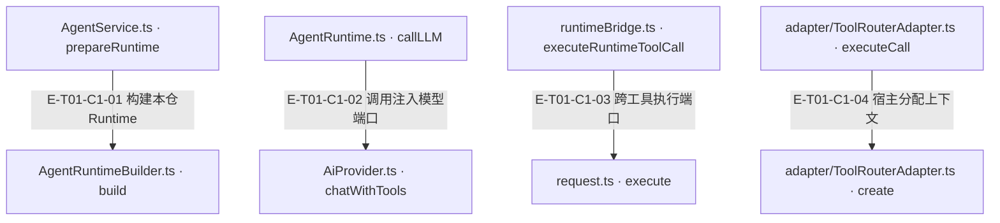
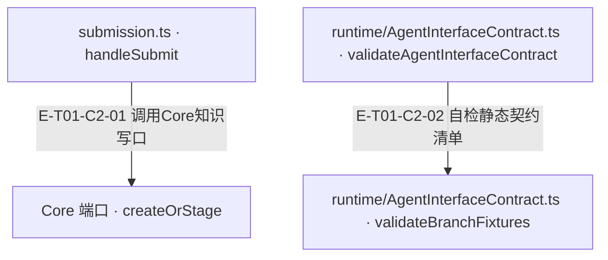

# 总体边界与公开入口 · 真实调用

包提供内部API-AI运行时与工具编排，不是CLI/daemon或Codex host-agent交付壳。15个显式exports提供facade与子路径；Agent持有模型调用、策略、预算、工具运行逻辑，Core通过公开包端口提供确定性知识/计划等能力，宿主注入provider、服务、资源位置与真实沙箱。静态manifest只是边界说明，不等于某能力已经执行。

[职责与边界](overview.md) · [直接依赖](file-dependency.md)

图中调用边经实现正文核对；AST只用于符号定位。接口／注入对象是调用端口，不据此推定所有宿主实现相同。测试表记录已定位的精确声明和断言边界；实际执行、展开后的参数化用例身份及当前输入一致性见页面证据。

## 调用接缝 1

### 本图术语说明

| 术语／节点 | 含义与范围 |
| --- | --- |
| AgentService.ts · prepareRuntime | `src/agent/service/AgentService.ts#AgentService.prepareRuntime`；声明或调用端口；动态实现的绑定条件见下表。 |
| AgentRuntimeBuilder.ts · build | `src/agent/service/AgentRuntimeBuilder.ts#AgentRuntimeBuilder.build`；声明或调用端口；动态实现的绑定条件见下表。 |
| AgentRuntime.ts · callLLM | `src/agent/runtime/AgentRuntime.ts#AgentRuntime.callLLM`；声明或调用端口；动态实现的绑定条件见下表。 |
| AiProvider.ts · chatWithTools | `src/ai/AiProvider.ts#AiProvider.chatWithTools`；声明或调用端口；动态实现的绑定条件见下表。 |
| runtimeBridge.ts · executeRuntimeToolCall | `src/agent/runtime/toolPipeline/runtimeBridge.ts#executeRuntimeToolCall`；声明或调用端口；动态实现的绑定条件见下表。 |
| request.ts · execute | `src/tools/kernel/request.ts#ToolRouterContract.execute`；声明或调用端口；动态实现的绑定条件见下表。 |
| adapter/ToolRouterAdapter.ts · executeCall | `src/tools/runtime/adapter/ToolRouterAdapter.ts#ToolRouterAdapter.executeCall`；声明或调用端口；动态实现的绑定条件见下表。 |
| adapter/ToolRouterAdapter.ts · create | `src/tools/runtime/adapter/ToolRouterAdapter.ts#ToolContextFactoryContract.create`；声明或调用端口；动态实现的绑定条件见下表。 |

| 编号 | 代码依据 | 测试依据 | 关系与可证明范围 |
| --- | --- | --- | --- |
| E-T01-C1-01 | `src/agent/service/AgentService.ts#AgentService.prepareRuntime` → `src/agent/service/AgentRuntimeBuilder.ts#AgentRuntimeBuilder.build` | `test/agent-lifecycle.test.ts#case:service%20compilation%20preserves%20explicit%20preset%20params%20at%20the%20real%20builder%20seam`；传 chat preset params={maxIterations:2,maxTokens:333}，Service使用真实Builder构建，再spy替换runtime.execute；断言真实runtime政策预算保留2/333。只覆盖编译/装配接缝，不覆盖该例中的模型或工具执行。断言已定位，实际执行见页面证据。 | Service的#prepareRuntime调用注入builder.build(compiledProfile, options)；默认Builder在本仓持有装配责任，不把host UI/daemon引入runtime。 装配：AgentService构造器注入AgentRuntimeBuilderLike；默认实现类由宿主选择。 |
| E-T01-C1-02 | `src/agent/runtime/AgentRuntime.ts#AgentRuntime.callLLM` → `src/ai/AiProvider.ts#AiProvider.chatWithTools` | `test/agent-lifecycle.test.ts#case:permits%20the%20first%20model%20call%20when%20the%20iteration%20budget%20is%20one`；harness使用真实Runtime+SingleStrategy，Builder为返回该runtime的替身，provider chat为vi.fn返回done；maxIterations=1，断言Service status=success、reply=done且provider只调用一次。断言已定位，实际执行见页面证据。 | 真正provider调用点传统一messages/tools/toolChoice/systemPrompt/temperature/maxTokens和abortSignal；Runtime不在此实现网络transport。 装配：aiProvider由Builder传入；测试为部分形状mock，不因此认定所有宿主都使用AiProvider类。 |
| E-T01-C1-03 | `src/agent/runtime/toolPipeline/runtimeBridge.ts#executeRuntimeToolCall` → `src/tools/kernel/request.ts#ToolRouterContract.execute` | `test/agent-lifecycle.test.ts#case:keeps%20confirmed%20tool%20receipts%20when%20cancellation%20interrupts%20a%20later%20model%20request`；第一次模型返回meta.tools调用，router spy返回observed:true成功信封；第二次模型挂起后runtime.abort，断言Service status=aborted仍保留meta回执/envelope.ok=true，router仅调用一次。真实Runtime/Single/Pipeline，Builder与Router为替身；不证明外部写入已回滚。断言已定位，实际执行见页面证据。 | buildRuntimeToolCallRequest把surface=runtime、allowedTools、scope、共享集合/记忆/证据端口投影为request；发起前检查abort后调用context.runtime.toolRouter.execute。 装配：合同执行端口；真实ToolRouterAdapter由Builder的toolRouter显式传入，或由Runtime从container.get("toolRouter")取得；toolRegistry只保留manifest查询，旧getRouter回退已删除。 |
| E-T01-C1-04 | `src/tools/runtime/adapter/ToolRouterAdapter.ts#ToolRouterAdapter.executeCall` → `src/tools/runtime/adapter/ToolRouterAdapter.ts#ToolContextFactoryContract.create` | `test/mining-e2e-pipeline.test.ts#case:%E5%81%A5%E5%BA%B7%E6%A8%A1%E5%9D%97%EF%BC%9Aanalyze(%E7%9C%9F%E5%8F%B0%E8%B4%A6)%E2%86%92note_finding(ledger-id)%E2%86%92%E8%B4%A8%E9%87%8F%E9%97%A8%E2%86%92produce%E2%86%92submit%20%E5%85%A8%E9%93%BE%E4%BA%A7%E5%87%BA%201%20%E6%9D%A1%20rule`；源码断言：脚本化 provider + 临时 fixture 仓，真实 Service/Compiler/Builder/Coordinator/PipelineStrategy/Runtime/Adapter/Router/handler，内存 fake gateway。created 长度为1，evidenceRefs≥3，child outcome=completed，lifecycle=pending且ready=false；不证明真实 provider 或 Core durable 写入。断言已定位，实际执行见页面证据。 | 解析与availability准入通过后才contextFactory.create(request)；宿主在这里注入Core服务、projectRoot、sandbox等，Adapter随后合并request.runtime与abortSignal。 装配：DI动态调用，to定位到本仓interface；实际宿主实现未在本子任务核对。 |

## 调用接缝 2

### 本图术语说明

| 术语／节点 | 含义与范围 |
| --- | --- |
| submission.ts · handleSubmit | `src/tools/runtime/handlers/knowledge/submission.ts#handleSubmit`；声明或调用端口；动态实现的绑定条件见下表。 |
| Core 端口 · createOrStage | `src/tools/runtime/handlers/knowledge/contracts.ts#RecipeGatewayLike`；声明或调用端口；动态实现的绑定条件见下表。 |
| runtime/AgentInterfaceContract.ts · validateAgentInterfaceContract | `src/agent/runtime/AgentInterfaceContract.ts#validateAgentInterfaceContract`；声明或调用端口；动态实现的绑定条件见下表。 |
| runtime/AgentInterfaceContract.ts · validateBranchFixtures | `src/agent/runtime/AgentInterfaceContract.ts#validateBranchFixtures`；声明或调用端口；动态实现的绑定条件见下表。 |

| 编号 | 代码依据 | 测试依据 | 关系与可证明范围 |
| --- | --- | --- | --- |
| E-T01-C2-01 | `src/tools/runtime/handlers/knowledge/submission.ts#handleSubmit` → `src/tools/runtime/handlers/knowledge/contracts.ts#RecipeGatewayLike` | `test/scan-run-production-integration.test.ts#case:projects%20the%20persisted%20pending%20Recipe%20through%20the%20real%20handler%20and%20Core%20gateway%20seam`；真实handleKnowledge/RecipeProductionGateway/SQLite repository，Runtime为替身；断言createOrStage/create/evaluateReadiness各一次、repository.findById读回同ID/pending、publish零调用。此测试只跨知识写口与投影，不跨真实模型循环。断言已定位，实际执行见页面证据。 | prepareSubmission通过且最后取消检查未命中才gateway.createOrStage；传单条effectiveItem与去重Set副本。Core口没有取消参数，已调用后等待真回执。 装配：ctx.recipeGateway由宿主注入；本仓合同是RecipeGatewayLike，不把Core内部实现画为Agent节点。 |
| E-T01-C2-02 | `src/agent/runtime/AgentInterfaceContract.ts#validateAgentInterfaceContract` → `src/agent/runtime/AgentInterfaceContract.ts#validateBranchFixtures` | `test/contract-surface.test.ts#case:covers%20every%20D1%20Agent-owned%20row%20and%20canonical%20result%20branch`；断言required rows/branches与validateAgentInterfaceContract()==[]；属于manifest一致性，不是permission/timeout/host真实运行验证。断言已定位，实际执行见页面证据。 | validate调用required coverage、branch fixtures、ordinary-output与failure-taxonomy四类检查；只检查静态清单，不能证明生产输出携带failureTaxonomy。 |

## 装配失败先于任何模型或工具请求

`src/agent/runtime/AgentRuntime.ts#AgentRuntime.constructor` 只接受显式 router 或容器同名服务；目录的 manifest 存储不再隐式提供执行器。`test/agent-runtime-tool-registry-port.test.ts#case:still%20resolves%20the%20router%20from%20the%20host%20container%20when%20no%20explicit%20router%20is%20passed` 断言容器分支仍可接线，`test/agent-runtime-tool-registry-port.test.ts#case:rejects%20a%20registry%20that%20only%20offers%20getRouter%20and%20never%20consults%20it` 断言旧目录分支不被调用。两者都是构造证据，不能替代工具副作用与释放验证。
