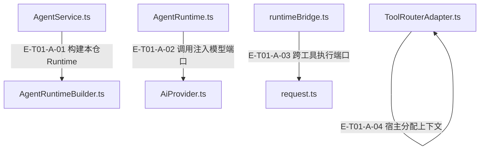

# 01 · 总体边界与公开入口

> Agent、Core、宿主和Plugin各自拥有什么；公开包出口如何接到真实运行？

包提供内部API-AI运行时与工具编排，不是CLI/daemon或Codex host-agent交付壳。15个显式exports提供facade与子路径；Agent持有模型调用、策略、预算、工具运行逻辑，Core通过公开包端口提供确定性知识/计划等能力，宿主注入provider、服务、资源位置与真实沙箱。静态manifest只是边界说明，不等于某能力已经执行。

[真实调用](call-flow.md) · [直接依赖](file-dependency.md) · [阅读规范](../00-diagram-standard.md)

## 职责与主要接缝

### 本图术语说明

| 术语／节点 | 含义与范围 |
| --- | --- |
| AgentService.ts | `src/agent/service/AgentService.ts`；本图按实现文件聚合职责；具体装配条件见下表。 |
| AgentRuntimeBuilder.ts | `src/agent/service/AgentRuntimeBuilder.ts`；本图按实现文件聚合职责；具体装配条件见下表。 |
| AgentRuntime.ts | `src/agent/runtime/AgentRuntime.ts`；本图按实现文件聚合职责；具体装配条件见下表。 |
| AiProvider.ts | `src/ai/AiProvider.ts`；本图按实现文件聚合职责；具体装配条件见下表。 |
| runtimeBridge.ts | `src/agent/runtime/toolPipeline/runtimeBridge.ts`；本图按实现文件聚合职责；具体装配条件见下表。 |
| request.ts | `src/tools/kernel/request.ts`；本图按实现文件聚合职责；具体装配条件见下表。 |
| ToolRouterAdapter.ts | `src/tools/runtime/adapter/ToolRouterAdapter.ts`；本图按实现文件聚合职责；具体装配条件见下表。 |

| 编号 | 代码依据 | 测试依据 | 关系与可证明范围 |
| --- | --- | --- | --- |
| E-T01-A-01 | `src/agent/service/AgentService.ts#AgentService.prepareRuntime` → `src/agent/service/AgentRuntimeBuilder.ts#AgentRuntimeBuilder.build` | `test/agent-lifecycle.test.ts#case:service%20compilation%20preserves%20explicit%20preset%20params%20at%20the%20real%20builder%20seam`；传 chat preset params={maxIterations:2,maxTokens:333}，Service使用真实Builder构建，再spy替换runtime.execute；断言真实runtime政策预算保留2/333。只覆盖编译/装配接缝，不覆盖该例中的模型或工具执行。断言已定位，实际执行见页面证据。 | Service的#prepareRuntime调用注入builder.build(compiledProfile, options)；默认Builder在本仓持有装配责任，不把host UI/daemon引入runtime。 装配：AgentService构造器注入AgentRuntimeBuilderLike；默认实现类由宿主选择。 |
| E-T01-A-02 | `src/agent/runtime/AgentRuntime.ts#AgentRuntime.callLLM` → `src/ai/AiProvider.ts#AiProvider.chatWithTools` | `test/agent-lifecycle.test.ts#case:permits%20the%20first%20model%20call%20when%20the%20iteration%20budget%20is%20one`；harness使用真实Runtime+SingleStrategy，Builder为返回该runtime的替身，provider chat为vi.fn返回done；maxIterations=1，断言Service status=success、reply=done且provider只调用一次。断言已定位，实际执行见页面证据。 | 真正provider调用点传统一messages/tools/toolChoice/systemPrompt/temperature/maxTokens和abortSignal；Runtime不在此实现网络transport。 装配：aiProvider由Builder传入；测试为部分形状mock，不因此认定所有宿主都使用AiProvider类。 |
| E-T01-A-03 | `src/agent/runtime/toolPipeline/runtimeBridge.ts#executeRuntimeToolCall` → `src/tools/kernel/request.ts#ToolRouterContract.execute` | `test/agent-lifecycle.test.ts#case:keeps%20confirmed%20tool%20receipts%20when%20cancellation%20interrupts%20a%20later%20model%20request`；第一次模型返回meta.tools调用，router spy返回observed:true成功信封；第二次模型挂起后runtime.abort，断言Service status=aborted仍保留meta回执/envelope.ok=true，router仅调用一次。真实Runtime/Single/Pipeline，Builder与Router为替身；不证明外部写入已回滚。断言已定位，实际执行见页面证据。 | buildRuntimeToolCallRequest把surface=runtime、allowedTools、scope、共享集合/记忆/证据端口投影为request；发起前检查abort后调用context.runtime.toolRouter.execute。 装配：合同执行端口；真实ToolRouterAdapter由Builder的toolRouter显式传入，或由Runtime从container.get("toolRouter")取得；toolRegistry只保留manifest查询，旧getRouter回退已删除。 |
| E-T01-A-04 | `src/tools/runtime/adapter/ToolRouterAdapter.ts#ToolRouterAdapter.executeCall` → `src/tools/runtime/adapter/ToolRouterAdapter.ts#ToolContextFactoryContract.create` | `test/mining-e2e-pipeline.test.ts#case:%E5%81%A5%E5%BA%B7%E6%A8%A1%E5%9D%97%EF%BC%9Aanalyze(%E7%9C%9F%E5%8F%B0%E8%B4%A6)%E2%86%92note_finding(ledger-id)%E2%86%92%E8%B4%A8%E9%87%8F%E9%97%A8%E2%86%92produce%E2%86%92submit%20%E5%85%A8%E9%93%BE%E4%BA%A7%E5%87%BA%201%20%E6%9D%A1%20rule`；源码断言：脚本化 provider + 临时 fixture 仓，真实 Service/Compiler/Builder/Coordinator/PipelineStrategy/Runtime/Adapter/Router/handler，内存 fake gateway。created 长度为1，evidenceRefs≥3，child outcome=completed，lifecycle=pending且ready=false；不证明真实 provider 或 Core durable 写入。断言已定位，实际执行见页面证据。 | 解析与availability准入通过后才contextFactory.create(request)；宿主在这里注入Core服务、projectRoot、sandbox等，Adapter随后合并request.runtime与abortSignal。 装配：DI动态调用，to定位到本仓interface；实际宿主实现未在本子任务核对。 |

## 输入、输出与副作用

| 维度 | 当前实现 |
| --- | --- |
| 输入 | AgentRunInput、宿主provider/router/contextFactory、Core公开服务端口；package exports/imports、layer-contract是结构约束输入，不能当调用证据 |
| 输出 | AgentRunResult与ToolResultEnvelope；静态边界/责任/接口manifest供读者与宿主查阅 |
| 副作用 | 模型网络与实际进程执行由注入端口触发；知识写入由Core port承担；Agent侧会分配运行/读取scope、记录诊断与证据；静态manifest自检不执行工具 |

## 从这些文件开始

| 文件 | 阅读目的 |
| --- | --- |
| `package.json` | ESM/Node>=22、15exports、#alias、dev Core本地链接、验证/发布/eval脚本 |
| `src/index.ts` | 显式聚合/兼容出口；转出本层已有实现，未创建第二条运行链。 |
| `src/agent/service/index.ts` | 显式聚合/兼容出口；转出本层已有实现，未创建第二条运行链。 |
| `src/agent/runtime/AgentRuntimeBoundary.ts` | Agent/Core/Host 所有权与不支持路由 |
| `src/agent/runtime/AgentRuntimeResponsibility.ts` | 职责 seam、词汇表和配置旗标声明 |
| `src/agent/runtime/AgentInterfaceContract.ts` | 冻结的分支/普通输出/失败分类 manifest |
| `src/tools/kernel/request.ts` | 外部 ToolCallRequest/ToolRouterContract |
| `src/tools/runtime/adapter/ToolRouterAdapter.ts` | ToolRouterContract 实现、context factory、稳定信封与 trust 派生 |
| `src/tools/runtime/handlers/knowledge/submission.ts` | 完整提交编排到 Core createOrStage 单入口 |
| `config/layer-contract.json` | agent→ai/tools/shared；tools/ai→shared的runtime DAG及文件级边界 |

## 失败、取消与恢复

- 支持线路：supportsAgentRuntimeRoute仅认可alembic-api-ai；plugin-host-agent-route等返回false。 依据 `test/contract-surface.test.ts#case:exposes%20the%20internal%20runtime%20boundary%20without%20owning%20Plugin%20host-agent%20routes`（仅定位与阅读）。
- 宿主未接线：Adapter可用性不通过时先给准入失败，不创建上下文；contextFactory.create/getAvailability抛错分别归tool_host_context_failed，不冒充handler失败。
- Core写入口取消：handleSubmit在prepareSubmission让出后再次检查取消；createOrStage一旦开始不能推出回滚，完成回执附取消后写入诊断。
- 兼容界面：冻结area id tool-v2只是标识；工具合同唯一位于kernel，不能恢复V1/V2双系统。 依据 `test/tool-system.test.ts#case:removes%20the%20V1%20core-contract%20shims%20and%20the%20runtime%20bridge%20from%20source`（仅定位与阅读）。

## 已知边界与未验证范围

- 未读取外部宿主具体DI及Plugin线路实现，因此不宣称某个HTTP、MCP、daemon入口已贯通。
- @alembic/core依赖声明为file:../AlembicCore；本子任务未固定Core当前commit。
- boundary与failure-taxonomy fixture不是运行时执行证明；ordinary failureTaxonomy默认生产调用点未显式附带。

## 接入与消费边界

[15个公开入口与宿主接线](public-api-and-hosts.md)解释精确包路径、资源注入和责任归属；[Agent的Core消费边界](core-consumption.md)按Agent源码索引外部facade，不复制Core内部架构。

## 当前装配与退役责任

目录、执行器和运行状态分别有明确所有者：`RuntimeConfig.toolRegistry` 只提供 manifest 查询；`capabilityCatalog` 才提供模型 schema 与有效动作集；`toolRouter` 必须显式传入或在宿主容器注册。只有旧 `getRouter` 的目录不能构造 Runtime，错误会给迁移方式且不调用它。依据 `src/agent/runtime/AgentRuntime.ts#AgentRuntime.constructor`、`src/agent/service/AgentRuntimeBuilder.ts#AgentRuntimeBuilder.build`，断言见 `test/agent-runtime-tool-registry-port.test.ts#case:rejects%20a%20registry%20that%20only%20offers%20getRouter%20and%20never%20consults%20it`。

`AgentState` 仍是公开类，Runtime 内部则持有私有 phase 并在结果中返回独立状态快照；不能把公开类的可订阅状态机画为Runtime必经节点。参见 `src/agent/runtime/AgentRuntime.ts#AgentRuntime.execute` 与 `src/agent/runtime/AgentState.ts#AgentState`。`FanOutStrategy` 运行时类已退役，任务扇出仍由 Coordinator 的计划执行，领域能力没有因此删除。Durable review 继续从 production 门面提供，evaluation只聚合独立reviewer与冻结证据投影。
