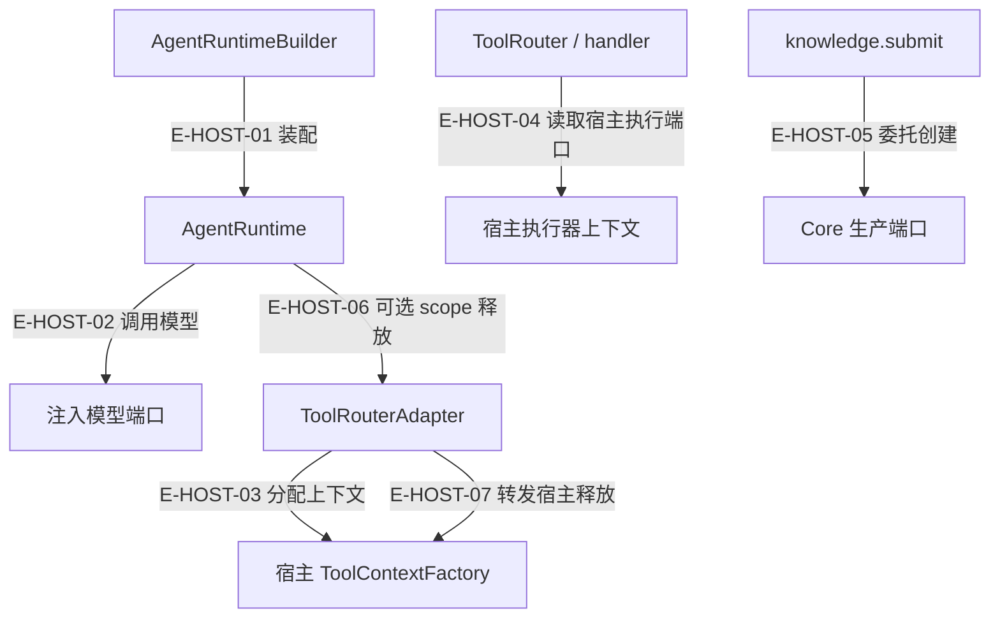

# 公开入口与宿主接线

这页沿“公开入口→必需端口→最小输入→结果判断→失败与释放责任”给出宿主接入路线。15 个精确出口来自 package exports 与原有 API 边界政策；源码路径按当前 TypeScript 的 rootDir/outDir 映射并核对存在。这里没有运行 dist 的公开导入 smoke，也不把冻结签名数量当作本轮执行验证。

[总体边界](overview.md) · [入口数据（阅读器内查看）](../../evidence/public-entrypoints.json) · [知识生产纵切](../13-end-to-end/knowledge-production.md)

## 15 个精确入口

| 消费路径 | 对应源码入口 | 用途 | 冻结 runtime 绑定数 |
| --- | --- | --- | --- |
| `@alembic/agent` | `src/index.ts` | 聚合门面与包身份 | 144 |
| `@alembic/agent/agent` | `src/agent/index.ts` | Agent 运行、策略与编排聚合 | 50 |
| `@alembic/agent/service` | `src/agent/service/index.ts` | 服务、Builder 与领域 helper | 17 |
| `@alembic/agent/runtime` | `src/agent/runtime/index.ts` | 循环、消息、预算与工具管线 | 58 |
| `@alembic/agent/prompts` | `src/agent/prompts/index.ts` | 提示构建和分析/生产模板 | 28 |
| `@alembic/agent/domain` | `src/agent/domain/index.ts` | 证据收集、会话经验固化 | 2 |
| `@alembic/agent/tasks` | `src/agent/tasks/index.ts` | 保留的兼容任务出口；须再核对实际工具 | 5 |
| `@alembic/agent/profiles` | `src/agent/profiles/index.ts` | 内置 profile、编译器与阶段工厂 | 7 |
| `@alembic/agent/ai` | `src/ai/index.ts` | Provider、网关、原生协议与模型管理 | 26 |
| `@alembic/agent/tools/runtime` | `src/tools/runtime/index.ts` | 唯一工具系统的实现和宿主合同 | 29 |
| `@alembic/agent/memory` | `src/agent/memory/index.ts` | 工作/会话/持久记忆及协调 | 13 |
| `@alembic/agent/context` | `src/agent/context/index.ts` | 历史、压缩、探索与计划跟踪 | 19 |
| `@alembic/agent/runs` | `src/runs.ts` | 精简严格 Plan 门面；不是六类 helper 全集 | 1 |
| `@alembic/agent/production` | `src/production.ts` | 严格生产与受信任证据/评审构造合同 | 13 |
| `@alembic/agent/evaluation` | `src/evaluation.ts` | 独立 reviewer 与冻结证据投影；durable 由 production 提供 | 3 |

绑定数来自 `config/agent-public-api-signatures.json` 的期望表，跨入口有重复再导出，不能相加当唯一 API 总数。类型导出也不包含在 runtime kind 计数中。原政策矩阵 `config/agent-public-api-boundary.json` 是分类单源；其中历史 “Tool V2” 文案不意味着本仓还有第二套工具合同。

特别注意：六类领域 helper 主要从 `src/agent/service/index.ts` 等聚合面暴露；`@alembic/agent/runs` 是精简的 strict Plan 门面。`@alembic/agent/tools`、`@alembic/agent/tools/terminal` 和 deep src/dist 子路径已经被政策拒绝，磁盘上有文件不等于公开入口。

## 一次接线必须交代的责任



### 本图术语说明

| 节点／术语 | 本图中的含义 |
| --- | --- |
| Builder/Runtime | Agent 拥有编排、预算和循环，不包含完整产品交付壳。 |
| 模型/执行器/Core端口 | 宿主注入的外部能力；普通依赖导入和实际执行是两类事实。 |
| ToolContextFactory | 具体资源与权限上下文的宿主分配点；可选 releaseScope 不等于事务回滚。 |

| 编号 | 代码依据 | 测试依据 | 关系与可证明范围 |
| --- | --- | --- | --- |
| E-HOST-01 | `src/agent/service/AgentRuntimeBuilder.ts#AgentRuntimeBuilder.build` → `src/agent/runtime/AgentRuntime.ts#AgentRuntime.constructor` | 间接覆盖：`alembic-agent-architecture-atlas/test/pilot.test.ts#case:success%3A%20receipt%20is%20returned%20to%20the%20second%20model%20turn%20and%20projected%20by%20Service`；已有真实 Builder/Runtime 组合样板。 | Builder 注入 provider、toolRouter、container、根路径；Agent 创建能力、策略与政策实例。宿主的 HTTP/CLI/MCP 入口不在此处实现。 |
| E-HOST-02 | `src/agent/runtime/AgentRuntime.ts#AgentRuntime.callLLM` → `src/ai/AiProvider.ts#AiProvider.chatWithTools` | 未覆盖：这里只核对当前实现与合同，不声明该分支已经执行。 | Runtime 调用注入的模型端口；内置 AiProvider 可走真实 gateway，测试可注入结构相容脚本。凭据获取与网络许可属于宿主配置边界。 |
| E-HOST-03 | `src/tools/runtime/adapter/ToolRouterAdapter.ts#ToolRouterAdapter.executeCall` → `src/tools/runtime/adapter/ToolRouterAdapter.ts#ToolContextFactoryContract.create` | 未覆盖：这里只核对当前实现与合同，不声明该分支已经执行。 | 解析和初次准入通过后才分配 ToolContext；create 提供 projectRoot、Core 服务、sandbox 等实际资源，不能从 interface 存在推断已接线。 |
| E-HOST-04 | `src/tools/runtime/router.ts#ToolRouter.execute` → `src/tools/kernel/registry.ts#ToolContext.sandboxExecutor` | 未覆盖：这里只核对当前实现与合同，不声明该分支已经执行。 | Router 最终选择 handler；terminal handler 通过 context 的执行器端口触发宿主能力。箭头表达上下文依赖，不是 Router 直接执行 shell，也不证明 OS 隔离。 |
| E-HOST-05 | `src/tools/runtime/handlers/knowledge/submission.ts#handleSubmit` → `src/tools/runtime/handlers/knowledge/contracts.ts#RecipeGatewayLike` | 间接覆盖：`test/mining-e2e-pipeline.test.ts#case:%E5%81%A5%E5%BA%B7%E6%A8%A1%E5%9D%97%EF%BC%9Aanalyze(%E7%9C%9F%E5%8F%B0%E8%B4%A6)%E2%86%92note_finding(ledger-id)%E2%86%92%E8%B4%A8%E9%87%8F%E9%97%A8%E2%86%92produce%E2%86%92submit%20%E5%85%A8%E9%93%BE%E4%BA%A7%E5%87%BA%201%20%E6%9D%A1%20rule`；断言已定位，实际执行见页面证据；真实 Agent 组合、脚本模型与内存 gateway。不是对每个内部函数的独立 spy 断言。 | Agent 负责准备、引用校验、取消检查及结果解释；持久化通过 createOrStage 注入端口。知识挖掘样板的端口是内存 fake，Core 内部由 Core 窗口负责。 |
| E-HOST-06 | `src/agent/runtime/AgentRuntime.ts#AgentRuntime.releaseToolScope` → `src/tools/runtime/adapter/ToolRouterAdapter.ts#ToolRouterAdapter.releaseScope` | 未覆盖：这里只核对当前实现与合同，不声明该分支已经执行。 | Runtime在finally等待router.releaseScope；读取view和完整run分别释放。失败只诊断不反转已确认结果；不合作的释放Promise仍可能拖延最终返回，宿主需要自己管理释放期限。 |
| E-HOST-07 | `src/tools/runtime/adapter/ToolRouterAdapter.ts#ToolRouterAdapter.releaseScope` → `src/tools/runtime/adapter/ToolRouterAdapter.ts#ToolContextFactoryContract.releaseScope` | `test/tool-resource-scope.test.ts#case:reports%20cleanup%20errors%20without%20replacing%20the%20completed%20result`；断言已定位，实际执行见页面证据。 | Adapter转发可选宿主释放端口；缺端口不等于真实资源已回收，资源所有者必须提供实现。 |

## 接入排障顺序

1. 先核对公开出口与正确 profile，不使用深层 src/dist 路径绕开合同。
2. 核对 capabilityCatalog：缺它会令模型看不见工具，诊断为 tool_schema_projection_empty。
3. 核对 toolRouter 与 contextFactory：schema 可见、权限允许、宿主可用、handler 执行是不同门。
4. 核对 scope/ledger/sharedState：多维度不能依赖隐式 scope，生产前必须能回读真实引用。
5. 最后检查回执的业务字段、执行状态、readiness 与发布状态。Controller 或 UI 文本不能替代已确认写口回执。

`src/tools/runtime/adapter/RuntimeCapabilityCatalog.ts`、`src/tools/kernel/request.ts`、`src/agent/service/AgentRunContracts.ts` 是接入时应一起核对的合同。

## 路线一：受控的一次工具回合

| 步骤 | 入口与最小输入 | 结果／失败判断 | 所有者与恢复责任 |
| --- | --- | --- | --- |
| 1. 选入口 | 从 `@alembic/agent/service` 取得 AgentService/AgentRuntimeBuilder；从 `@alembic/agent/tools/runtime` 取得 RuntimeCapabilityCatalog/ToolRouterAdapter。 | 不使用已退役的tools聚合/terminal子路径或深导入。 | 宿主选择入口并保证包解析指向期望版本。 |
| 2. 绑定模型 | Builder接收有name/model/chatWithTools的模型端口；真实Provider从ai门面创建，测试可用脚本替身。 | 只实现chat的AiProvider子类在调用时PROVIDER_CONTRACT_VIOLATION，Runtime按runtime_defect停止，不当作临时网络错误。 | 宿主修复Provider集成；Agent不替宿主取得凭据。 |
| 3. 绑定目录 | 容器的capabilityCatalog提供querySchemas；RuntimeCapabilityCatalog从注册表与接线事实投影。toolRegistry仅manifest查询。 | schema可见性、有效动作集、业务执行是三层；空schema有tool_schema_projection_empty。 | 宿主使目录与执行上下文使用同一接线事实；目录不能授予超出阶段的权限。 |
| 4. 绑定执行 | 显式toolRouter，或容器toolRouter；Adapter的contextFactory.create提供projectRoot/tokenBudget，并传入request.runtime/abortSignal及动作所需端口。 | 缺router构造失败；静态准入不通过不分配context；排队后仍重检可用性。 | 宿主提供执行资源，Agent负责动作/参数/权限/结果合同。 |
| 5. 提交请求 | profile + message.content + context.source；将abortSignal/timeoutMs放execution。code.read路径先在临时项目中准备。 | AgentRunResult含status/reply/toolCalls/usage/diagnostics；回执status是每次工具实际结局，不能用最终reply替代。 | 调用方保存真实回执并按业务字段判断；取消不撤销已完成工具。 |
| 6. 结束与释放 | contextFactory.releaseScope按runId/viewId回收宿主缓存与资源；run关闭后不借旧view继续读取。 | 清理抛错只warn，已完成结果保留；挂起释放可能延迟返回。 | 宿主实现幂等释放与自有期限；Agent只请求释放，不承诺底层事务回滚。 |

最小请求形状可沿 `alembic-agent-architecture-atlas/test/pilot.test.ts` 的真实装配读取；以下只展示合同，不启动产品运行：

```ts
const input = {
  profile: {
    basePreset: 'chat',
    skills: [],
    strategy: { type: 'single' },
    actionSpace: { mode: 'listed', toolIds: ['code'] },
    params: { maxIterations: 4 },
  },
  message: { content: '读取 sample.ts 并确认工具结果。' },
  context: { source: 'http-chat' },
  execution: { timeoutMs: 3000 },
};
// await service.run(input)：模型、目录、router、根路径必须先由宿主绑定。
```

合同位置：`src/agent/service/AgentRunContracts.ts#AgentRunInput`、`src/tools/runtime/adapter/ToolRouterAdapter.ts#ToolContextFactoryContract`、`src/tools/kernel/request.ts#ToolRouterContract`。`message.replyFn` 已退役；流式进度由受控的onProgress回调接收，最终reply由宿主发送。`presentation.responseShape` 目前是描述字段，不改变Service返回形状；`memory.enabled=false`同样不关闭运行上下文中的记忆注入。

## 路线二：增加具体能力时补哪些端口

| 能力 | 宿主必须提供的端口 | 最小可观察结果 | 失败与副作用边界 |
| --- | --- | --- | --- |
| code.read / code.outline | 受控projectRoot；outlineFile只在要AST大纲时必需。 | read区分full/range/outline/head-tail；outline过滤会说明显示数量。 | 缺outlineFile时outline不可用，大文件read可降头尾预览；已停读astAnalyzer。 |
| graph.query | 按GRAPH_QUERY_HOST_READERS提供对应唯一方法。 | 七种type：class/protocol/hierarchy/callers/callees/impact/search。 | 主方法缺失不可用，空结果不试旧备用方法；取消只结束等待。 |
| terminal.exec | sandboxExecutor.exec；无执行器仅字面true的受信许可可开plain exec。 | envelope.status + stdout/stderr + sandbox/intent诊断。 | Agent传意图，OS隔离由宿主兑现；部分结果或超时不能推出零写入。 |
| knowledge.prime | searchEngine.search；完整知识条款还需knowledgeRead.getById。 | knowledge条款或明确search-only降级。 | knowledgeRepo-only拒绝；两reader均缺可降级；detail仍有自己的兼容回落。 |
| knowledge.submit | recipeGateway.createOrStage及后置readiness能力，运行ledger/scope/shared counters。 | confirmed ID、lifecycle与readiness分开判断。 | 创建后的readiness失败保留ID，不盲重试；pending不等于published。 |
| durable review | 从production门面创建，注入受信ledger、签名密钥与witness权威。 | 绑定输入的durable attestation。 | evaluation门面的独立reviewer不提供相同权威；无注入权威不凭构造类型推断通过。 |

上述端口定位于 `src/tools/kernel/registry.ts#ToolContext`、`src/tools/kernel/registry.ts#GRAPH_QUERY_HOST_READERS`、`src/tools/runtime/handlers/knowledge/queries.ts#handlePrime`、`src/production.ts`。精确失败断言：`test/agent-runtime-provider-contract-defect.test.ts#case:rejects%20with%20code%20PROVIDER_CONTRACT_VIOLATION%20and%20keeps%20the%20must-override%20message`；`test/code-outline-port.test.ts#case:no%20longer%20serves%20the%20retired%20astAnalyzer%20duck%20type`；`test/tool-runtime-legacy-host-compat.test.ts#case:returns%20a%20primary%20empty%20result%20as%20no%20results%20instead%20of%20looking%20for%20another%20reader`；`test/tool-runtime-legacy-host-compat.test.ts#case:refuses%20prime%20on%20a%20knowledgeRepo-only%20host%20without%20reading%20the%20repository`。断言已定位，实际执行见页面证据。
