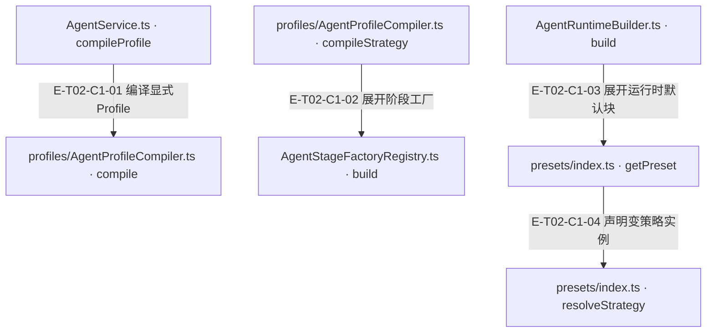
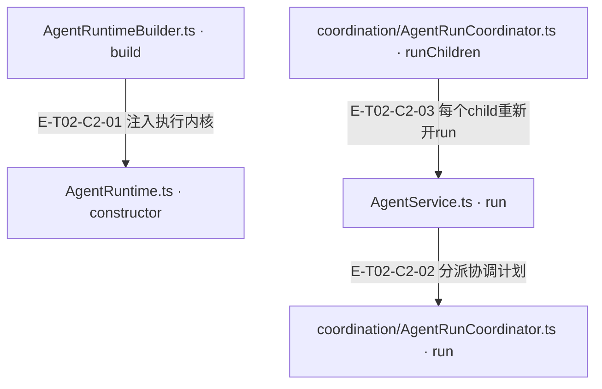

# 服务装配与编排 · 真实调用

Service校验与编译输入后按concurrency分流：协调profile经partitioner产生child并递归Service.run，每child独立Builder/Runtime；普通profile用preset展开capability、single或pipeline策略和policy后执行。跨维度／模块扇出归Coordinator；旧同Runtime的FanOutStrategy及fan_out运行时词汇已退役。子运行结果、父聚合结果和取消事实分别保留。

[职责与边界](overview.md) · [直接依赖](file-dependency.md)

图中调用边经实现正文核对；AST只用于符号定位。接口／注入对象是调用端口，不据此推定所有宿主实现相同。测试表区分精确断言与执行状态；是否运行及其输入指纹见页面证据。

## 调用接缝 1

### 本图术语说明

| 术语／节点 | 含义与范围 |
| --- | --- |
| AgentService.ts · compileProfile | `src/agent/service/AgentService.ts#AgentService.compileProfile`；声明或调用端口；动态实现的绑定条件见下表。 |
| profiles/AgentProfileCompiler.ts · compile | `src/agent/profiles/AgentProfileCompiler.ts#AgentProfileCompiler.compile`；声明或调用端口；动态实现的绑定条件见下表。 |
| profiles/AgentProfileCompiler.ts · compileStrategy | `src/agent/profiles/AgentProfileCompiler.ts#compileStrategy`；声明或调用端口；动态实现的绑定条件见下表。 |
| AgentStageFactoryRegistry.ts · build | `src/agent/profiles/AgentStageFactoryRegistry.ts#AgentStageFactoryRegistry.build`；声明或调用端口；动态实现的绑定条件见下表。 |
| AgentRuntimeBuilder.ts · build | `src/agent/service/AgentRuntimeBuilder.ts#AgentRuntimeBuilder.build`；声明或调用端口；动态实现的绑定条件见下表。 |
| presets/index.ts · getPreset | `src/agent/profiles/presets/index.ts#getPreset`；声明或调用端口；动态实现的绑定条件见下表。 |
| presets/index.ts · resolveStrategy | `src/agent/profiles/presets/index.ts#resolveStrategy`；声明或调用端口；动态实现的绑定条件见下表。 |

| 编号 | 代码依据 | 测试依据 | 关系与可证明范围 |
| --- | --- | --- | --- |
| E-T02-C1-01 | `src/agent/service/AgentService.ts#AgentService.compileProfile` → `src/agent/profiles/AgentProfileCompiler.ts#AgentProfileCompiler.compile` | `test/agent-lifecycle.test.ts#case:service%20compilation%20preserves%20explicit%20preset%20params%20at%20the%20real%20builder%20seam`；传 chat preset params={maxIterations:2,maxTokens:333}，Service使用真实Builder构建，再spy替换runtime.execute；断言真实runtime政策预算保留2/333。只覆盖编译/装配接缝，不覆盖该例中的模型或工具执行。断言已定位，实际执行见页面证据。 | run在start日志与Runtime开工前编译profile，传params/context；未知id失败向上reject，不能静默换preset。 |
| E-T02-C1-02 | `src/agent/profiles/AgentProfileCompiler.ts#compileStrategy` → `src/agent/profiles/AgentStageFactoryRegistry.ts#AgentStageFactoryRegistry.build` | `test/mining-e2e-pipeline.test.ts#case:%E5%81%A5%E5%BA%B7%E6%A8%A1%E5%9D%97%EF%BC%9Aanalyze(%E7%9C%9F%E5%8F%B0%E8%B4%A6)%E2%86%92note_finding(ledger-id)%E2%86%92%E8%B4%A8%E9%87%8F%E9%97%A8%E2%86%92produce%E2%86%92submit%20%E5%85%A8%E9%93%BE%E4%BA%A7%E5%87%BA%201%20%E6%9D%A1%20rule`；源码断言：脚本化 provider + 临时 fixture 仓，真实 Service/Compiler/Builder/Coordinator/PipelineStrategy/Runtime/Adapter/Router/handler，内存 fake gateway。created 长度为1，evidenceRefs≥3，child outcome=completed，lifecycle=pending且ready=false；不证明真实 provider 或 Core durable 写入。断言已定位，实际执行见页面证据。 | pipeline模板将factory名称与params/context交给registry.build，返回stage数组；fanout模板自身返回undefined，执行权由concurrency计划承担。 |
| E-T02-C1-03 | `src/agent/service/AgentRuntimeBuilder.ts#AgentRuntimeBuilder.build` → `src/agent/profiles/presets/index.ts#getPreset` | `test/agent-lifecycle.test.ts#case:direct%20runtime%20builder%20preserves%20preset%20parameter%20overrides`；真实Builder直接接受chat preset参数2/333/0.1/4567，断言runtime.policies.getBudget逐项保留。只验证装配，无模型调用。断言已定位，实际执行见页面证据。 | Builder将compiled.basePreset及runtimeOverrides交给getPreset；每次build重新创建capabilities和PolicyEngine。 |
| E-T02-C1-04 | `src/agent/profiles/presets/index.ts#getPreset` → `src/agent/profiles/presets/index.ts#resolveStrategy` | `test/agent-runtime-internal-cleanup.test.ts#case:deletes%20FanOutStrategy%20and%20rejects%20the%20fan_out%20runtime%20vocabulary%20at%20build%20time`；断言已定位，实际执行见页面证据。FanOutStrategy 文件不存在；resolveStrategy/getPreset fan_out 抛错；single/pipeline/default single 保留。 边界：源码与实例构造检查。 | 仅single/pipeline创建策略；未知词汇失败。fanout声明模板在compiler消去，由concurrency计划接管。 |

## 调用接缝 2

### 本图术语说明

| 术语／节点 | 含义与范围 |
| --- | --- |
| AgentRuntimeBuilder.ts · build | `src/agent/service/AgentRuntimeBuilder.ts#AgentRuntimeBuilder.build`；声明或调用端口；动态实现的绑定条件见下表。 |
| AgentRuntime.ts · constructor | `src/agent/runtime/AgentRuntime.ts#AgentRuntime.constructor`；声明或调用端口；动态实现的绑定条件见下表。 |
| AgentService.ts · run | `src/agent/service/AgentService.ts#AgentService.run`；声明或调用端口；动态实现的绑定条件见下表。 |
| coordination/AgentRunCoordinator.ts · run | `src/agent/coordination/AgentRunCoordinator.ts#AgentRunCoordinator.run`；声明或调用端口；动态实现的绑定条件见下表。 |
| coordination/AgentRunCoordinator.ts · runChildren | `src/agent/coordination/AgentRunCoordinator.ts#runChildren`；声明或调用端口；动态实现的绑定条件见下表。 |

| 编号 | 代码依据 | 测试依据 | 关系与可证明范围 |
| --- | --- | --- | --- |
| E-T02-C2-01 | `src/agent/service/AgentRuntimeBuilder.ts#AgentRuntimeBuilder.build` → `src/agent/runtime/AgentRuntime.ts#AgentRuntime.constructor` | `test/mining-e2e-pipeline.test.ts#case:%E5%81%A5%E5%BA%B7%E6%A8%A1%E5%9D%97%EF%BC%9Aanalyze(%E7%9C%9F%E5%8F%B0%E8%B4%A6)%E2%86%92note_finding(ledger-id)%E2%86%92%E8%B4%A8%E9%87%8F%E9%97%A8%E2%86%92produce%E2%86%92submit%20%E5%85%A8%E9%93%BE%E4%BA%A7%E5%87%BA%201%20%E6%9D%A1%20rule`；源码断言：脚本化 provider + 临时 fixture 仓，真实 Service/Compiler/Builder/Coordinator/PipelineStrategy/Runtime/Adapter/Router/handler，内存 fake gateway。created 长度为1，evidenceRefs≥3，child outcome=completed，lifecycle=pending且ready=false；不证明真实 provider 或 Core durable 写入。断言已定位，实际执行见页面证据。 | new AgentRuntime接收provider、显式toolRouter或Runtime容器中的toolRouter服务、capabilities、preset.strategyInstance、PolicyEngine、root路径与观察回调。 |
| E-T02-C2-02 | `src/agent/service/AgentService.ts#AgentService.run` → `src/agent/coordination/AgentRunCoordinator.ts#AgentRunCoordinator.run` | `test/agent-lifecycle.test.ts#case:a%20coordinator%20that%20returns%20no%20result%20for%20a%20coordinatable%20profile%20rejects%20without%20building%20a%20runtime`；注入违反合同的coordinator返回null，断言Service reject且Builder不调用；只证明守卫，不替代真实partitioner运行。断言已定位，实际执行见页面证据。 | canCoordinate只检查concurrency存在且mode!=none；协调run返回空值会明确reject，不再fallback到父消息单runtime。 |
| E-T02-C2-03 | `src/agent/coordination/AgentRunCoordinator.ts#runChildren` → `src/agent/service/AgentService.ts#AgentService.run` | `test/module-mining-agent-run.test.ts#case:fans%20out%20one%20child%20per%20ProjectContext%20module%20without%20dimension%20cross-talk`；3个ProjectContext modules进入真实Service/Coordinator，Builder执行替身记录3次module-mining-dimension；断言父moduleResults各自ID、无dimension串值，budget只在prompt context且无budgetOverride。断言已定位，实际执行见页面证据。 | runChildren的settleChild在停止检查与lazy context解析后调用runChild(createDispatchInput(childInput))；Service绑定回调childInput=>this.run(childInput)。 装配：runChild为DI回调；绑定点AgentService构造协调器回调，不能从import推导。 |

历史边 E-T02-C2-04 已撤回：它原先表示退役的同Runtime item策略委托。编号不复用，旧图保留在v4快照；当前跨维度链继续由 E-T02-C2-02/03 表达。
