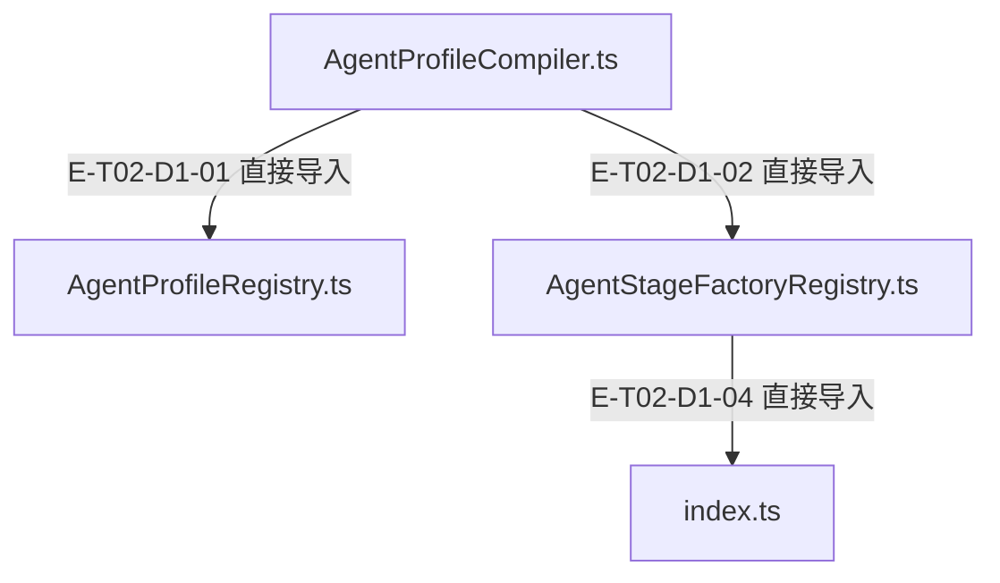
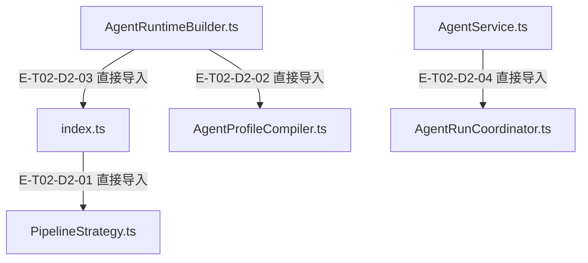

# 服务装配与编排 · 精选直接依赖

[职责与边界](overview.md) · [真实调用](call-flow.md)

选取本专题入口的最多8条直接依赖；完整库存可在阅读器「文件与依赖」查看。以仓库全路径为节点身份，同名文件不会合并。Core／Node／第三方包只在完整探索器的外部边界出现。

## 静态依赖 1

### 本图术语说明

| 术语／节点 | 含义与范围 |
| --- | --- |
| AgentProfileCompiler.ts | `src/agent/profiles/AgentProfileCompiler.ts`；文件直接依赖，箭头不表示执行先后。 |
| AgentProfileRegistry.ts | `src/agent/profiles/AgentProfileRegistry.ts`；文件直接依赖，箭头不表示执行先后。 |
| AgentStageFactoryRegistry.ts | `src/agent/profiles/AgentStageFactoryRegistry.ts`；文件直接依赖，箭头不表示执行先后。 |
| index.ts | `src/agent/profiles/presets/index.ts`；文件直接依赖，箭头不表示执行先后。 |

| 编号 | 代码依据 | 测试依据 | 关系与可证明范围 |
| --- | --- | --- | --- |
| E-T02-D1-01 | `src/agent/profiles/AgentProfileCompiler.ts` → `src/agent/profiles/AgentProfileRegistry.ts` | 未覆盖：静态依赖由本图谱解析器反例测试支持；不把 import 当作行为覆盖。 | TypeScript AST 解析 ./AgentProfileRegistry.js；第 13 行，kind=import，typeOnly=false。只证明结构关系。 |
| E-T02-D1-02 | `src/agent/profiles/AgentProfileCompiler.ts` → `src/agent/profiles/AgentStageFactoryRegistry.ts` | 未覆盖：静态依赖由本图谱解析器反例测试支持；不把 import 当作行为覆盖。 | TypeScript AST 解析 ./AgentStageFactoryRegistry.js；第 14 行，kind=import，typeOnly=false。只证明结构关系。 |
| E-T02-D1-04 | `src/agent/profiles/AgentStageFactoryRegistry.ts` → `src/agent/profiles/presets/index.ts` | 未覆盖：静态依赖由本图谱解析器反例测试支持；不把 import 当作行为覆盖。 | TypeScript AST 解析 ../profiles/presets/index.js；第 15 行，kind=import，typeOnly=false。只证明结构关系。 |

## 静态依赖 2

### 本图术语说明

| 术语／节点 | 含义与范围 |
| --- | --- |
| index.ts | `src/agent/profiles/presets/index.ts`；文件直接依赖，箭头不表示执行先后。 |
| PipelineStrategy.ts | `src/agent/strategies/PipelineStrategy.ts`；文件直接依赖，箭头不表示执行先后。 |
| AgentRuntimeBuilder.ts | `src/agent/service/AgentRuntimeBuilder.ts`；文件直接依赖，箭头不表示执行先后。 |
| AgentProfileCompiler.ts | `src/agent/profiles/AgentProfileCompiler.ts`；文件直接依赖，箭头不表示执行先后。 |
| AgentService.ts | `src/agent/service/AgentService.ts`；文件直接依赖，箭头不表示执行先后。 |
| AgentRunCoordinator.ts | `src/agent/coordination/AgentRunCoordinator.ts`；文件直接依赖，箭头不表示执行先后。 |

| 编号 | 代码依据 | 测试依据 | 关系与可证明范围 |
| --- | --- | --- | --- |
| E-T02-D2-01 | `src/agent/profiles/presets/index.ts` → `src/agent/strategies/PipelineStrategy.ts` | 未覆盖：静态依赖由本图谱解析器反例测试支持；不把 import 当作行为覆盖。 | TypeScript AST 解析 ../../strategies/PipelineStrategy.js；第 14 行，kind=import，typeOnly=false。只证明结构关系。 |
| E-T02-D2-02 | `src/agent/service/AgentRuntimeBuilder.ts` → `src/agent/profiles/AgentProfileCompiler.ts` | 未覆盖：静态依赖由本图谱解析器反例测试支持；不把 import 当作行为覆盖。 | TypeScript AST 解析 ../profiles/AgentProfileCompiler.js；第 6 行，kind=import，typeOnly=false。只证明结构关系。 |
| E-T02-D2-03 | `src/agent/service/AgentRuntimeBuilder.ts` → `src/agent/profiles/presets/index.ts` | 未覆盖：静态依赖由本图谱解析器反例测试支持；不把 import 当作行为覆盖。 | TypeScript AST 解析 ../profiles/presets/index.js；第 10 行，kind=import，typeOnly=false。只证明结构关系。 |
| E-T02-D2-04 | `src/agent/service/AgentService.ts` → `src/agent/coordination/AgentRunCoordinator.ts` | 未覆盖：静态依赖由本图谱解析器反例测试支持；不把 import 当作行为覆盖。 | TypeScript AST 解析 ../coordination/AgentRunCoordinator.js；第 5 行，kind=import，typeOnly=false。只证明结构关系。 |

历史边 E-T02-D1-03 已撤回：Compiler不再导入PRESETS执行id-as-preset回退。工厂和Builder的preset依赖仍保留，各边ID不变。
