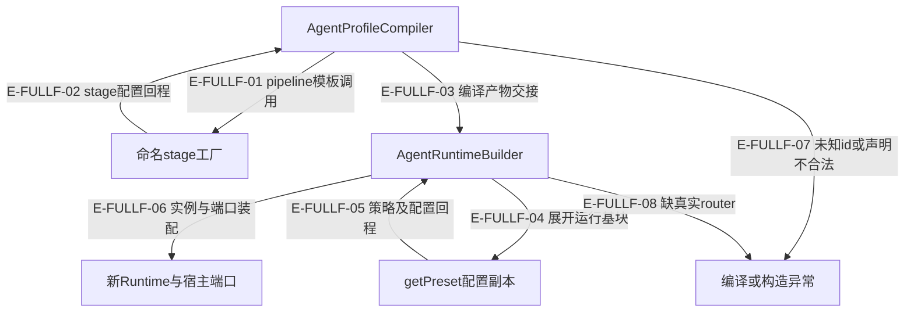

# Profile与宿主装配：当前全文审阅

沿声明→编译→阶段工厂→运行基块→Builder读到真实接线。描述字段、额外工具列表、运行级策略、每轮schema和实际执行准入不是同一个开关。

本页完整重读 11 个源文件、1890 个库存行，不再沿用“只看差异”的深度。段落范围含末尾换行产生的空行。全文阅读不等于分支覆盖，未定位的故障注入明确保留；本轮仅更新 Atlas。全体53文件的逐段、分支和断言身份见[结构化复核记录](../../evidence/reviews/source-full-v6.json)。

## 从声明到可运行对象

### 本图术语说明

| 节点 | 约束 |
| --- | --- |
| 编译器 | 注册声明与override不同；compiled标记不是外部schema验证器。 |
| Builder | 每build新建能力和Runtime；注入的服务/Policy实例不因此深克隆。 |
| actionSpace | listed只投影额外工具；none不等于关闭preset/capability工具。 |

| 编号 | 代码依据 | 测试依据 | 关系与限制 |
| --- | --- | --- | --- |
| E-FULLF-01 | `src/agent/profiles/AgentProfileCompiler.ts#compileStrategy` → `src/agent/profiles/AgentStageFactoryRegistry.ts#AgentStageFactoryRegistry.build` | `test/agent-surface-floor.test.ts#case:compiles%20definitions%20through%20stage%20factories%2C%20policies%2C%20and%20action-space%20projections`；命名factory使用params，additionalTools投影且budget实例真实。 边界：真实编译器/注册表，受控factory，无模型。。实际执行与输入匹配见本页证据。 | 调用；factory的业务含义由明确注册决定。 |
| E-FULLF-02 | `src/agent/profiles/AgentStageFactoryRegistry.ts#AgentStageFactoryRegistry.build` → `src/agent/profiles/AgentProfileCompiler.ts#compileStrategy` | `test/agent-surface-floor.test.ts#case:isolates%20mutable%20stage%20budgets%20and%20gates%20across%20factory%20calls`；改首次gate.maxRetries不改变下一次factory产物。 边界：真实工厂，未执行阶段。。实际执行与输入匹配见本页证据。 | 配置回程；只复制普通数据容器，函数/实例保持身份。 |
| E-FULLF-03 | `src/agent/profiles/AgentProfileCompiler.ts#AgentProfileCompiler.compile` → `src/agent/service/AgentRuntimeBuilder.ts#AgentRuntimeBuilder.build` | 间接覆盖：`test/agent-lifecycle.test.ts#case:direct%20runtime%20builder%20preserves%20preset%20parameter%20overrides`；真实Builder预算getBudget得到显式轮数/tokens/温度/超时。 边界：运行未开始。。实际执行与输入匹配见本页证据。 | 数据交接；可由Service提前compile或Builder懒compile。 |
| E-FULLF-04 | `src/agent/service/AgentRuntimeBuilder.ts#AgentRuntimeBuilder.build` → `src/agent/profiles/presets/index.ts#getPreset` | 间接覆盖：`test/agent-lifecycle.test.ts#case:direct%20runtime%20builder%20preserves%20preset%20parameter%20overrides`；真实Builder预算getBudget得到显式轮数/tokens/温度/超时。 边界：运行未开始。。实际执行与输入匹配见本页证据。 | 调用；不是复制整套宿主资源。 |
| E-FULLF-05 | `src/agent/profiles/presets/index.ts#getPreset` → `src/agent/service/AgentRuntimeBuilder.ts#AgentRuntimeBuilder.build` | 间接覆盖：`test/agent-surface-floor.test.ts#case:owns%20the%20preset%20runtime%20configuration%20while%20retaining%20function%20and%20policy%20ports`；修改getPreset能力数组不污染后续；policy工厂函数保持引用。 边界：只验证普通配置复制与函数身份，非任意深隔离。。实际执行与输入匹配见本页证据。 | 配置回程，后续capability/policy factory同步构造可失败。 |
| E-FULLF-06 | `src/agent/service/AgentRuntimeBuilder.ts#AgentRuntimeBuilder.build` → `src/agent/runtime/AgentRuntime.ts#AgentRuntime.constructor` | `test/agent-runtime-tool-registry-port.test.ts#case:accepts%20the%20production%20RuntimeCapabilityCatalog%20as%20the%20registry%20port%20through%20the%20builder`；真实Builder保留显式router/catalog身份。 边界：受控provider和router，没有实际工具轮。。实际执行与输入匹配见本页证据。 | 构造；目录和router分离，provider尚未被探活。 |
| E-FULLF-07 | `src/agent/profiles/AgentProfileCompiler.ts#AgentProfileCompiler.compileRef` | `test/agent-surface-floor.test.ts#case:does%20not%20silently%20swap%20an%20unknown%20explicit%20id%20for%20the%20preset`；拼错显式id即抛错，不回落给定insight。 边界：编译期入口。。实际执行与输入匹配见本页证据。 | 失败分支，不尝试把拼错id当preset。 |
| E-FULLF-08 | `src/agent/service/AgentRuntimeBuilder.ts#AgentRuntimeBuilder.build` → `src/agent/runtime/AgentRuntime.ts#AgentRuntime.constructor` | `test/agent-runtime-tool-registry-port.test.ts#case:fails%20the%20builder%20at%20build%20time%20when%20the%20router%20only%20lives%20on%20the%20registry`；Builder.build抛requires ToolRouter且不调用getRouter。 边界：构造期；模型零执行。。实际执行与输入匹配见本页证据。 | 构造失败；没有目录getRouter兜底。 |

## AgentProfileCompiler.ts

`src/agent/profiles/AgentProfileCompiler.ts` · 520 库存行（末尾空行计入）；本轮全文读取，声明引用/override到运行装配配置的编译器。

行为链：可信compiled标记直返；id/preset/override分流；stage factory+policy+action space+concurrency输出。

| 连续区间 | 逐段解释 |
| --- | --- |
| 1–48 | compiled标记只做kind辨识即按引用直返；否则basePreset优先override。 |
| 49–82 | 显式id必须命中，preset不能救拼错id；只有preset可查同名定义再回裸preset。 |
| 83–134 | override整块policy/strategy替换，persona/memory后续浅合并；裸preset仅白名单预算params。 |
| 135–180 | 声明默认params→fanout校验→警告→actionSpace→工厂/策略→policy→运行覆盖；元数据不控制执行。 |
| 181–257 | pipeline模板构建阶段、single模板转换、fanout标记消去并要求完整可执行计划。 |
| 258–318 | 模板余字段仅告警忽略；policy只接受实例/工厂/budget/safety，否则按index拒。 |
| 319–370 | 总token旧字段与input口径警告合并一次；只记录、不改配置或额外限额。 |
| 371–415 | signal-analysis auto仍授予未注册工具并告警；deprecated lifecycle告警但不拒运行。 |
| 416–449 | evolution审计预算单源；正有限concurrency取floor至少1，否则保留原声明。 |
| 450–494 | 默认scan任务、浅合并params、undefined剔除与类型标记；serviceKind映射仅描述。 |
| 495–520 | 裸preset预算字段白名单，业务params不隐式改权限；Service/Builder共享默认编译器。 |

| 触发 | 结果与副作用 | 恢复责任／源码 | 断言依据与边界 |
| --- | --- | --- | --- |
| P-COMPILER-ID · 显式id未注册，即使preset正确 | 编译期抛Unknown agent profile，无裸preset回落 已发生／可能已发生：尚未Builder/模型/工具执行 | 修正id或显式使用preset入口 `src/agent/profiles/AgentProfileCompiler.ts#AgentProfileCompiler.compileRef` | `test/agent-surface-floor.test.ts#case:does%20not%20silently%20swap%20an%20unknown%20explicit%20id%20for%20the%20preset`；拼错显式id即抛错，不回落给定insight。（编译期入口。） |
| P-COMPILER-FANOUT · fanout计划缺失/mode none/必要字段为空 | 编译即抛具体字段错误；旧模板多余字段告警忽略 已发生／可能已发生：未派发child | 修改concurrency计划，不恢复已退役FanOutStrategy `src/agent/profiles/AgentProfileCompiler.ts#assertFanoutConcurrencyPlan` | `test/agent-surface-floor.test.ts#case:rejects%20a%20fanout%20strategy%20without%20an%20executable%20concurrency%20plan`；无计划与mode none编译失败。（声明编译，不调度child。） `test/agent-surface-floor.test.ts#case:rejects%20a%20fanout%20concurrency%20plan%20that%20does%20not%20declare%20%25s`；childProfile/partitioner/merge缺失或空串失败。（声明编译的参数化字段分支。） |
| P-COMPILER-POLICY · 声明不是实例/工厂/budget/safety | 抛带index/type的Error，尚未生成运行策略 已发生／可能已发生：此前map已构造的policy未组成Runtime | 修正声明；不能把unknown当Policy对象透传 `src/agent/profiles/AgentProfileCompiler.ts#compilePolicyDeclarations` | `test/agent-surface-floor.test.ts#case:rejects%20unsupported%20override%20policy%20declarations%20with%20the%20declaration%20index`；未知和缺type的override policy按index/type报错。（编译期；不证明policy工厂产物形状验证。） |
| P-COMPILER-TRUST · 调用方给compiled-agent-profile标记 | 直接返回原对象，不做完整schema或再编译 已发生／可能已发生：保留其引用及嵌套对象身份 | 仅内部可信编译产物走此入口；不能冒称外部验证器 `src/agent/profiles/AgentProfileCompiler.ts#AgentProfileCompiler.compile` | 未覆盖：本次未定位到专门故障注入断言；仅确认当前源码顺序与边界，不宣称实际执行。 |
| P-COMPILER-DESC · deprecated或signal-analysis auto | 告警但仍产出编译结果；auto工具授权不等于已注册可执行 已发生／可能已发生：会写诊断日志 | 查真实目录/运行接线，不把metadata标签当开关 `src/agent/profiles/AgentProfileCompiler.ts#resolveActionSpace` | `test/agent-profile-declaration-readers.test.ts#case:auto%20%E6%A8%A1%E5%BC%8F%E4%BF%9D%E7%95%99%E5%AE%BF%E4%B8%BB%E6%96%AD%E8%A8%80%E7%9A%84%20actionSpace%EF%BC%8C%E4%BD%86%E5%8F%91%E5%87%BA%E5%B7%A5%E5%85%B7%E4%B8%8D%E5%AD%98%E5%9C%A8%E7%9A%84%20warn`；auto产出两个未注册工具名且警告一次。（编译结果与Logger spy；不是授权执行。） `test/agent-profile-declaration-readers.test.ts#case:deprecated%20%E5%A3%B0%E6%98%8E%E7%BC%96%E8%AF%91%E6%88%90%E5%8A%9F%E5%B9%B6%E5%8F%91%E4%B8%80%E6%9D%A1%E5%B8%A6%20profile%20id%20%E7%9A%84%20warn`；deprecated仍编译成功，警告带id一次。（编译期；不声称真实宿主已迁移。） |

- 策略工厂、日志器和自定义stage factory的异常不由编译器统一隔离；paramsSchema只是模板可选字段，本编译器未验证它。

已定位文件级断言（不自动覆盖上表所有分支）：

- `test/agent-surface-floor.test.ts#case:does%20not%20silently%20swap%20an%20unknown%20explicit%20id%20for%20the%20preset`：拼错显式id即抛错，不回落给定insight。 边界：编译期入口。
- `test/agent-surface-floor.test.ts#case:rejects%20a%20fanout%20strategy%20without%20an%20executable%20concurrency%20plan`：无计划与mode none编译失败。 边界：声明编译，不调度child。
- `test/agent-surface-floor.test.ts#case:rejects%20a%20fanout%20concurrency%20plan%20that%20does%20not%20declare%20%25s`：childProfile/partitioner/merge缺失或空串失败。 边界：声明编译的参数化字段分支。
- `test/agent-surface-floor.test.ts#case:rejects%20unsupported%20override%20policy%20declarations%20with%20the%20declaration%20index`：未知和缺type的override policy按index/type报错。 边界：编译期；不证明policy工厂产物形状验证。
- `test/agent-profile-declaration-readers.test.ts#case:auto%20%E6%A8%A1%E5%BC%8F%E4%BF%9D%E7%95%99%E5%AE%BF%E4%B8%BB%E6%96%AD%E8%A8%80%E7%9A%84%20actionSpace%EF%BC%8C%E4%BD%86%E5%8F%91%E5%87%BA%E5%B7%A5%E5%85%B7%E4%B8%8D%E5%AD%98%E5%9C%A8%E7%9A%84%20warn`：auto产出两个未注册工具名且警告一次。 边界：编译结果与Logger spy；不是授权执行。
- `test/agent-profile-declaration-readers.test.ts#case:deprecated%20%E5%A3%B0%E6%98%8E%E7%BC%96%E8%AF%91%E6%88%90%E5%8A%9F%E5%B9%B6%E5%8F%91%E4%B8%80%E6%9D%A1%E5%B8%A6%20profile%20id%20%E7%9A%84%20warn`：deprecated仍编译成功，警告带id一次。 边界：编译期；不声称真实宿主已迁移。

## AgentStageFactoryRegistry.ts

`src/agent/profiles/AgentStageFactoryRegistry.ts` · 297 库存行（末尾空行计入）；本轮全文读取，命名stage工厂与独立数据副本。

行为链：resolve→工厂执行→cloneRuntimeConfig；普通生成按条件返回1/4/6阶段，strict另路。

| 连续区间 | 逐段解释 |
| --- | --- |
| 1–72 | 注册空名拒绝、同名覆盖；resolve未知拒绝；按阶段名找必要preset并抛缺名错误；build复制数据容器。 |
| 73–101 | scan task必须为配置自身键，files只按数组形态传递；relations交现有builder。 |
| 102–157 | evolution按规模覆盖两预算字段和gate重试；recipes非数组最小预算并告警；preset不被修改。 |
| 158–194 | strictProduction.enabled===true且对象非数组时独立strict stages；普通分支解析terminal、rescanGap/createBudget。 |
| 195–231 | 仅三个正有限computed字段覆盖analyze；needsCandidates===false只返回analyze。 |
| 232–260 | 正rescan额度设置maxSubmits/softSubmitLimit/hardSubmitCap；零不写硬cap；producer不污染共享memory模式。 |
| 261–297 | 旧知识且未prescreen加evolve/gate；使用analyst-report与终端提示wrapper，其余普通四阶段。 |

| 触发 | 结果与副作用 | 恢复责任／源码 | 断言依据与边界 |
| --- | --- | --- | --- |
| P-FACTORY-MISSING · 工厂名或所需阶段名不存在 | 立即抛Error，不用数组下标回退 已发生／可能已发生：未执行stage | 修复注册/阶段声明，不把错阶段当降级 `src/agent/profiles/AgentStageFactoryRegistry.ts#requirePresetStage` | 未覆盖：已定位相邻入口拒绝测试，但未以它替代本分支的专门断言。 |
| P-FACTORY-BUDGET · computed值非正/非有限或rescan额度为0 | computed忽略；零rescan不写hardSubmitCap，保留preset预算 已发生／可能已发生：不是创建配额0时的自动禁止门 | 读取实际stage.budget；不要把未写cap解释成0提交 `src/agent/profiles/AgentStageFactoryRegistry.ts#AgentStageFactoryRegistry.registerDefaults` | 未覆盖：本次未定位到专门故障注入断言；仅确认当前源码顺序与边界，不宣称实际执行。 |
| P-FACTORY-STRICT · strict开关不是严格true或对象为数组 | 继续普通生成路径 已发生／可能已发生：会组装普通而非strict stages | 传递正确严格合同，别凭truthy值断言走strict `src/agent/profiles/AgentStageFactoryRegistry.ts#AgentStageFactoryRegistry.registerDefaults` | 未覆盖：本次未定位到专门故障注入断言；仅确认当前源码顺序与边界，不宣称实际执行。 |

- 自定义factory返回形状不在registry做深schema验证；plain对象数组被复制，闭包/类实例保留身份。

已定位文件级断言（不自动覆盖上表所有分支）：

- `test/agent-surface-floor.test.ts#case:rejects%20scan%20task%20%25s%20in%20the%20stage%20factory`：summarise/undefined/toString在工厂失败，scan-extract覆错params同样失败。 边界：无真实扫描或AI。
- `test/agent-surface-floor.test.ts#case:isolates%20mutable%20stage%20budgets%20and%20gates%20across%20factory%20calls`：改首次gate.maxRetries不改变下一次factory产物。 边界：真实工厂，未执行阶段。
- `test/agent-surface-floor.test.ts#case:still%20compiles%20the%20built-in%20fanout%20session%20profiles`：generate/module父profile编译后strategy undefined，concurrency tiered。 边界：无真正child运行；只确认装配。

## generate.profile.ts

`src/agent/profiles/definitions/generate.profile.ts` · 42 库存行（末尾空行计入）；本轮全文读取，generate父子声明。

行为链：父tiered Coordinator→独立dimension pipeline；同一concurrency单源。

| 连续区间 | 逐段解释 |
| --- | --- |
| 1–42 | 两个纯数据声明：父无工具actionSpace，tiered并发env缺省2；子generateDimensionPipeline；元数据非开关。 |

本文件主要是声明／类型；不自行执行失败、重试、取消或恢复。真实消费链见行为说明。

- 文件本身不调度、不终止child；stop-new和abort透传由Coordinator/Runtime执行。

已定位文件级断言（不自动覆盖上表所有分支）：

- `test/agent-surface-floor.test.ts#case:still%20compiles%20the%20built-in%20fanout%20session%20profiles`：generate/module父profile编译后strategy undefined，concurrency tiered。 边界：无真正child运行；只确认装配。

## ScopedModuleMiningProfile.ts

`src/agent/profiles/definitions/module-mining/ScopedModuleMiningProfile.ts` · 52 库存行（末尾空行计入）；本轮全文读取，模块挖掘父子声明。

行为链：父按projectContextModules分区→child维度pipeline→moduleMiningResults。

| 连续区间 | 逐段解释 |
| --- | --- |
| 1–17 | 注释界定persona.system退役、memory.enabled不关闭上下文、固定stop-new。 |
| 18–52 | 父/子纯数据配置，tiered/env默认2；模块归属由partitioner promptContext承载。 |

本文件主要是声明／类型；不自行执行失败、重试、取消或恢复。真实消费链见行为说明。

- 不能从memory.enabled:false推断无memory或无状态；本文件不执行恢复/发布。

已定位文件级断言（不自动覆盖上表所有分支）：

- `test/agent-surface-floor.test.ts#case:still%20compiles%20the%20built-in%20fanout%20session%20profiles`：generate/module父profile编译后strategy undefined，concurrency tiered。 边界：无真正child运行；只确认装配。
- `test/agent-profile-declaration-readers.test.ts#case:%E7%BC%96%E8%AF%91%E5%90%8E%E7%9A%84%20persona%20%E5%90%88%E5%B9%B6%E7%BB%93%E6%9E%9C%E4%BB%8D%E7%AD%89%E4%BA%8E%20insight%20preset%20%E5%8E%9F%E5%80%BC`：两个module profile合并后persona等于insight且无system键。 边界：编译+getPreset，不是模型理解验证。

## chatPreset.ts

`src/agent/profiles/presets/chatPreset.ts` · 36 库存行（末尾空行计入）；本轮全文读取，chat运行基块。

行为链：conversation+code_analysis→single→预算工厂。

| 连续区间 | 逐段解释 |
| --- | --- |
| 1–21 | 能力、single与默认8轮/4096/120s/0.7；工厂使用nullish覆盖。 |
| 22–36 | persona仅description被运行时消费；memory值是保留的描述性块。 |

本文件主要是声明／类型；不自行执行失败、重试、取消或恢复。真实消费链见行为说明。

- 工厂读取配置不等于已执行BudgetPolicy校验；默认不安装SafetyPolicy。

已定位文件级断言（不自动覆盖上表所有分支）：

- `test/agent-lifecycle.test.ts#case:direct%20runtime%20builder%20preserves%20preset%20parameter%20overrides`：真实Builder预算getBudget得到显式轮数/tokens/温度/超时。 边界：运行未开始。

## types.ts

`src/agent/profiles/presets/types.ts` · 38 库存行（末尾空行计入）；本轮全文读取，preset与运行策略类型边界。

行为链：声明模板先编译，运行词汇仅single/pipeline。

| 连续区间 | 逐段解释 |
| --- | --- |
| 1–38 | PolicyFactoryConfig列有限预算/质量键；MinimalStage开放扩展；StrategyConfig只是type/stages/maxRetries。 |

本文件主要是声明／类型；不自行执行失败、重试、取消或恢复。真实消费链见行为说明。

- 纯类型无运行时分支，不能由类型文件证明未知strategy已被拒；拒绝发生resolveStrategy。

已定位文件级断言（不自动覆盖上表所有分支）：

- `test/agent-surface-floor.test.ts#case:compiles%20definitions%20through%20stage%20factories%2C%20policies%2C%20and%20action-space%20projections`：命名factory使用params，additionalTools投影且budget实例真实。 边界：真实编译器/注册表，受控factory，无模型。

## index.ts

`src/agent/profiles/presets/index.ts` · 128 库存行（末尾空行计入）；本轮全文读取，冻结preset目录与独立装配副本。

行为链：own-key查preset→数据克隆→策略实例新建；函数/实例作为端口保留。

| 连续区间 | 逐段解释 |
| --- | --- |
| 1–28 | 三preset入口Object.freeze只冻结外层目录，内部基块另由读取路径克隆。 |
| 29–59 | 缺省single；仅single/pipeline受理，其余抛Unknown strategy type。 |
| 60–101 | 拒继承键名；capabilities/policies/strategy整体覆盖或默认；persona/memory浅合并再克隆。 |
| 102–128 | WeakMap复制循环普通数据和数组；nonplain对象/函数保持身份；自身enumerable键defineProperty避免__proto__赋值副作用。 |

| 触发 | 结果与副作用 | 恢复责任／源码 | 断言依据与边界 |
| --- | --- | --- | --- |
| P-PRESET-NAME · 未知或原型继承preset名 | hasOwn拒绝并列可用名 已发生／可能已发生：无runtime实例 | 使用chat/insight/evolution或注册profile `src/agent/profiles/presets/index.ts#getPreset` | `test/agent-surface-floor.test.ts#case:rejects%20inherited%20preset%20name%20%25s`；三个原型名均被getPreset拒绝。（入口构造，模型未运行。） |
| P-PRESET-STRATEGY · 运行策略传fanout/preset/fan_out或其它未知词汇 | resolveStrategy构建期抛错 已发生／可能已发生：未开始模型 | 模板先走Compiler，跨child扇出仍由Coordinator `src/agent/profiles/presets/index.ts#resolveStrategy` | 未覆盖：已定位相邻入口拒绝测试，但未以它替代本分支的专门断言。 |
| P-PRESET-ALIAS · 配置含类实例/函数/循环普通对象 | 普通容器复制但实例函数共享；循环保留拓扑 已发生／可能已发生：端口内部状态仍由宿主负责 | 不能将cloneRuntimeConfig解释为任意深隔离 `src/agent/profiles/presets/index.ts#cloneRuntimeConfig` | `test/agent-surface-floor.test.ts#case:owns%20the%20preset%20runtime%20configuration%20while%20retaining%20function%20and%20policy%20ports`；修改getPreset能力数组不污染后续；policy工厂函数保持引用。（只验证普通配置复制与函数身份，非任意深隔离。） `test/agent-surface-floor.test.ts#case:isolates%20mutable%20stage%20budgets%20and%20gates%20across%20factory%20calls`；改首次gate.maxRetries不改变下一次factory产物。（真实工厂，未执行阶段。） |

- PRESETS值可被直接引用；getPreset/工厂消费者的克隆才提供装配数据隔离。

已定位文件级断言（不自动覆盖上表所有分支）：

- `test/agent-surface-floor.test.ts#case:rejects%20inherited%20preset%20name%20%25s`：三个原型名均被getPreset拒绝。 边界：入口构造，模型未运行。
- `test/agent-surface-floor.test.ts#case:owns%20the%20preset%20runtime%20configuration%20while%20retaining%20function%20and%20policy%20ports`：修改getPreset能力数组不污染后续；policy工厂函数保持引用。 边界：只验证普通配置复制与函数身份，非任意深隔离。
- `test/agent-surface-floor.test.ts#case:isolates%20mutable%20stage%20budgets%20and%20gates%20across%20factory%20calls`：改首次gate.maxRetries不改变下一次factory产物。 边界：真实工厂，未执行阶段。

## insightPreset.ts

`src/agent/profiles/presets/insightPreset.ts` · 235 库存行（末尾空行计入）；本轮全文读取，分析→质量门→生产→拒绝门运行基块。

行为链：分析交接按quality_gate名确认，produce依赖工件，门重试与fast retry使用不同提示。

| 连续区间 | 逐段解释 |
| --- | --- |
| 1–60 | requireProducerAnalysisArtifact拒null/数组/缺analysisText或referencedFiles；只验证这两个消费字段。 |
| 61–138 | analyze能力/摘要/预算与promptBuilder传入维度、记忆、来源提示；门重试使用分析修复提示。 |
| 139–172 | quality_gate单一evaluator；produce明确producer能力/系统提示/分析交接与既有标题。 |
| 173–202 | producer retryBudget同时用于门重试和零工具超时fast retry，但retryPromptBuilder只供门重试；rejection_gate一重试。 |
| 203–235 | 运行级仅BudgetPolicy，默认无QualityGatePolicy；persona描述有效，memory.enabled无执行开关。 |

| 触发 | 结果与副作用 | 恢复责任／源码 | 断言依据与边界 |
| --- | --- | --- | --- |
| P-INSIGHT-ARTIFACT · quality_gate工件缺失或两个必要字段类型错 | 明确PRODUCER_ANALYSIS_ARTIFACT_UNAVAILABLE失败关闭，不渲染空产物 已发生／可能已发生：未开始本次produce调用 | 回查真实门工件来源，别用其它门最近产物替代 `src/agent/profiles/presets/insightPreset.ts#requireProducerAnalysisArtifact` | `test/pipeline-strategy-analysis-gate-handoff.test.ts#case:gateArtifact%3Dnull%20%E2%86%92%20%E6%8A%9B%E5%87%BA%E5%B8%A6%E9%97%A8%E5%90%8D%E7%9A%84%E6%98%8E%E7%A1%AE%E9%94%99%E8%AF%AF%EF%BC%8C%E8%80%8C%E4%B8%8D%E6%98%AF%E7%A9%BA%E6%8C%87%E9%92%88%20TypeError`；缺quality_gate分析交接时明确失败关闭。（直接preset promptBuilder；实际Pipeline交接另有测试。） |
| P-INSIGHT-RETRY · producer拒绝门重试与首轮零工具硬超时 | 两条路共用retryBudget，只有门重试用repair清单 已发生／可能已发生：fast retry复用完整阶段prompt并清上下文 | 断言实际触发条件，不能把两者重试提示互换 `src/agent/profiles/presets/insightPreset.ts#INSIGHT_PRESET` | `test/pipeline-preset-fast-retry-prompt.test.ts#case:%24label%3A%20hard%20timeout%20with%20zero%20tools%20reruns%20produce%20with%20the%20quality_gate%20artifact%20prompt%20plus%20the%20timeout%20notice%2C%20never%20the%20%220%20rejected%22%20fix%20list`；两种shipping stages的fast retry携完整工件prompt且不调用retryPromptBuilder。（真实Pipeline+工厂preset，Runtime是脚本替身，未实际生产工具。） |

- 缺期望工件不证明其它维度全部错误；ctx字段多为类型断言，具体构建器负责其输入边界。

已定位文件级断言（不自动覆盖上表所有分支）：

- `test/pipeline-strategy-analysis-gate-handoff.test.ts#case:gateArtifact%3Dnull%20%E2%86%92%20%E6%8A%9B%E5%87%BA%E5%B8%A6%E9%97%A8%E5%90%8D%E7%9A%84%E6%98%8E%E7%A1%AE%E9%94%99%E8%AF%AF%EF%BC%8C%E8%80%8C%E4%B8%8D%E6%98%AF%E7%A9%BA%E6%8C%87%E9%92%88%20TypeError`：缺quality_gate分析交接时明确失败关闭。 边界：直接preset promptBuilder；实际Pipeline交接另有测试。
- `test/pipeline-preset-fast-retry-prompt.test.ts#case:%24label%3A%20hard%20timeout%20with%20zero%20tools%20reruns%20produce%20with%20the%20quality_gate%20artifact%20prompt%20plus%20the%20timeout%20notice%2C%20never%20the%20%220%20rejected%22%20fix%20list`：两种shipping stages的fast retry携完整工件prompt且不调用retryPromptBuilder。 边界：真实Pipeline+工厂preset，Runtime是脚本替身，未实际生产工具。

## AgentRunContracts.ts

`src/agent/service/AgentRunContracts.ts` · 297 库存行（末尾空行计入）；本轮全文读取，Service/Compiler/Builder/Runtime间的公开数据合同。

行为链：声明模板与运行配置分离；context/shared ports与execution选项流向Runtime。

| 连续区间 | 逐段解释 |
| --- | --- |
| 1–77 | ref/override与描述字段、模板词汇，memory字段不关闭实际注入。 |
| 78–140 | concurrency单源、actionSpace模式与compiled产物；serviceKind/projection描述性。 |
| 141–201 | 消息/actor/source/child factories/coordination hooks/context；跨阶段资源端口unknown保宿主注入。 |
| 202–254 | 执行与展示选项；responseShape未被读取，结果恒AgentRunResult的独立status/usage/diagnostics。 |
| 255–297 | Runtime执行/构建选项与Like端口；返回可选工具/usage字段，不是具体宿主adapter实现。 |

本文件主要是声明／类型；不自行执行失败、重试、取消或恢复。真实消费链见行为说明。

- 本文件为类型，不能证明未知JS输入被校验；DTO形状不等于业务readiness/persistence。

已定位文件级断言（不自动覆盖上表所有分支）：

- `test/agent-surface-floor.test.ts#case:compiles%20definitions%20through%20stage%20factories%2C%20policies%2C%20and%20action-space%20projections`：命名factory使用params，additionalTools投影且budget实例真实。 边界：真实编译器/注册表，受控factory，无模型。
- `test/agent-lifecycle.test.ts#case:factory%20contexts%20retain%20scoped%20mutable%20resources%20but%20isolate%20separate%20runs`：同label两次生成独立memory/CW/Sets，trace是activeContext且原scope标识保留。 边界：真实SystemRunContextFactory，未调provider或生产持久化。

## AgentRuntimeBuilder.ts

`src/agent/service/AgentRuntimeBuilder.ts` · 153 库存行（末尾空行计入）；本轮全文读取，每次构建新Capability/Strategy/Runtime的宿主装配。

行为链：compile或可信compiled→getPreset副本→能力/Policy工厂→Runtime新实例。

| 连续区间 | 逐段解释 |
| --- | --- |
| 1–84 | 注入options与sharedOpts，cwd默认projectRoot/dataRoot；SOUL空串归null；不做provider/router的深验证。 |
| 85–110 | 懒默认compiler；能力全部新建；policy工厂同步执行；debug观察被observeSafely隔离。 |
| 111–138 | 显式或容器router由Runtime构造检查；未知provider只静态断言；memory声明不传Runtime。 |
| 139–153 | capability构造仅传共享静态配置，不跨运行共享实例，不把per-run memory夹入。 |

| 触发 | 结果与副作用 | 恢复责任／源码 | 断言依据与边界 |
| --- | --- | --- | --- |
| P-BUILDER-FACTORY · 未知capability、strategy或policy factory抛错 | 构建中断，不制造可用Runtime 已发生／可能已发生：此前已构造的capability实例不见统一dispose回滚 | 宿主修正接线/工厂，别以debug日志通过当构建成功 `src/agent/service/AgentRuntimeBuilder.ts#AgentRuntimeBuilder.build` | 未覆盖：本次未定位到专门故障注入断言；仅确认当前源码顺序与边界，不宣称实际执行。 |
| P-BUILDER-ROUTER · 未提供显式router且容器也无 | Runtime构造抛requires ToolRouter，不读目录getRouter兜底 已发生／可能已发生：无模型调用 | 注入真实ToolRouterContract；目录与路由是分离端口 `src/agent/service/AgentRuntimeBuilder.ts#AgentRuntimeBuilder.build` | `test/agent-runtime-tool-registry-port.test.ts#case:fails%20the%20builder%20at%20build%20time%20when%20the%20router%20only%20lives%20on%20the%20registry`；Builder.build抛requires ToolRouter且不调用getRouter。（构造期；模型零执行。） `test/agent-runtime-tool-registry-port.test.ts#case:accepts%20the%20production%20RuntimeCapabilityCatalog%20as%20the%20registry%20port%20through%20the%20builder`；真实Builder保留显式router/catalog身份。（受控provider和router，没有实际工具轮。） |

- 每次Runtime新建不意味着注入provider/Policy实例/宿主服务也被克隆；其生命周期由宿主拥有。

已定位文件级断言（不自动覆盖上表所有分支）：

- `test/agent-runtime-tool-registry-port.test.ts#case:fails%20the%20builder%20at%20build%20time%20when%20the%20router%20only%20lives%20on%20the%20registry`：Builder.build抛requires ToolRouter且不调用getRouter。 边界：构造期；模型零执行。
- `test/agent-runtime-tool-registry-port.test.ts#case:accepts%20the%20production%20RuntimeCapabilityCatalog%20as%20the%20registry%20port%20through%20the%20builder`：真实Builder保留显式router/catalog身份。 边界：受控provider和router，没有实际工具轮。
- `test/agent-lifecycle.test.ts#case:direct%20runtime%20builder%20preserves%20preset%20parameter%20overrides`：真实Builder预算getBudget得到显式轮数/tokens/温度/超时。 边界：运行未开始。
- `test/agent-lifecycle.test.ts#case:a%20real%20post-execution%20failure%20preserves%20already%20confirmed%20tool%20receipts%20in%20the%20service%20result`：validateAfter抛错导致Service error但meta确认回执与input4保留，router仅一次。 边界：真实Runtime+Single、受控FailAfterPolicy/provider/router；不是QualityGate.customValidator独立专测。

## SystemRunContextFactory.ts

`src/agent/service/SystemRunContextFactory.ts` · 92 库存行（末尾空行计入）；本轮全文读取，系统运行独立上下文资源工厂。

行为链：模型预算查询→新CW/MemoryCoordinator/scan scope/tracker→systemRunContext投影。

| 连续区间 | 逐段解释 |
| --- | --- |
| 1–28 | 只声明可选model端口，实例保存宿主对象引用。 |
| 29–51 | 运行时provider.name提示优先传budget查询，缺名回环境/registry；每次新CW。 |
| 52–92 | 每次新memory/scope/CW/tracker与dedup Sets；返回顶层投影并指回原systemRunContext，已删project转发。 |

| 触发 | 结果与副作用 | 恢复责任／源码 | 断言依据与边界 |
| --- | --- | --- | --- |
| P-SYSTEM-FACTORY · 未知或缺provider/name/model | 预算解析负责fallback，这里不探活模型 已发生／可能已发生：已创建独立局部资源，非生产知识store | 查ContextWindow预算诊断，不把无provider当真实模型可用 `src/agent/service/SystemRunContextFactory.ts#SystemRunContextFactory.createContextWindow` | `test/context-window-registry-budget.test.ts#case:passes%20AiProvider.name%20so%20a%20mismatched%20ALEMBIC_AI_PROVIDER%20does%20not%20bypass%20the%20registry`；运行时google name优先于env openai，使用fixture registry预算。（只改进程内registry并恢复，不访问网络。） `test/agent-lifecycle.test.ts#case:factory%20contexts%20retain%20scoped%20mutable%20resources%20but%20isolate%20separate%20runs`；同label两次生成独立memory/CW/Sets，trace是activeContext且原scope标识保留。（真实SystemRunContextFactory，未调provider或生产持久化。） |

- label仅形成scan:<label>作用域标识，不自带跨进程恢复或外部持久化；本方法没有统一构造失败清理catch。

已定位文件级断言（不自动覆盖上表所有分支）：

- `test/context-window-registry-budget.test.ts#case:passes%20AiProvider.name%20so%20a%20mismatched%20ALEMBIC_AI_PROVIDER%20does%20not%20bypass%20the%20registry`：运行时google name优先于env openai，使用fixture registry预算。 边界：只改进程内registry并恢复，不访问网络。
- `test/agent-lifecycle.test.ts#case:factory%20contexts%20retain%20scoped%20mutable%20resources%20but%20isolate%20separate%20runs`：同label两次生成独立memory/CW/Sets，trace是activeContext且原scope标识保留。 边界：真实SystemRunContextFactory，未调provider或生产持久化。

## 复核后的维护

代码变化后应重读相应区间与调用边界，不能只刷新SHA或full标记。无当前执行绑定的断言仍按未验证显示；旧v5快照保持其237全文／53局部时点。
