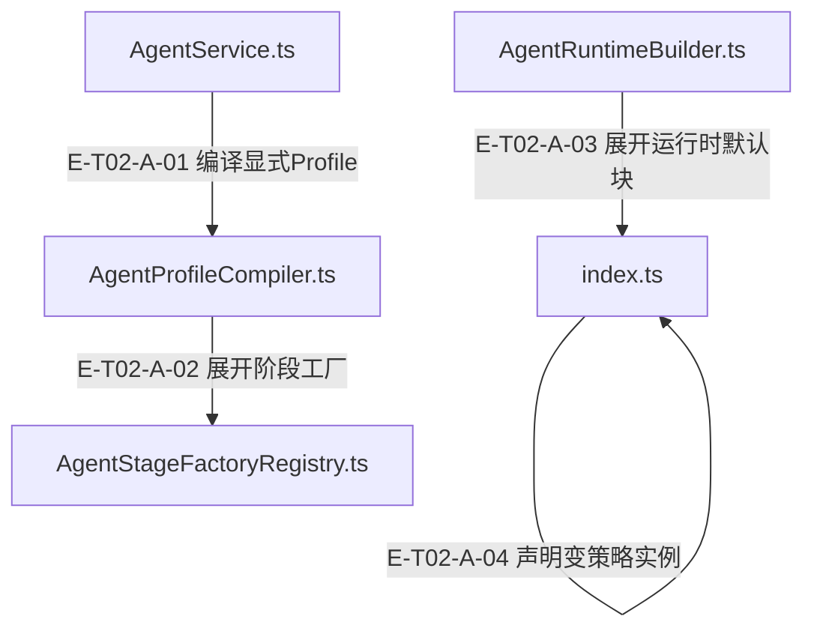

# 02 · 服务装配与编排

> Profile如何变成Runtime；跨维度协调和单Runtime阶段执行怎样分工？

Service校验与编译输入后按concurrency分流：协调profile经partitioner产生child并递归Service.run，每child独立Builder/Runtime；普通profile用preset展开capability、single或pipeline策略和policy后执行。跨维度／模块扇出归Coordinator；旧同Runtime的FanOutStrategy及fan_out运行时词汇已退役。子运行结果、父聚合结果和取消事实分别保留。

[真实调用](call-flow.md) · [直接依赖](file-dependency.md) · [阅读规范](../00-diagram-standard.md)

## 职责与主要接缝

### 本图术语说明

| 术语／节点 | 含义与范围 |
| --- | --- |
| AgentService.ts | `src/agent/service/AgentService.ts`；本图按实现文件聚合职责；具体装配条件见下表。 |
| AgentProfileCompiler.ts | `src/agent/profiles/AgentProfileCompiler.ts`；本图按实现文件聚合职责；具体装配条件见下表。 |
| AgentStageFactoryRegistry.ts | `src/agent/profiles/AgentStageFactoryRegistry.ts`；本图按实现文件聚合职责；具体装配条件见下表。 |
| AgentRuntimeBuilder.ts | `src/agent/service/AgentRuntimeBuilder.ts`；本图按实现文件聚合职责；具体装配条件见下表。 |
| index.ts | `src/agent/profiles/presets/index.ts`；本图按实现文件聚合职责；具体装配条件见下表。 |

| 编号 | 代码依据 | 测试依据 | 关系与可证明范围 |
| --- | --- | --- | --- |
| E-T02-A-01 | `src/agent/service/AgentService.ts#AgentService.compileProfile` → `src/agent/profiles/AgentProfileCompiler.ts#AgentProfileCompiler.compile` | `test/agent-lifecycle.test.ts#case:service%20compilation%20preserves%20explicit%20preset%20params%20at%20the%20real%20builder%20seam`；传 chat preset params={maxIterations:2,maxTokens:333}，Service使用真实Builder构建，再spy替换runtime.execute；断言真实runtime政策预算保留2/333。只覆盖编译/装配接缝，不覆盖该例中的模型或工具执行。断言已定位，实际执行见页面证据。 | run在start日志与Runtime开工前编译profile，传params/context；未知id失败向上reject，不能静默换preset。 |
| E-T02-A-02 | `src/agent/profiles/AgentProfileCompiler.ts#compileStrategy` → `src/agent/profiles/AgentStageFactoryRegistry.ts#AgentStageFactoryRegistry.build` | `test/mining-e2e-pipeline.test.ts#case:%E5%81%A5%E5%BA%B7%E6%A8%A1%E5%9D%97%EF%BC%9Aanalyze(%E7%9C%9F%E5%8F%B0%E8%B4%A6)%E2%86%92note_finding(ledger-id)%E2%86%92%E8%B4%A8%E9%87%8F%E9%97%A8%E2%86%92produce%E2%86%92submit%20%E5%85%A8%E9%93%BE%E4%BA%A7%E5%87%BA%201%20%E6%9D%A1%20rule`；源码断言：脚本化 provider + 临时 fixture 仓，真实 Service/Compiler/Builder/Coordinator/PipelineStrategy/Runtime/Adapter/Router/handler，内存 fake gateway。created 长度为1，evidenceRefs≥3，child outcome=completed，lifecycle=pending且ready=false；不证明真实 provider 或 Core durable 写入。断言已定位，实际执行见页面证据。 | pipeline模板将factory名称与params/context交给registry.build，返回stage数组；fanout模板自身返回undefined，执行权由concurrency计划承担。 |
| E-T02-A-03 | `src/agent/service/AgentRuntimeBuilder.ts#AgentRuntimeBuilder.build` → `src/agent/profiles/presets/index.ts#getPreset` | `test/agent-lifecycle.test.ts#case:direct%20runtime%20builder%20preserves%20preset%20parameter%20overrides`；真实Builder直接接受chat preset参数2/333/0.1/4567，断言runtime.policies.getBudget逐项保留。只验证装配，无模型调用。断言已定位，实际执行见页面证据。 | Builder将compiled.basePreset及runtimeOverrides交给getPreset；每次build重新创建capabilities和PolicyEngine。 |
| E-T02-A-04 | `src/agent/profiles/presets/index.ts#getPreset` → `src/agent/profiles/presets/index.ts#resolveStrategy` | `test/agent-runtime-internal-cleanup.test.ts#case:deletes%20FanOutStrategy%20and%20rejects%20the%20fan_out%20runtime%20vocabulary%20at%20build%20time`；断言已定位，实际执行见页面证据。FanOutStrategy 文件不存在；resolveStrategy/getPreset fan_out 抛错；single/pipeline/default single 保留。 边界：源码与实例构造检查。 | getPreset克隆数据容器后解析single/pipeline；未知词汇构建时拒绝，不静默回退。 |

## 输入、输出与副作用

| 维度 | 当前实现 |
| --- | --- |
| 输入 | 可序列化ProfileRef/Override/Definition与params/context；preset中的capability/policy工厂、stage registry、concurrency partitioner/merger；SystemRunContext可注入窗口、tracker、memory scope及sharedState |
| 输出 | CompiledAgentProfile→独立Runtime或父协调结果；Pipeline phase回执、_pipelineOutcome、Coordinator的moduleResults/dimensionResults/childResults |
| 副作用 | 每build创建capability与Runtime；scope属于run而不是preset单例；child结果回调可由宿主保存checkpoint，失败会停止后续派发；本仓不会自动重试该副作用回调 |

## 从这些文件开始

| 文件 | 阅读目的 |
| --- | --- |
| `src/agent/service/AgentService.ts` | 校验与编译入口，选择协调或单 Runtime；有界取消预检、剩余期限、消息投影、结果状态归类及恢复超时诊断投影。 |
| `src/agent/service/AgentRuntimeBuilder.ts` | 把编译产物展开为 preset、每次新建 capabilities、实例化 policy 工厂、注入宿主 provider/router/container 后构造 Runtime。 |
| `src/agent/profiles/AgentProfileCompiler.ts` | 合并参数，编译 JSON profile/override，验证 fanout 的完整 concurrency 计划、支持 policy 种类，并生成 runtimeOverrides。 |
| `src/agent/profiles/AgentProfileRegistry.ts` | 持有声明快照；拒绝函数、Set/Map、RegExp、Date、非有限数等非 JSON 声明，读写不共享可变对象。 |
| `src/agent/profiles/AgentStageFactoryRegistry.ts` | 装配 scan、relation、按 recipe 规模 evolution、动态预算 generate 或 strict 四阶段流水线。 |
| `src/agent/profiles/presets/index.ts` | preset 默认块查询与策略实例化；按数据容器拷贝并保留函数/端口身份，生成 single/pipeline；fan_out 构建时拒绝。 |
| `src/agent/coordination/AgentRunCoordinator.ts` | 真实 Service 子运行分区、分 tier/并发限流、懒构造、stop-new、回调结算、部分结果、确定性 merger 与墙钟耗时。 |
| `src/agent/strategies/PipelineStrategy.ts` | 顺序执行阶段、工具/预算隔离、quality gate、多类修复、strict fail-closed、超时终态、producer 配额及 outcome 投影。 |
| `src/agent/service/SystemRunContextFactory.ts` | 按 provider/model 创建 ContextWindow、独立 MemoryCoordinator 维度 scope 与 analyst tracker。 |

## 失败、取消与恢复

- 编译/装配未开工：compile、build、setFileCache、message组装失败保持reject并写明确日志；只有runtime.execute异常才按Service错误结果投影。
- 协调停止：stop-new取消未派发同tier与后续tier，已开始child等待结算；onChildResult等消费失败后不再派发新child，父抛带partialResult的协调错误。 依据 `test/agent-lifecycle.test.ts#case:waits%20for%20started%20children%2C%20preserves%20their%20facts%2C%20and%20never%20starts%20queued%20children%20after%20consumer%20failure`（仅定位与阅读）。
- 耗时口径：协调父usage.durationMs为墙钟，childDurationMsTotal单列，tokens/iterations求和。 依据 `test/agent-run-coordinator-duration.test.ts#case:reports%20wall-clock%20durationMs%20for%203%20concurrent%2060ms%20children%20and%20keeps%20the%20child%20sum%20in%20phases.childDurationMsTotal`（仅定位与阅读）。
- 阶段摘要声明：summaryMode=none总转发；其他合法声明仅当该attempt有tracker时转发；缺失/非法声明诊断后不转发，无tracker保留Runtime推断。 依据 `test/forced-summary.test.ts#case:%E6%97%A0%20tracker%20%E7%9A%84%E5%B0%9D%E8%AF%95%E4%B8%8D%E8%BD%AC%E5%8F%91%E9%9D%9E%20none%20%E5%A3%B0%E6%98%8E%EF%BC%9A%E6%97%81%E8%B7%AF%E4%BA%A4%E7%BB%99%20Runtime%20%E4%BF%9D%E7%95%99%E7%9A%84%E6%97%A0%20tracker%20%E5%88%86%E6%94%AF%EF%BC%88%E6%80%BB%E6%8E%A7%E8%A3%81%E5%AE%9A%E7%AC%AC%201%E3%80%816%20%E9%A1%B9%EF%BC%89`（仅定位与阅读）。

## 已知边界与未验证范围

- Coordinator固定stop-new。abortPolicy字段与旧“声明未实现”日志已删除；遗留JS字段不改变调度，运行中的child按自身signal收尾。
- SystemTaskRunSignals.timeoutMs在fan-out下是每child期限，非整次父fan-out总期限。
- 宿主自定义stage未声明summaryMode仍兼容运行，不画成schema拒绝。

[继续阅读：阶段门、重试与提示逐文件深读](stage-failures-and-prompts.md)。当前正文按源码变化复核；v4执行事实保留历史快照。

## 声明收窄与编译失败

显式 id 必须命中注册表；把 chat 写作 id 不再回退为 preset，应使用 { preset: "chat" }。fanout 模板只作 { type: "fanout" } 标记；childProfile、partitioner、merge 只从完整 concurrency 计划读取。旧模板多字段记录 fanout_template_fields_ignored，不再进行模板／计划同值比较。

`test/agent-surface-floor.test.ts#case:keeps%20compiling%20the%20%7B%20preset%20%7D%20form%20and%20registered%20profile%20ids`；断言已定位，实际执行见页面证据。{preset:chat} 与已注册 id 编译成功；测试同组覆盖未注册 id 失败。 边界：编译边界，无 Runtime 执行。 `test/agent-surface-floor.test.ts#case:compiles%20a%20marker-only%20fanout%20template%20against%20a%20complete%20concurrency%20plan`；断言已定位，实际执行见页面证据。{type:fanout} 编译 strategy=undefined，concurrency child/partitioner/merge 保留。 边界：真实 compiler；不创建 child Runtime。 `test/agent-surface-floor.test.ts#case:ignores%20retired%20fanout%20template%20fields%20with%20a%20warn%20and%20keeps%20the%20plan%20authoritative`；断言已定位，实际执行见页面证据。旧模板 childProfile/merge 与计划冲突只告警，执行声明以 concurrency 为准。 边界：编译边界。

旧同Runtime扇出比较与全item失败风险已随入口退役，详见 v4 历史快照；当前不再把它作为可执行能力。

[本轮Profile与宿主装配全文审阅](full-profile-review.md)逐文件展开声明、实例所有权、工厂失败与恢复边界。
