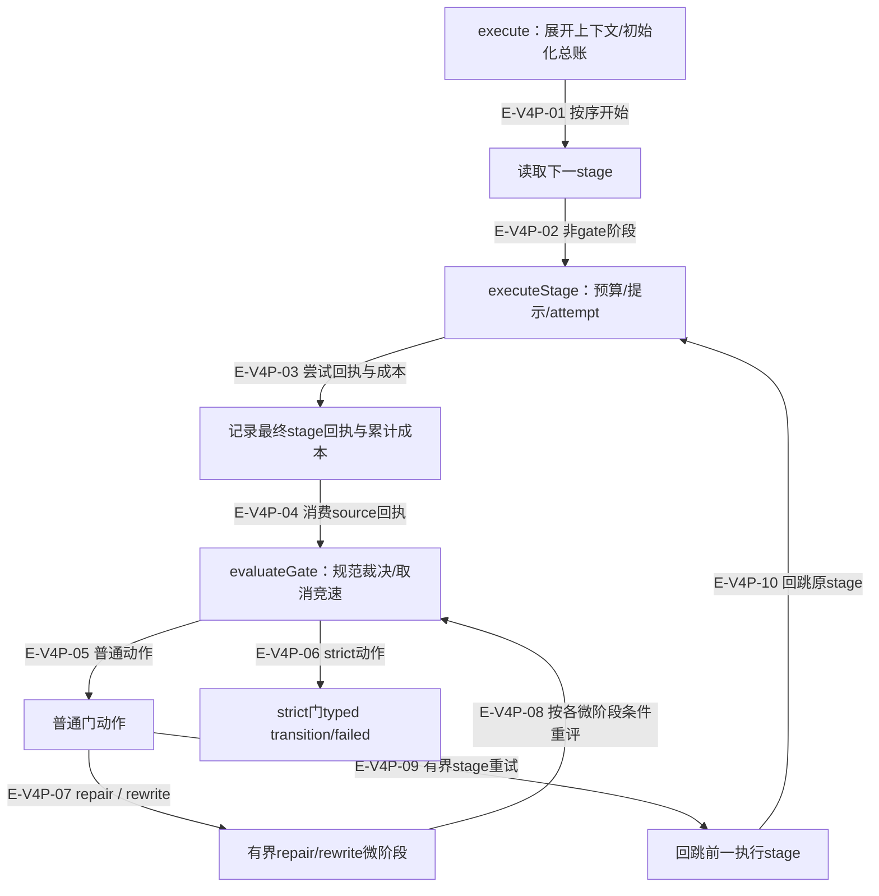
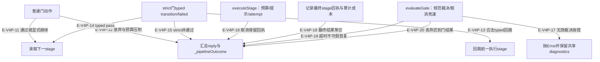
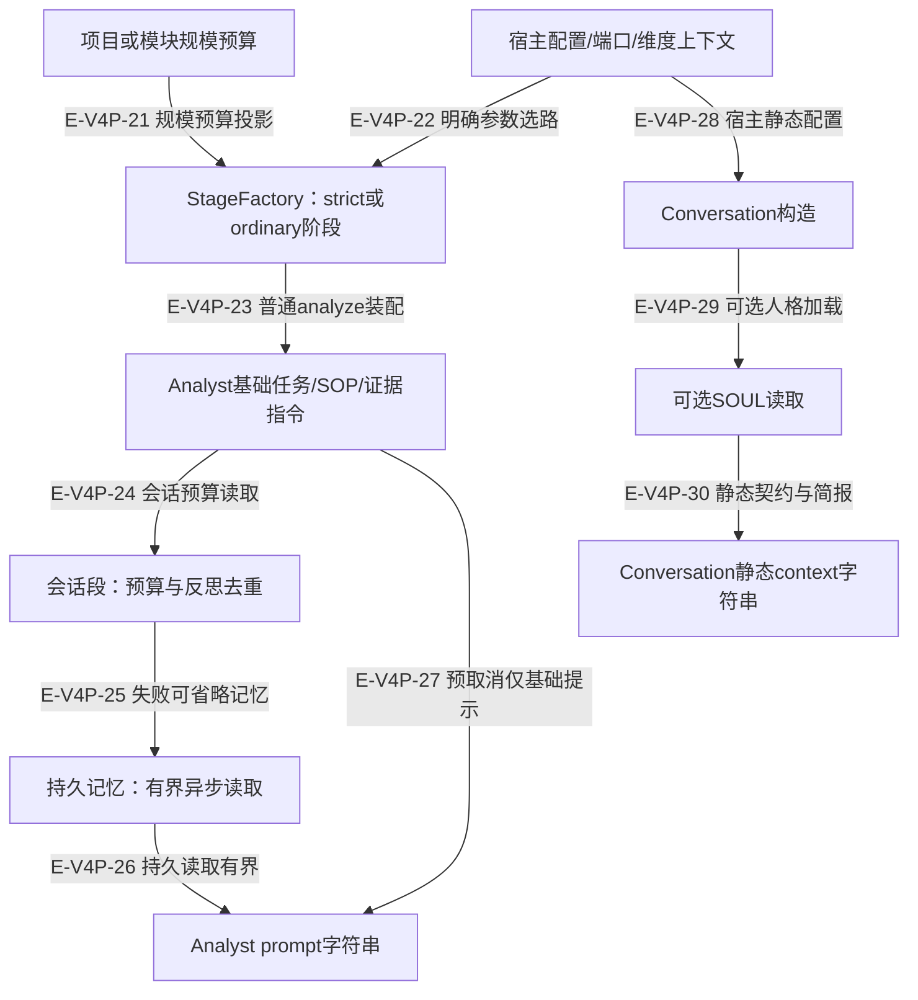

# 阶段门、重试与提示装配：逐文件深读

沿 v4 全文记录与匹配旧 blob 的差异复核PipelineStrategy、StageFactory、insightAnalyst和Conversation。主阶段回执、修复微阶段、工具副作用和最终outcome各有独立含义；图中的继续执行不自动表示业务成功。测试以真实Agent控制层和可控阶段／provider组成，不证明真实AI质量或Core生产持久化。

[服务装配专题](overview.md) · [Runtime状态](../03-runtime-lifecycle/state-and-recovery.md) · [会话恢复深读](../07-memory-context/source-review-and-recovery.md) · [执行记录](../../evidence/scoped-execution.json)

## 一次尝试与普通门修复

两张控制流分图共用P节点的概念；第一张展开尝试和修复，第二张补齐通过、strict与失败终态。

### 本图术语说明

| 节点／术语 | 本图含义 |
| --- | --- |
| execute：展开上下文/初始化总账 | 当前控制节点；具体函数与行为在逐边表中说明。 |
| 读取下一stage | 当前控制节点；具体函数与行为在逐边表中说明。 |
| executeStage：预算/提示/attempt | 当前控制节点；具体函数与行为在逐边表中说明。 |
| 记录最终stage回执与累计成本 | 当前控制节点；具体函数与行为在逐边表中说明。 |
| evaluateGate：规范裁决/取消竞速 | 当前控制节点；具体函数与行为在逐边表中说明。 |
| 普通门动作 | 当前控制节点；具体函数与行为在逐边表中说明。 |
| strict门typed transition/failed | 当前控制节点；具体函数与行为在逐边表中说明。 |
| 有界repair/rewrite微阶段 | 当前控制节点；具体函数与行为在逐边表中说明。 |
| 回跳前一执行stage | 当前控制节点；具体函数与行为在逐边表中说明。 |

| 编号 | 代码依据 | 测试依据 | 关系与可证明范围 |
| --- | --- | --- | --- |
| E-V4P-01 | `src/agent/strategies/PipelineStrategy.ts#PipelineStrategy.execute` | `test/pipeline-outcome-abandoned.test.ts#case:gate%20pass%20%E2%86%92%20outcome%3Dcompleted%EF%BC%8C%E6%97%A0%20abandon%20%E5%AD%97%E6%AE%B5`；断言已定位，实际执行见页面证据。断言两个主阶段均执行，outcome为completed、degraded=false、没有abandon字段。 边界：最小fake reactLoop；不是实际provider或知识持久化验收。 | 初始化完成后按stage序执行；不存在并行阶段派发。 |
| E-V4P-02 | `src/agent/strategies/PipelineStrategy.ts#PipelineStrategy.execute`；`src/agent/strategies/PipelineStrategy.ts#PipelineStrategy.executeStage` | `test/pipeline-outcome-abandoned.test.ts#case:gate%20pass%20%E2%86%92%20outcome%3Dcompleted%EF%BC%8C%E6%97%A0%20abandon%20%E5%AD%97%E6%AE%B5`；断言已定位，实际执行见页面证据。断言两个主阶段均执行，outcome为completed、degraded=false、没有abandon字段。 边界：最小fake reactLoop；不是实际provider或知识持久化验收。 | 非gate阶段进入executeStage，能力/预算在该阶段投影。 |
| E-V4P-03 | `src/agent/strategies/PipelineStrategy.ts#PipelineStrategy.executeStage`；`src/agent/strategies/PipelineStrategy.ts#PipelineStrategy.accumulateStageAttempt` | `test/agent-lifecycle.test.ts#case:shares%20the%20hard%20deadline%20across%20asynchronous%20preparation%20and%20execution`；断言已定位，实际执行见页面证据。30秒准备+剩余30.01秒耗尽同一60.01秒窗口，最终timedOut且timer清空。 边界：fake timers，验证timeoutMs+60s余量并非两份deadline。 `test/pipeline-outcome-abandoned.test.ts#case:counts%20the%20cost%20of%20a%20returned%20timed-out%20attempt%20before%20successful%20fast%20retry`；断言已定位，实际执行见页面证据。首轮timeout的50/10 token与成功轮7/3相加为57/13，iterations相加为3。 边界：返回式timedOut控制回执，未模拟真实网络计费。 | 准备与reactLoop共用deadline，所有尝试成本累加，phaseResults只留该阶段最后一次回执。 |
| E-V4P-04 | `src/agent/strategies/PipelineStrategy.ts#PipelineStrategy.processGate` | `test/agent-lifecycle.test.ts#case:%E9%87%8D%E8%B7%91%E4%BB%8D%E8%B6%85%E6%97%B6%E4%B8%94%E9%A2%9D%E5%BA%A6%E7%94%A8%E5%B0%BD%20%E2%86%92%20%E7%BB%88%E6%AD%A2(attempts%2FmaxRetries%20%E5%8F%AF%E5%AE%9A%E4%BD%8D)%EF%BC%8Cproduce%20%E4%B8%8D%E8%B7%91`；断言已定位，实际执行见页面证据。analyze最多首跑+1次重跑，仍超时时failed/timedOut、produce缺席、pipeline_timeout_terminal含2/1次数。 边界：模拟返回最终timedOut回执，非真实480秒等待。 `test/pipeline-strategy-strict-timeout-terminal.test.ts#case:%E4%B8%A5%E6%A0%BC%20analyst%20%E8%B6%85%E6%97%B6%20%2B%20G1%20pass%20%E2%86%92%20%E7%BB%88%E6%AD%A2%EF%BC%9A%E4%B8%8D%E8%B7%91%20strict%20producer%E3%80%81%E4%B8%8D%E8%BF%BD%E5%8A%A0%20pass%20typed%20return%E3%80%81%E5%86%99%20pipeline_timeout_terminal`；断言已定位，实际执行见页面证据。G1即使pass也不消费为成功transition；failed/timedOut，不跑producer、不追加strict pass。 边界：严格port fixture与假超时回执。 | 后续gate评估source回执，最终超时不能被普通pass当作恢复。 |
| E-V4P-05 | `src/agent/strategies/PipelineStrategy.ts#PipelineStrategy.processGate` | `test/pipeline-outcome-abandoned.test.ts#case:analysis_retry%20%E8%80%97%E5%B0%BD%20%E2%86%92%20outcome%3Dabandoned(action%3Dretry_exhausted)%EF%BC%8Cdegraded%20%E4%BF%9D%E6%8C%81%20false`；断言已定位，实际执行见页面证据。门重试耗尽返回abandoned/retry_exhausted且degraded=false。 边界：非strict、fake runtime。 `test/pipeline-outcome-abandoned.test.ts#case:gate%20degrade%20%E2%86%92%20outcome%3Dabandoned%20%E6%90%BA%E5%B8%A6%20stage%2Faction%2Freason%EF%BC%8C%E4%B8%94%E4%B8%8B%E6%B8%B8%E6%89%A7%E8%A1%8C%E9%98%B6%E6%AE%B5%E8%A2%AB%E8%B7%B3%E8%BF%87`；断言已定位，实际执行见页面证据。断言degraded=true、abandoned携带门/动作/原因，produce不执行。 边界：只覆盖evaluator明确返回degrade；不把所有degraded_*返回值等同这一分支。 | 无strict上下文时按普通门动作解释。 |
| E-V4P-06 | `src/agent/strategies/PipelineStrategy.ts#PipelineStrategy.processGate` | `test/pipeline-strategy-strict-timeout-terminal.test.ts#case:%E4%B8%A5%E6%A0%BC%20analyst%20%E8%B6%85%E6%97%B6%20%2B%20G1%20degrade%20%E2%86%92%20%E4%BB%8D%E6%98%AF%E6%97%A2%E6%9C%89%20fail-closed%EF%BC%9Atyped%20failed%20return%EF%BC%8C%E4%B8%8D%E5%86%99%20pipeline_timeout_terminal`；断言已定位，实际执行见页面证据。strict非通过直接typed G1 failed并停止，不走legacy降级成功。 边界：验证strict/legacy分支优先级，非真实审查服务。 `test/strict-iterative-analysis.test.ts#case:rejects%20an%20untyped%20analysis_retry%20instead%20of%20entering%20the%20strict%20retry%20loop`；断言已定位，实际执行见页面证据。legacy形状retry被strict门拒绝OUTCOME_UNTYPED，只有一次分析、failed。 边界：严格端口合同验证，不是任意自定义gate可自发声明合法transition。 | strict上下文走typed裁决，不落入legacy repair/degrade/skip。 |
| E-V4P-07 | `src/agent/strategies/PipelineStrategy.ts#PipelineStrategy.runRecordRepairStage`；`src/agent/strategies/PipelineStrategy.ts#PipelineStrategy.runSummaryRewriteStage` | `test/forced-summary.test.ts#case:%25s%20%E5%BE%AE%E9%98%B6%E6%AE%B5%E5%A3%B0%E6%98%8E%20none%EF%BC%9B%E6%9C%89%20tracker%20%E7%9A%84%E4%B8%BB%E9%98%B6%E6%AE%B5%E4%B9%9F%E9%80%8F%E4%BC%A0%E8%87%AA%E8%BA%AB%E5%A3%B0%E6%98%8E`；参数化模板；展开项的实际执行状态见定向记录。summary_rewrite/record_repair微阶段context.summaryMode=none；有tracker主analyze透传analyst-report。 边界：检查Pipeline传给捕获runtime的options，非实际摘要API。 | record_repair或summary_rewrite启动小预算微阶段，summaryMode=none。 |
| E-V4P-08 | `src/agent/strategies/PipelineStrategy.ts#PipelineStrategy.processGate` | `test/pipeline-outcome-abandoned.test.ts#case:record_repair%20%E6%95%91%E4%B8%8D%E5%9B%9E%20%E2%86%92%20degraded_no_findings%20%E5%90%8C%E6%A0%B7%E8%BF%9B%E5%85%A5%E4%B8%80%E7%AD%89%E7%BB%93%E5%B1%80(%E7%AC%AC%E4%BA%8C%E4%B8%AA%E9%99%8D%E7%BA%A7%E7%82%B9)`；断言已定位，实际执行见页面证据。evaluator持续要求record_repair时，微阶段后结果为abandoned/degraded_no_findings。 边界：fake runtime，未验证真实memory工具写入；证明控制流不继续生产。 `test/forced-summary.test.ts#case:summary_rewrite%20%E5%94%AF%E4%B8%80%E8%B0%83%E7%94%A8%E5%A4%B1%E8%B4%A5%E6%97%B6%E4%B8%8D%E4%BB%A5%E5%85%9C%E5%BA%95%20JSON%20%E8%A6%86%E7%9B%96%20analyze%20%E6%AD%A3%E6%96%87%EF%BC%8C%E8%BD%AC%20analysis_retry%20%E9%87%8D%E8%B7%91`；断言已定位，实际执行见页面证据。真实Runtime配受控provider：微阶段reply为空、不追加摘要、分析整段重跑，最终正文fresh，不含digest。 边界：provider是fixture；无网络/真实服务。 | record_repair未取消就重评，不要求微阶段产生可用结果；summary_rewrite仅在source存在且reply非空时替换正文并重评。空输出或仍判rewrite才转analysis_retry；重评degrade直接终止。 |
| E-V4P-09 | `src/agent/strategies/PipelineStrategy.ts#PipelineStrategy.processGate`；`src/agent/strategies/PipelineStrategy.ts#PipelineStrategy.preservePriorProducerAttempt` | `test/pipeline-stage-session-budget.test.ts#case:allows%20the%20retry%20when%20the%20target%20stayed%20within%20its%20own%20stage%20budget%20even%20if%20earlier%20stages%20used%20more`；断言已定位，实际执行见页面证据。前序scan500而analyze10/100仍重试并produce，日志分别展示stage和pipeline用量。 边界：最小runtime的声明成本，不验证provider真实token上报。 `test/pipeline-outcome-abandoned.test.ts#case:rescan%20%2B%20rejection_gate%20%E5%88%A4%20retry%EF%BC%9A%E9%A6%96%E8%BD%AE%E6%8C%89%20cap%3D2%20%E5%B0%81%E9%A1%B6%EF%BC%9B%E9%A6%96%E8%BD%AE%E6%8C%81%E4%B9%85%E5%8C%96%201%20%E6%9D%A1%E3%80%81%E6%8B%92%E7%BB%9D%202%20%E6%9D%A1%20%E2%86%92%20%E9%87%8D%E8%AF%95%E8%BD%AE%20maxSubmits%3D1(retryBudget%20%E5%85%B6%E4%BD%99%E5%8E%9F%E5%80%BC%E3%80%81%E6%97%A0%20targetSubmits)%EF%BC%8C%E7%9C%9F%E5%AE%9E%20tracker%20%E7%AC%AC%201%20%E6%AC%A1%E6%8C%81%E4%B9%85%E5%8C%96%E5%90%8E%E8%BF%9B%E5%85%A5%20SUMMARIZE`；断言已定位，实际执行见页面证据。重试cap减去已持久化数，保留5轮/300s预算且无targetSubmits；真实tracker仅再放行1条。 边界：持久化回执为fixture，tracker真实；不是数据库写入测试。 | analysis_retry/retry在次数和单阶段预算内回跳；producer先保留前次回执/算剩余配额。 |
| E-V4P-10 | `src/agent/strategies/PipelineStrategy.ts#PipelineStrategy.buildStagePrompt`；`src/agent/strategies/PipelineStrategy.ts#PipelineStrategy.executeStage` | `test/pipeline-outcome-abandoned.test.ts#case:rescan%20%2B%20rejection_gate%20%E5%88%A4%20retry%EF%BC%9A%E9%A6%96%E8%BD%AE%E6%8C%89%20cap%3D2%20%E5%B0%81%E9%A1%B6%EF%BC%9B%E9%A6%96%E8%BD%AE%E6%8C%81%E4%B9%85%E5%8C%96%201%20%E6%9D%A1%E3%80%81%E6%8B%92%E7%BB%9D%202%20%E6%9D%A1%20%E2%86%92%20%E9%87%8D%E8%AF%95%E8%BD%AE%20maxSubmits%3D1(retryBudget%20%E5%85%B6%E4%BD%99%E5%8E%9F%E5%80%BC%E3%80%81%E6%97%A0%20targetSubmits)%EF%BC%8C%E7%9C%9F%E5%AE%9E%20tracker%20%E7%AC%AC%201%20%E6%AC%A1%E6%8C%81%E4%B9%85%E5%8C%96%E5%90%8E%E8%BF%9B%E5%85%A5%20SUMMARIZE`；断言已定位，实际执行见页面证据。重试cap减去已持久化数，保留5轮/300s预算且无targetSubmits；真实tracker仅再放行1条。 边界：持久化回执为fixture，tracker真实；不是数据库写入测试。 `test/pipeline-outcome-abandoned.test.ts#case:returns%20the%20latest%20main-stage%20reply%20after%20rewrite%20falls%20back%20to%20analysis%20retry`；断言已定位，实际执行见页面证据。重写后转analysis_retry再成功，最终reply与phases.analyze均为fresh analysis，不误取微阶段插入顺序。 边界：fake顺序回复，检查最终主阶段选择。 | 门重试使用retryPromptBuilder及retryBudget（有声明时）；不是fast retry。 |

## 通过、取消、超时与strict终态

### 本图术语说明

| 节点／术语 | 本图含义 |
| --- | --- |
| 普通门动作 | 当前控制节点；具体函数与行为在逐边表中说明。 |
| 读取下一stage | 当前控制节点；具体函数与行为在逐边表中说明。 |
| 汇总reply与_pipelineOutcome | 当前控制节点；具体函数与行为在逐边表中说明。 |
| strict门typed transition/failed | 当前控制节点；具体函数与行为在逐边表中说明。 |
| 回跳前一执行stage | 当前控制节点；具体函数与行为在逐边表中说明。 |
| executeStage：预算/提示/attempt | 当前控制节点；具体函数与行为在逐边表中说明。 |
| evaluateGate：规范裁决/取消竞速 | 当前控制节点；具体函数与行为在逐边表中说明。 |
| 抛Error并保留共享diagnostics | 当前控制节点；具体函数与行为在逐边表中说明。 |
| 记录最终stage回执与累计成本 | 当前控制节点；具体函数与行为在逐边表中说明。 |

| 编号 | 代码依据 | 测试依据 | 关系与可证明范围 |
| --- | --- | --- | --- |
| E-V4P-11 | `src/agent/strategies/PipelineStrategy.ts#PipelineStrategy.processGate` | `test/pipeline-outcome-abandoned.test.ts#case:gate%20pass%20%E2%86%92%20outcome%3Dcompleted%EF%BC%8C%E6%97%A0%20abandon%20%E5%AD%97%E6%AE%B5`；断言已定位，实际执行见页面证据。断言两个主阶段均执行，outcome为completed、degraded=false、没有abandon字段。 边界：最小fake reactLoop；不是实际provider或知识持久化验收。 `test/pipeline-outcome-abandoned.test.ts#case:retry%20%E8%80%97%E5%B0%BD%E4%BD%86%20skipOnFail%3Dfalse%20%E2%86%92%20%E4%BB%8D%E5%86%99%20pipeline_gate_retry_exhausted%EF%BC%8Cmessage%20%E8%AF%B4%E6%98%8E%E4%B8%8B%E6%B8%B8%E7%BB%A7%E7%BB%AD%E6%89%A7%E8%A1%8C`；断言已定位，实际执行见页面证据。analyze两次后produce仍执行，outcome仍abandoned，警告记录次数和continue。 边界：显式skipOnFail=false，不能推断为质量通过。 | pass继续；显式skipOnFail=false也可继续，但终态仍保留非通过事实。 |
| E-V4P-12 | `src/agent/strategies/PipelineStrategy.ts#PipelineStrategy.processGate`；`src/agent/strategies/PipelineStrategy.ts#PipelineStrategy.execute` | `test/pipeline-outcome-abandoned.test.ts#case:gate%20degrade%20%E2%86%92%20outcome%3Dabandoned%20%E6%90%BA%E5%B8%A6%20stage%2Faction%2Freason%EF%BC%8C%E4%B8%94%E4%B8%8B%E6%B8%B8%E6%89%A7%E8%A1%8C%E9%98%B6%E6%AE%B5%E8%A2%AB%E8%B7%B3%E8%BF%87`；断言已定位，实际执行见页面证据。断言degraded=true、abandoned携带门/动作/原因，produce不执行。 边界：只覆盖evaluator明确返回degrade；不把所有degraded_*返回值等同这一分支。 `test/pipeline-outcome-abandoned.test.ts#case:analysis_retry%20%E8%80%97%E5%B0%BD%20%E2%86%92%20outcome%3Dabandoned(action%3Dretry_exhausted)%EF%BC%8Cdegraded%20%E4%BF%9D%E6%8C%81%20false`；断言已定位，实际执行见页面证据。门重试耗尽返回abandoned/retry_exhausted且degraded=false。 边界：非strict、fake runtime。 `test/pipeline-outcome-abandoned.test.ts#case:%E8%87%AA%E5%AE%9A%E4%B9%89%E9%97%A8%E8%BF%94%E5%9B%9E%E6%8B%BC%E9%94%99%E5%8A%A8%E4%BD%9C%20%22analysis-retry%22%20%E2%86%92%20%E4%B8%8B%E6%B8%B8%E8%A2%AB%E7%BB%88%E6%AD%A2%E4%B8%94%20warnings%20%E5%90%AB%20pipeline_gate_non_pass_terminated`；断言已定位，实际执行见页面证据。未知动作保留原始gateFailure，produce跳过、abandoned、警告带原始动作。 边界：未验证任意JS对象/恶意getter，只覆盖字符串未知动作。 `test/pipeline-stage-session-budget.test.ts#case:still%20suppresses%20the%20retry%20when%20the%20target%20exhausted%20its%20own%20stage%20budget%20on%20its%20last%20run`；断言已定位，实际执行见页面证据。analyze使用95/100后禁止重试，只有scan/analyze两段，degraded_budget_exhausted与95%诊断。 边界：按单次目标阶段input消耗，不按整条pipeline总额。 | degrade/重试耗尽/未知非通过默认停止并返回abandoned；预算压制也显式终止。 |
| E-V4P-13 | `src/agent/strategies/PipelineStrategy.ts#PipelineStrategy.readStrictAnalysisTransition`；`src/agent/strategies/PipelineStrategy.ts#PipelineStrategy.processGate` | `test/strict-iterative-analysis.test.ts#case:enrolls%20and%20executes%20a%20discovered%20counterquery%2C%20then%20reruns%20Analyst%20to%20a%20stable%20fixpoint`；断言已定位，实际执行见页面证据。登记并执行counterquery后epoch1→2，再分析并pass；2次strict Analyst+1次Producer、零legacy角色，loop receipt记录retry/pass。 边界：Agent/Core公开构造器与内存端口fixture；未访问Core内部；实际执行状态另列。 `test/strict-iterative-analysis.test.ts#case:fails%20closed%20when%20a%20typed%20retry%20would%20exceed%20the%20explicit%20epoch%20bound`；断言已定位，实际执行见页面证据。maxEpochs=1却拟进入epoch2时门reject/EPOCH_LIMIT_EXHAUSTED，failed、只有一次分析、无produce。 边界：通过真实strict stage factory验证epoch边界，Pipeline自身不另外复制次数上限。 | 只有已验证typed analysis_retry且strict-analyst目标合法时回跳，epoch上限归真实strict门。 Pipeline此处只检查transition形状；epoch进展和上限由真实strict工厂及evaluator保证。 |
| E-V4P-14 | `src/agent/strategies/PipelineStrategy.ts#PipelineStrategy.processGate` | `test/strict-iterative-analysis.test.ts#case:enrolls%20and%20executes%20a%20discovered%20counterquery%2C%20then%20reruns%20Analyst%20to%20a%20stable%20fixpoint`；断言已定位，实际执行见页面证据。登记并执行counterquery后epoch1→2，再分析并pass；2次strict Analyst+1次Producer、零legacy角色，loop receipt记录retry/pass。 边界：Agent/Core公开构造器与内存端口fixture；未访问Core内部；实际执行状态另列。 | typed pass投影transition.resultArtifact给Producer并可记pass typed return。 |
| E-V4P-15 | `src/agent/strategies/PipelineStrategy.ts#PipelineStrategy.processGate` | `test/pipeline-strategy-strict-timeout-terminal.test.ts#case:%E4%B8%A5%E6%A0%BC%20analyst%20%E8%B6%85%E6%97%B6%20%2B%20G1%20degrade%20%E2%86%92%20%E4%BB%8D%E6%98%AF%E6%97%A2%E6%9C%89%20fail-closed%EF%BC%9Atyped%20failed%20return%EF%BC%8C%E4%B8%8D%E5%86%99%20pipeline_timeout_terminal`；断言已定位，实际执行见页面证据。strict非通过直接typed G1 failed并停止，不走legacy降级成功。 边界：验证strict/legacy分支优先级，非真实审查服务。 `test/strict-iterative-analysis.test.ts#case:rejects%20an%20untyped%20analysis_retry%20instead%20of%20entering%20the%20strict%20retry%20loop`；断言已定位，实际执行见页面证据。legacy形状retry被strict门拒绝OUTCOME_UNTYPED，只有一次分析、failed。 边界：严格端口合同验证，不是任意自定义gate可自发声明合法transition。 | strict非通过写failed return并结束，不以legacy降级成功继续。 |
| E-V4P-16 | `src/agent/strategies/PipelineStrategy.ts#PipelineStrategy.isCancelled`；`src/agent/strategies/PipelineStrategy.ts#PipelineStrategy.execute` | `test/agent-lifecycle.test.ts#case:stops%20on%20host-reported%20cancellation%20even%20with%20timedOut%3D%25s`；参数化模板；展开项的实际执行状态见定向记录。父signal未abort但stage.aborted=true时只执行一次、不评门、不produce，outcome=aborted且cancelReason=stage_aborted。 边界：参数化timedOut=true/false；取消优先于超时。 `test/agent-lifecycle.test.ts#case:settles%20parent%20cancellation%20during%20%25s%20and%20ignores%20late%20work`；参数化模板；展开项的实际执行状态见定向记录。prepare或execute挂起时父取消立即结算aborted；迟到prepare不启动reactLoop，迟到execute不评门。 边界：不合作Promise控制fixture；停止等待不承诺回滚。 `test/agent-lifecycle.test.ts#case:stops%20host-reported%20cancellation%20during%20%25s%20without%20reevaluating%20its%20gate`；参数化模板；展开项的实际执行状态见定向记录。record_repair/summary_rewrite取消后保留初始分析、门只调用一次、不produce、不额外degrade。 边界：真实Pipeline配fake阶段结果，未执行工具。 | 父或宿主stage取消后不进入后续门/producer；已知成本保留，结局aborted。 |
| E-V4P-17 | `src/agent/strategies/PipelineStrategy.ts#PipelineStrategy.evaluateGateResult` | `test/pipeline-outcome-abandoned.test.ts#case:%E8%AF%84%E4%BC%B0%E5%99%A8%E6%8A%9B%E9%94%99%20%E2%86%92%20%E6%8A%9B%E5%87%BA%E5%89%8D%E5%86%99%20pipeline_gate_evaluation_failed(%E9%97%A8%E5%90%8D%E3%80%81%E6%BA%90%E9%98%B6%E6%AE%B5)%EF%BC%8C%E5%8E%9F%E9%94%99%E8%AF%AF%E4%BB%8D%E5%8E%9F%E6%A0%B7%E6%8A%9B%E5%87%BA`；断言已定位，实际执行见页面证据。execute rejects同一Error实例；共享diagnostics有门名、源阶段、原错误，gateFailures不新增。 边界：异常路径没有正常_pipelineOutcome返回；调用方负责结果错误投影。 `test/pipeline-outcome-abandoned.test.ts#case:%E8%AF%84%E4%BC%B0%E5%99%A8%E8%BF%94%E5%9B%9E%E9%9D%9E%E5%AF%B9%E8%B1%A1%20%E2%86%92%20%E5%90%8C%E6%A0%B7%E5%86%99%20pipeline_gate_evaluation_failed%20%E5%B9%B6%E6%8A%9B%E5%87%BA%20Error`；断言已定位，实际执行见页面证据。null裁决触发no decision错误及门级diagnostic。 边界：不代表完整gate-output schema验证；数组或其他对象的所有形态未在该case覆盖。 | evaluator抛错/无决策先写门级诊断后reject整个execute。 |
| E-V4P-18 | `src/agent/strategies/PipelineStrategy.ts#PipelineStrategy.execute` | `test/pipeline-strategy-strict-timeout-terminal.test.ts#case:%E4%B8%A5%E6%A0%BC%20producer%20%E8%B6%85%E6%97%B6%20%2B%20G2%20pass%20%E2%86%92%20%E8%A7%84%E5%88%99%E4%B8%8D%E8%A6%86%E7%9B%96%20producer%EF%BC%9AG2%20%E8%BF%BD%E5%8A%A0%20pass%20typed%20return%E3%80%81%E4%B8%8D%E9%87%8D%E8%B7%91%20produce%E3%80%81%E9%A6%96%E8%BD%AE%E5%9B%9E%E6%89%A7%E4%BF%9D%E7%95%99%E3%80%81%E4%B8%8D%E5%86%99%20pipeline_timeout_terminal`；断言已定位，实际执行见页面证据。produce只跑一次，G2原始pass保留，但整pipeline因最终超时仍failed；producer首轮回执保留。 边界：不表示G2 pass已证明全部业务完成，恢复归宿主。 | 无下游stage时按最终回执汇总；producer超时可保留其回执但outcome仍failed。 |
| E-V4P-19 | `src/agent/strategies/PipelineStrategy.ts#PipelineStrategy.resolveTimedOutSourceGate` | `test/agent-lifecycle.test.ts#case:%E9%87%8D%E8%B7%91%E4%BB%8D%E8%B6%85%E6%97%B6%E4%B8%94%E9%A2%9D%E5%BA%A6%E7%94%A8%E5%B0%BD%20%E2%86%92%20%E7%BB%88%E6%AD%A2(attempts%2FmaxRetries%20%E5%8F%AF%E5%AE%9A%E4%BD%8D)%EF%BC%8Cproduce%20%E4%B8%8D%E8%B7%91`；断言已定位，实际执行见页面证据。analyze最多首跑+1次重跑，仍超时时failed/timedOut、produce缺席、pipeline_timeout_terminal含2/1次数。 边界：模拟返回最终timedOut回执，非真实480秒等待。 `test/pipeline-strategy-strict-timeout-terminal.test.ts#case:%E4%B8%A5%E6%A0%BC%20analyst%20%E8%B6%85%E6%97%B6%20%2B%20G1%20pass%20%E2%86%92%20%E7%BB%88%E6%AD%A2%EF%BC%9A%E4%B8%8D%E8%B7%91%20strict%20producer%E3%80%81%E4%B8%8D%E8%BF%BD%E5%8A%A0%20pass%20typed%20return%E3%80%81%E5%86%99%20pipeline_timeout_terminal`；断言已定位，实际执行见页面证据。G1即使pass也不消费为成功transition；failed/timedOut，不跑producer、不追加strict pass。 边界：严格port fixture与假超时回执。 | 非producer最终超时且无合法完整重跑路径时终止；strict pass也不能合成恢复。 |
| E-V4P-20 | `src/agent/strategies/PipelineStrategy.ts#PipelineStrategy.evaluateGateResult` | `test/agent-lifecycle.test.ts#case:cancels%20a%20pending%20gate%20without%20publishing%20its%20late%20verdict%20or%20starting%20repair%2Fproducer`；断言已定位，实际执行见页面证据。挂起门取消后aborted；迟到pass不会出现在phaseResults或strictGateReturns，reactLoop只执行初始一次。 边界：假evaluator，验证竞速与丢弃迟到结果。 | pending gate被父取消后不采纳迟到裁决。 |

## 分析提示和对话提示的独立装配

### 本图术语说明

| 节点／术语 | 本图含义 |
| --- | --- |
| 项目或模块规模预算 | 当前控制节点；具体函数与行为在逐边表中说明。 |
| StageFactory：strict或ordinary阶段 | 当前控制节点；具体函数与行为在逐边表中说明。 |
| 宿主配置/端口/维度上下文 | 当前控制节点；具体函数与行为在逐边表中说明。 |
| Analyst基础任务/SOP/证据指令 | 当前控制节点；具体函数与行为在逐边表中说明。 |
| 会话段：预算与反思去重 | 当前控制节点；具体函数与行为在逐边表中说明。 |
| 持久记忆：有界异步读取 | 当前控制节点；具体函数与行为在逐边表中说明。 |
| Analyst prompt字符串 | 当前控制节点；具体函数与行为在逐边表中说明。 |
| Conversation构造 | 当前控制节点；具体函数与行为在逐边表中说明。 |
| 可选SOUL读取 | 当前控制节点；具体函数与行为在逐边表中说明。 |
| Conversation静态context字符串 | 当前控制节点；具体函数与行为在逐边表中说明。 |

| 编号 | 代码依据 | 测试依据 | 关系与可证明范围 |
| --- | --- | --- | --- |
| E-V4P-21 | `src/agent/prompts/insightAnalyst.ts#computeAnalystBudget`；`src/agent/prompts/insightAnalyst.ts#computeModuleAnalystBudget`；`src/agent/profiles/AgentStageFactoryRegistry.ts#AgentStageFactoryRegistry.registerDefaults` | `test/insight-analyst-budget-baseline.test.ts#case:derives%20the%20session%20input%20cap%20from%20the%20same%2024-round%20estimate%20as%20computeAnalystBudget`；断言已定位，实际执行见页面证据。静态与动态24轮同源；216000input；maxSessionTokens总量字段已删除。 边界：是预算公式断言，非token消费预测精度。 `test/module-context-assembler.test.ts#case:%E5%88%86%E6%A1%A3%2018%2F26%2F34%2F40%20%E4%B8%94%20session%20%E6%95%B0%E5%AD%A6%E9%9A%8F%E8%BF%AD%E4%BB%A3%E6%95%B0%E7%BC%A9%E6%94%BE`；断言已定位，实际执行见页面证据。模块4/20/50/200文件对应18/26/34/40轮，input与timeout随规模增加。 边界：模块档位数学，不覆盖真实项目文件数统计。 `test/generate-analyze-budget.test.ts#case:merges%20strategyContext._computedBudget%20over%20the%20static%20analyze%20preset%20budget`；断言已定位，实际执行见页面证据。3个正数动态字段覆盖analyze；已退役maxSessionTokens不合并；searchBudget不混入stage budget。 边界：factory装配边界，不断言tracker全部配置。 | 规模预算经宿主_computedBudget只覆盖analyze的3个正有限字段；不把searchBudget搬入stage。 |
| E-V4P-22 | `src/agent/profiles/AgentStageFactoryRegistry.ts#AgentStageFactoryRegistry.registerDefaults` | `test/generate-stage-lookup.test.ts#case:assembles%20the%20same%20pipeline%20when%20preset%20stages%20are%20declared%20in%20another%20order`；断言已定位，实际执行见页面证据。反转preset数组后仍按名装配evolve/gate/analyze/gate/produce/gate；needsCandidates=false只analyze。 边界：装配测试，无模型执行。 | 按明确参数决定only-analyze、前置evolve或完整普通pipeline；strict enabled另走严格工厂。 |
| E-V4P-23 | `src/agent/profiles/AgentStageFactoryRegistry.ts#AgentStageFactoryRegistry.registerDefaults`；`src/agent/prompts/insightAnalyst.ts#buildAnalystPrompt` | `test/generate-stage-lookup.test.ts#case:assembles%20the%20same%20pipeline%20when%20preset%20stages%20are%20declared%20in%20another%20order`；断言已定位，实际执行见页面证据。反转preset数组后仍按名装配evolve/gate/analyze/gate/produce/gate；needsCandidates=false只analyze。 边界：装配测试，无模型执行。 `test/llm-input-layering.test.ts#case:propagates%20%25s%20through%20the%20actual%20Analyst%20preset%20prompt%20boundary`；参数化模板；展开项的实际执行状态见定向记录。持久记忆挂起时abort或20ms超时均返回基础任务，端口signal已abort、tokenBudget600、相应diagnostic且timer清零。 边界：actual preset边界+fake persistent port/fake timers，无真实数据库。 | ordinary analyze的promptBuilder用维度/project/terminal policy上下文调用Analyst构建器。 |
| E-V4P-24 | `src/agent/prompts/insightAnalyst.ts#buildAnalystPrompt` | `test/llm-input-layering.test.ts#case:keeps%20crossRefs%20and%20suggestionsForNextTier%20in%20the%20real%20Analyst%20prompt%20with%20%25i%20prior%20dimensions`；参数化模板；展开项的实际执行状态见定向记录。真实SessionStore8/10/12前序维度超1400预算时crossRef和下一tier建议保留、反思只一次、文件清单先移除、截断diagnostic。 边界：真实SessionStore与preset，模型未调用；getRelevantReflections并未在本文件证明按维度过滤。 `test/llm-input-layering.test.ts#case:re-injects%20reflections%20when%20a%20port%20truncated%20to%20a%20larger%20budget%20than%20the%20analyst%20session%20budget`；断言已定位，实际执行见页面证据。旧端口虽有截断标记但超过本次预算，反思补到history前只出现一次，外层section-token-budget诊断。 边界：以1400默认会话预算为断言，不等于整份prompt1400token。 | 未预取消时读取session；传focusKeywords与session tokenBudget，旧端口用外层预算兜底。 |
| E-V4P-25 | `src/agent/prompts/insightAnalyst.ts#buildAnalystPrompt` | `test/llm-input-layering.test.ts#case:preserves%20the%20analysis%20task%20when%20session%20memory%20cannot%20be%20read`；断言已定位，实际执行见页面证据。session buildContext抛错仍返回包含分析项目任务的prompt。 边界：测试只断言可降级保任务，不证明失去记忆仍产出同质量分析。 `test/llm-input-layering.test.ts#case:propagates%20%25s%20through%20the%20actual%20Analyst%20preset%20prompt%20boundary`；参数化模板；展开项的实际执行状态见定向记录。持久记忆挂起时abort或20ms超时均返回基础任务，端口signal已abort、tokenBudget600、相应diagnostic且timer清零。 边界：actual preset边界+fake persistent port/fake timers，无真实数据库。 | 会话段完成或抛错降级后仍可读取persistent memory，不丢基础任务。 |
| E-V4P-26 | `src/agent/prompts/insightAnalyst.ts#buildAnalystPrompt` | `test/llm-input-layering.test.ts#case:propagates%20%25s%20through%20the%20actual%20Analyst%20preset%20prompt%20boundary`；参数化模板；展开项的实际执行状态见定向记录。持久记忆挂起时abort或20ms超时均返回基础任务，端口signal已abort、tokenBudget600、相应diagnostic且timer清零。 边界：actual preset边界+fake persistent port/fake timers，无真实数据库。 `test/llm-input-layering.test.ts#case:asks%20only%20for%20verification%20in%20verify-only%20rescan%20mode`；断言已定位，实际执行见页面证据。prompt有只验证既有知识文案，无发现新模式指令。 边界：仅prompt文案；实际不生产由外部params/阶段工厂决定。 | 持久记忆按signal/timeout/预算返回可用片段或省略；再附starter/panorama/evolution/rescan导航。 |
| E-V4P-27 | `src/agent/prompts/insightAnalyst.ts#buildAnalystPrompt` | `test/insight-analyst-graph-diagnostics.test.ts#case:reports%20the%20prompt-build%20abort%20short-circuit%20before%20session%20context`；断言已定位，实际执行见页面证据。预取消只返回基础任务提示，session aborted/prompt-build-aborted恰一条，不调用后续图谱端口。 边界：源码还证明session/persistent读被跳过；测试主要观察diagnostic和基础prompt。 | 预取消时直接返回基础任务/SOP/证据指令，不再读记忆端口。 |
| E-V4P-28 | `src/tools/runtime/toolsets/Conversation.ts#Conversation.constructor` | `test/conversation-soul-resolution.test.ts#case:hands%20a%20host-provided%20soulPath%20to%20the%20conversation%20capability`；断言已定位，实际执行见页面证据。真实Builder把宿主SOUL传给Conversation，输出host persona且无missing日志。 边界：本地文件+builder，不证明外部产品宿主已部署接线。 `test/conversation-capability.test.ts#case:builds%20its%20context%20without%20touching%20a%20memory%20coordinator`；断言已定位，实际执行见页面证据。含构造projectBriefing，未注入记忆段；连公开onAfterStep手动调用也没有任何coordinator属性访问。 边界：不覆盖Runtime本身的记忆注入，它属于运行级。 | 宿主经Builder传soulPath/projectBriefing，Conversation不接管运行级协调器。 |
| E-V4P-29 | `src/tools/runtime/toolsets/Conversation.ts#loadSoulContent`；`src/tools/runtime/toolsets/Conversation.ts#resolveDefaultSoulPath` | `test/conversation-soul-resolution.test.ts#case:hands%20a%20host-provided%20soulPath%20to%20the%20conversation%20capability`；断言已定位，实际执行见页面证据。真实Builder把宿主SOUL传给Conversation，输出host persona且无missing日志。 边界：本地文件+builder，不证明外部产品宿主已部署接线。 `test/conversation-capability.test.ts#case:reports%20the%20default%20package-root%20SOUL.md%20as%20missing%20with%20source%3Ddefault`；断言已定位，实际执行见页面证据。默认包根SOUL缺失只一条来源/路径/exists诊断，输出无人格marker。 边界：断言依赖本包当前不发布SOUL；未来资源策略改变需更新。 `test/conversation-soul-resolution.test.ts#case:imports%20Conversation%20and%20treats%20SOUL%20as%20missing%20when%20the%20package%20root%20cannot%20be%20located`；断言已定位，实际执行见页面证据。隐藏包package.json后模块仍可import和构造，warn packageRoot=unresolved，项目概况保留。 边界：fs mock只隐藏Agent包定位，不访问Core实现。 | 显式SOUL优先；否则惰性解析Agent包根默认路径。 |
| E-V4P-30 | `src/tools/runtime/toolsets/Conversation.ts#Conversation.buildContext`；`src/tools/runtime/toolsets/Conversation.ts#loadSoulContent` | `test/conversation-soul-resolution.test.ts#case:hands%20a%20host-provided%20soulPath%20to%20the%20conversation%20capability`；断言已定位，实际执行见页面证据。真实Builder把宿主SOUL传给Conversation，输出host persona且无missing日志。 边界：本地文件+builder，不证明外部产品宿主已部署接线。 `test/conversation-capability.test.ts#case:warns%20with%20source%3Doption%20when%20an%20explicit%20soulPath%20does%20not%20exist`；断言已定位，实际执行见页面证据。显式缺失SOUL记warn来源option/exists=false/目标路径。 边界：本地临时路径fixture；本页只定位该fixture断言，执行记录另列。 `test/conversation-capability.test.ts#case:warns%20with%20the%20error%20code%20when%20an%20explicit%20soulPath%20cannot%20be%20read`；断言已定位，实际执行见页面证据。路径是目录导致EISDIR，构造继续且输出无人格，warn含错误类别。 边界：只覆盖普通fs读取失败，不穷举日志器抛错。 | 可读SOUL加入静态生产契约与简报；缺失/不可读只省略人格并诊断。 |

主审核对 `src/agent/service/AgentRuntimeBuilder.ts#AgentRuntimeBuilder.build`：每次build重新创建capability；Conversation内旧“跨run复用”注释不作为当前生命周期事实。SOUL包根缺失用例仅mock existsSync返回，不移动真实package.json。

## 逐文件职责与差异复核范围

### PipelineStrategy.ts

`src/agent/strategies/PipelineStrategy.ts`

在一个Runtime内解释执行阶段与质量门的控制层：阶段独立预算/上下文、普通修复与严格fail-closed、成本和最终业务outcome投影。

execute展开flat/system/strategy上下文 → 按stage顺序executeStage或processGate → runStageAttempt包住prompt准备与reactLoop → 门动作决定前进、微阶段、回跳或终止 → 汇总最后主阶段reply及所有尝试成本。

| 继承全文后的语义复核项 | 核对内容（定位以当前符号为准） |
| --- | --- |
| 复核项 1 | 文件头约定、imports、stage/gate/budget/context类型；区分门动作、producer超时例外、strict typed retry和summaryMode可选声明。 |
| 复核项 2 | 按quality_gate门名读取分析产物，检测缺失/畸形；普通producer按findings放大首轮预算，hardSubmitCap约束配额，重试不放大。 |
| 复核项 3 | 仅观察submitRepair/readiness嵌套计数；context window最小端口、惰性logger与fast-retry追加说明。 |
| 复核项 4 | 构造与execute：上下文优先级flat<system<显式strategy，建立session计数盒；顺序循环；最终状态优先aborted>failed(strict/timeout)>abandoned>completed，最终reply按最后主stage选择。 |
| 复核项 5 | processGate全部分支：pass、strict typed retry/failed、degrade、record_repair、summary_rewrite、analysis_retry/retry、额度/预算压制、skipOnFail与未知动作。 |
| 复核项 6 | producer前轮工具回执保存、按对象身份去重计已持久化提交、计算剩余cap、满额跳过重试与门终止诊断。 |
| 复核项 7 | 识别producer与超时源，按门名选artifact，非producer最终超时把pass/微阶段动作改为整段重跑或终态；producer保留原回执交宿主。 |
| 复核项 8 | 重试预算按最新目标stage input比例判断；evaluator取消竞速/异常/无决策归一；存储门产物、gateFailure和首个abandonInfo。 |
| 复核项 9 | 记录修复与摘要重写小预算微阶段，显式summaryMode=none，不污染lastExecutedStageName；note_finding成功判定。 |
| 复核项 10 | record_repair只用groundedFiles及真实snippet路径；旧工件无grounded字段走带日志兼容；quality门activeContext缺失时可将trace作别名并诊断。 |
| 复核项 11 | executeStage冻结本次预算，attempt期限涵盖准备+reactLoop并加60s余量；新stage/fast retry重置ContextWindow，门重试保留；只在canFastRetry明确时单次重跑，strict禁fast retry。 |
| 复核项 12 | 取消原因/成本累加；prompt优先retryBuilder>builder>transform>原文；strict或修复禁tracker，普通后续阶段按producer/analyst重建tracker。 |
| 复核项 13 | strict context快照重建hash、role marker检查、typed gate/loop回执追加；transition读取在本层仅检查形状，语义验证归真实evaluator。 |
| 复核项 14 | 投影scope/PCV/previousPhases/能力/工具/预算/记忆到runLoop；decision-only与record-repair写共享策略标记；summaryMode放context末位。 |
| 复核项 15 | summaryMode未声明/非法仅留日志不转发；none总转发，其他仅有tracker时转发，无tracker留给Runtime兼容分支。 |
| 复核项 16 | 无evaluator时的兼容阈值门，累计工具视图、寻找前一执行stage及数值守卫。 |

| 触发条件 | 实际行为 | 恢复／停止依据 | 源码与测试证据 |
| --- | --- | --- | --- |
| 父signal取消，或宿主stage主动aborted，包括prompt准备/门/微阶段挂起 | 停止后续阶段和门，结局aborted；保留已知工具/成本，迟到结果不能改变结局。 | 由上层决定重启或读回；本层不会把取消解释为可fast-retry。 | `src/agent/strategies/PipelineStrategy.ts#PipelineStrategy.execute`；`src/agent/strategies/PipelineStrategy.ts#PipelineStrategy.isCancelled`；`src/agent/strategies/PipelineStrategy.ts#PipelineStrategy.evaluateGateResult`；`src/agent/strategies/PipelineStrategy.ts#PipelineStrategy.executeStage` `test/agent-lifecycle.test.ts#case:settles%20parent%20cancellation%20during%20%25s%20and%20ignores%20late%20work`；参数化模板；展开项的实际执行状态见定向记录。prepare或execute挂起时父取消立即结算aborted；迟到prepare不启动reactLoop，迟到execute不评门。 边界：不合作Promise控制fixture；停止等待不承诺回滚。 `test/agent-lifecycle.test.ts#case:stops%20on%20host-reported%20cancellation%20even%20with%20timedOut%3D%25s`；参数化模板；展开项的实际执行状态见定向记录。父signal未abort但stage.aborted=true时只执行一次、不评门、不produce，outcome=aborted且cancelReason=stage_aborted。 边界：参数化timedOut=true/false；取消优先于超时。 `test/agent-lifecycle.test.ts#case:stops%20host-reported%20cancellation%20during%20%25s%20without%20reevaluating%20its%20gate`；参数化模板；展开项的实际执行状态见定向记录。record_repair/summary_rewrite取消后保留初始分析、门只调用一次、不produce、不额外degrade。 边界：真实Pipeline配fake阶段结果，未执行工具。 `test/agent-lifecycle.test.ts#case:cancels%20a%20pending%20gate%20without%20publishing%20its%20late%20verdict%20or%20starting%20repair%2Fproducer`；断言已定位，实际执行见页面证据。挂起门取消后aborted；迟到pass不会出现在phaseResults或strictGateReturns，reactLoop只执行初始一次。 边界：假evaluator，验证竞速与丢弃迟到结果。 `test/agent-lifecycle.test.ts#case:isolates%20late%20diagnostics%20and%20tool%20callbacks%20from%20the%20parent%20attempt%20ledger`；断言已定位，实际执行见页面证据。取消后迟到diagnostic与tool callback不改父collector；已观察的4input/1tool保留。 边界：观察入口封闭，不证明宿主工具已经终止。 |
| 非producer执行阶段最终timedOut；后续门给pass/summary_rewrite/record_repair | 普通链把裁决改为analysis_retry，只有完整重跑覆盖最终回执才恢复；重试用尽/预算压制或无裁决门时终止并记pipeline_timeout_terminal。 | 在显式次数/预算内完整重跑；否则failed；微阶段不冒充超时恢复。 | `src/agent/strategies/PipelineStrategy.ts#PipelineStrategy.resolveTimedOutSourceGate`；`src/agent/strategies/PipelineStrategy.ts#PipelineStrategy.terminateOnTimedOutStage` `test/agent-lifecycle.test.ts#case:%E9%87%8D%E8%B7%91%E4%BB%8D%E8%B6%85%E6%97%B6%E4%B8%94%E9%A2%9D%E5%BA%A6%E7%94%A8%E5%B0%BD%20%E2%86%92%20%E7%BB%88%E6%AD%A2(attempts%2FmaxRetries%20%E5%8F%AF%E5%AE%9A%E4%BD%8D)%EF%BC%8Cproduce%20%E4%B8%8D%E8%B7%91`；断言已定位，实际执行见页面证据。analyze最多首跑+1次重跑，仍超时时failed/timedOut、produce缺席、pipeline_timeout_terminal含2/1次数。 边界：模拟返回最终timedOut回执，非真实480秒等待。 `test/agent-lifecycle.test.ts#case:shares%20the%20hard%20deadline%20across%20asynchronous%20preparation%20and%20execution`；断言已定位，实际执行见页面证据。30秒准备+剩余30.01秒耗尽同一60.01秒窗口，最终timedOut且timer清空。 边界：fake timers，验证timeoutMs+60s余量并非两份deadline。 |
| producer最终timedOut但门pass | 不把pass改成analysis_retry，不覆盖首轮持久化证据；整体因最终回执仍timedOut而failed。 | 宿主根据真实提交回执决定部分结果可救回；本层不重新执行已知副作用。 | `src/agent/strategies/PipelineStrategy.ts#PipelineStrategy.timedOutGateSource`；`src/agent/strategies/PipelineStrategy.ts#PipelineStrategy.execute` `test/pipeline-strategy-strict-timeout-terminal.test.ts#case:%E4%B8%A5%E6%A0%BC%20producer%20%E8%B6%85%E6%97%B6%20%2B%20G2%20pass%20%E2%86%92%20%E8%A7%84%E5%88%99%E4%B8%8D%E8%A6%86%E7%9B%96%20producer%EF%BC%9AG2%20%E8%BF%BD%E5%8A%A0%20pass%20typed%20return%E3%80%81%E4%B8%8D%E9%87%8D%E8%B7%91%20produce%E3%80%81%E9%A6%96%E8%BD%AE%E5%9B%9E%E6%89%A7%E4%BF%9D%E7%95%99%E3%80%81%E4%B8%8D%E5%86%99%20pipeline_timeout_terminal`；断言已定位，实际执行见页面证据。produce只跑一次，G2原始pass保留，但整pipeline因最终超时仍failed；producer首轮回执保留。 边界：不表示G2 pass已证明全部业务完成，恢复归宿主。 |
| 普通门degrade、未知动作、retry次数耗尽 | degrade立即终止并标degraded；未知动作/耗尽标abandoned，skipOnFail=false只允许继续，不抹掉失败事实。 | caller按abandonInfo处理；自动重试不能超出门额度。 | `src/agent/strategies/PipelineStrategy.ts#PipelineStrategy.processGate` `test/pipeline-outcome-abandoned.test.ts#case:gate%20degrade%20%E2%86%92%20outcome%3Dabandoned%20%E6%90%BA%E5%B8%A6%20stage%2Faction%2Freason%EF%BC%8C%E4%B8%94%E4%B8%8B%E6%B8%B8%E6%89%A7%E8%A1%8C%E9%98%B6%E6%AE%B5%E8%A2%AB%E8%B7%B3%E8%BF%87`；断言已定位，实际执行见页面证据。断言degraded=true、abandoned携带门/动作/原因，produce不执行。 边界：只覆盖evaluator明确返回degrade；不把所有degraded_*返回值等同这一分支。 `test/pipeline-outcome-abandoned.test.ts#case:%E8%87%AA%E5%AE%9A%E4%B9%89%E9%97%A8%E8%BF%94%E5%9B%9E%E6%8B%BC%E9%94%99%E5%8A%A8%E4%BD%9C%20%22analysis-retry%22%20%E2%86%92%20%E4%B8%8B%E6%B8%B8%E8%A2%AB%E7%BB%88%E6%AD%A2%E4%B8%94%20warnings%20%E5%90%AB%20pipeline_gate_non_pass_terminated`；断言已定位，实际执行见页面证据。未知动作保留原始gateFailure，produce跳过、abandoned、警告带原始动作。 边界：未验证任意JS对象/恶意getter，只覆盖字符串未知动作。 `test/pipeline-outcome-abandoned.test.ts#case:analysis_retry%20%E8%80%97%E5%B0%BD%20%E2%86%92%20outcome%3Dabandoned(action%3Dretry_exhausted)%EF%BC%8Cdegraded%20%E4%BF%9D%E6%8C%81%20false`；断言已定位，实际执行见页面证据。门重试耗尽返回abandoned/retry_exhausted且degraded=false。 边界：非strict、fake runtime。 `test/pipeline-outcome-abandoned.test.ts#case:retry%20%E8%80%97%E5%B0%BD%E4%BD%86%20skipOnFail%3Dfalse%20%E2%86%92%20%E4%BB%8D%E5%86%99%20pipeline_gate_retry_exhausted%EF%BC%8Cmessage%20%E8%AF%B4%E6%98%8E%E4%B8%8B%E6%B8%B8%E7%BB%A7%E7%BB%AD%E6%89%A7%E8%A1%8C`；断言已定位，实际执行见页面证据。analyze两次后produce仍执行，outcome仍abandoned，警告记录次数和continue。 边界：显式skipOnFail=false，不能推断为质量通过。 |
| record_repair后仍不pass，或summary_rewrite空输出/仍不合格 | record_repair未取消即重评，不通过则degraded_no_findings；summary_rewrite只在source存在且新reply非空时重评。空输出或仍判rewrite转analysis_retry，重评degrade直接停止；两微阶段none禁兜底摘要。 | 默认一次有界微阶段，之后按门重试/预算/终态规则；不无限写作或造证据。 | `src/agent/strategies/PipelineStrategy.ts#PipelineStrategy.runRecordRepairStage`；`src/agent/strategies/PipelineStrategy.ts#PipelineStrategy.runSummaryRewriteStage`；`src/agent/strategies/PipelineStrategy.ts#PipelineStrategy.processGate` `test/pipeline-outcome-abandoned.test.ts#case:record_repair%20%E6%95%91%E4%B8%8D%E5%9B%9E%20%E2%86%92%20degraded_no_findings%20%E5%90%8C%E6%A0%B7%E8%BF%9B%E5%85%A5%E4%B8%80%E7%AD%89%E7%BB%93%E5%B1%80(%E7%AC%AC%E4%BA%8C%E4%B8%AA%E9%99%8D%E7%BA%A7%E7%82%B9)`；断言已定位，实际执行见页面证据。evaluator持续要求record_repair时，微阶段后结果为abandoned/degraded_no_findings。 边界：fake runtime，未验证真实memory工具写入；证明控制流不继续生产。 `test/pipeline-outcome-abandoned.test.ts#case:returns%20the%20latest%20main-stage%20reply%20after%20rewrite%20falls%20back%20to%20analysis%20retry`；断言已定位，实际执行见页面证据。重写后转analysis_retry再成功，最终reply与phases.analyze均为fresh analysis，不误取微阶段插入顺序。 边界：fake顺序回复，检查最终主阶段选择。 `test/forced-summary.test.ts#case:summary_rewrite%20%E5%94%AF%E4%B8%80%E8%B0%83%E7%94%A8%E5%A4%B1%E8%B4%A5%E6%97%B6%E4%B8%8D%E4%BB%A5%E5%85%9C%E5%BA%95%20JSON%20%E8%A6%86%E7%9B%96%20analyze%20%E6%AD%A3%E6%96%87%EF%BC%8C%E8%BD%AC%20analysis_retry%20%E9%87%8D%E8%B7%91`；断言已定位，实际执行见页面证据。真实Runtime配受控provider：微阶段reply为空、不追加摘要、分析整段重跑，最终正文fresh，不含digest。 边界：provider是fixture；无网络/真实服务。 `test/forced-summary.test.ts#case:%25s%20%E5%BE%AE%E9%98%B6%E6%AE%B5%E5%A3%B0%E6%98%8E%20none%EF%BC%9B%E6%9C%89%20tracker%20%E7%9A%84%E4%B8%BB%E9%98%B6%E6%AE%B5%E4%B9%9F%E9%80%8F%E4%BC%A0%E8%87%AA%E8%BA%AB%E5%A3%B0%E6%98%8E`；参数化模板；展开项的实际执行状态见定向记录。summary_rewrite/record_repair微阶段context.summaryMode=none；有tracker主analyze透传analyst-report。 边界：检查Pipeline传给捕获runtime的options，非实际摘要API。 |
| 最新目标stage input达到maxSessionInputTokens比例阈值（默认90%） | 压制整段重跑，degraded_budget_exhausted；前序stage成本不进入分子，缺usage按0并留痕。 | 只能由上层给有效新预算或重新任务；本层不静默扩大输入预算。 | `src/agent/strategies/PipelineStrategy.ts#PipelineStrategy.getRetryBudgetSuppression` `test/pipeline-stage-session-budget.test.ts#case:still%20suppresses%20the%20retry%20when%20the%20target%20exhausted%20its%20own%20stage%20budget%20on%20its%20last%20run`；断言已定位，实际执行见页面证据。analyze使用95/100后禁止重试，只有scan/analyze两段，degraded_budget_exhausted与95%诊断。 边界：按单次目标阶段input消耗，不按整条pipeline总额。 `test/pipeline-stage-session-budget.test.ts#case:allows%20the%20retry%20when%20the%20target%20stayed%20within%20its%20own%20stage%20budget%20even%20if%20earlier%20stages%20used%20more`；断言已定位，实际执行见页面证据。前序scan500而analyze10/100仍重试并produce，日志分别展示stage和pipeline用量。 边界：最小runtime的声明成本，不验证provider真实token上报。 `test/pipeline-stage-session-budget.test.ts#case:counts%20a%20retry%20target%20whose%20runtime%20reported%20no%20token%20usage%20as%20zero%20in-stage%20input`；断言已定位，实际执行见页面证据。缺目标usage按0处理，允许重试并留stage input0/100日志。 边界：没有消耗证据不压制，不等于真实调用零成本。 |
| producer拒绝门要求重试但hardSubmitCap部分用掉或已满 | 部分剩余时retry maxSubmits收紧；满额跳过retry，保留首轮回执并写诊断，通常completed。 | 按剩余已授权配额修被拒条目；不能将retry当第二次全覆盖。 | `src/agent/strategies/PipelineStrategy.ts#PipelineStrategy.producerRetrySubmitAllowance`；`src/agent/strategies/PipelineStrategy.ts#PipelineStrategy.skipProducerRetryCapExhausted` `test/pipeline-outcome-abandoned.test.ts#case:rescan%20%2B%20rejection_gate%20%E5%88%A4%20retry%EF%BC%9A%E9%A6%96%E8%BD%AE%E6%8C%89%20cap%3D2%20%E5%B0%81%E9%A1%B6%EF%BC%9B%E9%A6%96%E8%BD%AE%E6%8C%81%E4%B9%85%E5%8C%96%201%20%E6%9D%A1%E3%80%81%E6%8B%92%E7%BB%9D%202%20%E6%9D%A1%20%E2%86%92%20%E9%87%8D%E8%AF%95%E8%BD%AE%20maxSubmits%3D1(retryBudget%20%E5%85%B6%E4%BD%99%E5%8E%9F%E5%80%BC%E3%80%81%E6%97%A0%20targetSubmits)%EF%BC%8C%E7%9C%9F%E5%AE%9E%20tracker%20%E7%AC%AC%201%20%E6%AC%A1%E6%8C%81%E4%B9%85%E5%8C%96%E5%90%8E%E8%BF%9B%E5%85%A5%20SUMMARIZE`；断言已定位，实际执行见页面证据。重试cap减去已持久化数，保留5轮/300s预算且无targetSubmits；真实tracker仅再放行1条。 边界：持久化回执为fixture，tracker真实；不是数据库写入测试。 `test/pipeline-outcome-abandoned.test.ts#case:rescan%20%2B%20rejection_gate%20%E5%88%A4%20retry%EF%BC%9A%E9%A6%96%E8%BD%AE%E5%B7%B2%E6%8C%81%E4%B9%85%E5%8C%96%202%20%E6%9D%A1(%E6%BB%A1%E9%A2%9D)%E3%80%81%E6%8B%92%E7%BB%9D%203%20%E6%9D%A1%20%E2%86%92%20%E8%B7%B3%E8%BF%87%E9%97%A8%E9%87%8D%E8%AF%95%EF%BC%8Coutcome%3Dcompleted%EF%BC%8Cwarn%20%E6%97%A5%E5%BF%97%E4%B8%8E%E8%AF%8A%E6%96%AD%20producer_retry_skipped_cap_exhausted`；断言已定位，实际执行见页面证据。满cap后跳过retry、只评门一次、保留首轮5工具回执，不创建虚假prior attempt，明确warn。 边界：这是有意完成语义；单凭门原始retry不能判整体失败。 |
| timeout但存在已开始/已完成工具计数、未知开始数或requiresReadback | 不启动fast retry；只在显式retryBudget且canFastRetry确认无副作用时单次重跑。 | 先读回未知副作用；可安全重跑时复用原阶段提示并追加超时说明。 | `src/agent/strategies/PipelineStrategy.ts#PipelineStrategy.executeStage` `test/agent-lifecycle.test.ts#case:consumes%20host-reported%20partial%20evidence%3A%20%24label`；参数化模板；展开项的实际执行状态见定向记录。参数组对requiresReadback、已开始/已完成计数、未知开始数禁止fast retry；只有明确零工具允许重试，不能编造工具内容。 边界：宿主部分回执控制fixture；未读回真实外部副作用。 `test/pipeline-outcome-abandoned.test.ts#case:counts%20the%20cost%20of%20a%20returned%20timed-out%20attempt%20before%20successful%20fast%20retry`；断言已定位，实际执行见页面证据。首轮timeout的50/10 token与成功轮7/3相加为57/13，iterations相加为3。 边界：返回式timedOut控制回执，未模拟真实网络计费。 |
| strict门非通过或返回未验证/未进展的retry | 不进入legacy微阶段/降级/skip逻辑；真实strict factory拒绝未typed或越epoch上限；合法typed transition才回跳strict analyze。 | 由strict epoch/expansion端口授权下一次append-only进展，不由Pipeline合成transition。 | `src/agent/strategies/PipelineStrategy.ts#PipelineStrategy.processGate`；`src/agent/strategies/PipelineStrategy.ts#PipelineStrategy.readStrictAnalysisTransition` `test/strict-iterative-analysis.test.ts#case:enrolls%20and%20executes%20a%20discovered%20counterquery%2C%20then%20reruns%20Analyst%20to%20a%20stable%20fixpoint`；断言已定位，实际执行见页面证据。登记并执行counterquery后epoch1→2，再分析并pass；2次strict Analyst+1次Producer、零legacy角色，loop receipt记录retry/pass。 边界：Agent/Core公开构造器与内存端口fixture；未访问Core内部；实际执行状态另列。 `test/strict-iterative-analysis.test.ts#case:fails%20closed%20when%20a%20typed%20retry%20would%20exceed%20the%20explicit%20epoch%20bound`；断言已定位，实际执行见页面证据。maxEpochs=1却拟进入epoch2时门reject/EPOCH_LIMIT_EXHAUSTED，failed、只有一次分析、无produce。 边界：通过真实strict stage factory验证epoch边界，Pipeline自身不另外复制次数上限。 `test/strict-iterative-analysis.test.ts#case:rejects%20an%20untyped%20analysis_retry%20instead%20of%20entering%20the%20strict%20retry%20loop`；断言已定位，实际执行见页面证据。legacy形状retry被strict门拒绝OUTCOME_UNTYPED，只有一次分析、failed。 边界：严格端口合同验证，不是任意自定义gate可自发声明合法transition。 `test/pipeline-strategy-strict-timeout-terminal.test.ts#case:%E4%B8%A5%E6%A0%BC%20analyst%20%E8%B6%85%E6%97%B6%20%2B%20G1%20degrade%20%E2%86%92%20%E4%BB%8D%E6%98%AF%E6%97%A2%E6%9C%89%20fail-closed%EF%BC%9Atyped%20failed%20return%EF%BC%8C%E4%B8%8D%E5%86%99%20pipeline_timeout_terminal`；断言已定位，实际执行见页面证据。strict非通过直接typed G1 failed并停止，不走legacy降级成功。 边界：验证strict/legacy分支优先级，非真实审查服务。 `test/pipeline-strategy-strict-timeout-terminal.test.ts#case:%E4%B8%A5%E6%A0%BC%20analyst%20%E8%B6%85%E6%97%B6%20%2B%20G1%20pass%20%E2%86%92%20%E7%BB%88%E6%AD%A2%EF%BC%9A%E4%B8%8D%E8%B7%91%20strict%20producer%E3%80%81%E4%B8%8D%E8%BF%BD%E5%8A%A0%20pass%20typed%20return%E3%80%81%E5%86%99%20pipeline_timeout_terminal`；断言已定位，实际执行见页面证据。G1即使pass也不消费为成功transition；failed/timedOut，不跑producer、不追加strict pass。 边界：严格port fixture与假超时回执。 |
| evaluator抛错、返回null/非对象 | 共享diagnostics先记录门+source，再抛原Error或包装Error；不是一个正常gateFailure结局。 | 上层Service/Runtime错误边界接管，不继续producer。 | `src/agent/strategies/PipelineStrategy.ts#PipelineStrategy.evaluateGateResult` `test/pipeline-outcome-abandoned.test.ts#case:%E8%AF%84%E4%BC%B0%E5%99%A8%E6%8A%9B%E9%94%99%20%E2%86%92%20%E6%8A%9B%E5%87%BA%E5%89%8D%E5%86%99%20pipeline_gate_evaluation_failed(%E9%97%A8%E5%90%8D%E3%80%81%E6%BA%90%E9%98%B6%E6%AE%B5)%EF%BC%8C%E5%8E%9F%E9%94%99%E8%AF%AF%E4%BB%8D%E5%8E%9F%E6%A0%B7%E6%8A%9B%E5%87%BA`；断言已定位，实际执行见页面证据。execute rejects同一Error实例；共享diagnostics有门名、源阶段、原错误，gateFailures不新增。 边界：异常路径没有正常_pipelineOutcome返回；调用方负责结果错误投影。 `test/pipeline-outcome-abandoned.test.ts#case:%E8%AF%84%E4%BC%B0%E5%99%A8%E8%BF%94%E5%9B%9E%E9%9D%9E%E5%AF%B9%E8%B1%A1%20%E2%86%92%20%E5%90%8C%E6%A0%B7%E5%86%99%20pipeline_gate_evaluation_failed%20%E5%B9%B6%E6%8A%9B%E5%87%BA%20Error`；断言已定位，实际执行见页面证据。null裁决触发no decision错误及门级diagnostic。 边界：不代表完整gate-output schema验证；数组或其他对象的所有形态未在该case覆盖。 |
| quality_gate产物缺失/畸形，或summaryMode声明缺失/非法 | 产物传null且不放大预算，绝不回用旧门artifact；非法mode留警告不转发，none外无tracker不转发。 | 具体producer prompt可拒绝缺artifact；Runtime处理未转发的mode兼容，不由这里伪造。 | `src/agent/strategies/PipelineStrategy.ts#PipelineStrategy.resolveStageGateArtifact`；`src/agent/strategies/PipelineStrategy.ts#PipelineStrategy.summaryModeForAttempt` `test/pipeline-strategy-analysis-gate-handoff.test.ts#case:quality_gate%20pass%20%E4%B8%8D%E5%B8%A6%E4%BA%A7%E7%89%A9%20%E2%86%92%20producer%20%E5%BE%97%E5%88%B0%20null%20%E5%B9%B6%E6%9C%89%E8%AF%8A%E6%96%AD%EF%BC%8C%E8%80%8C%E4%B8%8D%E6%98%AF%E6%9B%B4%E6%97%A9%E7%9A%84%20evolution_gate%20%E4%BA%A7%E7%89%A9`；断言已定位，实际执行见页面证据。producer收到null、预算不放大、有artifact_missing诊断，不借旧evolution产物。 边界：该fake producer接受null所以case仍completed；真实生产prompt可另外拒绝。 `test/forced-summary.test.ts#case:%E9%9D%9E%E6%B3%95%E9%98%B6%E6%AE%B5%E5%A3%B0%E6%98%8E%E4%B8%8D%E8%BD%AC%E5%8F%91%E5%B9%B6%E8%AE%B0%20warn`；断言已定位，实际执行见页面证据。非法markdown-ish声明未进入context并记warn。 边界：JS绕过类型的单非法值样例。 `test/forced-summary.test.ts#case:%E6%97%A0%20tracker%20%E7%9A%84%E5%B0%9D%E8%AF%95%E4%B8%8D%E8%BD%AC%E5%8F%91%E9%9D%9E%20none%20%E5%A3%B0%E6%98%8E%EF%BC%9A%E6%97%81%E8%B7%AF%E4%BA%A4%E7%BB%99%20Runtime%20%E4%BF%9D%E7%95%99%E7%9A%84%E6%97%A0%20tracker%20%E5%88%86%E6%94%AF%EF%BC%88%E6%80%BB%E6%8E%A7%E8%A3%81%E5%AE%9A%E7%AC%AC%201%E3%80%816%20%E9%A1%B9%EF%BC%89`；断言已定位，实际执行见页面证据。无tracker analyze/produce不转发非none声明，并记录no tracker日志。 边界：不代表字段未声明；只是本次不转发，Runtime另行选择。 |

边界与未验证项：

- 严格transition在Pipeline只检查kind/version/action/hash非空；语义/连续性/epoch上界依赖真实strict stage evaluator，不应把任意自定义gate的同形对象称为已授权。
- record_repair与summary_rewrite的计数上界跨门再次进入有效；一个门入口没有循环连续跑N次微阶段，maxRecordRepairRetries>1不等于单入口必跑N次。
- 普通门允许显式skipOnFail=false继续执行，但outcome仍abandoned；调用者必须区分流程继续、正常完成与持久化业务成果。
- 整个Pipeline发生异常时不会正常返回_pipelineOutcome；单个gate.runOperation只继承父signal，没有本地gate timeout，通常由外层Runtime deadline约束。
- number字段有宽松兼容：非法hardSubmitCap会警告后按无cap放大；这不是拒绝坏配置的强schema边界。

### AgentStageFactoryRegistry.ts

`src/agent/profiles/AgentStageFactoryRegistry.ts`

按名注册并装配scan、relation、evolution-audit和generate维度执行阶段，选择strict/ordinary路线并把宿主动态预算与终端策略投影到正确阶段。

compiler请求factory名 → resolve → build克隆数据容器 → strict enabled优先走strict stage factory；否则组合可选evolve、analyze、quality_gate、produce、rejection_gate。

| 继承全文后的语义复核项 | 核对内容（定位以当前符号为准） |
| --- | --- |
| 复核项 17 | 公开Core package imports、factory输入类型与requirePresetStage按name查找，禁止依赖preset数组下标。 |
| 复核项 18 | register/resolve/build/list：名字必须非空，未知factory抛错，构建结果经cloneRuntimeConfig隔离。 |
| 复核项 19 | scan task白名单与任务预算单源，relation默认两阶段；声明evolution专用伸缩装配意图。 |
| 复核项 20 | evolutionAuditPipeline按recipe数量取统一预算，覆盖evolve轮次/期限和gate重试数；非法recipes非数组warn后按0。 |
| 复核项 21 | strictProduction.enabled真则直接strict pipeline；普通generate解析候选/已知识/预筛标记、terminal policy、rescan配额，4项正有限动态字段只覆盖analyze；无候选只返回analyze。 |
| 复核项 22 | produce正createBudget写hardSubmitCap/maxSubmits/softSubmitLimit；不改共享MemoryCoordinator；按hasExistingRecipes&&!prescreenDone前置evolve/gate并声明analyst-report。 |

| 触发条件 | 实际行为 | 恢复／停止依据 | 源码与测试证据 |
| --- | --- | --- | --- |
| factory未注册、preset必要stage缺失或scan task未知 | 装配期立即Error；不会偷偷换成extract或按错误位置取stage。 | caller修正注册/名称/参数后再装配；不启动不完整runtime。 | `src/agent/profiles/AgentStageFactoryRegistry.ts#AgentStageFactoryRegistry.resolve`；`src/agent/profiles/AgentStageFactoryRegistry.ts#requirePresetStage`；`src/agent/profiles/AgentStageFactoryRegistry.ts#AgentStageFactoryRegistry.registerDefaults` `test/generate-stage-lookup.test.ts#case:fails%20at%20assembly%20time%20when%20a%20required%20preset%20stage%20is%20missing`；断言已定位，实际执行见页面证据。删除produce声明后立即抛带preset+stage名的Error。 边界：证明缺阶段而非空管线降级。 `test/agent-surface-floor.test.ts#case:rejects%20scan%20task%20%25s%20in%20the%20stage%20factory`；参数化模板；展开项的实际执行状态见定向记录。summarise、undefined、toString在scan factory与编译入口被拒绝。 边界：仅scan task字段验证，不宣称所有params都强schema验证。 |
| 宿主_computedBudget缺失、0、NaN或负数 | 只接受maxIterations/timeoutMs/maxSessionInputTokens的正有限值；其余保持preset，searchBudget不混入stage。 | 采用静态合法预算；若需规模化，宿主必须传入有效计算值。 | `src/agent/profiles/AgentStageFactoryRegistry.ts#AgentStageFactoryRegistry.registerDefaults` `test/generate-analyze-budget.test.ts#case:merges%20strategyContext._computedBudget%20over%20the%20static%20analyze%20preset%20budget`；断言已定位，实际执行见页面证据。3个正数动态字段覆盖analyze；已退役maxSessionTokens不合并；searchBudget不混入stage budget。 边界：factory装配边界，不断言tracker全部配置。 `test/generate-analyze-budget.test.ts#case:keeps%20the%20static%20preset%20budget%20when%20_computedBudget%20is%20absent%20or%20invalid`；断言已定位，实际执行见页面证据。缺动态预算或0/NaN/负数时仍用480000ms静态阶段预算与正input预算。 边界：静态fallback是当前行为，不表示坏输入触发拒绝。 |
| recipe输入不是数组 | warn recipes_invalid，按0条走最小evolution预算；规模预算仍由共享函数推导。 | 宿主修正recipes形状；本分审只读了正常规模case，尚无已读的非数组诊断专用case，故不标测试覆盖。 | `src/agent/profiles/AgentStageFactoryRegistry.ts#AgentStageFactoryRegistry.registerDefaults` 仅源码依据：本页未绑定对应故障注入用例，不能声明当前行为已执行通过。 |
| rescan提交配额可能被findings覆盖率放大，或并发prompt构建污染记忆预算 | 工厂将正createBudget落为hardSubmitCap；produce prompt不调用allocateBudget，维度scope预算保持隔离。 | Pipeline按剩余cap而非新一份配额重试；记忆分配由Runtime按阶段执行。 | `src/agent/profiles/AgentStageFactoryRegistry.ts#AgentStageFactoryRegistry.registerDefaults` `test/pipeline-outcome-abandoned.test.ts#case:Factory%EF%BC%9ArescanContext.createBudget%3D2%20%E2%86%92%20produce.budget%20%E5%86%99%E5%85%A5%20hardSubmitCap%3D2(%E4%B8%8E%20maxSubmits%2FsoftSubmitLimit%20%E5%90%8C%E5%80%BC)`；断言已定位，实际执行见页面证据。三个提交限额字段都为2。 边界：正配额装配，zero/invalid语义由源码额外说明。 `test/generate-analyze-budget.test.ts#case:keeps%20every%20scope%20budget%20snapshot%20and%20surplus%20when%20another%20dimension%20builds%20its%20produce%20prompt`；断言已定位，实际执行见页面证据。真实MemoryCoordinator双scope预算和surplus保持不变，produce prompt生成且allocateBudget未被调用。 边界：仅prompt构建过程，无LLM运行。 |
| 调用方改写一次构建产物，或preset数组顺序变化 | build克隆数据容器；按name选stage，下一次构建不受门budget修改污染。 | 缺少所需name时显式拒绝，合法重新排序不影响装配。 | `src/agent/profiles/AgentStageFactoryRegistry.ts#AgentStageFactoryRegistry.build`；`src/agent/profiles/AgentStageFactoryRegistry.ts#requirePresetStage` `test/generate-stage-lookup.test.ts#case:assembles%20the%20same%20pipeline%20when%20preset%20stages%20are%20declared%20in%20another%20order`；断言已定位，实际执行见页面证据。反转preset数组后仍按名装配evolve/gate/analyze/gate/produce/gate；needsCandidates=false只analyze。 边界：装配测试，无模型执行。 `test/agent-surface-floor.test.ts#case:isolates%20mutable%20stage%20budgets%20and%20gates%20across%20factory%20calls`；断言已定位，实际执行见页面证据。改第一次工厂产物的gate.maxRetries不影响下一次构建。 边界：固定gate可变字段，未穷举所有嵌套结构。 |

边界与未验证项：

- 本文件只检验决定装配的少数参数，不能理解为完整Runtime端口校验；strict enabled=true后真正port完整性由下游验证。
- createBudget只有正数时才写hardSubmitCap；0/负数会归0且不加cap，需宿主needsCandidates/executionMode保证零生产语义；本轮不据此发起修复。
- 当前ANALYST_BUDGET为24轮、216000 input；该值驱动阶段压缩压力，不是累计input+output硬停止上限。
- 工厂summaryMode声明与实际转发是两层；没有tracker时Pipeline可不转发非none声明。

### insightAnalyst.ts

`src/agent/prompts/insightAnalyst.ts`

legacy Insight Analyst的系统指引、项目/模块预算数学和多段任务prompt装配；读取受预算与取消约束的会话/持久记忆，仅导航提示不授工具权限。

computeAnalystBudget/computeModuleAnalystBudget估算轮数与session预算 → stage factory接线；buildAnalystPrompt先任务/SOP/输出与证据协议，再会话记忆、持久记忆、starter/panorama/evolution/rescan背景 → 返回一个字符串。

| 继承全文后的语义复核项 | 核对内容（定位以当前符号为准） |
| --- | --- |
| 复核项 23 | Core公开维度/深度标签引用、深度捕获指令、维度/项目/会话端口最小类型、会话截断标记与可选memory预算。 |
| 复核项 24 | ANALYST_SYSTEM_PROMPT规定先证据后结论、note_finding、工具效率与只读终端边界；ANALYST_TOOLS已撤出声明与公开出口，工具权限以实际stage/actionSpace为准。 |
| 复核项 25 | 阶段input公式：maxIterations×ceil(contextWindowBudget×0.6)；原×1.35总量字段已删除；静态24轮；项目24→32→40线性段，模块18/26/34/40档；timeout和search比例随轮次。 |
| 复核项 26 | panorama/starter/rescan输入形状与buildAnalystPrompt位置参数；第6参数_codeEntityGraph停用但保留位置；按analyst模式分配memory预算。 |
| 复核项 27 | 任务、guide、SOP或guide fallback、文件行号与模块要求、note_finding唯一已记录事实通道；引导get_previous_evidence/evidence而非recall finding。 |
| 复核项 28 | 预取消只返回基础提示；优先episodic session传对象预算，按真正注入文本去重反思；旧端口补反思，高优先级仍超预算不重复补；session异常诊断后保任务；无session时可用dimensionContext。 |
| 复核项 29 | 持久记忆经readPersistentMemorySection异步有界读取；source=bootstrap/query/limit10/tokenBudget；starter按strength取6条并限制数据展示。 |
| 复核项 30 | panorama模块角色/层级/耦合/gap；evolution结果避免重复探索；只有宿主terminalCapability.enabled才附终端使用边界。 |
| 复核项 31 | rescan已有知识最多10条、衰退最多5条；verify-only提示与produce提示分支；最终join全部选定段落。 |

| 触发条件 | 实际行为 | 恢复／停止依据 | 源码与测试证据 |
| --- | --- | --- | --- |
| 构建memory段前abortSignal已经取消 | 发session/aborted/prompt-build-aborted诊断并只返回§1–§5基础任务，不再读session/persistent等后段。 | 上层attempt停止执行；此函数只保留可解释的部分prompt，不把取消改成完整认知。 | `src/agent/prompts/insightAnalyst.ts#buildAnalystPrompt` `test/insight-analyst-graph-diagnostics.test.ts#case:reports%20the%20prompt-build%20abort%20short-circuit%20before%20session%20context`；断言已定位，实际执行见页面证据。预取消只返回基础任务提示，session aborted/prompt-build-aborted恰一条，不调用后续图谱端口。 边界：源码还证明session/persistent读被跳过；测试主要观察diagnostic和基础prompt。 |
| session读取抛错，persistent读取挂起/被取消/超时 | session错误经reportMemoryRead留痕，继续返回基础任务；persistent端口按memoryOptions的signal/deadline处理，失败省略记忆段。 | 记忆可选而任务不丢；宿主修复端口，不能将省略记忆理解为记忆为空或业务质量不受影响。 | `src/agent/prompts/insightAnalyst.ts#buildAnalystPrompt` `test/llm-input-layering.test.ts#case:preserves%20the%20analysis%20task%20when%20session%20memory%20cannot%20be%20read`；断言已定位，实际执行见页面证据。session buildContext抛错仍返回包含分析项目任务的prompt。 边界：测试只断言可降级保任务，不证明失去记忆仍产出同质量分析。 `test/llm-input-layering.test.ts#case:propagates%20%25s%20through%20the%20actual%20Analyst%20preset%20prompt%20boundary`；参数化模板；展开项的实际执行状态见定向记录。持久记忆挂起时abort或20ms超时均返回基础任务，端口signal已abort、tokenBudget600、相应diagnostic且timer清零。 边界：actual preset边界+fake persistent port/fake timers，无真实数据库。 |
| session上下文超预算、旧端口忽略预算或返回的反思不在实际注入段 | 预算对象交session优先级装配；旧端口反思前置补入后外层截断；端口按本预算已裁剪而反思单独超预算时不重复补入，只报reflections-over-budget。 | 保留crossRefs/下一tier建议优先于文件列表；严格按本次session份额截断，不放大总记忆预算。 | `src/agent/prompts/insightAnalyst.ts#buildAnalystPrompt` `test/llm-input-layering.test.ts#case:keeps%20crossRefs%20and%20suggestionsForNextTier%20in%20the%20real%20Analyst%20prompt%20with%20%25i%20prior%20dimensions`；参数化模板；展开项的实际执行状态见定向记录。真实SessionStore8/10/12前序维度超1400预算时crossRef和下一tier建议保留、反思只一次、文件清单先移除、截断diagnostic。 边界：真实SessionStore与preset，模型未调用；getRelevantReflections并未在本文件证明按维度过滤。 `test/llm-input-layering.test.ts#case:re-injects%20reflections%20when%20a%20port%20truncated%20to%20a%20larger%20budget%20than%20the%20analyst%20session%20budget`；断言已定位，实际执行见页面证据。旧端口虽有截断标记但超过本次预算，反思补到history前只出现一次，外层section-token-budget诊断。 边界：以1400默认会话预算为断言，不等于整份prompt1400token。 `test/llm-input-layering.test.ts#case:reports%20reflections%20that%20alone%20exceed%20the%20session%20budget%20instead%20of%20re-injecting%20them`；断言已定位，实际执行见页面证据。按预算裁剪过端口中的超大反思不重复补注入，crossRef保留，reflections-over-budget可见。 边界：反思可部分保留；不声称全量反思都注入。 |
| 外部仍传旧codeEntityGraph上下文端口 | 第6参数完全忽略，不调用不注入；graph事实必须经真实工具查询。 | 不添加伪图谱fallback；保持后续位置参数不移位。 | `src/agent/prompts/insightAnalyst.ts#buildAnalystPrompt` `test/insight-analyst-graph-diagnostics.test.ts#case:ignores%20a%20legacy%20graph%20context%20port%3A%20never%20calls%20it%20and%20never%20injects%20its%20output`；断言已定位，实际执行见页面证据。旧第6参数端口从未调用，输出无marker/旧graph提示，诊断无被退役graph上下文路径。 边界：只退役prompt图谱段；graph工具端口仍由另一case检查。 |

边界与未验证项：

- 这是legacy Insight/scan提示，不能当strict完整population契约；starter/top6和rescan标题截断只是导航压缩。
- 预算函数对NaN/Infinity/负context预算没有全量运行期校验；本轮仅核对正常档位公式及工厂正有限过滤，不把公式字段当provider硬限额。
- ANALYST_SYSTEM_PROMPT仍写最少3条finding，而实际门底线来自其他模块/Core；本文件提示不构成生产授权，未来底线变化需要对齐。
- 会话端口是同步最小接口，try/catch能处理抛错，不能中断宿主同步阻塞；持久记忆异步期限由MemoryPrompt/MemoryReadPolicy承担。
- getRelevantReflections接收dimId不意味着已按维度过滤；本分审仅确认按实际注入文本去重与预算，SessionStore筛选语义由主审另读。
- 源码头部称9段/11段是历史标题，实际含删除的§9位置和ES/M1/EVO等段，不能据段落数量推运行阶段。

### Conversation.ts

`src/tools/runtime/toolsets/Conversation.ts`

Conversation capability提供静态生产契约、可选宿主人格SOUL与项目简报，以及对话工具动作集合；不拥有运行级记忆协调器。

宿主经builder传soulPath/projectBriefing → constructor一次加载SOUL（显式路径或惰性包根默认） → buildContext输出生产契约+可选人格+当次或构造简报；allowedTools向Runtime声明动作集。 当前AgentRuntimeBuilder.build每次调用CapabilityRegistry.create新建能力，构造期加载的SOUL随每次build重新读取。

| 继承全文后的语义复核项 | 核对内容（定位以当前符号为准） |
| --- | --- |
| 复核项 32 | imports、宿主选项和context类型，错误仅描述类别。 |
| 复核项 33 | 默认SOUL路径惰性定位，找不到Agent包根时warn并返回null，不在模块导入期阻断。 |
| 复核项 34 | loadSoulContent规范化显式路径；缺省缺文件info，显式缺文件/read失败warn；只读内容trim，缺失降级null。 |
| 复核项 35 | Conversation构造保存静态字段，name/description，code/knowledge/graph/memory/meta动作集合；不保存协调器。 |
| 复核项 36 | buildContext始终含RECIPE_PRODUCTION_PROFILE_PROMPT，选加SOUL，再用context.projectBriefing或构造briefing生成字符串。 |

| 触发条件 | 实际行为 | 恢复／停止依据 | 源码与测试证据 |
| --- | --- | --- | --- |
| 未给soulPath且Agent默认SOUL文件不存在 | 只记source=default/exists=false信息，人格段省略，生产契约和项目简报保留。 | 宿主显式传自有SOUL文件；不从任意用户项目猜人格路径。 | `src/tools/runtime/toolsets/Conversation.ts#loadSoulContent`；`src/tools/runtime/toolsets/Conversation.ts#Conversation.buildContext` `test/conversation-capability.test.ts#case:reports%20the%20default%20package-root%20SOUL.md%20as%20missing%20with%20source%3Ddefault`；断言已定位，实际执行见页面证据。默认包根SOUL缺失只一条来源/路径/exists诊断，输出无人格marker。 边界：断言依赖本包当前不发布SOUL；未来资源策略改变需更新。 `test/conversation-soul-resolution.test.ts#case:hands%20a%20host-provided%20soulPath%20to%20the%20conversation%20capability`；断言已定位，实际执行见页面证据。真实Builder把宿主SOUL传给Conversation，输出host persona且无missing日志。 边界：本地文件+builder，不证明外部产品宿主已部署接线。 |
| 显式SOUL路径缺失或不可读 | 缺失/读取失败按warn区别source、exists、错误类别并返回null；不输出文件内容到日志。 | 宿主修复路径/权限；capability仍可提供其他静态上下文。 | `src/tools/runtime/toolsets/Conversation.ts#loadSoulContent` `test/conversation-capability.test.ts#case:warns%20with%20source%3Doption%20when%20an%20explicit%20soulPath%20does%20not%20exist`；断言已定位，实际执行见页面证据。显式缺失SOUL记warn来源option/exists=false/目标路径。 边界：本地临时路径fixture；本页只定位该fixture断言，执行记录另列。 `test/conversation-capability.test.ts#case:warns%20with%20the%20error%20code%20when%20an%20explicit%20soulPath%20cannot%20be%20read`；断言已定位，实际执行见页面证据。路径是目录导致EISDIR，构造继续且输出无人格，warn含错误类别。 边界：只覆盖普通fs读取失败，不穷举日志器抛错。 |
| 默认包根定位失败 | 定位推迟到构造加载时，warn后当作可选人格缺失，模块import不失败。 | 修复包布局或显式宿主soulPath；不是再实现第二套persona库。 | `src/tools/runtime/toolsets/Conversation.ts#resolveDefaultSoulPath` `test/conversation-soul-resolution.test.ts#case:imports%20Conversation%20and%20treats%20SOUL%20as%20missing%20when%20the%20package%20root%20cannot%20be%20located`；断言已定位，实际执行见页面证据。隐藏包package.json后模块仍可import和构造，warn packageRoot=unresolved，项目概况保留。 边界：fs mock只隐藏Agent包定位，不访问Core实现。 |
| 宿主误把运行级MemoryCoordinator作为Conversation/builder级选项 | 本capability不访问该对象，buildContext与公开after钩子不写入共享记忆。 | 每次运行通过RunContext注入记忆，Conversation只组静态文本。 | `src/tools/runtime/toolsets/Conversation.ts#Conversation.constructor`；`src/tools/runtime/toolsets/Conversation.ts#Conversation.buildContext` `test/conversation-capability.test.ts#case:builds%20its%20context%20without%20touching%20a%20memory%20coordinator`；断言已定位，实际执行见页面证据。含构造projectBriefing，未注入记忆段；连公开onAfterStep手动调用也没有任何coordinator属性访问。 边界：不覆盖Runtime本身的记忆注入，它属于运行级。 |

边界与未验证项：

- allowedTools是能力声明，真正授权还受Runtime/Router/Safety约束；memory save/recall被列出不等于Conversation自己保存记忆。
- SOUL仅构造时读取，文件后续修改不会自动热更新当前实例；显式soulPath是可信宿主配置，本模块不做项目根范围限制。
- Conversation的跨run复用旧注释与当前Builder不同；主审核对 src/agent/service/AgentRuntimeBuilder.ts 的build实现，每次build都新建capability。
- fs失败可降级，但Logger调用未用observeSafely包裹；未读取日志器抛错专用测试，不能声称任何诊断故障都被隔离。

## 阅读与验证边界

测试栏只定位当前精确标题与断言；参数化模板的每个展开项须绑定实际执行记录，不能由一个模板锚点推断全部参数通过。页面证据显示当前输入指纹是否匹配；历史通过不自动晋升为当前通过。本次文档校准不修改产品实现。

## 门与微阶段的当前输入

record_repair保留12000阶段input预算，summary_rewrite保留24000；两者均已删除maxSessionTokens，不能把历史总量数字继续写作运行约束。`test/agent-policy-budget-exit-narrowing.test.ts#case:the%20insight%20analyze%20stage%20neither%20falls%20back%20to%20nor%20merges%20a%20maxSessionTokens%20budget`；断言已定位，实际执行见页面证据。analyze budget 不再从 preset/动态 computed 合并总 token key。 边界：真实工厂装配；不证明真实模型成本。

进化门只读existingRecipes。旧JS仅传decayedRecipes会得到空期望集合并可能pass，不能据此断言全部旧Recipe已被处理。producer拒绝门固定统计knowledge.submit，过时submitToolNames不改变计数；scan rejection_gate直接绑定同一个producerRejectionGateEvaluator。buildScanPipelineStages的opts在类型层必填，JS省略仍在运行时抛Error。

`test/insight-analyst-budget-baseline.test.ts#case:derives%20the%20session%20input%20cap%20from%20the%20same%2024-round%20estimate%20as%20computeAnalystBudget`；断言已定位，实际执行见页面证据。静态与动态24轮 maxSessionInputTokens=216000；无 maxSessionTokens。

`test/gate-evaluators-scan-stage-narrowing.test.ts#case:ignores%20a%20JS%20caller%20that%20still%20passes%20decayedRecipes%3A%20empty%20expectation%2C%20pass%2C%20no%20alias%20log`；断言已定位，实际执行见页面证据。仅传 decayedRecipes 得到空期望集合/pass，旧别名无日志；existingRecipes 单独控制期望。

`test/gate-evaluators-scan-stage-narrowing.test.ts#case:keeps%20counting%20rejected%20knowledge.submit%20even%20when%20submitToolNames%20excludes%20knowledge`；断言已定位，实际执行见页面证据。两个 rejected knowledge.submit 仍 retry 2 rejections vs 0 successes。

`test/gate-evaluators-scan-stage-narrowing.test.ts#case:wires%20the%20scan%20rejection%20gate%20to%20the%20shared%20evaluator%20without%20an%20override%20wrapper`；断言已定位，实际执行见页面证据。第四阶段 evaluator 与 producerRejectionGateEvaluator 是同一函数引用。

`test/gate-evaluators-scan-stage-narrowing.test.ts#case:keeps%20the%20runtime%20opts%20check%20for%20JS%20callers%20that%20still%20omit%20opts`；断言已定位，实际执行见页面证据。不带 opts 或 null 仍在运行期抛含字段的 Error。
