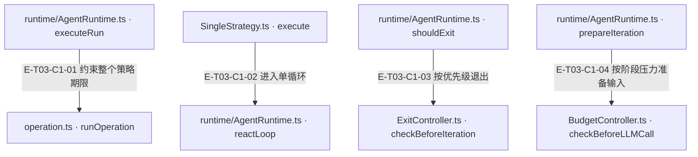
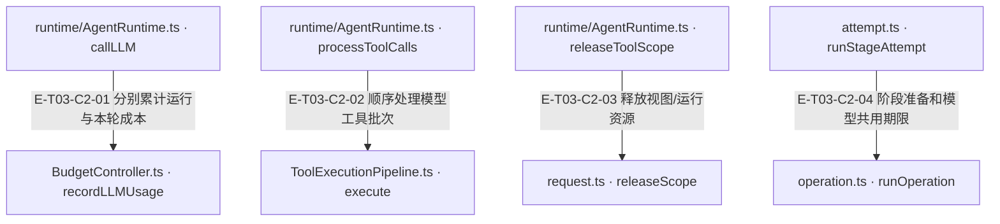

# 循环、预算与取消 · 真实调用

Runtime的执行边界用runOperation约束策略；reactLoop持有LoopContext并依次退出检查、输入准备/预算与压缩、provider、工具或文本处理、finalize。预算区分run累计与loop/stage基线；取消/超时先确定终态并传播signal，已确认工具回执保留，未合作任务的迟到输出不接纳。资源按run/view释放，不能将scope释放或abort理解为外部写入回滚。

[职责与边界](overview.md) · [直接依赖](file-dependency.md) · [当前全文与失败边界](full-source-review.md)

图中调用边经实现正文核对；AST只用于符号定位。接口／注入对象是调用端口，不据此推定所有宿主实现相同。测试表区分精确断言与执行状态；是否运行及其输入指纹见页面证据。

## 调用接缝 1

### 本图术语说明

| 术语／节点 | 含义与范围 |
| --- | --- |
| runtime/AgentRuntime.ts · executeRun | `src/agent/runtime/AgentRuntime.ts#AgentRuntime.executeRun`；声明或调用端口；动态实现的绑定条件见下表。 |
| operation.ts · runOperation | `src/shared/operation.ts#runOperation`；声明或调用端口；动态实现的绑定条件见下表。 |
| SingleStrategy.ts · execute | `src/agent/strategies/SingleStrategy.ts#SingleStrategy.execute`；声明或调用端口；动态实现的绑定条件见下表。 |
| runtime/AgentRuntime.ts · reactLoop | `src/agent/runtime/AgentRuntime.ts#AgentRuntime.reactLoop`；声明或调用端口；动态实现的绑定条件见下表。 |
| runtime/AgentRuntime.ts · shouldExit | `src/agent/runtime/AgentRuntime.ts#AgentRuntime.shouldExit`；声明或调用端口；动态实现的绑定条件见下表。 |
| ExitController.ts · checkBeforeIteration | `src/agent/runtime/ExitController.ts#ExitController.checkBeforeIteration`；声明或调用端口；动态实现的绑定条件见下表。 |
| runtime/AgentRuntime.ts · prepareIteration | `src/agent/runtime/AgentRuntime.ts#AgentRuntime.prepareIteration`；声明或调用端口；动态实现的绑定条件见下表。 |
| BudgetController.ts · checkBeforeLLMCall | `src/agent/runtime/BudgetController.ts#BudgetController.checkBeforeLLMCall`；声明或调用端口；动态实现的绑定条件见下表。 |

| 编号 | 代码依据 | 测试依据 | 关系与可证明范围 |
| --- | --- | --- | --- |
| E-T03-C1-01 | `src/agent/runtime/AgentRuntime.ts#AgentRuntime.executeRun` → `src/shared/operation.ts#runOperation` | `test/agent-lifecycle.test.ts#case:keeps%20a%20hard%20timeout%20authoritative%20when%20strategy%20resolves%20synchronously%20on%20abort`；真实Runtime边界、strategy.execute替身在收到abort时同步resolve成功文本；Service timeoutMs=10，fake timer推进10ms后断言status=timeout、timer数=0。证明终态先于cooperative迟到resolve。断言已定位，实际执行见页面证据。 | 把strategy.execute包进runOperation，传合成父/本地abortSignal及显式或policy期限；timeout生成owner-bound超时快照，error重抛，aborted返回已知snapshot。 |
| E-T03-C1-02 | `src/agent/strategies/SingleStrategy.ts#SingleStrategy.execute` → `src/agent/runtime/AgentRuntime.ts#AgentRuntime.reactLoop` | `test/agent-lifecycle.test.ts#case:permits%20the%20first%20model%20call%20when%20the%20iteration%20budget%20is%20one`；harness使用真实Runtime+SingleStrategy，Builder为返回该runtime的替身，provider chat为vi.fn返回done；maxIterations=1，断言Service status=success、reply=done且provider只调用一次。断言已定位，实际执行见页面证据。 | 传message.content/history、metadata.context，再用opts覆盖；reactLoop复用本Runtime活动scope，独立调用时自建scope。 |
| E-T03-C1-03 | `src/agent/runtime/AgentRuntime.ts#AgentRuntime.shouldExit` → `src/agent/runtime/ExitController.ts#ExitController.checkBeforeIteration` | `test/exit-controller-runtime-timeout.test.ts#case:%E7%AD%96%E7%95%A5%E8%B6%85%E6%97%B6%2050ms%E3%80%81%E9%98%B6%E6%AE%B5%20600s%EF%BC%9A%E9%80%80%E5%87%BA%E5%8E%9F%E5%9B%A0%E4%B8%BA%20stage_timeout%EF%BC%8CtimedOutStages%20%E9%9D%9E%E7%A9%BA%EF%BC%8C%E4%B8%8D%E5%86%8D%E5%8F%91%E5%BC%BA%E5%88%B6%E6%91%98%E8%A6%81`；真实Runtime，policy timeout=50ms、stage=600000ms、provider工具轮有延迟；断言cancelReason=stage_timeout、timedOutStages非空、forced_summary_suppressed、无policy_stop且timedOut=true。断言已定位，实际执行见页面证据。 | 传当前LoopContext与run累计tokenUsage；检查顺序abort→有效超时→tracker→无tracker轮数→policy，首次token超限且tracker未终结可给一次SUMMARIZE机会。 |
| E-T03-C1-04 | `src/agent/runtime/AgentRuntime.ts#AgentRuntime.prepareIteration` → `src/agent/runtime/BudgetController.ts#BudgetController.checkBeforeLLMCall` | `test/BudgetController.test.ts#case:measures%20a%20micro-stage%20budget%20against%20in-stage%20input%2C%20not%20the%20run-level%20cumulative%20input`；run累计input=300000的新微阶段，对比est/12000而非(300000+est)/12000；断言action=normal、ratio<0.75、工具quota=6000/15、run累计不变。此测试直接调用BudgetController，无provider。断言已定位，实际执行见页面证据。 | 每轮先runCompactionCycle再checkBeforeLLMCall；预检只返回normal/compress，session压力触发压缩，不直接决定终态。 |

## 调用接缝 2

### 本图术语说明

| 术语／节点 | 含义与范围 |
| --- | --- |
| runtime/AgentRuntime.ts · callLLM | `src/agent/runtime/AgentRuntime.ts#AgentRuntime.callLLM`；声明或调用端口；动态实现的绑定条件见下表。 |
| BudgetController.ts · recordLLMUsage | `src/agent/runtime/BudgetController.ts#BudgetController.recordLLMUsage`；声明或调用端口；动态实现的绑定条件见下表。 |
| runtime/AgentRuntime.ts · processToolCalls | `src/agent/runtime/AgentRuntime.ts#AgentRuntime.processToolCalls`；声明或调用端口；动态实现的绑定条件见下表。 |
| ToolExecutionPipeline.ts · execute | `src/agent/runtime/ToolExecutionPipeline.ts#ToolExecutionPipeline.execute`；声明或调用端口；动态实现的绑定条件见下表。 |
| runtime/AgentRuntime.ts · releaseToolScope | `src/agent/runtime/AgentRuntime.ts#AgentRuntime.releaseToolScope`；声明或调用端口；动态实现的绑定条件见下表。 |
| request.ts · releaseScope | `src/tools/kernel/request.ts#ToolRouterContract.releaseScope`；声明或调用端口；动态实现的绑定条件见下表。 |
| attempt.ts · runStageAttempt | `src/agent/strategies/pipeline/attempt.ts#runStageAttempt`；声明或调用端口；动态实现的绑定条件见下表。 |
| operation.ts · runOperation | `src/shared/operation.ts#runOperation`；声明或调用端口；动态实现的绑定条件见下表。 |

| 编号 | 代码依据 | 测试依据 | 关系与可证明范围 |
| --- | --- | --- | --- |
| E-T03-C2-01 | `src/agent/runtime/AgentRuntime.ts#AgentRuntime.callLLM` → `src/agent/runtime/BudgetController.ts#BudgetController.recordLLMUsage` | `test/BudgetController.test.ts#case:writes%20in-stage%20usage%20back%20to%20the%20shared%20run%20accumulator%20while%20ratios%20and%20summary%20stay%20in-stage`；给微阶段6000 input/500 output/100 reasoning/3000 cache，断言共享run累加为306000/40500/7100/93000，阶段ratio=0.5与summary只含本阶段，下一轮预检compress。断言已定位，实际执行见页面证据。 | provider返回usage后依次调用BudgetController.recordLLMUsage、ctx.addTokenUsage及diagnostics.recordTokenUsage；后一步失败不撤销前一步，不能把这三处当作原子提交。共享run总账与stage摘要不能互代。 |
| E-T03-C2-02 | `src/agent/runtime/AgentRuntime.ts#AgentRuntime.processToolCalls` → `src/agent/runtime/ToolExecutionPipeline.ts#ToolExecutionPipeline.execute` | `test/agent-lifecycle.test.ts#case:keeps%20confirmed%20tool%20receipts%20when%20cancellation%20interrupts%20a%20later%20model%20request`；第一次模型返回meta.tools调用，router spy返回observed:true成功信封；第二次模型挂起后runtime.abort，断言Service status=aborted仍保留meta回执/envelope.ok=true，router仅调用一次。真实Runtime/Single/Pipeline，Builder与Router为替身；不证明外部写入已回滚。断言已定位，实际执行见页面证据。 | 每轮最多8工具，顺序for-of逐个执行；每次先取消检查与异步before hook，再调用默认管道，拿到回执立即写loop与runtime history。 |
| E-T03-C2-03 | `src/agent/runtime/AgentRuntime.ts#AgentRuntime.releaseToolScope` → `src/tools/kernel/request.ts#ToolRouterContract.releaseScope` | `test/agent-lifecycle.test.ts#case:settles%20cancellation%20without%20waiting%20for%20an%20uncooperative%20provider%20and%20preserves%20the%20reason`；不合作provider保持pending，父signal.abort(reason)后断言Service已aborted、下游signal保留同一reason、runId scope释放、无剩余timer、再次abort不重复发布事件。releaseScope为spy，不验证宿主资源实际回收。断言已定位，实际执行见页面证据。 | loop finally释放runId/viewId，外层finally标scope.closed并释放runId；releaseScope抛错或拒绝只记诊断，不改写已确认结果；但await没有独立期限，永久pending仍可能阻止返回。 装配：可选宿主清理端口；ToolRouterAdapter再转发contextFactory.releaseScope。 |
| E-T03-C2-04 | `src/agent/strategies/pipeline/attempt.ts#runStageAttempt` → `src/shared/operation.ts#runOperation` | `test/agent-lifecycle.test.ts#case:shares%20the%20hard%20deadline%20across%20asynchronous%20preparation%20and%20execution`；真实PipelineStrategy，promptBuilder先等待30000ms、reactLoop替身永pending；预算声明timeoutMs=10经过既有阶段期限规则。fake timer先推进30000ms后loop只调用一次，再推进30010ms后已settled、phase.analyze.timedOut=true且timer=0。证明准备和执行同一attempt期限，不声称实际只等10ms。断言已定位，实际执行见页面证据。 | attempt把异步准备与runLoop统一包入operation，独立收集诊断/工具观察；终态后active=false防迟到回调污染父ledger。 |
