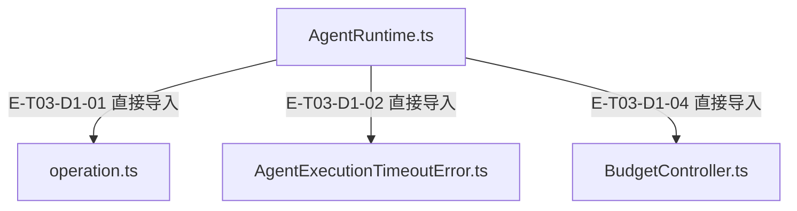
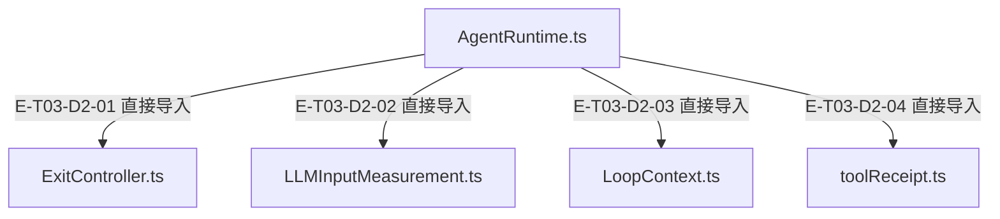

# 循环、预算与取消 · 精选直接依赖

[职责与边界](overview.md) · [真实调用](call-flow.md) · [当前全文与语义边界](full-source-review.md)

选取本专题入口的最多8条直接依赖；完整库存可在阅读器「文件与依赖」查看。以仓库全路径为节点身份，同名文件不会合并。Core／Node／第三方包只在完整探索器的外部边界出现。

## 静态依赖 1

### 本图术语说明

| 术语／节点 | 含义与范围 |
| --- | --- |
| AgentRuntime.ts | `src/agent/runtime/AgentRuntime.ts`；文件直接依赖，箭头不表示执行先后。 |
| operation.ts | `src/shared/operation.ts`；文件直接依赖，箭头不表示执行先后。 |
| AgentExecutionTimeoutError.ts | `src/agent/runtime/AgentExecutionTimeoutError.ts`；文件直接依赖，箭头不表示执行先后。 |
| BudgetController.ts | `src/agent/runtime/BudgetController.ts`；文件直接依赖，箭头不表示执行先后。 |

| 编号 | 代码依据 | 测试依据 | 关系与可证明范围 |
| --- | --- | --- | --- |
| E-T03-D1-01 | `src/agent/runtime/AgentRuntime.ts` → `src/shared/operation.ts` | 未覆盖：静态依赖由本图谱解析器反例测试支持；不把 import 当作行为覆盖。 | TypeScript AST 解析 #shared/operation.js；第 46 行，kind=import，typeOnly=false。只证明结构关系。 |
| E-T03-D1-02 | `src/agent/runtime/AgentRuntime.ts` → `src/agent/runtime/AgentExecutionTimeoutError.ts` | 未覆盖：静态依赖由本图谱解析器反例测试支持；不把 import 当作行为覆盖。 | TypeScript AST 解析 ./AgentExecutionTimeoutError.js；第 63 行，kind=import，typeOnly=false。只证明结构关系。 |
| E-T03-D1-04 | `src/agent/runtime/AgentRuntime.ts` → `src/agent/runtime/BudgetController.ts` | 未覆盖：静态依赖由本图谱解析器反例测试支持；不把 import 当作行为覆盖。 | TypeScript AST 解析 ./BudgetController.js；第 85 行，kind=import，typeOnly=false。只证明结构关系。 |

## 静态依赖 2

### 本图术语说明

| 术语／节点 | 含义与范围 |
| --- | --- |
| AgentRuntime.ts | `src/agent/runtime/AgentRuntime.ts`；文件直接依赖，箭头不表示执行先后。 |
| ExitController.ts | `src/agent/runtime/ExitController.ts`；文件直接依赖，箭头不表示执行先后。 |
| LLMInputMeasurement.ts | `src/agent/runtime/LLMInputMeasurement.ts`；文件直接依赖，箭头不表示执行先后。 |
| LoopContext.ts | `src/agent/runtime/LoopContext.ts`；文件直接依赖，箭头不表示执行先后。 |
| toolReceipt.ts | `src/agent/runtime/toolReceipt.ts`；文件直接依赖，箭头不表示执行先后。 |

| 编号 | 代码依据 | 测试依据 | 关系与可证明范围 |
| --- | --- | --- | --- |
| E-T03-D2-01 | `src/agent/runtime/AgentRuntime.ts` → `src/agent/runtime/ExitController.ts` | 未覆盖：静态依赖由本图谱解析器反例测试支持；不把 import 当作行为覆盖。 | TypeScript AST 解析 ./ExitController.js；第 87 行，kind=import，typeOnly=false。只证明结构关系。 |
| E-T03-D2-02 | `src/agent/runtime/AgentRuntime.ts` → `src/agent/runtime/LLMInputMeasurement.ts` | 未覆盖：静态依赖由本图谱解析器反例测试支持；不把 import 当作行为覆盖。 | TypeScript AST 解析 ./LLMInputMeasurement.js；第 101 行，kind=import，typeOnly=false。只证明结构关系。 |
| E-T03-D2-03 | `src/agent/runtime/AgentRuntime.ts` → `src/agent/runtime/LoopContext.ts` | 未覆盖：静态依赖由本图谱解析器反例测试支持；不把 import 当作行为覆盖。 | TypeScript AST 解析 ./LoopContext.js；第 103 行，kind=import，typeOnly=false。只证明结构关系。 |
| E-T03-D2-04 | `src/agent/runtime/AgentRuntime.ts` → `src/agent/runtime/toolReceipt.ts` | 未覆盖：静态依赖由本图谱解析器反例测试支持；不把 import 当作行为覆盖。 | TypeScript AST 解析 ./toolReceipt.js；第 138 行，kind=import，typeOnly=false。只证明结构关系。 |

历史边 E-T03-D1-03 已撤回：Runtime不再导入AgentState。独立AgentState类仍被公开barrel导出，不能把这条运行时依赖撤回解释为类已删除。
