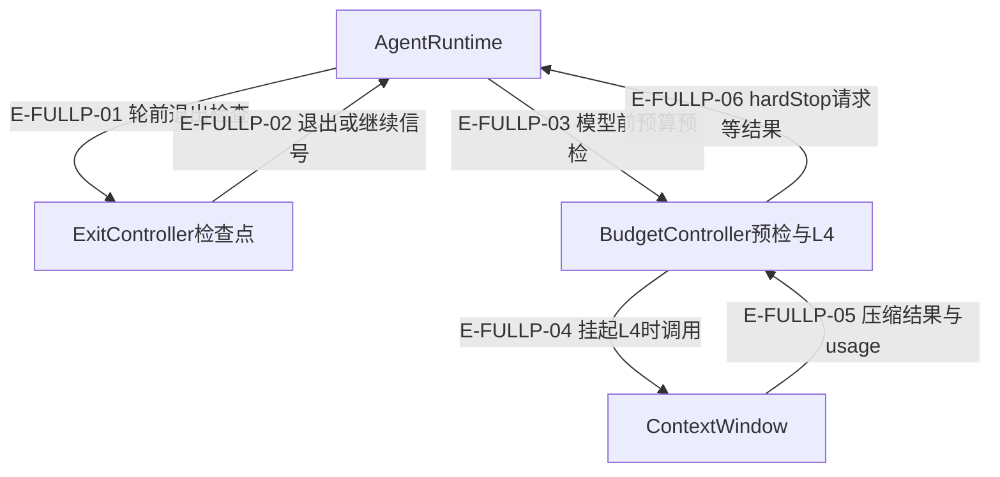

# 策略、预算与诊断：当前全文审阅

本页把预算压力、退出判断、运行级质量警告、独立状态机和诊断聚合分开。尤其注意：报错前的usage、phase或台账可能已经改变。

本页完整重读 10 个源文件、3205 个库存行，不再沿用“只看差异”的深度。段落范围含末尾换行产生的空行。全文阅读不等于分支覆盖，未定位的故障注入明确保留；本轮仅更新 Atlas。全体53文件的逐段、分支和断言身份见[结构化复核记录](../../evidence/reviews/source-full-v6.json)。

## 压缩信号、退出判断与副作用分层

### 本图术语说明

| 节点 | 所有权 |
| --- | --- |
| ExitController | 只画已接线的检查点，非独立墙钟race。 |
| BudgetController | 阶段累加器与压缩意图，工具展示配额不是访问授权。 |
| ContextWindow | 消息及压缩状态，效果可先于后置回调错误。 |

| 编号 | 代码依据 | 测试依据 | 关系与限制 |
| --- | --- | --- | --- |
| E-FULLP-01 | `src/agent/runtime/AgentRuntime.ts#AgentRuntime.shouldExit` → `src/agent/runtime/ExitController.ts#ExitController.checkBeforeIteration` | 间接覆盖：`test/exit-controller-runtime-timeout.test.ts#case:%E7%AD%96%E7%95%A5%E8%B6%85%E6%97%B6%2050ms%E3%80%81%E9%98%B6%E6%AE%B5%20600s%EF%BC%9A%E9%80%80%E5%87%BA%E5%8E%9F%E5%9B%A0%E4%B8%BA%20stage_timeout%EF%BC%8CtimedOutStages%20%E9%9D%9E%E7%A9%BA%EF%BC%8C%E4%B8%8D%E5%86%8D%E5%8F%91%E5%BC%BA%E5%88%B6%E6%91%98%E8%A6%81`；真实Runtime在更短策略时间后stage_timeout，timedOutStages与抑制摘要诊断可见。 边界：Single+mock provider/router，执行期限显式10s，不使用真实服务。。实际执行与输入匹配见本页证据。 | 调用；先判断abort/有效超时，后tracker与policy。 |
| E-FULLP-02 | `src/agent/runtime/ExitController.ts#ExitController.checkBeforeIteration` → `src/agent/runtime/AgentRuntime.ts#AgentRuntime.shouldExit` | 间接覆盖：`test/exit-controller.test.ts#case:abort%20%E4%BF%A1%E5%8F%B7%E5%85%88%E4%BA%8E%E9%98%B6%E6%AE%B5%E8%B6%85%E6%97%B6%EF%BC%9A%E5%B7%B2%E8%B6%85%E6%97%B6%20%2B%20tracker%20%E8%A6%81%E6%B1%82%E9%80%80%E5%87%BA%E6%97%B6%E4%BB%8D%E6%8A%A5%20abort_signal%EF%BC%8C%E4%B8%94%E4%B8%8D%E8%A7%A6%E7%A2%B0%20tracker%2Fpolicy`；已取消即返回abort，tracker tick/shouldExit和policy均零调用。 边界：真实ExitController，最小ctx与fake tracker。。实际执行与输入匹配见本页证据。 | 决策回程；检查点夹具不证明外部工具已取消。 |
| E-FULLP-03 | `src/agent/runtime/AgentRuntime.ts#AgentRuntime.callLLM` → `src/agent/runtime/BudgetController.ts#BudgetController.checkBeforeLLMCall` | 间接覆盖：`test/BudgetController.test.ts#case:measures%20a%20micro-stage%20budget%20against%20in-stage%20input%2C%20not%20the%20run-level%20cumulative%20input`；已有300000运行input不计本stage，首轮ratio低于.75、run累计不变。 边界：控制器与窗口直接组合。。实际执行与输入匹配见本页证据。 | 调用接缝由源码确认；测试只验证controller阶段基线。 |
| E-FULLP-04 | `src/agent/runtime/BudgetController.ts#BudgetController.executeL4IfPending` → `src/agent/context/ContextWindow.ts#ContextWindow.compactL4` | `test/budget-controller-l4-switch.test.ts#case:classifies%20an%20out-of-sync%20l4_disabled%20short-circuit%20as%20a%20skip%2C%20not%20an%20L4%20failure`；另一控制器关共享窗口后返回level0，无provider调用/失败统计；下次可再次pending。 边界：真实CW/Controller，受控provider，无真实LLM。。实际执行与输入匹配见本页证据。 | 调用；窗口开关冲突按skip返回。 |
| E-FULLP-05 | `src/agent/context/ContextWindow.ts#ContextWindow.compactL4` → `src/agent/runtime/BudgetController.ts#BudgetController.executeL4IfPending` | 间接覆盖：`test/runtime-degrade-diagnostics.test.ts#case:hard-stops%20on%20the%20second%20thrown%20L4%20failure%20under%201.0%E2%80%931.3%20pressure%2C%20like%20a%20returned%20failure`；同压力1.1两次返回failed或抛错都第二次给hardStop。 边界：compactL4被spy替换；未注入后置usage callback/logger错误。。实际执行与输入匹配见本页证据。 | 数据回程；spy提供失败，不能据此证明真实压缩模型效果。 |
| E-FULLP-06 | `src/agent/runtime/BudgetController.ts#BudgetController.executeL4IfPending` → `src/agent/runtime/AgentRuntime.ts#AgentRuntime.callLLM` | 间接覆盖：`test/runtime-degrade-diagnostics.test.ts#case:hard-stops%20on%20the%20second%20thrown%20L4%20failure%20under%201.0%E2%80%931.3%20pressure%2C%20like%20a%20returned%20failure`；同压力1.1两次返回failed或抛错都第二次给hardStop。 边界：compactL4被spy替换；未注入后置usage callback/logger错误。。实际执行与输入匹配见本页证据。 | 返回hardStop请求；Runtime消费由源码另证，不是controller自行杀进程。 |

## 独立 AgentState 的提交顺序

### 本图术语说明

| 节点 | 本图中的含义 |
| --- | --- |
| AgentState | 独立公开类；Runtime不再持有它。 |
| action失败 | phase/data已写，本次history与通知尚未发生。 |
| listener失败 | 可能已有history，后续通知不会自动补发。 |

| 编号 | 代码依据 | 测试依据 | 关系与限制 |
| --- | --- | --- | --- |
| E-FULLP-07 | `src/agent/runtime/AgentState.ts#AgentState.send` | 间接覆盖：`test/agent-state-snapshot-copy.test.ts#case:toJSON%20copies%20are%20not%20write-through%3A%20mutating%20the%20snapshot%20leaves%20the%20state%20intact`；改history数组长度与data顶层键不穿透；后续快照是新容器。 边界：仅顶层/数组，未覆盖nested对象和历史条目写穿。。实际执行与输入匹配见本页证据。 | 条件路径由源码定位；快照用例不逐一spy内部顺序。 |
| E-FULLP-08 | `src/agent/runtime/AgentState.ts#AgentState.send` | 间接覆盖：`test/agent-state-snapshot-copy.test.ts#case:toJSON%20copies%20are%20not%20write-through%3A%20mutating%20the%20snapshot%20leaves%20the%20state%20intact`；改history数组长度与data顶层键不穿透；后续快照是新容器。 边界：仅顶层/数组，未覆盖nested对象和历史条目写穿。。实际执行与输入匹配见本页证据。 | 调用前的状态修改由源码定位；快照用例不逐一spy内部顺序。 |
| E-FULLP-09 | `src/agent/runtime/AgentState.ts#AgentState.send` | 间接覆盖：`test/agent-state-snapshot-copy.test.ts#case:toJSON%20copies%20are%20not%20write-through%3A%20mutating%20the%20snapshot%20leaves%20the%20state%20intact`；改history数组长度与data顶层键不穿透；后续快照是新容器。 边界：仅顶层/数组，未覆盖nested对象和历史条目写穿。。实际执行与输入匹配见本页证据。 | 正常后续顺序由源码定位；快照用例不逐一spy内部顺序。 |
| E-FULLP-10 | `src/agent/runtime/AgentState.ts#AgentState.send` | 间接覆盖：`test/agent-state-snapshot-copy.test.ts#case:toJSON%20copies%20are%20not%20write-through%3A%20mutating%20the%20snapshot%20leaves%20the%20state%20intact`；改history数组长度与data顶层键不穿透；后续快照是新容器。 边界：仅顶层/数组，未覆盖nested对象和历史条目写穿。。实际执行与输入匹配见本页证据。 | 通知顺序由源码定位；快照用例不逐一spy内部顺序。 |
| E-FULLP-11 | `src/agent/runtime/AgentState.ts#AgentState.send` | 未覆盖：未定位action抛错后phase/data/history组合的专门断言。 | 异常传播，无本次history补记与自动回滚。 |
| E-FULLP-12 | `src/agent/runtime/AgentState.ts#AgentState.send` | 未覆盖：现有快照用例不覆盖同步listener抛错和通知中断。 | EventEmitter异常传播，已提交状态不撤回。 |

## Policy.ts

`src/agent/policies/Policy.ts` · 63 库存行（末尾空行计入）；本轮全文读取，同步三阶段策略合同与默认放行基类。

行为链：before/during/after 返回独立决策；无配置改写链。

| 连续区间 | 逐段解释 |
| --- | --- |
| 1–38 | PolicyContext/StepState/result 只定义输入形状；during code 可选，兼容 reason 分类在 ExitController。 |
| 39–63 | 基类 name 必须由子类实现，否则抛Error；三个校验默认ok，不提供重试或异常隔离。 |

| 触发 | 结果与副作用 | 恢复责任／源码 | 断言依据与边界 |
| --- | --- | --- | --- |
| P-BASE · 基类name未重写 | 读取name抛Error，校验方法仍默认放行 已发生／可能已发生：无自动记录或状态回滚 | 派生类提供name；ExitController另有名称回落 `src/agent/policies/Policy.ts#Policy.name` | `test/exit-controller.test.ts#case:%E7%AD%96%E7%95%A5%E6%9C%AA%E5%AE%9E%E7%8E%B0%20name%20%E6%97%B6%E8%AF%8A%E6%96%AD%E9%80%80%E5%9B%9E%E6%9E%84%E9%80%A0%E5%87%BD%E6%95%B0%E5%90%8D`；基类name抛错后仍按NamelessTokenPolicy记录预算拒绝。（标准Engine/collector；未注入Logger抛错。） |

- 合同类型不等于运行期schema校验；同步扩展钩子异常由调用方承担。

已定位文件级断言（不自动覆盖上表所有分支）：

- `test/exit-controller.test.ts#case:%E7%AD%96%E7%95%A5%E6%9C%AA%E5%AE%9E%E7%8E%B0%20name%20%E6%97%B6%E8%AF%8A%E6%96%AD%E9%80%80%E5%9B%9E%E6%9E%84%E9%80%A0%E5%87%BD%E6%95%B0%E5%90%8D`：基类name抛错后仍按NamelessTokenPolicy记录预算拒绝。 边界：标准Engine/collector；未注入Logger抛错。

## BudgetPolicy.ts

`src/agent/policies/BudgetPolicy.ts` · 121 库存行（末尾空行计入）；本轮全文读取，运行级轮次、时长和累计input策略。

行为链：按轮次→时长→累计input顺序首个拒绝，结构化code由ExitController解释。

| 连续区间 | 逐段解释 |
| --- | --- |
| 1–34 | 三个保留code、配置及运行累计input与阶段input差异；已无总token cap。 |
| 35–83 | 默认20轮/4096输出/300000ms/0.7；只解构保留字段，getters投影同一实例配置。 |
| 84–121 | iteration>=max先拒；elapsed>timeout再拒；input上限与用量均truthy且>=时拒；否则continue。 |

| 触发 | 结果与副作用 | 恢复责任／源码 | 断言依据与边界 |
| --- | --- | --- | --- |
| P-BUDGET-ORDER · 多个限制同时命中 | maxIterations先于timeout，timeout先于input返回 已发生／可能已发生：返回一个拒绝，未汇总其它拒绝 | 读取code，不能根据reason猜全部触发条件 `src/agent/policies/BudgetPolicy.ts#BudgetPolicy.validateDuring` | `test/agent-surface-floor.test.ts#case:short-circuits%20policy%20validation%20and%20exposes%20budget%20configuration`；检查默认/覆盖预算，before阻断及iteration/timeout拒绝。（直接Engine/预算策略；未spy所有后继策略或异常。） |
| P-BUDGET-INPUT · 输入上限/用量为0或未声明 | truthy检查使input预算不拒绝；无运行累计总token限制 已发生／可能已发生：策略本身不压缩也不发强制摘要 | 实际终止还要看阶段声明、ExitController屏蔽与grace `src/agent/policies/BudgetPolicy.ts#BudgetPolicy.validateDuring` | `test/exit-controller.test.ts#case:%E9%98%B6%E6%AE%B5%E6%9C%AA%E5%A3%B0%E6%98%8E%20maxSessionInputTokens%EF%BC%9A%E7%AD%96%E7%95%A5%E5%B1%82%20input%20%E4%BC%9A%E8%AF%9D%E6%8B%92%E7%BB%9D%E8%A2%AB%E5%B1%8F%E8%94%BD%E3%80%81%E5%86%99%E4%B8%80%E6%AC%A1%E8%AF%8A%E6%96%AD%EF%BC%8C%E5%B9%B6%E7%BB%A7%E7%BB%AD%E8%AF%84%E4%BC%B0%E5%90%8E%E7%BB%AD%E7%AD%96%E7%95%A5`；标准Engine屏蔽input拒绝后StopAll仍生效，跨两轮只诊断一次。（真实PolicyEngine与collector，ctx/tracker为夹具。） `test/BudgetController.test.ts#case:measures%20a%20micro-stage%20budget%20against%20in-stage%20input%2C%20not%20the%20run-level%20cumulative%20input`；已有300000运行input不计本stage，首轮ratio低于.75、run累计不变。（控制器与窗口直接组合。） |

- 配置构造不做数值schema验证；阶段BudgetController的input阈值不是这里的运行累计终止语义。

已定位文件级断言（不自动覆盖上表所有分支）：

- `test/agent-surface-floor.test.ts#case:short-circuits%20policy%20validation%20and%20exposes%20budget%20configuration`：检查默认/覆盖预算，before阻断及iteration/timeout拒绝。 边界：直接Engine/预算策略；未spy所有后继策略或异常。
- `test/exit-controller.test.ts#case:%E9%98%B6%E6%AE%B5%E6%9C%AA%E5%A3%B0%E6%98%8E%20maxSessionInputTokens%EF%BC%9A%E7%AD%96%E7%95%A5%E5%B1%82%20input%20%E4%BC%9A%E8%AF%9D%E6%8B%92%E7%BB%9D%E8%A2%AB%E5%B1%8F%E8%94%BD%E3%80%81%E5%86%99%E4%B8%80%E6%AC%A1%E8%AF%8A%E6%96%AD%EF%BC%8C%E5%B9%B6%E7%BB%A7%E7%BB%AD%E8%AF%84%E4%BC%B0%E5%90%8E%E7%BB%AD%E7%AD%96%E7%95%A5`：标准Engine屏蔽input拒绝后StopAll仍生效，跨两轮只诊断一次。 边界：真实PolicyEngine与collector，ctx/tracker为夹具。
- `test/BudgetController.test.ts#case:measures%20a%20micro-stage%20budget%20against%20in-stage%20input%2C%20not%20the%20run-level%20cumulative%20input`：已有300000运行input不计本stage，首轮ratio低于.75、run累计不变。 边界：控制器与窗口直接组合。

## PolicyEngine.ts

`src/agent/policies/PolicyEngine.ts` · 233 库存行（末尾空行计入）；本轮全文读取，同步策略顺序与工具安全组合。

行为链：生命周期按注册顺序首拒；所有SafetyPolicy都参与工具校验。

| 连续区间 | 逐段解释 |
| --- | --- |
| 1–25 | 构造保留传入策略数组引用；getter复制数组但不克隆Policy实例；get取首个instanceof。 |
| 26–60 | before/during/after逐条同步调用，首拒短路，未包catch。 |
| 61–90 | getBudget只投影首个BudgetPolicy；validateToolCall遍历所有SafetyPolicy。 |
| 91–153 | terminal读取嵌套或平铺command，再走code文件范围，审批配置命中是硬拒绝而非待确认。 |
| 154–203 | code.search从项目根检查，scope窄时拒绝；所有路径写法都检，structure缺省目录补.。 |
| 204–233 | 仅字符串路径进入候选；filePaths逐字符串采集，普通record排除数组。 |

| 触发 | 结果与副作用 | 恢复责任／源码 | 断言依据与边界 |
| --- | --- | --- | --- |
| P-ENGINE-SHORT · 先前policy拒绝或抛错 | 拒绝立即返回，异常直接传播，后面的policy未执行 已发生／可能已发生：此前policy可能已有自身副作用 | 不能根据首拒声称所有策略均运行；自定义policy自行管理副作用 `src/agent/policies/PolicyEngine.ts#PolicyEngine.validateBefore` | `test/agent-surface-floor.test.ts#case:short-circuits%20policy%20validation%20and%20exposes%20budget%20configuration`；检查默认/覆盖预算，before阻断及iteration/timeout拒绝。（直接Engine/预算策略；未spy所有后继策略或异常。） `test/agent-lifecycle.test.ts#case:a%20real%20post-execution%20failure%20preserves%20already%20confirmed%20tool%20receipts%20in%20the%20service%20result`；validateAfter抛错导致Service error但meta确认回执与input4保留，router仅一次。（真实Runtime+Single、受控FailAfterPolicy/provider/router；不是QualityGate.customValidator独立专测。） |
| P-ENGINE-APPROVAL · requireApprovalFor命中 | 返回safety-approval-unavailable硬拒绝 已发生／可能已发生：没有审批挂起、恢复、重放 | 改变授权配置或停用该调用，重复同一请求不改变结论 `src/agent/policies/PolicyEngine.ts#validateSafetyToolCall` | `test/agent-surface-floor.test.ts#case:applies%20safety%20policy%20to%20terminal%20commands%2C%20code%20paths%2C%20and%20approval-only%20tools`；验证sender拒绝、词法read/array/structure/search范围和审批规则硬拒绝。（直接PolicyEngine，命令只分类不执行、无OS沙箱。） |
| P-ENGINE-SCOPE · search项目根不在fileScope或任一路径越界 | 返回明确搜索/路径规则码；不把搜索根缩到scope 已发生／可能已发生：本函数不执行文件I/O | 改用允许范围内read/structure；terminal须独立隔离 `src/agent/policies/PolicyEngine.ts#checkCodeFileScope` | `test/agent-surface-floor.test.ts#case:applies%20safety%20policy%20to%20terminal%20commands%2C%20code%20paths%2C%20and%20approval-only%20tools`；验证sender拒绝、词法read/array/structure/search范围和审批规则硬拒绝。（直接PolicyEngine，命令只分类不执行、无OS沙箱。） |

- getBudget不是所有BudgetPolicy最小预算聚合；调用者修改原数组可改变本Engine链，getter只提供数组层隔离。

已定位文件级断言（不自动覆盖上表所有分支）：

- `test/agent-surface-floor.test.ts#case:short-circuits%20policy%20validation%20and%20exposes%20budget%20configuration`：检查默认/覆盖预算，before阻断及iteration/timeout拒绝。 边界：直接Engine/预算策略；未spy所有后继策略或异常。
- `test/agent-lifecycle.test.ts#case:a%20real%20post-execution%20failure%20preserves%20already%20confirmed%20tool%20receipts%20in%20the%20service%20result`：validateAfter抛错导致Service error但meta确认回执与input4保留，router仅一次。 边界：真实Runtime+Single、受控FailAfterPolicy/provider/router；不是QualityGate.customValidator独立专测。
- `test/agent-surface-floor.test.ts#case:applies%20safety%20policy%20to%20terminal%20commands%2C%20code%20paths%2C%20and%20approval-only%20tools`：验证sender拒绝、词法read/array/structure/search范围和审批规则硬拒绝。 边界：直接PolicyEngine，命令只分类不执行、无OS沙箱。

## QualityGatePolicy.ts

`src/agent/policies/QualityGatePolicy.ts` · 75 库存行（末尾空行计入）；本轮全文读取，显式注入时的运行级阈值质量提示。

行为链：长度→无持久化提交时文件引用→toolCalls数量→customValidator，汇总reason。

| 连续区间 | 逐段解释 |
| --- | --- |
| 1–38 | 默认阈值与显式注入定位；内置insight不用运行级QualityGate。 |
| 39–64 | 已持久化提交只免文件引用检查，不免长度和工具数；工具数是数组长度。 |
| 65–75 | 自定义validator返回false追加reason，抛错无catch；最后汇总返回ok/reason。 |

| 触发 | 结果与副作用 | 恢复责任／源码 | 断言依据与边界 |
| --- | --- | --- | --- |
| P-QUALITY · 有persisted submission但reply太短或工具数少 | 仍可质量失败；文件引用项被跳过 已发生／可能已发生：只产出质量决定，不负责改变Service状态 | 区分Runtime quality_warning与Pipeline gate outcome `src/agent/policies/QualityGatePolicy.ts#QualityGatePolicy.validateAfter` | `test/agent-surface-floor.test.ts#case:bypasses%20file-reference%20checks%20only%20for%20a%20persisted%20submission%20(%25s%20identity)`；仅带created身份pending生命周期回执才免文件引用，缺回执仍拒。（受控submission DTO；不证明真实Core持久化。） `test/agent-surface-floor.test.ts#case:combines%20evidence%2C%20call-count%20and%20custom%20quality%20requirements`；长度、文件引用、工具数分别拒绝，自定义false reason可见。（直接QualityGatePolicy，不是Pipeline门，也未注入custom抛错。） |
| P-QUALITY-CUSTOM · customValidator抛异常 | 异常传播，不转换成普通false 已发生／可能已发生：此前reason只在本地数组，未形成返回值 | 调用方负责异常；不要按普通质量警告自动重试提交 `src/agent/policies/QualityGatePolicy.ts#QualityGatePolicy.validateAfter` | `test/agent-lifecycle.test.ts#case:a%20real%20post-execution%20failure%20preserves%20already%20confirmed%20tool%20receipts%20in%20the%20service%20result`；validateAfter抛错导致Service error但meta确认回执与input4保留，router仅一次。（真实Runtime+Single、受控FailAfterPolicy/provider/router；不是QualityGate.customValidator独立专测。） 未覆盖说明：相邻用例已定位，但没有直接注入本行的nested别名／customValidator异常／配额耗尽条件；不能用相邻通过替代本行证据。 |

- 文件引用正则是文本启发式，并非文件存在/证据有效验证。

已定位文件级断言（不自动覆盖上表所有分支）：

- `test/agent-surface-floor.test.ts#case:bypasses%20file-reference%20checks%20only%20for%20a%20persisted%20submission%20(%25s%20identity)`：仅带created身份pending生命周期回执才免文件引用，缺回执仍拒。 边界：受控submission DTO；不证明真实Core持久化。
- `test/agent-surface-floor.test.ts#case:combines%20evidence%2C%20call-count%20and%20custom%20quality%20requirements`：长度、文件引用、工具数分别拒绝，自定义false reason可见。 边界：直接QualityGatePolicy，不是Pipeline门，也未注入custom抛错。
- `test/agent-lifecycle.test.ts#case:a%20real%20post-execution%20failure%20preserves%20already%20confirmed%20tool%20receipts%20in%20the%20service%20result`：validateAfter抛错导致Service error但meta确认回执与input4保留，router仅一次。 边界：真实Runtime+Single、受控FailAfterPolicy/provider/router；不是QualityGate.customValidator独立专测。

## SafetyPolicy.ts

`src/agent/policies/SafetyPolicy.ts` · 132 库存行（末尾空行计入）；本轮全文读取，发送者、命令、词法路径与审批配置。

行为链：sender预检；命令复用terminal规则后叠加独立RegExp；code范围由Engine使用。

| 连续区间 | 逐段解释 |
| --- | --- |
| 1–44 | 配置与范围说明：fileScope只覆盖code，不约束terminal/graph/knowledge/evidence，也不解析symlink。 |
| 45–77 | 构造复制黑名单数组，sender/approval数组仍共享；sender有白名单时缺失与不在列表都拒。 |
| 78–97 | 命令先terminal规则，再每次new RegExp避免g/y lastIndex污染；没有安全静态表。 |
| 98–132 | scope空则放行；path.resolve+relative按cwd判断父目录逃逸；approval只做工具名包含检查。 |

| 触发 | 结果与副作用 | 恢复责任／源码 | 断言依据与边界 |
| --- | --- | --- | --- |
| P-SAFETY-SENDER · 非空allowedSenders且sender缺失/不匹配 | validateBefore拒绝 已发生／可能已发生：工具未由此方法执行 | 宿主提供正确sender，不从角色名推断授权 `src/agent/policies/SafetyPolicy.ts#SafetyPolicy.validateBefore` | `test/agent-surface-floor.test.ts#case:applies%20safety%20policy%20to%20terminal%20commands%2C%20code%20paths%2C%20and%20approval-only%20tools`；验证sender拒绝、词法read/array/structure/search范围和审批规则硬拒绝。（直接PolicyEngine，命令只分类不执行、无OS沙箱。） |
| P-SAFETY-REGEX · terminal危险规则通过但自定义g/y规则命中 | 每次新matcher判定并拒绝，不交替放行 已发生／可能已发生：不复用调用方RegExp.lastIndex | 改变允许命令或策略，不把handler规则与custom规则混合解释 `src/agent/policies/SafetyPolicy.ts#SafetyPolicy.checkCommand` | `test/agent-surface-floor.test.ts#case:composes%20every%20safety%20policy%20with%20stateful%20pattern%20%25s`；第二条SafetyPolicy仍参与；g/y连续三次拒，原RegExp.lastIndex不变。（直接Engine与合成命令；不运行shell。） |
| P-SAFETY-PATH · 词法越界或使用symlink指向外部 | 词法越界拒绝；本层不解析真实链接 已发生／可能已发生：不是OS沙箱或真实路径权限证明 | 真实文件边界还需handler/宿主负责 `src/agent/policies/SafetyPolicy.ts#SafetyPolicy.checkFilePath` | `test/agent-surface-floor.test.ts#case:applies%20safety%20policy%20to%20terminal%20commands%2C%20code%20paths%2C%20and%20approval-only%20tools`；验证sender拒绝、词法read/array/structure/search范围和审批规则硬拒绝。（直接PolicyEngine，命令只分类不执行、无OS沙箱。） |

- 修改caller-owned sender/approval数组会影响实例；fileScope不覆盖terminal cwd/命令。

已定位文件级断言（不自动覆盖上表所有分支）：

- `test/agent-surface-floor.test.ts#case:applies%20safety%20policy%20to%20terminal%20commands%2C%20code%20paths%2C%20and%20approval-only%20tools`：验证sender拒绝、词法read/array/structure/search范围和审批规则硬拒绝。 边界：直接PolicyEngine，命令只分类不执行、无OS沙箱。
- `test/agent-surface-floor.test.ts#case:composes%20every%20safety%20policy%20with%20stateful%20pattern%20%25s`：第二条SafetyPolicy仍参与；g/y连续三次拒，原RegExp.lastIndex不变。 边界：直接Engine与合成命令；不运行shell。

## AgentState.ts

`src/agent/runtime/AgentState.ts` · 249 库存行（末尾空行计入）；本轮全文读取，独立保留的同步状态机（不是Runtime当前phase实现）。

行为链：精确/通配转换→guard→更新phase/data→action→history→两个同步事件。

| 连续区间 | 逐段解释 |
| --- | --- |
| 1–82 | 枚举、快照、guard/action与默认转换；abort/error通配，非终态锁。 |
| 83–139 | 默认转换先于自定义项；data浅拷贝/history数组拷贝；嵌套对象和历史条目仍共享。 |
| 140–183 | 无转换/guard false返回false；phase/data在action前已改；action异常时不追加history，事件异常发生提交之后。 |
| 184–216 | update先改data再emit；toJSON仅顶层data及history数组分离。 |
| 217–249 | fromJSON复制history数组；keepHistory=false仍可载入已有history；精确find优先默认首项再通配。 |

| 触发 | 结果与副作用 | 恢复责任／源码 | 断言依据与边界 |
| --- | --- | --- | --- |
| P-STATE-ACTION · action或transition事件监听器抛错 | send向调用方抛异常，但phase/data可能已改变；action失败前无新history，transition listener失败后phase事件不会发 已发生／可能已发生：不同失败点留下不同已提交状态 | inspect phase/data/history，不能假设send异常等于回滚或盲目重发 `src/agent/runtime/AgentState.ts#AgentState.send` | 未覆盖：本次未定位到专门故障注入断言；仅确认当前源码顺序与边界，不宣称实际执行。 |
| P-STATE-SHALLOW · 调用方修改快照嵌套对象/历史条目 | 浅复制不阻止nested/history-entry别名修改 已发生／可能已发生：只保证顶层data与history数组脱钩 | 需要深不可变快照由直接使用方另处理；不要归入Runtime结果 `src/agent/runtime/AgentState.ts#AgentState.toJSON` | `test/agent-state-snapshot-copy.test.ts#case:toJSON%20copies%20are%20not%20write-through%3A%20mutating%20the%20snapshot%20leaves%20the%20state%20intact`；改history数组长度与data顶层键不穿透；后续快照是新容器。（仅顶层/数组，未覆盖nested对象和历史条目写穿。） `test/agent-state-snapshot-copy.test.ts#case:fromJSON%20copies%20the%20incoming%20history%20instead%20of%20holding%20the%20caller%20array`；恢复后的追加与改原数组length相互独立。（不是history entry深复制或非法snapshot校验。） 未覆盖说明：相邻用例已定位，但没有直接注入本行的nested别名／customValidator异常／配额耗尽条件；不能用相邻通过替代本行证据。 |

- 默认相同from/event排在自定义项前，追加自定义转移不覆盖默认首项；Runtime结果仅phase另由Runtime生成。

已定位文件级断言（不自动覆盖上表所有分支）：

- `test/agent-state-snapshot-copy.test.ts#case:toJSON%20copies%20are%20not%20write-through%3A%20mutating%20the%20snapshot%20leaves%20the%20state%20intact`：改history数组长度与data顶层键不穿透；后续快照是新容器。 边界：仅顶层/数组，未覆盖nested对象和历史条目写穿。
- `test/agent-state-snapshot-copy.test.ts#case:fromJSON%20copies%20the%20incoming%20history%20instead%20of%20holding%20the%20caller%20array`：恢复后的追加与改原数组length相互独立。 边界：不是history entry深复制或非法snapshot校验。

## BudgetController.ts

`src/agent/runtime/BudgetController.ts` · 721 库存行（末尾空行计入）；本轮全文读取，每reactLoop的阶段input压力、压缩和工具展示配额。

行为链：共享累加器减构造基线→预检→L1/L4请求→异步压缩→统计；退出由调用方执行。

| 连续区间 | 逐段解释 |
| --- | --- |
| 1–159 | 配置/遥测合同与75%、90%、L4硬停阈值、错误文本有界格式化。 |
| 160–226 | 共享引用与阶段基线；L4显式优于env，并同步共享ContextWindow开关。 |
| 227–338 | 无预算清零继承pressure；有预算先消耗cooldown再估算，>75触发压缩，>90申请L4；标签不代表实际等级。 |
| 339–367 | 无窗口常规压缩返回level0；显式L4请求服从唯一开关与冷却。 |
| 368–471 | L4取消、开关冲突、failed/throw、usage回写及hardStop请求；pending先清，成功后callbacks仍在try内。 |
| 472–519 | pressure取实际与投影最大；>=1.3或两次失败且>=1.0给hardStop；usage共享累加。 |
| 520–570 | 有窗口按并行数缩放，最小400字符/2match；无窗口6000/15；remaining仍有400底线，不是I/O硬额度。 |
| 571–633 | turn遥测与连续零cache提醒，summary仅本loop差值，forcedSummarize恒false。 |
| 634–681 | 负共享增量钳0并每loop告警一次；估算优先上一轮，其次窗口，其次阶段均值，最后8000。 |
| 682–721 | 额外压缩、L4默认关闭与冷却门、压缩统计累计。 |

| 触发 | 结果与副作用 | 恢复责任／源码 | 断言依据与边界 |
| --- | --- | --- | --- |
| P-L4-SKIP · 共享窗口被另一控制器关闭L4 | l4_disabled返回level0，不计失败/冷却/hardStop 已发生／可能已发生：当前pending已清 | 修复共享窗口配置所有权，不当成摘要内容失败 `src/agent/runtime/BudgetController.ts#BudgetController.executeL4IfPending` | `test/budget-controller-l4-switch.test.ts#case:classifies%20an%20out-of-sync%20l4_disabled%20short-circuit%20as%20a%20skip%2C%20not%20an%20L4%20failure`；另一控制器关共享窗口后返回level0，无provider调用/失败统计；下次可再次pending。（真实CW/Controller，受控provider，无真实LLM。） |
| P-L4-FAIL · 未取消的L4返回failed或try内抛错 | 增加失败计数并设置一次冷却检查；有session预算的下一次preflight消费冷却计数。达到压力阈值才返回hardStop请求，取消另路处理。 已发生／可能已发生：之前成功的窗口修改/usage写入不自动回滚 | Runtime负责停止；不要把failed等同未调用模型 `src/agent/runtime/BudgetController.ts#BudgetController.executeL4IfPending` | `test/runtime-degrade-diagnostics.test.ts#case:hard-stops%20on%20the%20second%20thrown%20L4%20failure%20under%201.0%E2%80%931.3%20pressure%2C%20like%20a%20returned%20failure`；同压力1.1两次返回failed或抛错都第二次给hardStop。（compactL4被spy替换；未注入后置usage callback/logger错误。） `test/BudgetController.test.ts#case:does%20not%20start%20L4%20compaction%20after%20abort`；预取消返回cancelled/failed，provider零调用。（真实Controller/CW，受控provider。） |
| P-L4-POST · usage回写后的callback/硬停日志抛错，或回写前的成功/failed日志抛错 | try内归类可能变成L4失败；成功日志在usage前，callback在usage后；failed日志抛错还可能在catch再次累加失败次数。 已发生／可能已发生：效果随抛错时点不同：窗口可能已改，usage可能已累计；没有统一回滚。 | 按阶段读取确认使用量，不能重算成零或盲目重试 `src/agent/runtime/BudgetController.ts#BudgetController.executeL4IfPending` | 未覆盖：本次未定位到专门故障注入断言；仅确认当前源码顺序与边界，不宣称实际执行。 |
| P-BUDGET-SOFT · 工具展示配额耗尽或parallelCount很大 | 剩余配额仍至少400；默认无窗口每工具6000 已发生／可能已发生：只传展示配额，不是文件访问或终端输出硬停 | 结合handler回执/截断标记而非该数判断副作用 `src/agent/runtime/BudgetController.ts#BudgetController.getRemainingToolBudget` | `test/BudgetController.test.ts#case:initializes%20and%20resets%20per-round%20quotas%20without%20a%20context%20window`；配额初始化、使用1000后减额、下一轮复位。（未测试小于400底线/非法parallelCount；这些只据源码。） 未覆盖说明：相邻用例已定位，但没有直接注入本行的nested别名／customValidator异常／配额耗尽条件；不能用相邻通过替代本行证据。 |

- 公开usage入参只做||0，数值有效性依赖上游；logger/ContextWindow方法不是所有路径都异常隔离。
- 失败计数只在实际removed>0时清零；成功但未移除消息不保证清零。
- 无session预算的preflight在冷却消费之前直接noop；不能将设置冷却计数解释成所有无预算loop也实际冷却一轮。

已定位文件级断言（不自动覆盖上表所有分支）：

- `test/budget-controller-l4-switch.test.ts#case:classifies%20an%20out-of-sync%20l4_disabled%20short-circuit%20as%20a%20skip%2C%20not%20an%20L4%20failure`：另一控制器关共享窗口后返回level0，无provider调用/失败统计；下次可再次pending。 边界：真实CW/Controller，受控provider，无真实LLM。
- `test/runtime-degrade-diagnostics.test.ts#case:hard-stops%20on%20the%20second%20thrown%20L4%20failure%20under%201.0%E2%80%931.3%20pressure%2C%20like%20a%20returned%20failure`：同压力1.1两次返回failed或抛错都第二次给hardStop。 边界：compactL4被spy替换；未注入后置usage callback/logger错误。
- `test/BudgetController.test.ts#case:does%20not%20start%20L4%20compaction%20after%20abort`：预取消返回cancelled/failed，provider零调用。 边界：真实Controller/CW，受控provider。
- `test/BudgetController.test.ts#case:initializes%20and%20resets%20per-round%20quotas%20without%20a%20context%20window`：配额初始化、使用1000后减额、下一轮复位。 边界：未测试小于400底线/非法parallelCount；这些只据源码。
- `test/BudgetController.test.ts#case:measures%20a%20micro-stage%20budget%20against%20in-stage%20input%2C%20not%20the%20run-level%20cumulative%20input`：已有300000运行input不计本stage，首轮ratio低于.75、run累计不变。 边界：控制器与窗口直接组合。
- `test/BudgetController.test.ts#case:clears%20stale%20session%20pressure%20when%20a%20budget-less%20loop%20reuses%20the%20window%20without%20a%20stage%20reset`：无预算loop清0压力，6000/15配额恢复，原因日志只一次。 边界：真实内存CW，无真实模型。
- `test/BudgetController.test.ts#case:clamps%20in-stage%20usage%20to%20zero%20and%20warns%20once%20if%20the%20shared%20accumulator%20drops%20below%20the%20baseline`：外部将shared input降低，stage比值钳0且告警一次。 边界：受控外部修改引用；不证明并发安全。

## ExitController.ts

`src/agent/runtime/ExitController.ts` · 752 库存行（末尾空行计入）；本轮全文读取，三个已接线检查点与保留的独立公开判定。

行为链：before:abort→有效timeout→tracker→无tracker迭代→policy；afterLLM空响应；afterTools迭代。

| 连续区间 | 逐段解释 |
| --- | --- |
| 1–164 | 合同、code分类集合、来源WeakMap、policy.name异常时构造名回落（logger仍可抛）。 |
| 165–208 | 绑定tracker/有效时间/策略回调；grace和codeless去重状态属于本loop。 |
| 209–318 | 固定P1-P5顺序，完成轮数传policy；token code首次促tracker摘要grace；无code按小写token子串兼容。 |
| 319–344 | 无code按policy名每loop一次日志/诊断，不恢复旧session字符串屏蔽。 |
| 345–389 | null立即exit；空文本无call时SUMMARIZE phaseRounds<2重试，否则system连续空次数<2重试。 |
| 390–433 | 未接线AI方法不递增计数、不回退tracker、不等待、不写回复；不能替代Runtime内联。 |
| 434–446 | 无tracker工具轮结束>=max退出，有tracker交tracker。 |
| 447–558 | 未接线文本/toolChoice方法缺grounding/provider例外/实际消息副作用，保留签名但非Runtime权威。 |
| 559–600 | 有效timeout只取正有限数字/数字字符串最小；policy值只来自首个BudgetPolicy投影。 |
| 601–650 | 标准PolicyEngine逐条包装；覆盖validateDuring的子类尊重其单次回调；阶段有input上限决定屏蔽包装。 |
| 651–680 | 有阶段input限制仍首拒并附来源；可屏蔽code只有budget_session_input_tokens。 |
| 681–752 | 无阶段input时标准Engine可屏蔽后继续后续policy；自定义单回调只能屏蔽返回拒绝，日志明确无法逐条评估。 |

| 触发 | 结果与副作用 | 恢复责任／源码 | 断言依据与边界 |
| --- | --- | --- | --- |
| P-EXIT-PRIORITY · 取消/timeout同时存在 | abort先返回，timeout在tracker.tick之前，不计耗尽轮 已发生／可能已发生：未执行后续policy | 不能从同次只读一个reason推断其它条件未命中 `src/agent/runtime/ExitController.ts#ExitController.checkBeforeIteration` | `test/exit-controller.test.ts#case:abort%20%E4%BF%A1%E5%8F%B7%E5%85%88%E4%BA%8E%E9%98%B6%E6%AE%B5%E8%B6%85%E6%97%B6%EF%BC%9A%E5%B7%B2%E8%B6%85%E6%97%B6%20%2B%20tracker%20%E8%A6%81%E6%B1%82%E9%80%80%E5%87%BA%E6%97%B6%E4%BB%8D%E6%8A%A5%20abort_signal%EF%BC%8C%E4%B8%94%E4%B8%8D%E8%A7%A6%E7%A2%B0%20tracker%2Fpolicy`；已取消即返回abort，tracker tick/shouldExit和policy均零调用。（真实ExitController，最小ctx与fake tracker。） `test/exit-controller.test.ts#case:%E9%98%B6%E6%AE%B5%E8%B6%85%E6%97%B6%E5%85%88%E4%BA%8E%20tracker%EF%BC%9A%E8%B6%85%E6%97%B6%E8%BD%AE%E4%B8%8D%E8%B0%83%E7%94%A8%20tick%2FshouldExit%EF%BC%8C%E4%B9%9F%E4%B8%8D%E8%BF%9B%E5%85%A5%20policy%20%E5%88%A4%E5%AE%9A`；有效timeout先返回stage_timeout，不调用tick/shouldExit/policy。（检查点单测，不是阻塞调用的墙钟race。） `test/exit-controller-runtime-timeout.test.ts#case:%E7%AD%96%E7%95%A5%E8%B6%85%E6%97%B6%2050ms%E3%80%81%E9%98%B6%E6%AE%B5%20600s%EF%BC%9A%E9%80%80%E5%87%BA%E5%8E%9F%E5%9B%A0%E4%B8%BA%20stage_timeout%EF%BC%8CtimedOutStages%20%E9%9D%9E%E7%A9%BA%EF%BC%8C%E4%B8%8D%E5%86%8D%E5%8F%91%E5%BC%BA%E5%88%B6%E6%91%98%E8%A6%81`；真实Runtime在更短策略时间后stage_timeout，timedOutStages与抑制摘要诊断可见。（Single+mock provider/router，执行期限显式10s，不使用真实服务。） |
| P-EXIT-BYPASS · 未声明阶段input上限但policy返回对应code | 标准Engine跳过后继续，其它code/无code拒绝不屏蔽；自定义回调仅能判断返回值 已发生／可能已发生：每来源code最多一次诊断 | 确认真实PolicyEngine实现和阶段字段，不仅看reason `src/agent/runtime/ExitController.ts#createStageOwnedBypassValidate` | `test/exit-controller.test.ts#case:%E9%98%B6%E6%AE%B5%E6%9C%AA%E5%A3%B0%E6%98%8E%20maxSessionInputTokens%EF%BC%9A%E7%AD%96%E7%95%A5%E5%B1%82%20input%20%E4%BC%9A%E8%AF%9D%E6%8B%92%E7%BB%9D%E8%A2%AB%E5%B1%8F%E8%94%BD%E3%80%81%E5%86%99%E4%B8%80%E6%AC%A1%E8%AF%8A%E6%96%AD%EF%BC%8C%E5%B9%B6%E7%BB%A7%E7%BB%AD%E8%AF%84%E4%BC%B0%E5%90%8E%E7%BB%AD%E7%AD%96%E7%95%A5`；标准Engine屏蔽input拒绝后StopAll仍生效，跨两轮只诊断一次。（真实PolicyEngine与collector，ctx/tracker为夹具。） `test/exit-controller.test.ts#case:%E9%9D%9E%20PolicyEngine%20%E7%9A%84%20validateDuring%20%E6%BA%90%EF%BC%9A%E5%8F%AF%E5%B1%8F%E8%94%BD%20code%20%E4%BB%8D%E6%8C%89%20code%20%E5%B1%8F%E8%94%BD%E5%B9%B6%E5%9C%A8%E8%AF%8A%E6%96%AD%E4%B8%AD%E6%B3%A8%E6%98%8E%E5%90%8E%E7%BB%AD%E7%AD%96%E7%95%A5%E6%97%A0%E6%B3%95%E9%80%90%E4%B8%AA%E8%AF%84%E4%BC%B0`；自定义源返回可屏蔽code会continue，诊断明确无法逐条评估后继。（受控单回调，没有隐藏的真实policy链。） |
| P-EXIT-CODELESS · 自定义拒绝无合法code | reason含小写token走预算分类，可给一次tracker grace；超时文字不自动变stage_timeout 已发生／可能已发生：有警告，名字去重可能合并同名policy提示 | 新策略使用明确code；不要复制legacy方法代替Runtime `src/agent/runtime/ExitController.ts#ExitController.checkBeforeIteration` | `test/exit-controller.test.ts#case:%E5%AE%BF%E4%B8%BB%E5%A4%B9%E5%85%B7%E5%90%8C%E5%BD%A2%20%2B%20%E6%B4%BB%E8%B7%83%20tracker%EF%BC%9A%E9%A6%96%E6%AC%A1%20grace%EF%BC%88forceTerminal%EF%BC%89%EF%BC%8C%E7%AC%AC%E4%BA%8C%E6%AC%A1%20exit%EF%BC%8C%E8%AF%8A%E6%96%AD%E6%AF%8F%E4%B8%AA%20loop%20%E5%8F%AA%E5%8F%91%E4%B8%80%E6%AC%A1`；无code reason token先grace后exit，按loop仅一次诊断。（fake tracker；只复现兼容分类。） `test/exit-controller.test.ts#case:%E7%AD%96%E7%95%A5%E6%9C%AA%E5%AE%9E%E7%8E%B0%20name%20%E6%97%B6%E8%AF%8A%E6%96%AD%E9%80%80%E5%9B%9E%E6%9E%84%E9%80%A0%E5%87%BD%E6%95%B0%E5%90%8D`；基类name抛错后仍按NamelessTokenPolicy记录预算拒绝。（标准Engine/collector；未注入Logger抛错。） |
| P-EXIT-UNWIRED · 直接调用三个保留公开方法 | 与Runtime内联错误/文本/toolChoice语义不同 已发生／可能已发生：未执行真实回复、等待或消息注入副作用 | 图谱仅画实际三个检查点，独立方法测试单列 `src/agent/runtime/ExitController.ts#ExitController.checkToolChoiceViolation` | `test/exit-controller-unwired-methods.test.ts#case:checkToolChoiceViolation%20%E6%97%A0%20tracker%20%E6%97%B6%E6%94%BE%E8%A1%8C%E5%B7%A5%E5%85%B7%E8%B0%83%E7%94%A8%EF%BC%88Runtime%20%E5%9C%A8%20toolChoice%3Dnone%20%E4%B8%8B%E4%BC%9A%E5%BF%BD%E7%95%A5%EF%BC%89`；直接公开方法无tracker返回continue。（未运行Runtime；Runtime不同条件由当前源码另证。） |

- 判定检查并不提供阻塞provider/host的独立墙钟race；外层runOperation负责该边界。

已定位文件级断言（不自动覆盖上表所有分支）：

- `test/exit-controller.test.ts#case:abort%20%E4%BF%A1%E5%8F%B7%E5%85%88%E4%BA%8E%E9%98%B6%E6%AE%B5%E8%B6%85%E6%97%B6%EF%BC%9A%E5%B7%B2%E8%B6%85%E6%97%B6%20%2B%20tracker%20%E8%A6%81%E6%B1%82%E9%80%80%E5%87%BA%E6%97%B6%E4%BB%8D%E6%8A%A5%20abort_signal%EF%BC%8C%E4%B8%94%E4%B8%8D%E8%A7%A6%E7%A2%B0%20tracker%2Fpolicy`：已取消即返回abort，tracker tick/shouldExit和policy均零调用。 边界：真实ExitController，最小ctx与fake tracker。
- `test/exit-controller.test.ts#case:%E9%98%B6%E6%AE%B5%E8%B6%85%E6%97%B6%E5%85%88%E4%BA%8E%20tracker%EF%BC%9A%E8%B6%85%E6%97%B6%E8%BD%AE%E4%B8%8D%E8%B0%83%E7%94%A8%20tick%2FshouldExit%EF%BC%8C%E4%B9%9F%E4%B8%8D%E8%BF%9B%E5%85%A5%20policy%20%E5%88%A4%E5%AE%9A`：有效timeout先返回stage_timeout，不调用tick/shouldExit/policy。 边界：检查点单测，不是阻塞调用的墙钟race。
- `test/exit-controller-runtime-timeout.test.ts#case:%E7%AD%96%E7%95%A5%E8%B6%85%E6%97%B6%2050ms%E3%80%81%E9%98%B6%E6%AE%B5%20600s%EF%BC%9A%E9%80%80%E5%87%BA%E5%8E%9F%E5%9B%A0%E4%B8%BA%20stage_timeout%EF%BC%8CtimedOutStages%20%E9%9D%9E%E7%A9%BA%EF%BC%8C%E4%B8%8D%E5%86%8D%E5%8F%91%E5%BC%BA%E5%88%B6%E6%91%98%E8%A6%81`：真实Runtime在更短策略时间后stage_timeout，timedOutStages与抑制摘要诊断可见。 边界：Single+mock provider/router，执行期限显式10s，不使用真实服务。
- `test/exit-controller.test.ts#case:%E9%98%B6%E6%AE%B5%E6%9C%AA%E5%A3%B0%E6%98%8E%20maxSessionInputTokens%EF%BC%9A%E7%AD%96%E7%95%A5%E5%B1%82%20input%20%E4%BC%9A%E8%AF%9D%E6%8B%92%E7%BB%9D%E8%A2%AB%E5%B1%8F%E8%94%BD%E3%80%81%E5%86%99%E4%B8%80%E6%AC%A1%E8%AF%8A%E6%96%AD%EF%BC%8C%E5%B9%B6%E7%BB%A7%E7%BB%AD%E8%AF%84%E4%BC%B0%E5%90%8E%E7%BB%AD%E7%AD%96%E7%95%A5`：标准Engine屏蔽input拒绝后StopAll仍生效，跨两轮只诊断一次。 边界：真实PolicyEngine与collector，ctx/tracker为夹具。
- `test/exit-controller.test.ts#case:%E9%9D%9E%20PolicyEngine%20%E7%9A%84%20validateDuring%20%E6%BA%90%EF%BC%9A%E5%8F%AF%E5%B1%8F%E8%94%BD%20code%20%E4%BB%8D%E6%8C%89%20code%20%E5%B1%8F%E8%94%BD%E5%B9%B6%E5%9C%A8%E8%AF%8A%E6%96%AD%E4%B8%AD%E6%B3%A8%E6%98%8E%E5%90%8E%E7%BB%AD%E7%AD%96%E7%95%A5%E6%97%A0%E6%B3%95%E9%80%90%E4%B8%AA%E8%AF%84%E4%BC%B0`：自定义源返回可屏蔽code会continue，诊断明确无法逐条评估后继。 边界：受控单回调，没有隐藏的真实policy链。
- `test/exit-controller.test.ts#case:%E5%AE%BF%E4%B8%BB%E5%A4%B9%E5%85%B7%E5%90%8C%E5%BD%A2%20%2B%20%E6%B4%BB%E8%B7%83%20tracker%EF%BC%9A%E9%A6%96%E6%AC%A1%20grace%EF%BC%88forceTerminal%EF%BC%89%EF%BC%8C%E7%AC%AC%E4%BA%8C%E6%AC%A1%20exit%EF%BC%8C%E8%AF%8A%E6%96%AD%E6%AF%8F%E4%B8%AA%20loop%20%E5%8F%AA%E5%8F%91%E4%B8%80%E6%AC%A1`：无code reason token先grace后exit，按loop仅一次诊断。 边界：fake tracker；只复现兼容分类。
- `test/exit-controller.test.ts#case:%E7%AD%96%E7%95%A5%E6%9C%AA%E5%AE%9E%E7%8E%B0%20name%20%E6%97%B6%E8%AF%8A%E6%96%AD%E9%80%80%E5%9B%9E%E6%9E%84%E9%80%A0%E5%87%BD%E6%95%B0%E5%90%8D`：基类name抛错后仍按NamelessTokenPolicy记录预算拒绝。 边界：标准Engine/collector；未注入Logger抛错。
- `test/exit-controller-unwired-methods.test.ts#case:checkToolChoiceViolation%20%E6%97%A0%20tracker%20%E6%97%B6%E6%94%BE%E8%A1%8C%E5%B7%A5%E5%85%B7%E8%B0%83%E7%94%A8%EF%BC%88Runtime%20%E5%9C%A8%20toolChoice%3Dnone%20%E4%B8%8B%E4%BC%9A%E5%BF%BD%E7%95%A5%EF%BC%89`：直接公开方法无tracker返回continue。 边界：未运行Runtime；Runtime不同条件由当前源码另证。

## DiagnosticsCollector.ts

`src/agent/runtime/DiagnosticsCollector.ts` · 591 库存行（末尾空行计入）；本轮全文读取，可合并的诊断/效率副本。

行为链：merge坏字段保留好同级→聚合计数→callId去重→toJSON结构副本。

| 连续区间 | 逐段解释 |
| --- | --- |
| 1–127 | 空结构、degrade前缀规则、只覆盖被解引用字段的浅形状guard；toolCall仅必需callId。 |
| 128–205 | from已有collector保身份；非负有限数计数，溢出保原值；数组坏兄弟逐项警告。 |
| 206–278 | warnings/blocked追加，timeout去重，degrade gate标记，stageToolset复制数组。 |
| 279–330 | recordToolCallEnvelope同callId覆盖；效率调用数另记，不等于去重信封数。 |
| 331–384 | token/compaction走有界数值合并；nudge等内部增量与cancelReason直接记录。 |
| 385–459 | merge外部warnings/stages/calls等逐项guard，已有callId保留旧项（不同于record覆盖）。 |
| 460–503 | 效率聚合、max等级、strict true forcedSummary；cancelReason只接受非空字符串。 |
| 504–538 | isEmpty涵盖全部已知集合/计数/flags。 |
| 539–591 | toJSON复制已知容器和条目，toolActions数组另复制；未知扩展嵌套值不作通用深克隆。 |

| 触发 | 结果与副作用 | 恢复责任／源码 | 断言依据与边界 |
| --- | --- | --- | --- |
| P-DIAG-MALFORMED · 外部数组非数组、元素坏或计数NaN/负/溢出 | 可识别坏项警告并跳过，保留好元素和原计数 已发生／可能已发生：警告自身进入warnings，可使isEmpty变false | 检查diagnostics_invalid_count/entry，不能把缺诊断当任务未执行 `src/agent/runtime/DiagnosticsCollector.ts#DiagnosticsCollector.merge` | `test/diagnostics-collector-merge-guards.test.ts#case:keeps%20well-formed%20elements%20while%20skipping%20malformed%20siblings%20in%20the%20same%20array`；保留合法warning/stage/blocked/gate/call/toolset，12个坏同级各记警告。（只覆盖列明普通DTO，不验证任意getter/Proxy异常。） |
| P-DIAG-ID · record与merge遇相同callId | record替换最新entry；merge保留已有entry；其它效率计数仍加法 已发生／可能已发生：同一snapshot重复merge并非幂等，可能重复warnings/counts | 按所有权合并一次，不能当replay去重器 `src/agent/runtime/DiagnosticsCollector.ts#DiagnosticsCollector.recordToolCallEnvelope` | 未覆盖：本次未定位到专门故障注入断言；仅确认当前源码顺序与边界，不宣称实际执行。 |
| P-DIAG-BOUNDARY · unknown字段getter/代理抛错或未知嵌套值 | 形状guard未统一try；不是对任意对象的异常隔离/完整schema清洗 已发生／可能已发生：可能在读取对象属性时中断merge | 传纯快照；只声称已实现的字段guard `src/agent/runtime/DiagnosticsCollector.ts#DiagnosticsCollector.merge` | 未覆盖：本次未定位到专门故障注入断言；仅确认当前源码顺序与边界，不宣称实际执行。 |

- degraded/fallbackUsed按truthy读取，不是strict boolean sanitizer；allowedToolActions验证数组形态但不逐元素字符串。

已定位文件级断言（不自动覆盖上表所有分支）：

- `test/diagnostics-collector-merge-guards.test.ts#case:keeps%20well-formed%20elements%20while%20skipping%20malformed%20siblings%20in%20the%20same%20array`：保留合法warning/stage/blocked/gate/call/toolset，12个坏同级各记警告。 边界：只覆盖列明普通DTO，不验证任意getter/Proxy异常。
- `test/diagnostics-collector-merge-guards.test.ts#case:marks%20the%20run%20degraded%20when%20a%20merged%20gate%20failure%20carries%20degraded_budget_exhausted`：合并degraded_budget_exhausted使degraded true。 边界：直接collector，不推出Service状态。

## SystemPromptBuilder.ts

`src/agent/runtime/SystemPromptBuilder.ts` · 268 库存行（末尾空行计入）；本轮全文读取，稳定系统提示与宿主可用工具说明。

行为链：persona描述/缓存目录/capability动态context/语言→可选预算→宿主不可用工具说明。

| 连续区间 | 逐段解释 |
| --- | --- |
| 1–82 | prompt所需配置只保存引用；运行memory另路注入，不再传memoryConfig。 |
| 83–133 | 拼接persona.description与文件清单（非正文）；同步调用每个cap.buildContext，异常无catch。 |
| 134–187 | 仅system+tracker且不已有中文轮次预算时注入；producer/record/普通三分支只是文案。 |
| 188–219 | 无缺口或已有固定标题时不注入；只按本loop宿主schema投影，不描述动态阶段收紧。 |
| 220–268 | 不可用条目按整工具→动作→operation合并；operation去重排序，tracker字段类型守卫。 |

| 触发 | 结果与副作用 | 恢复责任／源码 | 断言依据与边界 |
| --- | --- | --- | --- |
| P-PROMPT-CAP · capability.buildContext抛错 | 基础提示构建失败向外抛，不以空片段兜底 已发生／可能已发生：此前parts只为局部数组，未产出完整系统提示 | 修复capability/宿主输入，不把这当模型错误 `src/agent/runtime/SystemPromptBuilder.ts#SystemPromptBuilder.build` | 未覆盖：本次未定位到专门故障注入断言；仅确认当前源码顺序与边界，不宣称实际执行。 |
| P-PROMPT-EXISTING · prompt已含轮次预算/不可用工具固定标题 | 字符串包含即跳过注入，不解析同名章节真实性 已发生／可能已发生：可能保留已有提示而不刷新 | 执行安全仍靠schema/gates；提示只是说明 `src/agent/runtime/SystemPromptBuilder.ts#SystemPromptBuilder.injectToolAvailability` | `test/tool-availability-prompt.test.ts#case:groups%20whole%20tools%2C%20whole%20actions%20and%20branches%2C%20and%20is%20idempotent`；整工具压制细项，operations排序去重，重复注入返回原prompt。（直接builder，不能替代执行权限检查。） |

- 预加载清单文字仍写filePath，不能据此推断code.read实际参数合同（handler使用path/filePaths）。

已定位文件级断言（不自动覆盖上表所有分支）：

- `test/tool-availability-prompt.test.ts#case:groups%20whole%20tools%2C%20whole%20actions%20and%20branches%2C%20and%20is%20idempotent`：整工具压制细项，operations排序去重，重复注入返回原prompt。 边界：直接builder，不能替代执行权限检查。
- `test/tool-availability-prompt.test.ts#case:tells%20the%20model%20that%20graph%20is%20not%20wired%20when%20the%20prompt%20still%20recommends%20it`：真实Runtime首轮schema不含graph且提示末尾明确不可用；静态文本仍可能推荐graph。 边界：mock provider捕获输入+局部host services。

## 复核后的维护

代码变化后应重读相应区间与调用边界，不能只刷新SHA或full标记。无当前执行绑定的断言仍按未验证显示；旧v5快照保持其237全文／53局部时点。
