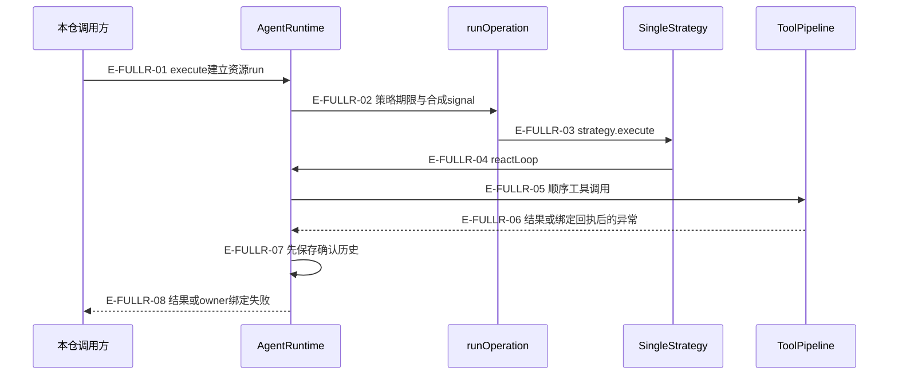
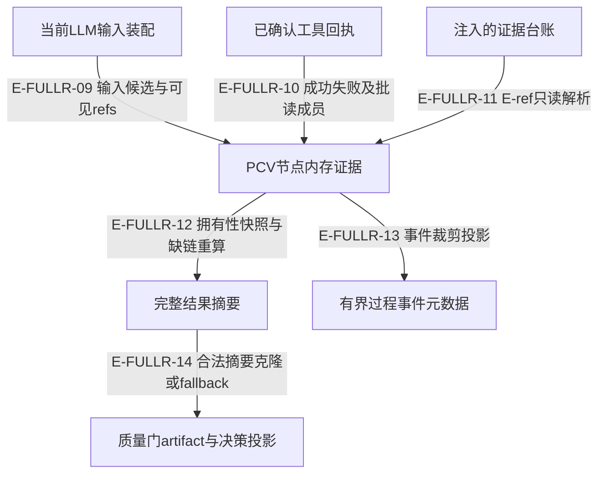

# Runtime 与 PCV：当前全文阅读及失败边界

本轮从当前工作树逐段完整读取 15 个文件，逐文件前后 SHA256 一致。共 8,868 行正文；Atlas 按末尾换行后的空行计为 8,883 行。下文 90 段覆盖每个文件的 1..lineCount，没有以 v4 全文或 v5 差异替代本轮读取。全文深度与 L3 失败语义是两个维度，都不等于运行覆盖率。

本页只把已读断言标作“已定位”，没有运行产品测试、真实 provider、OS sandbox 或外部宿主。测试的替身/真实边界在末尾逐条列明。工具的确认回执、模型历史、PCV 摘要、诊断与宿主持久化是不同事实，任何一个已写入都不自动证明其余步骤完成。

[Runtime失败路径](runtime-failure-deep-review.md) · [record-only多层准入](runtime-failure-deep-review.md#record-only-boundaries) · [状态与恢复](state-and-recovery.md) · [证据与知识](../08-evidence-knowledge/failure-and-receipts.md)

## 一次运行的拥有者与回执

`execute()` 先建立 ALS 资源 run，策略的期限由 `runOperation` 管理。`SingleStrategy.execute` 真实调用 `reactLoop`，其他策略须按自己的接线判断；直接 `reactLoop` 有资源 scope，但没有 `execute` 的统计复位、公开 abort controller 和完整硬期限合同。

### 本图术语说明

| 术语 | 含义 |
| --- | --- |
| 资源 run / view | run 属于一次 execute 或直接 loop 外壳；同 execute 的各 loop 有不同 view。 |
| owner 绑定失败 | 只采用该 Runtime 自己确认的快照；错误上的同名公开字段不能制造事实。 |
| 确认历史 | 真实工具返回后保存；安全通知失败不重跑工具，pipeline after 失败会停止并保回执。 |

| 编号 | 代码依据 | 测试依据 | 关系与可证明范围 |
| --- | --- | --- | --- |
| E-FULLR-01 | `src/agent/runtime/AgentRuntime.ts#AgentRuntime.execute` | `test/tool-resource-scope.test.ts#case:shares%20the%20run%20across%20stages%2C%20assigns%20distinct%20views%2C%20then%20releases%20both%20views%20and%20the%20run`；已定位断言：同一 execute 两个 loop 共 runId、不同 viewId；释放顺序 view1/view2/run。 边界：真实 Runtime 和文件 IO harness；模型返回受控。 | 源码调用；scope测试验证同run不同view与释放顺序。 |
| E-FULLR-02 | `src/agent/runtime/AgentRuntime.ts#AgentRuntime.executeRun` | `test/agent-lifecycle.test.ts#case:keeps%20confirmed%20tool%20receipts%20and%20usage%20when%20a%20later%20model%20request%20reaches%20the%20hard%20timeout`；已定位断言：1000ms 硬期限后 Service timeout，保留工具与 usage12/7；host 一次。 边界：真实运行边界，受控 provider/router、fake timers。 | 源码调用runOperation；硬超时保已确认部分，不等于副作用回滚。 |
| E-FULLR-03 | `src/shared/operation.ts#runOperation` | `test/agent-lifecycle.test.ts#case:keeps%20confirmed%20tool%20receipts%20when%20cancellation%20interrupts%20a%20later%20model%20request`；已定位断言：第一工具成功后第二模型挂起，abort 返回 Service aborted 且保留 observed:true/envelope.ok；host 一次。 边界：真实 Runtime/Single/default pipeline/Service；provider/router 替身、fake timers。 | 传signal给策略并停止等待；测试真实Single链，只替代provider/router。 |
| E-FULLR-04 | `src/agent/strategies/SingleStrategy.ts#SingleStrategy.execute` | `test/agent-lifecycle.test.ts#case:keeps%20confirmed%20tool%20receipts%20when%20cancellation%20interrupts%20a%20later%20model%20request`；已定位断言：第一工具成功后第二模型挂起，abort 返回 Service aborted 且保留 observed:true/envelope.ok；host 一次。 边界：真实 Runtime/Single/default pipeline/Service；provider/router 替身、fake timers。 | 真实策略到loop调用；不泛化自定义Strategy。 |
| E-FULLR-05 | `src/agent/runtime/AgentRuntime.ts#AgentRuntime.processToolCalls` | `test/agent-lifecycle.test.ts#case:retains%20the%20returned%20host%20receipt%20when%20default%20%25s%20postprocessing%20fails`；已定位断言：tracker/trace 参数例抛错：Service error，保留 usage4/3 与真实 envelope，provider/host 各一次，trace 关闭。 边界：真实 Runtime/default pipeline/ActiveContext/Tracker，方法 spy 故障，非外部宿主副作用。 | hook与取消检查后调用默认pipeline。 |
| E-FULLR-06 | `src/agent/runtime/toolPipeline/engine.ts#executeToolPipeline` | `test/runtime-efficiency.test.ts#case:keeps%20reused%20errors%20isolated%20by%20invocation%20and%20call%2C%20then%20consumes%20each%20receipt%20once`；已定位断言：同Error不同context/call分别回执，错身份/伪partial无结果，消费一次。 边界：真实engine WeakMap，受控host回执和抛错after。 | after失败按Error/context/call保存；不是把异常当正常结果。 |
| E-FULLR-07 | `src/agent/runtime/AgentRuntime.ts#AgentRuntime.processToolCalls` | `test/agent-lifecycle.test.ts#case:retains%20the%20returned%20host%20receipt%20when%20default%20%25s%20postprocessing%20fails`；已定位断言：tracker/trace 参数例抛错：Service error，保留 usage4/3 与真实 envelope，provider/host 各一次，trace 关闭。 边界：真实 Runtime/default pipeline/ActiveContext/Tracker，方法 spy 故障，非外部宿主副作用。 | 正常与可确认after失败都先入history；PCV/消息/事件不保证全部完成。 |
| E-FULLR-08 | `src/agent/runtime/AgentRuntime.ts#AgentRuntime.executeRun` | `test/agent-lifecycle.test.ts#case:reports%20a%20successful%20run%20as%20exactly%20%7B%20phase%3A%20completed%20%7D%20without%20data%20or%20history`；已定位断言：真实文本 loop 结果 state 仅 {phase:completed}、reply=done。 边界：真实 Runtime/Single，provider fixture。 | execute返回阶段快照；finally释放run仍可能等待宿主。 |

## PCV 是观察摘要，持久化由各自端口承担

PCV 记录输入、工具事实、来源归因与质量门给出的结果。它没有自己的文件写入。`note_finding` 的 accepted 必须同时满足调用成功、`recorded=true`、`target=activeContext`；质量 artifact 汇入的记录另标 `origin=quality_artifact`。失败路径与部分批读按成员记录，不能从整体 ok 推导每个文件读成功。

### 本图术语说明

| 术语 | 含义 |
| --- | --- |
| 候选 / 可见 refs | 完整候选列表与provider本轮可见前缀分别记录；消费提及统计仍匹配完整候选，不能证明真实阅读。 |
| 结果摘要 / 事件 | 结果保完整有界诊断；事件进一步截断且不是可回灌的完整摘要。 |
| quality 投影 | 读取调用者已给的gate结果，不重新裁决质量；来源标记区分artifact与工具录入。 |

| 编号 | 代码依据 | 测试依据 | 关系与可证明范围 |
| --- | --- | --- | --- |
| E-FULLR-09 | `src/agent/runtime/PcvNodeEvidenceRecorder.ts#recordPcvInputAssembly` | `test/llm-input-layering.test.ts#case:cuts%20deterministic%20refs%20at%20entry%20boundaries%20and%20records%20only%20the%20visible%20prefix`；已定位断言：完整32 refs与实际可见前缀分开，omitted计数与provider文本一致，PCV及事件透传。 边界：真实LLMInputAssembly/PCV，无provider请求。 | 数据流；可见前缀与完整候选分开，不替代内容证据。 |
| E-FULLR-10 | `src/agent/runtime/PcvNodeEvidenceRecorder.ts#recordPcvToolResult` | `test/evidence-recording-phase-chain.test.ts#case:links%20only%20the%20members%20a%20partially%20failed%20code.read%20batch%20really%20read%20(C052)`；已定位断言：真实批量读成功+不存在文件：整体成功但 sourceRefs只有成功成员；失败只记诊断且无绝对错误路径。 边界：临时文件、真实 routed read/PCV；不代表所有 IO 故障形状。 | 数据流；部分成功只链接成功成员。 |
| E-FULLR-11 | `src/agent/runtime/PcvNodeEvidenceRecorder.ts#recordPcvToolResult` | `test/evidence-recording-phase-chain.test.ts#case:preserves%20real%20ledger%20source%20links%20on%20modern%20note_finding`；已定位断言：真实 E-1@11-12 经 handleMemory 到 ActiveContext 和 PCV accepted 的 src/widget.ts:11-12。 边界：临时真实 EvidenceLedgerStore、MemoryCoordinator/handler；非宿主磁盘耐久性验收。 | 只读get解析E-ref；真正append/ActiveContext写入在其他组件。 |
| E-FULLR-12 | `src/agent/runtime/PcvNodeEvidenceRecorder.ts#buildPcvNodeEvidenceSummary` | `test/evidence-recording-phase-chain.test.ts#case:returns%20owned%20PCV%20snapshots`；已定位断言：修改 buildResult 的 inputAssembly/toolSchemaNames 与 finding evidence 不回写 ctx。 边界：真实 LoopContext/PCV，未测工具结果深层引用隔离。 | 快照数据流；不是工具result的通用深拷贝。 |
| E-FULLR-13 | `src/agent/runtime/PcvNodeEvidenceRecorder.ts#buildPcvNodeEvidenceProcessMetadata` | `test/evidence-recording-phase-chain.test.ts#case:caps%20stored%20diagnostics%20at%2064%2C%20counts%20distinct%20drops%20and%20aggregates%20missing%20link%20reasons`；已定位断言：1200不同缺失引用后保存64、丢1136；重放不增，事件前16、两类截断各报一次。 边界：直接PCV循环与fixture map；限制输出，不测side table内存上限。 | 输出裁剪；side-table全部seen keys仍可增长。 |
| E-FULLR-14 | `src/agent/runtime/PcvNodeEvidenceRecorder.ts#createQualityGateEvidenceBase` | `test/evidence-recording-phase-chain.test.ts#case:falls%20back%20instead%20of%20throwing%20when%20process-event%20metadata%20is%20passed%20as%20source%20evidence`；已定位断言：进程 metadata 非完整 summary，回落 quality_gate节点/off并标 invalid-source。 边界：直接质量证据构造，非真实 gate重跑。 | 事件metadata/坏摘要不能冒充完整source；缺省旧模式另兼容。 |

## 逐文件覆盖与失败分支

下列区间采用 Atlas 行数口径，末段包含末尾空行。纯类型与 barrel 明确没有可执行业务分支。源码符号是当前声明；私有方法锚点省略 `#`，不会指回退役类名。

### AgentEventBus.ts

`src/agent/runtime/AgentEventBus.ts` — 单向带元信息广播；不拥有请求/应答或执行状态。

实际链路：publish计数→快照topic与* rawListeners→observeSafely；单例reset清监听。

| 全文区间 | 已读语义 | 当前符号 |
| --- | --- | --- |
| 1–44 | 模块边界与仅有生产发布者的事件常量；旧订阅表/请求应答已删除。 | `src/agent/runtime/AgentEventBus.ts#AgentEvents` |
| 45–74 | EventEmitter构造、100监听上限、单例获取和reset；计数属于实例。 | `src/agent/runtime/AgentEventBus.ts#AgentEventBus`、`src/agent/runtime/AgentEventBus.ts#AgentEventBus.getInstance`、`src/agent/runtime/AgentEventBus.ts#AgentEventBus.resetInstance` |
| 75–111 | publish只携带target/correlation，不定向；冻结两通道监听快照，保once wrapper/this，以安全观察分发。 | `src/agent/runtime/AgentEventBus.ts#AgentEventBus.publish` |
| 112–124 | 统计只返回totalEvents和默认类导出。 最后一个库存行是文件末尾换行产生的空行。 | `src/agent/runtime/AgentEventBus.ts#AgentEventBus.getStats` |

| 条件 | 实际行为与副作用 | 恢复与证据边界 |
| --- | --- | --- |
| 监听器同步抛错或异步拒绝 | publish隔离失败，继续后续监听；诊断失败也由observeSafely隔离。副作用：计数先增；event payload按引用传递。 | 按监听器失败处理，不重放业务。 `src/agent/runtime/AgentEventBus.ts#AgentEventBus.publish`；T-FULLR-40。 |
| 监听器在发布中增删监听/once | 当前快照顺序topic→wildcard，新监听下次生效；once保Node语义。副作用：监听表可变化，但不改变本次快照。 | 调用off/reset清理监听。 `src/agent/runtime/AgentEventBus.ts#AgentEventBus.publish`；T-FULLR-44；T-FULLR-42。 |
| 重置全局单例 | 清旧实例监听，后续get返回新实例。副作用：不抹旧对象计数，但新实例从0开始。 | 持有旧对象者不自动迁移。 `src/agent/runtime/AgentEventBus.ts#AgentEventBus.resetInstance`；T-FULLR-43。 |

边界：安全边界是publish；继承emit保留Node行为。target不是权限/路由控制。

本文件已读测试断言：T-FULLR-40、T-FULLR-44、T-FULLR-42、T-FULLR-43。

### AgentMessage.ts

`src/agent/runtime/AgentMessage.ts` — 宿主已鉴权输入的消息信封；无渠道工厂或replyFn。

实际链路：constructor默认UUID/anonymous/http；internal合并显式元数据；toJSON投影session计数。

| 全文区间 | 已读语义 | 当前符号 |
| --- | --- | --- |
| 1–61 | 声明Sender/Session和internal可选字段；外部鉴权归宿主。 | `src/agent/runtime/AgentMessage.ts#Channel` |
| 62–112 | 冲突值仅诊断类型；显式非undefined覆盖metadata，未传保留，占位键顺序固定。 | `src/agent/runtime/AgentMessage.ts#describeValueType`、`src/agent/runtime/AgentMessage.ts#mergeInternalMetadata` |
| 113–163 | 冻结Channel四键；构造默认与原对象引用，history缺省空数组。 | `src/agent/runtime/AgentMessage.ts#AgentMessage`、`src/agent/runtime/AgentMessage.ts#AgentMessage.history` |
| 164–198 | internal生成agent来源消息并用统一合并；toJSON只压缩session历史，sender/metadata仍为引用。 最后一个库存行是文件末尾换行产生的空行。 | `src/agent/runtime/AgentMessage.ts#AgentMessage.internal`、`src/agent/runtime/AgentMessage.ts#AgentMessage.toJSON` |

| 条件 | 实际行为与副作用 | 恢复与证据边界 |
| --- | --- | --- |
| 显式parent/dimension/phase与metadata冲突 | 非undefined显式值获胜，debug只记键和类型。副作用：新metadata浅展开；其嵌套值保引用。 | 修正调用方冲突，不由runtime猜身份。 `src/agent/runtime/AgentMessage.ts#mergeInternalMetadata`；T-FULLR-11；T-FULLR-10。 |
| 运行产出回复 | 消息无自动投递；Runtime返回result.reply交宿主。副作用：toJSON不带渠道回写函数。 | 投递失败属于宿主，不能重跑工具。 `src/agent/runtime/AgentMessage.ts#AgentMessage`；T-FULLR-16。 |

边界：构造器是typed边界，无深校验/鉴权；toJSON不是深拷贝或内容脱敏器。 mergeInternalMetadata的debug不是observeSafely，异常logger可能中断构造；本轮未定位该故障用例。

本文件已读测试断言：T-FULLR-11、T-FULLR-10、T-FULLR-16。

### AgentRuntime.ts

`src/agent/runtime/AgentRuntime.ts` — ReAct编排主体，拥有执行边界、私有阶段、预算/工具/证据接线。

实际链路：execute→ALS run→policy→runOperation(strategy)→Single/Pipeline调用reactLoop→init/while/provider/tool/text/finalize→阶段快照→finally释放。

| 全文区间 | 已读语义 | 当前符号 |
| --- | --- | --- |
| 1–195 | 依赖与兼容类型导出，RuntimeToolContract/LlmDispatchInput明确本地装配和provider调用两段边界。 | `src/agent/runtime/AgentRuntime.ts#AgentRuntime`、`src/agent/runtime/AgentRuntime.ts#LLM_INPUT_ASSEMBLY_FAILED_CODE` |
| 196–297 | 最小phase表与模块级ALS owner/runId/closed；实例字段拥有统计、digest表、hook/pipeline、abort controller。 | `src/agent/runtime/AgentRuntime.ts#nextRuntimePhase`、`src/agent/runtime/AgentRuntime.ts#toolResourceRun` |
| 298–375 | 构造只接受显式或容器toolRouter；初始化job fallback/digest、模型引用、grounding默认off与默认pipeline/hooks，发布created。 | `src/agent/runtime/AgentRuntime.ts#AgentRuntime.constructor` |
| 376–415 | execute经withToolResourceRun；finally先closed再await releaseScope，抛错安全记录，等待没有独立期限。 | `src/agent/runtime/AgentRuntime.ts#AgentRuntime.execute`、`src/agent/runtime/AgentRuntime.ts#AgentRuntime.withToolResourceRun`、`src/agent/runtime/AgentRuntime.ts#AgentRuntime.releaseToolScope` |
| 416–632 | 每run复位，before policy拒绝早退；策略被runOperation包裹；取消/硬超时保自有快照，后置质量检查与phase/event，失败绑定owner快照。 | `src/agent/runtime/AgentRuntime.ts#AgentRuntime.executeRun` |
| 633–805 | reactLoop沿同owner开放scope复用或自开run；每loop释放view；主循环trace round、hook、exit、LLM/tool/text分叉，finally补闭round。 | `src/agent/runtime/AgentRuntime.ts#AgentRuntime.reactLoop`、`src/agent/runtime/AgentRuntime.ts#AgentRuntime.runReactLoop`、`src/agent/runtime/AgentRuntime.ts#AgentRuntime.performReactLoop` |
| 806–1055 | init解析cap/action contract/history/预算/模型输入窗口，打开同runtime digest支持的ledger，按真实资源投影schema与availability提示，挂loop/exit/budget。 | `src/agent/runtime/AgentRuntime.ts#AgentRuntime.initLoop` |
| 1056–1105 | 唯一迭代前ExitController调用，取消/阶段超时写诊断；不调用无消费者Capability空hook。 | `src/agent/runtime/AgentRuntime.ts#AgentRuntime.shouldExit` |
| 1106–1298 | nudge、压缩与预检；首轮override/tracker/80%强制none；record-only免强制摘要并收窄schema；动态记忆上下文不写回静态system。 | `src/agent/runtime/AgentRuntime.ts#AgentRuntime.prepareIteration`、`src/agent/runtime/AgentRuntime.ts#AgentRuntime.getIterationToolSchemas`、`src/agent/runtime/AgentRuntime.ts#AgentRuntime.logDimensionSubmitSchemaVariant` |
| 1299–1547 | L4先执行；两次取消检查夹住本地装配观察点；provider try仅调用/计数归零；usage先计后丢迟到响应；空响应延迟与违规toolChoice过滤。 | `src/agent/runtime/AgentRuntime.ts#AgentRuntime.callLLM` |
| 1548–1761 | 本地输入选择/投影/PCV/测量/超限/事件；装配缺陷及provider未覆写契约单次终止为runtime_defect、抑制摘要。 | `src/agent/runtime/AgentRuntime.ts#AgentRuntime.assembleLlmInput`、`src/agent/runtime/AgentRuntime.ts#AgentRuntime.handleLlmInputAssemblyFailure`、`src/agent/runtime/AgentRuntime.ts#AgentRuntime.handleProviderContractViolation` |
| 1762–1842 | provider错误取消优先；CIRCUIT_OPEN停止，普通错误二次resetToPromptOnly，首次等待2000ms可取消。 | `src/agent/runtime/AgentRuntime.ts#AgentRuntime.handleAiError`、`src/agent/runtime/AgentRuntime.ts#AgentRuntime.waitForRetry` |
| 1843–2210 | 工具上限8及continuation一致性；顺序执行前取消+async阻断hook；pipeline失败取本调用回执；先入历史再观察/PCV/配额投影/事件/消息，最后tracker与exit。 | `src/agent/runtime/AgentRuntime.ts#AgentRuntime.processToolCalls` |
| 2211–2449 | 转换nudge共用注入；guard才评估文本grounding，阻断rollback有连续上限；文本轮也endRound，analyst终结转换多一轮digest，其余接受/继续。 | `src/agent/runtime/AgentRuntime.ts#AgentRuntime.injectTransitionNudge`、`src/agent/runtime/AgentRuntime.ts#AgentRuntime.processTextResponse` |
| 2450–2601 | 摘要抑制依序取消→runtime_defect→有效超时→输入超限→质量退化；模式声明优先，其次user、tracked缺省诊断、无tracker system legacy digest。 | `src/agent/runtime/AgentRuntime.ts#AgentRuntime.getForcedSummarySuppression`、`src/agent/runtime/AgentRuntime.ts#AgentRuntime.resolveForcedSummaryMode`、`src/agent/runtime/AgentRuntime.ts#AgentRuntime.undeclaredStageSummaryMode` |
| 2602–2709 | 只有无lastReply才做摘要选择；none空回复、停止占位、scan回执计数、一次bounded摘要或fallback；usage只累计返回值，附aborted/timedOut标记。 | `src/agent/runtime/AgentRuntime.ts#AgentRuntime.finalize` |
| 2710–2898 | abort仅活动execute，事件一次；文件缓存/只读getter/progress；phase新对象快照、execute复位、非法转移debug，输入上限来源诊断。 | `src/agent/runtime/AgentRuntime.ts#AgentRuntime.abort`、`src/agent/runtime/AgentRuntime.ts#AgentRuntime.phaseSnapshot`、`src/agent/runtime/AgentRuntime.ts#AgentRuntime.resetPhaseForRun`、`src/agent/runtime/AgentRuntime.ts#AgentRuntime.transitionPhase`、`src/agent/runtime/AgentRuntime.ts#AgentRuntime.logProviderInputLimit` |
| 2899–3054 | 动作白名单union/null全动作/显式空；catalog固定firstRound mixed投影，能力解析，安全onProgress再bus。 | `src/agent/runtime/AgentRuntime.ts#AgentRuntime.collectToolContract`、`src/agent/runtime/AgentRuntime.ts#AgentRuntime.queryToolSchemas`、`src/agent/runtime/AgentRuntime.ts#AgentRuntime.resolveCapabilities`、`src/agent/runtime/AgentRuntime.ts#AgentRuntime.emitProgress` |
| 3055–3120 | direct note_finding仅memory/action允许时添加，record-only schema要求evidenceRefs且深度槽来自registry。 | `src/agent/runtime/AgentRuntime.ts#withDirectNoteFindingSchema`、`src/agent/runtime/AgentRuntime.ts#canUseDirectNoteFinding`、`src/agent/runtime/AgentRuntime.ts#buildDirectNoteFindingSchema` |
| 3121–3202 | developer事件在投影后取时间/PCV快照，证据工具种类与semantic nudge关联。 | `src/agent/runtime/AgentRuntime.ts#buildAgentProcessEvent`、`src/agent/runtime/AgentRuntime.ts#isEvidenceGroundingToolCall`、`src/agent/runtime/AgentRuntime.ts#buildSemanticNudgeProcessEvent` |
| 3203–3388 | abort诊断、严格modelRef查询、质量跳过信号、正数预算、native/text-compat来源与非Error归一辅助。 最后一个库存行是文件末尾换行产生的空行。 | `src/agent/runtime/AgentRuntime.ts#lookupRegisteredModelDef`、`src/agent/runtime/AgentRuntime.ts#resolveQualityCheckSkip`、`src/agent/runtime/AgentRuntime.ts#normalizeAiError`、`src/agent/runtime/AgentRuntime.ts#describeNonErrorValue` |

| 条件 | 实际行为与副作用 | 恢复与证据边界 |
| --- | --- | --- |
| validateBefore.ok=false | 零策略调用，返回idle/零用量和policy_rejected。副作用：计数已复位，run仍进入finally释放。 | 身份/权限由宿主修正，不自动扩大allowlist。 `src/agent/runtime/AgentRuntime.ts#AgentRuntime.executeRun`；T-FULLR-13。 |
| 父signal或abort()在运行中触发 | runOperation停止等待，保确认history/usage；取消回复/phase与事件一次；晚结果不采用。副作用：不保证外部副作用停止；已确认事实不回滚。 | 未确认在途工作应宿主读回，不能重放已确认工具。 `src/agent/runtime/AgentRuntime.ts#AgentRuntime.executeRun`；T-FULLR-09；T-FULLR-12。 |
| execute硬期限到达 | 抛owner绑定ExecutionTimeoutError，自有snapshot进入失败绑定，phase failed；Service可映射timeout。副作用：已确认工具与usage仍保存，策略可能继续运行。 | 只接纳本owner快照；外部partialResult不是权威。 `src/agent/runtime/AgentRuntime.ts#AgentRuntime.executeRun`；T-FULLR-08。 |
| loop/execute正常、错误或取消结束 | view/run两层释放；清理拒绝不替换结果，closed防旧strategy复活。副作用：releaseScope调用本身可有宿主副作用。 | pending释放需要宿主合作；没有独立deadline。 `src/agent/runtime/AgentRuntime.ts#AgentRuntime.releaseToolScope`；T-FULLR-64；T-FULLR-07；T-FULLR-63。 缺口：只有抛错与迟到loop测试；永久pending cleanup未覆盖。 |
| 调用reactLoop但没有execute边界 | 创建资源run，阶段start和loop统计继续；不重置所有实例账本，不设置executionAbortController。副作用：公开abort无法取消该直接loop。 | 调用方传abortSignal/预算；不得把execute合同套用到直接入口。 `src/agent/runtime/AgentRuntime.ts#AgentRuntime.reactLoop`；未绑定测试。 缺口：直接重复scope有测试，但本轮未绑定直接loop+公开abort组合断言。 |
| 本地assembleLlmInput抛错 | 写llm_input_assembly_failed/runtime_defect/degraded，不provider重试/摘要。副作用：装配前历史压缩或PCV记录可能已经发生，不做回滚。 | 修正本地装配输入/接线，不能当临时provider故障重试。 `src/agent/runtime/AgentRuntime.ts#AgentRuntime.handleLlmInputAssemblyFailure`；T-FULLR-02。 |
| provider code=PROVIDER_CONTRACT_VIOLATION且未取消 | 单次结束runtime_defect，无ai_error计数、无2000ms或摘要。副作用：契约诊断保留；不走gateway熔断。 | 更换/补齐host注入provider实现；取消同轮优先。 `src/agent/runtime/AgentRuntime.ts#AgentRuntime.callLLM`；T-FULLR-19；T-FULLR-17。 |
| 普通provider异常或CIRCUIT_OPEN | 取消优先；普通错误rollback tracker并首错等待2000ms，二错清模型历史后结束；熔断直接停止。副作用：runtime/loop已计usage不回滚；system可能随后摘要，user先填错误回复。 | 取消停止重试；读取最终cancelReason/摘要是否退化。 `src/agent/runtime/AgentRuntime.ts#AgentRuntime.handleAiError`；T-FULLR-18。 缺口：所绑用例证明普通二错；CIRCUIT_OPEN与空响应1500ms分支本轮只读源码。 |
| provider成功返回时signal已abort | 先记usage后抛弃内容/工具，warn late_llm_response_discarded。副作用：loop/runtime账本有已产生消耗；已返回外层snapshot未必含迟到usage。 | 以边界返回的确认快照为准，勿把未采纳文本算成功。 `src/agent/runtime/AgentRuntime.ts#AgentRuntime.callLLM`；未绑定测试。 缺口：未绑定迟到usage回写与已返回snapshot关系的定向测试。 |
| executeL4IfPending内部usage回写后回调或logger抛错 | Runtime未包裹独立回滚；其回调依序loop usage→diagnostics，后续L4结果由BudgetController给出。副作用：已发生usage或上下文变化不能从hardStop/removed=0反推未发生。 | 按BudgetController实际状态/用量核对；不重跑摘要来补观察。 `src/agent/runtime/AgentRuntime.ts#AgentRuntime.callLLM`；未绑定测试。 缺口：交叉边界发现：本轮未通读BudgetController，主审拥有该文件；未定位后置callback抛错专项断言。 |
| pipeline after/efficiency抛错且有当前context/call绑定receipt | 取一次真实receipt加入loop与runtime历史，记TOOL_POSTPROCESSING_FAILED并停run；不补发工具成功/PCV。副作用：host工作已完成，可能已有ledger append或tracker/trace部分更新。 | 查保留receipt与台账；禁止重跑副作用补通知。 `src/agent/runtime/AgentRuntime.ts#AgentRuntime.processToolCalls`；T-FULLR-15。 |
| 已保存receipt后onToolCall抛错/拒绝或触发取消 | 观察错误隔离；取消后本条仍记PCV，下一工具检查signal停止。副作用：每条确认回执即时入账，batch剩余不执行。 | 以已确认条目为恢复基线。 `src/agent/runtime/AgentRuntime.ts#AgentRuntime.processToolCalls`；T-FULLR-06；T-FULLR-01。 |
| tracker存在且groundingEnforcement=guard并判invalid | 有限次nudge+rollback，达到上限放普通文本轮；off跳过guard。副作用：追加消息、计数与诊断；PCV自身只观察。 | 读guard与blockLimit证据，不能把off的invalid-no-evidence当质量失败。 `src/agent/runtime/AgentRuntime.ts#AgentRuntime.processTextResponse`；未绑定测试。 缺口：主审另有guard文件；本轮未绑定该分支测试断言。 |
| loop无lastReply | 先算抑制再模式；none留空、停止原因占位、scan基于persisted receipt，或一次forced summary；已有回复跳过此过程。副作用：forced usage回写budget/loop/diagnostics，不重放工具。 | stop非空回复不是成功；timedOut/aborted由诊断附标记。 `src/agent/runtime/AgentRuntime.ts#AgentRuntime.finalize`；T-FULLR-02；T-FULLR-19。 缺口：完整summaryMode/L4/scan矩阵未在本轮执行；只绑定缺陷抑制对照。 |
| 策略未进loop或复用实例/空闲abort | 未进loop finish被跳过保idle；execute复位后正常loop completed；空闲abort只记录。副作用：结果state新对象，独立于后续private phase。 | 不能用AGENT_COMPLETED事件推断state必completed。 `src/agent/runtime/AgentRuntime.ts#AgentRuntime.transitionPhase`；T-FULLR-14；T-FULLR-16；T-FULLR-05。 |

边界：同Runtime实例共享phase/统计/abort controller/grounding有效值，不声明并发execute安全；ALS只隔离资源scope。 runOperation只包strategy，不包validateBefore、全部后处理、scope finally；直接日志/trace/diagnostics故障仍可中断。 tool_receipt先存不代表PCV/模型历史/工具end事件都已完成；失败须按真实阶段解释。 输入超限、工具cap8/continuation丢弃、qualitySkip及摘要各分支已全文阅读，但本轮不宣称全部运行覆盖。

本文件已读测试断言：T-FULLR-13、T-FULLR-09、T-FULLR-12、T-FULLR-08、T-FULLR-64、T-FULLR-07、T-FULLR-63、T-FULLR-02、T-FULLR-19、T-FULLR-17、T-FULLR-18、T-FULLR-15、T-FULLR-06、T-FULLR-01、T-FULLR-14、T-FULLR-16、T-FULLR-05。

### AgentRuntimeResponsibility.ts

`src/agent/runtime/AgentRuntimeResponsibility.ts` — 可检索的职责/语义/环境变量清单，不执行策略。

实际链路：类型→7职责seam→4术语→23行为开关→冻结顶层manifest。

| 全文区间 | 已读语义 | 当前符号 |
| --- | --- | --- |
| 1–53 | 定义seam/术语/feature flag/AI边界的只读类型；behaviorChangeAllowed固定false。 | `src/agent/runtime/AgentRuntimeResponsibility.ts#AgentRuntimeResponsibilityManifest` |
| 54–153 | 职责seams与semanticGlossary引用Agent/Core/host边界。 | `src/agent/runtime/AgentRuntimeResponsibility.ts#DECOMPOSITION_SEAMS`、`src/agent/runtime/AgentRuntimeResponsibility.ts#SEMANTIC_GLOSSARY` |
| 154–339 | 行为开关逐项标owner/default/sourceRefs，连接凭据/端点不列入；默认值是说明而非读取。 | `src/agent/runtime/AgentRuntimeResponsibility.ts#FEATURE_FLAGS` |
| 340–364 | manifest顶层Object.freeze，model registry与未归一vendor响应边界。 最后一个库存行是文件末尾换行产生的空行。 | `src/agent/runtime/AgentRuntimeResponsibility.ts#ALEMBIC_AGENT_RUNTIME_RESPONSIBILITY` |

无可执行业务分支。类型、常量清单与导出关系不能替代真实调用或输入校验。

边界：无可执行控制分支；Object.freeze只冻结顶层对象，readonly为类型约束。 清单不是环境验证器或运行路由；测试静态找读取站点不证明配置行为。

本文件已读测试断言：T-FULLR-20。

### AgentRuntimeTypes.ts

`src/agent/runtime/AgentRuntimeTypes.ts` — Runtime输入/结果、事件、诊断及工具元数据合同单源。

实际链路：纯类型声明→RuntimeConfig依赖→ReactLoopOpts→MAX_TOOL_CALLS_PER_ITER=8。

| 全文区间 | 已读语义 | 当前符号 |
| --- | --- | --- |
| 1–53 | 工具调用回执、function call签名与LLMResult；type只能continue，provider通常不写控制标记。 | `src/agent/runtime/AgentRuntimeTypes.ts#ToolCallEntry`、`src/agent/runtime/AgentRuntimeTypes.ts#FunctionCall`、`src/agent/runtime/AgentRuntimeTypes.ts#LLMResult` |
| 54–207 | 开发者事件、诊断、效率摘要和ToolMetadata；恢复超时字段由Service出口管理。 | `src/agent/runtime/AgentRuntimeTypes.ts#AgentProgressProcessEvent`、`src/agent/runtime/AgentRuntimeTypes.ts#AgentDiagnostics`、`src/agent/runtime/AgentRuntimeTypes.ts#ToolMetadata` |
| 208–277 | 文件缓存、grounding模式、RuntimeConfig宿主最小端口和jobId默认合同。 | `src/agent/runtime/AgentRuntimeTypes.ts#FileCacheEntry`、`src/agent/runtime/AgentRuntimeTypes.ts#GroundingEnforcement`、`src/agent/runtime/AgentRuntimeTypes.ts#RuntimeConfig` |
| 278–323 | AgentResult独立phase快照、loop可选依赖和8工具上限。 最后一个库存行是文件末尾换行产生的空行。 | `src/agent/runtime/AgentRuntimeTypes.ts#AgentResult`、`src/agent/runtime/AgentRuntimeTypes.ts#ReactLoopOpts`、`src/agent/runtime/AgentRuntimeTypes.ts#MAX_TOOL_CALLS_PER_ITER` |

无可执行业务分支。类型、常量清单与导出关系不能替代真实调用或输入校验。

边界：纯类型不进行输入归一、私有信息过滤或执行控制；这些约束须由实际调用边界兑现。

本文件已读测试断言：T-FULLR-58。

### HookSystem.ts

`src/agent/runtime/HookSystem.ts` — 按优先级顺序执行可阻断钩子；仅before的false阻断。

实际链路：注册排序→固定快照/once先领取→async emit或安全emitSync→诊断+两个LLM桥接。

| 全文区间 | 已读语义 | 当前符号 |
| --- | --- | --- |
| 1–106 | 七个真实分发Hook事件与typed payload、诊断形状。 | `src/agent/runtime/HookSystem.ts#HookEvent`、`src/agent/runtime/HookSystem.ts#HookPayloadMap`、`src/agent/runtime/HookSystem.ts#HookErrorDiagnostic` |
| 107–177 | 注册排序、unsubscribe和once.fired共享领取，防并发/重入重复。 | `src/agent/runtime/HookSystem.ts#HookSystem.on`、`src/agent/runtime/HookSystem.ts#HookSystem.once`、`src/agent/runtime/HookSystem.ts#HookSystem.claimOnce` |
| 178–244 | async emit顺序await thenable并累计阻断；emitSync不等待/不阻断而监听拒绝。 | `src/agent/runtime/HookSystem.ts#HookSystem.emit`、`src/agent/runtime/HookSystem.ts#HookSystem.emitSync` |
| 245–343 | clear/count/快照diagnostics；失败脱敏、附process metadata、逐dispatch sink隔离。 | `src/agent/runtime/HookSystem.ts#HookSystem.getDiagnostics`、`src/agent/runtime/HookSystem.ts#HookSystem.recordHookError`、`src/agent/runtime/HookSystem.ts#toRunWarning`、`src/agent/runtime/HookSystem.ts#attachHookDiagnosticToProcessEvent` |
| 344–395 | 默认仅桥接llm before/after到EventBus常量；工具事件由Runtime自行发布。 最后一个库存行是文件末尾换行产生的空行。 | `src/agent/runtime/HookSystem.ts#registerDefaultHooks` |

| 条件 | 实际行为与副作用 | 恢复与证据边界 |
| --- | --- | --- |
| tool:execute:before返回false | 继续运行其余hook，最终false阻工具。副作用：Runtime另造blocked回执；hook不是执行者。 | 拒绝原因随blockedTools返回。 `src/agent/runtime/HookSystem.ts#HookSystem.emit`；T-FULLR-41。 |
| handler或诊断sink抛错/拒绝 | 记录脱敏hookErrors/warning并继续，throw不等同false。副作用：async拒绝可能晚于emitSync返回/结果快照。 | 查本次dispatch sink；不重跑工具。 `src/agent/runtime/HookSystem.ts#HookSystem.recordHookError`；T-FULLR-38；T-FULLR-37。 |
| 并发emit已快照同一once entry | 调用前设置fired并从live表删除，只一个分发获得调用权。副作用：常驻hook不删除。 | 无需重复触发once。 `src/agent/runtime/HookSystem.ts#HookSystem.claimOnce`；T-FULLR-39。 |
| 异步before永不settle | emit顺序await没有自身deadline，后hook不继续。副作用：execute外层可停止等待；直接reactLoop只依赖传入signal但等待hook本身不race。 | 宿主hook合作取消或外层run终止；不能声称hook已经停止。 `src/agent/runtime/HookSystem.ts#HookSystem.emit`；未绑定测试。 缺口：本轮未定位永久pending before与直接reactLoop组合用例。 |

边界：Hook异常隔离不能泛化为tracker/trace/PCV/所有logger。

本文件已读测试断言：T-FULLR-41、T-FULLR-38、T-FULLR-37、T-FULLR-39。

### LoopContext.ts

`src/agent/runtime/LoopContext.ts` — 一次reactLoop的可变状态与注入依赖；只管理loop级账本。

实际链路：构造保存依赖→PCV初始证据→usage累计→buildResult快照。

| 全文区间 | 已读语义 | 当前符号 |
| --- | --- | --- |
| 1–105 | 内部预算/共享状态/配置typed口径；公开字段可写且多处duck cast。 | `src/agent/runtime/LoopContext.ts#LoopContext` |
| 106–234 | resourceScope用private run/view与messages revision；loop累计计数、grounding、上下文、控制器和PCV字段。 | `src/agent/runtime/LoopContext.ts#LoopContext.resourceScope` |
| 235–274 | 构造默认source/user、grounding/off、时间与PCV；isSystem/maxIterations是读取投影。 | `src/agent/runtime/LoopContext.ts#LoopContext.isSystem`、`src/agent/runtime/LoopContext.ts#LoopContext.maxIterations` |
| 275–311 | usage累加按字段||0；结果复制工具数组与token对象并构建独立PCV摘要。 最后一个库存行是文件末尾换行产生的空行。 | `src/agent/runtime/LoopContext.ts#LoopContext.addTokenUsage`、`src/agent/runtime/LoopContext.ts#LoopContext.buildResult` |

| 条件 | 实际行为与副作用 | 恢复与证据边界 |
| --- | --- | --- |
| 提供resourceRunId | 每loop唯一viewId，revision随消息可见范围改变；无runId返回undefined。副作用：resourceScope每次读取新对象，实际释放由Runtime。 | 不要把context自己当resource owner。 `src/agent/runtime/LoopContext.ts#LoopContext.resourceScope`；T-FULLR-64。 |
| 调用buildResult | toolCalls数组浅复制、usage复制、PCV多层复制。副作用：工具entry/result/envelope仍共享引用。 | 消费方遵守回执只读边界。 `src/agent/runtime/LoopContext.ts#LoopContext.buildResult`；T-FULLR-36。 缺口：已定位PCV拥有性断言；未证明工具DTO深拷贝。 |

边界：maxIterations采用||20，所以0不是零轮；usage未验证负数/NaN，依赖provider归一。 ctx公开可写；同Runtime并发执行不能由loop状态独立推导为安全。

本文件已读测试断言：T-FULLR-64、T-FULLR-36。

### PcvNodeEvidenceRecorder.ts

`src/agent/runtime/PcvNodeEvidenceRecorder.ts` — 节点证据归因与可序列化观察摘要；不拥有质量决策或独立持久化。

实际链路：LoopContext建节点→input burn→LLM文本统计→每工具确认/拒绝→summary/事件；quality gate另补artifact与决策投影。

| 全文区间 | 已读语义 | 当前符号 |
| --- | --- | --- |
| 1–365 | 定义stage/node/input/grounding/finding/quality等合同；source identity v1索引、上限与WeakMap侧表，事件不导出完整summary。 | `src/agent/runtime/PcvNodeEvidenceRecorder.ts#PcvNodeEvidenceSummary`、`src/agent/runtime/PcvNodeEvidenceRecorder.ts#PcvNodeEvidenceProcessMetadata`、`src/agent/runtime/PcvNodeEvidenceRecorder.ts#PCV_SOURCE_REF_DIAGNOSTIC_STATE` |
| 366–475 | 从context/sharedState/tracker解析身份、repair与ledger引用，挂source索引后探测trace可读性。 | `src/agent/runtime/PcvNodeEvidenceRecorder.ts#createPcvNodeEvidence`、`src/agent/runtime/PcvNodeEvidenceRecorder.ts#isPcvRepairAttempted` |
| 476–642 | 记录本轮输入refs/模型工具可见性、burn初值；LLM输出提取来源和消费提及，工具delta更新classification。 | `src/agent/runtime/PcvNodeEvidenceRecorder.ts#recordPcvInputAssembly`、`src/agent/runtime/PcvNodeEvidenceRecorder.ts#recordPcvLlmOutput`、`src/agent/runtime/PcvNodeEvidenceRecorder.ts#recordPcvToolRoundOutcome`、`src/agent/runtime/PcvNodeEvidenceRecorder.ts#getLatestPcvBurnGrounding` |
| 643–757 | 工具成功/失败与批量成员归因；现代E-ref读ledger还原文件范围；只有成功且recorded且activeContext算accepted，其他留rejected/repair原因。 | `src/agent/runtime/PcvNodeEvidenceRecorder.ts#recordPcvToolResult` |
| 758–813 | 克隆、去重、归一与有界summary；事件带24来源/8 burn/16诊断及finding引用，非完整证据。 | `src/agent/runtime/PcvNodeEvidenceRecorder.ts#buildPcvNodeEvidenceSummary`、`src/agent/runtime/PcvNodeEvidenceRecorder.ts#buildPcvNodeEvidenceProcessMetadata` |
| 814–983 | quality从合法source clone或fallback起，重挂身份、汇入artifact findings，投影gate/report并更新repair状态。 | `src/agent/runtime/PcvNodeEvidenceRecorder.ts#buildPcvQualityGateEvidence`、`src/agent/runtime/PcvNodeEvidenceRecorder.ts#createQualityGateEvidenceBase`、`src/agent/runtime/PcvNodeEvidenceRecorder.ts#recordQualityGateFindings`、`src/agent/runtime/PcvNodeEvidenceRecorder.ts#updateQualityGateRepairState` |
| 984–1158 | 公开来源提取及stage map解析；固定通道/alias优先级、字符串或对象identity归一，不读取退役stageNodeMap。 | `src/agent/runtime/PcvNodeEvidenceRecorder.ts#extractSourceRefsFromValue`、`src/agent/runtime/PcvNodeEvidenceRecorder.ts#resolvePcvStageNodeIdentity`、`src/agent/runtime/PcvNodeEvidenceRecorder.ts#buildStageNodeAliases`、`src/agent/runtime/PcvNodeEvidenceRecorder.ts#normalizePcvStageNodeMapValue` |
| 1159–1252 | 仅trace存在才建ActiveContext ledger ref；stats探针失败保引用+缺链原因；quality fallback无run/source上下文。 | `src/agent/runtime/PcvNodeEvidenceRecorder.ts#buildLedgerRefs`、`src/agent/runtime/PcvNodeEvidenceRecorder.ts#probeObservationLedger`、`src/agent/runtime/PcvNodeEvidenceRecorder.ts#createFallbackQualityGateEvidence` |
| 1253–1440 | source summary按实际解引用结构守卫；首个失败字段、有限形状日志，旧可选数组允许缺省，非全面业务schema验证。 | `src/agent/runtime/PcvNodeEvidenceRecorder.ts#isPcvNodeEvidenceSummary`、`src/agent/runtime/PcvNodeEvidenceRecorder.ts#findPcvNodeEvidenceSummaryDefect`、`src/agent/runtime/PcvNodeEvidenceRecorder.ts#reportInvalidSourcePcvEvidence` |
| 1441–1578 | note参数归一、当前缺链原因重算、findings去重；失败路径仅诊断，部分批读只采成功成员及其正文引用。 | `src/agent/runtime/PcvNodeEvidenceRecorder.ts#buildMissingLinkReasons`、`src/agent/runtime/PcvNodeEvidenceRecorder.ts#recordFailedCallSourceRefs`、`src/agent/runtime/PcvNodeEvidenceRecorder.ts#recordPartialReadSourceRefs`、`src/agent/runtime/PcvNodeEvidenceRecorder.ts#successfulReadMemberEntries` |
| 1579–1775 | 仅context.projectScopeSourceIdentityMap/sharedState下划线通道；v1契约校验、失败回退下一候选、map对象缓存；坏entry跳过。 | `src/agent/runtime/PcvNodeEvidenceRecorder.ts#attachPcvSourceRefIndex`、`src/agent/runtime/PcvNodeEvidenceRecorder.ts#resolvePcvSourceRefIndex`、`src/agent/runtime/PcvNodeEvidenceRecorder.ts#resolvePcvSourceIdentityMap`、`src/agent/runtime/PcvNodeEvidenceRecorder.ts#buildPcvSourceIdentityMapResolution` |
| 1776–1940 | 按真实身份+qualified组合建立三个桶；冲突先判，qualified/absolute/唯一basename依次；不做folder-relative回退。 | `src/agent/runtime/PcvNodeEvidenceRecorder.ts#buildPcvProjectScopeSourceRefIndex`、`src/agent/runtime/PcvNodeEvidenceRecorder.ts#pcvDistinctSourceIdentityKey`、`src/agent/runtime/PcvNodeEvidenceRecorder.ts#normalizePcvProjectScopeSourceRef` |
| 1941–2057 | 保行号后缀，未解或歧义去sourceRefs转诊断；唯一绝对路径面对qualified冲突原样保留并每索引去重日志。 | `src/agent/runtime/PcvNodeEvidenceRecorder.ts#normalizeSourceRefsForEvidence`、`src/agent/runtime/PcvNodeEvidenceRecorder.ts#reportAbsolutePathKept`、`src/agent/runtime/PcvNodeEvidenceRecorder.ts#normalizePcvEvidenceSourceRefs`、`src/agent/runtime/PcvNodeEvidenceRecorder.ts#recordSourceRefDiagnostic` |
| 2058–2243 | 诊断侧表保存全部见过键，输出64/事件16上限；丢弃数放missingLinkReasons并首次告警，反序列化恢复计数。 | `src/agent/runtime/PcvNodeEvidenceRecorder.ts#pushSourceRefDiagnostic`、`src/agent/runtime/PcvNodeEvidenceRecorder.ts#getSourceRefDiagnosticState`、`src/agent/runtime/PcvNodeEvidenceRecorder.ts#recordDroppedSourceRefDiagnostics`、`src/agent/runtime/PcvNodeEvidenceRecorder.ts#enforceSourceRefDiagnosticCap`、`src/agent/runtime/PcvNodeEvidenceRecorder.ts#emitPcvEvidenceWarning` |
| 2244–2386 | burn最多32，summary/record/evidence/consumed/analyze分类优先级；消费用全文候选substring匹配；来源提取80条/深5层/文本20k/过滤secret键。 | `src/agent/runtime/PcvNodeEvidenceRecorder.ts#upsertGroundingLedgerEntry`、`src/agent/runtime/PcvNodeEvidenceRecorder.ts#classifyGroundingEntry`、`src/agent/runtime/PcvNodeEvidenceRecorder.ts#collectConsumedEvidenceRefs`、`src/agent/runtime/PcvNodeEvidenceRecorder.ts#collectSourceRefs`、`src/agent/runtime/PcvNodeEvidenceRecorder.ts#asQualityReport` |
| 2387–2572 | 多层快照复制、保index弱关联，复制诊断键且移除sink；旧grounding补off日志；SHA1短ref与基础归一helper。 最后一个库存行是文件末尾换行产生的空行。 | `src/agent/runtime/PcvNodeEvidenceRecorder.ts#cloneEvidence`、`src/agent/runtime/PcvNodeEvidenceRecorder.ts#reportLegacyGroundingEnforcementDefault`、`src/agent/runtime/PcvNodeEvidenceRecorder.ts#shortHash`、`src/agent/runtime/PcvNodeEvidenceRecorder.ts#stableStringify`、`src/agent/runtime/PcvNodeEvidenceRecorder.ts#uniqueStrings` |

| 条件 | 实际行为与副作用 | 恢复与证据边界 |
| --- | --- | --- |
| trace.getStats抛错 | 保ActiveContext引用，标observation-ledger-stats-unavailable并记录运行warning。副作用：不存开局stats，引用不是成功持久化证明。 | trace拥有恢复；检查实际台账可读性。 `src/agent/runtime/PcvNodeEvidenceRecorder.ts#probeObservationLedger`；T-FULLR-35。 |
| assembly有/无可见ref及省略数 | 有则保完整候选与可见前缀两套；缺省表示未知，不造全部可见。副作用：upsert burn并有32条窗口。 | 审计模型实际可见读取visible字段。 `src/agent/runtime/PcvNodeEvidenceRecorder.ts#recordPcvInputAssembly`；T-FULLR-45；T-FULLR-46。 |
| LLM文字包含candidate引用或去行号路径子串 | consumedEvidenceRefs从完整deterministic+starter列表匹配，classification不是语义验证。副作用：输出来源仅审计不计进展；可见列表不参与该匹配。 | 不得据此宣称模型实际读到/理解证据。 `src/agent/runtime/PcvNodeEvidenceRecorder.ts#collectConsumedEvidenceRefs`；未绑定测试。 缺口：未定位“只提及被省略ref”或子串误命中的定向断言。 |
| toolSucceeded=false | 参数路径不入节点来源，留failed-tool-call；失败正文路径不提取。副作用：rejected finding仍可留其声称引用。 | 后续成功读取可链接；失败记录不伪装已读。 `src/agent/runtime/PcvNodeEvidenceRecorder.ts#recordPcvToolResult`；T-FULLR-28；T-FULLR-29。 |
| 整体成功但code.read含失败成员 | 只从成功路径/成功成员正文采refs，失败成员仅诊断。副作用：真实成功部分保留，错误文案绝对路径不计来源。 | 按成员回执读回，不把整体ok当全成员成功。 `src/agent/runtime/PcvNodeEvidenceRecorder.ts#recordPartialReadSourceRefs`；T-FULLR-32。 |
| note_finding调用成功且recorded=true,target=activeContext | ledger E-ref映射真实file/range进入accepted；其他为rejected。副作用：repair status更新；PCV本身不append ledger或写ActiveContext。 | 权威写入发生于handler/memory，PCV只投影回执。 `src/agent/runtime/PcvNodeEvidenceRecorder.ts#recordPcvToolResult`；T-FULLR-33；T-FULLR-29。 |
| quality source是事件metadata/残缺摘要或旧合法摘要 | 结构不合回fallback+invalid-source，旧缺grounding补off；合法source clone，artifact新增origin=quality_artifact。副作用：质量gate结果由调用者输入，PCV不重新裁决；派生缺链重算。 | 分别查看note_finding与quality_artifact来源，不能合并成实际工具写入次数。 `src/agent/runtime/PcvNodeEvidenceRecorder.ts#createQualityGateEvidenceBase`；T-FULLR-25；T-FULLR-24；T-FULLR-34。 |
| context map拒绝但sharedState存在合法v1 | 继续后选项建index并warn一次；无可用map时refs原样保留。副作用：WeakMap按map对象缓存；原地修改不会重建。 | 宿主传不可变快照，新内容用新对象。 `src/agent/runtime/PcvNodeEvidenceRecorder.ts#resolvePcvSourceRefIndex`；T-FULLR-26；T-FULLR-27。 缺口：warning统一尾句写without normalization，即使后项已建索引；源码实际行为以分支为准。 |
| 多身份共享qualified，唯一absolute输入可定位 | qualified/basename记歧义；唯一absolute保原值及行号，日志每index/path一次。副作用：sourceRefs可能包含宿主绝对路径；不是developer脱敏输出。 | 展示/导出需宿主另行规范，不把有歧义display path代替identity。 `src/agent/runtime/PcvNodeEvidenceRecorder.ts#normalizePcvProjectScopeSourceRef`；T-FULLR-30。 |
| 不同source诊断超过64或事件超过16 | 输出截断，完整见过键仍存side table，丢弃数持久化在missingLinkReasons。副作用：clone复制全部keys，长运行内存/复制成本不受64条输出上限约束。 | 读取drops和完整摘要；反序列化缺丢弃键可能重复计数。 `src/agent/runtime/PcvNodeEvidenceRecorder.ts#pushSourceRefDiagnostic`；T-FULLR-23；T-FULLR-31。 |
| summary/process metadata输出 | 克隆已知嵌套数组/对象并归一、去重；process非完整summary且不带groundingEnforcement顶层字段。副作用：公开完整summary保grounding模式，event模式缺字段为当前形状。 | 不能把event metadata回灌为完整summary；quality会fallback。 `src/agent/runtime/PcvNodeEvidenceRecorder.ts#buildPcvNodeEvidenceProcessMetadata`；T-FULLR-36；T-FULLR-25。 |
| PCV logger/sink或公开DTO getter抛错 | 没有统一observeSafely壳，可能让构造/记录/summary停止；不能由旁路定位推断全隔离。副作用：之前refs/计数/ledger事实不自动回滚。 | 检查调用点保存顺序；Runtime receipt先存不等于PCV更新完成。 `src/agent/runtime/PcvNodeEvidenceRecorder.ts#emitPcvEvidenceWarning`；未绑定测试。 缺口：未定位诊断sink、Core logger或accessor故障的PCV专用测试。 |

边界：sourceRefs采用有限正则抽取，含成功正文import等提及；不是读文件清单，更不是全文阅读凭证。 accepted/rejected/findings数量无统一总上限；64仅source诊断输出上限，seen keys侧表可增长。 没有自身fs写入：EvidenceLedgerStore台账与ActiveContext观察/finding各自持有事实，持久化或归档保证须读所属端口及宿主合同；hash ref不是内容真实性签章。 quality结构守卫主要检查克隆所需容器，非完整字段业务验证；JSON以外getter/cycle等边界仍依赖调用方。

本文件已读测试断言：T-FULLR-35、T-FULLR-45、T-FULLR-46、T-FULLR-28、T-FULLR-29、T-FULLR-32、T-FULLR-33、T-FULLR-25、T-FULLR-24、T-FULLR-34、T-FULLR-26、T-FULLR-27、T-FULLR-30、T-FULLR-23、T-FULLR-31、T-FULLR-36。

### ToolExecutionPipeline.ts

`src/agent/runtime/ToolExecutionPipeline.ts` — 默认中间件组合根与可手工use的执行类。

实际链路：createToolPipeline按12固定顺序注册；execute注入runtimeBridge给engine。

| 全文区间 | 已读语义 | 当前符号 |
| --- | --- | --- |
| 1–40 | 只在facade内部再导出中间件；公开runtime桶限制为工厂/类。 | `src/agent/runtime/ToolExecutionPipeline.ts#createToolPipeline`、`src/agent/runtime/ToolExecutionPipeline.ts#ToolExecutionPipeline` |
| 41–50 | 私有middleware数组、链式use与execute委托；手工构造未自动装安全门。 | `src/agent/runtime/ToolExecutionPipeline.ts#ToolExecutionPipeline.use`、`src/agent/runtime/ToolExecutionPipeline.ts#ToolExecutionPipeline.execute` |
| 51–74 | 默认顺序先7门，再duplicate/evidence/tracker/trace/submitDedup；无memory观察或可选事件中间件。 最后一个库存行是文件末尾换行产生的空行。 | `src/agent/runtime/ToolExecutionPipeline.ts#createToolPipeline` |

| 条件 | 实际行为与副作用 | 恢复与证据边界 |
| --- | --- | --- |
| 使用createToolPipeline | 安装完整默认门与after链；控制门先缓存、证据先tracker/trace。副作用：真实副作用来自bridge、ledger和after端口。 | 需要等同默认安全边界必须用工厂。 `src/agent/runtime/ToolExecutionPipeline.ts#createToolPipeline`；T-FULLR-60；T-FULLR-52。 |
| 直接new ToolExecutionPipeline().use | 只执行调用方注册链，空链仍可调用bridge。副作用：不隐式补默认门。 | 宿主自行承担组合合同；不得宣称与工厂等价。 `src/agent/runtime/ToolExecutionPipeline.ts#ToolExecutionPipeline.execute`；T-FULLR-55。 缺口：用例只证明自定义before失败边界，不证明任意组合安全。 |

边界：这里拥有顺序，不拥有timeout或取消race；after执行顺序是正序而非栈式反向。

本文件已读测试断言：T-FULLR-60、T-FULLR-52、T-FULLR-55。

### index.ts

`src/agent/runtime/index.ts` — runtime包公开聚合入口；保留的独立合同不等于当前运行依赖。

实际链路：再导出runtime/contract/辅助类型及函数，工具管道只导出工厂与类。

| 全文区间 | 已读语义 | 当前符号 |
| --- | --- | --- |
| 1–64 | EventBus、interface contract、Message、Runtime、Boundary与结果/诊断类型聚合。 | 仅再导出，无本地声明 |
| 65–108 | 独立AgentState/AgentPhase兼容导出，以及Budget/Exit/Hook/input/message辅助。 | 仅再导出，无本地声明 |
| 109–156 | PCV与SystemRunContext导出，末尾工具pipeline公开范围收窄。 最后一个库存行是文件末尾换行产生的空行。 | 仅再导出，无本地声明 |

无可执行业务分支。类型、常量清单与导出关系不能替代真实调用或输入校验。

边界：无可执行业务分支；模块求值加载依赖不证明调用。AgentState独立公开类已不是Runtime内部phase owner。

本文件已读测试断言：T-FULLR-61。

### toolPipeline/contracts.ts

`src/agent/runtime/toolPipeline/contracts.ts` — 中间件前置判定、元数据与执行端口类型边界。

实际链路：类型only导入Runtime/Loop；窄内部port与完整公开context分开。

| 全文区间 | 已读语义 | 当前符号 |
| --- | --- | --- |
| 1–44 | ToolCall和实际消费字段的Pick Runtime/Loop ports；不载入具体实现。 | `src/agent/runtime/toolPipeline/contracts.ts#ToolCall`、`src/agent/runtime/toolPipeline/contracts.ts#ToolRuntimePort`、`src/agent/runtime/toolPipeline/contracts.ts#ToolLoopPort` |
| 45–69 | pipeline/publiccontext、metadata与BeforeVerdict约定：blocked归一，非undefined短路不隐式缓存。 | `src/agent/runtime/toolPipeline/contracts.ts#ToolPipelineContext`、`src/agent/runtime/toolPipeline/contracts.ts#ToolExecContext`、`src/agent/runtime/toolPipeline/contracts.ts#ToolMetadata`、`src/agent/runtime/toolPipeline/contracts.ts#BeforeVerdict` |
| 70–92 | before/after与executor泛型签名，允许异步钩子。 最后一个库存行是文件末尾换行产生的空行。 | `src/agent/runtime/toolPipeline/contracts.ts#ToolMiddleware`、`src/agent/runtime/toolPipeline/contracts.ts#ToolExecutor` |

无可执行业务分支。类型、常量清单与导出关系不能替代真实调用或输入校验。

边界：只有类型无运行分支；custom use/execute保完整context，最小port是内部约束非宿主隔离。

本文件已读测试断言：T-FULLR-56、T-FULLR-53。

### toolPipeline/engine.ts

`src/agent/runtime/toolPipeline/engine.ts` — 正序before/executor/after及失败回执按身份保管。

实际链路：新metadata→before短路或execute→全部after→效率统计；after失败登记Error/context/call后抛。

| 全文区间 | 已读语义 | 当前符号 |
| --- | --- | --- |
| 1–47 | 工具失败判定与私有WeakMap receipt；take要求Error、相同context及call，消费后删除。 | `src/agent/runtime/toolPipeline/engine.ts#takeToolPipelineFailure` |
| 48–104 | blocked诊断原因及安全logger；成功形/缺失blocked结果包装失败，原payload只放data。 | `src/agent/runtime/toolPipeline/engine.ts#diagnosticReason`、`src/agent/runtime/toolPipeline/engine.ts#logSafely`、`src/agent/runtime/toolPipeline/engine.ts#normalizeBlockedResult` |
| 105–158 | before按注册顺序，blocked或非undefined result停止before；所有after仍按注册顺序。 | `src/agent/runtime/toolPipeline/engine.ts#runBeforeMiddlewares`、`src/agent/runtime/toolPipeline/engine.ts#runAfterMiddlewares` |
| 159–193 | 执行器返回结果后，after和效率记录共catch；before/executor自身错误不登记失败回执。 最后一个库存行是文件末尾换行产生的空行。 | `src/agent/runtime/toolPipeline/engine.ts#executeToolPipeline` |

| 条件 | 实际行为与副作用 | 恢复与证据边界 |
| --- | --- | --- |
| before.blocked为真，result缺失或成功形 | 归一error/status blocked保证下游判失败，跳后before/executor但after仍执行。副作用：blockedTools与可能normalization告警；原data保身份。 | 不要因payload成功形宣称工具已执行成功。 `src/agent/runtime/toolPipeline/engine.ts#normalizeBlockedResult`；T-FULLR-57。 |
| before给非undefined result且不blocked | null/0/false/空串合法跳过executor；只有自报cacheHit才计命中。副作用：after链与效率仍执行；未声明命中留日志。 | 区分业务短路与真实缓存命中。 `src/agent/runtime/toolPipeline/engine.ts#runBeforeMiddlewares`；T-FULLR-56；T-FULLR-53。 |
| after或最终效率collector抛错 | Error正规化，按Error/context/call保存当前result+metadata后向上抛。副作用：之前after可能已写ledger/cache/trace，不回滚。 | Runtime take一次真实回执；不可采信外部error.partialResult。 `src/agent/runtime/toolPipeline/engine.ts#executeToolPipeline`；T-FULLR-54。 |
| before失败或executor在返回前抛错 | 向上传播，未进入after catch所以没有可取回执。副作用：先前before可能有副作用；没有确认result。 | 修复输入或middleware；不要构造不存在的执行事实。 `src/agent/runtime/toolPipeline/engine.ts#executeToolPipeline`；T-FULLR-55。 |

边界：diagnostics.warn/recordBlockedTool在before阶段未隔离；异常不会生成回执。 同一context连续并发多call若复用同Error可能覆盖该context条目；Runtime为每call创建新context，外部手工使用须遵守。

本文件已读测试断言：T-FULLR-57、T-FULLR-56、T-FULLR-53、T-FULLR-54、T-FULLR-55。

### toolPipeline/observations.ts

`src/agent/runtime/toolPipeline/observations.ts` — 工具返回后的证据采集、tracker信号与trace记录。

实际链路：evidenceCapture追加ledger/标注→trackerSignal失败优先判定→traceRecord消费envelope。

| 全文区间 | 已读语义 | 当前符号 |
| --- | --- | --- |
| 1–25 | 无旧memory/notification观察者；成功判定同时考虑metadata.blocked与规范回执。 | `src/agent/runtime/toolPipeline/observations.ts#isSuccessfulToolObservation` |
| 26–61 | ledger/envelope/ok缺席零行为；采集成功追加文本标注和stats，部分异常保已确认entries。 | `src/agent/runtime/toolPipeline/observations.ts#evidenceCapture` |
| 62–96 | tracker对失败包装失败状态而保data，isNew写metadata；trace优先完整envelope。 最后一个库存行是文件末尾换行产生的空行。 | `src/agent/runtime/toolPipeline/observations.ts#trackerSignal`、`src/agent/runtime/toolPipeline/observations.ts#traceRecord` |

| 条件 | 实际行为与副作用 | 恢复与证据边界 |
| --- | --- | --- |
| capture EvidenceCaptureError携带已落账entries | 保这些标注与stats，再warn persisted数；正常链继续。副作用：append-only部分成功不可回滚；text被就地加标注。 | 以真实ledger条目为准；不要重录已确认部分。 `src/agent/runtime/toolPipeline/observations.ts#evidenceCapture`；T-FULLR-03。 |
| tracker.recordToolCall或trace.recordToolCall抛错 | 此模块不吞，engine保回执后向Runtime抛错。副作用：证据先写、isNew可能已改；后续after不再执行。 | 停止当前run并读已有receipt/ledger；不自动重跑。 `src/agent/runtime/toolPipeline/observations.ts#trackerSignal`；T-FULLR-15；T-FULLR-52。 |
| append标注后noteLedgerStats抛错或catch内warn抛错 | 正常try的stats错误会进capture catch，但非EvidenceCaptureError的entries=[]；可能误报persisted=0；catch内错误仍向上抛。副作用：真正ledger与text已变，统计失败不能推断零持久化。 | 用ledger读回核对；不要仅凭persisted日志回滚/重试。 `src/agent/runtime/toolPipeline/observations.ts#evidenceCapture`；未绑定测试。 缺口：未定位append成功后noteLedgerStats失败的定向断言。 |

边界：缺ledger时证据采集零行为，但后续tracker/trace仍运行；全模块并非零副作用。 env.ok门不检查metadata.blocked；默认链保证形状，任意custom middleware改metadata/envelope的组合未承诺安全。

本文件已读测试断言：T-FULLR-03、T-FULLR-15、T-FULLR-52。

### toolPipeline/phaseGates.ts

`src/agent/runtime/toolPipeline/phaseGates.ts` — Evolution/record-only/VERIFY/Producer动作级准入。

实际链路：先判断phase触发→按工具动作/嵌套实体放行或返回blocked payload；engine统一诊断。

| 全文区间 | 已读语义 | 当前符号 |
| --- | --- | --- |
| 1–45 | Evolution只在_evolutionDecisionOnly=true启用，manage限定三operation及truthy id。 | `src/agent/runtime/toolPipeline/phaseGates.ts#evolutionDecisionGate` |
| 46–111 | record/verify/action集合与graph嵌套params/非空entity要求，producer允许集和阻断文案。 | `src/agent/runtime/toolPipeline/phaseGates.ts#nestedGraphParams`、`src/agent/runtime/toolPipeline/phaseGates.ts#hasFocusedGraphEntity`、`src/agent/runtime/toolPipeline/phaseGates.ts#recordOnlyBlockedError` |
| 112–146 | record-only单源trigger：本阶段门对note/direct、memory recall/previous、evidence读返回不阻断；是否可执行还受先行基础allowlist、安全策略及provider本轮schema约束。 | `src/agent/runtime/toolPipeline/phaseGates.ts#recordRepairOnlyGate` |
| 147–204 | VERIFY只确认已有证据：code read/outline、evidence、memory；graph只六type且嵌套非空entity。 | `src/agent/runtime/toolPipeline/phaseGates.ts#analystVerifyOnlyGate` |
| 205–256 | producer SUMMARIZE全部阻；PRODUCE只submit/evidence读/recall/review；其他phase不管。 最后一个库存行是文件末尾换行产生的空行。 | `src/agent/runtime/toolPipeline/phaseGates.ts#producerSubmitOnlyGate` |

| 条件 | 实际行为与副作用 | 恢复与证据边界 |
| --- | --- | --- |
| _evolutionDecisionOnly=true | 只有knowledge.manage三决策operation+id放行，其余阻。副作用：未调用host；engine记录blocked原因。 | 补合法目标决策，不继续探索。 `src/agent/runtime/toolPipeline/phaseGates.ts#evolutionDecisionGate`；T-FULLR-51。 |
| record repair或analyst RECORD触发 | 该阶段门本身不拒memory.recall/get_previous_evidence；基础allowlist先行，SDK响应还受本轮广告schema约束。不能据单门例外推断隐藏动作整链可执行。副作用：阻断不写memory；trigger写入错误原因。 | 核对provider接入路径、基础动作集合与阶段门交集；详见record-only多层准入。 `src/agent/runtime/toolPipeline/phaseGates.ts#recordRepairOnlyGate`；T-FULLR-21。 缺口：测试钉探索与note；memory读取例外本轮未绑定专项断言。 |
| analyst VERIFY | code read/outline，聚焦graph嵌套entity，evidence与memory有限动作；平铺参数不获放行。副作用：拒绝广搜、terminal、knowledge，零host。 | 按真实handler嵌套参数修正调用。 `src/agent/runtime/toolPipeline/phaseGates.ts#analystVerifyOnlyGate`；T-FULLR-22。 缺口：绑定用例未穷尽六个query type与平铺/空白实体。 |
| producer SUMMARIZE或PRODUCE | SUMMARIZE即使submit也阻；PRODUCE有限提交/读回/评审。副作用：不在本层做持久化或去重。 | 读已确认回执后总结；不得继续源探索。 `src/agent/runtime/toolPipeline/phaseGates.ts#producerSubmitOnlyGate`；T-FULLR-04。 |

边界：phase门不替代schema验证、安全策略、宿主权限或OS隔离。Evolution id只查truthy，完整参数合法性由后续handler负责。

本文件已读测试断言：T-FULLR-51、T-FULLR-21、T-FULLR-22、T-FULLR-04。

### toolPipeline/runtimeBridge.ts

`src/agent/runtime/toolPipeline/runtimeBridge.ts` — 模型工具到宿主ToolRouterContract的请求/结果唯一投影。

实际链路：normalize call→assemble request→最后取消门→await router→model清理→metadata/diagnostics→payload投影。

| 全文区间 | 已读语义 | 当前符号 |
| --- | --- | --- |
| 1–40 | kernel工具边界、阻断状态集合、structuredContent优先返回；纯text走ordinary投影。 | `src/agent/runtime/toolPipeline/runtimeBridge.ts#projectPipelineToolResult` |
| 41–103 | 两载体私有字段清理；无改写保identity，日志只含有限字段路径/码；opaque字符串保真。 | `src/agent/runtime/toolPipeline/runtimeBridge.ts#redactModelBoundEnvelope` |
| 104–157 | performance计时；装配与host两catch，装配后最后取消；host try包含返回后清理/记录/投影。 | `src/agent/runtime/toolPipeline/runtimeBridge.ts#executeRuntimeToolCall` |
| 158–190 | 错误文本归一，diagnostic300字限制，模型error不截；sink优先、logger安全退路。 | `src/agent/runtime/toolPipeline/runtimeBridge.ts#describeBridgeError`、`src/agent/runtime/toolPipeline/runtimeBridge.ts#truncateBridgeError`、`src/agent/runtime/toolPipeline/runtimeBridge.ts#reportBridgeFailure` |
| 191–250 | 实际请求投影：固定runtime/developer来源、动作快照、signal/scope，共享memory/ledger/Set身份；不再投影死字段。 | `src/agent/runtime/toolPipeline/runtimeBridge.ts#buildRuntimeToolCallRequest` |
| 251–307 | terminal专属intent从capabilities按严格维度合并，非法值双通道告警；logger拒绝隔离；来源语言scope解析。 | `src/agent/runtime/toolPipeline/runtimeBridge.ts#resolveLoopTerminalIntent`、`src/agent/runtime/toolPipeline/runtimeBridge.ts#warnSafely`、`src/agent/runtime/toolPipeline/runtimeBridge.ts#resolvePipelineSourceName` |
| 308–341 | envelope先写metadata再逐调用诊断/cache/blocked统计；只有真实envelope才有执行条目。 最后一个库存行是文件末尾换行产生的空行。 | `src/agent/runtime/toolPipeline/runtimeBridge.ts#recordExecutedEnvelope` |

| 条件 | 实际行为与副作用 | 恢复与证据边界 |
| --- | --- | --- |
| 请求装配抛错 | host零调用，返回原error与TOOL_REQUEST_ASSEMBLY_FAILED；finally仍duration。副作用：可能执行了host policy getter但未dispatch。 | 修正Agent输入/注入，不归宿主执行故障。 `src/agent/runtime/toolPipeline/runtimeBridge.ts#executeRuntimeToolCall`；T-FULLR-49。 |
| 装配后signal已abort | metadata.blocked，返回aborted/error且不造envelope/callId。副作用：cancelReason/warn；host零调用。 | 外部已在途工作与本请求区分。 `src/agent/runtime/toolPipeline/runtimeBridge.ts#executeRuntimeToolCall`；T-FULLR-59。 |
| router或同try后置redaction/diagnostics/projection抛错 | 返回error归TOOL_HOST_EXECUTION_FAILED，诊断文案before returning过宽。副作用：host可能已经完成；metadata.envelope取决失败位置。 | 先读回真实host/callId，不能见此码就重试副作用。 `src/agent/runtime/toolPipeline/runtimeBridge.ts#executeRuntimeToolCall`；T-FULLR-50。 缺口：所绑测试只注入execute抛错；host已回执后diagnostics失败未覆盖。 |
| 结构化业务DTO含private字段；或top-level字符串 | 对象/数组清理两载体，opaque字符串不解析，即JSON形也保留。副作用：必要时返回副本，原DTO不改；metadata存模型边界信封。 | 内容脱敏由另明确边界承担；非通用secret值过滤器。 `src/agent/runtime/toolPipeline/runtimeBridge.ts#redactModelBoundEnvelope`；T-FULLR-48；T-FULLR-47。 |
| terminal且capabilities声明隔离intent | 认可network:none/filesystem:read-only按维度最严格合并，非法值丢弃告警。副作用：请求仅传意图，不执行sandbox。 | 宿主回执说明实际enforcement，不能仅据intent宣称隔离生效。 `src/agent/runtime/toolPipeline/runtimeBridge.ts#resolveLoopTerminalIntent`；T-FULLR-62。 |

边界：runtime请求包含共享对象身份；顶层新对象不是深拷贝隔离。 bridge无自己的timeout race；依赖router/handler和外层run边界。diagnostics方法不具logger相同的安全隔离。

本文件已读测试断言：T-FULLR-49、T-FULLR-59、T-FULLR-50、T-FULLR-48、T-FULLR-47、T-FULLR-62。

## 已定位的具体测试断言

本轮只读下列真实断言及必要 fixture，没有运行测试。参数化标题保留原始 `%s` / `$label` 模板，经URI编码定位；它不能借用任何一个展开case的通过结果。

| 编号 | 精确测试锚点 | 实际断言 | 真实边界与替身 |
| --- | --- | --- | --- |
| T-FULLR-01 | `test/AgentRuntime.test.ts#case:records%20confirmed%20evidence%20before%20cancellation%20ends%20the%20rest%20of%20a%20tool%20batch` | onToolCall 取消后只执行首个工具，回执一条，PCV evidence-produced/toolCallDelta1。 | 真实 Runtime 与 PCV；router 返回受控 code 回执。 |
| T-FULLR-02 | `test/AgentRuntime.test.ts#case:terminates%20a%20%25s%20run%20as%20runtime_defect%20without%20provider%20retry%2C%20breaker%20strike%20or%20forced%20summary` | 输入投影一次 TypeError；provider 零调用，aiErrorCount0/runtime_defect/degraded，无摘要。 | 真实 reactLoop，ContextWindow 投影 spy；user/system 模板。 |
| T-FULLR-03 | `test/EvidenceCapture.test.ts#case:keeps%20confirmed%20evidence%20annotations%20when%20the%20next%20batch%20append%20fails` | 第二append抛错，第一条仍落账并标E-1，stats1，EVIDENCE_CAPTURE_FAILED persisted=1。 | 真实临时ledger首append；第二append spy注入失败。 |
| T-FULLR-04 | `test/ExplorationStrategies.test.ts#case:blocks%20every%20producer%20tool%20call%20in%20SUMMARIZE%2C%20including%20knowledge.submit` | SUMMARIZE的knowledge.submit被阻，零dispatch，blockedTools有knowledge。 | 真实默认pipeline；tracker/routerfixture，只实例化submit案例。 |
| T-FULLR-05 | `test/agent-lifecycle.test.ts#case:idle%20abort()%20only%20logs%20from%20the%20private%20phase%3A%20no%20AGENT_ABORTED%20and%20the%20next%20execute%20completes` | 空闲 abort 无终态事件，随后 execute completed，日志记录 ignored。 | 真实 Runtime。 |
| T-FULLR-06 | `test/agent-lifecycle.test.ts#case:isolates%20a%20%25s%20tool%20observer%20failure%20without%20replaying%20the%20tool` | sync/async onToolCall 抛错仍 success，host 一次，warning 不含观察者私有正文。 | 真实 Runtime/default pipeline；回调替身。 |
| T-FULLR-07 | `test/agent-lifecycle.test.ts#case:keeps%20a%20confirmed%20result%20when%20resource%20cleanup%20and%20its%20diagnostic%20observer%20both%20fail` | releaseScope 与 logger 同时抛错仍 success/done，保留确认工具。 | 真实运行边界；受控抛错 cleanup，不覆盖永久 pending。 |
| T-FULLR-08 | `test/agent-lifecycle.test.ts#case:keeps%20confirmed%20tool%20receipts%20and%20usage%20when%20a%20later%20model%20request%20reaches%20the%20hard%20timeout` | 1000ms 硬期限后 Service timeout，保留工具与 usage12/7；host 一次。 | 真实运行边界，受控 provider/router、fake timers。 |
| T-FULLR-09 | `test/agent-lifecycle.test.ts#case:keeps%20confirmed%20tool%20receipts%20when%20cancellation%20interrupts%20a%20later%20model%20request` | 第一工具成功后第二模型挂起，abort 返回 Service aborted 且保留 observed:true/envelope.ok；host 一次。 | 真实 Runtime/Single/default pipeline/Service；provider/router 替身、fake timers。 |
| T-FULLR-10 | `test/agent-lifecycle.test.ts#case:keeps%20metadata%20values%20when%20the%20explicit%20option%20is%20absent%20or%20undefined` | 省略或 undefined 的显式字段保留 metadata 值。 | 直接内部消息合并。 |
| T-FULLR-11 | `test/agent-lifecycle.test.ts#case:lets%20explicit%20non-undefined%20options%20override%20conflicting%20metadata%20keys` | 显式 parent/dimension/phase 覆盖 metadata；debug 只含键与类型，不含旧维度值。 | 直接 AgentMessage.internal + Logger spy。 |
| T-FULLR-12 | `test/agent-lifecycle.test.ts#case:reports%20a%20manual%20abort()%20during%20execute%20as%20%7B%20phase%3A%20aborted%20%7D%20and%20publishes%20AGENT_ABORTED%20once` | 活动运行 abort 生成 aborted 快照与一次事件，结束后二次 abort 不改快照。 | 真实 execute，等待取消的受控 strategy。 |
| T-FULLR-13 | `test/agent-lifecycle.test.ts#case:reports%20a%20policy%20rejection%20as%20%7B%20phase%3A%20idle%20%7D` | SafetyPolicy 白名单拒绝；零迭代，state idle，回复含拒绝原因。 | 真实 Runtime+Policy，未进入 provider。 |
| T-FULLR-14 | `test/agent-lifecycle.test.ts#case:reports%20a%20successful%20run%20as%20exactly%20%7B%20phase%3A%20completed%20%7D%20without%20data%20or%20history` | 真实文本 loop 结果 state 仅 {phase:completed}、reply=done。 | 真实 Runtime/Single，provider fixture。 |
| T-FULLR-15 | `test/agent-lifecycle.test.ts#case:retains%20the%20returned%20host%20receipt%20when%20default%20%25s%20postprocessing%20fails` | tracker/trace 参数例抛错：Service error，保留 usage4/3 与真实 envelope，provider/host 各一次，trace 关闭。 | 真实 Runtime/default pipeline/ActiveContext/Tracker，方法 spy 故障，非外部宿主副作用。 |
| T-FULLR-16 | `test/agent-message-reply-delivery.test.ts#case:keeps%20a%20completed%20run%20completed%2C%20returns%20result.reply%20and%20publishes%20AGENT_COMPLETED%20once` | 返回 ok reply、completed 事件一次；替身策略未进 loop，state 实际为 idle。 | 真实 execute；策略为固定结果替身，不证明完整 ReAct 成功。 |
| T-FULLR-17 | `test/agent-runtime-provider-contract-defect.test.ts#case:keeps%20abort%20precedence%20when%20the%20contract%20violation%20races%20a%20cancelled%20run` | 拒绝同时取消只记 abort_signal，无 provider_contract_violation，无等待。 | 真实 reactLoop，受控 signal/provider。 |
| T-FULLR-18 | `test/agent-runtime-provider-contract-defect.test.ts#case:keeps%20the%202-strike%20retry%20for%20an%20ordinary%20provider%20error` | 两次 provider 错误，等待2000ms一次，aiErrorCount2/provider_error。 | 真实 loop，mock provider 与替代时钟。 |
| T-FULLR-19 | `test/agent-runtime-provider-contract-defect.test.ts#case:terminates%20a%20%25s%20run%20once%2C%20without%20the%202000ms%20retry%2C%20as%20runtime_defect` | chatWithTools 一次、chat 零次、无 delay，provider_contract_violation/runtime_defect/degraded，无 ai_error。 | 真实 reactLoop + 未覆写基类的 ChatOnlyProvider，user/system 模板。 |
| T-FULLR-20 | `test/contract-surface.test.ts#case:points%20every%20featureFlag%20sourceRef%20at%20an%20existing%20src%20file%20that%20reads%20the%20flag` | 逐项 sourceRef 存在且静态扫描能找到该 env 读取，problems=[]。 | 源码 AST/文本 contract 检查，不证明环境取值运行效果。 |
| T-FULLR-21 | `test/evidence-recording-phase-chain.test.ts#case:blocks%20exploration%20and%20non-finding%20memory%20writes%20during%20record%20repair` | record repair中code.read/memory.save被阻，memory.note_finding/direct允许且都投影memory，host2次。 | 默认pipeline，host替身；不验证recall例外。 |
| T-FULLR-22 | `test/evidence-recording-phase-chain.test.ts#case:blocks%20generalized%20exploration%20during%20analyst%20VERIFY%20while%20allowing%20focused%20evidence%20checks` | 阻code.search/graph search/terminal，允许read、callers实体、note_finding，host3次。 | 默认pipeline，tracker/host受控。 |
| T-FULLR-23 | `test/evidence-recording-phase-chain.test.ts#case:caps%20stored%20diagnostics%20at%2064%2C%20counts%20distinct%20drops%20and%20aggregates%20missing%20link%20reasons` | 1200不同缺失引用后保存64、丢1136；重放不增，事件前16、两类截断各报一次。 | 直接PCV循环与fixture map；限制输出，不测side table内存上限。 |
| T-FULLR-24 | `test/evidence-recording-phase-chain.test.ts#case:defaults%20a%20missing%20groundingEnforcement%20to%20observe-only%20off%20and%20keeps%20guard` | 旧摘要缺省 off，合法 guard保留，无 invalid-source。 | 质量 builder 的兼容输入。 |
| T-FULLR-25 | `test/evidence-recording-phase-chain.test.ts#case:falls%20back%20instead%20of%20throwing%20when%20process-event%20metadata%20is%20passed%20as%20source%20evidence` | 进程 metadata 非完整 summary，回落 quality_gate节点/off并标 invalid-source。 | 直接质量证据构造，非真实 gate重跑。 |
| T-FULLR-26 | `test/evidence-recording-phase-chain.test.ts#case:falls%20through%20to%20the%20sharedState%20map%20when%20the%20context%20map%20is%20rejected%20and%20warns%20once` | context v2被拒，sharedState v1实际归一成功，warning一次说明选中后者。 | 真实PCV，宿主形状fixture map。 |
| T-FULLR-27 | `test/evidence-recording-phase-chain.test.ts#case:indexes%20one%20host%20map%20object%20once%20across%20node%20evidences%20(WeakMap%20cache)` | 三个loop+quality复用同map只一条indexed日志，索引归一结果一致。 | 真实PCV，假定map不可原地更改。 |
| T-FULLR-28 | `test/evidence-recording-phase-chain.test.ts#case:keeps%20a%20blocked%20code.read%20path%20out%20of%20node%20sourceRefs%20and%20still%20reports%20missing-source-refs` | 失败 path 不入 sourceRefs，只留 failed-tool-call诊断，missing-source-refs存在。 | 直接 PCV 失败回执 fixture。 |
| T-FULLR-29 | `test/evidence-recording-phase-chain.test.ts#case:keeps%20a%20failed%20note_finding%20reference%20on%20the%20rejected%20finding%20only` | 失败 finding 保留 claimed ref 于 rejected，节点来源仍为空。 | 直接 PCV，受控失败回执。 |
| T-FULLR-30 | `test/evidence-recording-phase-chain.test.ts#case:keeps%20a%20unique%20absolute%20path%20verbatim%20and%20marks%20the%20colliding%20qualified%20path%20and%20basename%20ambiguous` | 同qualifiedPath不同身份：唯一绝对路径留原值，qualified/basename歧义被诊断，一条分叉日志。 | 宿主形状同名目录fixture；未审阅外部宿主实现。 |
| T-FULLR-31 | `test/evidence-recording-phase-chain.test.ts#case:keeps%20the%20cap%20and%20restores%20the%20dropped%20count%20when%20a%20serialized%20summary%20feeds%20the%20gate` | 序列化摘要原丢16，经quality新增2后丢18且仍64条。 | JSON round-trip+真实quality builder；无跨进程索引持久化。 |
| T-FULLR-32 | `test/evidence-recording-phase-chain.test.ts#case:links%20only%20the%20members%20a%20partially%20failed%20code.read%20batch%20really%20read%20(C052)` | 真实批量读成功+不存在文件：整体成功但 sourceRefs只有成功成员；失败只记诊断且无绝对错误路径。 | 临时文件、真实 routed read/PCV；不代表所有 IO 故障形状。 |
| T-FULLR-33 | `test/evidence-recording-phase-chain.test.ts#case:preserves%20real%20ledger%20source%20links%20on%20modern%20note_finding` | 真实 E-1@11-12 经 handleMemory 到 ActiveContext 和 PCV accepted 的 src/widget.ts:11-12。 | 临时真实 EvidenceLedgerStore、MemoryCoordinator/handler；非宿主磁盘耐久性验收。 |
| T-FULLR-34 | `test/evidence-recording-phase-chain.test.ts#case:recomputes%20missing%20links%20after%20real%20quality%20artifact%20supplied%20findings` | 质量 artifact 补 findings/source 后缺失原因消失。 | 真实 PCV quality builder；artifact/gate 为 fixture，未执行质量判断器。 |
| T-FULLR-35 | `test/evidence-recording-phase-chain.test.ts#case:reports%20an%20unreadable%20observation%20ledger%20instead%20of%20swallowing%20the%20error` | getStats抛错保留 ledger ref，添加 missing原因及含ledger closed的warning。 | LoopContext注入trace stub+真实diagnostics。 |
| T-FULLR-36 | `test/evidence-recording-phase-chain.test.ts#case:returns%20owned%20PCV%20snapshots` | 修改 buildResult 的 inputAssembly/toolSchemaNames 与 finding evidence 不回写 ctx。 | 真实 LoopContext/PCV，未测工具结果深层引用隔离。 |
| T-FULLR-37 | `test/hook-system-run-diagnostics.test.ts#case:isolates%20a%20failing%20diagnostics%20sink%20and%20still%20logs%20and%20continues%20later%20hooks` | sink.warn 抛错，emitSync 不抛、后 hook 仍运行、自有 hookErrors 保留。 | 直接 HookSystem 与故障 sink。 |
| T-FULLR-38 | `test/hook-system-run-diagnostics.test.ts#case:records%20a%20throwing%20tool%3Aexecute%3Abefore%20hook%20as%20a%20hook_handler_failed%20warning%20without%20blocking%20the%20tool` | throwing before 不等于 false：host一次、done、warning脱敏。 | 真实 Runtime/HookSystem，注入故障回调。 |
| T-FULLR-39 | `test/hook-system.test.ts#case:claims%20an%20async%20once%20hook%20before%20a%20concurrent%20emission%20can%20invoke%20it%20again` | 两 emit 在前 hook await 后共享 once 领取；once一次、常驻 hook 保留。 | 直接 HookSystem 并发分发，不证明 Runtime 并发 execute。 |
| T-FULLR-40 | `test/hook-system.test.ts#case:isolates%20a%20%24mode%20%24channel%20observer%20and%20still%20delivers%20to%20later%20listeners` | 同步/异步×topic/wildcard 故障仍投递后续监听器，并记录 warning。 | 真实 EventBus，参数化拒绝 fixture；定位模板，不宣称展开项运行通过。 |
| T-FULLR-41 | `test/hook-system.test.ts#case:keeps%20a%20later%20blocking%20hook%20active%20when%20an%20earlier%20hook%20unsubscribes%20in%20the%20real%20runtime` | 前 hook 自退订仍执行后续 blocker；host 零调用，blockedTools 有 meta。 | 真实 Runtime/HookSystem；provider/router fixture。 |
| T-FULLR-42 | `test/hook-system.test.ts#case:preserves%20generic%20listener%20order%2C%20once%20and%20EventEmitter%20this%20binding` | 先 once/topic/wildcard，第二次只有 topic/wildcard；this 为 bus。 | 真实 EventEmitter 的 publish 路径。 |
| T-FULLR-43 | `test/hook-system.test.ts#case:resets%20singleton%20listeners%20without%20reusing%20the%20old%20instance` | 旧监听被清空，新实例不同且计数为零。 | 真实单例生命周期，非跨进程。 |
| T-FULLR-44 | `test/hook-system.test.ts#case:uses%20one%20listener%20snapshot%20when%20observers%20subscribe%20or%20unsubscribe%20during%20publish` | 本次只有原有 self/later；新增 topic/wildcard 下一次才调用。 | 真实 EventBus，本地监听器；没有网络。 |
| T-FULLR-45 | `test/llm-input-layering.test.ts#case:cuts%20deterministic%20refs%20at%20entry%20boundaries%20and%20records%20only%20the%20visible%20prefix` | 完整32 refs与实际可见前缀分开，omitted计数与provider文本一致，PCV及事件透传。 | 真实LLMInputAssembly/PCV，无provider请求。 |
| T-FULLR-46 | `test/llm-input-layering.test.ts#case:leaves%20the%20visible-ref%20ledger%20fields%20absent%20for%20assemblies%20that%20do%20not%20report%20them` | 旧assembly无可见字段时PCV不补造可见集合。 | 手工删除metadata字段后真实record。 |
| T-FULLR-47 | `test/runtime-bridge-private-fields.test.ts#case:keeps%20a%20top-level%20string%20result%20verbatim%20in%20both%20carriers%20(L3-P7c)` | JSON形字符串含apiKey仍逐字到结果/两载体，无redaction告警。 | 真实Adapter/bridge内容保真fixture。 |
| T-FULLR-48 | `test/runtime-bridge-private-fields.test.ts#case:removes%20threadId%2C%20reasoningContent%20and%20apiKey%20from%20the%20result%20the%20model%20receives` | 返回值/structuredContent/text清理，原DTO不变，warning只含字段名。 | 真实Adapter/Router/bridge，knowledgeReadfixture。 |
| T-FULLR-49 | `test/runtime-degrade-diagnostics.test.ts#case:classifies%20request%20assembly%20failures%20separately%20and%20keeps%20the%20original%20error%20text` | allowedActions非数组使装配失败，host零次，只有assembly诊断且error原文/duration>=0。 | 直接bridge，畸形loop输入fixture。 |
| T-FULLR-50 | `test/runtime-degrade-diagnostics.test.ts#case:includes%20the%20router%20error%20text%20in%20TOOL_HOST_EXECUTION_FAILED` | router抛router exploded，返回同error并归HOST而非ASSEMBLY。 | 直接bridge，host execute替身抛错；不覆盖host返回后的异常。 |
| T-FULLR-51 | `test/runtime-efficiency.test.ts#case:blocks%20%24label%20before%20host%20dispatch` | decision-only非法operation/缺id/search/read均阻，零host，blockedTools有原工具。 | 默认pipeline且不挂Evolution能力，隔离阶段门。 |
| T-FULLR-52 | `test/runtime-efficiency.test.ts#case:captures%20evidence%20before%20tracker%20and%20trace%20consume%20the%20same%20envelope` | 真实ledger→tracker→trace，trace看到[evidence]标注且isNew=true。 | 临时ledger，router/观察端口替身。 |
| T-FULLR-53 | `test/runtime-efficiency.test.ts#case:counts%20a%20non-blocked%20short%20circuit%20as%20a%20cache%20hit%20only%20when%20the%20middleware%20declares%20it` | middleware写cacheHit才累计1；result身份保持，executor零次。 | 局部pipeline受控缓存，不证明缓存新鲜度。 |
| T-FULLR-54 | `test/runtime-efficiency.test.ts#case:keeps%20reused%20errors%20isolated%20by%20invocation%20and%20call%2C%20then%20consumes%20each%20receipt%20once` | 同Error不同context/call分别回执，错身份/伪partial无结果，消费一次。 | 真实engine WeakMap，受控host回执和抛错after。 |
| T-FULLR-55 | `test/runtime-efficiency.test.ts#case:never%20treats%20an%20error%20payload%20as%20a%20returned%20receipt%20when%20a%20before%20hook%20fails` | before错误带伪partial仍无回执，host零次。 | 自定义pipeline故障。 |
| T-FULLR-56 | `test/runtime-efficiency.test.ts#case:short-circuits%20a%20%24label%20verdict%20but%20still%20runs%20all%20after%20hooks` | null/0/false/空串及blocked缺result跳过后续before与executor，所有after运行，未声明命中不计cache。 | 自定义pipeline参数化模板；未测生产host。 |
| T-FULLR-57 | `test/runtime-efficiency.test.ts#case:wraps%20a%20success-shaped%20blocked%20verdict%20as%20a%20failure%20payload%20in%20the%20engine%20(I44)` | host零调用，成功形blocked包装error/status/data保原payload身份，after拿同包装。 | 局部engine，executor和after替身。 |
| T-FULLR-58 | `test/runtime-public-surface-compat.test.ts#case:LLMResult.type%20%E6%94%B6%E7%AA%84%E4%B8%BA%20typeof%20LLMResultType.CONTINUE` | AST 检查 LLMResult.type PropertySignature 精确为该 typeof。 | 静态源码合同，不执行 provider。 |
| T-FULLR-59 | `test/runtime-tool-call-diagnostics.test.ts#case:records%20no%20tool%20call%20entry%20when%20cancelled%20before%20host%20dispatch` | 预取消不execute，返回aborted/error，无toolCalls，有dispatch_cancelled。 | 直接bridge、受控signal。 |
| T-FULLR-60 | `test/tool-pipeline-dead-links.test.ts#case:assembles%20the%20documented%20order%20without%20an%20observation%20middleware` | use spy精确断言12中间件顺序，无observationRecord。 | 真实工厂装配，未执行工具。 |
| T-FULLR-61 | `test/tool-pipeline-dead-links.test.ts#case:keeps%20the%20runtime%20subpath%20factory%20identical%20to%20the%20facade%20factory` | runtimeIndex.createToolPipeline与facade同一函数。 | 实际导入导出身份，不证明任意自定义管道安全。 |
| T-FULLR-62 | `test/tool-pipeline-terminal-intent.test.ts#case:merges%20several%20loop%20capabilities%20by%20taking%20the%20strictest%20value%20per%20dimension` | 合并network:none/filesystem:read-only，丢弃非法full并双通道warning。 | 真实pipeline/adapter/handler，capturing executor未执行OS sandbox。 |
| T-FULLR-63 | `test/tool-resource-scope.test.ts#case:does%20not%20resurrect%20a%20timed-out%20run%20when%20a%20legacy%20strategy%20starts%20a%20late%20loop%20without%20its%20signal` | 超时后旧 strategy 再启 loop 被 closed scope 拒绝；工具请求零次，run 释放一次。 | 真实 ALS/Runtime；受控迟到 strategy。 |
| T-FULLR-64 | `test/tool-resource-scope.test.ts#case:shares%20the%20run%20across%20stages%2C%20assigns%20distinct%20views%2C%20then%20releases%20both%20views%20and%20the%20run` | 同一 execute 两个 loop 共 runId、不同 viewId；释放顺序 view1/view2/run。 | 真实 Runtime 和文件 IO harness；模型返回受控。 |

## 新发现与尚未绑定的验证入口

这些来自源码/断言审阅，不是新增产品需求，也不授权修复。

- FULLR-G01：令releaseScope永久pending，比较execute硬期限已触发与调用者实际settle；并检查direct reactLoop的取消入口。 finally不在strategy deadline内；现有抛错测试不覆盖挂起。
- FULLR-G02：host返回真实成功envelope后令recordToolCallEnvelope或redaction诊断sink抛错，检查metadata、Runtime确认历史与HOST错误分类。 避免已发生副作用因后置诊断被误认为未执行。
- FULLR-G03：ledger首append成功后让tracker.noteLedgerStats抛错，核对实际条目、envelope annotation和persisted日志。 当前catch跨度可能令persisted=0与真实部分写入不符。
- FULLR-G04：LLM仅提及本轮预算省略的deterministic ref或其路径子串，比较consumedEvidenceRefs和visibleDeterministicEvidenceRefs。 分类是观察启发式，不能提升为模型已消费证据的质量门。
- FULLR-G05：PCV sink/logger抛错、恶意getter与大规模不同source诊断分别检查返回、已确认receipt、side-table增长与快照成本。 输出cap不等于内存cap，PCV无统一异常隔离。
- FULLR-G06：L4 provider已计usage后让addLoopTokenUsage或日志抛错，核对runtime/loop/diagnostic用量和上下文是否已经更新。 BudgetController catch可能归L4失败，但先前副作用不回滚。

另有两项解释必须保持精确：当前 Runtime 私有 phase 不再使用独立导出的 AgentState；L4 usage 回调与日志可能发生在压缩器的异常边界里，失败不能回滚此前已累计用量。主审负责 BudgetController 与独立 AgentState 的逐文件事实，本页只记录调用边界。

未修改产品代码、测试、相邻仓库或 Wakeflow 状态；没有提交，原因是本轮交付独立 Atlas 的可复核阅读材料。历史快照和已有审阅结果继续保留，本页不把旧执行回执改写为本轮验证。
