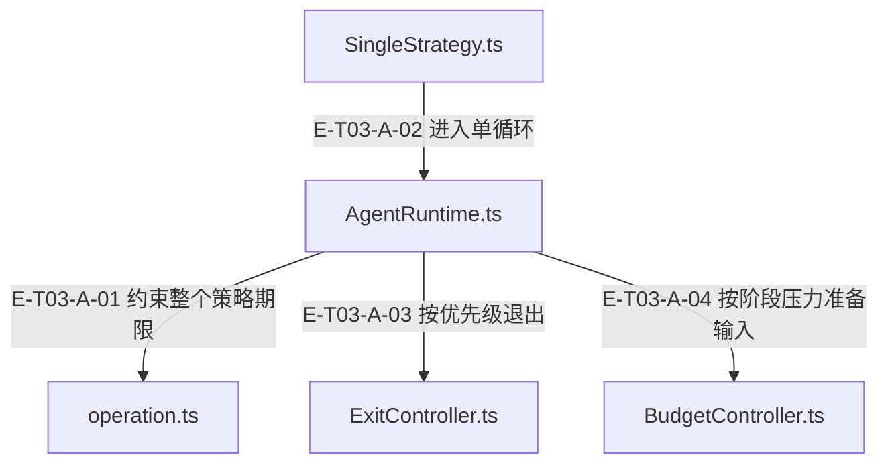

# 03 · 循环、预算与取消

> 每轮怎样排序，谁决定退出，取消后哪些回执与资源还能确认？

Runtime的执行边界用runOperation约束策略；reactLoop持有LoopContext并依次退出检查、输入准备/预算与压缩、provider、工具或文本处理、finalize。预算区分run累计与loop/stage基线；取消/超时先确定终态并传播signal，已确认工具回执保留，未合作任务的迟到输出不接纳。资源按run/view释放，不能将scope释放或abort理解为外部写入回滚。

[真实调用](call-flow.md) · [直接依赖](file-dependency.md) · [Runtime与PCV当前全文深读](full-source-review.md) · [阅读规范](../00-diagram-standard.md)

## 职责与主要接缝

### 本图术语说明

| 术语／节点 | 含义与范围 |
| --- | --- |
| AgentRuntime.ts | `src/agent/runtime/AgentRuntime.ts`；本图按实现文件聚合职责；具体装配条件见下表。 |
| operation.ts | `src/shared/operation.ts`；本图按实现文件聚合职责；具体装配条件见下表。 |
| SingleStrategy.ts | `src/agent/strategies/SingleStrategy.ts`；本图按实现文件聚合职责；具体装配条件见下表。 |
| ExitController.ts | `src/agent/runtime/ExitController.ts`；本图按实现文件聚合职责；具体装配条件见下表。 |
| BudgetController.ts | `src/agent/runtime/BudgetController.ts`；本图按实现文件聚合职责；具体装配条件见下表。 |

| 编号 | 代码依据 | 测试依据 | 关系与可证明范围 |
| --- | --- | --- | --- |
| E-T03-A-01 | `src/agent/runtime/AgentRuntime.ts#AgentRuntime.executeRun` → `src/shared/operation.ts#runOperation` | `test/agent-lifecycle.test.ts#case:keeps%20a%20hard%20timeout%20authoritative%20when%20strategy%20resolves%20synchronously%20on%20abort`；真实Runtime边界、strategy.execute替身在收到abort时同步resolve成功文本；Service timeoutMs=10，fake timer推进10ms后断言status=timeout、timer数=0。证明终态先于cooperative迟到resolve。断言已定位，实际执行见页面证据。 | 把strategy.execute包进runOperation，传合成父/本地abortSignal及显式或policy期限；timeout生成owner-bound超时快照，error重抛，aborted返回已知snapshot。 |
| E-T03-A-02 | `src/agent/strategies/SingleStrategy.ts#SingleStrategy.execute` → `src/agent/runtime/AgentRuntime.ts#AgentRuntime.reactLoop` | `test/agent-lifecycle.test.ts#case:permits%20the%20first%20model%20call%20when%20the%20iteration%20budget%20is%20one`；harness使用真实Runtime+SingleStrategy，Builder为返回该runtime的替身，provider chat为vi.fn返回done；maxIterations=1，断言Service status=success、reply=done且provider只调用一次。断言已定位，实际执行见页面证据。 | 传message.content/history、metadata.context，再用opts覆盖；reactLoop复用本Runtime活动scope，独立调用时自建scope。 |
| E-T03-A-03 | `src/agent/runtime/AgentRuntime.ts#AgentRuntime.shouldExit` → `src/agent/runtime/ExitController.ts#ExitController.checkBeforeIteration` | `test/exit-controller-runtime-timeout.test.ts#case:%E7%AD%96%E7%95%A5%E8%B6%85%E6%97%B6%2050ms%E3%80%81%E9%98%B6%E6%AE%B5%20600s%EF%BC%9A%E9%80%80%E5%87%BA%E5%8E%9F%E5%9B%A0%E4%B8%BA%20stage_timeout%EF%BC%8CtimedOutStages%20%E9%9D%9E%E7%A9%BA%EF%BC%8C%E4%B8%8D%E5%86%8D%E5%8F%91%E5%BC%BA%E5%88%B6%E6%91%98%E8%A6%81`；真实Runtime，policy timeout=50ms、stage=600000ms、provider工具轮有延迟；断言cancelReason=stage_timeout、timedOutStages非空、forced_summary_suppressed、无policy_stop且timedOut=true。断言已定位，实际执行见页面证据。 | 传当前LoopContext与run累计tokenUsage；检查顺序abort→有效超时→tracker→无tracker轮数→policy，首次token超限且tracker未终结可给一次SUMMARIZE机会。 |
| E-T03-A-04 | `src/agent/runtime/AgentRuntime.ts#AgentRuntime.prepareIteration` → `src/agent/runtime/BudgetController.ts#BudgetController.checkBeforeLLMCall` | `test/BudgetController.test.ts#case:measures%20a%20micro-stage%20budget%20against%20in-stage%20input%2C%20not%20the%20run-level%20cumulative%20input`；run累计input=300000的新微阶段，对比est/12000而非(300000+est)/12000；断言action=normal、ratio<0.75、工具quota=6000/15、run累计不变。此测试直接调用BudgetController，无provider。断言已定位，实际执行见页面证据。 | 每轮先runCompactionCycle再checkBeforeLLMCall；预检只返回normal/compress，session压力触发压缩，不直接决定终态。 |

## 输入、输出与副作用

| 维度 | 当前实现 |
| --- | --- |
| 输入 | AgentMessage、策略opts、父AbortSignal、timeout/budget、provider响应与工具调用；LoopContext持有messages、tracker、budgetController、diagnostics、evidenceLedger、resourceScope |
| 输出 | reply、toolCalls、tokenUsage、phases、diagnostics、state观察快照；取消/超时错误携带owner-bound已知事实；Service投影为status |
| 副作用 | 每轮model调用、工具副作用、消息历史、token账、证据/trace/events；run/view scope清理只释放本地/宿主资源；不逆向撤销Core/文件/进程已经发生的效果 |

## 从这些文件开始

| 文件 | 阅读目的 |
| --- | --- |
| `src/agent/runtime/AgentRuntime.ts` | 唯一 ReAct 执行内核 |
| `src/agent/runtime/LoopContext.ts` | 单 loop 可变状态与 read-view identity |
| `src/agent/runtime/ExitController.ts` | 退出优先级及预算/空响应判断 |
| `src/agent/runtime/BudgetController.ts` | 运行用量、阶段增量、压缩压力与工具配额 |
| `src/agent/runtime/AgentState.ts` | 仍公开的独立状态机；当前Runtime不持有或订阅它 |
| `src/agent/runtime/AgentExecutionTimeoutError.ts` | 运行超时错误与 owner 绑定的失败快照 |
| `src/shared/operation.ts` | 单次异步操作deadline/取消终态 |
| `src/agent/strategies/pipeline/attempt.ts` | 阶段准备和 reactLoop 共享截止时间；记录实际工具开始/完成，保留部分回执并标注 requiresReadback，关闭迟到观察入口。 |
| `src/agent/runtime/toolReceipt.ts` | 回执身份保存与模型显示配额 |
| `src/agent/runtime/LLMInputMeasurement.ts` | 完整请求的本地 token/重复块估算 |

## 失败、取消与恢复

- 开工前取消：Service可在preflight直接返回aborted/timeout，Runtime strategy不开始；shouldAbort异步检查受同一显式期限约束，消耗时间从Runtime剩余期限扣除。
- 在途取消与硬超时：runOperation先settle终态再abort内层。已回执工具和usage保留；Runtime忽略迟到strategy/provider成功。硬超时使用owner-bound快照，外层不能冒领内层结果。 依据 `test/agent-lifecycle.test.ts#case:keeps%20confirmed%20tool%20receipts%20when%20cancellation%20interrupts%20a%20later%20model%20request`（仅定位与阅读）。
- 后处理失败：pipeline after失败通过按Error/context/call隔离的WeakMap保留已执行回执；Runtime取出一次入history并停止，不重跑after/工具。
- 输入/预算失败：过大provider输入在调用前拒绝；本地装配异常不计provider两次错误重试。L4默认关闭，启用后失败可触发冷却及高压力hardStop。`src/agent/runtime/BudgetController.ts#BudgetController.executeL4IfPending` 的try还包含usage回写、loop回调与日志：后置回调异常可能被归入L4失败，此前窗口修改或已计用量不会回滚；不能据failed/removed=0推断模型未调用或压缩从未发生。 依据 `test/agent-runtime-provider-input-limit.test.ts#case:rejects%20oversized%20input%20for%20ollama%3Allama3%20(8k%20window)%20before%20calling%20the%20provider`（仅定位与阅读）。
- 不同状态不能合并：Runtime私有phase的结果快照、Pipeline outcome、Service status、工具envelope status、Core lifecycle/readiness各有独立语义；Service只在completed且最终阶段非空/非timedOut时搬移已恢复超时诊断。

## 已知边界与未验证范围

- ExitController.checkAfterAiError/checkAfterTextResponse/checkToolChoiceViolation在当前Runtime未接线；不可画为真实每轮调用。
- replyFn回写已退役；当前结果只通过AgentResult.reply交回宿主。finally的可选releaseScope仍无独立期限，永久pending的风险保留。
- runOperation不能杀死不合作外部代码，只能停止等待并忽略迟到结果。
- stage maxSessionInputTokens是压缩压力；maxSessionTokens已从阶段与policy字段删除，没有累计input+output总量停止门。policy保留的运行累计input限制与阶段压缩口径、迭代／期限停止分别说明。
- 本次测试未运行，文件读取是当前源码事实而非当前进程行为证明。

[继续阅读：Runtime、缓存与后处理失败闭环](runtime-failure-deep-review.md)；[15文件当前全文记录](full-source-review.md)另列连续区间、断言与未验证边界。历史v4执行事实继续保留，当前全文阅读不借用其通过结论。

## 当前运行时失败分类

Provider 未覆写 chatWithTools 是集成缺陷：PROVIDER_CONTRACT_VIOLATION 在未取消时单次终止为runtime_defect，记provider_contract_violation与degraded，不重试也不发强制摘要；取消竞态优先于缺陷分类。普通上游错误仍保留2-strike。`test/agent-runtime-provider-contract-defect.test.ts#case:terminates%20a%20%25s%20run%20once%2C%20without%20the%202000ms%20retry%2C%20as%20runtime_defect`；断言已定位，实际执行见页面证据。user/system 参数化：chatWithTools 一次、无等待/强制摘要、aiErrorCount=0，runtime_defect+provider_contract_violation+degraded。 边界：测试直接 reactLoop，ChatOnlyProvider 派生基类；需分别记录两个展开 case，不代表 Service status。 `test/agent-runtime-provider-contract-defect.test.ts#case:keeps%20abort%20precedence%20when%20the%20contract%20violation%20races%20a%20cancelled%20run`；断言已定位，实际执行见页面证据。provider 拒绝同时取消只归 abort_signal，无 provider_contract_violation。 边界：真实 reactLoop，受控 provider 拒绝与 signal。

Runtime不再调用消息replyFn，返回reply由宿主投递。state只含phase；它与Service status、Pipeline outcome、工具status各自独立。`test/agent-state-snapshot-copy.test.ts#case:returns%20only%20%7B%20phase%20%7D%20and%20a%20later%20abort()%20does%20not%20rewrite%20the%20returned%20snapshot`；断言已定位，实际执行见页面证据。真实文本 Runtime 返回 {phase:completed}；结束后 abort 不回写旧快照。 边界：真实 Runtime + fixture provider。

[策略、预算与诊断全文审阅](full-policy-review.md)说明软预算、退出判定、同步回调副作用和诊断副本的不同职责。
