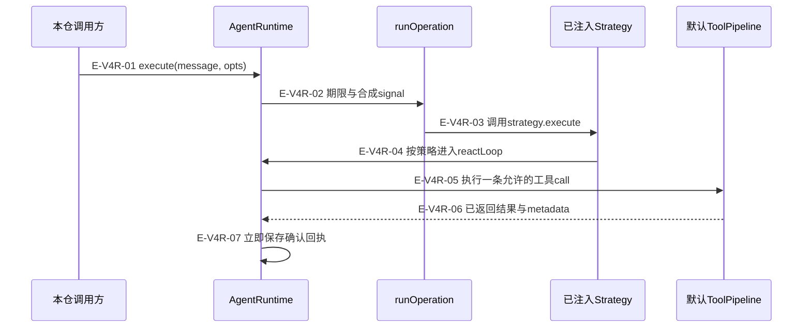
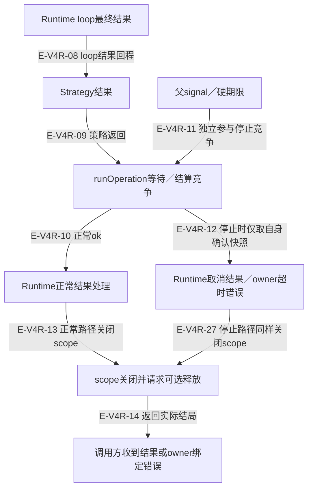
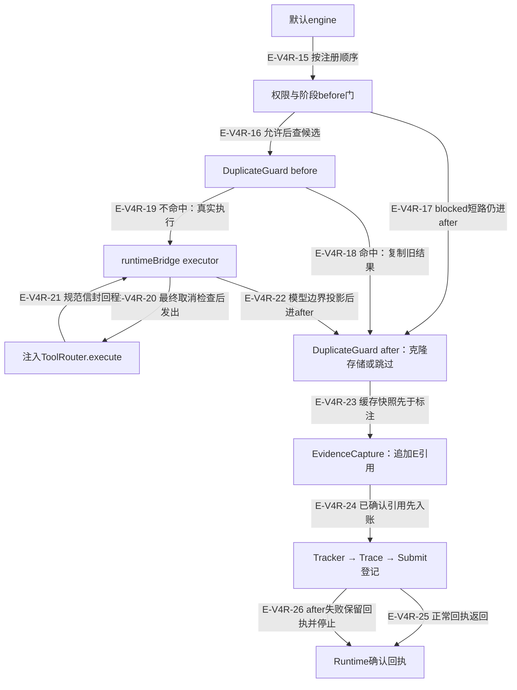

# Runtime、工具后处理与缓存：逐文件深读

本页保留 v4 全文记录与匹配旧 blob 差异复核形成的失败闭环；v6对Runtime、PCV及相关15文件的当前全文重读另见[连续区间与断言记录](full-source-review.md)。重复缓存的既有复核材料仍在本页，不把它误算进这15个文件。默认执行链、手工管道和直接reactLoop有不同约束；确认回执、观察通知、实例统计、资源scope也不能合并成一个状态。

[循环与预算专题](overview.md) · [当前全文深读](full-source-review.md) · [阶段门深读](../02-service-orchestration/stage-failures-and-prompts.md) · [终端失败分支](../06-tool-execution/terminal-failures-and-contracts.md) · [执行记录](../../evidence/scoped-execution.json)

## 一次execute进入工具回合

### 本图术语说明

| 节点／术语 | 本图含义 |
| --- | --- |
| execute / reactLoop | execute建立运行边界；图以策略实际调用reactLoop为前提，直接loop入口另见逐文件说明。 |
| 确认回执 | 工具返回后先记录到loop与runtime历史；后续观察失败不撤销已发生事实。 |
| runOperation | 只包策略执行；finally释放等待没有独立期限，消息replyFn已删除。 |

| 编号 | 代码依据 | 测试依据 | 关系与可证明范围 |
| --- | --- | --- | --- |
| E-V4R-01 | `src/agent/runtime/AgentRuntime.ts#AgentRuntime.execute` | `test/agent-lifecycle.test.ts#case:keeps%20confirmed%20tool%20receipts%20when%20cancellation%20interrupts%20a%20later%20model%20request`；断言已定位，实际执行见页面证据。第一轮meta成功，第二次模型pending时取消；Service aborted仍保留observed:true及成功envelope，router一次。 边界：真实Runtime/Single/default pipeline；Builder/provider/router为替身，无外部写入。 | 公开execute建立run资源边界，不能等同直接reactLoop。 |
| E-V4R-02 | `src/agent/runtime/AgentRuntime.ts#AgentRuntime.executeRun`；`src/shared/operation.ts#runOperation` | `test/agent-lifecycle.test.ts#case:keeps%20confirmed%20tool%20receipts%20and%20usage%20when%20a%20later%20model%20request%20reaches%20the%20hard%20timeout`；断言已定位，实际执行见页面证据。首次usage12/7与meta回执后模型挂起，虚拟时钟达到期限；timeout仍保留回执与usage12/7。 边界：真实Runtime边界、mock provider/router、fake timers。 | 显式/policy期限与合成signal包住strategy执行，不包finally的全部等待；当前Runtime不再进行replyFn渠道投递。 |
| E-V4R-03 | `src/agent/runtime/AgentRuntime.ts#AgentRuntime.executeRun` | `test/agent-lifecycle.test.ts#case:keeps%20confirmed%20tool%20receipts%20when%20cancellation%20interrupts%20a%20later%20model%20request`；断言已定位，实际执行见页面证据。第一轮meta成功，第二次模型pending时取消；Service aborted仍保留observed:true及成功envelope，router一次。 边界：真实Runtime/Single/default pipeline；Builder/provider/router为替身，无外部写入。 | runOperation执行传入的strategy.execute回调，具体策略由装配注入。 |
| E-V4R-04 | `src/agent/runtime/AgentRuntime.ts#AgentRuntime.reactLoop`；`src/agent/strategies/SingleStrategy.ts#SingleStrategy.execute` | `test/agent-lifecycle.test.ts#case:keeps%20confirmed%20tool%20receipts%20when%20cancellation%20interrupts%20a%20later%20model%20request`；断言已定位，实际执行见页面证据。第一轮meta成功，第二次模型pending时取消；Service aborted仍保留observed:true及成功envelope，router一次。 边界：真实Runtime/Single/default pipeline；Builder/provider/router为替身，无外部写入。 | 图以调用reactLoop的正常策略为前提；自定义Strategy不一定调用loop。 |
| E-V4R-05 | `src/agent/runtime/AgentRuntime.ts#AgentRuntime.processToolCalls`；`src/agent/runtime/ToolExecutionPipeline.ts#ToolExecutionPipeline.execute` | `test/agent-lifecycle.test.ts#case:retains%20the%20returned%20host%20receipt%20when%20default%20%25s%20postprocessing%20fails`；参数化模板；展开项的实际执行状态见定向记录。tracker/trace两例：after抛错后Service error；provider/router各一次，usage4/3、meta回执与原envelope保留，trace round关闭。 边界：真实Runtime/default pipeline，真实tracker/trace上spy抛错，provider/router替身。 | 取消与异步hook检查后，按顺序执行工具。 |
| E-V4R-06 | `src/agent/runtime/toolPipeline/engine.ts#executeToolPipeline` | `test/runtime-efficiency.test.ts#case:captures%20evidence%20before%20tracker%20and%20trace%20consume%20the%20same%20envelope`；断言已定位，实际执行见页面证据。实际ledger采集code.read；顺序ledger→tracker→trace，trace看到[evidence]标注，isNew=true。 边界：真实临时EvidenceLedgerStore/default pipeline，router与观察端口受控。 | 正常回程给result+metadata；after抛错另走按调用身份保存的失败回执。 |
| E-V4R-07 | `src/agent/runtime/AgentRuntime.ts#AgentRuntime.processToolCalls` | `test/agent-lifecycle.test.ts#case:keeps%20confirmed%20tool%20receipts%20when%20cancellation%20interrupts%20a%20later%20model%20request`；断言已定位，实际执行见页面证据。第一轮meta成功，第二次模型pending时取消；Service aborted仍保留observed:true及成功envelope，router一次。 边界：真实Runtime/Single/default pipeline；Builder/provider/router为替身，无外部写入。 `test/agent-lifecycle.test.ts#case:retains%20the%20returned%20host%20receipt%20when%20default%20%25s%20postprocessing%20fails`；参数化模板；展开项的实际执行状态见定向记录。tracker/trace两例：after抛错后Service error；provider/router各一次，usage4/3、meta回执与原envelope保留，trace round关闭。 边界：真实Runtime/default pipeline，真实tracker/trace上spy抛错，provider/router替身。 | 回执先进入loop/runtime历史，后续通知或下一模型失败不撤销它。 |

## 正常与停止结算、资源关闭

正常策略完成与父signal／硬期限独立参与竞争；E-V4R-12只在停止结算时读取本Runtime确认快照。正常与停止路径共用同一finally关闭scope；关闭不等于宿主释放已经成功。

### 本图术语说明

| 节点／术语 | 本图含义 |
| --- | --- |
| 停止快照 | 只信本Runtime的owner绑定；不能接纳外部Error.partialResult伪造事实。 |
| 可选释放 | 抛错被隔离，挂起却没有独立deadline；并非所有清理情形都已通过测试。 |
| 回程 | 表达跨层结果交接，不将状态机phase替代Service status或Pipeline outcome。 |

| 编号 | 代码依据 | 测试依据 | 关系与可证明范围 |
| --- | --- | --- | --- |
| E-V4R-08 | `src/agent/runtime/AgentRuntime.ts#AgentRuntime.finalize` | `test/runtime-public-surface-compat.test.ts#case:%E5%8F%AA%E4%BC%A0%E9%98%B6%E6%AE%B5%E5%A3%B0%E6%98%8E%E7%9A%84%20summaryMode%EF%BC%8C%E4%B8%8D%E4%BC%A0%E5%B7%B2%E5%88%A0%E9%99%A4%E7%9A%84%20contextWindow%2FtokenUsage%EF%BC%9B%E6%91%98%E8%A6%81%E7%94%A8%E9%87%8F%E6%8C%89%E8%BF%94%E5%9B%9E%E5%80%BC%E7%B4%AF%E8%AE%A1%E4%B8%80%E6%AC%A1`；断言已定位，实际执行见页面证据。produceForcedSummary被调用一次，参数无contextWindow/tokenUsage；loop/runtime usage均为11/7，不重复计费。 边界：真实Runtime，包装summary spy、provider mock。 | loop最终结果包括reply、工具、usage和诊断，summary usage只累计一次。 |
| E-V4R-09 | `src/agent/runtime/AgentRuntime.ts#AgentRuntime.executeRun`；`src/agent/strategies/SingleStrategy.ts#SingleStrategy.execute` | `test/agent-lifecycle.test.ts#case:keeps%20confirmed%20tool%20receipts%20when%20cancellation%20interrupts%20a%20later%20model%20request`；断言已定位，实际执行见页面证据。第一轮meta成功，第二次模型pending时取消；Service aborted仍保留observed:true及成功envelope，router一次。 边界：真实Runtime/Single/default pipeline；Builder/provider/router为替身，无外部写入。 | 正常strategy结果交operation；此测试走取消对照，不单独证明所有Strategy正常输出。 |
| E-V4R-10 | `src/agent/runtime/AgentRuntime.ts#AgentRuntime.executeRun` | `test/agent-message-reply-delivery.test.ts#case:keeps%20a%20completed%20run%20completed%2C%20returns%20result.reply%20and%20publishes%20AGENT_COMPLETED%20once`；断言已定位，实际执行见页面证据。替身策略结果返回 ok reply、completed 事件一次，state 仍 idle（未进入 reactLoop）。 边界：仅 execute 通知/返回合同，不是状态 completed 断言。 | 正常ok结果经后置质量与私有phase快照返回，Runtime不回写渠道。边仍表示operation正常分支，旧投递测试已退役。 |
| E-V4R-11 | `src/agent/runtime/AgentRuntime.ts#AgentRuntime.executeRun` | `test/agent-lifecycle.test.ts#case:keeps%20confirmed%20tool%20receipts%20when%20cancellation%20interrupts%20a%20later%20model%20request`；断言已定位，实际执行见页面证据。第一轮meta成功，第二次模型pending时取消；Service aborted仍保留observed:true及成功envelope，router一次。 边界：真实Runtime/Single/default pipeline；Builder/provider/router为替身，无外部写入。 `test/agent-lifecycle.test.ts#case:keeps%20confirmed%20tool%20receipts%20and%20usage%20when%20a%20later%20model%20request%20reaches%20the%20hard%20timeout`；断言已定位，实际执行见页面证据。首次usage12/7与meta回执后模型挂起，虚拟时钟达到期限；timeout仍保留回执与usage12/7。 边界：真实Runtime边界、mock provider/router、fake timers。 | 停止等待不表示合作方副作用已回滚。 |
| E-V4R-12 | `src/agent/runtime/AgentRuntime.ts#AgentRuntime.executeRun` | `test/agent-lifecycle.test.ts#case:keeps%20confirmed%20tool%20receipts%20and%20usage%20when%20a%20later%20model%20request%20reaches%20the%20hard%20timeout`；断言已定位，实际执行见页面证据。首次usage12/7与meta回执后模型挂起，虚拟时钟达到期限；timeout仍保留回执与usage12/7。 边界：真实Runtime边界、mock provider/router、fake timers。 | 保留当前Runtime自己的history/usage，硬超时错误与owner绑定。 |
| E-V4R-13 | `src/agent/runtime/AgentRuntime.ts#AgentRuntime.withToolResourceRun`；`src/agent/runtime/AgentRuntime.ts#AgentRuntime.releaseToolScope` | `test/tool-resource-scope.test.ts#case:does%20not%20resurrect%20a%20timed-out%20run%20when%20a%20legacy%20strategy%20starts%20a%20late%20loop%20without%20its%20signal`；断言已定位，实际执行见页面证据。10ms硬超时后放行旧strategy，迟到reactLoop抛run已closed；零工具请求，releaseScope一次。 边界：真实Runtime资源边界，受控legacy strategy与路由端口；不证明真实宿主资源释放。 `test/agent-lifecycle.test.ts#case:keeps%20a%20confirmed%20result%20when%20resource%20cleanup%20and%20its%20diagnostic%20observer%20both%20fail`；断言已定位，实际执行见页面证据。确认工具结果后scope清理与清理日志器都抛错，已确认执行结果仍保留。 边界：真实Runtime/Single，清理与日志替身；只验证失败隔离。 | scope先closed，迟到loop拒绝；释放端口可选，抛错不改结果，不承诺永不挂起。 |
| E-V4R-14 | `src/agent/runtime/AgentRuntime.ts#AgentRuntime.executeRun`；`src/agent/runtime/AgentRuntime.ts#AgentRuntime.withToolResourceRun` | `test/agent-state-snapshot-copy.test.ts#case:returns%20only%20%7B%20phase%20%7D%20and%20a%20later%20abort()%20does%20not%20rewrite%20the%20returned%20snapshot`；断言已定位，实际执行见页面证据。真实文本 Runtime 返回 {phase:completed}；结束后 abort 不回写旧快照。 边界：真实 Runtime + fixture provider。；取消／期限对应E-V4R-11/12的断言 | 完成、取消结果与owner硬超时／异常分开返回；释放后由Service解释执行status。 |
| E-V4R-27 | `src/agent/runtime/AgentRuntime.ts#AgentRuntime.withToolResourceRun`；`src/agent/runtime/AgentRuntime.ts#AgentRuntime.releaseToolScope` | `test/tool-resource-scope.test.ts#case:does%20not%20resurrect%20a%20timed-out%20run%20when%20a%20legacy%20strategy%20starts%20a%20late%20loop%20without%20its%20signal`；断言已定位，实际执行见页面证据。10ms硬超时后放行旧strategy，迟到reactLoop抛run已closed；零工具请求，releaseScope一次。 边界：真实Runtime资源边界，受控legacy strategy与路由端口；不证明真实宿主资源释放。 `test/agent-lifecycle.test.ts#case:keeps%20a%20confirmed%20result%20when%20resource%20cleanup%20and%20its%20diagnostic%20observer%20both%20fail`；断言已定位，实际执行见页面证据。确认工具结果后scope清理与清理日志器都抛错，已确认执行结果仍保留。 边界：真实Runtime/Single，清理与日志替身；只验证失败隔离。 | 停止/异常路径同样进入withToolResourceRun的finally，先closed再可选releaseScope；没有承诺释放端口永不挂起。 |

## 默认管道：准入、缓存与after顺序

### 本图术语说明

| 节点／术语 | 本图含义 |
| --- | --- |
| 默认工厂 | new ToolExecutionPipeline是空中间件表；完整默认门由createToolPipeline安装。 |
| 重复缓存 | 仅真实注册表允许且有宿主snapshot的动作；不包含通用文件、知识或memory缓存。 |
| after失败 | tracker/trace的错误会传播，区别于onProgress/onToolCall安全观察通知。 |
| bridge回程 | 同一try还含私有字段清理、诊断记录和投影；HOST失败码不独自证明宿主没有返回。 |

| 编号 | 代码依据 | 测试依据 | 关系与可证明范围 |
| --- | --- | --- | --- |
| E-V4R-15 | `src/agent/runtime/ToolExecutionPipeline.ts#createToolPipeline`；`src/agent/runtime/toolPipeline/engine.ts#executeToolPipeline` | `test/tool-pipeline-dead-links.test.ts#case:assembles%20the%20documented%20order%20without%20an%20observation%20middleware`；断言已定位，实际执行见页面证据。spy ToolExecutionPipeline.use，默认中间件名称顺序等于声明表且不含observationRecord。 边界：装配结构断言，不是全部gate行为验证。 `test/runtime-efficiency.test.ts#case:awaits%20before%20hooks%20and%20invokes%20after%20hooks%20in%20registration%20order`；断言已定位，实际执行见页面证据。异步before:first等待完成，再before:second、executor、after:first、after:second。 边界：真实自定义pipeline/engine，router替身。 | 工厂固定安全/阶段门顺序；engine等异步before，非反向回卷。 |
| E-V4R-16 | `src/agent/runtime/toolPipeline/duplicateCache.ts#isDeterministicDuplicateCandidate` | `test/tool-pipeline-duplicate-cache-registry.test.ts#case:admits%20exactly%20the%20registry%20actions%20declared%20read-only%2C%20non-exclusive%20and%20cache-enabled`；断言已定位，实际执行见页面证据。遍历TOOL_REGISTRY动作，准入仅graph.overview/graph.query。 边界：直接调用guard.before，不执行host。 `test/tool-pipeline-duplicate-cache-registry.test.ts#case:admits%20graph.query%20only%20when%20a%20real%20project%20snapshot%20id%20is%20bound`；断言已定位，实际执行见页面证据。有夹具快照时cacheEligible=true；无快照时false。 边界：只验证有无字符串快照，不验证快照内容真实性或全局唯一性。 | 先通过控制门，才判断单源动作声明与快照是否允许复用。 |
| E-V4R-17 | `src/agent/runtime/toolPipeline/engine.ts#executeToolPipeline`；`src/agent/runtime/toolPipeline/duplicateCache.ts#deterministicDuplicateGuard` | `test/runtime-efficiency.test.ts#case:short-circuits%20a%20%24label%20verdict%20but%20still%20runs%20all%20after%20hooks`；参数化模板；展开项的实际执行状态见定向记录。null/0/false/空字符串和blocked无result短路executor，仍执行所有after；blocked结果按失败归一。 边界：自定义middleware受控；不代表默认每个门都覆盖。 | blocked不调用executor，但所有after仍按注册顺序运行，guard.after因blocked不存。 |
| E-V4R-18 | `src/agent/runtime/toolPipeline/duplicateCache.ts#deterministicDuplicateGuard` | `test/tool-pipeline-duplicate-cache-registry.test.ts#case:short-circuits%20the%20second%20identical%20graph.query%20through%20the%20default%20pipeline%20without%20consulting%20getManifest`；断言已定位，实际执行见页面证据。绑定snapshot-1的同参数graph.query两次只执行host一次，第二次cacheHit/duplicateShortCircuit=true，效率toolCalls=2/cacheHits=1，不调用getManifest。 边界：真实默认pipeline，router受控返回信封；不读取真实项目图。 `test/runtime-degrade-diagnostics.test.ts#case:treats%20a%20cached%20entry%20that%20cannot%20be%20copied%20as%20a%20miss%20and%20evicts%20it`；断言已定位，实际执行见页面证据。手动放入含函数的缓存项，命中复制失败后剔除、不标hit/shortCircuit，记录TOOL_CACHE_CLONE_FAILED。 边界：模拟污染旧缓存；只验证guard边界。 | 命中先克隆；成功才短路，复制失败驱逐并当miss。 |
| E-V4R-19 | `src/agent/runtime/toolPipeline/engine.ts#executeToolPipeline`；`src/agent/runtime/toolPipeline/runtimeBridge.ts#executeRuntimeToolCall` | `test/tool-pipeline-duplicate-cache-registry.test.ts#case:short-circuits%20the%20second%20identical%20graph.query%20through%20the%20default%20pipeline%20without%20consulting%20getManifest`；断言已定位，实际执行见页面证据。绑定snapshot-1的同参数graph.query两次只执行host一次，第二次cacheHit/duplicateShortCircuit=true，效率toolCalls=2/cacheHits=1，不调用getManifest。 边界：真实默认pipeline，router受控返回信封；不读取真实项目图。 | 无before结果才调用executor；此边是依赖注入执行，绑定在ToolExecutionPipeline.execute。 |
| E-V4R-20 | `src/agent/runtime/toolPipeline/runtimeBridge.ts#executeRuntimeToolCall` | `test/runtime-tool-call-diagnostics.test.ts#case:records%20no%20tool%20call%20entry%20when%20cancelled%20before%20host%20dispatch`；断言已定位，实际执行见页面证据。预取消signal阻止execute；返回aborted/error，diagnostics无toolCalls，有TOOL_HOST_DISPATCH_CANCELLED。 边界：直接bridge与mock host，未产生真实执行信封。 `test/runtime-degrade-diagnostics.test.ts#case:classifies%20request%20assembly%20failures%20separately%20and%20keeps%20the%20original%20error%20text`；断言已定位，实际执行见页面证据。allowedToolActions.meta给7造成展开失败，router零调用，只返回error并记录TOOL_REQUEST_ASSEMBLY_FAILED，duration非负。 边界：直接真实bridge，畸形loop输入fixture。 | 装配异常/取消都应在host入口前收口。 |
| E-V4R-21 | `src/agent/runtime/toolPipeline/runtimeBridge.ts#executeRuntimeToolCall` | `test/runtime-bridge-private-fields.test.ts#case:removes%20threadId%2C%20reasoningContent%20and%20apiKey%20from%20the%20result%20the%20model%20receives`；断言已定位，实际执行见页面证据。真实adapter detail返回合成私有字段；bridge返回与envelope两载体均清理，原DTO不改，诊断只列字段名。 边界：真实Adapter/Router/bridge；knowledgeRead为fixture，不含真实凭据。 `test/runtime-degrade-diagnostics.test.ts#case:includes%20the%20router%20error%20text%20in%20TOOL_HOST_EXECUTION_FAILED`；断言已定位，实际执行见页面证据。router抛router exploded，返回同error文案，warning分类为HOST_EXECUTION而非REQUEST_ASSEMBLY。 边界：直接真实bridge，host execute替身抛错。 | 路由正常返回后先处理私有字段；异常没有新真实callId，HOST错误分类也可能来自该try内后处理。 |
| E-V4R-22 | `src/agent/runtime/toolPipeline/runtimeBridge.ts#recordExecutedEnvelope`；`src/agent/runtime/toolPipeline/engine.ts#executeToolPipeline` | `test/tool-pipeline-dead-links.test.ts#case:does%20not%20project%20unread%20policyValidator%2C%20sessionToolCalls%2C%20currentRound%20or%20cache%20to%20the%20host`；断言已定位，实际执行见页面证据。宿主请求不含四个死字段，不map全部toolCalls；iteration=3且memoryCoordinator原对象保留；diagnostics/fileCache/dataRoot/logger/validator不进请求，诊断由bridge直接写loop。 边界：默认pipeline与真实bridge，捕获请求的受控host端口。 `test/runtime-efficiency.test.ts#case:awaits%20before%20hooks%20and%20invokes%20after%20hooks%20in%20registration%20order`；断言已定位，实际执行见页面证据。异步before:first等待完成，再before:second、executor、after:first、after:second。 边界：真实自定义pipeline/engine，router替身。 | envelope记录与模型payload归一完成后进入正序after；保留共享DI身份。 |
| E-V4R-23 | `src/agent/runtime/ToolExecutionPipeline.ts#createToolPipeline`；`src/agent/runtime/toolPipeline/duplicateCache.ts#deterministicDuplicateGuard` | `test/tool-pipeline-dead-links.test.ts#case:assembles%20the%20documented%20order%20without%20an%20observation%20middleware`；断言已定位，实际执行见页面证据。spy ToolExecutionPipeline.use，默认中间件名称顺序等于声明表且不含observationRecord。 边界：装配结构断言，不是全部gate行为验证。 `test/runtime-degrade-diagnostics.test.ts#case:does%20not%20cache%20a%20result%20that%20cannot%20be%20cloned%20and%20records%20TOOL_CACHE_CLONE_FAILED`；断言已定位，实际执行见页面证据。结果含函数，store复制失败；cache为空、诊断存在，重复before仍非命中。 边界：直接guard.before/after，真实structuredClone，构造共享状态；不运行完整Runtime。 | cache store克隆发生在EvidenceCapture追加文本之前，后者不污染缓存副本。 |
| E-V4R-24 | `src/agent/runtime/toolPipeline/observations.ts#evidenceCapture`；`src/agent/runtime/toolPipeline/observations.ts#trackerSignal`；`src/agent/runtime/toolPipeline/observations.ts#traceRecord` | `test/runtime-efficiency.test.ts#case:captures%20evidence%20before%20tracker%20and%20trace%20consume%20the%20same%20envelope`；断言已定位，实际执行见页面证据。实际ledger采集code.read；顺序ledger→tracker→trace，trace看到[evidence]标注，isNew=true。 边界：真实临时EvidenceLedgerStore/default pipeline，router与观察端口受控。 `test/EvidenceCapture.test.ts#case:keeps%20confirmed%20evidence%20annotations%20when%20the%20next%20batch%20append%20fails`；断言已定位，实际执行见页面证据。第二次append抛错；ledger仍有第一条，envelope只有E-1无E-2，stats为1，warn包含persisted=1。 边界：真实ledger与evidenceCapture，第二次append故障注入；不证明任意存储故障可恢复。 | 证据先落账标注；部分append失败保留确认项，tracker/trace之后消费。 |
| E-V4R-25 | `src/agent/runtime/toolPipeline/engine.ts#executeToolPipeline`；`src/agent/runtime/AgentRuntime.ts#AgentRuntime.processToolCalls` | `test/tool-pipeline-dead-links.test.ts#case:runs%20the%20default%20observers%20on%20the%20routed%20envelope%20without%20touching%20MemoryCoordinator`；断言已定位，实际执行见页面证据。真实默认pipeline返回成功，执行端口一次；tracker一次，trace收到同一envelope及isNew=true。 边界：MemoryCoordinator真实实例，tracker/trace/终端执行器受控；不运行真实shell。 | after正常完成后，Runtime保存receipt，再做quota文本/PCV/过程事件等后续。 |
| E-V4R-26 | `src/agent/runtime/toolPipeline/engine.ts#takeToolPipelineFailure`；`src/agent/runtime/AgentRuntime.ts#AgentRuntime.processToolCalls` | `test/agent-lifecycle.test.ts#case:retains%20the%20returned%20host%20receipt%20when%20default%20%25s%20postprocessing%20fails`；参数化模板；展开项的实际执行状态见定向记录。tracker/trace两例：after抛错后Service error；provider/router各一次，usage4/3、meta回执与原envelope保留，trace round关闭。 边界：真实Runtime/default pipeline，真实tracker/trace上spy抛错，provider/router替身。 `test/runtime-efficiency.test.ts#case:keeps%20reused%20errors%20isolated%20by%20invocation%20and%20call%2C%20then%20consumes%20each%20receipt%20once`；断言已定位，实际执行见页面证据。同一Error用于两个调用；只有匹配context+call能取到对应真实envelope，外部partialResult无效，每个回执只能消费一次。 边界：真实pipeline/engine失败登记，after抛错注入。 | after抛错不会逆向撤销host结果；仅本次context/call回执可取一次，停止run不重放。 |

## 逐文件职责与差异复核范围

### AgentRuntime.ts

`src/agent/runtime/AgentRuntime.ts`

统一Agent执行边界与ReAct编排：持有per-execute状态/统计，建立per-loop上下文，调用provider及工具管道，发布观察事件并保留失败/取消时的确认事实。

- 构造期依次解析显式toolRouter→container.toolRouter；无router拒绝。固定实例id/modelRef/projectRoot/dataRoot、独立回退evidence jobId，默认grounding=off；自建HookSystem、默认管道、prompt builder与私有phase字段。
- execute先建立AsyncLocalStorage run scope，再复位私有phase/计数/历史/token和本次grounding override；Policy.validateBefore失败只给零成本拒绝回执，未进strategy。
- runOperation包strategy.execute并合成父signal与runtime.abort控制器。结果、硬超时、异常和取消分别收口；只将本Runtime的错误/超时快照绑定给Service读取，外部Error.partialResult不可冒充。
- reactLoop复用同owner未关闭run；否则独立创建run。每loop建立view，finally释放runId/viewId；外层finally将run闭合并释放runId。
- #initLoop解析capability与动作白名单、静态system prompt、history+prompt、阶段budget覆盖与注册表输入上限。打开维度evidence ledger后，按真实宿主资源查询有效schema，并记录缺接线/不可用诊断。
- LoopContext持有messages/tracker/trace/memoryCoordinator/sharedState/evidenceLedger/权限/signal。BudgetController共享run token总账但以构造时累计为阶段基线，ExitController负责终止判定；provider输入上限保存在按LoopContext键控的WeakMap。
- 每轮先增计数/开trace，before hook→退出检查→nudge、压缩、预算预检、toolChoice/阶段schema/动态记忆→L4（如pending）→本地输入装配、PCV、测量/守卫→provider。动态phase/memory文本是ephemeral输入，不写回ContextWindow。
- provider响应先累计usage，再检查迟到取消；空响应按ExitController决定重试/终止，工具选择违规可能丢弃calls。普通provider异常有2-strike/熔断分支；本地装配异常与PROVIDER_CONTRACT_VIOLATION都以runtime_defect停止、不进入该重试链。
- 工具批次最多8个，顺序执行。先记assistant calls，再逐个检查signal、发start事件、await before hook；允许时进入默认管道，拒绝时生成无router envelope的错误payload。
- 每条已返回工具回执立即加入ctx.toolCalls与runtime.toolCallHistory；after失败可取一次owner/context/call绑定的回执。普通回程再通知onToolCall、写PCV、按共享额度投影、必要时使读取view失效，发end事件并appendToolResult。
- 工具轮与文本轮都会推进tracker/endRound。文本grounding只在guard时生效且有连续阻断上限；默认off保持observe-only。Analyst终结转换可注入单源digest nudge，非终结转换nudge不再丢失。
- finalize只在lastReply缺失时考虑摘要：先判停止抑制，再选summaryMode；none为空，停止给停止回执，正常scan直接数created回执，其余工具/跟踪/system场景最多调用一次produceForcedSummary，最后兜底文案带fallback诊断。
- execute后置质量检查跳过取消和最终超时；完整/abandoned/degraded等其它结果仍可有qualityWarning。私有phase只是观察投影，最终附只含phase的state/duration/diagnostics并发布终态事件；reply由宿主自行投递。
- 公开abort只取消当前execute边界；直接reactLoop必须使用传入signal。setFileCache同步更新prompt builder；emitProgress对回调异常隔离，事件bus另行发布。

| 语义复核项 | 当前实现与定位 |
| --- | --- |
| 构造与scope | 显式／容器router；ALS run/view与closed门；新实例私有phase=idle；默认Hook、pipeline、prompt builder。 |
| 执行边界 | execute复位phase/统计；before拒绝零成本；runOperation包strategy并合成signal，确认结果／owner错误快照分别保全。 |
| 终态与释放 | 正常质量检查或取消／timeout跳过；结果state只含phase；bus通知后finally标scope closed并await可选release。 |
| loop装配 | 每loop初始化history、权限、预算、schema availability、ledger；同Runtime EvidenceSourceDigestTable跨loop共享。 |
| 预算与准备 | BudgetController阶段input基线、窗口压缩/L4和工具quota；ExitController负责退出，动态phase/memory不写回历史。 |
| Provider边界 | 本地组装／最终测量先于dispatch；usage先累计再处理取消；contract violation一次runtime_defect；普通错误仍2-strike。 |
| 工具批次 | 最多8条，顺序门控执行；先保存确认回执，再通知／PCV／配额投影／历史；after失败从调用绑定记录恢复事实并停止。 |
| 文本轮 | guard开启才阻断无证据文本且有连续上限；tracker/endRound、终结digest及非终结nudge保留。 |
| 最终摘要 | lastReply缺失才考虑；abort/runtime_defect/timeout/input上限等抑制；none不请求；usage仅累计一次。 |
| 可观测性与状态 | phase快照不可被迟到abort修改；publish/progress有隔离边界，直接logger/diagnostics与tracker/trace不一概吞错。 |

| 触发条件 | 实际行为 | 恢复／停止依据 | 源码与测试证据 |
| --- | --- | --- | --- |
| 构造时没有router，或loop capability动作合同非法/目录未接线 | 没有router/非法动作合同会抛Error；工具声明存在但schema空且无availability理由时记tool_schema_projection_empty。完整schema每loop重查，不沿用进程级lazy展开状态。 | 修复真实DI/合同后重新运行；不得把空工具面当正常无工具任务，也不得靠恢复旧shim绕过。 | `src/agent/runtime/AgentRuntime.ts#AgentRuntime.constructor`；`src/agent/runtime/AgentRuntime.ts#AgentRuntime.collectToolContract`；`src/agent/runtime/AgentRuntime.ts#AgentRuntime.queryToolSchemas` `test/tool-schema-projection.test.ts#case:rejects%20an%20invalid%20explicit%20action%20contract%20instead%20of%20widening%20through%20legacy%20tools`；断言已定位，实际执行见页面证据。capability.allowedTools给code:'read'而非数组，reactLoop拒绝，provider与execute均零调用。 边界：真实Runtime/catalog，畸形capability与mock端口。 |
| Policy.validateBefore拒绝 | 返回拒绝文案、零工具/usage/iterations并记录policy_rejected，未进入strategy。 | 由调用方修正授权/输入；Runtime不重试被拒请求。 | `src/agent/runtime/AgentRuntime.ts#AgentRuntime.executeRun` `test/agent-lifecycle.test.ts#case:reports%20policy%20rejection%20as%20blocked%20without%20calling%20the%20provider`；断言已定位，实际执行见页面证据。SafetyPolicy拒绝sender；Service为blocked，provider零调用。 边界：真实Runtime，Service使用返回该Runtime的Builder替身；provider受控。 |
| 父signal或abort()取消在途strategy/provider | runOperation停止等待，取消文案替换late success，保留当前确认回执/usage与abort诊断；不合作策略迟到结果不被接纳。 | 读取已确认history；外部副作用未获回执时由宿主读回，不能推断rollback。 | `src/agent/runtime/AgentRuntime.ts#AgentRuntime.executeRun`；`src/agent/runtime/AgentRuntime.ts#AgentRuntime.abort`；`src/agent/runtime/AgentRuntime.ts#AgentRuntime.handleAiError` `test/agent-lifecycle.test.ts#case:keeps%20confirmed%20tool%20receipts%20when%20cancellation%20interrupts%20a%20later%20model%20request`；断言已定位，实际执行见页面证据。第一轮meta成功，第二次模型pending时取消；Service aborted仍保留observed:true及成功envelope，router一次。 边界：真实Runtime/Single/default pipeline；Builder/provider/router为替身，无外部写入。 |
| runOperation硬期限到达 | 抛本Runtime owner-bound AgentExecutionTimeoutError，快照保留确认history、usage；catch不冒领嵌套Runtime超时快照。 | Service按该结构化错误分类timeout；不要因存在非空部分文字判已恢复。 | `src/agent/runtime/AgentRuntime.ts#AgentRuntime.executeRun` `test/agent-lifecycle.test.ts#case:keeps%20confirmed%20tool%20receipts%20and%20usage%20when%20a%20later%20model%20request%20reaches%20the%20hard%20timeout`；断言已定位，实际执行见页面证据。首次usage12/7与meta回执后模型挂起，虚拟时钟达到期限；timeout仍保留回执与usage12/7。 边界：真实Runtime边界、mock provider/router、fake timers。 `test/tool-resource-scope.test.ts#case:does%20not%20resurrect%20a%20timed-out%20run%20when%20a%20legacy%20strategy%20starts%20a%20late%20loop%20without%20its%20signal`；断言已定位，实际执行见页面证据。10ms硬超时后放行旧strategy，迟到reactLoop抛run已closed；零工具请求，releaseScope一次。 边界：真实Runtime资源边界，受控legacy strategy与路由端口；不证明真实宿主资源释放。 |
| 旧strategy在关闭的ALS run里迟到启动reactLoop | owner相同且scope.closed时明确拒绝，阻止旧任务复活并开始新工具。 | 重新请求必须获得新的execute/run scope，而不是复用超时scope。 | `src/agent/runtime/AgentRuntime.ts#AgentRuntime.reactLoop`；`src/agent/runtime/AgentRuntime.ts#AgentRuntime.withToolResourceRun` `test/tool-resource-scope.test.ts#case:does%20not%20resurrect%20a%20timed-out%20run%20when%20a%20legacy%20strategy%20starts%20a%20late%20loop%20without%20its%20signal`；断言已定位，实际执行见页面证据。10ms硬超时后放行旧strategy，迟到reactLoop抛run已closed；零工具请求，releaseScope一次。 边界：真实Runtime资源边界，受控legacy strategy与路由端口；不证明真实宿主资源释放。 |
| scope release或进度／工具通知观察者抛错 | release错误与onProgress/onToolCall通知按各自安全观察边界隔离；Runtime已无state-transition监听器。 | 保留原结果；不意味着资源已释放，tracker/trace后处理是下一行的停止分支。 | `src/agent/runtime/AgentRuntime.ts#AgentRuntime.releaseToolScope`；`src/agent/runtime/AgentRuntime.ts#AgentRuntime.emitProgress` `test/agent-lifecycle.test.ts#case:keeps%20a%20confirmed%20result%20when%20resource%20cleanup%20and%20its%20diagnostic%20observer%20both%20fail`；断言已定位，实际执行见页面证据。清理和诊断观察者同时抛错仍保留确认结果。 |
| 默认pipeline tracker/trace after处理抛错 | 取engine保存的本次回执进入两个history，记TOOL_POSTPROCESSING_FAILED，重抛停止run；不通知成功/重跑工具或after。 | 错误partialResult保留已确认工具事实；修复观察者后由上层决定后续，不能重试副作用来补通知。 | `src/agent/runtime/AgentRuntime.ts#AgentRuntime.processToolCalls`；`src/agent/runtime/toolPipeline/engine.ts#takeToolPipelineFailure` `test/agent-lifecycle.test.ts#case:retains%20the%20returned%20host%20receipt%20when%20default%20%25s%20postprocessing%20fails`；参数化模板；展开项的实际执行状态见定向记录。tracker/trace两例：after抛错后Service error；provider/router各一次，usage4/3、meta回执与原envelope保留，trace round关闭。 边界：真实Runtime/default pipeline，真实tracker/trace上spy抛错，provider/router替身。 `test/runtime-efficiency.test.ts#case:keeps%20reused%20errors%20isolated%20by%20invocation%20and%20call%2C%20then%20consumes%20each%20receipt%20once`；断言已定位，实际执行见页面证据。同一Error用于两个调用；只有匹配context+call能取到对应真实envelope，外部partialResult无效，每个回执只能消费一次。 边界：真实pipeline/engine失败登记，after抛错注入。 |
| 本地LLM输入装配异常或最终测量超限 | 装配异常记runtime_defect/degraded，不记ai_error、不重试、不发强制摘要；超限记LLM_INPUT_TOO_LARGE并在provider前终止。 | 修复本地输入/装配或缩小内容；不可把同一确定性失败丢进provider重试。 | `src/agent/runtime/AgentRuntime.ts#AgentRuntime.assembleLlmInput`；`src/agent/runtime/AgentRuntime.ts#AgentRuntime.handleLlmInputAssemblyFailure` `test/AgentRuntime.test.ts#case:terminates%20a%20%25s%20run%20as%20runtime_defect%20without%20provider%20retry%2C%20breaker%20strike%20or%20forced%20summary`；参数化模板；展开项的实际执行状态见定向记录。ContextWindow输入预算投影抛TypeError；user/system均一次装配、零provider/ai_error/forcedSummary，cancelReason=runtime_defect且degraded。 边界：真实reactLoop，局部装配方法spy注入缺陷；不测试provider故障。 `test/agent-runtime-provider-input-limit.test.ts#case:rejects%20oversized%20input%20for%20ollama%3Allama3%20(8k%20window)%20before%20calling%20the%20provider`；断言已定位，实际执行见页面证据。输入估算6000tokens；8192窗口减4096输出预留，provider零调用，LLM_INPUT_TOO_LARGE与model-registry来源可见。 边界：真实Runtime输入装配/注册表，provider spy；不运行Ollama。 |
| 普通provider异常、CIRCUIT_OPEN或空响应（不含contract violation） | 取消优先不记strike；CIRCUIT_OPEN终止；一般异常首次可取消退避2s，第二次provider_error并resetToPromptOnly；空响应由ExitController决定1.5s重试或退出。 | 保留诊断并按finalize的摘要抑制/降级规则收口；普通上游错误不归runtime_defect；缺chatWithTools覆写单列为集成缺陷。 | `src/agent/runtime/AgentRuntime.ts#AgentRuntime.handleAiError`；`src/agent/runtime/AgentRuntime.ts#AgentRuntime.callLLM`；`src/agent/runtime/AgentRuntime.ts#AgentRuntime.waitForRetry` `test/AgentRuntime.test.ts#case:records%20the%20provider%20rejection%20text%20when%20the%20provider%20rejects%20with%20a%20non-Error%20value`；断言已定位，实际执行见页面证据。provider拒绝普通字符串；两次调用、两次ai_error、cancelReason=provider_error，诊断保留错误文本。 边界：mock provider；此例真实等待一次2s退避，不依赖网络。 `test/forced-summary.test.ts#case:summary_rewrite%20%E5%BE%AE%E9%98%B6%E6%AE%B5%EF%BC%88%E6%98%BE%E5%BC%8F%20summaryMode%3Dnone%EF%BC%89%E5%94%AF%E4%B8%80%E8%B0%83%E7%94%A8%E5%A4%B1%E8%B4%A5%E6%97%B6%E8%BF%94%E5%9B%9E%E7%A9%BA%20reply%EF%BC%8C%E4%B8%8D%E5%86%8D%E8%BF%BD%E5%8A%A0%E6%91%98%E8%A6%81%E8%B0%83%E7%94%A8`；断言已定位，实际执行见页面证据。模型首轮CIRCUIT_OPEN，summaryMode=none；仅一次调用，reply空，forcedSummary=false，有suppressed诊断。 边界：真实Runtime.reactLoop，provider替身。 |
| 模型在forced none/graceful阶段仍返回工具，或一轮超过8个工具 | 违规calls按provider例外规则丢弃，文本可作最后reply；超8只执行前8并给剩余未执行nudge。截断且存在native continuation时丢续接、剥thoughtSignature、保留独立reasoningContent。 | 按未执行列表分批重新请求；不能把被截断calls当已执行。 | `src/agent/runtime/AgentRuntime.ts#AgentRuntime.callLLM`；`src/agent/runtime/AgentRuntime.ts#AgentRuntime.processToolCalls` `test/native-provider-sdk.test.ts#case:keeps%20DeepSeek%20reasoning%20after%20the%20runtime%20truncates%20a%20nine-call%20round%20(%25s%20history)`；参数化模板；展开项的实际执行状态见定向记录。两种history适配器中九调用只执行八次；第二个SDK请求含八个tool_calls并保留reasoning_content，只有一条truncated_calls诊断且不泄露推理正文。 边界：真实Runtime/DeepSeekProvider与SDK投影，fetch被stub、router mock；不使用真实API。 |
| guard模式持续无证据analyze文本 | 实际阻断才计数、nudge并rollback；到连续上限后按普通文本轮放行并诊断，以便tracker预算推进。工具轮/非阻断轮清零，off不执行guard。 | 降级放行不等于证据通过；读取grounding diagnostics与后续质量门。 | `src/agent/runtime/AgentRuntime.ts#AgentRuntime.processTextResponse` `test/agent-runtime-grounding-block-limit.test.ts#case:guard%20%2B%20V4%20%2B%20%E7%9C%9F%E5%AE%9E%20analyst%20ExplorationTracker%EF%BC%9A%E6%8C%81%E7%BB%AD%E6%97%A0%E8%AF%81%E6%8D%AE%E6%96%87%E6%9C%AC%E6%97%B6%20LLM%20%E8%B0%83%E7%94%A8%E6%AC%A1%E6%95%B0%E6%9C%89%E7%95%8C%EF%BC%8C%E5%B9%B6%E8%AE%B0%E5%BD%95%20grounding_block_limit_reached`；断言已定位，实际执行见页面证据。持续无证据文本，guard开启；只阻断BLOCK_LIMIT次，之后tracker推进，无外部abort，provider次数有界，上限诊断含阶段/model。 边界：真实Runtime+ExplorationTracker，脚本化provider与受控路由。 `test/agent-runtime-grounding-block-limit.test.ts#case:%E9%BB%98%E8%AE%A4%20off%EF%BC%9A%E4%B8%8D%E9%98%BB%E6%96%AD%E3%80%81%E4%B8%8D%E8%AE%A1%E6%95%B0%E3%80%81%E4%B8%8D%E4%BA%A7%E7%94%9F%E4%B8%8A%E9%99%90%E8%AF%8A%E6%96%AD%EF%BC%88observe-only%20%E8%A1%8C%E4%B8%BA%E4%B8%8D%E5%8F%98%EF%BC%89`；断言已定位，实际执行见页面证据。off时仅一轮，rollbackTick零调用，无invalid_no_evidence或limit诊断。 边界：真实Runtime与stub tracker，脚本化provider。 |
| 无reply时停止条件或summaryMode缺失/非法 | none永不追加摘要并保持空reply；abort/runtime_defect/timeout/输入超限/质量退化抑制；tracked system缺声明固定digest并告警，no-tracker system保留legacy digest。 | 领域consumer应读停止原因与业务outcome；不能用fallback/停止文案冒充完整分析。 | `src/agent/runtime/AgentRuntime.ts#AgentRuntime.getForcedSummarySuppression`；`src/agent/runtime/AgentRuntime.ts#AgentRuntime.resolveForcedSummaryMode`；`src/agent/runtime/AgentRuntime.ts#AgentRuntime.finalize` `test/forced-summary.test.ts#case:summary_rewrite%20%E5%BE%AE%E9%98%B6%E6%AE%B5%EF%BC%88%E6%98%BE%E5%BC%8F%20summaryMode%3Dnone%EF%BC%89%E5%94%AF%E4%B8%80%E8%B0%83%E7%94%A8%E5%A4%B1%E8%B4%A5%E6%97%B6%E8%BF%94%E5%9B%9E%E7%A9%BA%20reply%EF%BC%8C%E4%B8%8D%E5%86%8D%E8%BF%BD%E5%8A%A0%E6%91%98%E8%A6%81%E8%B0%83%E7%94%A8`；断言已定位，实际执行见页面证据。模型首轮CIRCUIT_OPEN，summaryMode=none；仅一次调用，reply空，forcedSummary=false，有suppressed诊断。 边界：真实Runtime.reactLoop，provider替身。 `test/forced-summary.test.ts#case:%E5%BE%AE%E9%98%B6%E6%AE%B5%E8%A2%AB%E8%B6%85%E6%97%B6%E6%8A%91%E5%88%B6%E6%97%B6%E4%B9%9F%E8%BF%94%E5%9B%9E%E7%A9%BA%20reply%EF%BC%8C%E5%B9%B6%E4%BF%9D%E7%95%99%20timedOut%20%E4%B8%8E%E5%81%9C%E6%AD%A2%E5%8E%9F%E5%9B%A0`；断言已定位，实际执行见页面证据。预置stage_timeout并声明none；仅循环内一次调用，reply空且无停止文本，timedOut=true，诊断保留stage_timeout。 边界：真实Runtime，diagnostics中注入阶段超时事实；不是硬超时计时测试。 `test/forced-summary.test.ts#case:source%3Dsystem%20%2B%20%25s%20tracker%20%E4%B8%94%E4%B8%8D%E5%A3%B0%E6%98%8E%EF%BC%9A%E8%B5%B0%E7%BC%BA%E5%A4%B1%E5%A3%B0%E6%98%8E%E8%B7%AF%E5%BE%84%EF%BC%88dimension-digest%EF%BC%89%E5%B9%B6%E8%AE%B0%E8%AF%8A%E6%96%AD%EF%BC%8C%E4%B8%8D%E5%86%8D%E6%8C%89%20tracker%20%E6%8E%A8%E6%96%AD`；参数化模板；展开项的实际执行状态见定向记录。analyst/producer tracker均退出且无合法summaryMode；强制摘要使用dimensionDigest JSON，记录forced_summary_mode_undeclared。 边界：真实Runtime，exiting tracker及provider替身；只证明兼容选择。 `test/runtime-public-surface-compat.test.ts#case:%E5%8F%AA%E4%BC%A0%E9%98%B6%E6%AE%B5%E5%A3%B0%E6%98%8E%E7%9A%84%20summaryMode%EF%BC%8C%E4%B8%8D%E4%BC%A0%E5%B7%B2%E5%88%A0%E9%99%A4%E7%9A%84%20contextWindow%2FtokenUsage%EF%BC%9B%E6%91%98%E8%A6%81%E7%94%A8%E9%87%8F%E6%8C%89%E8%BF%94%E5%9B%9E%E5%80%BC%E7%B4%AF%E8%AE%A1%E4%B8%80%E6%AC%A1`；断言已定位，实际执行见页面证据。produceForcedSummary被调用一次，参数无contextWindow/tokenUsage；loop/runtime usage均为11/7，不重复计费。 边界：真实Runtime，包装summary spy、provider mock。 |
| 取消或最终阶段timedOut后的后置质量检查 | resolveQualityCheckSkip跳过validateAfter，只记quality_check_skipped；普通完整、failed/abandoned/degraded仍沿用质量告警口径。 | 保持停止原因权威；不能用质量warning解释取消占位文本。 | `src/agent/runtime/AgentRuntime.ts#resolveQualityCheckSkip`；`src/agent/runtime/AgentRuntime.ts#AgentRuntime.executeRun` `test/agent-runtime-quality-check-skip.test.ts#case:a%20cancelled%20run%20skips%20validateAfter%20and%20produces%20no%20quality_warning`；断言已定位，实际执行见页面证据。执行中父signal取消，validateAfter零调用；有runtime_aborted/quality_check_skipped，无quality_warning。 边界：真实Runtime；strategy结果与policy校验spy受控。 |

边界与未验证项：

- execute的runOperation期限只包strategy；finally中的await releaseScope没有独立期限，宿主promise永久pending仍可阻止返回。replyFn挂起风险已随入口退役；它不能证明releaseScope也已收口。
- abort()只管活动execute；直接reactLoop不会设置#executionAbortController，必须传signal。direct loop保留实例累计统计，不等同execute的新一轮复位。
- 同一实例同时execute没有排他锁，phase/startTime/tokenUsage/history/activeAbortController均是实例字段；ALS只隔离资源owner/run，不能据此宣称并发execute统计完全隔离。
- Runtime已无公开state实例及监听器迁移。独立AgentState类仍公开，其data/history与自定义转移不再属于Runtime结果。
- 观察器隔离不是所有调用一律吞错。直接logger调用、tracker/trace方法、schema/query回调等仍可能抛出；特定after失败有回执保留，不代表所有阶段都相同。
- normalizeAiError对普通对象读取message/code仍可能触发外部getter；stringifyAbortReason最后使用未捕获String(reason)。异常对象/toString的对抗性边界未由本次引用测试覆盖。
- 成功provider输出在此被断言为LLMResult，随后直接读usage/text/functionCalls；Runtime不是完整的外部输出schema验证器，依赖provider/协议层合同。
- Runtime私有phase是观察投影，不能替代Service status、Pipeline业务outcome、Core持久化/readiness状态；qualityWarning也不自动改执行status。

### ToolExecutionPipeline.ts

`src/agent/runtime/ToolExecutionPipeline.ts`

工具管道装配门面、middleware注册器与唯一默认工厂；执行生命周期委托engine，真实executor绑定runtimeBridge。

- ToolExecutionPipeline构造时中间件数组为空；use按调用顺序push并返回this，execute把当前数组、call/context与executeRuntimeToolCall交给engine。
- createToolPipeline依次注册allowlist、argument bounds、runtime safety、evolution/record/verify/producer gates、deterministicDuplicateGuard、evidenceCapture、trackerSignal、traceRecord、submitDedup。
- 控制门早于cache；duplicateGuard.after在evidence标注前克隆缓存；evidence先落账，再tracker/trace，提交登记最后。
- progressEmitter/eventBusPublisher已删除，工具事件只由Runtime在结果投影后发布。observationRecord已连同旧记忆工具缓存入口删除。

| 继承全文后的语义复核项 | 核对内容（定位以当前符号为准） |
| --- | --- |
| 复核项 1 | 兼容门面、公开收窄登记与已删除observationRecord说明。 |
| 复核项 2 | 从各职责模块导入并再导出选定middleware；runtimeSafetyGate只在内部使用。 |
| 复核项 3 | 空注册表、use与execute；显式把runtimeBridge executor注入engine。 |
| 复核项 4 | 默认工厂的完整安全／观察顺序；可选事件中间件已删除，事件由Runtime发布。 |

| 触发条件 | 实际行为 | 恢复／停止依据 | 源码与测试证据 |
| --- | --- | --- | --- |
| 调用方直接new ToolExecutionPipeline或内部手工组装 | 不会自动补安全门；runtime包已撤回零散middleware，内部直接导入仍不代表完整默认链；生命周期异常由engine传播，此门面不catch。 | 需要相同默认安全语义时使用createToolPipeline，而非推断类构造器已有默认middleware。 | `src/agent/runtime/ToolExecutionPipeline.ts#ToolExecutionPipeline`；`src/agent/runtime/ToolExecutionPipeline.ts#createToolPipeline` `test/tool-pipeline-dead-links.test.ts#case:assembles%20the%20documented%20order%20without%20an%20observation%20middleware`；断言已定位，实际执行见页面证据。spy ToolExecutionPipeline.use，默认中间件名称顺序等于声明表且不含observationRecord。 边界：装配结构断言，不是全部gate行为验证。 `test/tool-pipeline-dead-links.test.ts#case:keeps%20the%20runtime%20subpath%20factory%20identical%20to%20the%20facade%20factory`；断言已定位，实际执行见页面证据。runtime barrel的createToolPipeline与facade函数对象相同。 边界：源码barrel导入；不是dist/public npm包smoke。 |
| before短路、before抛错或after抛错 | engine等待异步before；有结果则跳executor但仍正序after；非blocked短路不再隐式cacheHit，中间件必须自行声明，否则记录未计命中的原因。before异常不伪造回执；after异常绑定已返回事实供Runtime恢复。 | 区分未执行与已返回后的后处理失败；不重放副作用。 | `src/agent/runtime/ToolExecutionPipeline.ts#ToolExecutionPipeline.execute`；`src/agent/runtime/toolPipeline/engine.ts#executeToolPipeline` `test/runtime-efficiency.test.ts#case:awaits%20before%20hooks%20and%20invokes%20after%20hooks%20in%20registration%20order`；断言已定位，实际执行见页面证据。异步before:first等待完成，再before:second、executor、after:first、after:second。 边界：真实自定义pipeline/engine，router替身。 `test/runtime-efficiency.test.ts#case:short-circuits%20a%20%24label%20verdict%20but%20still%20runs%20all%20after%20hooks`；参数化模板；展开项的实际执行状态见定向记录。null/0/false/空字符串和blocked无result短路executor，仍执行所有after；blocked结果按失败归一。 边界：自定义middleware受控；不代表默认每个门都覆盖。 `test/runtime-efficiency.test.ts#case:keeps%20reused%20errors%20isolated%20by%20invocation%20and%20call%2C%20then%20consumes%20each%20receipt%20once`；断言已定位，实际执行见页面证据。同一Error用于两个调用；只有匹配context+call能取到对应真实envelope，外部partialResult无效，每个回执只能消费一次。 边界：真实pipeline/engine失败登记，after抛错注入。 |
| 旧消费者期待observationRecord/MemoryCoordinator.recordObservation | 该实现及两层导出已不存在；默认运行不会把工具结果再次写SessionStore缓存。 | 迁移到当前实际memory/evidence端口；不得恢复已删shim来掩盖缺接线。 | `src/agent/runtime/ToolExecutionPipeline.ts#createToolPipeline`；`src/agent/runtime/index.ts` `test/tool-pipeline-dead-links.test.ts#case:no%20longer%20exports%20observationRecord%20from%20the%20runtime%20subpath%20or%20the%20pipeline%20facade%20(W1-04)`；断言已定位，实际执行见页面证据。runtimeIndex和pipeline facade均无observationRecord；MemoryCoordinator.prototype无recordObservation。 边界：源码公开面检查，不证明其它保留导出均有生产消费者。 `test/tool-pipeline-dead-links.test.ts#case:runs%20the%20default%20observers%20on%20the%20routed%20envelope%20without%20touching%20MemoryCoordinator`；断言已定位，实际执行见页面证据。真实默认pipeline返回成功，执行端口一次；tracker一次，trace收到同一envelope及isNew=true。 边界：MemoryCoordinator真实实例，tracker/trace/终端执行器受控；不运行真实shell。 |

边界与未验证项：

- 手工pipeline可以省略全部控制门；公开类的能力与默认factory的安全约束不可混写。
- 默认执行顺序由工厂正典决定；engine只是执行器，不能从其import图推断安全链已安装。

### record-only 的广告面与多层准入

record-only 的触发谓词是单源，允许集合并非只有一个。`src/agent/runtime/AgentRuntime.ts#AgentRuntime.getIterationToolSchemas` 在该轮未强制none、且基础memory schema与note_finding动作可用时，只向模型广告direct note_finding和已有evidence；条件不满足则给空集合。这个每轮投影不反写initLoop保存的allowedToolIds/allowedToolActions。

默认工具管道先经过 `src/agent/runtime/toolPipeline/accessGates.ts#allowlistGate`，按loop的基础有效工具/动作集合拒绝越界调用，再经过runtimeSafetyGate与各阶段门。`src/agent/runtime/toolPipeline/phaseGates.ts#recordRepairOnlyGate` 单独不拒绝memory.recall/get_previous_evidence，但它不能撤销前门的拒绝，也不替代后续宿主权限和参数验证。因此不能把这两个局部例外概括成“整链开放隐藏memory动作”。

当前SDK响应入口 `src/ai/transport/sdkProtocol.ts#sdkResponse` 还按本次request.tools中的名称与参数schema验证模型提案；本轮未广告的memory提案不能通过该入口。若宿主注入绕过此入口的自定义provider，Runtime自身没有再次按每轮广告集合做等价验证；调用仍需基础allowlist、runtime safety、phase gate和宿主边界全部接受。这个接入差异只按源码确认，尚未绑定record-only隐藏动作的完整故障注入断言。

已读断言边界：`test/AgentRuntime.test.ts#case:does%20not%20force%20toolChoice%20none%20on%20the%20last%20record_repair%20round%20and%20records%20its%20note_finding` 断言三轮均广告note_finding/evidence、auto且三条finding到路由；`test/tool-schema-projection.test.ts#case:uses%20querySchemas%20directly%20and%20enforces%20its%20effective%20actions%20before%20calling%20an%20external%20host` 断言基础投影只允许code.read、禁止其他工具/动作且host只一次。两者使用受控provider/router，本轮只读，均不单独证明隐藏动作跨所有provider的结果。

### index.ts

`src/agent/runtime/index.ts`

@alembic/agent/runtime源码barrel：暴露运行时类、DTO、边界manifest、状态/预算/输入/PCV/SystemRunContext，以及默认工具管道工厂与类。

- 纯声明式具名value/type re-export，没有独立任务执行循环或host装配逻辑；导出存在不证明有运行消费者。
- AgentRuntime类型通过AgentRuntimeTypes单源提供；消息、状态、Budget/Exit、Hook、输入测量、PCV与SystemRunContext分别从责任模块重导出。
- runtime包出口的工具管道部分只保留createToolPipeline与ToolExecutionPipeline；默认middleware仍作为内部实现，不作为公共拼装契约。
- observationRecord已撤回；runtime出口另撤十个pipeline构件，当前签名登记58个运行时绑定。该数字仍需由主审的当前采集验证。

| 继承全文后的语义复核项 | 核对内容（定位以当前符号为准） |
| --- | --- |
| 复核项 5 | 事件、InterfaceContract、Message/Runtime与边界manifest重导出。 |
| 复核项 6 | Runtime DTO/状态与预算、退出、摘要及Hook公开面。 |
| 复核项 7 | LLM装配/测量、CONTINUE、LoopContext与消息适配器。 |
| 复核项 8 | PCV类型与观察构造/记录函数再导出，不拥有准入决策。 |
| 复核项 9 | SystemPromptBuilder/SystemRunContext与工具管道只公开factory与类；零散middleware已撤出包出口。 |

| 触发条件 | 实际行为 | 恢复／停止依据 | 源码与测试证据 |
| --- | --- | --- | --- |
| 旧代码从runtime包导入零散middleware | 十个pipeline构件绑定已撤；工具管道部分只保留默认factory与类。 | 更新消费到createToolPipeline，或显式承担自定义空链的安全门装配；不能复活已退役事件中间件。 | `src/agent/runtime/index.ts`；`src/agent/runtime/ToolExecutionPipeline.ts#createToolPipeline` `test/contract-surface.test.ts#case:withdraws%20the%20ten%20pipeline%20building%20blocks%20and%20keeps%20names%2C%20kinds%20and%20hash%20equal%20to%20the%20snapshot`；断言已定位，实际执行见页面证据。runtime 出口撤十个中间件绑定、保留 factory/class，58 个名字/种类与快照一致。 边界：源码导入签名检查；不是发布 dist smoke。 |
| 旧代码导入已撤回observationRecord | 当前barrel/facade不导出该符号。 | 更新消费者到现有合同，不复活旧缓存层。 | `src/agent/runtime/index.ts` `test/tool-pipeline-dead-links.test.ts#case:no%20longer%20exports%20observationRecord%20from%20the%20runtime%20subpath%20or%20the%20pipeline%20facade%20(W1-04)`；断言已定位，实际执行见页面证据。runtimeIndex和pipeline facade均无observationRecord；MemoryCoordinator.prototype无recordObservation。 边界：源码公开面检查，不证明其它保留导出均有生产消费者。 |

边界与未验证项：

- 源码barrel断言不等于构建后dist或外部包消费者smoke通过；该条源码定位不替代当前测试或build回执。
- manifest、PCV helper和类型导出不自行拥有运行时状态/权限authority。

### duplicateCache.ts

`src/agent/runtime/toolPipeline/duplicateCache.ts`

在真实项目快照与策略上下文内复用合格只读工具结果；是默认管道的确定性重复短路，不是SessionStore工具缓存或通用文件缓存。

- 候选先排除副作用action及code/memory/knowledge/evidence全部动作、meta.review，再读取TOOL_REGISTRY该动作：risk=read-only、非exclusive、cache显式非none且有truthy snapshot。
- snapshot优先从context.projectSnapshotId/snapshotId/projectRevision/workspaceRevision再到sharedState对应私有字段取值；无值不启用。
- cacheKey由工具名/action/完整args/snapshot以及source/pipelinePhase/pipelineType/preset序列化，Map保存到sharedState._toolEfficiencyCache。
- before命中先structuredClone result和envelope；成功才标cacheHit/duplicateShortCircuit，并将复制envelope.durationMs置0、cache policy置session。
- after只在cacheEligible/cacheKey且非blocked/非duplicateShortCircuit时考虑入库；readToolObservation必须判ok；在后续证据标注之前克隆并存储。
- 复制失败绝不退回共享引用：store失败保留原返回但不缓存；hit失败剔除污染条目并执行真实路由；warn记录TOOL_CACHE_CLONE_FAILED。
- 本次未命中无论成功入缓存与否仍记cacheMiss；命中不会再次调用runtimeBridge，保留原执行envelope的callId作为复用来源。

| 继承全文后的语义复核项 | 核对内容（定位以当前符号为准） |
| --- | --- |
| 复核项 10 | 输入合同、shared cache结构与副作用动作排除集合。 |
| 复核项 11 | 注册表单源准入；可变状态工具排除与snapshot要求。 |
| 复核项 12 | 共享Map、result/envelope深克隆与有界clone失败诊断。 |
| 复核项 13 | snapshot解析、包含策略坐标的稳定cache key、作用范围说明。 |
| 复核项 14 | before命中复制/驱逐，after成功克隆存储与miss统计。 |

| 触发条件 | 实际行为 | 恢复／停止依据 | 源码与测试证据 |
| --- | --- | --- | --- |
| 缺snapshot、未知tool/action、可变/副作用动作、cache缺省none | 失败关闭为不缓存，继续正常路由而不捏造命中；当前注册表只剩graph.overview/query合格。 | 由真实handler与Router继续判断；要复用必须提供可信快照身份，不可用占位值跳门。 | `src/agent/runtime/toolPipeline/duplicateCache.ts#isDeterministicDuplicateCandidate`；`src/agent/runtime/toolPipeline/duplicateCache.ts#resolveRegistryAction` `test/tool-pipeline-duplicate-cache-registry.test.ts#case:admits%20graph.query%20only%20when%20a%20real%20project%20snapshot%20id%20is%20bound`；断言已定位，实际执行见页面证据。有夹具快照时cacheEligible=true；无快照时false。 边界：只验证有无字符串快照，不验证快照内容真实性或全局唯一性。 `test/tool-pipeline-duplicate-cache-registry.test.ts#case:admits%20exactly%20the%20registry%20actions%20declared%20read-only%2C%20non-exclusive%20and%20cache-enabled`；断言已定位，实际执行见页面证据。遍历TOOL_REGISTRY动作，准入仅graph.overview/graph.query。 边界：直接调用guard.before，不执行host。 |
| 第一次结果/envelope含不可structuredClone成员 | 不入缓存，原结果仍交回，记录store clone failed；后续相同调用仍执行。 | 不要把返回引用塞进cache；由上游使结果满足可复制合同，或维持无缓存。 | `src/agent/runtime/toolPipeline/duplicateCache.ts#cloneCacheEntry`；`src/agent/runtime/toolPipeline/duplicateCache.ts#deterministicDuplicateGuard` `test/runtime-degrade-diagnostics.test.ts#case:does%20not%20cache%20a%20result%20that%20cannot%20be%20cloned%20and%20records%20TOOL_CACHE_CLONE_FAILED`；断言已定位，实际执行见页面证据。结果含函数，store复制失败；cache为空、诊断存在，重复before仍非命中。 边界：直接guard.before/after，真实structuredClone，构造共享状态；不运行完整Runtime。 |
| 缓存已被外部污染为不可复制对象 | before复制失败删除该key，不标hit/shortCircuit，继续executor，诊断stage=hit。 | 剔除单项恢复正常执行，不复用共享引用。 | `src/agent/runtime/toolPipeline/duplicateCache.ts#deterministicDuplicateGuard` `test/runtime-degrade-diagnostics.test.ts#case:treats%20a%20cached%20entry%20that%20cannot%20be%20copied%20as%20a%20miss%20and%20evicts%20it`；断言已定位，实际执行见页面证据。手动放入含函数的缓存项，命中复制失败后剔除、不标hit/shortCircuit，记录TOOL_CACHE_CLONE_FAILED。 边界：模拟污染旧缓存；只验证guard边界。 |
| 结果被blocked或readToolObservation判失败 | after不缓存该结果；有可读取payload也不把失败提升为成功。 | 按实际错误回执处理，等待新合法调用。 | `src/agent/runtime/toolPipeline/duplicateCache.ts#deterministicDuplicateGuard` 仅源码依据：本页未绑定对应故障注入用例，不能声明当前行为已执行通过。 |

边界与未验证项：

- snapshot值类型是unknown；实现只做truthy检查后String转换，没有验证哈希、内容新鲜度或全局唯一性。代码依赖宿主提供真实身份；字符串'同一值'不自动证明同一项目事实。
- cache key不包含runId/viewId/dimensionScopeId/projectRoot；跨loop复用范围由共享state和snapshot/策略坐标决定，不能宣传为每个run都强制独立。
- 本模块没有TTL、容量上限或整Map主动清理；Map生命周期由sharedState所有者决定，不能借Runtime.releaseScope推断此Map已清空。
- 命中复制保留原envelope.callId，只有duration/cache标记改变；它是原执行结果复用，不是新host执行信封，diagnostics实际执行条目不能按模型调用数理解。
- key序列化或snapshot对象String转换若抛错，before没有本地catch；clone失败保护只覆盖result/envelope复制，不覆盖所有缓存输入故障。
- readToolObservation.ok允许可用partial；本模块不额外要求status=success，不能把缓存解释为完整结果保证。

### observations.ts

`src/agent/runtime/toolPipeline/observations.ts`

工具已返回后的证据/探索/推理观察链；默认链使用evidenceCapture→trackerSignal→traceRecord，可选进度/bus中间件已退役。

- isSuccessfulToolObservation先否决meta.blocked，再用完整call/result/envelope的readToolObservation判定；失败状态优先于可保留业务payload。
- evidenceCapture只在ledger存在且envelope.ok时采集，把已落账E-x标注追加到envelope.text，再刷新tracker ledger stats；没有ledger或信封时只是不执行本中间件采集；后续tracker/trace仍可能运行。
- EvidenceCaptureError带部分entries时，已落账项仍标注/统计并记录EVIDENCE_CAPTURE_FAILED；append-only事实不回滚。
- trackerSignal把失败包成{ok:false,status,data}，成功给原payload；recordToolCall返回isNew写回metadata供trace与Runtime轮次汇总。
- traceRecord优先传同一envelope，否则传result，并附metadata.isNew；没有隔离自身回调异常，交engine登记已返回回执。

| 语义复核项 | 当前实现与定位 |
| --- | --- |
| evidenceCapture | 仅有ledger与成功envelope时采集；部分append失败保留已确认E-id标注并诊断。 |
| trackerSignal | blocked/失败状态优先于非空payload；记录新信息isNew。 |
| traceRecord | 把同一envelope或payload交ActiveContext.recordToolCall；抛错交engine保留确认回执。 |
| 事件责任 | 旧progressEmitter/eventBusPublisher删除；事件只在Runtime默认路径生成。 |

| 触发条件 | 实际行为 | 恢复／停止依据 | 源码与测试证据 |
| --- | --- | --- | --- |
| ledger缺席、无envelope或envelope.ok=false | evidenceCapture直接跳过，不能从该工具出现推断有E-x。 | 下游需看真实ledger/标注，不能把业务payload伪造为采集成功。 | `src/agent/runtime/toolPipeline/observations.ts#evidenceCapture` 仅源码依据：本页未绑定对应故障注入用例，不能声明当前行为已执行通过。 |
| 批量证据后续append失败 | catch读取EvidenceCaptureError.entries，保留前面已确认标注/统计，warn含persisted数量。 | 依据已持久化条目继续/读回；不宣称整批未落账或自动回滚。 | `src/agent/runtime/toolPipeline/observations.ts#evidenceCapture` `test/EvidenceCapture.test.ts#case:keeps%20confirmed%20evidence%20annotations%20when%20the%20next%20batch%20append%20fails`；断言已定位，实际执行见页面证据。第二次append抛错；ledger仍有第一条，envelope只有E-1无E-2，stats为1，warn包含persisted=1。 边界：真实ledger与evidenceCapture，第二次append故障注入；不证明任意存储故障可恢复。 |
| tracker或trace后处理抛错 | 观察调用直接传播给engine；Runtime恢复真实回执后停止run，与onProgress/onToolCall安全通知不同。 | 修复观察者后按保留回执做上层恢复，不重放已执行工具。 | `src/agent/runtime/toolPipeline/observations.ts#trackerSignal`；`src/agent/runtime/toolPipeline/observations.ts#traceRecord` `test/agent-lifecycle.test.ts#case:retains%20the%20returned%20host%20receipt%20when%20default%20%25s%20postprocessing%20fails`；参数化模板；展开项的实际执行状态见定向记录。tracker/trace两例：after抛错后Service error；provider/router各一次，usage4/3、meta回执与原envelope保留，trace round关闭。 边界：真实Runtime/default pipeline，真实tracker/trace上spy抛错，provider/router替身。 `test/runtime-efficiency.test.ts#case:keeps%20reused%20errors%20isolated%20by%20invocation%20and%20call%2C%20then%20consumes%20each%20receipt%20once`；断言已定位，实际执行见页面证据。同一Error用于两个调用；只有匹配context+call能取到对应真实envelope，外部partialResult无效，每个回执只能消费一次。 边界：真实pipeline/engine失败登记，after抛错注入。 |

边界与未验证项：

- evidenceCapture的try同时覆盖capture、appendEvidenceAnnotation与tracker.noteLedgerStats。若append和标注已成功、随后noteLedgerStats抛出普通异常，catch把entries当空集合，可能记录persisted=0，但真实ledger/text已经改变；catch中的noteLedgerStats或diagnostics.warn还可能再次抛错。此组合未被当前引用用例覆盖。
- 证据采集入口只检查envelope.ok，完整失败优先语义在tracker通知侧另做；应依赖规范信封status/ok一致及EvidenceCapture自身验证，不能把任意custom router信封当可靠事实。
- 本文件没有MemoryCoordinator.recordObservation或SessionStore工具缓存写入；trace/ledger仍是真实副作用，不能笼统标成无状态日志。

### runtimeBridge.ts

`src/agent/runtime/toolPipeline/runtimeBridge.ts`

模型工具调用到宿主ToolRouterContract的唯一请求/返回投影：保持共享对象身份，区分装配失败与路由失败，清理模型边界结构化私有字段，并记录执行信封诊断。

- toExecutableToolCall先归一直接note_finding等调用；buildRuntimeToolCallRequest复制动作集合、固定surface/actor/source，透传signal、scope、共享去重Set、memoryCoordinator及evidenceLedger对象。
- 请求装配单独try：出错返回原error文案并记录TOOL_REQUEST_ASSEMBLY_FAILED，宿主零调用。装配后最后检查abort，命中返回aborted/error并标blocked，不伪造Envelope。
- 正常await runtime.toolRouter.execute；拿到envelope先redactModelBoundEnvelope，再写metadata.envelope和逐调用diagnostics，最后投影structuredContent或ordinary输出。
- 对象/数组structuredContent及相应text经kernel私有字段清理；无改写保留身份，有改写只报告字段路径/规范化码。顶层字符串结果及其相等text不解析，逐字保留。
- 路由try异常统一返回{error}并记TOOL_HOST_EXECUTION_FAILED；diagnostic错误文案截至300字符，返回模型的error不截。finally用performance.now计duration，墙钟回拨不影响。
- 仅terminal调用从loop capabilities合并隔离intent；按维度取最严格认可值，无效值丢弃并diagnostics+logger告警；未声明或其它工具不加该键。
- recordExecutedEnvelope保留status/callId/parent关系与cache事实；非ok的blocked/confirmation/aborted/timeout标blockedTools。没有信封的取消/异常没有真实callId，不记执行条目。
- runtime.cache/policyValidator/sessionToolCalls/currentRound以及diagnostics/fileCache/dataRoot/logger不再投影；memoryCoordinator仍按原身份用于实际记忆/证据端口。

| 继承全文后的语义复核项 | 核对内容（定位以当前符号为准） |
| --- | --- |
| 复核项 15 | kernel合同、blocking status集合、structured/text返回投影及诊断路径上限。 |
| 复核项 16 | 模型边界私有字段双载体处理、identity保持、safe logger fallback。 |
| 复核项 17 | execute入口：单调计时、装配/宿主两个try、最终取消检查、信封处理及error归一。 |
| 复核项 18 | 错误码、模型error文本与诊断截断、诊断优先及请求兼容删字段说明。 |
| 复核项 19 | 完整ToolCallRequest装配与共享对象/动作集合投影。 |
| 复核项 20 | terminal intent读取合并与无效声明诊断。 |
| 复核项 21 | logger异常隔离、source/projectLanguage/dimensionScope辅助解析。 |
| 复核项 22 | 执行envelope诊断、cache hit/miss和blockedTool记录。 |

| 触发条件 | 实际行为 | 恢复／停止依据 | 源码与测试证据 |
| --- | --- | --- | --- |
| 请求装配失败（例：动作集合形状错误） | 不调用host，返回{error}，记录TOOL_REQUEST_ASSEMBLY_FAILED，仍写durationMs。 | 修正本地输入/DI；与宿主执行失败分开定位。 | `src/agent/runtime/toolPipeline/runtimeBridge.ts#buildRuntimeToolCallRequest`；`src/agent/runtime/toolPipeline/runtimeBridge.ts#executeRuntimeToolCall` `test/runtime-degrade-diagnostics.test.ts#case:classifies%20request%20assembly%20failures%20separately%20and%20keeps%20the%20original%20error%20text`；断言已定位，实际执行见页面证据。allowedToolActions.meta给7造成展开失败，router零调用，只返回error并记录TOOL_REQUEST_ASSEMBLY_FAILED，duration非负。 边界：直接真实bridge，畸形loop输入fixture。 |
| 装配期间或之前signal已取消 | 最后dispatch门返回aborted/error、metadata.blocked=true并记cancelReason和warning；不造callId执行条目。 | 无需当作已执行工具；外部在途工作另读回。 | `src/agent/runtime/toolPipeline/runtimeBridge.ts#executeRuntimeToolCall` `test/runtime-tool-call-diagnostics.test.ts#case:records%20no%20tool%20call%20entry%20when%20cancelled%20before%20host%20dispatch`；断言已定位，实际执行见页面证据。预取消signal阻止execute；返回aborted/error，diagnostics无toolCalls，有TOOL_HOST_DISPATCH_CANCELLED。 边界：直接bridge与mock host，未产生真实执行信封。 |
| host execute抛错，或同try内后续信封处理抛错 | 统一返回error与TOOL_HOST_EXECUTION_FAILED；该try实际还包括redact/record/project，因此诊断不能独立证明host尚未返回envelope。 | 先查真实metadata/回执与故障来源，不据一条HOST诊断自动重执行可能有副作用的请求。 | `src/agent/runtime/toolPipeline/runtimeBridge.ts#executeRuntimeToolCall`；`src/agent/runtime/toolPipeline/runtimeBridge.ts#recordExecutedEnvelope` `test/runtime-degrade-diagnostics.test.ts#case:includes%20the%20router%20error%20text%20in%20TOOL_HOST_EXECUTION_FAILED`；断言已定位，实际执行见页面证据。router抛router exploded，返回同error文案，warning分类为HOST_EXECUTION而非REQUEST_ASSEMBLY。 边界：直接真实bridge，host execute替身抛错。 |
| 结构化host结果带私有字段或非JSON安全载体 | 两载体使用清理/规范化副本；原业务DTO不改，诊断只含路径/代码。字符串内容是有意不透明边界，不能误称所有输出都去敏。 | 模型与开发者显示按各自边界消费；需要内容脱敏必须由其它明确路径承担。 | `src/agent/runtime/toolPipeline/runtimeBridge.ts#redactModelBoundEnvelope`；`src/agent/runtime/toolPipeline/runtimeBridge.ts#projectPipelineToolResult` `test/runtime-bridge-private-fields.test.ts#case:removes%20threadId%2C%20reasoningContent%20and%20apiKey%20from%20the%20result%20the%20model%20receives`；断言已定位，实际执行见页面证据。真实adapter detail返回合成私有字段；bridge返回与envelope两载体均清理，原DTO不改，诊断只列字段名。 边界：真实Adapter/Router/bridge；knowledgeRead为fixture，不含真实凭据。 `test/runtime-bridge-private-fields.test.ts#case:keeps%20a%20top-level%20string%20result%20verbatim%20in%20both%20carriers%20(L3-P7c)`；断言已定位，实际执行见页面证据。JSON形字符串含nested apiKey仍逐字保留于result/structuredContent/text，无private-fields-redacted诊断。 边界：受控DTO字符串；证明不透明内容边界，不是承诺内容去敏。 |
| terminal intent声明非法/未提供，或logger自己失败 | 非法值丢弃且不放宽其他声明；缺省不加键；logger同步抛错/异步拒绝被吞，不能改变已经确定的结果。 | 宿主按收到intent落实隔离；Agent不据intent字段宣称OS sandbox已生效。 | `src/agent/runtime/toolPipeline/runtimeBridge.ts#resolveLoopTerminalIntent`；`src/agent/runtime/toolPipeline/runtimeBridge.ts#warnSafely` `test/tool-pipeline-terminal-intent.test.ts#case:merges%20several%20loop%20capabilities%20by%20taking%20the%20strictest%20value%20per%20dimension`；断言已定位，实际执行见页面证据。network:none与filesystem:read-only合并；非法network:full丢弃，执行器收到最严格intent，diagnostics/logger注明忽略项。 边界：真实pipeline/adapter/handler，capturing executor不执行OS sandbox。 |
| 回执是blocked/needs-confirmation/aborted/timeout，或没有diagnostics collector | 真实envelope仍保留与投影；非ok阻断状态另记blockedTools，无collector不妨碍返回。 | 同时读status/ok和payload；不能用旧可选观察器用例证明当前宿主执行。 | `src/agent/runtime/toolPipeline/runtimeBridge.ts#recordExecutedEnvelope` `test/runtime-tool-call-diagnostics.test.ts#case:still%20returns%20the%20tool%20result%20when%20the%20loop%20has%20no%20diagnostics%20collector`；断言已定位，实际执行见页面证据。无诊断 collector 仍返回结构化 payload 并保持 envelope 身份。 边界：直接 bridge、受控 host envelope。 |

边界与未验证项：

- 内层catch覆盖范围大于工具宿主execute；后处理错误可能同样贴HOST_EXECUTION_FAILED且文案称before returning an envelope，必须结合实际阶段判读。
- diagnostics方法未像logger一样全部隔离；recordToolCallEnvelope/warn等若由不合格注入对象抛错，会影响返回/分类。此处不能宣传为任意诊断故障都安全。
- 不透明字符串结果（终端stdout、文件正文）有意不按JSON私有键清理；这维护内容保真，但不是通用敏感值滤除器。
- request.runtime保留多个共享对象引用，这是去重/证据/记忆同一作用域所需；宿主应遵守合同，不能据顶层新对象推断深拷贝隔离。
- 该模块不自建host timeout/race；真实router或handler不合作时外层run边界停止等待，实际副作用仍需回执/读回。
- cache metadata与逐调用执行diagnostics来自真实host envelope；duplicateGuard命中绕过本函数，不能把两种计数口径合并。

## 本轮未验证的运行边界

- releaseScope永久pending仍只有源码边界，当前引用仅覆盖抛错隔离；已退役replyFn的故障不再列为当前验证缺口。
- 未声明同一AgentRuntime实例的并发execute安全；实例统计/状态与ALS资源scope的隔离范围不同。
- 缓存snapshot只经过truthy/String读取，不验证内容哈希；缓存新鲜度和生命周期依赖宿主合同。
- 源码中仍有直接logger、tracker、trace和diagnostics调用；不能把部分安全观察器概括为所有观察故障都被吞掉。

这些是本轮确认的边界与后续验证入口，不构成修改产品代码的授权。

## 场景：工具已完成，但观察回程失败

先检查失败发生在安全通知还是pipeline after。onProgress/onToolCall及Hook处理器异常有隔离诊断；tracker/trace抛错会让run停止，但engine按Error/context/call绑定保存真实回执，Runtime取回一次并记TOOL_POSTPROCESSING_FAILED。恢复依据是保留的工具事实，不能为了补通知重跑副作用。回执历史先写并不表示后续PCV、模型消息或end事件已经完成；这些步骤在Runtime的普通回程，不能借用engine的after回执登记证明全部后处理成功。

`test/agent-lifecycle.test.ts#case:retains%20the%20returned%20host%20receipt%20when%20default%20%25s%20postprocessing%20fails`；断言已定位，实际执行见页面证据。参数化tracker/trace：Service error仍保留确认工具及usage；host与provider均不重跑。

## 场景：宿主拒绝、异常或返回后投影失败

TOOL_REQUEST_ASSEMBLY_FAILED表示尚未发出；TOOL_HOST_EXECUTION_FAILED来自包含execute、清理、诊断与投影的共同try，单凭这个码不能证明宿主尚未返回。先看metadata.envelope、callId和确认历史；metadata缺席也可能是host返回后、写入metadata之前的清理异常，不能据此断言未执行。未确认副作用由宿主读回后决定恢复。

`test/runtime-degrade-diagnostics.test.ts#case:includes%20the%20router%20error%20text%20in%20TOOL_HOST_EXECUTION_FAILED`；断言已定位，实际执行见页面证据。router异常被归类并保留文案；此用例只注入execute失败，不覆盖返回后的所有故障。

## Provider合约缺陷与跨阶段证据

`test/agent-runtime-provider-contract-defect.test.ts#case:terminates%20a%20%25s%20run%20once%2C%20without%20the%202000ms%20retry%2C%20as%20runtime_defect`；断言已定位，实际执行见页面证据。user/system 参数化：chatWithTools 一次、无等待/强制摘要、aiErrorCount=0，runtime_defect+provider_contract_violation+degraded。 边界：测试直接 reactLoop，ChatOnlyProvider 派生基类；需分别记录两个展开 case，不代表 Service status。

`test/agent-runtime-provider-contract-defect.test.ts#case:keeps%20abort%20precedence%20when%20the%20contract%20violation%20races%20a%20cancelled%20run`；断言已定位，实际执行见页面证据。provider 拒绝同时取消只归 abort_signal，无 provider_contract_violation。 边界：真实 reactLoop，受控 provider 拒绝与 signal。

同Runtime各reactLoop的store共享内存EvidenceSourceDigestTable；原文HMAC不随store重开丢失。seed或不同Runtime仍不能继承原文摘要，需按其降级诊断解释freshness。`test/evidence-ledger-readback.test.ts#case:%24name%EF%BC%9A%E5%90%8C%E4%B8%80%E5%BC%A0%E8%A1%A8%E7%9A%84%E4%B8%8B%E4%B8%80%E4%B8%AA%20reactLoop%20store%20%E5%88%A4%20stale%EF%BC%8C%E5%B9%B6%E6%8C%89%E5%8E%9F%E6%96%87%E5%9B%9E%E8%AF%BB`；断言已定位，实际执行见页面证据。两个 openLoopEvidence store 使用同一摘要表；未变 fresh并原文读回，脱敏隐藏范围修改 stale并回退存储内容。 边界：测试模拟每loop开store，未直接跑同一 Runtime 两阶段；Runtime字段接线由源码另证。

已退役的replyFn投递与state-transition观察者失败说明保留在v4历史快照，不再参与当前调用图。E-V4R-10仍是operation正常结果分支，已用当前“返回result.reply”断言替换旧投递用例；不存在的函数引用不会充当当前证据。

## 短路结果与缓存统计

非blocked的before结果（包括null、0、false、空字符串）只意味着跳过执行器，仍运行正序after。只有中间件自行写metadata.cacheHit才计命中；真实快照复用另声明duplicateShortCircuit，不能把所有短路都叫缓存。

`test/runtime-efficiency.test.ts#case:counts%20a%20non-blocked%20short%20circuit%20as%20a%20cache%20hit%20only%20when%20the%20middleware%20declares%20it`；断言已定位，实际执行见页面证据。中间件自行写 cacheHit=true 才增加 hits；executor 未执行，保持结果身份与 after。 边界：自定义 pipeline 受控回执。

`test/runtime-efficiency.test.ts#case:keeps%20an%20undeclared%20short-circuit%20result%20when%20the%20runtime%20logger%20throws`；断言已定位，实际执行见页面证据。日志抛错不覆盖短路结果，cacheHit=false。 边界：局部 engine，未实际执行工具。
