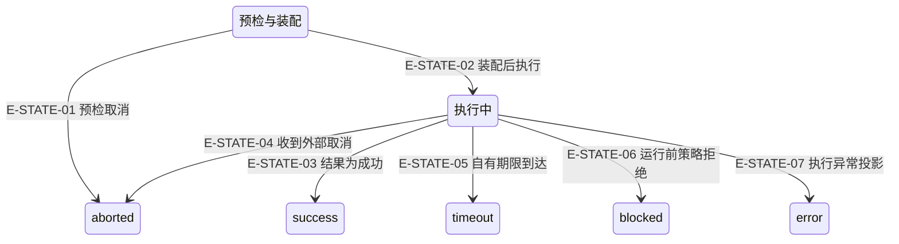

# 运行状态、取消与恢复

本图是 Service 请求状态的解释流程，包含一个临时运行节点。它不是新增的持久状态机，也不代表 Pipeline outcome、ToolResultEnvelope.status 或 Core lifecycle。

[Runtime与PCV当前全文深读](full-source-review.md) · [工具确认后失败闭环](runtime-failure-deep-review.md)

### 本图术语说明

| 名称 | 范围 |
| --- | --- |
| 预检／执行中 | 解释请求路径的临时节点，不是持久化状态。 |
| success / blocked / aborted / timeout / error | `src/agent/service/AgentRunContracts.ts#AgentRunStatus`的五个公开结果；没有持久化含义。 |
| owner-bound | 快照由创建它的 Runtime 认领，外部 Error 不能冒领 partialResult。 |

| 编号 | 代码依据 | 测试依据 | 关系说明 |
| --- | --- | --- | --- |
| E-STATE-01 | `src/agent/service/AgentService.ts#AgentService.run` | `alembic-agent-architecture-atlas/test/pilot.test.ts#case:cancel-before%3A%20preflight%20cancellation%20skips%20builder%2C%20model%20and%20router`；断言已定位，实际执行见页面证据。 | 没有创建 Runtime。 |
| E-STATE-02 | `src/agent/service/AgentService.ts#AgentService.run` | `alembic-agent-architecture-atlas/test/pilot.test.ts#case:success%3A%20receipt%20is%20returned%20to%20the%20second%20model%20turn%20and%20projected%20by%20Service`；断言已定位，实际执行见页面证据。 | Builder/Runtime 均为真实实现；输入编译失败会 reject，不进入此状态。 |
| E-STATE-03 | `src/agent/service/AgentService.ts#inferRunStatus` | `alembic-agent-architecture-atlas/test/pilot.test.ts#case:success%3A%20receipt%20is%20returned%20to%20the%20second%20model%20turn%20and%20projected%20by%20Service`；断言已定位，实际执行见页面证据。 | success 是 Service 解释；不自动要求每个工具信封 success。 |
| E-STATE-04 | `src/agent/runtime/AgentRuntime.ts#AgentRuntime.executeRun` | `alembic-agent-architecture-atlas/test/pilot.test.ts#case:cancel-after%3A%20confirmed%20receipt%20survives%20interruption%20before%20the%20next%20turn`；断言已定位，实际执行见页面证据。 | 已确认回执保留；不是撤销已发生操作。 |
| E-STATE-05 | `src/agent/runtime/AgentRuntime.ts#AgentRuntime.executeRun` | `alembic-agent-architecture-atlas/test/pilot.test.ts#case:timeout%3A%20owned%20deadline%20returns%20a%20timeout%20without%20fabricating%20a%20receipt`；断言已定位，实际执行见页面证据。 | 使用运行 owner 绑定的快照；迟到结果不接纳。 |
| E-STATE-06 | `src/agent/runtime/AgentRuntime.ts#AgentRuntime.executeRun` | 未覆盖：本图新增样板没有执行这个整次运行分支；仅按源码解释。 | policy_rejected 使 Service blocked；工具 allowlist 拒绝不是同一层。 |
| E-STATE-07 | `src/agent/service/AgentService.ts#AgentService.run` | 未覆盖：本图新增样板没有执行这个整次运行分支；仅按源码解释。 | 仅 runtime.execute 内异常经 Service 投影，compile/build 失败保持 reject。 |

## 停止之后先看什么

| 已知事实 | 可保留 | 恢复限制 |
| --- | --- | --- |
| 预检未开工 | 输入和拒绝/取消原因 | 无工具回执，是否再次发起由上层决定。 |
| 已确认工具完成 | toolCalls / usage / diagnostics | 成功、partial、失败回执按原事实保留。 |
| 外部写入在途 | 仅当前可确认的事实 | runOperation 只能停止等待，不杀死不合作宿主；需 Core/宿主读回，不盲重试。 |
| after 观察器失败 | 仅该 call/context 关联的已确认回执 | WeakMap 的失败快照不跨调用冒领；不重跑 after 或工具。 |
| 资源 scope 释放 | 发起缓存与读视图清理请求 | 可选宿主 releaseScope 不是事务回滚；抛错不替换确认结果，但await无独立期限。本样板未验证宿主实际清理或永久pending。 |

实现定位：`src/shared/operation.ts#runOperation`、`src/agent/runtime/toolPipeline/engine.ts#takeToolPipelineFailure`、`src/agent/runtime/AgentRuntime.ts#AgentRuntime.execute`。

Runtime结果中的state由私有phase字段生成，只含本次phase；仍公开的独立AgentState不参与这条执行链，其action/history/事件失败不能套用到Runtime结果。Service的success/blocked/aborted/timeout/error仍由本页解释，二者不合并。策略未进入reactLoop时可返回phase=idle但有完成事件，完整文本Runtime才由executing进入completed。`test/agent-state-snapshot-copy.test.ts#case:returns%20only%20%7B%20phase%20%7D%20and%20a%20later%20abort()%20does%20not%20rewrite%20the%20returned%20snapshot`；断言已定位，实际执行见页面证据。真实文本 Runtime 返回 {phase:completed}；结束后 abort 不回写旧快照。 边界：真实 Runtime + fixture provider。
