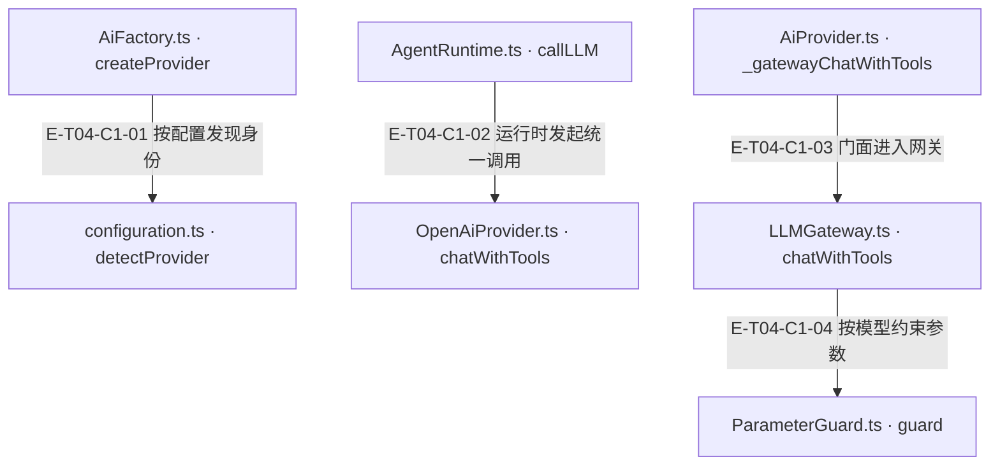
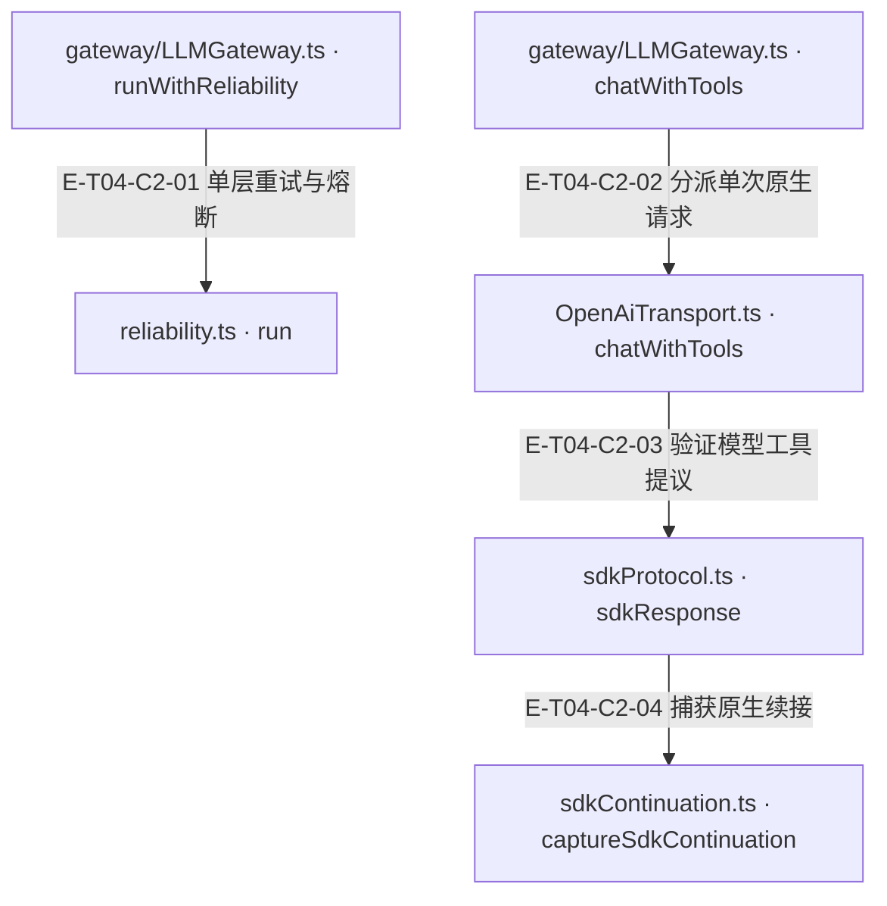
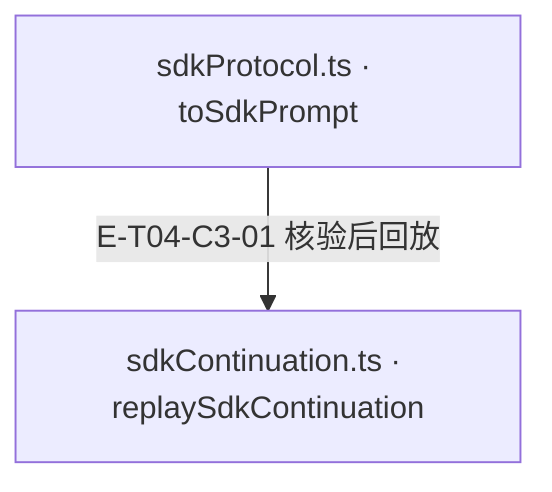
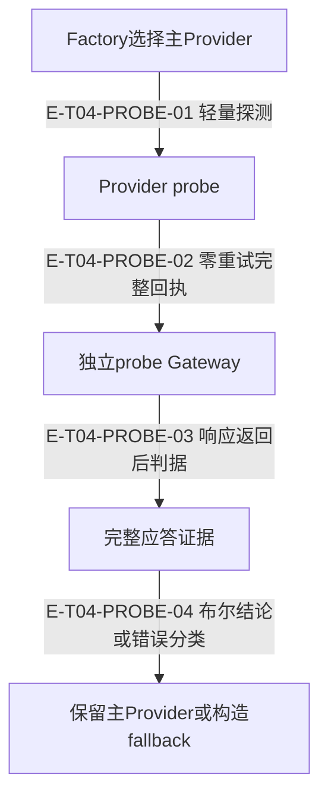

# AI与原生协议 · 真实调用

AgentRuntime 通过 AiProvider 门面调用该Provider私有的惰性业务 LLMGateway；Gateway 解析模型、过滤参数并持有 provider 级可靠性控制，Transport 使用版本化 SDK doGenerate 执行单次请求。工具返回先经 schema 与调用身份校验，续接元数据绑定 provider、model、连接摘要及消息投影。自动发现只选择配置身份与默认模型；工具许可仍由 Runtime/工具合同决定。

[职责与边界](overview.md) · [直接依赖](file-dependency.md)

图中调用边经实现正文核对；AST只用于符号定位。接口／注入对象是调用端口，不据此推定所有宿主实现相同。测试表记录已定位的精确声明和断言边界；实际执行、展开后的参数化用例身份及当前输入一致性见页面证据。

## 调用接缝 1

### 本图术语说明

| 术语／节点 | 含义与范围 |
| --- | --- |
| AiFactory.ts · createProvider | `src/ai/AiFactory.ts#createProvider`；声明或调用端口；动态实现的绑定条件见下表。 |
| configuration.ts · detectProvider | `src/ai/configuration.ts#detectProvider`；声明或调用端口；动态实现的绑定条件见下表。 |
| AgentRuntime.ts · callLLM | `src/agent/runtime/AgentRuntime.ts#callLLM`；声明或调用端口；动态实现的绑定条件见下表。 |
| OpenAiProvider.ts · chatWithTools | `src/ai/providers/OpenAiProvider.ts#chatWithTools`；声明或调用端口；动态实现的绑定条件见下表。 |
| AiProvider.ts · _gatewayChatWithTools | `src/ai/AiProvider.ts#_gatewayChatWithTools`；声明或调用端口；动态实现的绑定条件见下表。 |
| LLMGateway.ts · chatWithTools | `src/ai/gateway/LLMGateway.ts#chatWithTools`；声明或调用端口；动态实现的绑定条件见下表。 |
| ParameterGuard.ts · guard | `src/ai/guard/ParameterGuard.ts#guard`；声明或调用端口；动态实现的绑定条件见下表。 |

| 编号 | 代码依据 | 测试依据 | 关系与可证明范围 |
| --- | --- | --- | --- |
| E-T04-C1-01 | `src/ai/AiFactory.ts#createProvider` → `src/ai/configuration.ts#detectProvider` | `test/ai-configuration.test.ts#case:lets%20createProvider()%20discover%20the%20provider%20when%20ALEMBIC_AI_PROVIDER%3Dauto%20instead%20of%20rejecting%20the%20identity`；已读用例：无凭据断言 API_KEY_MISSING/provider=auto；配置 fixture 凭据后断言 OpenAiProvider，与 autoDetectProvider 模型一致，并验证显式 model 与 provider 优先。断言已定位，实际执行见页面证据。 | 没有显式 provider 且环境声明 auto 时，工厂调用 detectProvider；没有可用凭据抛 API_KEY_MISSING，有凭据时构造对应 Provider。显式 provider/model 仍优先；这不是按任务语义自动择模。 |
| E-T04-C1-02 | `src/agent/runtime/AgentRuntime.ts#callLLM` → `src/ai/providers/OpenAiProvider.ts#chatWithTools` | `test/openai-sdk.test.ts#case:runs%20a%20native%20SDK%20tool%20round%20through%20the%20actual%20AgentRuntime%20exactly%20once`；已读真实 AgentRuntime + OpenAiProvider fixture：断言宿主 execute 只调用一次、两次 HTTP body，第二轮包含第一次 Responses reasoning 的 item_reference。断言已定位，实际执行见页面证据。 | Runtime 在最终取消检查后，向注入 Provider 的 chatWithTools 传递已装配 messages、schemas、effectiveToolChoice、systemPrompt、预算参数与 abortSignal；内置 OpenAI Provider 进入门面 Gateway 路径。 |
| E-T04-C1-03 | `src/ai/AiProvider.ts#_gatewayChatWithTools` → `src/ai/gateway/LLMGateway.ts#chatWithTools` | `test/openai-sdk.test.ts#case:runs%20a%20native%20SDK%20tool%20round%20through%20the%20actual%20AgentRuntime%20exactly%20once`；同一端到端 fixture 通过实际内置 Provider/Gateway 完成工具回合；该测试覆盖调用接线，未逐项断言门面全部默认参数。断言已定位，实际执行见页面证据。 | 门面优先使用非空 opts.messages，否则构造一条 user 消息；把 toolSchemas 映射为 tools，补默认 choice、温度、maxTokens，并经惰性 Gateway 调用。 |
| E-T04-C1-04 | `src/ai/gateway/LLMGateway.ts#chatWithTools` → `src/ai/guard/ParameterGuard.ts#guard` | `test/LLMGateway.test.ts#case:filters%20model%20parameters%20before%20the%20native%20Anthropic%20request`；已读用例：要求不允许 temperature 的模型调用 native Anthropic SDK，断言实际请求 body 没有 temperature，文本与 usage 正常归一化。另已读 unsupported-toolCalling 用例断言仍发送 schemas 且只警告一次。断言已定位，实际执行见页面证据。 | Gateway 先用 ModelRegistry 解析 modelRef，再将 temperature/maxTokens/toolChoice/reasoningEffort 交给 ParameterGuard；过滤和钳制有诊断。模型声明不支持 toolCalling 只告警，不等同工具权限拒绝；明确 toolChoice=none 仍去掉 tools。 |

## 调用接缝 2

### 本图术语说明

| 术语／节点 | 含义与范围 |
| --- | --- |
| gateway/LLMGateway.ts · runWithReliability | `src/ai/gateway/LLMGateway.ts#runWithReliability`；声明或调用端口；动态实现的绑定条件见下表。 |
| reliability.ts · run | `src/ai/shared/reliability.ts#ReliabilityController.run`；声明或调用端口；动态实现的绑定条件见下表。 |
| gateway/LLMGateway.ts · chatWithTools | `src/ai/gateway/LLMGateway.ts#chatWithTools`；声明或调用端口；动态实现的绑定条件见下表。 |
| OpenAiTransport.ts · chatWithTools | `src/ai/transport/OpenAiTransport.ts#chatWithTools`；声明或调用端口；动态实现的绑定条件见下表。 |
| sdkProtocol.ts · sdkResponse | `src/ai/transport/sdkProtocol.ts#sdkResponse`；声明或调用端口；动态实现的绑定条件见下表。 |
| sdkContinuation.ts · captureSdkContinuation | `src/ai/transport/sdkContinuation.ts#captureSdkContinuation`；声明或调用端口；动态实现的绑定条件见下表。 |

| 编号 | 代码依据 | 测试依据 | 关系与可证明范围 |
| --- | --- | --- | --- |
| E-T04-C2-01 | `src/ai/gateway/LLMGateway.ts#runWithReliability` → `src/ai/shared/reliability.ts#ReliabilityController.run` | `test/openai-sdk.test.ts#case:lets%20the%20gateway%20retry%20one%20failed%20attempt%20without%20SDK%20retry%20multiplication`；已读用例：首个 fetch 返回 503，第二次成功，maxRetries=1 时断言文本为 done 且 fetch 恰好两次。断言已定位，实际执行见页面证据。 | Gateway 为每个 provider 复用 ReliabilityController，传入一次 transport 操作及调用方 abortSignal；重试/退避由该层持有，SDK 不再叠加隐藏重试。 |
| E-T04-C2-02 | `src/ai/gateway/LLMGateway.ts#chatWithTools` → `src/ai/transport/OpenAiTransport.ts#chatWithTools` | `test/LLMGateway.test.ts#case:applies%20the%20global%20timeout%20even%20when%20provider%20credentials%20are%20explicit`；已读用例：provider 显式 timeout=200ms，但 Gateway 全局 timeout=5ms；fixture fetch 等待 signal，断言真实 Gateway 调用以 after 5ms 超时拒绝。另真实 Runtime fixture 覆盖完整接线。断言已定位，实际执行见页面证据。 | Gateway 构造 TransportRequest 并在可靠性回调内调用 transport.chatWithTools；OpenAiTransport 按 apiStyle 选择 chat 或 responses，使用 sdkCallOptions 后由 runRequest 包住 SDK model.doGenerate。 |
| E-T04-C2-03 | `src/ai/transport/OpenAiTransport.ts#chatWithTools` → `src/ai/transport/sdkProtocol.ts#sdkResponse` | `test/openai-sdk.test.ts#case:records%20known%20usage%20when%20a%20completed%20model%20response%20contains%20an%20invalid%20tool%20call`；已读用例：模型完成但工具 arguments 是坏 JSON，断言 LLM_INVALID_TOOL_CALL、onUsage 一次且 totalTokens=15；另已读 malformed arguments 用例断言不发明空对象。断言已定位，实际执行见页面证据。 | SDK 成功返回后仍必须校验 JSON 参数是对象、callId 非空且唯一、工具属于本次 schemas、参数符合 schema，并拒绝 providerExecuted 或 none 下的工具提议；非法输出抛 LlmResponseError，保留已知 usage。 |
| E-T04-C2-04 | `src/ai/transport/sdkProtocol.ts#sdkResponse` → `src/ai/transport/sdkContinuation.ts#captureSdkContinuation` | `test/openai-sdk.test.ts#case:runs%20a%20native%20SDK%20tool%20round%20through%20the%20actual%20AgentRuntime%20exactly%20once`；已读 Runtime fixture 在第二次 Responses body 中断言原 reasoning item_reference；原生多 provider 测试另断言 reasoning/signature 不进入 progress。断言已定位，实际执行见页面证据。 | 响应先建立已验证的公共 text/toolCalls 投影，再捕获续接。Responses 保存 reasoning item id；Google/Claude/DeepSeek 保存有序 text/reasoning/tool parts 和必要签名，并绑定投影摘要。 |

## 调用接缝 3

### 本图术语说明

| 术语／节点 | 含义与范围 |
| --- | --- |
| sdkProtocol.ts · toSdkPrompt | `src/ai/transport/sdkProtocol.ts#toSdkPrompt`；声明或调用端口；动态实现的绑定条件见下表。 |
| sdkContinuation.ts · replaySdkContinuation | `src/ai/transport/sdkContinuation.ts#replaySdkContinuation`；声明或调用端口；动态实现的绑定条件见下表。 |

| 编号 | 代码依据 | 测试依据 | 关系与可证明范围 |
| --- | --- | --- | --- |
| E-T04-C3-01 | `src/ai/transport/sdkProtocol.ts#toSdkPrompt` → `src/ai/transport/sdkContinuation.ts#replaySdkContinuation` | `test/openai-sdk.test.ts#case:does%20not%20replay%20stored%20reasoning%20across%20different%20provider%20connections`；已读用例：同模型改用另一个 baseURL 后续接，断言第二个请求不含旧 reasoning item_reference。未执行；投影篡改分支本轮只读源码，不额外声称执行证明。 | 下一轮 assistant 消息先校验 provider/model/connection 与 projectionHash；不匹配则过滤原生元数据并诊断。旧无 hash 续接只保留身份/范围检查并警告；DeepSeek 未签名 reasoning 的兼容回退只在相同身份范围内。 |

## 探针与fallback真实分叉

### 本图术语说明

| 节点／术语 | 含义与范围 |
| --- | --- |
| Factory选择主Provider | `src/ai/AiFactory.ts#getProviderWithFallback` |
| Provider probe | `src/ai/AiProvider.ts#AiProvider.probe` |
| 独立probe Gateway | `src/ai/gateway/LLMGateway.ts#LLMGateway.chatWithTools` |
| 完整应答证据 | `src/ai/AiProvider.ts#probeResponseEvidence` |
| 保留主Provider或构造fallback | `src/ai/AiFactory.ts#getProviderWithFallback` |

| 编号 | 代码依据 | 测试依据 | 关系与可证明范围 |
| --- | --- | --- | --- |
| E-T04-PROBE-01 | `src/ai/AiFactory.ts#getProviderWithFallback` → `src/ai/AiProvider.ts#AiProvider.probe` | `test/ai-provider-probe-thinking.test.ts#case:%24id%20probe%20resolves%20true%20for%20a%20billed%20reasoning-only%20response`；断言已定位，实际执行见页面证据。 | 调用probe布尔结果参与决策，不再只等待返回。 |
| E-T04-PROBE-02 | `src/ai/AiProvider.ts#AiProvider.probe` → `src/ai/gateway/LLMGateway.ts#LLMGateway.chatWithTools` | `test/ai-provider-probe-thinking.test.ts#case:%24id%20probe%20resolves%20true%20for%20a%20billed%20reasoning-only%20response`；断言已定位，实际执行见页面证据。 | 内置Provider单条ping无工具请求；deadline与caller signal合成，独立于业务可靠性状态。 |
| E-T04-PROBE-03 | `src/ai/AiProvider.ts#AiProvider.probe` → `src/ai/AiProvider.ts#probeResponseEvidence` | `test/ai-provider-probe-thinking.test.ts#case:resolves%20false%20with%20a%20diagnostic%20when%20a%20successful%20response%20carries%20no%20evidence%20at%20all`；断言已定位，实际执行见页面证据。 | 这是数据返回后的判定关系：可见文本、工具、推理、用量或截断任一成立即true。 |
| E-T04-PROBE-04 | `src/ai/AiFactory.ts#getProviderWithFallback` → `src/ai/AiFactory.ts#isGeoOrProviderError` | `test/ai-provider-probe-thinking.test.ts#case:still%20selects%20the%20configured%20fallback%20when%20a%20successful%20primary%20probe%20carries%20no%20evidence`；`test/ai-provider-probe-thinking.test.ts#case:warns%20with%20a%20summary%20when%20every%20configured%20fallback%20fails%20to%20construct%20and%20the%20primary%20is%20retained`；断言已定位，实际执行见页面证据。 | false或provider限制进fallback；暂时错误保留主Provider。候选只构造，全部构造失败明确warn后保留主Provider。 |

## 永久集成缺陷的停止点

`src/ai/AiProvider.ts#AiProvider.chatWithTools` 的基类实现只记录工具数/消息数然后拒绝；错误在Gateway之前发生，既不使用纯文本chat替代，也不进入可靠性控制器。`src/agent/runtime/AgentRuntime.ts#AgentRuntime.callLLM`收到合同错误后由循环分类为runtime_defect；并发取消优先于该分类。

`test/agent-runtime-provider-contract-defect.test.ts#case:terminates%20a%20%25s%20run%20once%2C%20without%20the%202000ms%20retry%2C%20as%20runtime_defect`（user/system展开项）断言只调用一次、没有2000ms等待、aiErrorCount=0、forcedSummary=false且诊断为provider_contract_violation；`test/agent-runtime-provider-contract-defect.test.ts#case:keeps%20abort%20precedence%20when%20the%20contract%20violation%20races%20a%20cancelled%20run`固定取消优先；`test/agent-runtime-provider-contract-defect.test.ts#case:keeps%20the%202-strike%20retry%20for%20an%20ordinary%20provider%20error`是临时错误对照。断言已定位，实际执行见页面证据。
