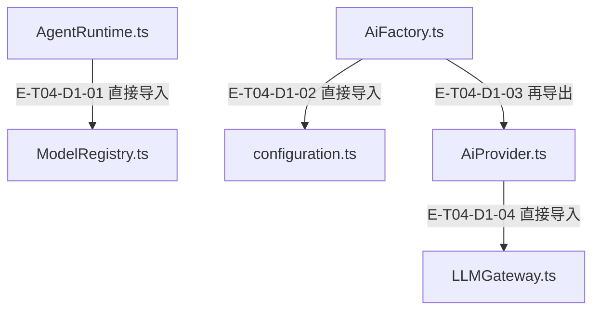
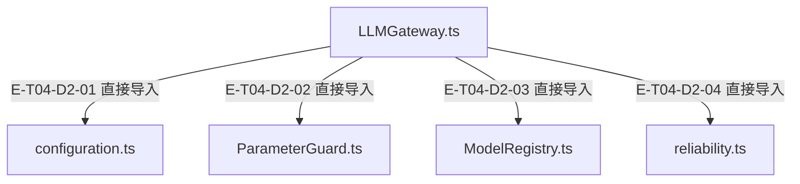

# AI与原生协议 · 精选直接依赖

[职责与边界](overview.md) · [真实调用](call-flow.md)

选取本专题入口的最多8条直接依赖；完整库存可在阅读器「文件与依赖」查看。以仓库全路径为节点身份，同名文件不会合并。Core／Node／第三方包只在完整探索器的外部边界出现。

## 静态依赖 1

### 本图术语说明

| 术语／节点 | 含义与范围 |
| --- | --- |
| AgentRuntime.ts | `src/agent/runtime/AgentRuntime.ts`；文件直接依赖，箭头不表示执行先后。 |
| ModelRegistry.ts | `src/ai/registry/ModelRegistry.ts`；文件直接依赖，箭头不表示执行先后。 |
| AiFactory.ts | `src/ai/AiFactory.ts`；文件直接依赖，箭头不表示执行先后。 |
| configuration.ts | `src/ai/configuration.ts`；文件直接依赖，箭头不表示执行先后。 |
| AiProvider.ts | `src/ai/AiProvider.ts`；文件直接依赖，箭头不表示执行先后。 |
| LLMGateway.ts | `src/ai/gateway/LLMGateway.ts`；文件直接依赖，箭头不表示执行先后。 |

| 编号 | 代码依据 | 测试依据 | 关系与可证明范围 |
| --- | --- | --- | --- |
| E-T04-D1-01 | `src/agent/runtime/AgentRuntime.ts` → `src/ai/registry/ModelRegistry.ts` | 未覆盖：静态依赖由本图谱解析器反例测试支持；不把 import 当作行为覆盖。 | TypeScript AST 解析 #ai/registry/ModelRegistry.js；第 44 行，kind=import，typeOnly=false。只证明结构关系。 |
| E-T04-D1-02 | `src/ai/AiFactory.ts` → `src/ai/configuration.ts` | 未覆盖：静态依赖由本图谱解析器反例测试支持；不把 import 当作行为覆盖。 | TypeScript AST 解析 ./configuration.js；第 11 行，kind=import，typeOnly=false。只证明结构关系。 |
| E-T04-D1-03 | `src/ai/AiFactory.ts` → `src/ai/AiProvider.ts` | 未覆盖：静态依赖由本图谱解析器反例测试支持；不把 import 当作行为覆盖。 | TypeScript AST 解析 ./AiProvider.js；第 237 行，kind=re-export，typeOnly=false。只证明结构关系。 |
| E-T04-D1-04 | `src/ai/AiProvider.ts` → `src/ai/gateway/LLMGateway.ts` | 未覆盖：静态依赖由本图谱解析器反例测试支持；不把 import 当作行为覆盖。 | TypeScript AST 解析 ./gateway/LLMGateway.js；第 415 行，kind=dynamic-import，typeOnly=false。只证明结构关系。 |

## 静态依赖 2

### 本图术语说明

| 术语／节点 | 含义与范围 |
| --- | --- |
| LLMGateway.ts | `src/ai/gateway/LLMGateway.ts`；文件直接依赖，箭头不表示执行先后。 |
| configuration.ts | `src/ai/configuration.ts`；文件直接依赖，箭头不表示执行先后。 |
| ParameterGuard.ts | `src/ai/guard/ParameterGuard.ts`；文件直接依赖，箭头不表示执行先后。 |
| ModelRegistry.ts | `src/ai/registry/ModelRegistry.ts`；文件直接依赖，箭头不表示执行先后。 |
| reliability.ts | `src/ai/shared/reliability.ts`；文件直接依赖，箭头不表示执行先后。 |

| 编号 | 代码依据 | 测试依据 | 关系与可证明范围 |
| --- | --- | --- | --- |
| E-T04-D2-01 | `src/ai/gateway/LLMGateway.ts` → `src/ai/configuration.ts` | 未覆盖：静态依赖由本图谱解析器反例测试支持；不把 import 当作行为覆盖。 | TypeScript AST 解析 ../configuration.js；第 18 行，kind=import，typeOnly=false。只证明结构关系。 |
| E-T04-D2-02 | `src/ai/gateway/LLMGateway.ts` → `src/ai/guard/ParameterGuard.ts` | 未覆盖：静态依赖由本图谱解析器反例测试支持；不把 import 当作行为覆盖。 | TypeScript AST 解析 ../guard/ParameterGuard.js；第 29 行，kind=import，typeOnly=false。只证明结构关系。 |
| E-T04-D2-03 | `src/ai/gateway/LLMGateway.ts` → `src/ai/registry/ModelRegistry.ts` | 未覆盖：静态依赖由本图谱解析器反例测试支持；不把 import 当作行为覆盖。 | TypeScript AST 解析 ../registry/ModelRegistry.js；第 31 行，kind=import，typeOnly=false。只证明结构关系。 |
| E-T04-D2-04 | `src/ai/gateway/LLMGateway.ts` → `src/ai/shared/reliability.ts` | 未覆盖：静态依赖由本图谱解析器反例测试支持；不把 import 当作行为覆盖。 | TypeScript AST 解析 ../shared/reliability.js；第 34 行，kind=import，typeOnly=false。只证明结构关系。 |

本页直接依赖已对照当前AST逐边重查；沿用稳定边ID，行号按当前源码更新。导入存在不表示本轮行为已执行；实际执行见页面证据。
