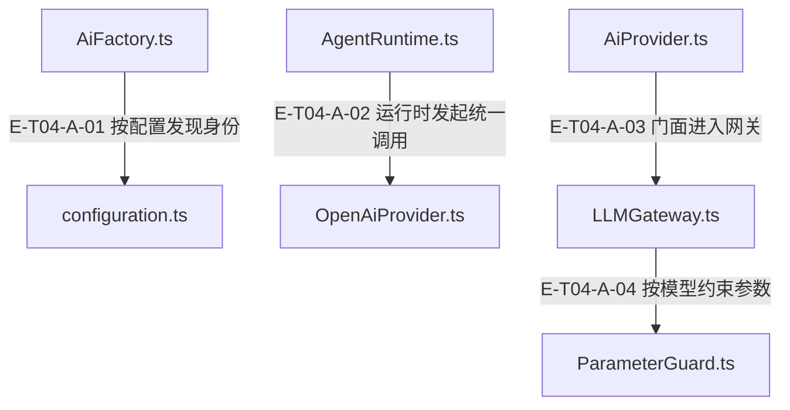

# 04 · AI与原生协议

> 一次带工具的模型调用如何从 Runtime 到达原生供应商协议，又如何安全续接下一轮？

AgentRuntime 通过 AiProvider 门面调用该Provider私有的惰性业务 LLMGateway；Gateway 解析模型、过滤参数并持有 provider 级可靠性控制，Transport 使用版本化 SDK doGenerate 执行单次请求。工具返回先经 schema 与调用身份校验，续接元数据绑定 provider、model、连接摘要及消息投影。自动发现只选择配置身份与默认模型；工具许可仍由 Runtime/工具合同决定。

[真实调用](call-flow.md) · [直接依赖](file-dependency.md) · [阅读规范](../00-diagram-standard.md)

## 职责与主要接缝

### 本图术语说明

| 术语／节点 | 含义与范围 |
| --- | --- |
| AiFactory.ts | `src/ai/AiFactory.ts`；本图按实现文件聚合职责；具体装配条件见下表。 |
| configuration.ts | `src/ai/configuration.ts`；本图按实现文件聚合职责；具体装配条件见下表。 |
| AgentRuntime.ts | `src/agent/runtime/AgentRuntime.ts`；本图按实现文件聚合职责；具体装配条件见下表。 |
| OpenAiProvider.ts | `src/ai/providers/OpenAiProvider.ts`；本图按实现文件聚合职责；具体装配条件见下表。 |
| AiProvider.ts | `src/ai/AiProvider.ts`；本图按实现文件聚合职责；具体装配条件见下表。 |
| LLMGateway.ts | `src/ai/gateway/LLMGateway.ts`；本图按实现文件聚合职责；具体装配条件见下表。 |
| ParameterGuard.ts | `src/ai/guard/ParameterGuard.ts`；本图按实现文件聚合职责；具体装配条件见下表。 |

| 编号 | 代码依据 | 测试依据 | 关系与可证明范围 |
| --- | --- | --- | --- |
| E-T04-A-01 | `src/ai/AiFactory.ts#createProvider` → `src/ai/configuration.ts#detectProvider` | `test/ai-configuration.test.ts#case:lets%20createProvider()%20discover%20the%20provider%20when%20ALEMBIC_AI_PROVIDER%3Dauto%20instead%20of%20rejecting%20the%20identity`；已读用例：无凭据断言 API_KEY_MISSING/provider=auto；配置 fixture 凭据后断言 OpenAiProvider，与 autoDetectProvider 模型一致，并验证显式 model 与 provider 优先。断言已定位，实际执行见页面证据。 | 没有显式 provider 且环境声明 auto 时，工厂调用 detectProvider；没有可用凭据抛 API_KEY_MISSING，有凭据时构造对应 Provider。显式 provider/model 仍优先；这不是按任务语义自动择模。 |
| E-T04-A-02 | `src/agent/runtime/AgentRuntime.ts#callLLM` → `src/ai/providers/OpenAiProvider.ts#chatWithTools` | `test/openai-sdk.test.ts#case:runs%20a%20native%20SDK%20tool%20round%20through%20the%20actual%20AgentRuntime%20exactly%20once`；已读真实 AgentRuntime + OpenAiProvider fixture：断言宿主 execute 只调用一次、两次 HTTP body，第二轮包含第一次 Responses reasoning 的 item_reference。断言已定位，实际执行见页面证据。 | Runtime 在最终取消检查后，向注入 Provider 的 chatWithTools 传递已装配 messages、schemas、effectiveToolChoice、systemPrompt、预算参数与 abortSignal；内置 OpenAI Provider 进入门面 Gateway 路径。 |
| E-T04-A-03 | `src/ai/AiProvider.ts#_gatewayChatWithTools` → `src/ai/gateway/LLMGateway.ts#chatWithTools` | `test/openai-sdk.test.ts#case:runs%20a%20native%20SDK%20tool%20round%20through%20the%20actual%20AgentRuntime%20exactly%20once`；同一端到端 fixture 通过实际内置 Provider/Gateway 完成工具回合；该测试覆盖调用接线，未逐项断言门面全部默认参数。断言已定位，实际执行见页面证据。 | 门面优先使用非空 opts.messages，否则构造一条 user 消息；把 toolSchemas 映射为 tools，补默认 choice、温度、maxTokens，并经惰性 Gateway 调用。 |
| E-T04-A-04 | `src/ai/gateway/LLMGateway.ts#chatWithTools` → `src/ai/guard/ParameterGuard.ts#guard` | `test/LLMGateway.test.ts#case:filters%20model%20parameters%20before%20the%20native%20Anthropic%20request`；已读用例：要求不允许 temperature 的模型调用 native Anthropic SDK，断言实际请求 body 没有 temperature，文本与 usage 正常归一化。另已读 unsupported-toolCalling 用例断言仍发送 schemas 且只警告一次。断言已定位，实际执行见页面证据。 | Gateway 先用 ModelRegistry 解析 modelRef，再将 temperature/maxTokens/toolChoice/reasoningEffort 交给 ParameterGuard；过滤和钳制有诊断。模型声明不支持 toolCalling 只告警，不等同工具权限拒绝；明确 toolChoice=none 仍去掉 tools。 |

## 输入、输出与副作用

| 维度 | 当前实现 |
| --- | --- |
| 输入 | GatewayRequest：modelRef、UnifiedMessage[]、systemPrompt、tools/toolChoice、生成参数、可选 schema、abortSignal。；Provider 身份与模型来自显式配置、环境解析或注册表；宿主注入的工具合同决定可用工具。 |
| 输出 | ChatWithToolsResult：text、functionCalls、usage、finishReason、reasoningContent 与可选 continuation。；已分类的错误：无凭据、请求无效、工具提议无效、取消、超时、HTTP/网络故障。 |
| 副作用 | Transport 可发送网络请求；Gateway 维护 provider 级并发、限流和熔断状态。；已知 token 用量通过隔离观察回调上报；观察失败不会重发模型请求。；模型注册表未知项生成保守定义并诊断，不写回为已注册模型；自动发现不授予工具权限。 |

## 从这些文件开始

| 文件 | 阅读目的 |
| --- | --- |
| `src/agent/runtime/AgentRuntime.ts` | 调用 Provider；保持输入装配、取消检查、工具执行循环与进度发送的次序 |
| `src/ai/AiFactory.ts` | 按显式身份或配置自动发现创建 Provider，受限 provider fallback |
| `src/ai/configuration.ts` | provider 别名、连接、默认模型及环境投影的统一解析 |
| `src/ai/AiProvider.ts` | 公开 Provider 门面、独立业务/探针 Gateway、用量观察与 chatWithTools 必须覆写合同 |
| `src/ai/gateway/LLMGateway.ts` | 模型解析→参数 guard→可靠性→transport→结果归一化 |
| `src/ai/registry/ModelRegistry.ts` | 注册模型定义与未知模型的保守动态定义 |
| `src/ai/guard/ParameterGuard.ts` | 根据模型定义过滤不支持参数并钳制数值 |
| `src/ai/shared/reliability.ts` | 并发槽、429 冷却、重试及熔断 |
| `src/ai/transport/LLMTransport.ts` | 请求生命周期、超时、取消与代理 fetch 边界 |
| `src/ai/transport/OpenAiTransport.ts` | Chat/Responses SDK 单次生成及原生 embedding 校验；Ollama复用此类 |
| `src/ai/transport/sdkProtocol.ts` | SDK 输入转换、schema 编译、工具回执验证、usage/finishReason 投影 |
| `src/ai/transport/sdkContinuation.ts` | 捕获与校验原生 reasoning/signature 续接信息 |

## 失败、取消与恢复

- 调用方取消：Runtime 在观察回调后再次检查 signal；ReliabilityController 对取消直接退出，不继续重试；Transport 持有请求终态。
- 429/网络/服务端暂时失败：按分类重试；429 建立共享冷却；并发槽在退避期间释放，熔断与半开探测由可靠性控制器管理。
- 坏工具输出：统一 SDK 边界拒绝执行，保留已知 usage；不把模型输出校验失败等同远端服务故障。
- 跨连接或被改写的续接：过滤原生元数据并诊断；旧无 projectionHash 回执保留显式兼容限制，不能宣称完整绑定验证。
- 自定义 Provider 只实现 chat：基类chatWithTools每次记录只含计数的chatWithTools_not_overridden并抛PROVIDER_CONTRACT_VIOLATION，绝不调用chat；Runtime按runtime_defect一次停止，跳过2-strike与强制摘要。五个内置Provider仍各自覆写原生路径；DeepSeekTransport的文本工具兼容是另外一条显式协议分支。

## 已知边界与未验证范围

- 这是本地实现事实，未调用真实供应商 API，未验证注册表中的外部产品状态。
- SDK 只做单次协议请求；Agent 的工具执行循环与权限不由 SDK 接管。
- 生成模型热切换不代表 embedding 服务切换；AiProviderManager 对独立 embedding 保持分离。
- 不应把 deprecated/toolCalling capability 警告画成硬许可门；Runtime/ToolExecutionPipeline 的 allowlist、action 与执行门另属工具权限专题。

## 探测、业务调用与热切换的责任

| 场景 | 当前行为 | 恢复责任与证据 |
| --- | --- | --- |
| 内置Provider probe | 独立Gateway，30秒期限、零重试、16token；完整响应中有文本/工具/推理/计费用量/预算截断任一证据即true。 | 无可见文本不等于不可达；`test/ai-provider-probe-thinking.test.ts#case:%24id%20probe%20resolves%20true%20for%20a%20billed%20reasoning-only%20response`。 |
| 成功响应无任何证据 | probe_no_response_evidence + false；Factory转已配置fallback链。 | 候选只构造不再探活，不能把返回对象当可达证明；`test/ai-provider-probe-thinking.test.ts#case:resolves%20false%20with%20a%20diagnostic%20when%20a%20successful%20response%20carries%20no%20evidence%20at%20all`、`test/ai-provider-probe-thinking.test.ts#case:still%20selects%20the%20configured%20fallback%20when%20a%20successful%20primary%20probe%20carries%20no%20evidence`。 |
| 暂时网络/限流/取消 | probe带原因抛错；Factory不因可重试错误切厂商，保留primary。 | 业务可靠性仍归业务Gateway，探针失败不污染它的熔断。 |
| 全部fallback构造失败 | fallback_exhausted汇总候选与错误类名后保留primary。 | 明确降级，宿主修复配置；`test/ai-provider-probe-thinking.test.ts#case:warns%20with%20a%20summary%20when%20every%20configured%20fallback%20fails%20to%20construct%20and%20the%20primary%20is%20retained`。 |
| 只实现chat的外部子类 | chatWithTools合同违约；直接probe仍可走该子类chat，只有非空文本能证明其应答。 | 不合作chat忽略signal时探测不能强制中断；`test/agent-runtime-provider-contract-defect.test.ts#case:rejects%20with%20code%20PROVIDER_CONTRACT_VIOLATION%20and%20keeps%20the%20must-override%20message`。 |
| Provider热切换 | Manager只同步生成Provider并绑定计量，DI回调仅一个参数；已删除embedding兼容槽。 | async hook拒绝并要求修复，路由可补偿而失效缓存不回滚；`test/ai-provider-manager.test.ts#case:synchronizes%20only%20the%20routed%20provider%20through%20the%20single-argument%20DI%20hook`、`test/ai-provider-manager.test.ts#case:observes%20an%20asynchronous%20capability%20rejection%20and%20requires%20repair%20of%20the%20synchronous%20contract`。 |

源码：`src/ai/AiProvider.ts#probeResponseEvidence`、`src/ai/AiProvider.ts#AiProvider.probe`、`src/ai/AiFactory.ts#getProviderWithFallback`、`src/ai/AiProviderManager.ts#AiProviderManager.switchProvider`。断言已定位，实际执行见页面证据。

已退役的Gateway probe/resolveWithFallback/getModelDef、共享getLLMGateway/resetLLMGateway和Transport chat/chatStructured不恢复为平行线路。查询模型用ModelRegistry；结构化本地校验继续由Gateway.chatStructured执行。依据 `test/agent-dcr-retirements.test.ts#case:removes%20Gateway%20probe%2C%20fallback%20and%20model%20lookup%20helpers%20but%20keeps%20chatStructured`、`test/agent-dcr-retirements.test.ts#case:does%20not%20export%20the%20shared%20Gateway%20singleton%20functions%20from%20any%20AI%20entry`、`test/agent-dcr-retirements.test.ts#case:removes%20Transport-level%20chat%20and%20chatStructured%20from%20the%20base%20and%20every%20transport`。Provider自身chatWithStructuredOutput保留，不能与Transport快捷入口混淆。
