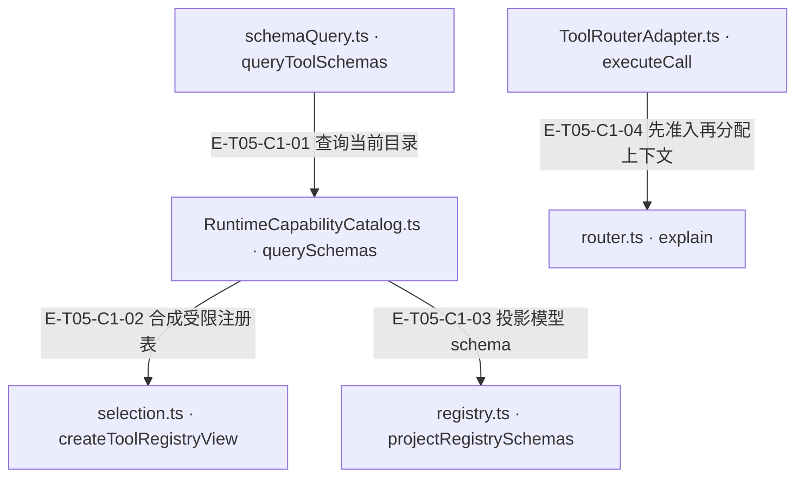
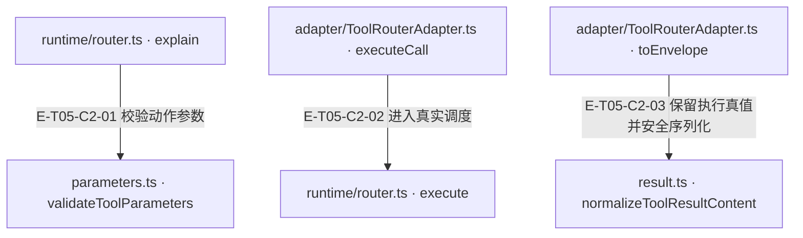
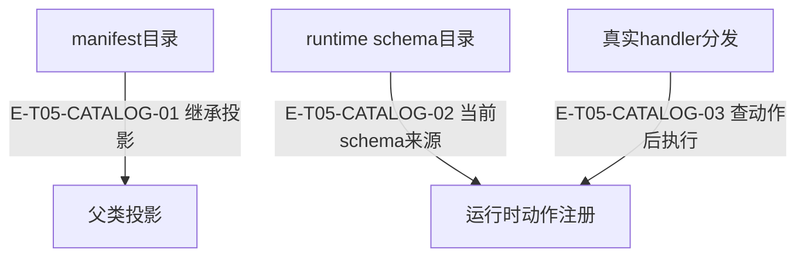

# 工具契约与目录 · 真实调用

工具合同集中在 kernel，runtime registry 持有动作 schema 与 handler。RuntimeCapabilityCatalog 将阶段选择与宿主稀疏 availability 求交；ToolRouterAdapter 先预检再分配 context，ToolRouter 在获得并发 slot 后重检。目录投影不执行工具，manifest 元数据也不是通用执行器。

[职责与边界](overview.md) · [直接依赖](file-dependency.md)

图中调用边经实现正文核对；AST只用于符号定位。接口／注入对象是调用端口，不据此推定所有宿主实现相同。测试表记录已定位的精确声明和断言边界；实际执行、展开后的参数化用例身份及当前输入一致性见页面证据。

## 调用接缝 1

### 本图术语说明

| 术语／节点 | 含义与范围 |
| --- | --- |
| schemaQuery.ts · queryToolSchemas | `src/tools/catalog/schemaQuery.ts#queryToolSchemas`；声明或调用端口；动态实现的绑定条件见下表。 |
| RuntimeCapabilityCatalog.ts · querySchemas | `src/tools/runtime/adapter/RuntimeCapabilityCatalog.ts#RuntimeCapabilityCatalog.querySchemas`；声明或调用端口；动态实现的绑定条件见下表。 |
| selection.ts · createToolRegistryView | `src/tools/runtime/selection.ts#createToolRegistryView`；声明或调用端口；动态实现的绑定条件见下表。 |
| registry.ts · projectRegistrySchemas | `src/tools/runtime/registry.ts#projectRegistrySchemas`；声明或调用端口；动态实现的绑定条件见下表。 |
| ToolRouterAdapter.ts · executeCall | `src/tools/runtime/adapter/ToolRouterAdapter.ts#ToolRouterAdapter.executeCall`；声明或调用端口；动态实现的绑定条件见下表。 |
| router.ts · explain | `src/tools/runtime/router.ts#ToolRouter.explain`；声明或调用端口；动态实现的绑定条件见下表。 |

| 编号 | 代码依据 | 测试依据 | 关系与可证明范围 |
| --- | --- | --- | --- |
| E-T05-C1-01 | `src/tools/catalog/schemaQuery.ts#queryToolSchemas` → `src/tools/runtime/adapter/RuntimeCapabilityCatalog.ts#RuntimeCapabilityCatalog.querySchemas` | `test/tool-schema-projection.test.ts#case:uses%20querySchemas%20directly%20and%20enforces%20its%20effective%20actions%20before%20calling%20an%20external%20host`；断言 querySchemas 调用一次、旧 mixed 方法零调用；仅 code.read 到达宿主，graph 与未开放 action 进入 blockedTools。 | 现代端口分支实际调用 catalog.querySchemas(portQuery)，随后仍按调用前 selection 快照收窄；此边指向默认 runtime catalog 实现，旧宿主另走兼容探测。 |
| E-T05-C1-02 | `src/tools/runtime/adapter/RuntimeCapabilityCatalog.ts#RuntimeCapabilityCatalog.querySchemas` → `src/tools/runtime/selection.ts#createToolRegistryView` | `test/tool-schema-projection.test.ts#case:returns%20one%20effective%20action%20set%20and%20narrows%20available%20management%20branches`；断言 graph 被移除，knowledge.manage 只广告 update，原 registry 仍含 publish，allowedTools 冻结。 | 传入 TOOL_REGISTRY、query.selection 与规范 availability，返回只包含有效动作/operation 的视图。 |
| E-T05-C1-03 | `src/tools/runtime/adapter/RuntimeCapabilityCatalog.ts#RuntimeCapabilityCatalog.querySchemas` → `src/tools/runtime/registry.ts#projectRegistrySchemas` | `test/tool-schema-projection.test.ts#case:projects%20action-level%20allowlists%20into%20provider-visible%20schemas`；knowledge schema 的 action 仅 submit，必需字段与 reasoning/content 保留；meta 仅 review。 | 对受限 view 生成 provider schema；单 action 展开参数，多 action 使用 envelope；同一结果携带 allowedTools。 |
| E-T05-C1-04 | `src/tools/runtime/adapter/ToolRouterAdapter.ts#ToolRouterAdapter.executeCall` → `src/tools/runtime/router.ts#ToolRouter.explain` | `test/tool-availability.test.ts#case:explains%20the%20same%20capability%20rejection%20as%20execute%20without%20allocating%20a%20context`；同一禁止的 graph.overview 在 explain/execute 中一致拒绝；create 与 getOverview 均零调用。 | parse 与 availability 后调用 explain；不允许时返回 admission failure，不调用 contextFactory.create。 |

## 调用接缝 2

### 本图术语说明

| 术语／节点 | 含义与范围 |
| --- | --- |
| runtime/router.ts · explain | `src/tools/runtime/router.ts#ToolRouter.explain`；声明或调用端口；动态实现的绑定条件见下表。 |
| parameters.ts · validateToolParameters | `src/tools/runtime/parameters.ts#validateToolParameters`；声明或调用端口；动态实现的绑定条件见下表。 |
| adapter/ToolRouterAdapter.ts · executeCall | `src/tools/runtime/adapter/ToolRouterAdapter.ts#ToolRouterAdapter.executeCall`；声明或调用端口；动态实现的绑定条件见下表。 |
| runtime/router.ts · execute | `src/tools/runtime/router.ts#ToolRouter.execute`；声明或调用端口；动态实现的绑定条件见下表。 |
| adapter/ToolRouterAdapter.ts · toEnvelope | `src/tools/runtime/adapter/ToolRouterAdapter.ts#ToolRouterAdapter.toEnvelope`；声明或调用端口；动态实现的绑定条件见下表。 |
| result.ts · normalizeToolResultContent | `src/tools/kernel/result.ts#normalizeToolResultContent`；声明或调用端口；动态实现的绑定条件见下表。 |

| 编号 | 代码依据 | 测试依据 | 关系与可证明范围 |
| --- | --- | --- | --- |
| E-T05-C2-01 | `src/tools/runtime/router.ts#ToolRouter.explain` → `src/tools/runtime/parameters.ts#validateToolParameters` | `test/tool-availability.test.ts#case:keeps%20safe-integer%20admission%20for%20the%20review%20queue%20limit%20before%20host%20allocation`；超过 MAX_SAFE_INTEGER 的 review-queue limit 返回 TOOL_CALL_INVALID/writeState=not-started，宿主 context 和 reader 零调用。 | Ajv 参数校验在 capability、stage、availability 判断之前执行；schema 编译失败与模型参数不匹配使用不同准入阶段/状态。 |
| E-T05-C2-02 | `src/tools/runtime/adapter/ToolRouterAdapter.ts#ToolRouterAdapter.executeCall` → `src/tools/runtime/router.ts#ToolRouter.execute` | `test/tool-availability.test.ts#case:refreshes%20host%20availability%20after%20a%20queued%20call%20gains%20its%20execution%20slot`；测试先占用 management slot，再撤销第二个 queued reject operation；第一个成功、第二个失败，排队许可不能沿用。 | Adapter 将 host context 与 request.runtime/signal 合并后执行 router；router 快照调用参数、调度 slot，并再次读取 availability 后才调用 action.handler。 |
| E-T05-C2-03 | `src/tools/runtime/adapter/ToolRouterAdapter.ts#ToolRouterAdapter.toEnvelope` → `src/tools/kernel/result.ts#normalizeToolResultContent` | `test/tool-system.test.ts#case:keeps%20an%20over-wide%20confirmed%20publish%20complete%20in%20the%20canonical%20envelope`；11,000 元素的 confirmed publish 保留 success/完整 canonical data；普通显示投影另报 TOOL_RESULT_DISPLAY_LIMIT。 | 先采用 result._meta.resultStatus，再对 data 做 JSON 安全化；规范信封不使用普通显示投影的 4096 节点预算，不能因宽数据把已确认写入改为失败。 |

## 存储目录、schema投影与执行查表

### 本图术语说明

| 节点／术语 | 含义与范围 |
| --- | --- |
| manifest目录 | `src/tools/catalog/UnifiedToolCatalog.ts#UnifiedToolCatalog` |
| 父类投影 | `src/tools/catalog/CapabilityCatalog.ts#CapabilityCatalog.projectSchema` |
| runtime schema目录 | `src/tools/runtime/adapter/RuntimeCapabilityCatalog.ts#RuntimeCapabilityCatalog.querySchemas` |
| 运行时动作注册 | `src/tools/runtime/registry.ts#TOOL_REGISTRY` |
| 真实handler分发 | `src/tools/runtime/router.ts#ToolRouter.execute` |

| 编号 | 代码依据 | 测试依据 | 关系与可证明范围 |
| --- | --- | --- | --- |
| E-T05-CATALOG-01 | `src/tools/catalog/UnifiedToolCatalog.ts#UnifiedToolCatalog` → `src/tools/catalog/CapabilityCatalog.ts#CapabilityCatalog.projectSchema` | `test/tool-system.test.ts#case:projects%20full%20schemas%20for%20runtime%20mixed%20queries%20without%20instance-level%20lazy%20state`；断言已定位，实际执行见页面证据。 | 继承关系；没有自有lazy/model定义层，也不授执行权限。 |
| E-T05-CATALOG-02 | `src/tools/runtime/adapter/RuntimeCapabilityCatalog.ts#RuntimeCapabilityCatalog.querySchemas` → `src/tools/runtime/registry.ts#projectRegistrySchemas` | `test/tool-schema-projection.test.ts#case:projects%20action-level%20allowlists%20into%20provider-visible%20schemas`；断言已定位，实际执行见页面证据。 | 限定动作和宿主可用分支后生成schema；本边不执行handler。 |
| E-T05-CATALOG-03 | `src/tools/runtime/router.ts#ToolRouter.execute` → `src/tools/runtime/router.ts#ToolRouter.getToolSpec` | `test/tool-availability.test.ts#case:explains%20the%20same%20capability%20rejection%20as%20execute%20without%20allocating%20a%20context`；断言已定位，实际执行见页面证据。 | Router查注册表并执行ToolAction.handler；此查表与上方投影共用数据而非共用生命周期。 |
