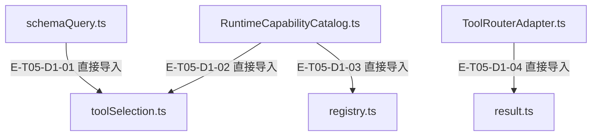
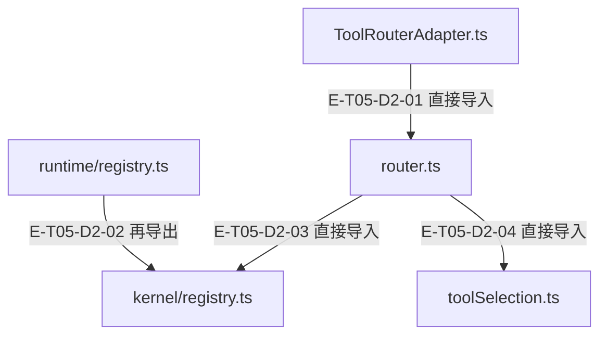

# 工具契约与目录 · 精选直接依赖

[职责与边界](overview.md) · [真实调用](call-flow.md)

选取本专题入口的最多8条直接依赖；完整库存可在阅读器「文件与依赖」查看。以仓库全路径为节点身份，同名文件不会合并。Core／Node／第三方包只在完整探索器的外部边界出现。

## 静态依赖 1

### 本图术语说明

| 术语／节点 | 含义与范围 |
| --- | --- |
| schemaQuery.ts | `src/tools/catalog/schemaQuery.ts`；文件直接依赖，箭头不表示执行先后。 |
| toolSelection.ts | `src/tools/kernel/toolSelection.ts`；文件直接依赖，箭头不表示执行先后。 |
| RuntimeCapabilityCatalog.ts | `src/tools/runtime/adapter/RuntimeCapabilityCatalog.ts`；文件直接依赖，箭头不表示执行先后。 |
| registry.ts | `src/tools/runtime/registry.ts`；文件直接依赖，箭头不表示执行先后。 |
| ToolRouterAdapter.ts | `src/tools/runtime/adapter/ToolRouterAdapter.ts`；文件直接依赖，箭头不表示执行先后。 |
| result.ts | `src/tools/kernel/result.ts`；文件直接依赖，箭头不表示执行先后。 |

| 编号 | 代码依据 | 测试依据 | 关系与可证明范围 |
| --- | --- | --- | --- |
| E-T05-D1-01 | `src/tools/catalog/schemaQuery.ts` → `src/tools/kernel/toolSelection.ts` | 未覆盖：静态依赖由本图谱解析器反例测试支持；不把 import 当作行为覆盖。 | TypeScript AST 解析 #tools/kernel/toolSelection.js；第 12 行，kind=import，typeOnly=false。只证明结构关系。 |
| E-T05-D1-02 | `src/tools/runtime/adapter/RuntimeCapabilityCatalog.ts` → `src/tools/kernel/toolSelection.ts` | 未覆盖：静态依赖由本图谱解析器反例测试支持；不把 import 当作行为覆盖。 | TypeScript AST 解析 #tools/kernel/toolSelection.js；第 21 行，kind=import，typeOnly=false。只证明结构关系。 |
| E-T05-D1-03 | `src/tools/runtime/adapter/RuntimeCapabilityCatalog.ts` → `src/tools/runtime/registry.ts` | 未覆盖：静态依赖由本图谱解析器反例测试支持；不把 import 当作行为覆盖。 | TypeScript AST 解析 ../registry.js；第 22 行，kind=import，typeOnly=false。只证明结构关系。 |
| E-T05-D1-04 | `src/tools/runtime/adapter/ToolRouterAdapter.ts` → `src/tools/kernel/result.ts` | 未覆盖：静态依赖由本图谱解析器反例测试支持；不把 import 当作行为覆盖。 | TypeScript AST 解析 #tools/kernel/result.js；第 26 行，kind=import，typeOnly=false。只证明结构关系。 |

## 静态依赖 2

### 本图术语说明

| 术语／节点 | 含义与范围 |
| --- | --- |
| ToolRouterAdapter.ts | `src/tools/runtime/adapter/ToolRouterAdapter.ts`；文件直接依赖，箭头不表示执行先后。 |
| router.ts | `src/tools/runtime/router.ts`；文件直接依赖，箭头不表示执行先后。 |
| runtime/registry.ts | `src/tools/runtime/registry.ts`；文件直接依赖，箭头不表示执行先后。 |
| kernel/registry.ts | `src/tools/kernel/registry.ts`；文件直接依赖，箭头不表示执行先后。 |
| toolSelection.ts | `src/tools/kernel/toolSelection.ts`；文件直接依赖，箭头不表示执行先后。 |

| 编号 | 代码依据 | 测试依据 | 关系与可证明范围 |
| --- | --- | --- | --- |
| E-T05-D2-01 | `src/tools/runtime/adapter/ToolRouterAdapter.ts` → `src/tools/runtime/router.ts` | 未覆盖：静态依赖由本图谱解析器反例测试支持；不把 import 当作行为覆盖。 | TypeScript AST 解析 ../router.js；第 28 行，kind=import，typeOnly=false。只证明结构关系。 |
| E-T05-D2-02 | `src/tools/runtime/registry.ts` → `src/tools/kernel/registry.ts` | 未覆盖：静态依赖由本图谱解析器反例测试支持；不把 import 当作行为覆盖。 | TypeScript AST 解析 #tools/kernel/registry.js；第 55 行，kind=re-export，typeOnly=false。只证明结构关系。 |
| E-T05-D2-03 | `src/tools/runtime/router.ts` → `src/tools/kernel/registry.ts` | 未覆盖：静态依赖由本图谱解析器反例测试支持；不把 import 当作行为覆盖。 | TypeScript AST 解析 #tools/kernel/registry.js；第 19 行，kind=import，typeOnly=true。只证明结构关系。 |
| E-T05-D2-04 | `src/tools/runtime/router.ts` → `src/tools/kernel/toolSelection.ts` | 未覆盖：静态依赖由本图谱解析器反例测试支持；不把 import 当作行为覆盖。 | TypeScript AST 解析 #tools/kernel/toolSelection.js；第 30 行，kind=import，typeOnly=false。只证明结构关系。 |

本页直接依赖已对照当前AST逐边重查；沿用稳定边ID，行号按当前源码更新。导入存在不表示本轮行为已执行；实际执行见页面证据。
