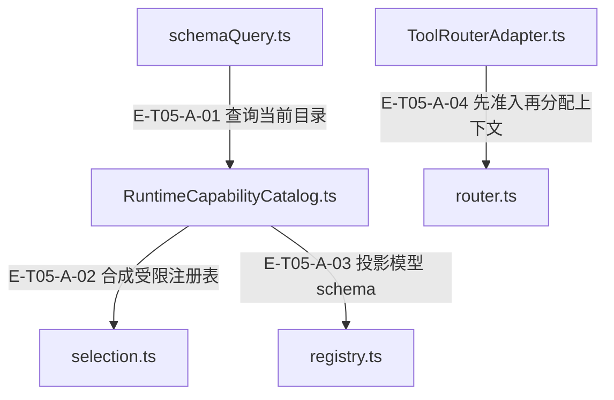

# 05 · 工具契约与目录

> 模型看见哪些工具，选择集如何变成可执行权限，公开回执如何保持语义？

工具合同集中在 kernel，runtime registry 持有动作 schema 与 handler。RuntimeCapabilityCatalog 将阶段选择与宿主稀疏 availability 求交；ToolRouterAdapter 先预检再分配 context，ToolRouter 在获得并发 slot 后重检。目录投影不执行工具，manifest 元数据也不是通用执行器。

[真实调用](call-flow.md) · [直接依赖](file-dependency.md) · [阅读规范](../00-diagram-standard.md)

## 职责与主要接缝

### 本图术语说明

| 术语／节点 | 含义与范围 |
| --- | --- |
| schemaQuery.ts | `src/tools/catalog/schemaQuery.ts`；本图按实现文件聚合职责；具体装配条件见下表。 |
| RuntimeCapabilityCatalog.ts | `src/tools/runtime/adapter/RuntimeCapabilityCatalog.ts`；本图按实现文件聚合职责；具体装配条件见下表。 |
| selection.ts | `src/tools/runtime/selection.ts`；本图按实现文件聚合职责；具体装配条件见下表。 |
| registry.ts | `src/tools/runtime/registry.ts`；本图按实现文件聚合职责；具体装配条件见下表。 |
| ToolRouterAdapter.ts | `src/tools/runtime/adapter/ToolRouterAdapter.ts`；本图按实现文件聚合职责；具体装配条件见下表。 |
| router.ts | `src/tools/runtime/router.ts`；本图按实现文件聚合职责；具体装配条件见下表。 |

| 编号 | 代码依据 | 测试依据 | 关系与可证明范围 |
| --- | --- | --- | --- |
| E-T05-A-01 | `src/tools/catalog/schemaQuery.ts#queryToolSchemas` → `src/tools/runtime/adapter/RuntimeCapabilityCatalog.ts#RuntimeCapabilityCatalog.querySchemas` | `test/tool-schema-projection.test.ts#case:uses%20querySchemas%20directly%20and%20enforces%20its%20effective%20actions%20before%20calling%20an%20external%20host`；断言 querySchemas 调用一次、旧 mixed 方法零调用；仅 code.read 到达宿主，graph 与未开放 action 进入 blockedTools。 | 现代端口分支实际调用 catalog.querySchemas(portQuery)，随后仍按调用前 selection 快照收窄；此边指向默认 runtime catalog 实现，旧宿主另走兼容探测。 |
| E-T05-A-02 | `src/tools/runtime/adapter/RuntimeCapabilityCatalog.ts#RuntimeCapabilityCatalog.querySchemas` → `src/tools/runtime/selection.ts#createToolRegistryView` | `test/tool-schema-projection.test.ts#case:returns%20one%20effective%20action%20set%20and%20narrows%20available%20management%20branches`；断言 graph 被移除，knowledge.manage 只广告 update，原 registry 仍含 publish，allowedTools 冻结。 | 传入 TOOL_REGISTRY、query.selection 与规范 availability，返回只包含有效动作/operation 的视图。 |
| E-T05-A-03 | `src/tools/runtime/adapter/RuntimeCapabilityCatalog.ts#RuntimeCapabilityCatalog.querySchemas` → `src/tools/runtime/registry.ts#projectRegistrySchemas` | `test/tool-schema-projection.test.ts#case:projects%20action-level%20allowlists%20into%20provider-visible%20schemas`；knowledge schema 的 action 仅 submit，必需字段与 reasoning/content 保留；meta 仅 review。 | 对受限 view 生成 provider schema；单 action 展开参数，多 action 使用 envelope；同一结果携带 allowedTools。 |
| E-T05-A-04 | `src/tools/runtime/adapter/ToolRouterAdapter.ts#ToolRouterAdapter.executeCall` → `src/tools/runtime/router.ts#ToolRouter.explain` | `test/tool-availability.test.ts#case:explains%20the%20same%20capability%20rejection%20as%20execute%20without%20allocating%20a%20context`；同一禁止的 graph.overview 在 explain/execute 中一致拒绝；create 与 getOverview 均零调用。 | parse 与 availability 后调用 explain；不允许时返回 admission failure，不调用 contextFactory.create。 |

## 输入、输出与副作用

| 维度 | 当前实现 |
| --- | --- |
| 输入 | ToolCallRequest：toolId、args、actor/source、runtime、abortSignal、可选 parentCallId；ToolSchemaQuery.selection 与宿主同步 availability 快照 |
| 输出 | ToolSchemaQueryResult：schemas、allowedTools、作用域内 unavailable 原因；ToolDecision 与 ToolResultEnvelope：success/partial/error/blocked/aborted/timeout/needs-confirmation |
| 副作用 | 目录查询不执行 handler。允许调用才分配 host context；router 在并发许可内调 handler。；Adapter 为回执生成 callId/时间、诊断、cache 与来源 trust；D23 内容清理在下游普通输出/历史边界执行。 |

## 从这些文件开始

| 文件 | 阅读目的 |
| --- | --- |
| `src/tools/kernel/request.ts` | ToolCallRequest 与 ToolRouterContract；execute 是最小必需路由面 |
| `src/tools/kernel/result.ts` | 七类结果状态、规范信封、JSON 安全化和普通输出投影 |
| `src/tools/kernel/registry.ts` | ToolSpec、ToolAction、ToolContext 和宿主注入端口 |
| `src/tools/kernel/toolSchema.ts` | schema 查询端口与 action allowlist |
| `src/tools/kernel/toolSelection.ts` | 选择快照、归一化、交集与参数权限 |
| `src/tools/catalog/schemaQuery.ts` | 现代 querySchemas 与旧目录兼容的唯一消费入口 |
| `src/tools/runtime/registry.ts` | code/terminal/knowledge/graph/memory/evidence/meta 的单源动作注册 |
| `src/tools/runtime/adapter/RuntimeCapabilityCatalog.ts` | 按真实宿主接线投影 schema 与有效动作 |
| `src/tools/runtime/adapter/ToolRouterAdapter.ts` | 把 runtime router 适配到统一请求/回执合同 |
| `src/tools/runtime/router.ts` | 参数/能力/阶段/availability 准入、并发调度与 handler 调用 |

## 失败、取消与恢复

- 未知工具、参数错误、能力或阶段拒绝：返回准入错误，拒绝发生在实际副作用前；模型/调用方根据 reason 修正参数或权限。
- 排队期间取消或撤权：取消可移除等待项；取得 slot 后重读宿主 availability，不能沿用入队时许可。
- 宿主 context/availability 或 handler 抛错：按阶段产生诊断和错误信封；slot 在 finally 释放。
- 非 JSON/circular/getter/toJSON 返回值：规范化成带内标记与警告，不调用自定义 getter/toJSON，也不抹掉 handler 已确认状态。

## 已知边界与未验证范围

- CapabilityManifest 中的 timeout/abort/approval/role 声明不能自动证明相应强制执行；实际约束要沿 router、policy 与 host 调用链判断。
- UnifiedToolCatalog的handler/router/lazy与ToolDefinition层已删除，当前仅manifest存储及继承投影。kernel旧handler/routing文件也已删除；执行继续经ToolRouterContract→Adapter→Router→ActionHandler，不恢复V1 shim/v2标签。
- Router maxOutputTokens 直接约束字符串；结构化输出还依赖具体 handler/host 端口预算。
- 本专题没有运行测试；以用例源码作为证据定位。

## 三个名字相近的对象如何区分

| 对象 | 读取事实与产出 | 不承诺的能力 |
| --- | --- | --- |
| UnifiedToolCatalog / CapabilityCatalog | register/getManifest/list与通用flat schema；mixed/full给完整schema，explicit lightweight才简化；JS旧构造参数忽略并warn。 | 不持router、不存handler、不保lazy展开状态，不按modelOverrides改schema。 |
| RuntimeCapabilityCatalog | 从TOOL_REGISTRY、阶段selection及宿主availability产生同一组schemas/allowedTools。 | 可见并不免除执行时重检；不能由manifest审批字段直接授予工具权限。 |
| ToolRouter / ToolRouterAdapter | 参数、能力、阶段、availability准入，slot后重检，再调用真实ActionHandler并规范回执。 | 不通过已退役getSchemas投影模型schema，不从catalog寻找执行器。 |

依据 `src/tools/catalog/UnifiedToolCatalog.ts#UnifiedToolCatalog`、`src/tools/catalog/CapabilityCatalog.ts#CapabilityCatalog.projectSchema`、`src/tools/runtime/adapter/RuntimeCapabilityCatalog.ts#RuntimeCapabilityCatalog.querySchemas`、`src/tools/runtime/router.ts#ToolRouter.execute`；`test/tool-system.test.ts#case:keeps%20the%20host%20manifest%20store%3A%20empty%20construction%2C%20register%2C%20getManifest%2C%20list%20and%20unregister`、`test/tool-system.test.ts#case:projects%20full%20schemas%20for%20runtime%20mixed%20queries%20without%20instance-level%20lazy%20state`、`test/tool-system.test.ts#case:drops%20the%20router%2C%20definition%2Fhandler%20and%20lazy%20members%20from%20the%20prototype%20chain`、`test/tool-system.test.ts#case:ignores%20a%20legacy%20ToolDefinition%20array%20passed%20by%20JS%20callers%20and%20reports%20it`均已定位断言，实际执行见页面证据。

System类和system_interaction已退役；CapabilityRegistry私有按名表不允许调用register覆盖能力。ScanAnalyze只撤掉公开类再导出，scan_analyze能力仍可按名解析，不能视为扫描功能删除。依据 `src/tools/runtime/toolsets/CapabilityRegistry.ts#CapabilityRegistry`、`src/tools/runtime/toolsets/index.ts`；`test/capability-registry-system-interaction.test.ts#case:deletes%20the%20System%20class%20file%20while%20scan_analyze%20stays%20registered%20%28W2a-03%29`、`test/capability-registry-system-interaction.test.ts#case:keeps%20the%20name%20table%20module-private%20and%20create%2Fnames%20independent%20of%20this%20%28W2a-03%29`、`test/capability-registry-system-interaction.test.ts#case:a%20compiled%20override%20profile%20cannot%20resolve%20system_interaction%20into%20a%20runtime`。

## 端口收窄与失败责任

- graph.query每种type只有一条宿主方法：class/protocol/hierarchy/callers/callees/impact/search。缺方法返回不可用，空值是无结果，不再读旧备用图端口；overrides/extensions旧参数由schema拒绝。依据 `src/tools/kernel/registry.ts#GRAPH_QUERY_HOST_READERS` 与 `test/tool-runtime-legacy-host-compat.test.ts#case:derives%20availability%20and%20handler%20reads%20for%20%24port.%24method%20from%20the%20same%20table`、`test/tool-runtime-legacy-host-compat.test.ts#case:returns%20a%20primary%20empty%20result%20as%20no%20results%20instead%20of%20looking%20for%20another%20reader`。
- code.outline只认outlineFile；astAnalyzer字段目前为类型兼容保留，但执行与availability都不读取。依据 `src/tools/runtime/handlers/code.ts#buildAstOutline` 与 `test/code-outline-port.test.ts#case:no%20longer%20serves%20the%20retired%20astAnalyzer%20duck%20type`。
- ToolRuntimeCallContext中的旧diagnostics/policyValidator/sessionToolCalls/currentRound/validator/fileCache/dataRoot/logger已删除。调用诊断由runtimeBridge直接记录；顶层ToolCallContext.dataRoot和ToolPolicyValidator/Decision类型仍保留，不把类型存在当运行门禁。
- knowledge.prime不再读knowledgeRepo；detail/manage各自回落与prime的search-only分支仍存在。依据 `src/tools/runtime/handlers/knowledge/queries.ts#handlePrime`、`test/tool-runtime-legacy-host-compat.test.ts#case:refuses%20prime%20on%20a%20knowledgeRepo-only%20host%20without%20reading%20the%20repository`、`test/tool-runtime-legacy-host-compat.test.ts#case:keeps%20the%20search-only%20fallback%20on%20its%20own%20diagnostic%20without%20a%20knowledgeRepo%20log`。局部退役不能扩大为所有兼容路径均已删除。
