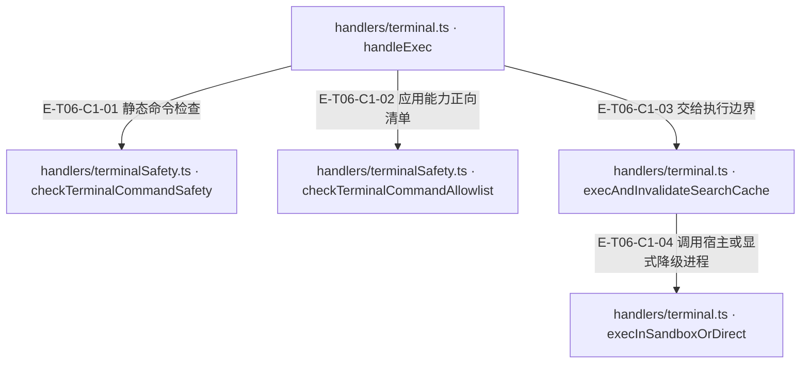
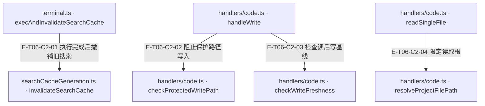

# 工具执行与安全 · 真实调用

真实副作用位于 code/terminal handlers。code 使用项目内真实路径、保护段与可选 delta freshness；terminal 在 cwd、安全规则和可选 allowlist 后才调用宿主执行器，缺执行器默认拒绝。Agent 透传隔离 intent，宿主负责真正沙箱；执行结果、审计和缓存代数分别维护。

[职责与边界](overview.md) · [直接依赖](file-dependency.md) · [当前全文与失败审阅](full-source-review.md)

图中调用边经实现正文核对；AST只用于符号定位。接口／注入对象是调用端口，不据此推定所有宿主实现相同。测试表记录已定位的精确声明和断言边界；实际执行、展开后的参数化用例身份及当前输入一致性见页面证据。

## 调用接缝 1

### 本图术语说明

| 术语／节点 | 含义与范围 |
| --- | --- |
| handlers/terminal.ts · handleExec | `src/tools/runtime/handlers/terminal.ts#handleExec`；声明或调用端口；动态实现的绑定条件见下表。 |
| handlers/terminalSafety.ts · checkTerminalCommandSafety | `src/tools/runtime/handlers/terminalSafety.ts#checkTerminalCommandSafety`；声明或调用端口；动态实现的绑定条件见下表。 |
| handlers/terminalSafety.ts · checkTerminalCommandAllowlist | `src/tools/runtime/handlers/terminalSafety.ts#checkTerminalCommandAllowlist`；声明或调用端口；动态实现的绑定条件见下表。 |
| handlers/terminal.ts · execAndInvalidateSearchCache | `src/tools/runtime/handlers/terminal.ts#execAndInvalidateSearchCache`；声明或调用端口；动态实现的绑定条件见下表。 |
| handlers/terminal.ts · execInSandboxOrDirect | `src/tools/runtime/handlers/terminal.ts#execInSandboxOrDirect`；声明或调用端口；动态实现的绑定条件见下表。 |

| 编号 | 代码依据 | 测试依据 | 关系与可证明范围 |
| --- | --- | --- | --- |
| E-T06-C1-01 | `src/tools/runtime/handlers/terminal.ts#handleExec` → `src/tools/runtime/handlers/terminalSafety.ts#checkTerminalCommandSafety` | `test/runtime-terminal-safety.test.ts#case:writes%20a%20stable%20audit%20classification%20for%20every%20failure%20path%20without%20the%20command%20text`；以 sudo whoami 覆盖 security block，并断言审计稳定分类且不含命令原文；该测试不等于 canonical blocked 信封已实现。 | cwd 解析与 timeout 归一之后调用共享 shell 安全检查；不安全命令直接 fail，不启动执行器。 |
| E-T06-C1-02 | `src/tools/runtime/handlers/terminal.ts#handleExec` → `src/tools/runtime/handlers/terminalSafety.ts#checkTerminalCommandAllowlist` | `test/runtime-terminal-safety.test.ts#case:blocks%20git%20with%20a%20subdirectory%20cwd%20before%20the%20sandbox%20executor%20through%20the%20Evolution%20router`；用例验证 Evolution 下非项目根 cwd 的 git 调用在 sandbox executor 前被拦截。 | 只有 ctx.commandAllowlist 存在时追加 bin/参数检查，并传入 cwdIsProjectRoot；Evolution 使用只读取证清单。 |
| E-T06-C1-03 | `src/tools/runtime/handlers/terminal.ts#handleExec` → `src/tools/runtime/handlers/terminal.ts#execAndInvalidateSearchCache` | `test/runtime-terminal-safety.test.ts#case:re-runs%20code.search%20after%20the%20executor%20was%20invoked%20(%25s)`；参数化 exit0/exit1/exit137/throw/timeout/plain-exec：执行先真实改盘，后续同 cache 搜索 total=0 且 cached=false。 | 通过前置门后调用执行包装；包装在成功、非零退出、137、抛错等 settle 后统一失效搜索缓存。 |
| E-T06-C1-04 | `src/tools/runtime/handlers/terminal.ts#execAndInvalidateSearchCache` → `src/tools/runtime/handlers/terminal.ts#execInSandboxOrDirect` | `test/tool-availability.test.ts#case:blocks%20terminal.exec%20before%20starting%20a%20process%20when%20the%20injected%20executor%20has%20no%20exec%20method`；注入对象缺少 exec 时 handler 默认 blocked，不因对象真值自动启用 plain exec。 | 优先 await sandboxExecutor.exec(command,{cwd,projectRoot,timeout,signal,intent})；只有 allowUnsandboxedTerminal===true 才可 plain exec。宿主执行器是注入边界。 |

## 调用接缝 2

### 本图术语说明

| 术语／节点 | 含义与范围 |
| --- | --- |
| terminal.ts · execAndInvalidateSearchCache | `src/tools/runtime/handlers/terminal.ts#execAndInvalidateSearchCache`；声明或调用端口；动态实现的绑定条件见下表。 |
| searchCacheGeneration.ts · invalidateSearchCache | `src/tools/runtime/handlers/searchCacheGeneration.ts#invalidateSearchCache`；声明或调用端口；动态实现的绑定条件见下表。 |
| handlers/code.ts · handleWrite | `src/tools/runtime/handlers/code.ts#handleWrite`；声明或调用端口；动态实现的绑定条件见下表。 |
| handlers/code.ts · checkProtectedWritePath | `src/tools/runtime/handlers/code.ts#checkProtectedWritePath`；声明或调用端口；动态实现的绑定条件见下表。 |
| handlers/code.ts · checkWriteFreshness | `src/tools/runtime/handlers/code.ts#checkWriteFreshness`；声明或调用端口；动态实现的绑定条件见下表。 |
| handlers/code.ts · readSingleFile | `src/tools/runtime/handlers/code.ts#readSingleFile`；声明或调用端口；动态实现的绑定条件见下表。 |
| handlers/code.ts · resolveProjectFilePath | `src/tools/runtime/handlers/code.ts#resolveProjectFilePath`；声明或调用端口；动态实现的绑定条件见下表。 |

| 编号 | 代码依据 | 测试依据 | 关系与可证明范围 |
| --- | --- | --- | --- |
| E-T06-C2-01 | `src/tools/runtime/handlers/terminal.ts#execAndInvalidateSearchCache` → `src/tools/runtime/handlers/searchCacheGeneration.ts#invalidateSearchCache` | `test/runtime-terminal-safety.test.ts#case:re-runs%20code.search%20after%20the%20executor%20was%20invoked%20(%25s)`；每种执行结局只记录一次 generation=1，日志不含 small.ts 或 sed 文本。 | finally 推进缓存实例 WeakMap 代数；执行中产生的旧代数搜索条目也会失效。 |
| E-T06-C2-02 | `src/tools/runtime/handlers/code.ts#handleWrite` → `src/tools/runtime/handlers/code.ts#checkProtectedWritePath` | `test/tool-runtime-contract.test.ts#case:surfaces%20the%20denial%20as%20a%20blocked%20envelope%20with%20the%20diagnostic%20through%20the%20host%20adapter`；写 .env.local 返回 blocked、code_write_protected_path、blockedTools，文件仍不存在。 | 同时检查请求路径和 realpath 后路径的保护段；在 freshness、建目录和写盘前拒绝 .git/node_modules/.env 类路径。 |
| E-T06-C2-03 | `src/tools/runtime/handlers/code.ts#handleWrite` → `src/tools/runtime/handlers/code.ts#checkWriteFreshness` | `test/tool-runtime-contract.test.ts#case:state%202%20(CG-3)%3A%20rejects%20a%20write%20when%20the%20file%20changed%20externally%20since%20last%20read`；先读后带外改盘，再写被拒；原带外内容完整保留，error 带 changed externally 与重读提示。 | 先确认磁盘存在性；存在且注入 deltaCache 时必须有先读指纹，且检查时磁盘内容仍 fresh；拒绝时提示重新 code.read。无 deltaCache 时透传；检查与后续普通 writeFile 之间不是原子 compare-and-swap，现有顺序外改测试不证明并发窗口已消除。 |
| E-T06-C2-04 | `src/tools/runtime/handlers/code.ts#readSingleFile` → `src/tools/runtime/handlers/code.ts#resolveProjectFilePath` | `test/tool-runtime-contract.test.ts#case:rejects%20code.%25s%20through%20a%20symlink%20outside%20the%20project`；read/write 两个参数化场景均拒绝根外 symlink，根外文件保持原内容。 | 读取前解析项目内真实路径；超根/符号链接越界返回文件级错误，合法路径才 fs.readFile。 |

## 大纲能力的单一宿主入口

`src/tools/runtime/handlers/code.ts#buildAstOutline`现在只调用ctx.outlineFile(absPath, relPath)。`test/code-outline-port.test.ts#case:reads%20only%20outlineFile%20even%20when%20a%20retired%20astAnalyzer%20is%20also%20injected`断言即使注入旧astAnalyzer也只调用新端口；`test/code-outline-port.test.ts#case:no%20longer%20serves%20the%20retired%20astAnalyzer%20duck%20type`断言仅旧端口时不执行它；`test/code-outline-port.test.ts#case:reports%20a%20throwing%20port%20as%20analyzer-error%20with%20the%20error%20class`断言抛错归为analyzer-error。缺端口/no-definitions时code.read可降头尾预览，code.outline返回不可用；不能把降级预览当全文证据。

terminal的黑名单调用保持原E边，内部识别已切换为raw切块还原加token归属检查；详细新边在[写法识别与拒绝](terminal-failures-and-contracts.md)。断言已定位，实际执行见页面证据。
