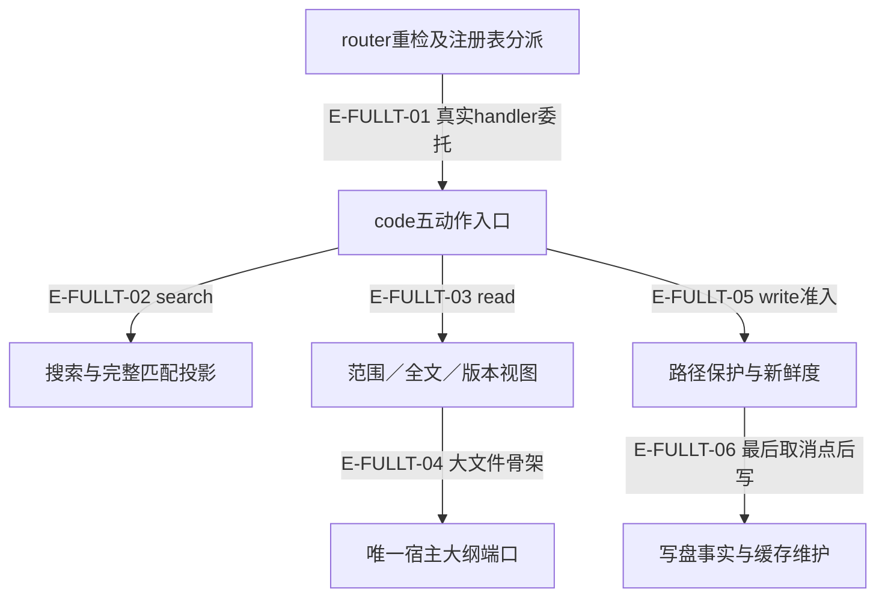
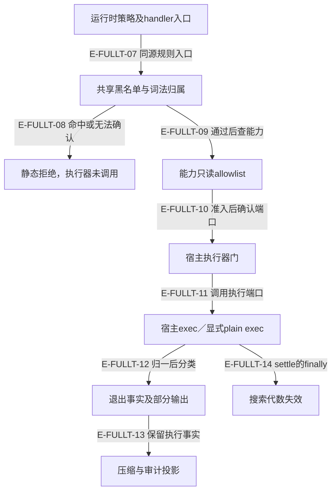

# 代码工具与终端规则：当前全文、失败与恢复边界

本页重新完整读取当前 `code.ts` 与 `terminalSafety.ts` 的每一行，补齐旧记录只有差异及影响上下文的部分。全文阅读与 L3 分支解释是两个维度；本页测试引用均只表示**已定位并读取断言，未在本轮执行**。历史快照和旧执行回执保持原样，不能给新断言自动附加通过状态。

真实调用体同时核对了注册表、router、运行时准入、SafetyPolicy、共享路径解析，以及完整的终端 handler。主对象仅为下表两个文件；辅助调用方没有借此获得新的全文覆盖登记。终端规则是用户已有工作树改动，本页不修改、接收或发布它。

[工具执行专题](overview.md) · [既有终端合同页](terminal-failures-and-contracts.md) · [既有调用图](call-flow.md)

## 当前读取身份

| 文件 | 逻辑行／物理行 | 读取前后相同的 SHA-256 | 方法 |
| --- | --- | --- | --- |
| `src/tools/runtime/handlers/code.ts` | 3608／3607 | `sha256:ac69e258692f7054f8187c87f37f8b05c3dda91da88a8ee25af5bee9203b7996` | current-full-text；连续分段全文 |
| `src/tools/runtime/handlers/terminalSafety.ts` | 5171／5170 | `sha256:bc8d8eed27e9648d5e58fdff60dbc2267222e90c12d53bb97e2fffa57348a856` | current-full-text；连续分段全文 |

逻辑行数沿用 Atlas 的 LF split 口径，末尾 LF 后的空逻辑行也计入；实际源码的连续阅读没有用 delta、grep 或哈希相同来替代。

## 文件工具的可见内容与写入事实

### 本图术语说明

| 节点／术语 | 本图含义 |
| --- | --- |
| router重检及注册表分派 | `src/tools/runtime/router.ts#ToolRouter` |
| code五动作入口 | `src/tools/runtime/handlers/code.ts#handle` |
| 搜索与完整匹配投影 | `src/tools/runtime/handlers/code.ts#handleSearch` |
| 范围／全文／版本视图 | `src/tools/runtime/handlers/code.ts#readSingleFile` |
| 唯一宿主大纲端口 | `src/tools/runtime/handlers/code.ts#buildAstOutline` |
| 路径保护与新鲜度 | `src/tools/runtime/handlers/code.ts#handleWrite` |
| 写盘事实与缓存维护 | `src/tools/runtime/handlers/code.ts#handleWrite` |

| 编号 | 代码依据 | 测试依据 | 关系与可证明范围 |
| --- | --- | --- | --- |
| E-FULLT-01 | `src/tools/runtime/registry.ts#CODE_SPEC`；`src/tools/runtime/router.ts#ToolRouter`；`src/tools/runtime/handlers/code.ts#handle` | `test/code-search-patterns-param.test.ts#case:rejects%20a%20singular%20pattern%20at%20the%20router%20before%20the%20handler%20runs`；仅单数pattern时ok=false并报告缺少patterns。 边界：真实router/adapter与临时文件；本轮未执行，仅定位并读断言。 | 调用：schema/权限检查后按注册表委托；排队后重新准入。 |
| E-FULLT-02 | `src/tools/runtime/handlers/code.ts#handleSearch`；`src/tools/runtime/handlers/code.ts#spawnRg`；`src/tools/runtime/handlers/code.ts#projectSearchResults` | `test/tool-runtime-contract.test.ts#case:continues%20past%20a%20pattern%20whose%20output%20overflowed%20before%20enough%20hits%20and%20names%20it%20in%20the%20warning`；2MB前仅3命中仍继续tail-hit；partial、交错4条、total=4；仅完整pattern缓存。 边界：真实spawn+受控rg协议脚本；本轮未执行，仅定位并读断言。 `test/tool-resource-scope.test.ts#case:bounds%20structured%20search%20at%20the%20action%2Frequest%20quota%20(%25i)%20without%20inventing%20source%20evidence`；整条舍弃长命中，真实定位保留，缓存完整；ledger只采可见短命中。 边界：真实adapter/临时fs/evidence，8000与450预算；本轮未执行，仅定位并读断言。 | 调用与数据：数量观察下界、partial和有损展示不同；缺项不能视为未命中。 |
| E-FULLT-03 | `src/tools/runtime/handlers/code.ts#handleRead`；`src/tools/runtime/handlers/code.ts#readSingleFile` | `test/tool-runtime-contract.test.ts#case:serves%20requested%20ranges%20after%20a%20cached%20read%20of%20%25i%20lines`；20/600行文件先读再请求区间仍返回真实行号正文。 边界：真实文件+DeltaCache；本轮未执行，仅定位并读断言。 `test/tool-resource-scope.test.ts#case:does%20not%20reuse%20full%20visibility%20after%20the%20router%20truncates%20an%20oversized%20single%20read`；超配额单读第二次仍有正文且截断，不能unchanged。 边界：真实文件+router截断+DeltaCache；本轮未执行，仅定位并读断言。 | 调用：只有已展示全文可unchanged；区间和裁剪不能冒充全文可见。 |
| E-FULLT-04 | `src/tools/runtime/handlers/code.ts#generateOutlineForRead`；`src/tools/runtime/handlers/code.ts#buildAstOutline` | `test/code-outline-port.test.ts#case:serves%20a%20%3E500-line%20code.read%20through%20outlineFile%20with%20(absPath%2C%20relPath)%20and%20marks%20it%20ast`；1200行调用端口一次，绝对/相对路径正确，batch标ast，无fallback。 边界：vi.fn定义列表，未调用真实Core Tree-sitter；本轮未执行，仅定位并读断言。 `test/code-outline-port.test.ts#case:no%20longer%20serves%20the%20retired%20astAnalyzer%20duck%20type`；旧端口从不调用，outline不可用，read头尾fallback且analyzer-missing。 边界：旧字段fixture，不验证实际宿主迁移；本轮未执行，仅定位并读断言。 | 调用：端口fixture证实单一入口；缺席/失败的head-tail不是全文。 |
| E-FULLT-05 | `src/tools/runtime/handlers/code.ts#checkProtectedWritePath`；`src/tools/runtime/handlers/code.ts#checkWriteFreshness` | `test/tool-runtime-contract.test.ts#case:surfaces%20the%20denial%20as%20a%20blocked%20envelope%20with%20the%20diagnostic%20through%20the%20host%20adapter`；写.env.local blocked、diagnostic/blockedTools有记录，文件不存在。 边界：真实adapter/fs；本轮未执行，仅定位并读断言。 `test/tool-runtime-contract.test.ts#case:state%202%20(CG-3)%3A%20rejects%20a%20write%20when%20the%20file%20changed%20externally%20since%20last%20read`；读后带外修改再写拒绝，完整保留外改内容。 边界：顺序夹具，不是检查至写入间race；本轮未执行，仅定位并读断言。 | 控制：保护先于freshness；一致性检查没有原子CAS含义。 |
| E-FULLT-06 | `src/tools/runtime/handlers/code.ts#handleWrite`；`src/tools/runtime/handlers/searchCacheGeneration.ts#invalidateSearchCache` | `test/tool-resource-scope.test.ts#case:honors%20the%20final%20cancellation%20boundary%20at%20%25s%20without%20inventing%20a%20rollback`；freshness/mkdir后取消不写内容；写后取消仍success且内容在盘。 边界：真实IO包装注入取消，目录可能已创建；本轮未执行，仅定位并读断言。 `test/tool-resource-scope.test.ts#case:preserves%20a%20confirmed%20write%20when%20optional%20fingerprint%20maintenance%20will%20%25s`；cache throw/reject/pending不改写成事实，write一次；迟到拒绝不改已发回执。 边界：真实写盘+cache故障注入；本轮未执行，仅定位并读断言。 | 副作用：开始尝试写就失效搜索；确认写后缓存失败不反转磁盘事实。 |

## 终端静态判定与真实执行回执

黑名单、只读 allowlist、宿主执行及结果投影分别承担不同事实。源码注释中的宿主状态不是本页跨仓核验结果；`sandboxed=true` 缺省也不是 OS 隔离证据。

### 本图术语说明

| 节点／术语 | 本图含义 |
| --- | --- |
| 运行时策略及handler入口 | `src/agent/runtime/toolPipeline/accessGates.ts#runtimeSafetyGate` |
| 共享黑名单与词法归属 | `src/tools/runtime/handlers/terminalSafety.ts#checkTerminalCommandSafety` |
| 静态拒绝，执行器未调用 | `src/tools/runtime/handlers/terminal.ts#handleExec` |
| 能力只读allowlist | `src/tools/runtime/handlers/terminalSafety.ts#checkTerminalCommandAllowlist` |
| 宿主执行器门 | `src/tools/runtime/handlers/terminal.ts#handleExec` |
| 宿主exec／显式plain exec | `src/tools/runtime/handlers/terminal.ts#execInSandboxOrDirect` |
| 退出事实及部分输出 | `src/tools/runtime/handlers/terminal.ts#terminalFailureStatus` |
| 压缩与审计投影 | `src/tools/runtime/handlers/terminal.ts#compressOutput` |
| 搜索代数失效 | `src/tools/runtime/handlers/terminal.ts#execAndInvalidateSearchCache` |

| 编号 | 代码依据 | 测试依据 | 关系与可证明范围 |
| --- | --- | --- | --- |
| E-FULLT-07 | `src/agent/policies/SafetyPolicy.ts#SafetyPolicy`；`src/tools/runtime/handlers/terminalSafety.ts#checkTerminalCommandSafety`；`src/tools/runtime/handlers/terminal.ts#handleExec` | `test/runtime-terminal-safety.test.ts#case:blocks%20the%20package%20bypass%20commands%20before%20the%20sandbox%20executor%20is%20called`；wrapper/find/xargs/替换/heredoc/注释/描述符/stdin危险形态拒绝，executor零次。 边界：router+mock executor，不执行危险命令；本轮未执行，仅定位并读断言。 | 调用：policy与handler同源黑名单；运行时能力另在access gate前置检查。 |
| E-FULLT-08 | `src/tools/runtime/handlers/terminalSafety.ts#lexShellReadings`；`src/tools/runtime/handlers/terminalSafety.ts#checkDeniedNameFallback`；`src/tools/runtime/handlers/terminalSafety.ts#explainOutputFlow` | `test/terminal-safety-path-escape-wrappers.test.ts#case:blocks%20every%20denied%20target%20spelling%20wrapped%20by%20%24wrapper`；30wrapper×10目标×7写法的漏拒列表为空。 边界：纯函数组合；10目标并非DENIED_BINS全部12成员；本轮未执行，仅定位并读断言。 `test/runtime-terminal-safety.test.ts#case:blocks%20evidence%20output%20that%20flows%20into%20an%20executing%20command%3A%20%24command`；管道/进程替换/coproc/同串写文件再执行均按具体规则拒绝。 边界：同一命令串静态流，不覆盖跨调用脚本；本轮未执行，仅定位并读断言。 | 控制：命令位置、raw还原及多读法归属任何不安全即拒绝，非shell完整解释器。 |
| E-FULLT-09 | `src/tools/runtime/handlers/terminal.ts#handleExec`；`src/tools/runtime/handlers/terminalSafety.ts#evaluateTerminalCommandAllowlist` | `test/runtime-terminal-safety.test.ts#case:blocks%20the%20disabled%20commands%20before%20the%20sandbox%20executor%20through%20the%20Evolution%20router`；node/npm/npx/eslint/vitest/jest代码执行禁用，executor零次。 边界：真实Evolution/router+mock executor，生产false开关；本轮未执行，仅定位并读断言。 | 调用：只有注入allowlist才查；黑名单safe不能替代Evolution准入。 |
| E-FULLT-10 | `src/tools/runtime/handlers/terminal.ts#handleExec` | `test/runtime-terminal-safety.test.ts#case:refuses%20to%20run%20when%20no%20sandbox%20executor%20is%20injected`；无executor blocked、marker不出现、诊断和失败audit一次。 边界：真实未启动进程证据，仅默认门；本轮未执行，仅定位并读断言。 `test/runtime-terminal-safety.test.ts#case:does%20not%20treat%20a%20truthy%20non-boolean%20opt-in%20as%20permission%20to%20run%20unsandboxed`；字符串yes仍blocked。 边界：host坏形状fixture；本轮未执行，仅定位并读断言。 | 控制：缺exec默认blocked，只有boolean true开放plain降级路径。 |
| E-FULLT-11 | `src/tools/runtime/handlers/terminal.ts#execInSandboxOrDirect` | `test/runtime-terminal-safety.test.ts#case:runs%20unsandboxed%20only%20when%20the%20host%20explicitly%20opts%20in%2C%20and%20says%20so%20in%20the%20result`；boolean true才真实短进程，标unsandboxed/fallback。 边界：真实本地子进程，无隔离承诺；本轮未执行，仅定位并读断言。 | 宿主边界：透传cwd/root/timeout/signal/可选intent；plain真实无沙箱并明示。 |
| E-FULLT-12 | `src/tools/runtime/handlers/terminal.ts#normalizeExecutorResult`；`src/tools/runtime/handlers/terminal.ts#terminalFailureStatus` | `test/runtime-terminal-safety.test.ts#case:preserves%20stderr%20from%20137%20%24label%20without%20changing%20its%20terminal%20status`；无原因137为error；取消aborted、期限timeout，去ANSI保留stderr及ok=true。 边界：mock137+信号原因；本轮未执行，仅定位并读断言。 `test/runtime-terminal-safety.test.ts#case:merges%20malformed%20diagnostics%20with%20other%20malformed%20executor%20fields%20in%20one%20warning`；stdout number与diagnostic字符串合并一次warn，effective sandboxed=true/fallbackUsed=false。 边界：回落值非隔离事实；本轮未执行，仅定位并读断言。 | 数据：137需signal辨因；diagnostics回落不是隔离生效证据。 |
| E-FULLT-13 | `src/tools/runtime/handlers/terminal.ts#compressOutput`；`src/tools/runtime/handlers/terminal.ts#recordTerminalAudit` | `test/runtime-terminal-safety.test.ts#case:surfaces%20a%20compressor%20failure%20as%20a%20diagnostic%20and%20keeps%20the%20cleaned%20output`；TypeError后回去ANSI原文ok，fallback诊断无命令/secret。 边界：mock compressor故障+mock executor；本轮未执行，仅定位并读断言。 `test/runtime-terminal-safety.test.ts#case:logs%20audit%20sink%20failures%20with%20the%20command%20hash%20only`；sink抛错不改成功，warn含sha256和类名，无secret。 边界：同步抛错sink，不覆盖永不settle；本轮未执行，仅定位并读断言。 | 投影：压缩异常回原文，审计拒绝不反转执行；永久pending未覆盖。 |
| E-FULLT-14 | `src/tools/runtime/handlers/terminal.ts#execAndInvalidateSearchCache`；`src/tools/runtime/handlers/searchCacheGeneration.ts#invalidateSearchCache` | `test/runtime-terminal-safety.test.ts#case:re-runs%20code.search%20after%20the%20executor%20was%20invoked%20(%25s)`；执行后各结局都失效一次generation=1，真实改盘后搜索fresh。 边界：五种mock executor实际写fs；plain-exec真实进程；rg依环境；本轮未执行，仅定位并读断言。 `test/runtime-terminal-safety.test.ts#case:keeps%20the%20cached%20search%20when%20%24name%20blocks%20the%20command%20before%20execution`；前置安全/allowlist/缺沙箱/cwd拒绝executor零次，缓存仍hit无失效日志。 边界：真实router/cache+mock executor计数；本轮未执行，仅定位并读断言。 | 副作用：执行器已调用才推进，失败或部分写盘也失效，前置拒绝不失效。 |

## code.ts 连续全文阅读

代码搜索、版本视图读取、宿主大纲适配、目录树及受保护写入真实handler。

router→CODE_SPEC→handle；search:rg/仅ENOENT fallback→结构化投影；read:realpath→磁盘/DeltaCache→full/range/outline；write:路径保护→四态freshness→最后取消点→写盘→可选cache维护。

| 行段 | 逐段解释 | 关键符号 |
| --- | --- | --- |
| 1–49 | 公开Core logging、kernel及共享路径助手导入；handle委托五动作，未知动作fail。 | `handle` |
| 50–288 | patterns准入、逐pattern缓存/rg/仅ENOENT fallback；partial继续、取消跳过；轮转合并后JSON预算投影。 | `handleSearch` |
| 289–482 | 全/部分缓存命中诊断；file:line去重轮转；不完整原因点名；整条取舍match/context/定位。 | `reportSearchCacheHits`、`mergeRoundRobin`、`describeIncompleteSearch`、`projectSearchResults` |
| 483–735 | 统一ignore转rg argv；15秒/2MB/AbortSignal收尾；满足请求早停、exit1空成功、exit2部分或失败；迟到事件不可改settle。 | `ripgrepSearch`、`spawnRg`、`searchAbortStatus` |
| 736–858 | 流式JSON match/context/end/summary；保留内容空白，matched_lines为观察下界；坏JSON跳过。 | `RipgrepJsonStream` |
| 859–999 | fallback JS regex逐文件读并realpath校验，目录symlink跳过、读错计数；满足数量和扫描缺口区别，取消按原因结束。 | `fallbackRegexSearch`、`fallbackIncomplete` |
| 1000–1198 | 读取合同、LF计行保CR、start/end正整数、path/filePaths互斥；单读配额有损撤销全文可见性，头尾预览标fallback。 | `splitSourceLines`、`normalizeReadRange`、`handleRead` |
| 1199–1502 | 保指纹撤全文展示；batch最多5项串读/均分预算；失败取消截断聚合，诊断采样路径与EOF越界提示。 | `forgetFullRead`、`handleBatchRead`、`describeBatchCompleteness`、`pushRangeBeyondEofWarning` |
| 1503–1679 | resolve后readFile；小文件无范围才delta check；range/outline只登记指纹；大文件AST不可用用已读同版本30头15尾。 | `readSingleFile`、`generateOutlineForRead` |
| 1680–1945 | outline过滤与路径验证；kinds enum/maxDepth；整体形状和每条字段归一，不合法可选字段缺省；过滤不推断真实深度。 | `handleOutline`、`normalizeOutlineFilter`、`normalizeOutlineDefinitions`、`matchesOutlineFilter` |
| 1946–2077 | 唯一outlineFile调用；异常/无定义/坏形状分别处理；计行失败不抹大纲；过滤0条解释成功，按depth缩进签名。 | `buildAstOutline` |
| 2078–2327 | structure至多400条、深度至5；realpath、排序、展示ignore；取消停止新读，子目录不可读保节点，根失败整体fail。 | `handleStructure`、`buildDirectoryTree`、`structureWalkStopped` |
| 2328–2558 | 写保护请求/真实两视图；lowercase与NFKC双判、精确env模板例外；symlink根选择词法/真实相对视图并诊断回落。 | `protectedSegmentRule`、`requestedViewRelPath`、`checkProtectedWritePath`、`protectedPathDenial` |
| 2559–2730 | 四态freshness、无cache透传与legacy全文比；mkdir前后取消；尝试写即失效搜索；确认写与可选缓存维护隔离。 | `handleWrite`、`checkWriteFreshness`、`legacyContentFreshness` |
| 2731–2929 | 语言/输入/路径助手；Unicode码点安全batch头尾裁剪含notice预算，二分字符数，计数诊断，无损/有损视图区分。 | `normalizeFilePaths`、`resolveProjectFilePath`、`clampReadResult`、`countClampCharsWithinBudget` |
| 2930–3075 | fallback5000候选/采样/能力说明；override/root ignore模型；glob token与字符类首尾符号及反向range拒绝。 | `FallbackScan`、`parseGlobClass` |
| 3076–3243 | glob解析栈识别星号段/分支/字符类，拒绝组内**；按UTF8字节生成regex，编译失败明示unsupported。 | `parseRipgrepGlob`、`globTokensToRegexSource`、`compileRipgrepGlob`、`toGlobSubject` |
| 3244–3438 | 反斜杠/extglob拒绝；override最后命中优先ignore/隐藏；Git根/祖先存在才读根gitignore，跳过忽略与重新纳入分开记录。 | `compileFallbackGlob`、`fallbackEntrySelected`、`loadRootGitignore` |
| 3439–3608 | 共享override和根ignore排序深搜；只文件/symlink候选、跳设备，5000全局硬停；扫描与不可读/reinclude诊断采样。3608为末尾LF后的空逻辑行。 | `buildFallbackOverrides`、`scanFallbackFiles`、`pushFallbackScanWarnings` |

### code.ts 失败与恢复映射

| 分支 | 触发／行为 | 副作用与恢复 | 当前代码 | 断言位置及证明边界 |
| --- | --- | --- | --- | --- |
| C-01 | patterns缺失/非数组/空或超过10。schema要求patterns，handler再拒空或超10；无单数回退。 | 不spawn或扫描。恢复：修正patterns[]。 | `src/tools/runtime/handlers/code.ts#handleSearch` | `test/code-search-patterns-param.test.ts#case:rejects%20a%20singular%20pattern%20at%20the%20router%20before%20the%20handler%20runs`；仅单数pattern时ok=false并报告缺少patterns。 真实router/adapter与临时文件；本轮未执行，仅定位并读断言。 |
| C-02 | 各pattern全/部分缓存命中。key含root、实时generation、pattern/glob/regex/数量/context；全命中才cached。 | 完整rg写缓存，partial/fallback不写。恢复：写操作推进代数，未命中继续搜索。 | `src/tools/runtime/handlers/code.ts#handleSearch` | `test/tool-runtime-contract.test.ts#case:reports%20a%20repeated%20all-pattern%20search%20as%20a%20cache%20hit%20so%20the%20runtime%20bridge%20stops%20counting%20a%20miss`；第二次hit=true/cacheMiss消失，set仍2次。 真实runtime bridge/adapter/cache，rg环境依赖；本轮未执行，仅定位并读断言。 `test/tool-runtime-contract.test.ts#case:marks%20a%20partially%20cached%20search%20with%20code_search_cache_hit%20without%20claiming%20a%20whole%20hit`；1/2命中仍hit=false且有诊断，下次全命中true。 真实bridge/adapter/cache；本轮未执行，仅定位并读断言。 |
| C-03 | rg请求已满足、超2MB或非零退出。满足且文件end可早停成功；不足配额溢出或exit2带命中partial并继续；零命中exit2失败。 | 真实spawn；早停/中断kill；partial不缓存。恢复：保留观察下界，补搜点名pattern。 | `src/tools/runtime/handlers/code.ts#spawnRg` | `test/tool-runtime-contract.test.ts#case:continues%20past%20a%20pattern%20whose%20output%20overflowed%20before%20enough%20hits%20and%20names%20it%20in%20the%20warning`；2MB前仅3命中仍继续tail-hit；partial、交错4条、total=4；仅完整pattern缓存。 真实spawn+受控rg协议脚本；本轮未执行，仅定位并读断言。 `test/tool-runtime-contract.test.ts#case:finishes%20as%20satisfied%20once%20maxResults%20hits%20are%20collected%20without%20waiting%20for%20rg%20to%20exit`；10命中+文件end即可success，10秒内返回、缓存1次，无incomplete。 受控rg脚本随后挂起；非复杂度证明；本轮未执行，仅定位并读断言。 `test/tool-resource-scope.test.ts#case:retains%20rg%20exit%202%20matches%20as%20diagnosed%20partial%20output%20and%20never%20caches%20them`；exit2保留已观察命中和stderr原因，partial、无缓存、无fallback。 真实spawn+可控rg替身；本轮未执行，仅定位并读断言。 |
| C-04 | 搜索前/运行中取消或15秒rg期限。按原因timeout/aborted；保留匹配、点名skipped、settle一次。 | 清timer/监听并SIGKILL，无缓存。恢复：重试未完成pattern，不接受迟到事件改回执。 | `src/tools/runtime/handlers/code.ts#spawnRg` | `test/tool-resource-scope.test.ts#case:settles%20rg%20%25s%20once%2C%20retaining%20observed%20matches%20without%20fallback%20or%20cache`；aborted/timeout均保留一命中、SIGKILL、timer清零；迟到data/close/error不改回执。 mock child EventEmitter+fake timers，非真实OS杀进程；本轮未执行，仅定位并读断言。 `test/code-search-deadline.test.ts#case:reports%20%24status%20when%20the%20search%20stops%20because%20%24label`；runOperation期限/父取消分别timeout/aborted，所有未开始pattern被点名。 真实runOperation，刻意在rg启动前取消；本轮未执行，仅定位并读断言。 |
| C-05 | 仅spawn ENOENT及fallback能力缺口。切JS正则/共享文件清单；不支持glob失败；5000上限/不可读/未应用reinclude在未满足数量时partial。 | 真实fs读；只根gitignore，不缓存fallback。恢复：安装rg或收窄glob；保留降级说明。 | `src/tools/runtime/handlers/code.ts#fallbackRegexSearch` | `test/tool-runtime-contract.test.ts#case:rejects%20a%20glob%20shape%20the%20fallback%20cannot%20evaluate%20instead%20of%20reporting%20zero%20hits`；不支持glob返回error与fallback/glob_unsupported，不能伪装零命中。 PATH清空产生ENOENT，真实fallback/fs；本轮未执行，仅定位并读断言。 `test/tool-runtime-contract.test.ts#case:stops%20at%20the%20global%20fallback%20file%20cap%20and%20reports%20the%20unsatisfied%20pattern%20as%20partial`；5000上限后未满足请求为partial；maxResults=1已满足则success。 真实临时5000+文件；本轮未执行，仅定位并读断言。 `test/tool-runtime-contract.test.ts#case:counts%20unreadable%20subdirectories%20and%20files%20in%20a%20warning%20instead%20of%20failing%20or%20hiding%20them`；可读命中保留，partial并点名1个不可读目录及1个文件。 真实chmod夹具，root用户skipIf；本轮未执行，仅定位并读断言。 `test/tool-runtime-contract.test.ts#case:classifies%20cancellation%20during%20the%20fallback%20scan%20as%20%25s%20and%20stops%20walking`；sub处取消后visited仅根/sub，timeout或aborted并点名never-run。 真实readdir包装注入取消，不覆盖同步regex内取消；本轮未执行，仅定位并读断言。 |
| C-06 | 非法regex或引擎单项失败。该pattern失败记录后继续，全局无匹配有失败则fail。 | 可能已有早前pattern读取，不缓存失败。恢复：修表达式，不能解释为零命中。 | `src/tools/runtime/handlers/code.ts#handleSearch` | `test/tool-resource-scope.test.ts#case:rejects%20invalid%20regex%20rather%20than%20reporting%20no%20matches%20(fallback%3D%25s)`；非法[原生/fallback均error，缓存set零次。 临时fs，原生rg依环境可用；本轮未执行，仅定位并读断言。 |
| C-07 | 搜索JSON超过min(host,action)预算。整条取舍匹配/context/定位；保留下界total/shown/omitted，不截造源码。 | 缓存仍存完整结果，证据仅收可见匹配。恢复：按真实定位补读，连计数不够预算则失败。 | `src/tools/runtime/handlers/code.ts#projectSearchResults` | `test/tool-resource-scope.test.ts#case:bounds%20structured%20search%20at%20the%20action%2Frequest%20quota%20(%25i)%20without%20inventing%20source%20evidence`；整条舍弃长命中，真实定位保留，缓存完整；ledger只采可见短命中。 真实adapter/临时fs/evidence，8000与450预算；本轮未执行，仅定位并读断言。 |
| C-08 | 范围、重复小文件或有损读视图。范围正整数验证；<=500无范围才DeltaCache.check；range/outline只留指纹；裁剪撤销full visibility。 | 真实readFile，LF切行保CR。恢复：区间补读；越EOF给空区间警告。 | `src/tools/runtime/handlers/code.ts#readSingleFile` | `test/tool-runtime-contract.test.ts#case:serves%20requested%20ranges%20after%20a%20cached%20read%20of%20%25i%20lines`；20/600行文件先读再请求区间仍返回真实行号正文。 真实文件+DeltaCache；本轮未执行，仅定位并读断言。 `test/tool-resource-scope.test.ts#case:does%20not%20reuse%20full%20visibility%20after%20the%20router%20truncates%20an%20oversized%20single%20read`；超配额单读第二次仍有正文且截断，不能unchanged。 真实文件+router截断+DeltaCache；本轮未执行，仅定位并读断言。 `test/tool-runtime-contract.test.ts#case:rejects%20a%20non-positive-integer%20range%20%25j`；负数、小数、0的start/end在单读与batch均失败。 router形状允许number，再由handler语义拒绝；本轮未执行，仅定位并读断言。 `test/tool-runtime-contract.test.ts#case:returns%20an%20empty%20range%20with%20a%20warning%20when%20startLine%20is%20past%20the%20end%20of%20the%20file`；越EOF单读和batch空正文且range_beyond_eof。 真实20行文件；本轮未执行，仅定位并读断言。 `test/tool-runtime-contract.test.ts#case:keeps%20CRLF%20range%20reads%20byte-aligned%20with%20the%20evidence%20ledger%20freshness%20slice`；保留CR，去行号后登记ledger，源文件checkFreshness=fresh。 真实文件及EvidenceLedgerStore；本轮未执行，仅定位并读断言。 |
| C-09 | batch缺文件、取消、每文件裁剪。至多5文件串读；部分成功ok但partial/timeout/aborted；后续未读项Read aborted，全失败ok=false。 | 已读/指纹保留；不再读取未开始项。恢复：补读失败/未读/省略片段。 | `src/tools/runtime/handlers/code.ts#handleBatchRead` | `test/tool-runtime-contract.test.ts#case:reports%20a%20batch%20with%20a%20missing%20file%20as%20partial%20while%20keeping%20ok%20and%20the%20data%20shape`；一成功一缺失，ok=true/status=partial，summary1/2，点名缺失。 真实fs/adapter；本轮未执行，仅定位并读断言。 `test/tool-runtime-contract.test.ts#case:reports%20a%20batch%20cancelled%20after%20the%20first%20file%20as%20aborted%20with%20the%20skipped%20files%20named`；首文件成功，后两项Read aborted、点名未读项。 cache钩子取消+真实文件，不表示readFile可被中断；本轮未执行，仅定位并读断言。 `test/tool-runtime-contract.test.ts#case:reports%20a%20batch%20stopped%20by%20the%20run%20deadline%20after%20the%20first%20file%20as%20timeout%2C%20not%20aborted`；TimeoutError后文件true/false/false，status=timeout，汇总日志一次。 注入DOMException原因，非本case实际计时器到期；本轮未执行，仅定位并读断言。 |
| C-10 | outlineFile缺/null/throw/坏形状/坏项或过滤为空。唯一outlineFile；read降30头15尾，outline失败；普通坏项丢弃/缺省warn，过滤空仍说明成功。 | 宿主只读端口约定，可能计行重读，异常消息进入日志。恢复：修宿主端口或读行段，不将head-tail当全文。 | `src/tools/runtime/handlers/code.ts#buildAstOutline` | `test/code-outline-port.test.ts#case:serves%20a%20%3E500-line%20code.read%20through%20outlineFile%20with%20(absPath%2C%20relPath)%20and%20marks%20it%20ast`；1200行调用端口一次，绝对/相对路径正确，batch标ast，无fallback。 vi.fn定义列表，未调用真实Core Tree-sitter；本轮未执行，仅定位并读断言。 `test/code-outline-port.test.ts#case:reports%20a%20null%20port%20result%20as%20no-definitions%20for%20both%20outline%20and%20read`；outline失败；read batch为head-tail/no-definitions。 mock宿主端口null；本轮未执行，仅定位并读断言。 `test/code-outline-port.test.ts#case:reports%20a%20throwing%20port%20as%20analyzer-error%20with%20the%20error%20class`；RangeError以类名和消息进入错误与warn。 mock宿主端口reject；本轮未执行，仅定位并读断言。 `test/code-outline-port.test.ts#case:drops%20malformed%20port%20entries%20with%20a%20warning%20log%20and%20keeps%20the%20valid%20ones`；4项丢3项保留Kept，全坏时无定义失败。 普通对象fixture，非getter/Proxy/巨大depth；本轮未执行，仅定位并读断言。 `test/code-outline-port.test.ts#case:warns%20once%20when%20outlineFile%20returns%20a%20non-array%20shape%20and%20still%20reports%20no-definitions`；非数组对象/字符串各warn一次，回no-definitions。 mock宿主返回值；本轮未执行，仅定位并读断言。 `test/code-outline-port.test.ts#case:logs%20invalid%20optional%20fields%20that%20fall%20back%20to%20defaults%20without%20changing%20the%20outline`；非法depth按0，endLine缺省，计数endLine1/signature1/depth2。 普通对象fixture；本轮未执行，仅定位并读断言。 `test/code-outline-port.test.ts#case:returns%20an%20explained%20empty%20outline%20when%20the%20filter%20matches%20nothing`；enum过滤0/6仍ok，正文解释为空。 mock定义列表，不表示文件没有定义；本轮未执行，仅定位并读断言。 `test/code-outline-port.test.ts#case:no%20longer%20serves%20the%20retired%20astAnalyzer%20duck%20type`；旧端口从不调用，outline不可用，read头尾fallback且analyzer-missing。 旧字段fixture，不验证实际宿主迁移；本轮未执行，仅定位并读断言。 |
| C-11 | structure取消、400条上限、子目录不可读。停止新条目/readdir并保留部分树；子目录unreadable继续兄弟，根失败整体fail。 | 真实只读遍历；排序、展示ignore区别于search。恢复：收窄目录/depth或修权限。 | `src/tools/runtime/handlers/code.ts#buildDirectoryTree` | `test/tool-runtime-contract.test.ts#case:returns%20the%20partial%20tree%20when%20cancelled%20during%20the%20walk%20and%20stops%20reading%20directories`；保留根/alpha，后续beta/root未列；visited仅根/alpha，status aborted。 真实readdir包装取消；本轮未执行，仅定位并读断言。 `test/tool-runtime-contract.test.ts#case:marks%20an%20unreadable%20subdirectory%20as%20%3Cunreadable%3E%20instead%20of%20failing%20the%20whole%20tree`；alpha EACCES后仍有beta/b.ts，partial，相对路径诊断。 readdir拒绝mock+其余真实fs；本轮未执行，仅定位并读断言。 `test/tool-runtime-contract.test.ts#case:stops%20walking%20at%20the%20entry%20cap%20and%20reports%20code_structure_truncated`；450文件条目<=400、尾标记和partial、readdir<=2。 真实fs/调用spy；本轮未执行，仅定位并读断言。 |
| C-12 | 根外路径或requested/resolved任一受保护段。realpath包含门后lowercase及Unicode折叠双判；.git/node_modules/env族拒绝，精确模板例外。 | 拒绝不mkdir/write；blocked可见。恢复：合法根内非保护目标。 | `src/tools/runtime/handlers/code.ts#checkProtectedWritePath` | `test/tool-runtime-contract.test.ts#case:surfaces%20the%20denial%20as%20a%20blocked%20envelope%20with%20the%20diagnostic%20through%20the%20host%20adapter`；写.env.local blocked、diagnostic/blockedTools有记录，文件不存在。 真实adapter/fs；本轮未执行，仅定位并读断言。 `test/tool-runtime-contract.test.ts#case:rejects%20code.%25s%20through%20a%20symlink%20outside%20the%20project`；根外symlink read/write拒绝，外部文件不变。 真实symlink夹具，不覆盖并发替换；本轮未执行，仅定位并读断言。 `test/tool-runtime-contract.test.ts#case:does%20not%20let%20Unicode%20folding%20turn%20a%20non-template%20.env.*%20spelling%20into%20an%20allowed%20template`；写.env.ſample仍env-file拒绝。 静态字符串规则，不证明所有FS等价类；本轮未执行，仅定位并读断言。 |
| C-13 | 磁盘不存在/未读/变更/一致，无cache或旧cache。ENOENT新文件允许，其他读错拒；有cache需先读fresh；无cache透传；缺isFresh精确全文比。 | 检查会读盘，拒绝不写。恢复：code.read后写，宿主同视图共享cache。 | `src/tools/runtime/handlers/code.ts#checkWriteFreshness` | `test/tool-runtime-contract.test.ts#case:state%204%3A%20writes%20a%20brand-new%20(disk-absent)%20file%20without%20requiring%20a%20prior%20read`；新文件无需先读即写成。 真实fs+DeltaCache；本轮未执行，仅定位并读断言。 `test/tool-runtime-contract.test.ts#case:state%201%3A%20rejects%20a%20write%20to%20a%20disk-existing%20file%20that%20was%20NOT%20read%20this%20run`；既存未读拒绝并要求重读，磁盘不变。 真实fs+空DeltaCache；本轮未执行，仅定位并读断言。 `test/tool-runtime-contract.test.ts#case:state%202%20(CG-3)%3A%20rejects%20a%20write%20when%20the%20file%20changed%20externally%20since%20last%20read`；读后带外修改再写拒绝，完整保留外改内容。 顺序夹具，不是检查至写入间race；本轮未执行，仅定位并读断言。 `test/tool-runtime-contract.test.ts#case:state%203%3A%20allows%20a%20write%20after%20a%20consistent%20read%20(same%20ctx%2C%20disk%20unchanged)`；同ctx先读后写成功，实际磁盘新值。 真实fs+共享DeltaCache；本轮未执行，仅定位并读断言。 `test/tool-runtime-contract.test.ts#case:passthrough%3A%20with%20no%20deltaCache%20injected%20the%20gate%20does%20not%20false-reject%20a%20disk-existing%20write`；无cache的既存文件写成功。 验证透传，不证明无条件read-before-write；本轮未执行，仅定位并读断言。 `test/tool-runtime-contract.test.ts#case:degrades%20the%20write%20gate%20to%20an%20exact%20content%20comparison%20for%20a%20cache%20without%20isFresh`；旧cache全文一致允许、带外变更拒；日志不含正文。 自制legacy cache+真实fs；本轮未执行，仅定位并读断言。 `test/tool-resource-scope.test.ts#case:rejects%20a%20freshness%20read%20error%20instead%20of%20treating%20an%20existing%20file%20as%20new`；EACCES不当新文件，writeFile零次，原文不变。 readFile拒绝mock+真实可写文件；本轮未执行，仅定位并读断言。 |
| C-14 | freshness/mkdir/写成后取消。前两个检查点阻止内容写；写开始后尊重真实IO回执，不伪造回滚。 | mkdir可已创建目录；写后取消内容仍在盘。恢复：读取磁盘事实再决定恢复。 | `src/tools/runtime/handlers/code.ts#handleWrite` | `test/tool-resource-scope.test.ts#case:honors%20the%20final%20cancellation%20boundary%20at%20%25s%20without%20inventing%20a%20rollback`；freshness/mkdir后取消不写内容；写后取消仍success且内容在盘。 真实IO包装注入取消，目录可能已创建；本轮未执行，仅定位并读断言。 |
| C-15 | writeFile尝试后抛错或已部分写盘。write-started推进search代数；fail不等于not-started。 | 磁盘可已变化，旧搜索不能再复用。恢复：先读当前文件再决定重试。 | `src/tools/runtime/handlers/code.ts#handleWrite` | `test/tool-resource-scope.test.ts#case:invalidates%20%24cacheKind%20search%20results%20once%20a%20write%20is%20attempted%20(failure%3D%24writeFailure)`；先实际改盘再抛回执异常时ok=false，但下一次搜索看到新内容。 真实fs+故障注入，native/legacy cache；本轮未执行，仅定位并读断言。 |
| C-16 | 确认写入后cache.set抛错/reject/pending。written仍success；同步失败诊断、异步unconfirmed；迟到拒绝只warn。 | 仅一次写盘，已发布回执不可改。恢复：下次code.read恢复指纹。 | `src/tools/runtime/handlers/code.ts#handleWrite` | `test/tool-resource-scope.test.ts#case:preserves%20a%20confirmed%20write%20when%20optional%20fingerprint%20maintenance%20will%20%25s`；cache throw/reject/pending不改写成事实，write一次；迟到拒绝不改已发回执。 真实写盘+cache故障注入；本轮未执行，仅定位并读断言。 |
| C-17 | freshness检查至writeFile之间外部写/路径替换。顺序检查后普通writeFile，非原子CAS或跨进程锁。 | 可能存在检查后变化窗口。恢复：记录边界，另行决定原子性需求与探针。 | `src/tools/runtime/handlers/code.ts#handleWrite` | 未覆盖：未定位检查完成后插入外部写或symlink替换的断言；现有四态fixture为顺序修改。 |
| C-18 | outline记录getter/Proxy抛错或极大合法depth。字段解构在端口await的catch之外；depth只验安全非负整数，repeat可能抛。 | router可能归handler-crash，不保证head-tail降级。恢复：先用有界host异常对象fixture观察。 | `src/tools/runtime/handlers/code.ts#normalizeOutlineDefinitions` | 未覆盖：普通坏对象测试不覆盖属性访问异常和巨大depth；本轮未运行探针。 |
| C-19 | fallback大文件/耗时regex或outline长期pending。5000限制候选数，不限字节；同步regex无同等15秒timer；单读/outline await不携signal。 | 可延迟取消与回执。恢复：补独立有界探针，发现项不变成实现授权。 | `src/tools/runtime/handlers/code.ts#fallbackRegexSearch` | 未覆盖：扫描取消只在readdir边界；未定位regex单文件或挂起outline的有界结束断言。 |

### code.ts 保留风险

- checkWriteFreshness到writeFile为顺序检查后写，非原子CAS；同router exclusive也不等于跨进程锁。
- 无deltaCache时既存文件可写，不能称为无条件read-before-write。
- fallback仅根gitignore和5000候选，JS regex同步，不等价全部rg规则且没有同等15秒强制界限。
- 单读/outline等待没有内部signal竞速；batch/structure在下一项边界检查取消。
- 坏outline普通对象可归一，getter/Proxy和极大合法depth未在已读fixture覆盖。
- rg坏JSON行直接跳过，正常exit下协议损失是否显式partial未定位断言。

## terminalSafety.ts 连续全文阅读

终端黑名单、保守shell词法与归属/输出流判定、Evolution只读allowlist。

SafetyPolicy/terminal handler→共享黑名单→多读法lex/递归wrapper/raw归属与flow；accessGates及terminal handler→allowlist；准入后terminal.ts执行器门→exec→状态/压缩/审计/搜索代数。

| 行段 | 逐段解释 | 关键符号 |
| --- | --- | --- |
| 1–151 | 两道静态检查职责与盲区；生产Evolution代码执行false及恢复前两条保留问题；不同CLI语法边界。 | `DENIED_BINS`、`EVOLUTION_CODE_EXECUTION_ENABLED`、`CODE_EXECUTING_BINS` |
| 152–457 | 选项风险表构造合并、内置值；tsc/find/git/rg/eslint/biome/sed/man规则；man只作手册取证豁免，非惰性消费者。 | `riskOptionTable`、`mergeOptionTables`、`MAN_OPTION_TABLE` |
| 458–837 | vitest/jest/node风险与白名单、透传并集、subkeys与数值类型；保留表不绕过生产禁用。 | `BIN_OPTION_TABLES`、`PASSTHROUGH_OPTION_TABLE`、`AllowedOption` |
| 838–953 | 包管理器自身小白名单、tsc flags、测试路径；递归/解包/候选/状态/长度上限及危险正则预检。 | `MAX_INSPECTION_DEPTH`、`MAX_TERMINAL_COMMAND_LENGTH`、`detectDangerousShellPayload` |
| 954–1105 | 入口先长度/正则再lex；替换体去重递归；&> POSIX切段，注释有无读法任一失败即拒。 | `checkTerminalCommandSafety`、`inspectLiteralShellCommand`、`commandWordReadings`、`lexShellReadings` |
| 1106–1382 | 原始文本兜底设计、取证程序与严格man操作数；分块还原路径/转义/ANSI-C/续行；eval需参数，记录规范化来源。 | `isEvidenceInvocation`、`isManualPageLookup`、`findDeniedNameHits`、`decodeRawChunk` |
| 1383–1615 | 原词区间归属在全部读法下合取；按需flow，管道/同串文件/进程替换有非惰性消费者则拒绝。 | `checkDeniedNameFallback`、`findWordAt`、`explainHit`、`ReadingFlow` |
| 1616–1922 | 输出flow与惰性缓存、重定向/tee写文件；wrapper候选交叉归属，shell嵌套单查，find动作词归具体动作命令。 | `explainOutputFlow`、`analyzeReadingFlow`、`writesFile`、`attributeCandidate` |
| 1923–2123 | 递归深度、命令位置拒绝及shell/source/trap/find分流；rm扫--前recursive/force，替换生成选项拒。 | `inspectNestedCommandString`、`inspectResolvedCommand`、`checkRemoveArguments` |
| 2124–2400 | 所有可能shell代码串递归；stdin/动态-c拒绝，静态here-string与文件脚本区别；跨shell短簇带值候选。 | `inspectShellCodeArguments`、`checkShellProgramSource`、`shellProgramSource`、`clusterCommandStringSource` |
| 2401–2551 | source脚本选择；find动作分段/占位；GNU别名、basename、残留引号转义和提权名字族归一，文档源码扩展名例外。 | `sourcedScriptSource`、`splitFindExecSegments`、`normalizeBinName`、`privilegeFamilyRoot` |
| 2552–2815 | 赋值/保留字前缀与执行wrapper规格；flag/value/optional/query/env-S结构，xargs替换串、timeout位置操作数。 | `COMMAND_PREFIX_KEYWORDS`、`EXEC_WRAPPERS` |
| 2816–3088 | wrapper单次解包；xargs无目标/解释器/find/未知wrapper程序名拒；取证与默认echo例外、候选上限、动态词诊断。 | `unwrapLiteralCommand`、`unwrapXargsTargets`、`checkXargsTarget`、`programNamedInArgument`、`dynamicCommandBlock` |
| 3089–3357 | wrapper状态遍历、未知选项双解释、长前缀/短簇/值/env-S重写；debug直接Logger调用未隔离。 | `parseWrapperArguments`、`stepLongOption`、`takeOptionValue`、`splitEnvString`、`logSafetyDecision` |
| 3358–3577 | 生产allowlist及测试保留入口；shell语法→路径bin→代码禁用→bin集合→git cwd→选项/子命令，统一脱敏拒绝日志。 | `checkTerminalCommandAllowlist`、`__testingRetainedCodeExecutionRules`、`evaluateTerminalCommandAllowlist` |
| 3578–3809 | 元字符/非shell空白/控制字、brace候选闭合模拟、词首注释/option-like glob；不求值shell展开。 | `containsShellMeta`、`findBraceExpansion`、`braceGroupCloses`、`hasOptionLikeGlob` |
| 3810–4110 | ShellWord动态来源/偏移；lex引号、转义、续行、替换、展开、ANSI-C、注释、fd、重定向；heredoc fail-closed。 | `ShellWord`、`parseSimpleShellWords` |
| 4111–4443 | 续行透明、反引号去转义，括号/双引号/参数展开递归；case/comment/heredoc复杂边界拒；ANSI-C控制/数值解码。 | `scanBacktickSubstitution`、`findParenSubstitutionEnd`、`findParameterExpansionEnd`、`decodeAnsiCQuote` |
| 4444–4684 | 选项name/stem/subkey/inline归一，按bin长名/短簇/缩写/内置值审查；tsc拒响应文件并识别最后有效noEmit。 | `parseOption`、`matchOptionTable`、`checkTscArguments`、`hasEffectiveNoEmit` |
| 4685–4922 | git首只读子命令；包管理器脚本/选项、透传二次--/值/路径；vitest运行模式及jest保留规则。 | `checkGitSubcommand`、`checkPackageManagerSubcommand`、`checkRunnerPassthrough`、`checkVitestSubcommand` |
| 4923–5171 | node test需在位置参数前，eval/preload/值/测试路径；biome check/ci；计数脱敏日志隔离warn。5171为末尾LF后空逻辑行。 | `checkNodeSubcommand`、`describeTestPathViolation`、`checkBiomeSubcommand`、`logAllowlistBlock` |

### terminalSafety.ts 失败与恢复映射

| 分支 | 触发／行为 | 副作用与恢复 | 当前代码 | 断言位置及证明边界 |
| --- | --- | --- | --- | --- |
| T-01 | 命令超32768或危险正则预检命中。长度先拒不切词；rm合并rf/远程shell管道/fork-bomb预检先拒。 | 只诊断无进程。恢复：缩小合法命令，不绕过拒绝。 | `src/tools/runtime/handlers/terminalSafety.ts#checkTerminalCommandSafety` | `test/runtime-terminal-safety.test.ts#case:fails%20closed%20on%20commands%20longer%20than%20the%20inspection%20limit%20without%20lexing%20them`；168KB命令shell-command-too-long且<500ms。 纯规则及阈值，未启动shell；本轮未执行，仅定位并读断言。 `test/runtime-terminal-safety.test.ts#case:blocks%20the%20package%20bypass%20commands%20before%20the%20sandbox%20executor%20is%20called`；wrapper/find/xargs/替换/heredoc/注释/描述符/stdin危险形态拒绝，executor零次。 router+mock executor，不执行危险命令；本轮未执行，仅定位并读断言。 |
| T-02 | 注释/&>多读法、heredoc或词法不确定。注释有无与bash/POSIX重定向均查；替换体递归；不可切分fail-closed。 | 静态扫描及debug诊断。恢复：改为有限静态命令，拒绝不是执行过。 | `src/tools/runtime/handlers/terminalSafety.ts#lexShellReadings` | `test/runtime-terminal-safety.test.ts#case:emits%20diagnostics%20for%20wrapper%20query%20short-circuits%20and%20unknown-option%20branching`；query/未知选项、heredoc、stdin、注释与&>分叉均有诊断，不含原命令。 纯规则+Logger spy，不是跨shell执行；本轮未执行，仅定位并读断言。 `test/runtime-terminal-safety.test.ts#case:blocks%20the%20package%20bypass%20commands%20before%20the%20sandbox%20executor%20is%20called`；wrapper/find/xargs/替换/heredoc/注释/描述符/stdin危险形态拒绝，executor零次。 router+mock executor，不执行危险命令；本轮未执行，仅定位并读断言。 |
| T-03 | 路径/转义/ANSI-C/续行/名字族被禁名命中。token命令位置优先；raw分块还原再次查，每个命中须证实惰性归属。 | canonical name/spelling种类诊断。恢复：取证参数有条件豁免，未知wrapper位置不放行。 | `src/tools/runtime/handlers/terminalSafety.ts#checkDeniedNameFallback` | `test/terminal-safety-path-escape-wrappers.test.ts#case:blocks%20every%20denied%20target%20spelling%20wrapped%20by%20%24wrapper`；30wrapper×10目标×7写法的漏拒列表为空。 纯函数组合；10目标并非DENIED_BINS全部12成员；本轮未执行，仅定位并读断言。 `test/terminal-safety-path-escape-wrappers.test.ts#case:logs%20the%20normalized%20name%20and%20spelling%20kind%20of%20new%20blocks%20without%20the%20command%20text`；路径/转义/ANSI-C/续行/名字族诊断正确，无原文/原路径。 Logger spy+纯规则；本轮未执行，仅定位并读断言。 `test/terminal-safety-path-escape-wrappers.test.ts#case:still%20allows%20the%20read-only%20evidence%20form%20%25s`；sudo路径等取证参数和手册查询仍safe。 黑名单safe不等于Evolution allowlist允许；本轮未执行，仅定位并读断言。 `test/terminal-safety-path-escape-wrappers.test.ts#case:does%20not%20treat%20man%20as%20evidence%20in%20the%20executing%20form%20%25s`；pager/config/path及xargs-man输入形态均拒绝。 静态检查，未执行man；本轮未执行，仅定位并读断言。 |
| T-04 | 已知wrapper/未知选项/query/歧义嵌套。只解已知wrapper，未知选项带值/flag都查，query短路；8递归/16解包/32候选/64状态界限。 | 不做shell求值，env-S重切参数。恢复：收窄歧义，不把query当目标执行。 | `src/tools/runtime/handlers/terminalSafety.ts#unwrapLiteralCommand` | `test/runtime-terminal-safety.test.ts#case:emits%20diagnostics%20for%20wrapper%20query%20short-circuits%20and%20unknown-option%20branching`；query/未知选项、heredoc、stdin、注释与&>分叉均有诊断，不含原命令。 纯规则+Logger spy，不是跨shell执行；本轮未执行，仅定位并读断言。 `test/runtime-terminal-safety.test.ts#case:keeps%20nested%20xargs%20chains%20linear%20in%20the%20nesting%20depth`；16层×280链及带命中链safe且<1秒。 固定输入计时断言不是全域复杂度证明；本轮未执行，仅定位并读断言。 |
| T-05 | 命令位置/结构含动态词，shell stdin/动态-c或find/xargs不定目标。按位置拒参数展开/替换/占位；xargs默认echo例外，脚本文件路径仍不读内容。 | 纯静态规则，宿主稍后才执行。恢复：采用可检查目标，safe不等于脚本可信。 | `src/tools/runtime/handlers/terminalSafety.ts#inspectResolvedCommand` | `test/runtime-terminal-safety.test.ts#case:blocks%20the%20package%20bypass%20commands%20before%20the%20sandbox%20executor%20is%20called`；wrapper/find/xargs/替换/heredoc/注释/描述符/stdin危险形态拒绝，executor零次。 router+mock executor，不执行危险命令；本轮未执行，仅定位并读断言。 `test/runtime-terminal-safety.test.ts#case:blocks%20xargs%20input%20handed%20to%20an%20interpreter%20behind%20an%20unknown%20wrapper%3A%20%25s`；未知wrapper内解释器/动态值/find/缺目标wrapper被dynamic-command拒绝。 纯规则，无运行时求值；本轮未执行，仅定位并读断言。 |
| T-06 | 取证命中输出流向非惰性消费者。查管道、进程替换/coproc、同串写文件再执行；无法确认拒绝。 | 静态flow缓存，无真实数据流跟踪。恢复：保留跨调用文件脚本盲区。 | `src/tools/runtime/handlers/terminalSafety.ts#explainOutputFlow` | `test/runtime-terminal-safety.test.ts#case:blocks%20evidence%20output%20that%20flows%20into%20an%20executing%20command%3A%20%24command`；管道/进程替换/coproc/同串写文件再执行均按具体规则拒绝。 同一命令串静态流，不覆盖跨调用脚本；本轮未执行，仅定位并读断言。 |
| T-07 | Evolution代码执行bin，生产开关false。node/npm/pnpm/yarn/npx/vitest/jest/eslint整类禁用；true仅保留规则测试入口。 | executor零次。恢复：只读取证；恢复需另验宿主及源码注明两条保留问题。 | `src/tools/runtime/handlers/terminalSafety.ts#evaluateTerminalCommandAllowlist` | `test/runtime-terminal-safety.test.ts#case:blocks%20the%20disabled%20commands%20before%20the%20sandbox%20executor%20through%20the%20Evolution%20router`；node/npm/npx/eslint/vitest/jest代码执行禁用，executor零次。 真实Evolution/router+mock executor，生产false开关；本轮未执行，仅定位并读断言。 `test/runtime-terminal-safety.test.ts#case:logs%20every%20allowlist%20rejection%20with%20its%20rule%20id%20and%20without%20the%20raw%20option%20value`；生产npm禁用及保留规则package-manager-option分别一日志，不泄漏值。 测试true入口不代表生产恢复；本轮未执行，仅定位并读断言。 |
| T-08 | allowlist元字符/空白/控制字/brace/comment/glob/路径bin。先严格shell层门，再bin及语义；brace候选>64保守拒。 | 无执行，拒绝warn经observeSafely。恢复：literal用引号，裸bin依赖可信PATH。 | `src/tools/runtime/handlers/terminalSafety.ts#evaluateTerminalCommandAllowlist` | `test/runtime-terminal-safety.test.ts#case:rejects%20the%20brace%20form%20that%20the%20host%20shell%20expands%3A%20%25s`；普通/嵌套/非最近闭括号形态都brace-expansion拒绝。 纯规则，此case没有运行bash/dash；本轮未执行，仅定位并读断言。 `test/runtime-terminal-safety.test.ts#case:fails%20closed%20with%20the%20brace%20rule%20when%20one%20word%20holds%20too%20many%20unquoted%20%22%7B%22%20to%20pair`；64候选允许，65拒绝，原因明确且日志无填充正文。 纯规则+性能阈值；本轮未执行，仅定位并读断言。 `test/runtime-terminal-safety.test.ts#case:keeps%20allowlist%20decisions%20when%20the%20logger%20itself%20throws`；warn抛错仍返回allowlist-exec-like-arg拒绝。 只测allowlist.warn，不测黑名单debug；本轮未执行，仅定位并读断言。 |
| T-09 | 只读git cwd明确非项目根。git-cwd拒绝；只读子命令必须在首参数，global -c/-C不放行。 | 防伪裸仓配置执行，executor不调用。恢复：git根运行，用路径参数限范围。 | `src/tools/runtime/handlers/terminalSafety.ts#checkGitSubcommand` | `test/runtime-terminal-safety.test.ts#case:keeps%20repository-provided%20git%20config%20programs%20from%20running%20through%20a%20bare-shaped%20subdirectory`；直接git对照写marker，经Evolution cwd拒绝后marker不存在。 非Windows；真实git/临时fs/plain-exec，不证明OS沙箱；本轮未执行，仅定位并读断言。 |
| T-10 | bin选项写/执行/网络或未知runner形态。归一name/stem/点子键/短簇和缩写；tsc有效noEmit/无response，保留runner从严。 | 纯判定，生产禁用bin先短路。恢复：测试保留入口和生产策略分开。 | `src/tools/runtime/handlers/terminalSafety.ts#matchOptionTable` | `test/runtime-terminal-safety.test.ts#case:logs%20every%20allowlist%20rejection%20with%20its%20rule%20id%20and%20without%20the%20raw%20option%20value`；生产npm禁用及保留规则package-manager-option分别一日志，不泄漏值。 测试true入口不代表生产恢复；本轮未执行，仅定位并读断言。 |
| T-11 | 准入后缺可调用sandbox.exec。默认blocked，只有boolean true允许plain exec。 | 默认无进程；plain继承env可能写盘。恢复：修宿主接线或显式降级，回执标unsandboxed。 | `src/tools/runtime/handlers/terminal.ts#execInSandboxOrDirect` | `test/runtime-terminal-safety.test.ts#case:refuses%20to%20run%20when%20no%20sandbox%20executor%20is%20injected`；无executor blocked、marker不出现、诊断和失败audit一次。 真实未启动进程证据，仅默认门；本轮未执行，仅定位并读断言。 `test/runtime-terminal-safety.test.ts#case:runs%20unsandboxed%20only%20when%20the%20host%20explicitly%20opts%20in%2C%20and%20says%20so%20in%20the%20result`；boolean true才真实短进程，标unsandboxed/fallback。 真实本地子进程，无隔离承诺；本轮未执行，仅定位并读断言。 `test/runtime-terminal-safety.test.ts#case:does%20not%20treat%20a%20truthy%20non-boolean%20opt-in%20as%20permission%20to%20run%20unsandboxed`；字符串yes仍blocked。 host坏形状fixture；本轮未执行，仅定位并读断言。 |
| T-12 | exit非零/137/throw，signal取消或deadline。保留兼容ok和部分stdout/stderr；明确error/aborted/timeout，137自身原因未知。 | 执行器已调用，副作用可能存在。恢复：依据status和磁盘事实，不能盲重跑。 | `src/tools/runtime/handlers/terminal.ts#terminalFailureStatus` | `test/runtime-terminal-safety.test.ts#case:carries%20%24mode%20execution%20facts%20through%20the%20adapter%20and%20outcome%20observation`；exit0/1/2/throw/abort/timeout映射正确，保留stdout/stderr，只有success observation为ok。 mock executor+signal，不证明OS终止；本轮未执行，仅定位并读断言。 `test/runtime-terminal-safety.test.ts#case:preserves%20stderr%20from%20137%20%24label%20without%20changing%20its%20terminal%20status`；无原因137为error；取消aborted、期限timeout，去ANSI保留stderr及ok=true。 mock137+信号原因；本轮未执行，仅定位并读断言。 `test/runtime-terminal-safety.test.ts#case:reports%20%24status%20when%20a%20running%20command%20stops%20because%20%24label`；runOperation期限/父取消到达mock executor，部分输出和状态保留。 真实runOperation信号+监听signal的mock；本轮未执行，仅定位并读断言。 |
| T-13 | timeout非法/小数/过大或plain本地timer强杀。默认30000/floor/夹120000；plain强杀137仍靠signal判原因。 | opts交宿主/Node，不是隔离保证。恢复：报告effective timeout；无signal不能推断超时。 | `src/tools/runtime/handlers/terminal.ts#normalizeTerminalTimeout` | `test/runtime-terminal-safety.test.ts#case:keeps%20valid%20timeouts%2C%20flooring%20fractions%20and%20clamping%20to%20the%20documented%20maximum`；默认30000、1500.7→1500、300000→120000。 mock捕获opts，非OS计时精度；本轮未执行，仅定位并读断言。 `test/runtime-terminal-safety.test.ts#case:normalizes%20a%20%24label%20timeout%20that%20bypassed%20schema%20validation`；NaN/Infinity/string直调默认30000并有normalization诊断。 绕schema直调+mock executor；本轮未执行，仅定位并读断言。 `test/runtime-terminal-safety.test.ts#case:preserves%20stderr%20from%20137%20%24label%20without%20changing%20its%20terminal%20status`；无原因137为error；取消aborted、期限timeout，去ANSI保留stderr及ok=true。 mock137+信号原因；本轮未执行，仅定位并读断言。 |
| T-14 | host执行结果/diagnostics坏形状或缺字段。非string输出空、非整数exit为1；diagnostics逐字段回落，缺省sandboxed=true/fallbackUsed=false。 | 只归一回执，不建立OS隔离事实。恢复：宿主修合同，区分回落与实际沙箱。 | `src/tools/runtime/handlers/terminal.ts#normalizeExecutorResult` | `test/runtime-terminal-safety.test.ts#case:merges%20malformed%20diagnostics%20with%20other%20malformed%20executor%20fields%20in%20one%20warning`；stdout number与diagnostic字符串合并一次warn，effective sandboxed=true/fallbackUsed=false。 回落值非隔离事实；本轮未执行，仅定位并读断言。 |
| T-15 | compressor缺/throw/非string/忽略预算。去ANSI或raw回退；1参照+至多4收缩，router兜底；预算改参照视图才degraded。 | 投影有损，命令不重跑。恢复：保留执行状态，分清压缩失败与执行失败。 | `src/tools/runtime/handlers/terminal.ts#compressOutput` | `test/runtime-terminal-safety.test.ts#case:keeps%20one%20truncation%20marker%20and%20the%20%5Bstderr%5D%20tail%20under%20the%20host%208000%20budget`；<=4000、一个压缩标记、stderr尾保留、degraded。 mock stdout+真实compressor/router；本轮未执行，仅定位并读断言。 `test/runtime-terminal-safety.test.ts#case:surfaces%20a%20compressor%20failure%20as%20a%20diagnostic%20and%20keeps%20the%20cleaned%20output`；TypeError后回去ANSI原文ok，fallback诊断无命令/secret。 mock compressor故障+mock executor；本轮未执行，仅定位并读断言。 `test/runtime-terminal-safety.test.ts#case:hands%20the%20cut%20to%20the%20router%20with%20a%20warning%20when%20the%20compressor%20ignores%20the%20budget`；1参照+4递减预算后router截断，<=4000，仅tool_output_truncated。 忽略预算的compressor fixture+真实router；本轮未执行，仅定位并读断言。 |
| T-16 | audit sink抛错或reject。finish等待audit；拒绝仅warn/drop，不改执行结果；稳定分类码+hash。 | 持久化可能失败。恢复：修sink，不声称记录已保存。 | `src/tools/runtime/handlers/terminal.ts#recordTerminalAudit` | `test/runtime-terminal-safety.test.ts#case:writes%20a%20stable%20audit%20classification%20for%20every%20failure%20path%20without%20the%20command%20text`；8失败分类及success各一次audit，稳定码和hash，无命令原文。 mock executor+内存sink，不证明持久化；本轮未执行，仅定位并读断言。 `test/runtime-terminal-safety.test.ts#case:logs%20audit%20sink%20failures%20with%20the%20command%20hash%20only`；sink抛错不改成功，warn含sha256和类名，无secret。 同步抛错sink，不覆盖永不settle；本轮未执行，仅定位并读断言。 |
| T-17 | 执行器已调用且settle，或前置拒绝。finally推进search generation；拒绝前不失效。 | 失败/部分写也使旧代数失效，容量由宿主回收。恢复：同视图重新搜索，区分拒绝与执行。 | `src/tools/runtime/handlers/terminal.ts#execAndInvalidateSearchCache` | `test/runtime-terminal-safety.test.ts#case:re-runs%20code.search%20after%20the%20executor%20was%20invoked%20(%25s)`；执行后各结局都失效一次generation=1，真实改盘后搜索fresh。 五种mock executor实际写fs；plain-exec真实进程；rg依环境；本轮未执行，仅定位并读断言。 `test/runtime-terminal-safety.test.ts#case:keeps%20the%20cached%20search%20when%20%24name%20blocks%20the%20command%20before%20execution`；前置安全/allowlist/缺沙箱/cwd拒绝executor零次，缓存仍hit无失效日志。 真实router/cache+mock executor计数；本轮未执行，仅定位并读断言。 |
| T-18 | 脚本/别名/未知wrapper/运行时拼名/跨调用脚本。不完整求值；部分动态位置拒绝不能证明全语义安全。 | 真实网络文件隔离由宿主承担。恢复：safe仅表示未命中当前静态规则。 | `src/tools/runtime/handlers/terminalSafety.ts#inspectResolvedCommand` | 未覆盖：未运行真实宿主隔离测试，纯allow/deny不能证明任意shell安全。 |
| T-19 | 黑名单Logger.debug抛错。logSafetyDecision直接调用，区别allowlist.warn隔离；异常可打断判定。 | router可能转handler失败。恢复：补throwing-debug fixture后再决定修复。 | `src/tools/runtime/handlers/terminalSafety.ts#logSafetyDecision` | 未覆盖：已定位logger异常测试仅allowlist.warn，不覆盖黑名单debug。 |
| T-20 | compressor/audit Promise永久pending。await无本地timeout/signal竞速，有限重压次数不约束一次await。 | 命令已完成也可能迟迟无回执。恢复：端口活性单独有界验证，不假定命令未执行。 | `src/tools/runtime/handlers/terminal.ts#recordTerminalAudit` | 未覆盖：throw/reject测试不覆盖永久pending；本轮不运行挂起实验。 |

### terminalSafety.ts 保留风险

- 黑名单是启发式纵深防御，不完整求值脚本/别名/未知wrapper内部、运行时拼名或跨调用文件流。
- Evolution生产代码执行false；保留测试入口不使生产开放，恢复前两条源码注明问题未被本页宣布修复。
- 裸bin仍依赖宿主可信PATH/环境/OS沙箱；本页不核实相邻宿主当前实现。
- 黑名单debug Logger未隔离，现有throwing logger case只测allowlist.warn。
- terminal caller中缺失/坏diagnostics默认sandboxed=true只是回落值，不证明OS隔离或intent落实。
- plain-exec本地timer强杀转137，无AbortSignal原因时error；137本身不是超时证据。
- compressor/audit永久pending未设本地截止，拒绝隔离测试不证明回执有界。
- terminalSafety属于用户已有未提交改动；阅读不意味着接收、发布或恢复产品实现。

## 审阅完成与未完成的边界

两个主对象的段落连续覆盖、读取前后哈希一致。没有运行产品测试、Atlas 全量检查或浏览器渲染；没有修改产品源码、测试、相邻仓库或历史快照。没有提交，因为本页是主审限定分工的 review 输入。

后续探针来自本次源码／断言检查，**不构成新增实现授权**：写入检查后竞争窗口；outline异常对象／巨大深度／挂起；fallback单文件和正则的取消界限；黑名单debug抛错；plain-exec自身期限以及compressor/audit永久pending。旧执行回执即使仍新鲜，也只能绑定原有明确场景，不能自动覆盖这些缺口。
