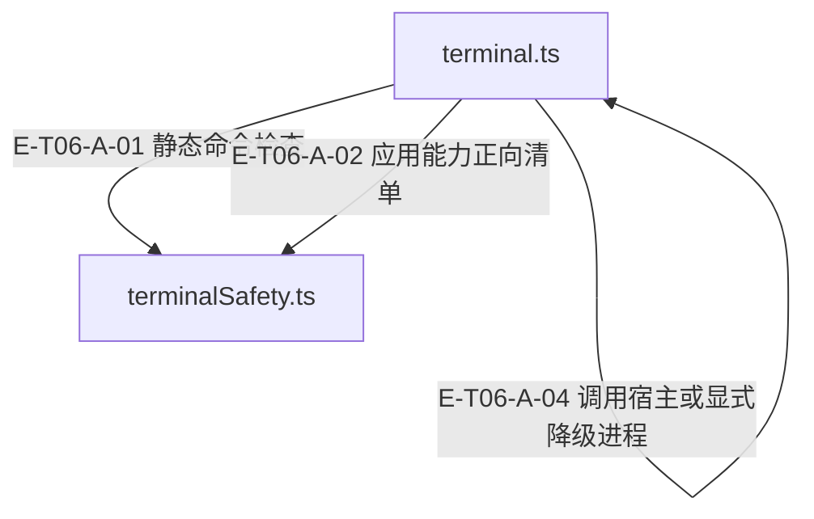

# 06 · 工具执行与安全

> 命令和文件动作在哪些位置被拦截，真实执行、部分结果与缓存失效如何相连？

真实副作用位于 code/terminal handlers。code 使用项目内真实路径、保护段与可选 delta freshness；terminal 在 cwd、安全规则和可选 allowlist 后才调用宿主执行器，缺执行器默认拒绝。Agent 透传隔离 intent，宿主负责真正沙箱；执行结果、审计和缓存代数分别维护。

[真实调用](call-flow.md) · [直接依赖](file-dependency.md) · [当前全文与失败审阅](full-source-review.md) · [阅读规范](../00-diagram-standard.md)

## 职责与主要接缝

### 本图术语说明

| 术语／节点 | 含义与范围 |
| --- | --- |
| terminal.ts | `src/tools/runtime/handlers/terminal.ts`；本图按实现文件聚合职责；具体装配条件见下表。 |
| terminalSafety.ts | `src/tools/runtime/handlers/terminalSafety.ts`；本图按实现文件聚合职责；具体装配条件见下表。 |

| 编号 | 代码依据 | 测试依据 | 关系与可证明范围 |
| --- | --- | --- | --- |
| E-T06-A-01 | `src/tools/runtime/handlers/terminal.ts#handleExec` → `src/tools/runtime/handlers/terminalSafety.ts#checkTerminalCommandSafety` | `test/runtime-terminal-safety.test.ts#case:writes%20a%20stable%20audit%20classification%20for%20every%20failure%20path%20without%20the%20command%20text`；以 sudo whoami 覆盖 security block，并断言审计稳定分类且不含命令原文；该测试不等于 canonical blocked 信封已实现。 | cwd 解析与 timeout 归一之后调用共享 shell 安全检查；不安全命令直接 fail，不启动执行器。 |
| E-T06-A-02 | `src/tools/runtime/handlers/terminal.ts#handleExec` → `src/tools/runtime/handlers/terminalSafety.ts#checkTerminalCommandAllowlist` | `test/runtime-terminal-safety.test.ts#case:blocks%20git%20with%20a%20subdirectory%20cwd%20before%20the%20sandbox%20executor%20through%20the%20Evolution%20router`；用例验证 Evolution 下非项目根 cwd 的 git 调用在 sandbox executor 前被拦截。 | 只有 ctx.commandAllowlist 存在时追加 bin/参数检查，并传入 cwdIsProjectRoot；Evolution 使用只读取证清单。 |
| E-T06-A-03 | `src/tools/runtime/handlers/terminal.ts#handleExec` → `src/tools/runtime/handlers/terminal.ts#execAndInvalidateSearchCache` | `test/runtime-terminal-safety.test.ts#case:re-runs%20code.search%20after%20the%20executor%20was%20invoked%20(%25s)`；参数化 exit0/exit1/exit137/throw/timeout/plain-exec：执行先真实改盘，后续同 cache 搜索 total=0 且 cached=false。 | 通过前置门后调用执行包装；包装在成功、非零退出、137、抛错等 settle 后统一失效搜索缓存。 |
| E-T06-A-04 | `src/tools/runtime/handlers/terminal.ts#execAndInvalidateSearchCache` → `src/tools/runtime/handlers/terminal.ts#execInSandboxOrDirect` | `test/tool-availability.test.ts#case:blocks%20terminal.exec%20before%20starting%20a%20process%20when%20the%20injected%20executor%20has%20no%20exec%20method`；注入对象缺少 exec 时 handler 默认 blocked，不因对象真值自动启用 plain exec。 | 优先 await sandboxExecutor.exec(command,{cwd,projectRoot,timeout,signal,intent})；只有 allowUnsandboxedTerminal===true 才可 plain exec。宿主执行器是注入边界。 |

## 输入、输出与副作用

| 维度 | 当前实现 |
| --- | --- |
| 输入 | code action 与 path/range/pattern/glob/content，projectRoot 与可选 DeltaCache/SearchCache；terminal command/cwd/timeout，abortSignal，宿主 sandboxExecutor，能力 allowlist/terminal intent |
| 输出 | code 文本/结构化搜索、批读、目录树或 written/bytes 回执；terminal stdout+stderr、退出状态、压缩/降级诊断、审计 commandHash |
| 副作用 | code.read/search/outline/structure 只读；code.write 可建父目录并写文件，成功写盘后更新指纹。；terminal 可执行真实宿主命令；Agent 静态检查不是 OS 隔离。；code.write 写入开始前、terminal 执行器 settle 后推进搜索代数；被前置门拦截不推进。 |

## 从这些文件开始

| 文件 | 阅读目的 |
| --- | --- |
| `src/tools/runtime/router.ts` | 动作 handler 调度；parallel/single/exclusive 与输出兜底 |
| `src/tools/runtime/handlers/code.ts` | 搜索、读、outline、结构遍历、安全写入 |
| `src/shared/projectPath.ts` | 项目根与真实路径包含关系 |
| `src/tools/runtime/handlers/terminal.ts` | 终端执行、超时归一、部分输出、审计与降级 |
| `src/tools/runtime/handlers/terminalSafety.ts` | shell 静态检查与 bin/参数 allowlist |
| `src/tools/runtime/handlers/searchCacheGeneration.ts` | 按 SearchCache 实例维护失效代数 |
| `src/tools/runtime/cache/DeltaCache.ts` | 可见全文基线与 freshness 指纹分离 |
| `src/tools/runtime/compressor/OutputCompressor.ts` | 终端解析压缩与失败保底 |
| `src/agent/runtime/toolPipeline/accessGates.ts` | runtime action/参数/策略前置访问门 |
| `src/agent/policies/SafetyPolicy.ts` | sender、fileScope、requireApprovalFor 等策略 |

## 失败、取消与恢复

- 路径越界/保护路径/缺沙箱：副作用前拒绝；缺沙箱可转用 code/graph/knowledge。显式 plain-exec 降级会保留警告。
- cancel/timeout/137/非零退出：保留实际已观察输出；terminal _meta.resultStatus 优先于兼容 ok。中断不代表回滚，写后不盲目重试。
- code.write freshness 拒绝：重新 code.read 获取最新内容/指纹，再由调用方决定是否重写。
- 写入成功但缓存维护失败：保持 confirmed written，附 cache refresh warning，下一次写前重读。
- 大文件/批读/结构遍历不完整：使用 AST 或 head-tail 预览，批量/取消/截断有 partial/aborted/timeout 与缺失成员信息。

## 已知边界与未验证范围

- 当前 terminal.ts 中 cwd、安全和 allowlist 拒绝只 fail(...)，未设置 resultStatus；Adapter 归为 error。审计 blocked 分类不能当 canonical blocked 信封证据。
- 当前 plain exec 将 killed 或 aborted 映射 137；terminalFailureStatus 仅看外部 signal。工具自身 timeout 但 signal 未中止时仍归 error/unknown-termination；本轮未复跑历史 probe。
- terminal intent 仅最严格合并并透传；源码注释仍记录主宿主 SandboxExecutorBridge 尚未读取 opts.intent，不宣称宿主已执行该隔离。
- 未注入 deltaCache 时既存文件写入 freshness 门透传；read/check/write 不是跨进程原子 compare-and-swap。
- 外部编辑不自动推进搜索代数；不提供 mtime/TTL 失效保证。requireApprovalFor 当前策略是禁用，不是人工审批队列。

[终端失败与合同逐文件深读](terminal-failures-and-contracts.md)保留第4轮阅读范围与原有执行引用；[当前全文审阅](full-source-review.md)记录本轮重新通读两个大文件的连续段落、精确断言和未覆盖分支。本轮新增引用只声明已定位，未运行测试。

## 当前端口与安全规则补充

code.outline只调用 `src/tools/runtime/handlers/code.ts#buildAstOutline` 读取outlineFile。缺端口时outline不可用，超过500行的code.read可回头尾预览并标原因；宿主返回空、坏形状、坏条目与抛错分别处理。旧astAnalyzer字段不再被调用，见 `test/code-outline-port.test.ts#case:no%20longer%20serves%20the%20retired%20astAnalyzer%20duck%20type`、`test/code-outline-port.test.ts#case:reports%20a%20throwing%20port%20as%20analyzer-error%20with%20the%20error%20class`。

terminalSafety当前把raw命令切块还原，覆盖路径、转义、引号拼接、ANSI-C与提权名字族，再与token归属判断合并。只读取证及受限man页名有明确例外；变量和运行时拼装不被求值，规则仍不能替代宿主沙箱。详细流程与失败责任见[终端深读页](terminal-failures-and-contracts.md)及[当前全文审阅](full-source-review.md)。Evolution 的生产代码执行开关仍为 false；保留的 runner 规则测试入口不能当作生产能力已开放的证据。
