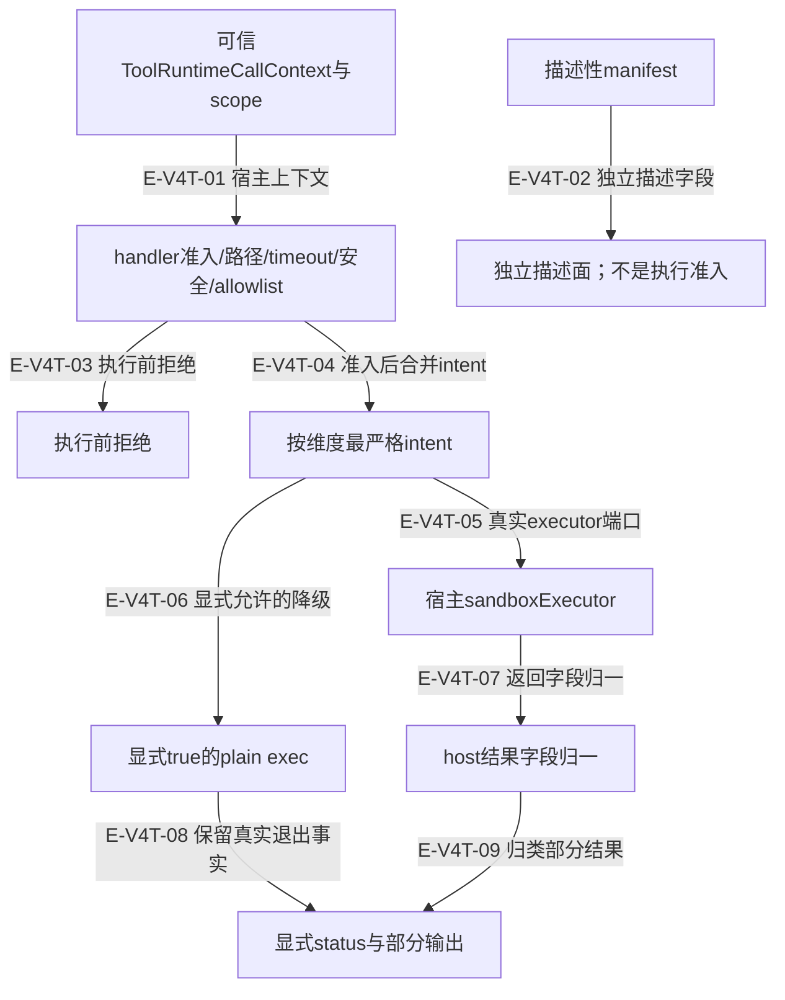
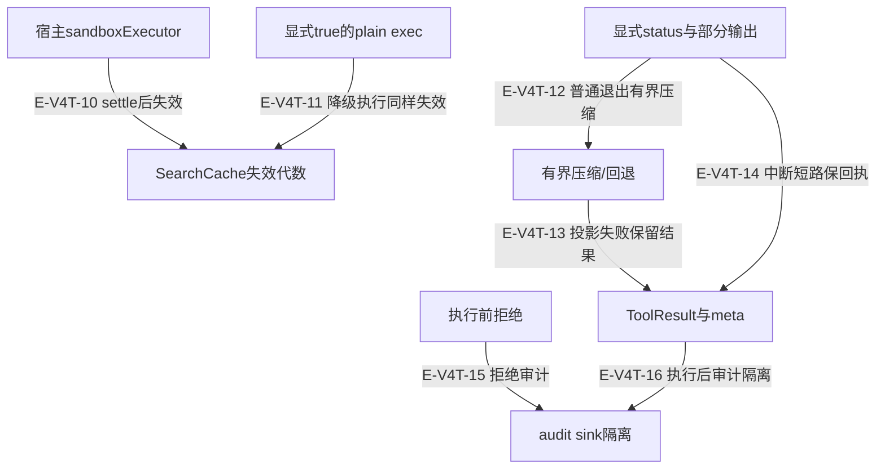
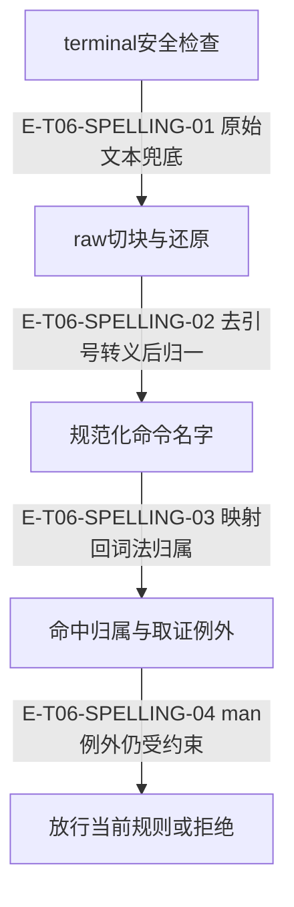

# 终端执行、合同与缓存失效：逐文件深读

本页保留V4逐段阅读记录及V5端口退役、terminalSafety差异复核。旧行段属于当时阅读索引，当前定位以符号和页面指纹为准；本轮重新完整通读 code.ts 与 terminalSafety.ts 的记录另见[当前全文审阅](full-source-review.md)。执行前拒绝、执行后失败、输出压缩失败、审计失败分开记录；显式status比兼容ok布尔值更能说明命令结局。真实OS隔离仍是宿主责任。

[工具执行专题](overview.md) · [工具合同](../05-tool-contracts/overview.md) · [执行记录](../../evidence/scoped-execution.json)

## 准入、宿主执行与明确降级

### 本图术语说明

| 节点／术语 | 本图含义 |
| --- | --- |
| 可信ToolRuntimeCallContext与scope | Agent；`src/tools/kernel/context.ts#ToolRuntimeCallContext`；`src/tools/kernel/context.ts#ToolResourceScope` |
| handler准入/路径/timeout/安全/allowlist | Agent；`src/tools/runtime/handlers/terminal.ts#handleExec` |
| 描述性manifest | Agent；`src/tools/kernel/manifest.ts#ToolCapabilityManifest` |
| 独立描述面；不是执行准入 | 当前控制节点；具体函数与行为在逐边表中说明。 |
| 执行前拒绝 | Agent；`src/tools/runtime/handlers/terminal.ts#handleExec` |
| 按维度最严格intent | Agent；`src/tools/runtime/handlers/terminal.ts#resolveTerminalIntent` |
| 宿主sandboxExecutor | Host；`src/tools/runtime/handlers/terminal.ts#SandboxExecutorLike` |
| 显式true的plain exec | Agent；`src/tools/runtime/handlers/terminal.ts#execInSandboxOrDirect` |
| host结果字段归一 | Agent；`src/tools/runtime/handlers/terminal.ts#normalizeExecutorResult` |
| 显式status与部分输出 | Agent；`src/tools/runtime/handlers/terminal.ts#terminalFailureStatus`；`src/tools/runtime/handlers/terminal.ts#handleExec` |

| 编号 | 代码依据 | 测试依据 | 关系与可证明范围 |
| --- | --- | --- | --- |
| E-V4T-01 | `src/tools/kernel/context.ts#ToolRuntimeCallContext`；`src/tools/runtime/handlers/terminal.ts#handleExec` | `test/tool-pipeline-dead-links.test.ts#case:does%20not%20project%20unread%20policyValidator%2C%20sessionToolCalls%2C%20currentRound%20or%20cache%20to%20the%20host`；断言已定位，实际执行见页面证据。host runtime无4个死字段；历史toolCalls不重map；iteration、memoryCoordinator仍按当前合同传递；调用诊断由runtimeBridge直接记录。旧cache、diagnostics及无人读取字段已从runtime合同删除。 `test/tool-pipeline-terminal-intent.test.ts#case:hands%20the%20executor%20exactly%20the%20read-only%2C%20no-network%20intent%20declared%20by%20Evolution`；断言已定位，实际执行见页面证据。经默认pipeline与不带capability的adapter，宿主opts.intent为network:none/filesystem:read-only，cwd/projectRoot正确。 边界：只证明透传，宿主是否实施隔离另有责任。 | runtime.allowedTools/intent/abort由受信宿主链提供，模型参数不能扩宽；handler消费其中terminal相关上下文。 |
| E-V4T-02 | `src/tools/kernel/manifest.ts#ToolExecutionProfile`；`src/tools/runtime/handlers/terminal.ts#normalizeTerminalTimeout` | `test/tool-pipeline-duplicate-cache-registry.test.ts#case:short-circuits%20the%20second%20identical%20graph.query%20through%20the%20default%20pipeline%20without%20consulting%20getManifest`；断言已定位，实际执行见页面证据。相同graph.query第二次复用首结果，executeCount=1，getManifest从未调用。 边界：缓存前提是运行时ToolAction与真实snapshot；不由ToolCapabilityManifest决定。 | manifest描述能力元数据；handler准入由实际运行字段与ToolAction控制。本边是独立描述面，不接入执行门。 |
| E-V4T-03 | `src/tools/runtime/handlers/terminal.ts#handleExec` | `test/runtime-terminal-safety.test.ts#case:keeps%20the%20cached%20search%20when%20%24name%20blocks%20the%20command%20before%20execution`；参数化模板；展开项的实际执行状态见定向记录。安全/allowlist/缺沙箱/cwd拒绝时executor=0；下一次搜索仍cached=true；无失效日志。 边界：失效边界是执行器被调用，不是收到terminal请求。 `test/runtime-terminal-safety.test.ts#case:refuses%20to%20run%20when%20no%20sandbox%20executor%20is%20injected`；断言已定位，实际执行见页面证据。预设marker文件不存在；resultStatus=blocked和terminal_sandbox_required；failure audit一次。 边界：真实进程不得启动的fail-closed默认。 | command/cwd/security/allowlist/缺sandbox在执行前拒绝，不推进SearchCache代数。 |
| E-V4T-04 | `src/tools/runtime/handlers/terminal.ts#resolveTerminalIntent` | `test/tool-pipeline-terminal-intent.test.ts#case:merges%20several%20loop%20capabilities%20by%20taking%20the%20strictest%20value%20per%20dimension`；断言已定位，实际执行见页面证据。合法限制求最严格；未知network full不放宽，记录TERMINAL_INTENT_VALUE_IGNORED。 边界：JS接线字段校验，不推断宿主profile。 | 通过执行器gate后才合并runtime与capability intent。 |
| E-V4T-05 | `src/tools/runtime/handlers/terminal.ts#execInSandboxOrDirect`；`src/tools/runtime/handlers/terminal.ts#SandboxExecutorLike` | `test/tool-pipeline-terminal-intent.test.ts#case:hands%20the%20executor%20exactly%20the%20read-only%2C%20no-network%20intent%20declared%20by%20Evolution`；断言已定位，实际执行见页面证据。经默认pipeline与不带capability的adapter，宿主opts.intent为network:none/filesystem:read-only，cwd/projectRoot正确。 边界：只证明透传，宿主是否实施隔离另有责任。 | 有可调用exec时透传cwd/projectRoot/timeout/signal及可选intent。 |
| E-V4T-06 | `src/tools/runtime/handlers/terminal.ts#execInSandboxOrDirect` | `test/runtime-terminal-safety.test.ts#case:runs%20unsandboxed%20only%20when%20the%20host%20explicitly%20opts%20in%2C%20and%20says%20so%20in%20the%20result`；断言已定位，实际执行见页面证据。显式true后真实短子进程输出ok；unsandboxed后缀、fallbackUsed和terminal_sandbox_fallback存在。 边界：测试以临时项目运行；不证明任意主机隔离。 `test/runtime-terminal-safety.test.ts#case:does%20not%20treat%20a%20truthy%20non-boolean%20opt-in%20as%20permission%20to%20run%20unsandboxed`；断言已定位，实际执行见页面证据。allowUnsandboxedTerminal="yes"仍blocked。 边界：仅字面boolean true开放降级。 | 只有无exec且allowUnsandboxedTerminal===true才允许继承env的子进程路径并明确unsandboxed。 |
| E-V4T-07 | `src/tools/runtime/handlers/terminal.ts#normalizeExecutorResult`；`src/tools/runtime/handlers/terminal.ts#normalizeTerminalDiagnostics` | `test/runtime-terminal-safety.test.ts#case:merges%20malformed%20diagnostics%20with%20other%20malformed%20executor%20fields%20in%20one%20warning`；断言已定位，实际执行见页面证据。stdout=number与sandboxed/fallbackUsed字符串归一到一条warning，文案列实际fallback和effective状态。 边界：不将字符串false解释成false；fallback默认状态必须明确。 | 宿主stdout/stderr/exitCode/diagnostics先做最小形状归一并报告坏字段。 |
| E-V4T-08 | `src/tools/runtime/handlers/terminal.ts#execInSandboxOrDirect`；`src/tools/runtime/handlers/terminal.ts#terminalFailureStatus` | `test/runtime-terminal-safety.test.ts#case:preserves%20stderr%20from%20137%20%24label%20without%20changing%20its%20terminal%20status`；参数化模板；展开项的实际执行状态见定向记录。未知137记error；取消记aborted；deadline记timeout；stderr去ANSI后保留，兼容ok=true。 边界：137自身没有原因鉴别能力，依赖signal。 `test/runtime-terminal-safety.test.ts#case:carries%20%24mode%20execution%20facts%20through%20the%20adapter%20and%20outcome%20observation`；参数化模板；展开项的实际执行状态见定向记录。exit0/1/2/throw/abort/timeout分别进入success/error/error/error/aborted/timeout；部分stdout/stderr保留；readToolObservation只把success视为成功。 边界：宿主executor fixture；超时由AbortSignal事实给出，不覆盖plain exec自己的timeout。 | plain exec的非零/强杀回执进入同一状态分类；当前本地timeout原因仍可能塌缩为137。 |
| E-V4T-09 | `src/tools/runtime/handlers/terminal.ts#handleExec`；`src/tools/runtime/handlers/terminal.ts#terminalFailureStatus` | `test/runtime-terminal-safety.test.ts#case:carries%20%24mode%20execution%20facts%20through%20the%20adapter%20and%20outcome%20observation`；参数化模板；展开项的实际执行状态见定向记录。exit0/1/2/throw/abort/timeout分别进入success/error/error/error/aborted/timeout；部分stdout/stderr保留；readToolObservation只把success视为成功。 边界：宿主executor fixture；超时由AbortSignal事实给出，不覆盖plain exec自己的timeout。 `test/runtime-terminal-safety.test.ts#case:preserves%20stderr%20from%20137%20%24label%20without%20changing%20its%20terminal%20status`；参数化模板；展开项的实际执行状态见定向记录。未知137记error；取消记aborted；deadline记timeout；stderr去ANSI后保留，兼容ok=true。 边界：137自身没有原因鉴别能力，依赖signal。 `test/runtime-terminal-safety.test.ts#case:carries%20a%20runOperation%20deadline%20through%20the%20adapter%20as%20a%20timeout%20envelope`；断言已定位，实际执行见页面证据。deadline下adapter envelope.status=timeout，保留已输出正文。 边界：证明外部deadline传播；不覆盖工具本地timeout计时器。 | 137或抛错保留部分输出，按signal判deadline/取消；普通非零明确error。 |

## 执行后的失效、压缩与审计

执行器返回或抛错之后，缓存失效和回执投影仍要处理。副作用可能已经发生，不能因输出或审计失败直接重跑命令。

### 本图术语说明

| 节点／术语 | 本图含义 |
| --- | --- |
| 宿主sandboxExecutor | Host；`src/tools/runtime/handlers/terminal.ts#SandboxExecutorLike` |
| SearchCache失效代数 | Agent；`src/tools/runtime/handlers/searchCacheGeneration.ts#invalidateSearchCache` |
| 显式true的plain exec | Agent；`src/tools/runtime/handlers/terminal.ts#execInSandboxOrDirect` |
| 显式status与部分输出 | Agent；`src/tools/runtime/handlers/terminal.ts#terminalFailureStatus`；`src/tools/runtime/handlers/terminal.ts#handleExec` |
| 有界压缩/回退 | Agent；`src/tools/runtime/handlers/terminal.ts#compressOutput` |
| ToolResult与meta | Agent；`src/tools/runtime/handlers/terminal.ts#handleExec` |
| 执行前拒绝 | Agent；`src/tools/runtime/handlers/terminal.ts#handleExec` |
| audit sink隔离 | Host port + Agent isolation；`src/tools/runtime/handlers/terminal.ts#recordTerminalAudit` |

| 编号 | 代码依据 | 测试依据 | 关系与可证明范围 |
| --- | --- | --- | --- |
| E-V4T-10 | `src/tools/runtime/handlers/terminal.ts#execAndInvalidateSearchCache`；`src/tools/runtime/handlers/searchCacheGeneration.ts#invalidateSearchCache` | `test/runtime-terminal-safety.test.ts#case:re-runs%20code.search%20after%20the%20executor%20was%20invoked%20(%25s)`；参数化模板；展开项的实际执行状态见定向记录。exit0/1/137/throw/timeout/plain-exec先改fixture磁盘；同SearchCache下一次搜索fresh；只一条generation=1日志，不含文件名/命令。 边界：该case会写临时fixture；测试使用临时fixture。 | 执行器settle的finally无论成功失败都失效，覆盖运行期间旧代数搜索。 |
| E-V4T-11 | `src/tools/runtime/handlers/terminal.ts#execAndInvalidateSearchCache`；`src/tools/runtime/handlers/searchCacheGeneration.ts#invalidateSearchCache` | `test/runtime-terminal-safety.test.ts#case:re-runs%20code.search%20after%20the%20executor%20was%20invoked%20(%25s)`；参数化模板；展开项的实际执行状态见定向记录。exit0/1/137/throw/timeout/plain-exec先改fixture磁盘；同SearchCache下一次搜索fresh；只一条generation=1日志，不含文件名/命令。 边界：该case会写临时fixture；测试使用临时fixture。 | 显式plain exec同样在settle后失效，不依赖宿主clear方法。 |
| E-V4T-12 | `src/tools/runtime/handlers/terminal.ts#handleExec`；`src/tools/runtime/handlers/terminal.ts#resolveCompressorBudget` | `test/runtime-terminal-safety.test.ts#case:reserves%20room%20for%20the%20exit%20prefix%20and%20unsandboxed%20suffix%20so%20the%20router%20does%20not%20cut%20again`；断言已定位，实际执行见页面证据。exit1前缀和unsandboxed后缀保留；预算诊断含host/action/reserve；<=4000且不再router截断。 边界：压缩后的回执仍是error。 `test/runtime-terminal-safety.test.ts#case:preserves%20stderr%20from%20137%20%24label%20without%20changing%20its%20terminal%20status`；参数化模板；展开项的实际执行状态见定向记录。未知137记error；取消记aborted；deadline记timeout；stderr去ANSI后保留，兼容ok=true。 边界：137自身没有原因鉴别能力，依赖signal。 | 一般退出按cap扣framing压缩；137/throw保留部分输出的短路路径不强求压缩。 |
| E-V4T-13 | `src/tools/runtime/handlers/terminal.ts#compressOutput`；`src/tools/runtime/handlers/terminal.ts#fitCompressorOutput` | `test/runtime-terminal-safety.test.ts#case:keeps%20one%20truncation%20marker%20and%20the%20%5Bstderr%5D%20tail%20under%20the%20host%208000%20budget`；断言已定位，实际执行见页面证据。尾部stderr保留；估算<=4000；只有compressor marker，无router再截断；标terminal_output_compressed/degraded。 边界：预算与tail保留fixture，不等于对全部命令摘要保真。 `test/runtime-terminal-safety.test.ts#case:surfaces%20a%20compressor%20failure%20as%20a%20diagnostic%20and%20keeps%20the%20cleaned%20output`；断言已定位，实际执行见页面证据。compressor抛TypeError仍回ok正文，fallbackUsed=true，诊断/日志只有错误类名，不含命令与异常中的secret。 边界：输出压缩是附属投影，不反转执行成功。 | 只在预算改变参照视图时degraded；压缩器失败回去ANSI原文，由router兜底。 |
| E-V4T-14 | `src/tools/runtime/handlers/terminal.ts#handleExec` | `test/runtime-terminal-safety.test.ts#case:carries%20%24mode%20execution%20facts%20through%20the%20adapter%20and%20outcome%20observation`；参数化模板；展开项的实际执行状态见定向记录。exit0/1/2/throw/abort/timeout分别进入success/error/error/error/aborted/timeout；部分stdout/stderr保留；readToolObservation只把success视为成功。 边界：宿主executor fixture；超时由AbortSignal事实给出，不覆盖plain exec自己的timeout。 `test/runtime-terminal-safety.test.ts#case:preserves%20stderr%20from%20137%20%24label%20without%20changing%20its%20terminal%20status`；参数化模板；展开项的实际执行状态见定向记录。未知137记error；取消记aborted；deadline记timeout；stderr去ANSI后保留，兼容ok=true。 边界：137自身没有原因鉴别能力，依赖signal。 | ok兼容字段不替代resultStatus；部分stdout/stderr继续可审阅。 |
| E-V4T-15 | `src/tools/runtime/handlers/terminal.ts#auditFailure`；`src/tools/runtime/handlers/terminal.ts#buildTerminalAuditEntry` | `test/runtime-terminal-safety.test.ts#case:writes%20a%20stable%20audit%20classification%20for%20every%20failure%20path%20without%20the%20command%20text`；断言已定位，实际执行见页面证据。9类结局各写一次audit；失败分类区分missing/cwd/security/allowlist/sandbox/exit/137/throw；audit不含command原文。 边界：验证审计分类，不证明拒绝分支的envelope.status都等于blocked。 | 拒绝也写稳定audit失败分类，command只以sha256出现。 |
| E-V4T-16 | `src/tools/runtime/handlers/terminal.ts#recordTerminalAudit` | `test/runtime-terminal-safety.test.ts#case:logs%20audit%20sink%20failures%20with%20the%20command%20hash%20only`；断言已定位，实际执行见页面证据。auditSink抛错后工具ok；日志含sha256与Error类，不含命令secret。 边界：不承诺audit持久化成功，实际为entry-dropped。 | finish等待审计；审计拒绝只warn，不重写已确认的执行结局。 |

## 逐文件职责与全文阅读范围

### terminal.ts

`src/tools/runtime/handlers/terminal.ts`

terminal.exec的Agent侧准入、宿主执行适配、回执归一和审计；不是实际sandbox实现

handle→handleExec(command/cwd/timeout/safety/optional allowlist/executor gate)→resolveTerminalIntent→execAndInvalidateSearchCache→sandboxExecutor.exec或显式plain exec→归一exit/diagnostics→状态分类/保留部分输出→compressOutput与预算收敛→finish/audit→ToolResult；缓存失效发生在执行器settle的finally。

| 阅读段落（行） | 核对内容 |
| --- | --- |
| 1–94 | 模块边界、host intent与缓存时机说明，imports与timeout/输出预算常量。 |
| 95–313 | handle只认exec；handleExec输入/路径/安全/allowlist/沙箱门、137/一般退出/抛错回执与所有分支audit。 |
| 314–400 | 稳定audit类别、timeout缺省/下取整/上限、按AbortSignal区分error/aborted/timeout。 |
| 401–594 | 执行器调用finally失效搜索；优先host executor，显式true才plain exec；未知退出码与host返回字段归一。 |
| 595–715 | 结果/host端口类型、受限诊断token、合并stdout/stderr与realpath cwd边界。 |
| 716–973 | intent合并/未落实诊断；sandbox diagnostics逐字段单次读取；非记录/异常toStringTag保守归一。 |
| 974–1025 | audit entry仅commandHash和受限分类；sink失败隔离为日志。 |
| 1026–1278 | 输出预算扣framing；无限预算参照→有限预算收敛最多4次；compressor错误回原文并诊断。 |

| 触发条件 | 实际行为 | 恢复／停止依据 | 源码与测试证据 |
| --- | --- | --- | --- |
| 缺command、cwd越界或安全/allowlist拒绝 | 进入执行器前返回fail并记录各自audit分类，缓存不失效。 | 修正输入/使用当前能力允许命令；拒绝不是重试执行器故障。 | `src/tools/runtime/handlers/terminal.ts#handleExec`；`src/tools/runtime/handlers/terminal.ts#resolveTerminalCwd` `test/runtime-terminal-safety.test.ts#case:writes%20a%20stable%20audit%20classification%20for%20every%20failure%20path%20without%20the%20command%20text`；断言已定位，实际执行见页面证据。9类结局各写一次audit；失败分类区分missing/cwd/security/allowlist/sandbox/exit/137/throw；audit不含command原文。 边界：验证审计分类，不证明拒绝分支的envelope.status都等于blocked。 `test/runtime-terminal-safety.test.ts#case:keeps%20the%20cached%20search%20when%20%24name%20blocks%20the%20command%20before%20execution`；参数化模板；展开项的实际执行状态见定向记录。安全/allowlist/缺沙箱/cwd拒绝时executor=0；下一次搜索仍cached=true；无失效日志。 边界：失效边界是执行器被调用，不是收到terminal请求。 |
| 没有可调用sandboxExecutor且allowUnsandboxedTerminal!==true | 显式blocked + terminal_sandbox_required；不静默继承宿主env执行。 | 宿主接线真实executor；仅受信调用者的显式true允许带unsandboxed诊断降级。 | `src/tools/runtime/handlers/terminal.ts#handleExec`；`src/tools/runtime/handlers/terminal.ts#isSandboxExecutor` `test/runtime-terminal-safety.test.ts#case:refuses%20to%20run%20when%20no%20sandbox%20executor%20is%20injected`；断言已定位，实际执行见页面证据。预设marker文件不存在；resultStatus=blocked和terminal_sandbox_required；failure audit一次。 边界：真实进程不得启动的fail-closed默认。 `test/runtime-terminal-safety.test.ts#case:runs%20unsandboxed%20only%20when%20the%20host%20explicitly%20opts%20in%2C%20and%20says%20so%20in%20the%20result`；断言已定位，实际执行见页面证据。显式true后真实短子进程输出ok；unsandboxed后缀、fallbackUsed和terminal_sandbox_fallback存在。 边界：测试以临时项目运行；不证明任意主机隔离。 `test/runtime-terminal-safety.test.ts#case:does%20not%20treat%20a%20truthy%20non-boolean%20opt-in%20as%20permission%20to%20run%20unsandboxed`；断言已定位，实际执行见页面证据。allowUnsandboxedTerminal="yes"仍blocked。 边界：仅字面boolean true开放降级。 |
| 非法timeout或超最大值 | 负/0/NaN/类型非法回30000并诊断；合法小数下取整，>120000截到120000。 | 确认工具参数单位毫秒，消费有效timeout诊断。 | `src/tools/runtime/handlers/terminal.ts#normalizeTerminalTimeout` `test/runtime-terminal-safety.test.ts#case:falls%20back%20to%20the%20default%20timeout%20instead%20of%20interrupting%20at%20once%20for%20a%20%24label%20timeout`；参数化模板；展开项的实际执行状态见定向记录。负数/0/亚毫秒timeout被归一为30000并给terminal_timeout_normalized，fixture正常完成。 边界：schema绕过值由handler归一，不是即时强杀。 `test/runtime-terminal-safety.test.ts#case:keeps%20valid%20timeouts%2C%20flooring%20fractions%20and%20clamping%20to%20the%20documented%20maximum`；断言已定位，实际执行见页面证据。缺省30000、1500.7→1500、300000→120000，不产生非法值归一警告。 边界：只断言传给执行端口的timeout。 |
| executor非零退出、抛错、137、父取消或deadline | 保留兼容ok=true与已观察stdout/stderr，以显式resultStatus决定error/aborted/timeout；137缺signal只记error。 | 消费者以status/readToolObservation判断，不用ok单字段；读部分输出后决定下一步。 | `src/tools/runtime/handlers/terminal.ts#handleExec`；`src/tools/runtime/handlers/terminal.ts#terminalFailureStatus` `test/runtime-terminal-safety.test.ts#case:carries%20%24mode%20execution%20facts%20through%20the%20adapter%20and%20outcome%20observation`；参数化模板；展开项的实际执行状态见定向记录。exit0/1/2/throw/abort/timeout分别进入success/error/error/error/aborted/timeout；部分stdout/stderr保留；readToolObservation只把success视为成功。 边界：宿主executor fixture；超时由AbortSignal事实给出，不覆盖plain exec自己的timeout。 `test/runtime-terminal-safety.test.ts#case:preserves%20stderr%20from%20137%20%24label%20without%20changing%20its%20terminal%20status`；参数化模板；展开项的实际执行状态见定向记录。未知137记error；取消记aborted；deadline记timeout；stderr去ANSI后保留，兼容ok=true。 边界：137自身没有原因鉴别能力，依赖signal。 `test/runtime-terminal-safety.test.ts#case:reports%20%24status%20when%20a%20running%20command%20stops%20because%20%24label`；参数化模板；展开项的实际执行状态见定向记录。实际runOperation deadline或父取消产生signal，工具保留partial stdout并按原因归类。 边界：执行器桩通过signal终止；不验证宿主进程树硬终止。 `test/runtime-terminal-safety.test.ts#case:carries%20a%20runOperation%20deadline%20through%20the%20adapter%20as%20a%20timeout%20envelope`；断言已定位，实际执行见页面证据。deadline下adapter envelope.status=timeout，保留已输出正文。 边界：证明外部deadline传播；不覆盖工具本地timeout计时器。 |
| 宿主返回畸形输出/exitCode/diagnostics | 非字符串输出按空、非法exitCode按1；diagnostics合法字段保留，坏字段对应fallback，并合成一条terminal_executor_result_normalized。 | 修复宿主receipt合同；查看effective sandboxed/fallbackUsed，不把warning文案误作成功隔离证明。 | `src/tools/runtime/handlers/terminal.ts#normalizeExecutorResult`；`src/tools/runtime/handlers/terminal.ts#normalizeTerminalDiagnostics` `test/runtime-terminal-safety.test.ts#case:merges%20malformed%20diagnostics%20with%20other%20malformed%20executor%20fields%20in%20one%20warning`；断言已定位，实际执行见页面证据。stdout=number与sandboxed/fallbackUsed字符串归一到一条warning，文案列实际fallback和effective状态。 边界：不将字符串false解释成false；fallback默认状态必须明确。 |
| 声明只读/无网络intent而宿主报告未进沙箱 | 保留最严格intent透传，增加terminal_intent_not_enforced；不在Agent侧模拟OS隔离。 | 由宿主落实隔离；sandboxed=true也不能从Agent单方证明profile已采用intent。 | `src/tools/runtime/handlers/terminal.ts#resolveTerminalIntent`；`src/tools/runtime/handlers/terminal.ts#terminalMeta`；`src/tools/kernel/context.ts#ToolRuntimeCallContext` `test/tool-pipeline-terminal-intent.test.ts#case:hands%20the%20executor%20exactly%20the%20read-only%2C%20no-network%20intent%20declared%20by%20Evolution`；断言已定位，实际执行见页面证据。经默认pipeline与不带capability的adapter，宿主opts.intent为network:none/filesystem:read-only，cwd/projectRoot正确。 边界：只证明透传，宿主是否实施隔离另有责任。 `test/tool-pipeline-terminal-intent.test.ts#case:merges%20several%20loop%20capabilities%20by%20taking%20the%20strictest%20value%20per%20dimension`；断言已定位，实际执行见页面证据。合法限制求最严格；未知network full不放宽，记录TERMINAL_INTENT_VALUE_IGNORED。 边界：JS接线字段校验，不推断宿主profile。 `test/tool-pipeline-terminal-intent.test.ts#case:reports%20the%20declared%20intent%20as%20not%20enforced%20when%20the%20host%20degrades%20to%20unsandboxed`；断言已定位，实际执行见页面证据。宿主sandboxed=false时回执带terminal_intent_not_enforced并保留原声明。 边界：sandboxed=true时Agent无法证明intent已生效。 |
| 超输出预算、compressor抛错或不返回字符串 | 预算从host/action cap扣framing；有损改写才degraded；失败回去ANSI原文并标fallback；router最终兜底。 | 缩小输出或依赖router限额，不能重新执行已成功命令只为修复压缩。 | `src/tools/runtime/handlers/terminal.ts#resolveCompressorBudget`；`src/tools/runtime/handlers/terminal.ts#compressOutput`；`src/tools/runtime/handlers/terminal.ts#fitCompressorOutput` `test/runtime-terminal-safety.test.ts#case:keeps%20one%20truncation%20marker%20and%20the%20%5Bstderr%5D%20tail%20under%20the%20host%208000%20budget`；断言已定位，实际执行见页面证据。尾部stderr保留；估算<=4000；只有compressor marker，无router再截断；标terminal_output_compressed/degraded。 边界：预算与tail保留fixture，不等于对全部命令摘要保真。 `test/runtime-terminal-safety.test.ts#case:reserves%20room%20for%20the%20exit%20prefix%20and%20unsandboxed%20suffix%20so%20the%20router%20does%20not%20cut%20again`；断言已定位，实际执行见页面证据。exit1前缀和unsandboxed后缀保留；预算诊断含host/action/reserve；<=4000且不再router截断。 边界：压缩后的回执仍是error。 `test/runtime-terminal-safety.test.ts#case:surfaces%20a%20compressor%20failure%20as%20a%20diagnostic%20and%20keeps%20the%20cleaned%20output`；断言已定位，实际执行见页面证据。compressor抛TypeError仍回ok正文，fallbackUsed=true，诊断/日志只有错误类名，不含命令与异常中的secret。 边界：输出压缩是附属投影，不反转执行成功。 |
| audit sink同步抛错或异步拒绝 | 保留工具结局，warn仅commandHash/类别/errorName；明确entry-dropped。 | 宿主修复audit sink和补充审计，不反转执行结果或盲目重跑。 | `src/tools/runtime/handlers/terminal.ts#recordTerminalAudit` `test/runtime-terminal-safety.test.ts#case:logs%20audit%20sink%20failures%20with%20the%20command%20hash%20only`；断言已定位，实际执行见页面证据。auditSink抛错后工具ok；日志含sha256与Error类，不含命令secret。 边界：不承诺audit持久化成功，实际为entry-dropped。 |

边界与未验证项：

- 现有代码plain exec的本地timeout与其他killed错误都转137，terminalFailureStatus只读外部signal；此前识别的本地timeout原因丢失风险仍可从源码确认，本轮未重跑probe。 `src/tools/runtime/handlers/terminal.ts#execInSandboxOrDirect`；`src/tools/runtime/handlers/terminal.ts#terminalFailureStatus`
- cwd/安全/allowlist的fail返回没有显式blocked，而缺sandbox有blocked；当前audit测试不证明外层统一blocked分类。 `src/tools/runtime/handlers/terminal.ts#handleExec`
- 模块头关于当前宿主是否读取intent仅为本仓登记；本轮没有访问邻仓，因此图谱不能升级为宿主当前状态实测。 `src/tools/runtime/handlers/terminal.ts#SandboxExecutorLike`

### searchCacheGeneration.ts

`src/tools/runtime/handlers/searchCacheGeneration.ts`

按SearchCache对象身份记录弱引用失效代数；无mtime/TTL与clear接口

currentSearchCacheGeneration读WeakMap默认0→code.search将代数纳入key；invalidateSearchCache在受控写/执行settle后+1→旧key失配，缓存容量回收仍归cache实例。

| 阅读段落（行） | 核对内容 |
| --- | --- |
| 1–23 | 内部模块边界与失效触发/不触发说明；引入观察隔离与SearchCacheLike类型。 |
| 24–31 | 来源联合类型、WeakMap实例代数与默认0查询。 |
| 32–64 | 缺缓存debug返回undefined；存在则递增代数、info受限outcome，日志失败不改变返回。 |

| 触发条件 | 实际行为 | 恢复／停止依据 | 源码与测试证据 |
| --- | --- | --- | --- |
| terminal可能已部分写盘后非零退出/抛错/强杀/超时 | 调用执行器settle后照样推进代数，下一次同视图搜索不复用旧内容。 | 下一次搜索重取；没有自动撤销已发生文件副作用。 | `src/tools/runtime/handlers/searchCacheGeneration.ts#invalidateSearchCache`；`src/tools/runtime/handlers/terminal.ts#execAndInvalidateSearchCache` `test/runtime-terminal-safety.test.ts#case:re-runs%20code.search%20after%20the%20executor%20was%20invoked%20(%25s)`；参数化模板；展开项的实际执行状态见定向记录。exit0/1/137/throw/timeout/plain-exec先改fixture磁盘；同SearchCache下一次搜索fresh；只一条generation=1日志，不含文件名/命令。 边界：该case会写临时fixture；测试使用临时fixture。 |
| terminal在安全/allowlist/缺沙箱/cwd门被拒 | 未调用执行器就不推进代数，缓存仍可复用。 | 修正输入并重新准入；不把拒绝伪装成缓存变更。 | `src/tools/runtime/handlers/searchCacheGeneration.ts#currentSearchCacheGeneration`；`src/tools/runtime/handlers/terminal.ts#handleExec` `test/runtime-terminal-safety.test.ts#case:keeps%20the%20cached%20search%20when%20%24name%20blocks%20the%20command%20before%20execution`；参数化模板；展开项的实际执行状态见定向记录。安全/allowlist/缺沙箱/cwd拒绝时executor=0；下一次搜索仍cached=true；无失效日志。 边界：失效边界是执行器被调用，不是收到terminal请求。 |

边界与未验证项：

- 外部编辑不会自动通过mtime/TTL失效；当前注释明确按既定决定不引入。缓存新鲜度依赖调用方的run/view与已知写路径。 `src/tools/runtime/handlers/searchCacheGeneration.ts#generations`
- outcome原样进入日志，本模块只约束类型为string，不自行校验受限内容；调用方必须传退出码/错误类等受限描述。 `src/tools/runtime/handlers/searchCacheGeneration.ts#invalidateSearchCache`

### context.ts

`src/tools/kernel/context.ts`

跨Agent/runtime/宿主工具调用身份与DI端口声明；本文件不执行策略或缓存

ToolCallContext携带可信projectRoot/服务/abort/runtime→runtime.allowedTools只收窄选择；terminalIntent是宿主传递意图；resourceScope区分run/view/revision；EvidenceLedgerLike是只读证据引用/新鲜度端口。

| 阅读段落（行） | 核对内容 |
| --- | --- |
| 当前1–49 | surface/actor/source与service locator；ToolPolicyDecision/Validator类型保留，service-contract接缝与diagnostics投影已删除。 |
| 当前50–94 | EvidenceLedgerLike的读取、搜索、最近条目、可选searchByFile和fresh/stale/unknown语义。 |
| 当前95–108 | ToolResourceScope与ToolScopeRelease：run/view/revision及整体/局部释放。 |
| 当前109–141 | ToolRuntimeCallContext保留的运行字段；旧无人读取投影已删除。 |
| 当前143–154 | 外层ToolCallContext身份、source、root、services及可选abort，顶层dataRoot仍保留。 |

| 触发条件 | 实际行为 | 恢复／停止依据 | 源码与测试证据 |
| --- | --- | --- | --- |
| 宿主继续期待cache/policyValidator/sessionToolCalls/currentRound被runtimeBridge投影 | 当前生产投影不再带这些值；cache、diagnostics、policyValidator、sessionToolCalls、currentRound、validator、fileCache、dataRoot、logger已从runtime投影合同删除；顶层ToolCallContext.dataRoot保留。 | 按live字段/真实端口接线，不依据历史类型字段猜测运行时效果。 | `src/tools/kernel/context.ts#ToolRuntimeCallContext` `test/tool-pipeline-dead-links.test.ts#case:does%20not%20project%20unread%20policyValidator%2C%20sessionToolCalls%2C%20currentRound%20or%20cache%20to%20the%20host`；断言已定位，实际执行见页面证据。host runtime无4个死字段；历史toolCalls不重map；iteration、memoryCoordinator仍按当前合同传递；调用诊断由runtimeBridge直接记录。旧cache、diagnostics及无人读取字段已从runtime合同删除。 |
| run/view生命周期资源需要释放或cleanup失败 | 合同表达view与run释放粒度；消费者测试断言多阶段同run不同view，cleanup错误只warn。 | 实现者应按scope释放自己的状态；不能借旧view声称全文仍可见。 | `src/tools/kernel/context.ts#ToolResourceScope`；`src/tools/kernel/context.ts#ToolScopeRelease` `test/tool-resource-scope.test.ts#case:shares%20the%20run%20across%20stages%2C%20assigns%20distinct%20views%2C%20then%20releases%20both%20views%20and%20the%20run`；断言已定位，实际执行见页面证据。同run跨阶段、view不同，依次release两view再release run。 边界：合同只描述身份，分配与清理由消费者实现。 `test/tool-resource-scope.test.ts#case:reports%20cleanup%20errors%20without%20replacing%20the%20completed%20result`；断言已定位，实际执行见页面证据。releaseScope抛错时reply仍done，logger报告cleanup failed。 边界：生命周期附属失败不替换已完成业务结果。 |
| terminal意图来自多能力与JS宿主配置 | 只读/无网络维度取最严格，未知字段不扩大权限；最终落地由executor负责。 | 校验受信宿主配置与实际隔离，不把intent当执行结果。 | `src/tools/kernel/context.ts#ToolRuntimeCallContext` `test/tool-pipeline-terminal-intent.test.ts#case:hands%20the%20executor%20exactly%20the%20read-only%2C%20no-network%20intent%20declared%20by%20Evolution`；断言已定位，实际执行见页面证据。经默认pipeline与不带capability的adapter，宿主opts.intent为network:none/filesystem:read-only，cwd/projectRoot正确。 边界：只证明透传，宿主是否实施隔离另有责任。 `test/tool-pipeline-terminal-intent.test.ts#case:merges%20several%20loop%20capabilities%20by%20taking%20the%20strictest%20value%20per%20dimension`；断言已定位，实际执行见页面证据。合法限制求最严格；未知network full不放宽，记录TERMINAL_INTENT_VALUE_IGNORED。 边界：JS接线字段校验，不推断宿主profile。 |

边界与未验证项：

- 若上层只构造ToolPolicyDecision/ToolRuntimeCallContext但不接runtimeSafetyGate/Router，类型本身不会实现权限检查。 `src/tools/kernel/context.ts#ToolPolicyValidator`；`src/tools/kernel/context.ts#ToolRuntimeCallContext`
- checkFreshness允许unknown，searchByFile可缺省；消费方必须自己定义降级策略，合同不宣称所有ref均能鲜度复核。 `src/tools/kernel/context.ts#EvidenceLedgerLike`

### manifest.ts

`src/tools/kernel/manifest.ts`

可序列化ToolCapabilityManifest的元数据合同；运行时动作门与预算并不由本manifest执行

能力目录读取id/description/inputSchema与lifecycle/surfaces；UnifiedToolCatalog不再由旧ToolDefinition派生surface/eval。execution整个profile及大部分risk/governance字段仅描述；duplicateCache读ToolAction，旧派生层已退役。

| 阅读段落（行） | 核对内容 |
| --- | --- |
| 1–30 | 明确记录有读取方与仅描述性字段及host责任。 |
| 31–60 | kind/lifecycle/surface/policy/audit/abort枚举及examples/failure modes。 |
| 61–101 | risk/execution/governance三组profile，声明不等于实施。 |
| 102–120 | eval与externalTrust元数据。 |
| 121–140 | 聚合ToolCapabilityManifest可序列化字段。 |

| 触发条件 | 实际行为 | 恢复／停止依据 | 源码与测试证据 |
| --- | --- | --- | --- |
| 消费者把manifest.cachePolicy/concurrency当重复缓存准入 | 当前duplicate guard不再访问getManifest；实际仅registry只读、非exclusive、cache启用且有snapshot的合格动作。 | 读取TOOL_REGISTRY与真实快照，保留写/读取/未知动作排除。 | `src/tools/kernel/manifest.ts#ToolExecutionProfile` `test/tool-pipeline-duplicate-cache-registry.test.ts#case:short-circuits%20the%20second%20identical%20graph.query%20through%20the%20default%20pipeline%20without%20consulting%20getManifest`；断言已定位，实际执行见页面证据。相同graph.query第二次复用首结果，executeCount=1，getManifest从未调用。 边界：缓存前提是运行时ToolAction与真实snapshot；不由ToolCapabilityManifest决定。 `test/tool-pipeline-duplicate-cache-registry.test.ts#case:admits%20exactly%20the%20registry%20actions%20declared%20read-only%2C%20non-exclusive%20and%20cache-enabled`；断言已定位，实际执行见页面证据。遍历registry最终可缓存动作仅graph.overview、graph.query。 边界：名称排除、风险、并发、cache、snapshot门仍共同作用。 `test/tool-pipeline-duplicate-cache-registry.test.ts#case:admits%20graph.query%20only%20when%20a%20real%20project%20snapshot%20id%20is%20bound`；断言已定位，实际执行见页面证据。snapshot存在准入；缺少snapshot不准入。 边界：类型/manifest存在不等于实际复用。 |
| 配置approvalPolicy/allowedRoles/timeout等便假设执行门已生效 | 本文件只有类型和登记，没有执行器读取这些字段；不能产生审批/角色/timeout机制。 | 接到真正host或runtime执行门；图谱将其标为declarative，避免虚构执行边。 | `src/tools/kernel/manifest.ts#ToolGovernanceProfile`；`src/tools/kernel/manifest.ts#ToolExecutionProfile` 未覆盖：本轮仅沿源码确认，没有对应故障注入。 |

边界与未验证项：

- 文件头关于host HTTP capabilityCatalog.getManifest恒null的说明本轮只作为本仓登记，不作为当前邻仓实测。 `src/tools/kernel/manifest.ts#ToolCapabilityManifest`
- risk.network/credentialAccess/dataAccess与externalTrust.trusted均为元数据；不能从这些字段反推内容已清洗或外部网络已受限。 `src/tools/kernel/manifest.ts#ToolRiskProfile`；`src/tools/kernel/manifest.ts#ToolExternalTrustProfile`

## 尚未跨过的验证边界

所列Agent断言使用受控executor、临时文件与明确允许的短plain exec；实际执行见页面证据，不验收生产宿主沙箱。plain exec本地计时器的killed错误转137后，若外部signal未中止会归error；这一原因丢失边界从源码确认，未重新做专用probe。

## 当前危险命令写法与只读取证例外

### 本图术语说明

| 节点／术语 | 含义与范围 |
| --- | --- |
| terminal安全检查 | `src/tools/runtime/handlers/terminalSafety.ts#checkTerminalCommandSafety` |
| raw切块与还原 | `src/tools/runtime/handlers/terminalSafety.ts#findDeniedNameHits` |
| 规范化命令名字 | `src/tools/runtime/handlers/terminalSafety.ts#normalizeBinName` |
| 命中归属与取证例外 | `src/tools/runtime/handlers/terminalSafety.ts#checkDeniedNameFallback` |
| 放行当前规则或拒绝 | `src/tools/runtime/handlers/terminalSafety.ts#isManualPageLookup` |

| 编号 | 代码依据 | 测试依据 | 关系与可证明范围 |
| --- | --- | --- | --- |
| E-T06-SPELLING-01 | `src/tools/runtime/handlers/terminalSafety.ts#checkDeniedNameFallback` → `src/tools/runtime/handlers/terminalSafety.ts#findDeniedNameHits` | `test/terminal-safety-path-escape-wrappers.test.ts#case:blocks%20every%20denied%20target%20spelling%20wrapped%20by%20%24wrapper`；断言已定位，实际执行见页面证据。 | 各层shell串切块，不求值程序；覆盖未知wrapper里的字面被禁命令写法。 |
| E-T06-SPELLING-02 | `src/tools/runtime/handlers/terminalSafety.ts#classifyRawChunk` → `src/tools/runtime/handlers/terminalSafety.ts#normalizeBinName` | `test/terminal-safety-path-escape-wrappers.test.ts#case:blocks%20every%20denied%20target%20spelling%20wrapped%20by%20%24wrapper`；断言已定位，实际执行见页面证据。 | ANSI-C/转义/续行还原后取basename、小写、GNU别名和提权名字族；不是完整shell解释。 |
| E-T06-SPELLING-03 | `src/tools/runtime/handlers/terminalSafety.ts#checkDeniedNameFallback` → `src/tools/runtime/handlers/terminalSafety.ts#explainHit` | `test/terminal-safety-path-escape-wrappers.test.ts#case:still%20allows%20the%20read-only%20evidence%20form%20%25s`；断言已定位，实际执行见页面证据。 | 命中词必须在每种读法都被确认为取证参数/惰性位置；不可确认则拒绝，避免把命令执行误当文本。 |
| E-T06-SPELLING-04 | `src/tools/runtime/handlers/terminalSafety.ts#attributeCandidate` → `src/tools/runtime/handlers/terminalSafety.ts#isManualPageLookup` | `test/terminal-safety-path-escape-wrappers.test.ts#case:does%20not%20treat%20man%20as%20evidence%20in%20the%20executing%20form%20%25s`；断言已定位，实际执行见页面证据。 | man仅普通页名/章节号且无执行/写入选项时放行；不当xargs惰性消费者。 |

| 条件 | 当前结论 | 恢复与边界 |
| --- | --- | --- |
| 路径、反斜杠、引号拼接、ANSI-C、续行或提权名字族变体 | raw切块还原与token命令位置共同判断；识别sudo/su/doas/pkexec/run0等规范名。 | 修改合法任务的调用形式或能力配置；不通过变换拼写绕过拒绝。 |
| rg/grep/git log等安全取证参数里的危险词 | 必须确认是惰性参数且输出没有被送给执行者，才给例外。 | 只读命令也需符合选项/子命令规则；不把词命中直接当命令执行。 |
| man页名与选项 | 普通man页名可放行；pager、配置、路径等可能执行的形态拒绝；man不进惰性管道消费者集合。 | 调整为确定的手册页查询；测试`test/terminal-safety-path-escape-wrappers.test.ts#case:does%20not%20treat%20man%20as%20evidence%20in%20the%20executing%20form%20%25s`。 |
| 运行时变量/花括号/通配/程序内拼装 | 检查器不求值；在命令身份或wrapper结构关键处无法确定时fail-closed，其他未知wrapper内仍可能是盲区。 | 宿主沙箱才是实际文件/网络边界，不能宣称lexer覆盖所有执行语义。 |
| 诊断 | 只报告规范名、写法类别与原因，不写原始命令、路径或转义文本。 | 审计仍用commandHash；`test/terminal-safety-path-escape-wrappers.test.ts#case:logs%20the%20normalized%20name%20and%20spelling%20kind%20of%20new%20blocks%20without%20the%20command%20text`。 |

这些变更原已存在于产品工作树，图谱只记录。V5对 code.ts／terminalSafety.ts 只作完整变更块与受影响上下文复核；本轮已另行逐行通读当前两个文件，连续范围及读取前后哈希见[当前全文审阅](full-source-review.md)，不回改历史快照。新增断言仅定位、未执行；旧执行记录只在原输入与场景仍匹配时有效。

当前回执还须区分宿主声明与实际隔离：`src/tools/runtime/handlers/terminal.ts#normalizeExecutorResult` 对缺失或坏形状 diagnostics 的缺省可为 sandboxed=true、fallbackUsed=false；这不证明 OS 沙箱或 intent 已实施。plain exec 本地计时器强杀转137而外部 signal 未中止时仍归 error／unknown-termination。压缩或审计异常能被隔离，不代表永久 pending 的宿主端口已经有本地完成期限；相关未覆盖项保留在新页。
