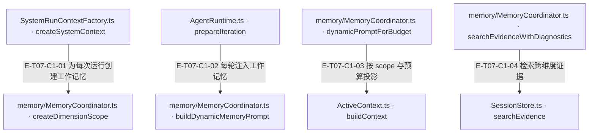
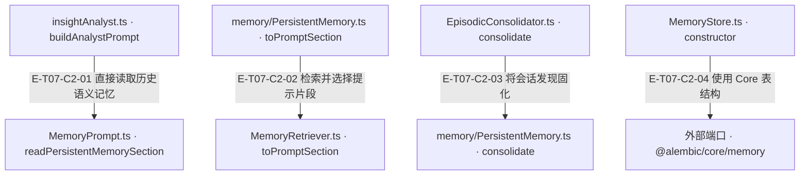
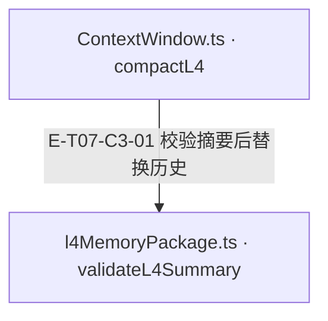

# 记忆、上下文与提示 · 真实调用

三层记忆分别是 scope 内 ActiveContext、会话级 SessionStore 与跨会话 PersistentMemory。MemoryCoordinator 管理 scope 和动态 prompt，但不是所有访问的唯一路由；Analyst 直接通过 MemoryPrompt 读取持久语义记忆。ContextWindow 的 L1–L4 是另一组压缩步骤，不是记忆层级。

[职责与边界](overview.md) · [直接依赖](file-dependency.md) · [15文件当前全文深读与失败恢复](full-source-review.md)

图中调用边经实现正文核对；AST只用于符号定位。接口／注入对象是调用端口，不据此推定所有宿主实现相同。测试表区分精确断言与执行状态；是否运行及其输入指纹见页面证据。

## 调用接缝 1

### 本图术语说明

| 术语／节点 | 含义与范围 |
| --- | --- |
| SystemRunContextFactory.ts · createSystemContext | `src/agent/service/SystemRunContextFactory.ts#createSystemContext`；声明或调用端口；动态实现的绑定条件见下表。 |
| memory/MemoryCoordinator.ts · createDimensionScope | `src/agent/memory/MemoryCoordinator.ts#createDimensionScope`；声明或调用端口；动态实现的绑定条件见下表。 |
| AgentRuntime.ts · prepareIteration | `src/agent/runtime/AgentRuntime.ts#prepareIteration`；声明或调用端口；动态实现的绑定条件见下表。 |
| memory/MemoryCoordinator.ts · buildDynamicMemoryPrompt | `src/agent/memory/MemoryCoordinator.ts#buildDynamicMemoryPrompt`；声明或调用端口；动态实现的绑定条件见下表。 |
| memory/MemoryCoordinator.ts · dynamicPromptForBudget | `src/agent/memory/MemoryCoordinator.ts#dynamicPromptForBudget`；声明或调用端口；动态实现的绑定条件见下表。 |
| ActiveContext.ts · buildContext | `src/agent/memory/ActiveContext.ts#buildContext`；声明或调用端口；动态实现的绑定条件见下表。 |
| memory/MemoryCoordinator.ts · searchEvidenceWithDiagnostics | `src/agent/memory/MemoryCoordinator.ts#searchEvidenceWithDiagnostics`；声明或调用端口；动态实现的绑定条件见下表。 |
| SessionStore.ts · searchEvidence | `src/agent/memory/SessionStore.ts#searchEvidence`；声明或调用端口；动态实现的绑定条件见下表。 |

| 编号 | 代码依据 | 测试依据 | 关系与可证明范围 |
| --- | --- | --- | --- |
| E-T07-C1-01 | `src/agent/service/SystemRunContextFactory.ts#createSystemContext` → `src/agent/memory/MemoryCoordinator.ts#createDimensionScope` | `test/agent-lifecycle.test.ts#case:factory%20contexts%20retain%20scoped%20mutable%20resources%20but%20isolate%20separate%20runs`；已读用例：两个相同 label 的运行仍有不同 coordinator/contextWindow，sharedState 互不污染，trace 指向本运行 activeContext，scopeId 保留。断言已定位；本轮未运行，执行状态另见页面证据。 | 工厂构造 mode=bootstrap 的 coordinator，创建 scan:<label> scope、ContextWindow 和 tracker；此默认构造没有注入 SessionStore 或 PersistentMemory。 |
| E-T07-C1-02 | `src/agent/runtime/AgentRuntime.ts#prepareIteration` → `src/agent/memory/MemoryCoordinator.ts#buildDynamicMemoryPrompt` | 未覆盖：本轮已读 Runtime 真实调用点；所读 memory-context 单元测试覆盖 coordinator 的预算/scope行为，没有单独证明此 Runtime 分支的集成断言。 | 系统运行每轮按 analyst/producer 与 dimensionScopeId 读取动态工作记忆，追加到 ephemeral dynamicContext；静态 systemPrompt 保持稳定，动态层不写进 ContextWindow。 |
| E-T07-C1-03 | `src/agent/memory/MemoryCoordinator.ts#dynamicPromptForBudget` → `src/agent/memory/ActiveContext.ts#buildContext` | `test/memory-context.test.ts#case:returns%20an%20empty%20dynamic%20memory%20prompt%20without%20scopeId%20when%20several%20scopes%20are%20active`；已读用例：两 scope 下缺 scopeId 返回空且告警含 scopes=2；显式指定 dimB 时包含 dimB 发现。另单 scope 用例验证隐式回退仍可写、可读且记 debug。断言已定位；本轮未运行，执行状态另见页面证据。 | 动态 prompt 使用目标 scope、相同 mode 的预算快照与 surplus；ActiveContext.buildContext 只投影 scratchpad 与已压缩观察台账，外层再按 token 预算截断，不把计划或近期原始观察自动拼进此片段。多 scope 且缺 scopeId 返回空并警告。 |
| E-T07-C1-04 | `src/agent/memory/MemoryCoordinator.ts#searchEvidenceWithDiagnostics` → `src/agent/memory/SessionStore.ts#searchEvidence` | `test/memory-context.test.ts#case:returns%20visible%20degraded%20diagnostics%20when%20evidence%20search%20fails`；已读用例：模拟 SessionStore.searchEvidence 抛错，断言 ok=false、degraded=true、results=[]、MEMORY_EVIDENCE_SEARCH_FAILED；缺 SessionStore 用例断言单独缺失原因。断言已定位；本轮未运行，执行状态另见页面证据。 | coordinator 将 query/dimId 交给 SessionStore，缺存储或存储抛错返回结构化 degraded 诊断；SessionStore 的维度报告替换先校验再同步重建证据与 crossRefs。 |

## 调用接缝 2

### 本图术语说明

| 术语／节点 | 含义与范围 |
| --- | --- |
| insightAnalyst.ts · buildAnalystPrompt | `src/agent/prompts/insightAnalyst.ts#buildAnalystPrompt`；声明或调用端口；动态实现的绑定条件见下表。 |
| MemoryPrompt.ts · readPersistentMemorySection | `src/agent/memory/MemoryPrompt.ts#readPersistentMemorySection`；声明或调用端口；动态实现的绑定条件见下表。 |
| memory/PersistentMemory.ts · toPromptSection | `src/agent/memory/PersistentMemory.ts#toPromptSection`；声明或调用端口；动态实现的绑定条件见下表。 |
| MemoryRetriever.ts · toPromptSection | `src/agent/memory/MemoryRetriever.ts#toPromptSection`；声明或调用端口；动态实现的绑定条件见下表。 |
| EpisodicConsolidator.ts · consolidate | `src/agent/memory/EpisodicConsolidator.ts#consolidate`；声明或调用端口；动态实现的绑定条件见下表。 |
| memory/PersistentMemory.ts · consolidate | `src/agent/memory/PersistentMemory.ts#consolidate`；声明或调用端口；动态实现的绑定条件见下表。 |
| MemoryStore.ts · constructor | `src/agent/memory/MemoryStore.ts#constructor`；声明或调用端口；动态实现的绑定条件见下表。 |
| 外部端口 · @alembic/core/memory | 外部合同 `@alembic/core/memory#ensureSemanticMemorySchema`；声明或调用端口；动态实现的绑定条件见下表。 |

| 编号 | 代码依据 | 测试依据 | 关系与可证明范围 |
| --- | --- | --- | --- |
| E-T07-C2-01 | `src/agent/prompts/insightAnalyst.ts#buildAnalystPrompt` → `src/agent/memory/MemoryPrompt.ts#readPersistentMemorySection` | `test/memory-context.test.ts#case:normalizes%20invalid%20time%20limits%20without%20creating%20an%20unbounded%20request`；已读 helper 用例：NaN timeout/deadline 被规范化，5001ms 后返回空段且 timer 清理。此用例覆盖读取边界，不证明 Analyst 的 source/query 参数；这些由本轮源码调用点核对。断言已定位；本轮未运行，执行状态另见页面证据。 | Analyst 使用 source=bootstrap、当前维度/项目语言相关 query、limit=10 与分配的预算直接读取 semanticMemory；不经 MemoryCoordinator 静态 prompt。MemoryPrompt 对读取设置共享截止时间，异常/超时/非法类型降级为空段。 |
| E-T07-C2-02 | `src/agent/memory/PersistentMemory.ts#toPromptSection` → `src/agent/memory/MemoryRetriever.ts#toPromptSection` | `test/memory-context.test.ts#case:fits%20actual%20rendered%20memory%20text%20within%20the%20supplied%20token%20budget`；已读用例：长低优先文本与短高重要性记忆同时存在，输出保留短重要决策且 estimateTokens<=60；另 embedding 截止时间用例断言超时仍返回词法候选和诊断。断言已定位；本轮未运行，执行状态另见页面证据。 | PersistentMemory 委托 Retriever 读取活跃记忆，按 recency/importance/relevance 排序后选择预算能容纳的条目；向量可用时融合词法，否则降级词法。只对实际选入 prompt 的记忆更新访问热度。 |
| E-T07-C2-03 | `src/agent/memory/EpisodicConsolidator.ts#consolidate` → `src/agent/memory/PersistentMemory.ts#consolidate` | `test/memory-context.test.ts#case:preserves%20prior%20bootstrap%20memory%20when%20a%20replacement%20INSERT%20fails`；已读 SQLite 内存库用例：注入 INSERT 失败 trigger，经真实 EpisodicConsolidator+PersistentMemory 调用后抛错，同时原 bootstrap 内容仍存在。零候选测试另断言不调用 clear/compact。断言已定位；本轮未运行，执行状态另见页面证据。 | 从 SessionStore 提取 finding/reflection/text fact 后委托 PersistentMemory→MemoryConsolidator；clearPrevious 时把清旧代、写新代与容量维护放进同一事务，候选数组长度为零明确跳过替换；非空但逐项全被判为空白/短内容的输入仍可先删旧代再全部 skipped，事务并不替代有效候选门槛。 |
| E-T07-C2-04 | `src/agent/memory/MemoryStore.ts#constructor` → `@alembic/core/memory#ensureSemanticMemorySchema` | `test/memory-context.test.ts#case:fails%20fast%20when%20the%20Core%20semantic%20memory%20schema%20shape%20drifts`；已读用例：只创建 id 列的 semantic_memories 表后构造 MemoryStore，断言抛出缺 type 列的 schema tripwire。断言已定位；本轮未运行，执行状态另见页面证据。 | Store 接收宿主数据库；已有表先做形状 tripwire，再调用 Core ensureSemanticMemorySchema 并二次校验。Agent 未在此另建迁移所有权。 |

## 调用接缝 3

### 本图术语说明

| 术语／节点 | 含义与范围 |
| --- | --- |
| ContextWindow.ts · compactL4 | `src/agent/context/ContextWindow.ts#compactL4`；声明或调用端口；动态实现的绑定条件见下表。 |
| l4MemoryPackage.ts · validateL4Summary | `src/agent/context/l4MemoryPackage.ts#validateL4Summary`；声明或调用端口；动态实现的绑定条件见下表。 |

| 编号 | 代码依据 | 测试依据 | 关系与可证明范围 |
| --- | --- | --- | --- |
| E-T07-C3-01 | `src/agent/context/ContextWindow.ts#compactL4` → `src/agent/context/l4MemoryPackage.ts#validateL4Summary` | `test/ContextWindow.test.ts#case:rejects%20L4%20summaries%20that%20drop%20phase%20or%20evidence%20refs`；已读用例：笼统摘要导致 failed=true、validationMissing 包含 phase/key_findings/evidence_refs，原两条历史未被摘要替换。另已读默认关闭用例断言 provider 不调用；取消用例已定位并读主体。断言已定位；本轮未运行，执行状态另见页面证据。 | L4 用 toolChoice=none 调模型，返回后核对调用方 signal、历史内容与 revision，再验证 phase/findings/evidence/failure 等最低覆盖；通过才替换历史，缺失或并发变化保留原历史。包构造/render/原历史 JSON 快照在 Provider try 之前，可直接抛错；最低锚点检查不证明逐条语义等价。 |

当前L4开关只由BudgetController的enableL4Compaction（显式优先、缺省读环境）经syncL4CompactionSwitch设置。构造窗口不再接受enableL4LLM初值。`test/budget-controller-l4-switch.test.ts#case:lets%20an%20explicit%20enableL4Compaction%20config%20win%20over%20env%20and%20syncs%20it`；断言已定位；本轮未运行，执行状态另见页面证据。显式 BudgetController 开关优先于 env 并同步窗口。 边界：受控 provider/窗口，不调用真实模型。

## RECORD 补记录不是单门放行承诺

本专题的 noteFinding 写入链位于工具准入之后。阶段条件、模型广告、SDK 返回校验和执行管道是不同检查，不能把 `recordRepairOnlyGate.before` 返回 undefined 写成整条生产链允许执行。

| 层次 | 当前检查与限制 | 已读依据与验证边界 |
| --- | --- | --- |
| 阶段 gate | 三个触发谓词是 sharedState._recordRepairOnly、context.recordRepairOnly、analyst 的 RECORD。该 gate 单独接受 direct note_finding、memory.note_finding/recall/get_previous_evidence、evidence.get/search；其它动作阻断。 | `src/agent/runtime/toolPipeline/callNormalization.ts#resolveRecordOnlyStageTrigger`；`src/agent/runtime/toolPipeline/phaseGates.ts#recordRepairOnlyGate`。这里的允许是本门不再阻断，不是能力授权或 schema 验证成功。 |
| 本轮广告 schema | toolChoice 不是 none 且处于 record-only 时，必须已有 memory schema 并获 memory.note_finding 能力准入；满足才广告 direct note_finding 和原投影中已有的 evidence，否则返回空 schema。memory.recall/get_previous_evidence 不在此广告列表。 | `src/agent/runtime/AgentRuntime.ts#getIterationToolSchemas`；`src/agent/runtime/AgentRuntime.ts#canUseDirectNoteFinding`。`test/AgentRuntime.test.ts#case:does%20not%20force%20toolChoice%20none%20on%20the%20last%20record_repair%20round%20and%20records%20its%20note_finding` 的受控 Provider 三次都观察到 auto 与 note_finding/evidence，三次记录到达受控 router；没有真实SDK或AI服务。 |
| 默认 SDK 返回 | sdkResponse 按本次 request.tools 查工具名并验证参数；未广告的 memory 调用没有校验器，抛 LlmResponseError。不能由 phase gate 对 memory.recall 的宽兼容反推模型本轮可调用它。 | `src/ai/transport/sdkProtocol.ts#sdkResponse`。本项读了实际判断；本页未绑定“RECORD 中未广告 memory.recall”的 SDK 联合断言，不能声称已执行证明。 |
| 默认执行管道 | allowlist→参数大小→runtimeSafety→场景 gates 均在缓存和router之前；direct note_finding 仍要 memory.note_finding 能力许可。自定义 Provider 绕过SDK时，也只能在这些执行检查全部允许后到达router。 | `src/agent/runtime/ToolExecutionPipeline.ts#createToolPipeline`；`src/agent/runtime/toolPipeline/accessGates.ts#allowlistGate`；`src/tools/kernel/toolSelection.ts#isToolActionAllowed`。`test/runtime-efficiency.test.ts#case:lets%20analyst%20RECORD%20%24label%20through%20to%20the%20router` 直接运行管道，fixture 显式列宽工具名且未设置动作收窄；null 动作项按通配处理。它只证明四类受控调用到达替身router，不证明当前 Provider 广告、真实权限或 memory handler 引用校验。 |

record-only 能用哪些工具，必须结合当轮实际 schema、toolChoice、capability action 集、执行 gate 和 handler 看；本轮没有新增或运行覆盖所有这些层的联合测试。底层存储接收发现的 `recorded:true` 也不能反过来证明此前全部准入步骤已执行。
