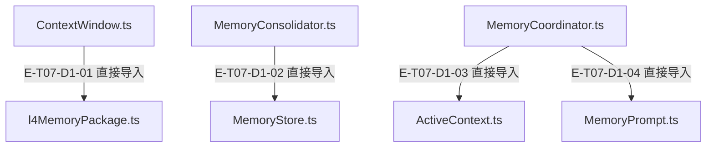
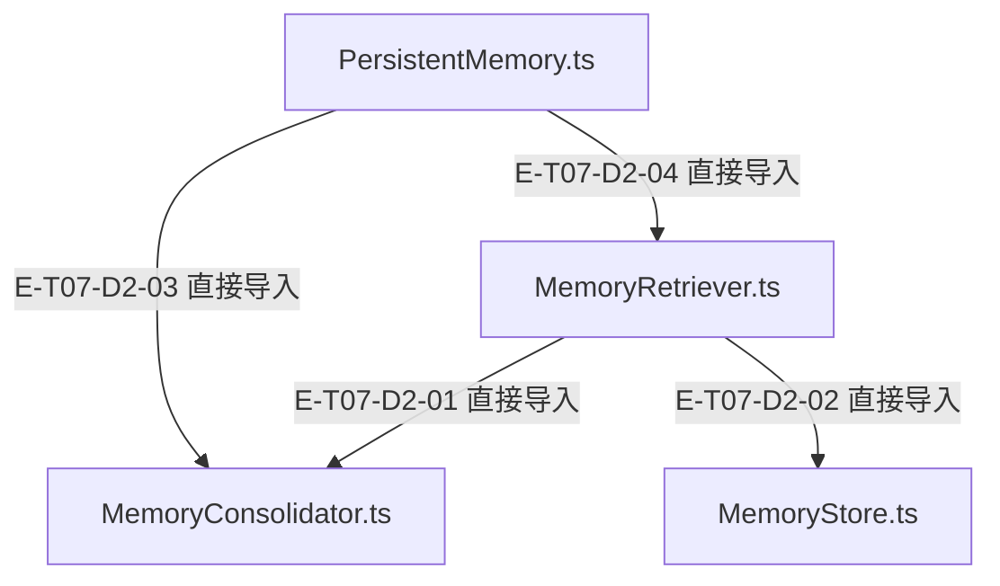

# 记忆、上下文与提示 · 精选直接依赖

[职责与边界](overview.md) · [真实调用](call-flow.md) · [15文件当前全文深读](full-source-review.md)

选取本专题入口的8条直接依赖；完整库存可在阅读器「文件与依赖」查看。以仓库全路径为节点身份，同名文件不会合并。同一对文件可能同时存在 type 和 value import，下表列出已读声明，不能把第一条 type import 的标记当作整条文件边的运行语义。Core／Node／第三方包只在完整探索器的外部边界出现。

## 静态依赖 1

### 本图术语说明

| 术语／节点 | 含义与范围 |
| --- | --- |
| ContextWindow.ts | `src/agent/context/ContextWindow.ts`；文件直接依赖，箭头不表示执行先后。 |
| l4MemoryPackage.ts | `src/agent/context/l4MemoryPackage.ts`；文件直接依赖，箭头不表示执行先后。 |
| MemoryConsolidator.ts | `src/agent/memory/MemoryConsolidator.ts`；文件直接依赖，箭头不表示执行先后。 |
| MemoryStore.ts | `src/agent/memory/MemoryStore.ts`；文件直接依赖，箭头不表示执行先后。 |
| MemoryCoordinator.ts | `src/agent/memory/MemoryCoordinator.ts`；文件直接依赖，箭头不表示执行先后。 |
| ActiveContext.ts | `src/agent/memory/ActiveContext.ts`；文件直接依赖，箭头不表示执行先后。 |
| MemoryPrompt.ts | `src/agent/memory/MemoryPrompt.ts`；文件直接依赖，箭头不表示执行先后。 |

| 编号 | 代码依据 | 测试依据 | 关系与可证明范围 |
| --- | --- | --- | --- |
| E-T07-D1-01 | `src/agent/context/ContextWindow.ts` → `src/agent/context/l4MemoryPackage.ts` | 未覆盖：静态依赖由本图谱解析器反例测试支持；不把 import 当作行为覆盖。 | TypeScript AST 解析 ./l4MemoryPackage.js；第 35 行，kind=import，typeOnly=false。只证明结构关系。 |
| E-T07-D1-02 | `src/agent/memory/MemoryConsolidator.ts` → `src/agent/memory/MemoryStore.ts` | 未覆盖：静态依赖由本图谱解析器反例测试支持；不把 import 当作行为覆盖。 | TypeScript AST 解析 ./MemoryStore.js；第 17 行是 type import，第 18 行另有 MemoryStore 与容量常量的 value import；这条文件聚合边包含两种依赖，不是纯类型依赖。只证明导入关系，事务调用另看调用地图。 |
| E-T07-D1-03 | `src/agent/memory/MemoryCoordinator.ts` → `src/agent/memory/ActiveContext.ts` | 未覆盖：静态依赖由本图谱解析器反例测试支持；不把 import 当作行为覆盖。 | TypeScript AST 解析 ./ActiveContext.js；第 21 行，kind=import，typeOnly=false。只证明结构关系。 |
| E-T07-D1-04 | `src/agent/memory/MemoryCoordinator.ts` → `src/agent/memory/MemoryPrompt.ts` | 未覆盖：静态依赖由本图谱解析器反例测试支持；不把 import 当作行为覆盖。 | TypeScript AST 解析 ./MemoryPrompt.js；第 22 行，kind=import，typeOnly=false。只证明结构关系。 |

## 静态依赖 2

### 本图术语说明

| 术语／节点 | 含义与范围 |
| --- | --- |
| MemoryRetriever.ts | `src/agent/memory/MemoryRetriever.ts`；文件直接依赖，箭头不表示执行先后。 |
| MemoryConsolidator.ts | `src/agent/memory/MemoryConsolidator.ts`；文件直接依赖，箭头不表示执行先后。 |
| MemoryStore.ts | `src/agent/memory/MemoryStore.ts`；文件直接依赖，箭头不表示执行先后。 |
| PersistentMemory.ts | `src/agent/memory/PersistentMemory.ts`；文件直接依赖，箭头不表示执行先后。 |

| 编号 | 代码依据 | 测试依据 | 关系与可证明范围 |
| --- | --- | --- | --- |
| E-T07-D2-01 | `src/agent/memory/MemoryRetriever.ts` → `src/agent/memory/MemoryConsolidator.ts` | 未覆盖：静态依赖由本图谱解析器反例测试支持；不把 import 当作行为覆盖。 | TypeScript AST 解析 ./MemoryConsolidator.js；第 18 行，kind=import，typeOnly=false。只证明结构关系。 |
| E-T07-D2-02 | `src/agent/memory/MemoryRetriever.ts` → `src/agent/memory/MemoryStore.ts` | 未覆盖：静态依赖由本图谱解析器反例测试支持；不把 import 当作行为覆盖。 | TypeScript AST 解析 ./MemoryStore.js；第 28 行是 type import，第 29 行另有 MemoryStore 与容量常量的 value import；文件聚合边同时含类型和运行时值依赖，不等于已执行数据库读取。 |
| E-T07-D2-03 | `src/agent/memory/PersistentMemory.ts` → `src/agent/memory/MemoryConsolidator.ts` | 未覆盖：静态依赖由本图谱解析器反例测试支持；不把 import 当作行为覆盖。 | TypeScript AST 解析 ./MemoryConsolidator.js；第 26–30 行是候选/配置/统计的 type import，第 31 行另导入 MemoryConsolidator 类值；文件聚合边同时含类型与运行时组装依赖。 |
| E-T07-D2-04 | `src/agent/memory/PersistentMemory.ts` → `src/agent/memory/MemoryRetriever.ts` | 未覆盖：静态依赖由本图谱解析器反例测试支持；不把 import 当作行为覆盖。 | TypeScript AST 解析 ./MemoryRetriever.js；第 34–41 行是检索合同的 type import，第 42 行另导入 MemoryRetriever 类值；文件聚合边同时含类型与运行时组装依赖。 |
