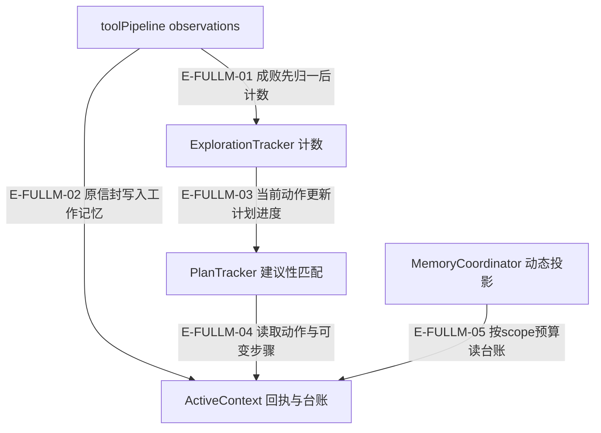
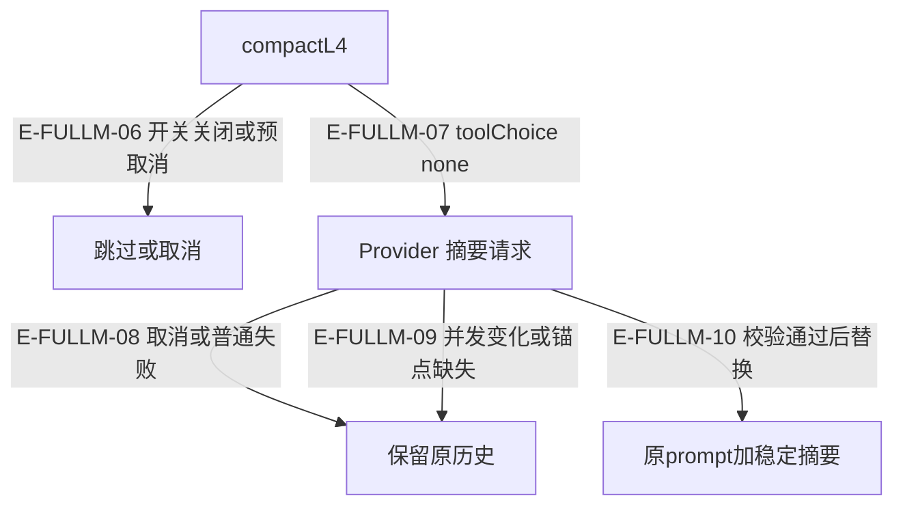

# 记忆与上下文 · 当前全文深读

本页补完 15 个先前仅按差异复核的文件：已顺序读取当前工作区全部 10,613 个 Atlas 行位（实际文本行 10,598，另含每文件末尾 EOF 空行）。每文件读取前后 SHA256 一致；分段连续覆盖从 1 到 lineCount。这里的 L3 表示已读实现和定位测试断言，不表示本轮执行测试。

本轮只新增此页与汇总阅读证据，不改产品、旧快照或既有地图。证据以当前未提交工作区为真值；来源变化后须重新核读。测试引用中的 `located` 只证明本轮读到了声明、断言与替身边界；下面没有任何“测试通过”结论。

[职责总览](overview.md) · [调用地图](call-flow.md) · [既有恢复入口说明](source-review-and-recovery.md) · [图谱标准](../00-diagram-standard.md)

## 先校准五个语义

- `maxRecentRounds` 当前按观察条目数量裁剪，不能写成保留 N 个完整轮次；`buildContext` 只投影 scratchpad 与已压缩观察台账，`distill` 才同时带出近期原始观察的摘要。
- ContextWindow 的 L1/L2 会改写历史，L3 只改变 provider 投影，L4 校验通过才替换历史；L3 保最近两工具轮、L4 摘要钉住、证据尾注最低正文配额都可能让预算仍超额。
- SessionStore 报告先校验再换代；`digest` 缺省沿用、null 清空、对象替换。恢复时缺少 `evidenceStore` 才从报告重建，显式空对象必须保持空。
- Consolidator 的空候选保险只查数组长度。非空但全是空白/短字符串会先删除旧代，再全部 skipped；这是当前源码缺口，没有本轮执行复现或修复。
- 三层记忆与 L1–L4 压缩是两种划分。Coordinator 管 scope 和动态投影，但不是全部记忆读写的唯一路由；SessionStore 只有快照边界，宿主保存文件。

## 回执进入工作记忆的实际链路

### 本图术语说明

| 术语 | 本图边界 |
| --- | --- |
| observations | 仓内工具管道 after 中间件；失败状态优先，trace 收原始 envelope。 |
| Tracker / PlanTracker | 成功取证计数与建议性计划匹配，不负责执行 shell 或检查文件权限。 |
| ActiveContext | 记录状态与观察文本；没有宿主文件保存或恢复入口。 |
| Coordinator | 动态读严格选择 scope；缺省多 scope 返回空。 |

| 编号 | 代码依据 | 测试依据 | 关系与可证明范围 |
| --- | --- | --- | --- |
| E-FULLM-01 | `src/agent/runtime/toolPipeline/observations.ts#trackerSignal` → `src/agent/context/ExplorationTracker.ts#recordToolCall` | `test/ExplorationStrategies.test.ts#case:does%20not%20promote%20%25s%20into%20code%20evidence`；error/blocked/aborted/timeout回执均isNew=false、evidenceToolCallCount=0、totalToolCalls=1。 边界：真实toolPipeline+受控router；只证明状态消费，不证明权限/取消/超时执行机制。 本轮未运行。 | 真实管道搭配受控router只验证failed状态不会获证据信用。 |
| E-FULLM-02 | `src/agent/runtime/toolPipeline/observations.ts#traceRecord` → `src/agent/memory/ActiveContext.ts#recordToolCall` | `test/ExplorationStrategies.test.ts#case:does%20not%20complete%20the%20failed%20member%20of%20a%20partially%20successful%20batch%20read`；计划指向missing文件，partial回执仅good成功，步骤仍pending。 边界：真实toolPipeline+ActiveContext+tracker；router是fixture。 本轮未运行。 | trace路径将成功成员保留为成功路径，失败成员不能完成计划。 |
| E-FULLM-03 | `src/agent/context/ExplorationTracker.ts#updatePlanProgress` → `src/agent/context/exploration/PlanTracker.ts#updatePlanProgress` | `test/ExplorationStrategies.test.ts#case:does%20not%20complete%20the%20failed%20member%20of%20a%20partially%20successful%20batch%20read`；计划指向missing文件，partial回执仅good成功，步骤仍pending。 边界：真实toolPipeline+ActiveContext+tracker；router是fixture。 本轮未运行。 | 开启planning的策略才调用；返回跳过动作统计用于日志。 |
| E-FULLM-04 | `src/agent/context/exploration/PlanTracker.ts#updatePlanProgress` → `src/agent/memory/ActiveContext.ts#getPlanStepsMutable` | `test/ExplorationStrategies.test.ts#case:fires%20a%20deviation%20replan%20only%20after%20three%20consecutive%20off-plan%20exploration%20rounds`；第1/2次offplan无nudge，第3次后偏差nudge；consecutiveOffPlan=3、deviationScore=1。 边界：本地PlanTracker+ActiveContext，受控返回内容。 本轮未运行。 | 步骤引用有意可变；三轮偏离只是重规划建议条件。 |
| E-FULLM-05 | `src/agent/memory/MemoryCoordinator.ts#buildDynamicMemoryPrompt` → `src/agent/memory/ActiveContext.ts#buildContext` | `test/memory-context.test.ts#case:returns%20an%20empty%20dynamic%20memory%20prompt%20without%20scopeId%20when%20several%20scopes%20are%20active`；多 scope 隐式读为空且 warn scopes=2；显式 dimB 包含私有发现；公开 getActiveContext 仍取最近 scope。 边界：真实工作记忆投影；未测 Runtime 多维调度。 本轮未运行。 | Runtime prepareIteration以dimensionScopeId调用此入口；测试覆盖coordinator局部scope守卫，不证明并行调度整体。 |

## L4 的提交与保留边界

### 本图术语说明

| 术语 | 本图边界 |
| --- | --- |
| Provider | 注入 chatWithTools 端口；本文件传 abortSignal，不创建本地超时或重试。 |
| 最低锚点校验 | phase/findings/evidence/failure 的最低文本检查，不能当全部事实语义等价。 |
| 保留原历史 | provider调用后的拒绝路径；包构造、render及JSON快照在 try 之前的异常另见 CW09。 |
| 稳定摘要 | 成功后有 metadata.kind=l4_memory_summary，之后的L3仍钉住此消息。 |

| 编号 | 代码依据 | 测试依据 | 关系与可证明范围 |
| --- | --- | --- | --- |
| E-FULLM-06 | `src/agent/context/ContextWindow.ts#compactL4` | `test/ContextWindow.test.ts#case:C05%20compactL4%20short-circuits%20with%20an%20l4_disabled%20marker%20while%20the%20L4%20switch%20is%20off`；未开关时provider未调用、history不变、failed/marker稳定且单条warn。 边界：ContextWindow+vi.fn Provider替身。 本轮未运行。 | 开关关闭有明确marker；预取消分支同样不请求Provider，但本表用例只证明关闭路径。 |
| E-FULLM-07 | `src/agent/context/ContextWindow.ts#compactL4` → `src/agent/context/l4MemoryPackage.ts#renderL4MemoryPackage` | `test/ContextWindow.test.ts#case:rejects%20L4%20summaries%20that%20drop%20phase%20or%20evidence%20refs`；笼统摘要失败，missing含phase/findings/evidence，旧两消息未改。 边界：受控Provider与distill替身；非语义充分覆盖证明。 本轮未运行。 | 传结构化包与摘要提示给注入Provider；读取到toolChoice none调用点，测试使用受控回复。 |
| E-FULLM-08 | `src/agent/context/ContextWindow.ts#compactL4` | `test/ContextWindow.test.ts#case:C03%20reports%20cancelled%20when%20the%20provider%20rejects%20because%20the%20abort%20signal%20fired`；signal已abort+Provider AbortError归cancelled，不写auto-compact failed，历史不变。 边界：受控Provider拒绝；signal是归类权威。 本轮未运行。 | 取消以调用方signal状态归类；普通provider错误见CW04及测试索引。 |
| E-FULLM-09 | `src/agent/context/ContextWindow.ts#compactL4` → `src/agent/context/l4MemoryPackage.ts#validateL4Summary` | `test/ContextWindow.test.ts#case:does%20not%20overwrite%20newer%20context%20after%20L4%20%25s`；append/reset/overlap期间旧摘要迟到返回failed/removed0且usage7保留，最新history字节不被覆盖。 边界：Promise.withResolvers控制并发、受控Provider；包括直接新stage和另一成功L4。 本轮未运行。 | 并发append/reset/overlap不被迟到摘要覆盖；缺锚点拒绝另见CW02。 |
| E-FULLM-10 | `src/agent/context/ContextWindow.ts#compactL4` → `src/agent/context/l4MemoryPackage.ts#formatL4MemorySummary` | `test/ContextWindow.test.ts#case:C01%20keeps%20the%20L4%20memory%20summary%20when%20it%20is%20the%20only%20message%20before%20the%20collapse%20boundary`；只有pinned摘要时L3投影不额外添Collapsed marker；长度原样且日志明确projection unchanged。 边界：先受控Provider创建L4摘要再追加两轮；无远程服务。 本轮未运行。 | 测试helper先成功生成摘要，再验证只有pinned消息时L3不凭空加折叠marker。 |

## 逐文件全文与失败恢复记录

所有行范围含首尾；段落串接没有空洞或重叠。SHA 表示读取前后同一内容，EOF 空行只为 inventory 计数，不视作实现。测试编号连接本页末尾精确声明、实际断言和替身边界。

### src/agent/context/ContextWindow.ts

**Provider历史、投影视图与L1–L4压缩；工具展示结果限制器**。消息写入→provider投影估算→L1/L2原地压缩与L3读时折叠→可选L4验证后替换。

全文：1902 行；SHA256 前后相同：`sha256:486b9db86f70eadc4c9439f56918e634e39215eddea32427e2fc50ffb66d8519`。

| 连续范围 | 本段实现与边界 |
| --- | --- |
| 1–239 | 消息/续接/配额合同、五阈值与模型回退表；窗口拥有原始消息、折叠边界、压缩日志及读视图revision。 |
| 240–381 | 模型预算按provider提示查registry，未命中走regex/32k默认；分档返回预算；构造L4恒关闭，syncL4CompactionSwitch为唯一设置入口。 |
| 382–478 | 追加用户/nudge/assistant/tool消息；nudge去旧并移动折叠边界，knowledge参数压缩时关联续接一起舍弃，提交确认元数据仅收布尔。 |
| 479–617 | compactIfNeeded逐级触发，session压力仅启动L1；独立provider输入预算跑L1-L3但最近轮次不可压时仍可能超额。 |
| 618–803 | L4开关/少消息/预取消短路；构造包并快照历史，Provider toolChoice none；取消、revision或内容变化、校验缺项均保留历史；成功替换为原prompt+摘要。 |
| 804–959 | L1对非最近轮的长tool result首尾压缩并保evidence尾注；L2保护续接/metadata与工具配对；L3只推进最近两工具轮之前边界并保L4摘要。 |
| 960–1189 | 原始/投影视图及唯一token估算、pressure阶梯配额、诊断副本；resetToPromptOnly保首prompt，resetForNewStage清全部消息/压力但保提交集合。 |
| 1190–1287 | 从有匹配回执的knowledge.submit提取已持久标题；布尔metadata优先，旧JSON解析失败不将请求标题认作已提交；工具轮起点扫描。 |
| 1288–1579 | 内部共享纯函数：nudge去重、参数压缩/签名剥离、continuation估算、阶段预算默认值；submit保标识和payloadSummary但不保正文。 |
| 1580–1902 | 首尾snip的省略数字与极小预算例外；evidence尾注800封顶+正文200下限；按knowledge/code search/batch/file/通用结果展示压缩，长单行回退字符截断；含EOF空行。 |

| 分支 | 条件与行为 | 副作用、恢复与证据限制 |
| --- | --- | --- |
| CW01 | L4开关关闭 → 返回failed与l4_disabled；不调用Provider。 | `src/agent/context/ContextWindow.ts#compactL4`。warn；历史不改。 恢复：由预算控制器同步显式开关后下一次调用再尝试。 证据：[T15](#t15)。限制：不是Provider失败；无本地重试。 |
| CW02 | 摘要缺失phase/findings/evidence最低锚点 → validationMissing回执；不替换。 | `src/agent/context/ContextWindow.ts#compactL4`。compactionLog记录拒绝原因。 恢复：调用方决定补包或再试，原历史保留。 证据：[T21](#t21)。限制：最低字符串覆盖检查不等于逐条事实完整性。 |
| CW03 | signal预取消、返回时取消、或Provider因signal拒绝 → 取消回执failed/cancelled/removed0；返回时取消保usage。 | `src/agent/context/ContextWindow.ts#compactL4`。warn；不替换。 恢复：取消由调用方控制；本类无超时调度。 证据：[T18](#t18)、[T13](#t13)。限制：预取消分支本轮未单独定位断言；没有真实网络取消。 |
| CW04 | Provider抛错但调用方signal未取消 → 返回普通failed，不标cancelled。 | `src/agent/context/ContextWindow.ts#compactL4`。warn；不改历史。 恢复：外层预算控制器拥有失败计数/后续行动。 证据：[T14](#t14)。限制：内部无timeout或retry；AbortError名称本身不足以认作取消。 |
| CW05 | L4生成期间append/reset/另一次L4改变消息或revision → discard并validationMissing=context_changed。 | `src/agent/context/ContextWindow.ts#compactL4`。旧结果usage仍回传，最新历史不变。 恢复：调用方如需压缩必须基于新状态重新发起。 证据：[T19](#t19)。限制：测试只断言failed/保历史，未逐字断言context_changed marker。 |
| CW06 | L1/L3/阶段预算压力 → L1修改旧正文、L3保最近两工具轮与pinned摘要；无可折叠内容投影原样。 | `src/agent/context/ContextWindow.ts#compactForProviderInputBudget`。revision/log更新；被保留原历史可大于投影。 恢复：后续新增轮次再触发压缩。 证据：[T16](#t16)、[T11](#t11)、[T12](#t12)。限制：阶段预算是软触发，不保证达到maxProjected上限；evidence尾注+正文下限可超过maxChars。 |
| CW07 | knowledge submit参数为provider历史压缩且携带continuation → 丢弃续接与thoughtSignature，保reasoningContent。 | `src/agent/context/ContextWindow.ts#appendAssistantWithToolCalls`。一条无正文/签名的diagnostic。 恢复：此轮按普通历史发送；不伪造新的签名。 证据：[T20](#t20)。限制：受控fixture只证明本地历史，不证明远程签名协议。 |
| CW08 | reset/折叠遇到提交请求但没有持久回执 → 只持久确认标题进入compactedSubmits；无确认排除。 | `src/agent/context/ContextWindow.ts#resetForNewStage`。info记录unconfirmed数量；stage reset清压力与消息。 恢复：持久化事实通过runtime布尔metadata或完整旧JSON补证。 证据：[T17](#t17)。限制：只扫描knowledge.submit，不扫描submit_batch；集合去重按标题并无持久ID。 |
| CW09 | kind已标记L4包但字段畸形，或render/JSON.stringify在Provider try之前抛错 → 包构造/快照位于try之外，异常可直接拒绝compactL4。 | `src/agent/context/ContextWindow.ts#compactL4`。可能仅已写ready/degraded诊断，原历史通常未替换。 恢复：调用方需防御此异常；应另补畸形包probe。 证据：未覆盖：本轮未定位匹配断言。限制：未定位此入口的畸形包/循环history断言；不得称所有L4失败都结构化返回。 |
| CW10 | 模型registry无命中或tool展示结果形状不符合预期 → 预算regex/default有日志；unknown结果stringify与maxChars/defaults没有全面runtime shape校验。 | `src/agent/context/ContextWindow.ts#resolveTokenBudget`。预算估算或展示文本可能降级；limitToolResult不提供错误信封。 恢复：上游保证可序列化结果；预算回退非模型能力验真。 证据：未覆盖：本轮未定位匹配断言。限制：本轮未把全registry或任意不可序列化quota输入作为行为测试覆盖。 |

需保留的边界：toMessages与未折叠toProjectedMessages返回原引用，L4用JSON+revision阻止迟到覆盖但不是全局不可变历史。 evidence尾注模式仅识别单行末尾  [evidence]，800字封顶仍可能截断引用；没有保证全部证据存活。 历史模型正则表与registry重复维护；本次仅按本地源码记录，不声称其数值为当前远端能力。

### src/agent/context/ConversationStore.ts

**JSONL对话与100条LRU索引；只读兼容旧摘要**。constructor路径守卫→create/append维护索引→load过滤坏行并按预算投影。

全文：527 行；SHA256 前后相同：`sha256:04869dd058ceb6ca1e379decc2c38e0a883e1a5c69c81bd790212703aa908c17`。

| 连续范围 | 本段实现与边界 |
| --- | --- |
| 1–105 | 持久化约定、旧摘要识别、错误描述与LRU时间比较；constructor选择WriteZone或项目目录并调用Core写路径守卫。 |
| 106–227 | create插入新索引；append先写JSONL再更新/补登记LRU，失败吞掉并warn；load缺文件/读错返回空历史。 |
| 228–335 | 预算归一、最新消息优先、可容纳才保首摘要及截断标记；逐JSONL形状过滤；日志隔离；拒绝路径分隔符/NUL/点ID。 |
| 336–437 | 容量淘汰保护当前条目、按updatedAt排序其余项；未知ID从现存历史重建计数/标题/摘要；删文件失败不阻断索引。 |
| 438–527 | loadIndex损坏或错形退空、过滤坏条目；WriteZone写入由Core决定；裸fs同目录临时写rename，失败清理临时文件；EOF空行。 |

| 分支 | 条件与行为 | 副作用、恢复与证据限制 |
| --- | --- | --- |
| CV01 | 非法conversationId → append放弃写；load=[]并日志 | `src/agent/context/ConversationStore.ts#append`。外部文件与索引不应被修改。 恢复：修正ID后重新调用。 证据：[T66](#t66)。限制：constructor Core pathGuard本身的拒绝未在这项测试验证。 |
| CV02 | JSONL坏行或不存在/不可读文件 → 坏行忽略保邻居；缺文件info、读取失败warn，返回空。 | `src/agent/context/ConversationStore.ts#load`。读操作不改磁盘。 恢复：修复文件后再load；没有自动重建。 证据：[T60](#t60)、[T55](#t55)。限制：不可读包括EISDIR测试，不外推ACL。 |
| CV03 | 超预算含旧摘要 → 先确保最新内容；摘要放不下时丢读时投影，适当插标记。 | `src/agent/context/ConversationStore.ts#load`。仅结果截断+info。 恢复：更多预算可重新读全历史。 证据：[T40](#t40)、[T41](#t41)。限制：仅首消息摘要受特殊保留；hasSummary允许摘要在非首位置。 |
| CV04 | 索引parse/shape坏或条目不合规 → 退空或过滤；下一次save会覆盖旧索引登记。 | `src/agent/context/ConversationStore.ts#create`。历史JSONL可能成为不受LRU管理的孤儿。 恢复：人工修复索引或append触发单ID补登记。 证据：[T74](#t74)、[T75](#t75)。限制：退空不是无损恢复。 |
| CV05 | 裸fs索引写中途抛错 → 同目录tmp未rename时旧index仍完整，清理tmp。 | `src/agent/context/ConversationStore.ts#create`。warn+可能残留tmp。 恢复：下次create/append再写；无fsync/锁承诺。 证据：[T52](#t52)。限制：WriteZone分支与rename失败后的tmp清理再次失败未分别定位断言。 |
| CV06 | 淘汰时历史删除失败 → 索引继续移除旧项，磁盘目录/文件可能仍在。 | `src/agent/context/ConversationStore.ts#create`。info淘汰+warn删除失败。 恢复：人工或宿主清理遗留。 证据：[T73](#t73)。限制：此分支没有重试或垃圾回收。 |
| CV07 | JSONL追加成功但后续索引保存失败 → append不回滚已追加消息，create仍返回ID；没有持久成功回执。 | `src/agent/context/ConversationStore.ts#append`。JSONL与索引可以暂时不一致。 恢复：未知ID下次append可补登记，但不保证其他孤儿被发现。 证据：未覆盖：本轮未定位匹配断言。限制：未定位跨文件原子一致性或并发append/create断言。 |

需保留的边界：本类无summarize/delete/list公开入口；旧摘要来源只可能是历史写入。 同pid临时文件名与读改写索引没有跨进程锁；本次不以单文件rename证明并发一致性。

### src/agent/context/ExplorationTracker.ts

**探索阶段机与真实回执计数、nudge、grace exit编排**。resolve→tick→recordToolCall→endRound/onTextResponse→计划建议与终结阶段。

全文：919 行；SHA256 前后相同：`sha256:d55afaa0cdf4768a5c60fd2753096e37937fdeaadb91330a927a4cd635d08085`。

| 连续范围 | 本段实现与边界 |
| --- | --- |
| 1–217 | 状态/预算默认值、子模块与ledger统计；resolve只对system创建，analyst/producer按名选择，其余内部bootstrap回退并对未知名warn。 |
| 218–368 | tick/rollback时序；终结scan立即退出、grace与maxIterations硬上限；nudge优先级与plan抑制诊断；grace时toolChoice none。 |
| 369–512 | 所有调用计attempt；失败不给evidence/novelty；成功提交与真实note回执才加相应指标；endRound更新轮次、精确search flag、skip清标记。 |
| 513–667 | 文本轮最多一次转换；终结文本与新终结nudge分开；EXPLORE/VERIFY要证据、RECORD两轮纯文本让gate接管；外部forceTerminal。 |
| 668–878 | 只读状态/计划进展代理；相邻阶段metrics/text规则与quota不可达warn；转换重置停滞计数、记录dwell；nudge状态装配。 |
| 879–919 | Producer完成文本需完成与无剩余双模式；未知策略日志格式化；取证工具action白名单；EOF。 |

| 分支 | 条件与行为 | 副作用、恢复与证据限制 |
| --- | --- | --- |
| ET01 | 非system或未知策略名 → user返回null；未知策略保留bootstrap流程且warn。 | `src/agent/context/ExplorationTracker.ts#resolve`。构造子状态机，不执行工具。 恢复：由调用方纠正strategy；不自动推测analyst。 证据：[T37](#t37)。限制：未知名回退可能与调用方预期输出格式不同。 |
| ET02 | error/blocked/aborted/timeout观察 → totalToolCalls+1；无evidence或新信息信用。 | `src/agent/context/ExplorationTracker.ts#recordToolCall`。debug保留尝试事实。 恢复：后续成功观察才更新成功指标。 证据：[T27](#t27)。限制：仅回执消费，不拥有拒绝/取消/超时执行权。 |
| ET03 | knowledge请求或note写入未真实完成 → 仅持久提交/recorded true+target activeContext记进度；verified缺席兼容已核实。 | `src/agent/context/ExplorationTracker.ts#recordToolCall`。更新count与depth交集，非语义验收。 恢复：handler提供真实回执；不凭文本宣称提交。 证据：[T22](#t22)。限制：重复成功回执可重复计数，未按候选/发现ID去重。 |
| ET04 | endRound已经转换后同轮文本又满足下个规则 → 保持本阶段，避免零轮跳过VERIFY。 | `src/agent/context/ExplorationTracker.ts#onTextResponse`。info跳过文本转换；返回phase-specific或fallback nudge。 恢复：下一tick才能再次转。 证据：[T35](#t35)。限制：此用例局部验证时序，未跑Runtime。 |
| ET05 | maxIterations强制终结后同tick AI失败回滚 → iteration退1，已转换phase不回退，phaseRounds不减为负。 | `src/agent/context/ExplorationTracker.ts#rollbackTick`。info撤轮说明；grace状态保留。 恢复：下一tick从phaseRounds=1继续。 证据：[T31](#t31)。限制：forceTerminal有同构分支，本轮未单独重复读取其测试。 |
| ET06 | skipped轮曾搜索 → 清currentRoundHasSearch；不计轮次/转换。 | `src/agent/context/ExplorationTracker.ts#endRound`。debug discarded flag。 恢复：下一真实搜索轮照常计数。 证据：[T25](#t25)。限制：调用者仍须管理tick/rollback是否成对。 |
| ET07 | ledger无文件导致verified配额不可达 → 原始findings达目标允许RECORD→SUMMARIZE并warn target/effective/raw。 | `src/agent/context/ExplorationTracker.ts#endRound`。降级终结而非宣布verified。 恢复：后续质量门仍需独立判断。 证据：[T33](#t33)。限制：不是任意缺证据皆可跳过VERIFY；只认ledgerDistinctFiles===0。 |

需保留的边界：部分阶段info/warn直接调用logger而非observeSafely；日志异常对已改阶段的影响未见本轮匹配断言。 phase/预算参数没有全面运行时校验，配置方需提供有效策略。

### src/agent/context/exploration/ExplorationStrategies.ts

**探索预算/trace合同与bootstrap、analyst、producer规则声明**。Tracker选择策略→对metrics/text应用相邻阶段predicate→toolChoice建议。

全文：380 行；SHA256 前后相同：`sha256:d3fb4f57254189135e67080a9f1d583f106ba1b66aab9ad402542e20b6330240`。

| 连续范围 | 本段实现与边界 |
| --- | --- |
| 1–103 | 反思/重规划常量与metrics/budget/phase/strategy合同；可选verified和ledger字段承载旧快照兼容。 |
| 104–191 | 发现目标按evidence调用及文件数钳制；verified+depth交集加权；无文件RECORD配额不可达出口；producer目标归一。 |
| 192–221 | ExplorationTrace单端口：PlanTracker可变步骤与动作成功回执；缺ok按成功兼容需宿主如实填写。 |
| 222–276 | 内部bootstrap的skill-only二阶段或标准三阶段；搜索/提交/grace条件与reflection/planning开关。 |
| 277–353 | analyst五阶段：SCAN无工具，EXPLORE/VERIFY证据门槛，RECORD加权配额与降级出口，SUMMARIZE无工具。 |
| 354–380 | producer两阶段由目标提交/硬限/空闲收口，禁reflection/planning；EOF。 |

| 分支 | 条件与行为 | 副作用、恢复与证据限制 |
| --- | --- | --- |
| ES01 | analyst还无真实代码证据 → EXPLORE持续required且文本不能直接退出。 | `src/agent/context/exploration/ExplorationStrategies.ts#STRATEGY_ANALYST`。纯predicate，不执行工具/写记忆。 恢复：成功取证后才进入后续条件。 证据：[T29](#t29)、[T26](#t26)。限制：toolChoice只是策略值；工具可执行集合由下游另管。 |
| ES02 | producer仍欠targetSubmits → idle不能提前收口，目标达到可转SUMMARIZE。 | `src/agent/context/exploration/ExplorationStrategies.ts#STRATEGY_PRODUCER`。纯策略返回。 恢复：真实持久回执更新submitCount。 证据：[T32](#t32)。限制：maxSubmits/空闲零提交等其它兜底可能终结，不是无限等待目标。 |
| ES03 | verified字段缺席或边际计数无交集 → 兼容memoryFindingCount，交集只取可证明下界；ledger0按raw发现降级退出。 | `src/agent/context/exploration/ExplorationStrategies.ts#effectiveMemoryFindingCount`。纯函数，不记录日志；Tracker记录出口。 恢复：新handler应提供verified与交集精确值。 证据：[T33](#t33)。限制：本轮只为ledger0出口定位断言，未为全部数值组合声明覆盖。 |

需保留的边界：createGenerateStrategy仍在源模块内部供fallback导入，未在context/root公开；文件内旧注释export*已与当前显式barrel不符。 参数为类型合同，不包含任意负数/NaN全量验证。

### src/agent/context/exploration/PlanTracker.ts

**建议性计划匹配、偏离统计与受限重规划**。成功探索动作→目标/关键词/语义匹配→覆盖/续做/偏离→周期或三轮偏离replan。

全文：991 行；SHA256 前后相同：`sha256:73ef02d83e3808267006a8c9fa0f6b7e35295a1faf6a6de339ffb6338726492e`。

| 连续范围 | 本段实现与边界 |
| --- | --- |
| 1–123 | trace子类型、进展/抑制/轮评估结构与成功取证工具白名单；bootstrap replan1次、其它2次、冷却3轮。 |
| 124–294 | 文件扩展名与JS技术名排除；总结步与CLI宾语白名单、语言/运行时命令参数规则。 |
| 295–391 | 命令宾语与被执行对象区段正则；工具类别语义回退含已知宽命中；诊断隔离。 |
| 392–558 | checkPlanning首轮授权；已有计划周期或三轮偏离触发；cap/bootstrap后段/cooldown抑制；输出nudge并置pending。 |
| 559–710 | 成功探索才参与；未完成步骤优先、已完成可续做；只剩总结时保持连击，全完成后计划外仍计数；replan重置诊断。 |
| 711–897 | prompt文本与匹配顺序；read/outline硬文件门槛，terminal语义回退不能越过待检视文件，执行对象豁免及日志。 |
| 898–991 | 抽取/分类文件目标与执行span、路径边界匹配、总结步剔除路径后识别、语义predicate；EOF。 |

| 分支 | 条件与行为 | 副作用、恢复与证据限制 |
| --- | --- | --- |
| PT01 | 动作失败或非code/graph/terminal取证 → 不完成步骤、不记偏离；本轮无可计动作保持旧连击。 | `src/agent/context/exploration/PlanTracker.ts#updatePlanProgress`。可能返回skipped统计供Tracker日志。 恢复：成功动作后继续评估。 证据：[T23](#t23)。限制：自定义trace缺ok仍按成功，见PT02。 |
| PT02 | 第三方trace动作缺ok → 按成功兼容匹配文件并置done。 | `src/agent/context/exploration/PlanTracker.ts#updatePlanProgress`。原地修改getPlanStepsMutable。 恢复：宿主需如实提供ok=false，ActiveContext真实路径会写。 证据：[T36](#t36)。限制：无回执不等同证明工具执行成功。 |
| PT03 | 连续三轮可计探索全未命中 → 触发偏差replan；单纯未完成率不触发。 | `src/agent/context/exploration/PlanTracker.ts#checkPlanning`。更新建议性count与authorization，不执行计划。 恢复：模型需在授权响应返回新计划。 证据：[T28](#t28)。限制：pendingReplan检查有plan即清计数，未验证是否真的收到新版本。 |
| PT04 | 已触发但冷却/cap/bootstrap>=65% → 返回null并回调抑制原因。 | `src/agent/context/exploration/PlanTracker.ts#checkPlanning`。replan计数/时间仅发nudge时更新。 恢复：等待冷却或交终结流程；不会无限重排。 证据：[T34](#t34)。限制：onSuppressed直接调用，抛错回调隔离未定位测试。 |
| PT05 | terminal命令无关但步骤明确阅读某文件 → 语义回退不得完成或续做；显式关键词/路径边界可命中；执行脚本宾语可豁免。 | `src/agent/context/exploration/PlanTracker.ts#updatePlanProgress`。记gated/豁免debug；未命中算计划外。 恢复：用真实read/outline或点名目标的动作完成。 证据：[T24](#t24)。限制：无文件目标的语义规则仍近似；本轮未重复读取全部豁免措辞参数化测试。 |

需保留的边界：计划coveredSteps/deviationScore属于建议性信号，不是文件全文读取或验收完成证明。 getPlanStepsMutable有意暴露可变引用；外部修改可影响匹配。

### src/agent/context/exploration/SignalDetector.ts

**成功工具观察的新信息去重与精确搜索action判定**。readToolObservation→按工具/action提取成功路径/模式/图实体/命令或指纹→Set新颖性。

全文：254 行；SHA256 前后相同：`sha256:4c17910cb3c151f0573eaef8ae02cc783dee77b24f296cbd324d434660e27bc9`。

| 连续范围 | 本段实现与边界 |
| --- | --- |
| 1–57 | isSearchAction只认code.search/graph.query；指标集合引用由tracker注入。 |
| 58–110 | detect先归一并拒绝失败；code.read只使用成功路径，knowledge提交不算信息增量，其余按类型分派。 |
| 111–175 | search模式及结构化matches提取文件；纯文本才用兼容正则；filePaths逐条成功去重。 |
| 176–224 | structure目录、graph action/type/entity、terminal命令与generic稳定参数指纹去重。 |
| 225–254 | 纯文本文件分隔线/冒号行号解析重置全局正则游标；EOF。 |

| 分支 | 条件与行为 | 副作用、恢复与证据限制 |
| --- | --- | --- |
| SD01 | 工具回执失败或partial成员失败 → 整体失败false；partial仅成功文件入uniqueFiles。 | `src/agent/context/exploration/SignalDetector.ts#detect`。不污染失败文件的新颖性集合。 恢复：稍后成功读取仍能isNew=true。 证据：[T27](#t27)、[T30](#t30)。限制：不负责产生permission/cancel/timeout状态。 |
| SD02 | search纯文本而非结构化matches → 用两种文件行格式回退；pattern仍计新。 | `src/agent/context/exploration/SignalDetector.ts#detect`。增加uniquePatterns/uniqueFiles；本类无回退日志。 恢复：宿主优先提供结构化matches。 证据：未覆盖：本轮未定位匹配断言。限制：本轮未定位专门覆盖两种文本regex与重复reset的断言。 |
| SD03 | graph/terminal/generic重复参数 → 相同key不再新；knowledge submit恒false。 | `src/agent/context/exploration/SignalDetector.ts#detect`。共享Set只增不清。 恢复：新参数或新成功实体才能增量。 证据：未覆盖：本轮未定位匹配断言。限制：参数同但结果变化不会被识别为新事实；并非内容变更检测。 |

需保留的边界：图实体只认params.entity，不使用旧别名；terminal同命令新输出不会自动计新。

### src/agent/context/index.ts

**context公开具名barrel**。具体context实现→显式value/type re-export→context/root消费者。

全文：37 行；SHA256 前后相同：`sha256:64536f18d3e4301a6922dedf3f3571a5774854193fc745fe328adcb71bde7beb`。

| 连续范围 | 本段实现与边界 |
| --- | --- |
| 1–7 | 核心类重导出；明确撤下bootstrap生成器公开名但保留内部fallback。 |
| 8–25 | 探索常量/纯函数/策略与类型按名公开；新增源导出不自动扩大入口。 |
| 26–37 | NudgeGenerator/PlanTracker/SignalDetector与L4包工具导出；EOF。 |

本文件为 DTO 或显式 barrel，没有本地运行时失败/取消/重试/恢复分支；不能为了填满表格虚构分支。
出口或消费者定位：[T39](#t39)。

需保留的边界：无执行分支、重试、取消或持久化；barrel移除导出不代表实现被删除。

### src/agent/memory/ActiveContext.ts

**scope工作记忆、观察台账、scratchpad及一次性计划授权**。recordToolCall保存真实回执→按条目滑窗压缩→buildContext投影/退出distill→分析产物和L4包。

全文：2239 行；SHA256 前后相同：`sha256:1f446b524346c562a8de153168973d8a494c30acdbad6171ab47343a94a764bb`。

| 连续范围 | 本段实现与边界 |
| --- | --- |
| 1–288 | 工具特化压缩：code搜索计数与批量读失败明示；graph overview、未解析、列表、实体分开，未知形状诊断fallback。 |
| 289–471 | 单文件读展示模板辨识：unchanged/delta/outline/head-tail/range/router截断；只从可见行号推断行数，不把diff当源码。 |
| 472–674 | graph列表/overview摘要；默认与不可序列化最终兜底；flatten参数、回执payload解包及search数量读取。 |
| 675–862 | round、计划、授权、scratchpad、观察/压缩台账结构及容量常量；授权绑定下一次模型响应，不入快照。 |
| 863–1010 | 构造校验非负整数；startRound自动关旧轮，endRound结算授权；recordToolCall同时记action/meta和原观察，按recent数组条目数压缩。 |
| 1011–1171 | noteKeyFinding存证据文本/refs与importance；extractAndSetPlan先一次性消费授权、拒绝未授权覆盖；只读plan与有意mutable步骤口。 |
| 1172–1381 | buildContext按预算优先scratchpad再压缩台账；distill带所有新旧观察摘要、refs、plan/stats；toJSON只为观测，无fromJSON；clear释放全部。 |
| 1382–1507 | buildObservationMeta按tool归类并附信封status/callID；结果大小避免序列化整对象，knowledge submit将gotNewInfo置true。 |
| 1508–1654 | 压缩拆信封保失败status；策略→默认JSON→键名占位三层降级；无法读回执记ok=false，无成功路径；meta/ledger异常独立兜底。 |
| 1655–1886 | 压缩台账去重/类别封顶/按预算投影；failureSet与nextHints分开，partial读区分成功/失败成员，工具专用key与文本清理。 |
| 1887–2108 | 计划建立/授权覆盖历史、关键词提取；2k响应窗与列表解析，授权/marker可一条，其余>=2条、拒多数问句；工具或roundSummary响应消耗授权，真空轮保留。 |
| 2109–2239 | 计划行过滤、搜索范围/无结果摘要、debug字段剔除与JSON台账展示、字符串helper和默认导出；EOF。 |

| 分支 | 条件与行为 | 副作用、恢复与证据限制 |
| --- | --- | --- |
| AC01 | maxRecentRounds非法 → 构造抛RangeError；coordinator先构造后替换，旧scope不丢。 | `src/agent/memory/ActiveContext.ts#ActiveContext`。无新scope提交。 恢复：修正为非负整数；0即时压缩。 证据：[T10](#t10)。限制：实质上按观察条目数量限制，不是按round分组。 |
| AC02 | tool error/blocked或批量partial → 失败摘要带status；partial成功文件入readSet，失败文件入failureSet/nextHints。 | `src/agent/memory/ActiveContext.ts#recordToolCall`。保存真实attempt与原结果；失败不完成计划。 恢复：提示窄化/核实路径后重试由模型/宿主执行。 证据：[T06](#t06)、[T08](#t08)。限制：只消费回执；本层没有工具权限决策、timeout或重试时钟。 |
| AC03 | 直连结果BigInt/循环/抛错getter → 摘要三层降级；读不出回执记ok=false；meta unknown或ledger summary-only。 | `src/agent/memory/ActiveContext.ts#recordToolCall`。warn含tool/round/reason；仍保存可用摘要。 恢复：宿主应先走标准adapter归一，后续可诊断原shape。 证据：[T05](#t05)、[T07](#t07)。限制：#compressObservation的unwrap/flatten在summary try外；任意恶意args getter/Proxy仍不可据此承诺绝不抛。 |
| AC04 | scratchpad/ledger预算不够 → 重要发现优先逐条装配，放不下跳过；台账剩余<=100整段跳过或类别截断。 | `src/agent/memory/ActiveContext.ts#buildContext`。日志记录omitted/skipped；存储原发现不删。 恢复：下轮增加预算或通过其他上下文取证。 证据：[T03](#t03)。限制：不可压缩指存储，不等于每轮模型能看到所有scratchpad。 |
| AC05 | 已有计划但无expectPlan授权，或第一次授权响应不是计划 → 拒绝覆盖；无论解析成败入口消费授权。 | `src/agent/memory/ActiveContext.ts#extractAndSetPlan`。debug拒因；旧计划保留。 恢复：再次由PlanTracker发授权才可覆盖。 证据：[T02](#t02)。限制：未授权首次计划仍可从marker/编号列表捕获。 |
| AC06 | 授权后模型工具响应全部before-hook阻断 → roundSummary.totalCalls>0仍视作响应并过期授权。 | `src/agent/memory/ActiveContext.ts#endRound`。planHistory不增加；日志解释无action的响应。 恢复：后轮反思不得借用授权。 证据：[T04](#t04)。限制：模拟hook结果，非HookSystem端到端。 |
| AC07 | 授权轮没有任何模型响应 → endRound保留授权到下一轮。 | `src/agent/memory/ActiveContext.ts#endRound`。debug kept；没有计划变更。 恢复：真实重试响应可覆盖。 证据：[T01](#t01)。限制：空轮识别依赖调用方不写虚假thought/actions/summary。 |
| AC08 | distill以及查询方修改refs/plan → distill复制refs、getPlan复制steps；mutable步骤口仅供PlanTracker。 | `src/agent/memory/ActiveContext.ts#distill`。导出摘要不改原观察；recent也被临时压缩带出。 恢复：无恢复入口；每维重建ActiveContext。 证据：[T09](#t09)、[T76](#t76)。限制：stats只统计已endRound轮；总观察计数与当前轮stats可能暂不相等。 |
| AC09 | 失败code.search或knowledge.submit进入观测meta/ledger → search仍可按请求创建Searched evidence/searchSet，knowledge submit meta会把gotNewInfo置true；failureSet另行保留。 | `src/agent/memory/ActiveContext.ts#buildObservationMeta`。可能出现失败尝试与正面标签同时投影。 恢复：Tracker成功指标仍拒失败；需要独立断言澄清台账/反思语义。 证据：未覆盖：本轮未定位匹配断言。限制：本轮未定位专门断言失败search不冒充已证实搜索、失败submit不提升recent newInfoRatio。 |

需保留的边界：maxRecentRounds名称与实现计数不同；一轮多调用会压缩本轮较早观察。 原始recentObservations/rounds与planHistory无独立总容量上限；buildContext只限制投影。 recordToolCall保存args原引用，toJSON/getCurrentRoundActions的structuredClone仍可能被非可克隆args影响；降级保证不涵盖所有公开读取。

### src/agent/memory/MemoryConsolidator.ts

**SQLite记忆固化事务、词法冲突判别与来源合并**。候选归一→同type相似检索→跨维保留/跨代替换/UPDATE/MERGE/ADD→容量控制→事务提交回执。

全文：887 行；SHA256 前后相同：`sha256:173d82a5a653e79fb5d8174e7048de4e2d9d41e2f4e9fd72f1e46dd0f8dd35c8`。

| 连续范围 | 本段实现与边界 |
| --- | --- |
| 1–122 | 候选/统计/批次/相似scope合同与0.85 UPDATE、0.6 MERGE、正文500、列表20上限。 |
| 123–264 | 中英文否定模式与韩文短形/长形/禁止/连写NFC辨识；名词误判保护及主题词剥离。 |
| 265–391 | consolidate的零候选代替换防护、事务内先清旧代、逐候选skip/检索/冲突/写入与最终enforceCapacity；成功后汇总。 |
| 392–546 | 冲突前置解决：极性相反+相似度+主题交集门槛；同批不同维度保留并排除merge，跨代/同维替换来源；错误重抛由事务回滚。 |
| 547–670 | 候选来源/列表归一；ADD保source/ttl，UPDATE吸收元数据与热度；MERGE超500已包含则UPDATE，否则ADD。 |
| 671–770 | 吸收保已有单值来源，替换来源随新正文；列表旧项优先并集封顶20，诊断计数仅非零输出。 |
| 771–887 | 主题停用词过滤保韩文单音节；debug/info/warn通过observeSafely隔离，warn缺失降级info；EOF。 |

| 分支 | 条件与行为 | 副作用、恢复与证据限制 |
| --- | --- | --- |
| MC01 | clearPreviousBootstrap且候选数组长度0 → 跳过旧代删除/compact但仍走空固化容量控制；stats全0。 | `src/agent/memory/MemoryConsolidator.ts#consolidate`。warn空候选保旧代。 恢复：获得有效候选后再次调用。 证据：[T42](#t42)。限制：测试store为替身；事务真实性另见MC03。 |
| MC02 | 非空数组却全部content空白或长度<5 → replacePrevious=true先清旧代，再逐项skipped；可提交只删不写。 | `src/agent/memory/MemoryConsolidator.ts#consolidate`。旧bootstrap可能消失；返回skipped而不是异常。 恢复：当前没有恢复/回滚触发；保旧代需改进候选有效性门槛。 证据：未覆盖：本轮未定位匹配断言。限制：未定位现有用例覆盖全无效非空数组；本轮未运行复现且未修产品。 |
| MC03 | 清旧代后INSERT/中间写或容量处理抛错 → SQLite事务拒绝并回滚所有本批修改，外层抛出。 | `src/agent/memory/MemoryConsolidator.ts#consolidate`。staged日志不代表已提交；成功汇总不会出现。 恢复：修复底层写错误后可重试整批。 证据：[T63](#t63)、[T72](#t72)。限制：测试真实内存SQLite；非断电/disk fsync验证。 |
| MC04 | 词法矛盾达到门槛且同批不同维度 → 保留旧行、排除其UPDATE/MERGE目标，新增另一行。 | `src/agent/memory/MemoryConsolidator.ts#consolidate`。counter crossDimensionKept+诊断。 恢复：后续上层人工/语义决策不在此执行。 证据：[T50](#t50)。限制：同维或不同代允许覆盖；缺任一sourceDimension视为无法判跨维。 |
| MC05 | 跨代或同维矛盾命中 → 就地改正文、重要性max、来源换候选、列表并集；计replaced。 | `src/agent/memory/MemoryConsolidator.ts#consolidate`。一行持久变更在事务内。 恢复：失败整体rollback；缺新来源显式清旧来源。 证据：[T68](#t68)。限制：仅词法阈值，非模型语义矛盾识别。 |
| MC06 | MERGE拼接超过500 → 已含candidate改UPDATE，否则降ADD保两条。 | `src/agent/memory/MemoryConsolidator.ts#consolidate`。mergeDowngraded/Absorbed日志。 恢复：每条自身的Store正文裁剪仍适用。 证据：[T47](#t47)。限制：本轮未单独读取已包含→UPDATE用例主体，不扩张覆盖。 |
| MC07 | 来源元数据错形或合并列表已满 → 非法值warn后置空/丢弃，旧列表优先只补到20。 | `src/agent/memory/MemoryConsolidator.ts#consolidate`。可持续固化，部分新来源丢失。 恢复：通过日志定位调用方输入；无自动重试。 证据：[T48](#t48)。限制：content/type/source/importance并非在此完整schema校验。 |
| MC08 | 韩文语法否定/同形名词或logger故障 → NFC后识别语法否定，名词样本排除；logger抛错不改变提交回执。 | `src/agent/memory/MemoryConsolidator.ts#hasKoreanNegation`。词法门槛不扩大到词汇性否定；诊断旁路。 恢复：模型/宿主需自行处理语义不足；日志可恢复后观察。 证据：[T44](#t44)、[T43](#t43)、[T61](#t61)。限制：Korean纯函数样本不等同完整韩文语义或所有合并分支覆盖。 |

需保留的边界：当前NOOP语义实际为skipped无效短内容；相似UPDATE仍会增加访问计数。 findSimilar从容量窗口取top3，语义矛盾也受相似排序候选数限制。 没有本地async/cancel/timeout/retry；同步数据库事务由宿主数据库提供。

### src/agent/memory/MemoryCoordinator.ts

**scope管理、请求私有预算、动态prompt及会话证据代理**。构造依赖→allocateBudget→createDimensionScope→动态读取/noteFinding→SessionStore证据诊断。

全文：682 行；SHA256 前后相同：`sha256:85aa98333fe9b39aa9d94e3ad614f5afd53d565e98c38c01b58154010a86d0ff`。

| 连续范围 | 本段实现与边界 |
| --- | --- |
| 1–139 | 依赖端口与预算快照、可见写/读回执类型；legacy conversationLog需summarize，当前只在弃用旁路使用。 |
| 140–275 | 配置状态与默认预算；allocateBudget清scope预算缓存，configure及只读预算便利口保留待收窄。 |
| 276–397 | 静态prompt持有请求快照、session错误降级、persistent带read options；同scope/mode剩余预算给动态层，取消或异常空投影。 |
| 398–486 | noteFinding显式拒多scope隐式写、捕获异常回结构化失败；scope先创建成功再替换，整体生命周期交宿主GC。 |
| 487–614 | getter兼容最近scope；evidence缺store返回ok+degraded，查询失败非ok；diagnostics写列表恒空；legacy12条摘要旁路失败warn。 |
| 615–682 | 内部scope守卫与单scope fallback、session维度prompt端口及日志隔离；EOF。 |

| 分支 | 条件与行为 | 副作用、恢复与证据限制 |
| --- | --- | --- |
| CO01 | 多scope且未提供scopeId → 动态读空；noteFinding拒绝recorded=false；公开getter仍最近scope。 | `src/agent/memory/MemoryCoordinator.ts#noteFinding`。warn含scope数量，不串读/串写。 恢复：显式提供scopeId；单scope保debug兼容fallback。 证据：[T67](#t67)、[T70](#t70)、[T53](#t53)。限制：getter不使用严格内部守卫，消费者需辨别。 |
| CO02 | 并发静态读取异步逆序完成 → 每请求快照仅更新其scope/mode动态配额，不把A surplus灌B。 | `src/agent/memory/MemoryCoordinator.ts#buildDynamicMemoryPrompt`。_lastSurplus仅观测；allocateBudget清缓存。 恢复：后续按对应snapshot投影。 证据：[T49](#t49)。限制：未把替身证明为数据库并发事务。 |
| CO03 | 无SessionStore或查询抛错 → 缺store为ok=true/degraded；异常ok=false/degraded；二者各有稳定code与[]。 | `src/agent/memory/MemoryCoordinator.ts#searchEvidenceWithDiagnostics`。首次缺store warn后debug；异常warn。 恢复：宿主注入可用store或修查询；旧searchEvidence只投影results会丢诊断。 证据：[T56](#t56)、[T71](#t71)。限制：无自动重试/权限恢复。 |
| CO04 | scratchpad写失败 → 捕获unknown为target error/recorded false回执。 | `src/agent/memory/MemoryCoordinator.ts#noteFinding`。warn；不退回SessionStore。 恢复：修复active context后重试。 证据：[T69](#t69)。限制：实际noteKeyFinding可已发生部分变更后其他异常，此替身只覆盖写前抛错。 |
| CO05 | conversationLog/aiProvider缺失或>=12条摘要旁路失败 → 缺依赖return；旧端口失败吞掉并warn，下次更新才再试。 | `src/agent/memory/MemoryCoordinator.ts#onConversationUpdated`。可调用旧自带summarize端口；当前ConversationStore不能直接满足。 恢复：默认生产无接线证据；宿主自行提供端口。 证据：[T54](#t54)。限制：此测试是替身，不证明该功能默认可达。 |
| CO06 | scope新配置无效或宿主释放SessionStore → 先构造避免坏配置替换旧scope；coordinator无dispose，不替宿主释放store。 | `src/agent/memory/MemoryCoordinator.ts#createDimensionScope`。同引用store由宿主dispose清数据。 恢复：修配置重建scope；宿主管理会话生命周期。 证据：[T10](#t10)、[T77](#t77)。限制：没有checkpoint/restore/completeDimension后续自动固化。 |

需保留的边界：buildDynamicMemoryPrompt不是唯一记忆入口；analysis静态持久片段绕过coordinator。 静态promptread有abort/read policy依赖；动态buildContext是同步，不提供执行中取消点。 已弃用getDiagnostics写失败列表无写入者，不能以空列表证明持久写健康。

### src/agent/memory/MemoryFlushContract.ts

**ActiveContext.distill返回的可序列化DTO**。工作记忆→分析产物与L4包；宿主报告写入为另一入口。

全文：50 行；SHA256 前后相同：`sha256:35fb0775eb8413b90c8beb74933b946b391f20050d5577730b5141db33658731`。

| 连续范围 | 本段实现与边界 |
| --- | --- |
| 1–15 | 契约定位与已删除completeDimension/高优先投影说明：不再宣称自动flush到SessionStore。 |
| 16–50 | keyFindings含可选evidenceRefs、工具摘要、人类可读失败status、统计、计划与观察数量；只有类型声明，EOF。 |

本文件为 DTO 或显式 barrel，没有本地运行时失败/取消/重试/恢复分支；不能为了填满表格虚构分支。
出口或消费者定位：[T09](#t09)。

需保留的边界：本文件没有运行时分支、权限、重试、恢复或存储实现；DTO不是自动flush保证。

### src/agent/memory/PersistentMemory.ts

**MemoryStore/Retriever/Consolidator门面与Core公开数据库端口**。unwrapRawDb→构造三子模块→同步CRUD/consolidate与异步retrieval/embedding委托。

全文：252 行；SHA256 前后相同：`sha256:b80b892f2ee36f923804dcf0688aad80739390be2eb8006c015fb9151e787a0e`。

| 连续范围 | 本段实现与边界 |
| --- | --- |
| 1–78 | 候选/检索/store合同导入、logger与DbWrapper声明；持久门面不复制Core schema。 |
| 79–126 | constructor拒无db，Core unwrapRawDb取raw DB后组装；CRUD与consolidate保留真实委托。 |
| 127–196 | retrieve/search/toPromptSection/load/append委托Retriever；compact/clearBootstrapMemories委托Store并记日志；legacy迁移已删除。 |
| 197–252 | embedding函数注入、batch embedding/read options、relevance委托；info observer隔离；EOF。 |

| 分支 | 条件与行为 | 副作用、恢复与证据限制 |
| --- | --- | --- |
| PM01 | db为空或公开raw DB端口不适配 → 缺db直接Error；子模块构造/SQL校验异常自然冒泡。 | `src/agent/memory/PersistentMemory.ts#PersistentMemory`。未成功组装即无可用门面。 恢复：宿主提供符合合同的数据库，不在此补SQLite实现。 证据：未覆盖：本轮未定位匹配断言。限制：本轮未定位缺DB/坏wrapper专门断言。 |
| PM02 | consolidate委托写入失败 → 保留Consolidator异常，事务回滚由底层完成。 | `src/agent/memory/PersistentMemory.ts#consolidate`。门面不吞失败也不返回伪成功。 恢复：宿主处理失败后重新固化。 证据：[T63](#t63)、[T72](#t72)。限制：真实SQLite仅内存；发布/跨进程恢复不在本次。 |
| PM03 | 异步retrieve/embed取消/超时或embedding缺失 → 原样委托Retriever并透传MemoryReadOptions；本文件不拥有另一个重试/timeout机制。 | `src/agent/memory/PersistentMemory.ts#embedAllMemories`。可能由Retriever记访问热度/向量store；本门面只结果与可选日志。 恢复：读取策略/宿主拥有deadline与fallback。 证据：未覆盖：本轮未定位匹配断言。限制：本轮未全文复审Retriever，不把其历史用例挪作门面所有路径覆盖。 |

需保留的边界：共享确定性DB能力来自Core公开入口；门面仍保留实际持久写入，不是契约空壳。

### src/agent/memory/SessionStore.ts

**会话报告、派生证据/交叉引用、digest/反思与快照**。报告先clone+validate→本维派生整代替换→budget上下文→toJSON/fromJSON宿主边界。

全文：978 行；SHA256 前后相同：`sha256:eb82c4b0d64eece81c0c1466535bde80c93ae1a5bfacb06c84d18ec6db7bba02`。

| 连续范围 | 本段实现与边界 |
| --- | --- |
| 1–235 | 模型与兼容字段：缓存已删，retired配置仅debug、cache统计固定0；constructor克隆项目context，无timer。 |
| 236–374 | storeDimensionReport归一输入，digest缺省沿旧/null清空/对象替换；严格验证后删本维reportDimId证据与from crossRefs再重建；查询副本。 |
| 375–509 | 提交候选追加；addDimensionDigest单项归一并替换建议；反思归一/clone与全部tier渲染，currentDimId不筛选。 |
| 510–670 | 跨维context按header→建议/反思→相关维度发现→文件清单，兼容keywords数组与opts；预算截断诊断。 |
| 671–784 | toJSON深拷贝；fromJSON先shape验证再新建；evidenceStore缺席才重建，旧ledger标签和无reportDimId匹配条目迁移归属。 |
| 785–845 | 引用文件/统计查询，cache返回副本全0；dispose幂等清报告/证据/建议/反思/候选，无外部资源。 |
| 846–978 | 日志旁路、预算各类别保留/partial计数、归一化warn、digest建议生成、发现相关性选取、ledger证据路径提取与公共证据剥离归属；EOF。 |

| 分支 | 条件与行为 | 副作用、恢复与证据限制 |
| --- | --- | --- |
| SS01 | 报告替换前输入shape坏或clone失败 → 任何索引变更前抛错，旧报告/证据/建议保留。 | `src/agent/memory/SessionStore.ts#storeDimensionReport`。不生成半代状态。 恢复：修输入再提交。 证据：[T45](#t45)。限制：同步无await提交，非数据库事务。 |
| SS02 | 同维报告整代替换 → 仅删除reportDimId==dimId的派生证据与from==dimId建议；无归属独立证据及其它维度保留。 | `src/agent/memory/SessionStore.ts#storeDimensionReport`。重建本代报告/证据索引。 恢复：新证据query剥reportDimId并clone。 证据：[T57](#t57)。限制：旧无归属条目若与报告完全同shape会被恢复推断为派生，需辨别输入来源。 |
| SS03 | digest未提供/null/对象 → 未提供沿旧，null清掉，对象整体替换；建议随本代重建不累加。 | `src/agent/memory/SessionStore.ts#storeDimensionReport`。存日志digest retained/replaced/cleared/none。 恢复：支持宿主先恢复digest再写report顺序。 证据：[T51](#t51)、[T46](#t46)。限制：JS假值仍经／／null兼容清空，不能概括为所有非对象均严格拒绝。 |
| SS04 | AI digest/reflection字段可修复或整体非对象 → 单项归一丢坏项/补默认并warn；整体非法抛错不改状态。 | `src/agent/memory/SessionStore.ts#addDimensionDigest`。仅成功归一后写报告/反思。 恢复：宿主修正AI形状；当前快照回读同规则。 证据：[T58](#t58)、[T59](#t59)。限制：storeDimensionReport不会走宽容单项归一。 |
| SS05 | 恢复快照缺evidenceStore或显式空{} → 缺字段从报告推导证据；显式{}保空；旧标签路径/归属尽量迁移。 | `src/agent/memory/SessionStore.ts#fromJSON`。只在新实例构建集合后提交。 恢复：JSON roundtrip保持证据，宿主负责保存文件。 证据：[T64](#t64)、[T62](#t62)、[T65](#t65)。限制：未证明文件原子写/fsync/超时恢复；这些入口已删除。 |
| SS06 | 构造传已退役缓存键或调用dispose → 无清理timer；旧键只debug不进入projectContext；cache统计全0；dispose清数据但不清projectContext。 | `src/agent/memory/SessionStore.ts#dispose`。无外部资源操作。 恢复：宿主可丢弃实例；dispose后并未设置不可再写标志。 证据：[T78](#t78)、[T79](#t79)、[T77](#t77)。限制：dispose为幂等清理，不是sealed/closed状态。 |
| SS07 | 跨维context超预算 → 按语义优先顺序整体尾截；日志说明每类kept/partial。 | `src/agent/memory/SessionStore.ts#buildContextForDimension`。不删报告；模型可能只见部分文字。 恢复：更多预算或memory evidence查询补细节。 证据：未覆盖：本轮未定位匹配断言。限制：本轮未读取此优先序专用断言，不声称预算能保住所有crossRefs。 |
| SS08 | addSubmittedCandidate收到未校验JS假对象字段 → 方法只用／／空串，不像digest/report先schema验证；truthy非字符串可进入内存。 | `src/agent/memory/SessionStore.ts#addSubmittedCandidate`。后续toJSON可输出fromJSON不接受状态。 恢复：宿主遵循类型合同；建议独立roundtrip异常probe。 证据：未覆盖：本轮未定位匹配断言。限制：未定位越界候选形状的现有断言；不扩大成产品修复授权。 |

需保留的边界：getRelevantReflections渲染全部tier，currentDimId目前未用于相关筛选。 文件路径fallback用冒号前缀；ledger格式之外的证据文本不具有路径规范化保证。

### src/agent/memory/SessionStoreSchema.ts

**快照严格验证与AI单项宽容归一的共同shape边界**。validateSessionStoreShape检查/默认/clone；digest/reflection单项修复并再次严格验证。

全文：471 行；SHA256 前后相同：`sha256:ccd25b77a47db631d1bb3ce902d29ac2c2899c663cf370ec60cb6c0d21040df7`。

| 连续范围 | 本段实现与边界 |
| --- | --- |
| 1–99 | 序列化shape、normalization诊断结构与record/string/finite/finding公共谓词。 |
| 100–152 | 验证顶层容器、逐报告/候选/evidence、crossRef/反思；null-prototype记录防特殊键，末尾structuredClone。 |
| 153–223 | digest宽容归一：summary/count/keyFindings/gaps/crossRefs可修复字段逐项note；扩展字段保留，再校验。 |
| 224–295 | reflection非对象拒绝，tier缺值用有限fallback，字符串数组及findings过滤后严格validate。 |
| 296–401 | 报告key/dimId一致、completedAt有限、findings/referencedFiles/candidates校验与缺字段默认；公共records/string/numeric校验。 |
| 402–471 | workingMemory兼容字符串/对象tool摘要与plan/stats形状，digest严格字段校验；扩展字段不逐项限制，EOF。 |

| 分支 | 条件与行为 | 副作用、恢复与证据限制 |
| --- | --- | --- |
| SC01 | 快照顶层/报告字段错误或报告key与dimId冲突 → 抛带字段定位的Error；仅缺失字段提供兼容默认。 | `src/agent/memory/SessionStoreSchema.ts#validateSessionStoreShape`。返回前structuredClone；不写SessionStore。 恢复：修快照，不把损坏当空会话。 证据：[T65](#t65)、[T64](#t64)。限制：个别可null字段使用??默认，不能推论每字段present null均拒。 |
| SC02 | AI digest/reflection可修复偏离 → 返回归一结果+逐字段rawType/action；调用者负责warn。 | `src/agent/memory/SessionStoreSchema.ts#normalizeDimensionDigest`。本模块无logger无状态。 恢复：整体非对象拒绝，成功值可再通过快照规则。 证据：[T58](#t58)、[T59](#t59)。限制：扩展字段保留但structuredClone可能拒函数等，不是任意JS对象无损接收。 |
| SC03 | 扩展字段可clone但不可JSON序列化，或workingMemory.plan内部形状异常 → schema主要约束已声明浅层字段；clone不等于JSON roundtrip合法性。 | `src/agent/memory/SessionStoreSchema.ts#validateSessionStoreShape`。未知扩展值可能保留。 恢复：宿主持久化前需遵循JSON合同或额外schema。 证据：未覆盖：本轮未定位匹配断言。限制：未定位循环扩展/BigInt/嵌套plan的快照JSON串行化断言。 |

需保留的边界：严格快照入口与宽容AI入口不可互相替换；normalization记录不是runtime错误恢复日志本身。

### src/agent/memory/index.ts

**memory公开具名barrel**。各memory实现/DTO显式导出→memory/root消费。

全文：44 行；SHA256 前后相同：`sha256:cc370bf9cc8e437938283c8e8ff16397086666ef3de4226909d9252d56d7577a`。

| 连续范围 | 本段实现与边界 |
| --- | --- |
| 1–10 | 模块历史与当前分拆职责说明，未恢复旧缓存/迁移能力。 |
| 11–32 | 类门面、MemoryStore合同和值及DistilledContext纯类型出口。 |
| 33–44 | SessionStore四类输入数据类型与Serialized只作type，SessionStore/validator为运行时值；EOF。 |

本文件为 DTO 或显式 barrel，没有本地运行时失败/取消/重试/恢复分支；不能为了填满表格虚构分支。
出口或消费者定位：[T39](#t39)、[T38](#t38)。

需保留的边界：只有模块加载/re-export，无本地失败分支、retry/timeout/cancel；类型出口不增加runtime binding。

## 后续验证建议（未执行、未授权为产品改动）

以下来自本次代码/测试检查，不是原需求新增产品范围：

- `src/agent/memory/MemoryConsolidator.ts`：非空但所有候选空白/长度<5 + clearPreviousBootstrap=true，断言旧代是否保留及stats/日志。MC02当前先删后skip，无匹配断言；发现自源码检查，非本次已授权产品改动。
- `src/agent/memory/ActiveContext.ts`：失败code.search与失败knowledge.submit对ledger evidence/searchSet和getRecentSummary.newInfoRatio的影响。AC09失败标签与正面元信息并存，需明确业务语义；仅推荐。
- `src/agent/memory/SessionStore.ts`：JS越界submitted candidate的title/subTopic/summary truthy非字符串→toJSON/fromJSON一致性。SS08单项写缺schema。
- `src/agent/context/ContextWindow.ts`：畸形已标kind的L4包、循环history及极小/NaN quota的失败回执边界。CW09/CW10发生于Provider try外或缺runtime shape，不应宣称全失败被捕获。
- `src/agent/context/ConversationStore.ts`：append已落JSONL但index保存失败及并发create/append的索引一致性。CV07单文件rename不等于跨文件事务或进程锁。
- `src/agent/memory/SessionStoreSchema.ts`：循环/BigInt扩展字段、坏plan嵌套、未实现JSON保证的roundtrip拒绝策略。SC03structuredClone并非JSONschema。

## 精确测试声明与断言索引

各项只记录源码定位；替身/内存库边界不能升级为真实 Provider、磁盘崩溃恢复或权限执行证据。参数化用例引用声明模板标题（保留 `%s`），不编造展开后的测试名。

### T01

`test/ActiveContext.test.ts#case:carries%20authorization%20across%20a%20round%20without%20any%20model%20response%20(LLM%20retry)`

断言：授权轮无文本/动作结束后，下一轮可授权覆盖为两步新计划。 边界：人工构造空轮代表 LLM retry；不验证 Provider 重试。 状态：located，本轮未运行。

### T02

`test/ActiveContext.test.ts#case:consumes%20authorization%20on%20the%20first%20text%20response%20even%20when%20it%20carries%20no%20plan`

断言：授权轮 prose 提取失败后，后续 reflection 列表仍不可覆盖旧计划。 边界：ActiveContext 直接轮次/文本调用；无模型执行。 状态：located，本轮未运行。

### T03

`test/ActiveContext.test.ts#case:counts%20complete%20CJK%2Femoji%20ledger%20headers%20and%20sections%20at%20every%20small%20budget`

断言：0..260 预算逐个断言渲染估算<=预算且无二次硬截断标记。 边界：本地 tokenUtils 估算口径与 CJK/emoji fixture；不是 provider tokenizer。 状态：located，本轮未运行。

### T04

`test/ActiveContext.test.ts#case:expires%20authorization%20when%20the%20grant%20round%20reports%20tool%20calls%20that%20recorded%20no%20action%20(blocked%20by%20tool%3Aexecute%3Abefore)`

断言：roundSummary.totalCalls=1 且无 actions 时授权过期，后轮 reflection 不改旧计划，history=0、日志明确 blocked 情形。 边界：直接注入 roundSummary 模拟所有 before-hook 阻断；没有运行 HookSystem。 状态：located，本轮未运行。

### T05

`test/ActiveContext.test.ts#case:never%20throws%20from%20recordToolCall%2Fdistill%20when%20a%20direct%20host%20result%20cannot%20be%20serialized`

断言：BigInt、循环对象、抛错 getter 经即时/延迟压缩均不抛，5条摘要及 fallback=string/summary-only 告警可见。 边界：绕过适配器的直连宿主输入；不涵盖任意 Proxy 或 args getter。 状态：located，本轮未运行。

### T06

`test/ActiveContext.test.ts#case:prefixes%20a%20failed%20envelope%20summary%20with%20its%20status`

断言：error code.read 与 blocked terminal 分别蒸馏为带 [error]/[blocked] 前缀的原错误文本。 边界：受控 kernel envelope；不执行危险命令或权限判断。 状态：located，本轮未运行。

### T07

`test/ActiveContext.test.ts#case:records%20an%20unreadable%20code.read%20receipt%20as%20not%20ok%20with%20no%20successful%20read%20paths`

断言：ok getter 抛错后 action.ok=false、successfulReadPaths=[]，告警含工具/轮次/原因。 边界：直连结果 getter 注入；结果中的 files 表面成功不获计划信用。 状态：located，本轮未运行。

### T08

`test/ActiveContext.test.ts#case:records%20partially%20failed%20batch%20reads%20in%20the%20ledger%20failureSet%20and%20nextHints`

断言：成功文件进入 readSet；失败路径/ENOENT 同时进入 failureSet、nextHints 与 distill，未标记 Attempted read。 边界：手工合法 envelope，直接 recordToolCall；无真实文件读取。 状态：located，本轮未运行。

### T09

`test/ActiveContext.test.ts#case:refs%20%E6%B5%81%E8%BD%AC%EF%BC%9Ascratchpad%20%E6%9D%A1%E7%9B%AE%E4%B8%8E%20distill%20%E6%8A%95%E5%BD%B1%E6%90%BA%E5%B8%A6%20evidenceRefs%EF%BC%88%E9%98%B2%E5%BE%A1%E6%80%A7%E6%8B%B7%E8%B4%9D%EF%BC%89`

断言：noteKeyFinding 后修改传入 refs，distill 仍只含 E-9 且 evidence 标签不变。 边界：ActiveContext 单元数据通路；不证明 handler 对引用的权限/真实性校验。 状态：located，本轮未运行。

### T10

`test/ActiveContext.test.ts#case:rejects%20an%20invalid%20scope%20without%20replacing%20the%20current%20active%20context`

断言：负 maxRecentRounds 抛 RangeError；当前 scope 引用不变，invalid scope 不存在。 边界：真实 coordinator+ActiveContext；仅构造拒绝分支。 状态：located，本轮未运行。

### T11

`test/ContextWindow.test.ts#case:C01%20keeps%20the%20L4%20memory%20summary%20when%20it%20is%20the%20only%20message%20before%20the%20collapse%20boundary`

断言：只有pinned摘要时L3投影不额外添Collapsed marker；长度原样且日志明确projection unchanged。 边界：先受控Provider创建L4摘要再追加两轮；无远程服务。 状态：located，本轮未运行。

### T12

`test/ContextWindow.test.ts#case:C02%20keeps%20the%20complete%20%5Bevidence%5D%20tail%20when%20L1%20snips%20an%20old%20tool%20result%2C%20idempotently`

断言：limitToolResult→L1后head/evidence尾注存在且<2000；再3轮保持完全相同。 边界：字符串与压缩逻辑单元；尾注内容真实性未验证。 状态：located，本轮未运行。

### T13

`test/ContextWindow.test.ts#case:C03%20reports%20cancelled%20when%20the%20provider%20rejects%20because%20the%20abort%20signal%20fired`

断言：signal已abort+Provider AbortError归cancelled，不写auto-compact failed，历史不变。 边界：受控Provider拒绝；signal是归类权威。 状态：located，本轮未运行。

### T14

`test/ContextWindow.test.ts#case:C03%20still%20reports%20a%20plain%20provider%20failure%20without%20cancelled`

断言：未abort时provider unavailable只返回failed=true、removed0，不带cancelled。 边界：受控Provider Error；未建立本地timeout时钟。 状态：located，本轮未运行。

### T15

`test/ContextWindow.test.ts#case:C05%20compactL4%20short-circuits%20with%20an%20l4_disabled%20marker%20while%20the%20L4%20switch%20is%20off`

断言：未开关时provider未调用、history不变、failed/marker稳定且单条warn。 边界：ContextWindow+vi.fn Provider替身。 状态：located，本轮未运行。

### T16

`test/ContextWindow.test.ts#case:applies%20a%20provider-input%20budget%20before%20the%20global%20model-context%20budget%20is%20high`

断言：stage budget使level3、消息/token减少并保留最近Feature7；未断言严格降到阈值。 边界：本地8轮消息fixture；估算不是实际provider用量。 状态：located，本轮未运行。

### T17

`test/ContextWindow.test.ts#case:carries%20only%20confirmed%20submitted%20titles%20across%20stage%20reset`

断言：query和denied不保留标题，created/id/lifecycle的saved跨reset保留。 边界：手工短JSON回执，不测试实际提交。 状态：located，本轮未运行。

### T18

`test/ContextWindow.test.ts#case:discards%20in-flight%20L4%20compaction%20results%20after%20abort`

断言：Provider返回前abort后结果cancelled/failed/removed0、旧历史保留。 边界：Provider在Promise内部触发abort；无网络。 状态：located，本轮未运行。

### T19

`test/ContextWindow.test.ts#case:does%20not%20overwrite%20newer%20context%20after%20L4%20%25s`

断言：append/reset/overlap期间旧摘要迟到返回failed/removed0且usage7保留，最新history字节不被覆盖。 边界：Promise.withResolvers控制并发、受控Provider；包括直接新stage和另一成功L4。 状态：located，本轮未运行。

### T20

`test/ContextWindow.test.ts#case:drops%20the%20continuation%20of%20a%20compacted%20submit%20round%20while%20keeping%20reasoning%20and%20one%20diagnostic`

断言：knowledge args改写后continuation/signature移除、reasoning保留、只一条diagnostic不含正文。 边界：本地continuation fixture；无Provider签名验真。 状态：located，本轮未运行。

### T21

`test/ContextWindow.test.ts#case:rejects%20L4%20summaries%20that%20drop%20phase%20or%20evidence%20refs`

断言：笼统摘要失败，missing含phase/findings/evidence，旧两消息未改。 边界：受控Provider与distill替身；非语义充分覆盖证明。 状态：located，本轮未运行。

### T22

`test/ExplorationStrategies.test.ts#case:counts%20only%20persisted%20candidate%20submissions%20as%20producer%20progress`

断言：search/detail/manage与duplicate_blocked均不计提交；created/id/lifecycle回执才+1。 边界：手工回执分类；不验证实际持久写入。 状态：located，本轮未运行。

### T23

`test/ExplorationStrategies.test.ts#case:does%20not%20complete%20the%20failed%20member%20of%20a%20partially%20successful%20batch%20read`

断言：计划指向missing文件，partial回执仅good成功，步骤仍pending。 边界：真实toolPipeline+ActiveContext+tracker；router是fixture。 状态：located，本轮未运行。

### T24

`test/ExplorationStrategies.test.ts#case:does%20not%20count%20an%20unrelated%20terminal%20command%20as%20continuing%20a%20done%20file-target%20step`

断言：先读完commands.ts后ls不算续做，unplannedActions/consecutiveOffPlan均1。 边界：受控terminal结果，无shell执行；文件目标门槛局部。 状态：located，本轮未运行。

### T25

`test/ExplorationStrategies.test.ts#case:does%20not%20leak%20the%20search%20flag%20of%20a%20skipped%20round%20into%20the%20next%20round`

断言：skipped search后下一read不转阶段，真实下一search才转SUMMARIZE。 边界：自定义searchProbeStrategy；不执行真实搜索。 状态：located，本轮未运行。

### T26

`test/ExplorationStrategies.test.ts#case:does%20not%20let%20analyst%20text-only%20rounds%20leave%20EXPLORE%20before%20code%20evidence%20exists`

断言：5次纯文本轮仍EXPLORE/required、不final、继续请求真实证据。 边界：直接tracker，没有实际工具访问。 状态：located，本轮未运行。

### T27

`test/ExplorationStrategies.test.ts#case:does%20not%20promote%20%25s%20into%20code%20evidence`

断言：error/blocked/aborted/timeout回执均isNew=false、evidenceToolCallCount=0、totalToolCalls=1。 边界：真实toolPipeline+受控router；只证明状态消费，不证明权限/取消/超时执行机制。 状态：located，本轮未运行。

### T28

`test/ExplorationStrategies.test.ts#case:fires%20a%20deviation%20replan%20only%20after%20three%20consecutive%20off-plan%20exploration%20rounds`

断言：第1/2次offplan无nudge，第3次后偏差nudge；consecutiveOffPlan=3、deviationScore=1。 边界：本地PlanTracker+ActiveContext，受控返回内容。 状态：located，本轮未运行。

### T29

`test/ExplorationStrategies.test.ts#case:keeps%20SCAN%20as%20a%20no-tool%20briefing%20phase%20and%20transitions%20to%20EXPLORE%20after%20one%20round`

断言：初始SCAN toolChoice none；一tick/endRound后EXPLORE且有阶段提示。 边界：真实tracker内存状态机，无Provider。 状态：located，本轮未运行。

### T30

`test/ExplorationStrategies.test.ts#case:keeps%20failed%20batch%20paths%20out%20of%20observed%20file%20novelty`

断言：partial batch仅uniqueFiles=1；稍后成功读失败文件metadata.isNew=true。 边界：真实toolPipeline+受控router envelope；无真实文件读取。 状态：located，本轮未运行。

### T31

`test/ExplorationStrategies.test.ts#case:keeps%20phaseRounds%20at%200%20when%20maxIterations%20forced%20the%20terminal%20phase%20in%20the%20rolled-back%20tick`

断言：强制SUMMARIZE后rollback只退iteration，phaseRounds=0；下次tick=1。 边界：手工模拟AI失败撤轮；阶段不回退。 状态：located，本轮未运行。

### T32

`test/ExplorationStrategies.test.ts#case:keeps%20producer%20in%20PRODUCE%20until%20structured%20finding%20submit%20target%20is%20covered`

断言：target=6时submit1不能转，submit6可转；targetProducerSubmitCount=6。 边界：纯策略predicate，不等同持久提交。 状态：located，本轮未运行。

### T33

`test/ExplorationStrategies.test.ts#case:moves%20a%20degraded-ledger%20analyst%20tracker%20from%20RECORD%20to%20SUMMARIZE%20and%20warns%20with%20the%20quota%20numbers`

断言：ledgerDistinctFiles=0、4条未核实发现可收口；warn target3/effective0/raw4/ledger0。 边界：手工tracker回执；证明明确降级出口，非证据质量通过。 状态：located，本轮未运行。

### T34

`test/ExplorationStrategies.test.ts#case:reports%20cooldown%2C%20replan%20cap%20and%20late-bootstrap%20suppressions%20to%20the%20caller`

断言：回调分别报告cooldown/replan_cap/bootstrap_late；无trigger不报告。 边界：fixedPlanTrace替身；不证明AI实际重新规划。 状态：located，本轮未运行。

### T35

`test/ExplorationStrategies.test.ts#case:stays%20in%20VERIFY%20when%20a%20%E2%89%A540%25%20no-new-info%20tool%20round%20is%20followed%20by%20a%20text%20round`

断言：endRound推进VERIFY后同轮文本不再进RECORD；shouldContinue=true并有跳过日志。 边界：直接tracker时序；不执行Runtime LLM循环。 状态：located，本轮未运行。

### T36

`test/ExplorationStrategies.test.ts#case:treats%20an%20action%20without%20a%20receipt%20as%20successful%20on%20the%20trace%20port`

断言：自定义 ExplorationTrace action缺ok仍将指定文件步骤置done。 边界：鸭子类型trace替身；明确缺回执兼容风险。 状态：located，本轮未运行。

### T37

`test/ExplorationStrategies.test.ts#case:warns%20when%20resolve%20falls%20back%20to%20the%20bootstrap%20strategy%20for%20an%20unknown%20strategy%20name`

断言：analyze回退bootstrap并warn；analyst/producer/bootstrap/undefined无unknown告警。 边界：静态策略工厂与logger spy。 状态：located，本轮未运行。

### T38

`test/contract-surface.test.ts#case:exports%20SessionStore%20data%20types%20from%20the%20memory%20subpath%20as%20types%20only%20(C66)`

断言：临时编译 probe 经 memory/root 导入 Finding、DimensionDigest 等类型并调用 store 写入方法，diagnostics=[]。 边界：TypeScript compiler probe；只定位类型可用性，未运行编译或写入。 状态：located，本轮未运行。

### T39

`test/contract-surface.test.ts#case:withdraws%20the%20bindings%20from%20%60.%60%2C%20%60.%2Fcontext%60%2C%20%60.%2Fmemory%60%20and%20%60.%2Fprompts%60%20and%20matches%20the%20snapshot`

断言：按 snapshot 比较运行时名字、kind、hash；context=19、memory=13；撤回出口不存在，isSearchAction/ExplorationTracker 仍公开。 边界：动态 import 源模块与冻结签名比较；无运行流程或宿主行为验证。 状态：located，本轮未运行。

### T40

`test/conversation-store-legacy-summary.test.ts#case:keeps%20a%20leading%20legacy%20summary%20and%20the%20newest%20message%20when%20load%20exceeds%20the%20token%20budget`

断言：返回摘要+截断标记+最新消息共3条，省略6条、token总和<=预算，磁盘摘要不变。 边界：直接写旧版格式 JSONL；无 AI 摘要请求。 状态：located，本轮未运行。

### T41

`test/conversation-store-legacy-summary.test.ts#case:lets%20the%20newest%20message%20win%20when%20the%20legacy%20summary%20and%20it%20do%20not%20both%20fit`

断言：摘要不再返回，最新 assistant 内容仍以 LATEST 开头，总 token <= 预算。 边界：临时旧历史的读时投影；不改历史文件。 状态：located，本轮未运行。

### T42

`test/memory-consolidation-empty-candidate-guard.test.ts#case:short-circuits%20generation%20replacement%20and%20warns%20when%20clearPreviousBootstrap%20arrives%20with%20zero%20candidates`

断言：空数组回stats全0、不clear、不compact、warn明确previous generation retained。 边界：MemoryStore方法替身的transaction直接执行回调；不能证明SQLite原子性。 状态：located，本轮未运行。

### T43

`test/memory-consolidator-korean-negation.test.ts#case:does%20not%20treat%20%25s%20as%20a%20negation`

断言：名词安/钉子、名词短语、英文中文否定等样本函数=false。 边界：纯函数样本；英文中文由独立模式处理。 状态：located，本轮未运行。

### T44

`test/memory-consolidator-korean-negation.test.ts#case:recognises%20%25s`

断言：韩文短形、长形、禁止式、连写、NFD样本全部hasKoreanNegation=true。 边界：纯函数参数化声明；不等同固化替换端到端或全韩文语义。 状态：located，本轮未运行。

### T45

`test/memory-context.test.ts#case:bad%20report%20replacement%20must%20not%20remove%20the%20live%20report%20indexes`

断言：findings:[null] replacement 抛错且整个 toJSON 等于写前状态。 边界：真实内存报告；验证发生于任何状态改动之前。 状态：located，本轮未运行。

### T46

`test/memory-context.test.ts#case:clears%20the%20digest%20and%20its%20crossRefs%20only%20when%20a%20report%20passes%20digest%3A%20null`

断言：null清空并移除旧建议；显式新对象替换只生成新目标crossRef。 边界：三态局部行为与prompt检查。 状态：located，本轮未运行。

### T47

`test/memory-context.test.ts#case:downgrades%20MERGE%20to%20ADD%20when%20the%20merged%20text%20would%20exceed%20500%20characters`

断言：超500时旧行不变、新正文独立完整保存且日志MERGE→ADD；恰好500允许MERGE。 边界：真实SQLite+重复短语构造相似度；候选本身>500仍由Store裁剪。 状态：located，本轮未运行。

### T48

`test/memory-context.test.ts#case:drops%20malformed%20candidate%20provenance%20with%20warnings%20and%20caps%20merged%20lists%20without%20losing%20existing%20items`

断言：坏单值/数组丢弃告警；19个旧tag保留只补1个到20，importance更新分支完成。 边界：JS越界shape经unknown构造+SQLite；不涵盖坏content/type字段。 状态：located，本轮未运行。

### T49

`test/memory-context.test.ts#case:isolates%20per-scope%20budgets%20when%20asynchronous%20reads%20finish%20in%20reverse%20order`

断言：A 的持久 read 延迟，B producer 动态 buildContext 两次都收100预算；A迟到不改B。 边界：PersistentMemory.toPromptSection Promise替身+ActiveContext.buildContext spy；不证明外部数据库并发。 状态：located，本轮未运行。

### T50

`test/memory-context.test.ts#case:keeps%20a%20same-batch%20contradiction%20from%20another%20dimension%20as%20a%20separate%20memory%20with%20a%20diagnostic`

断言：同批跨维正反两句added=2、不merged/replaced且维度保留；同维对照added1/replaced1。 边界：真实SQLite及英文相似句fixture；不是通用自然语言矛盾证明。 状态：located，本轮未运行。

### T51

`test/memory-context.test.ts#case:keeps%20an%20earlier%20digest%20and%20its%20crossRefs%20when%20a%20resumed%20report%20omits%20digest`

断言：先digest后report省略digest仍保留 summary/crossRefs；再次替换crossReferences=1不累加。 边界：真实内存恢复顺序；不证明宿主断点文件。 状态：located，本轮未运行。

### T52

`test/memory-context.test.ts#case:keeps%20the%20previous%20index%20intact%20when%20an%20index%20write%20is%20interrupted`

断言：fs.writeFileSync 替身先写半段再抛错；旧 index 字节不变、tmp 清除、warn index save failed。 边界：局部 fs 故障注入；不是进程杀死/fsync/多进程并发试验。 状态：located，本轮未运行。

### T53

`test/memory-context.test.ts#case:keeps%20the%20single-scope%20implicit%20fallback%20writable%20and%20logs%20implicit-current-scope%20at%20debug`

断言：单 scope 隐式 note/write/read 可用，debug 标记 fallback；公开 getter 返回该对象。 边界：真实单 scope 兼容路径。 状态：located，本轮未运行。

### T54

`test/memory-context.test.ts#case:logs%20swallowed%20conversation%20summary%20failures%20instead%20of%20dropping%20them`

断言：注入12条旧摘要端口，summarize 抛字符串；onConversationUpdated 吞掉并warn含conversation和原因。 边界：自带 summarize 的遗留端口替身；当前 ConversationStore 不实现它，不能当默认接线。 状态：located，本轮未运行。

### T55

`test/memory-context.test.ts#case:logs%20why%20conversation%20history%20is%20empty%20when%20the%20file%20is%20missing%20or%20unreadable`

断言：缺文件 info 与目录占据文件路径造成 EISDIR warn 均返回空数组。 边界：真实临时目录；未模拟所有 EACCES/IO 错误。 状态：located，本轮未运行。

### T56

`test/memory-context.test.ts#case:marks%20missing%20SessionStore%20evidence%20search%20as%20degraded%20instead%20of%20silently%20empty`

断言：缺 store 返回 ok=true/degraded=true/results=[]/MEMORY_EVIDENCE_STORE_MISSING。 边界：未注入 SessionStore；这是能力缺失的可见降级，不是真空查询。 状态：located，本轮未运行。

### T57

`test/memory-context.test.ts#case:new%20report%20generations%20retain%20unrelated%20and%20independent%20restored%20evidence`

断言：新报告替换后仅剩其他报告+新报告+独立旧快照证据；query剥离reportDimId。 边界：用快照添加独立证据后fromJSON；无已删除addEvidence入口。 状态：located，本轮未运行。

### T58

`test/memory-context.test.ts#case:normalizes%20a%20malformed%20AI%20digest%20at%20addDimensionDigest%20with%20a%20located%20warning`

断言：对象summary置空、坏count/keyFindings/crossRefs/gaps丢弃；fromJSON可回读、warn逐字段。 边界：模拟未校验AI对象；未调用真实模型。 状态：located，本轮未运行。

### T59

`test/memory-context.test.ts#case:normalizes%20a%20malformed%20tier%20reflection%20at%20addTierReflection%20and%20keeps%20it%20round-trippable`

断言：fallback tierIndex及数组过滤后快照可回读；null整体输入抛错且已有反思数量不变。 边界：直接AI形状输入与日志spy。 状态：located，本轮未运行。

### T60

`test/memory-context.test.ts#case:persists%20conversation%20index%20and%20loads%20only%20valid%20JSONL%20messages%20within%20budget`

断言：create/append 形成 2 条索引计数；尾部 not-json 被忽略，两个相邻有效消息保留。 边界：真实临时 JSONL；此标题虽提预算，主体只证明合法消息过滤与索引。 状态：located，本轮未运行。

### T61

`test/memory-context.test.ts#case:preserves%20a%20committed%20consolidation%20receipt%20if%20final%20logger%20fails`

断言：info同步抛错不冒泡；store.size=1且stats.added=1。 边界：真实SQLite内存store+logger故障注入。 状态：located，本轮未运行。

### T62

`test/memory-context.test.ts#case:preserves%20evidence%20through%20a%20persisted%20JSON%20snapshot%20round%20trip`

断言：JSON stringify/parse+fromJSON 后证据一致；原实例后续写入不污染恢复实例。 边界：JSON round trip；宿主保存/fsync/断电恢复未验证。 状态：located，本轮未运行。

### T63

`test/memory-context.test.ts#case:preserves%20prior%20bootstrap%20memory%20when%20a%20replacement%20INSERT%20fails`

断言：SQLite BEFORE INSERT RAISE(ABORT) 使固化抛错；旧bootstrap行仍存在。 边界：真实better-sqlite3内存库+Episodic→Persistent→Consolidator；非磁盘持久崩溃。 状态：located，本轮未运行。

### T64

`test/memory-context.test.ts#case:rebuilds%20legacy%20evidence%20only%20when%20the%20persisted%20evidence%20field%20is%20absent`

断言：缺 evidenceStore恢复1条；显式{}恢复0条；findings:null拒绝。 边界：内存快照对照；不是持久文件原子性。 状态：located，本轮未运行。

### T65

`test/memory-context.test.ts#case:rejects%20a%20malformed%20persisted%20snapshot%20through%20fromJSON%20and%20validateSessionStoreShape`

断言：null报告及key/dimId冲突均抛schema错误；缺失字段才补默认。 边界：直接 shape 与恢复入口；未遍历全部扩展字段。 状态：located，本轮未运行。

### T66

`test/memory-context.test.ts#case:rejects%20conversation%20ids%20that%20escape%20the%20store%20for%20reads%20and%20appends`

断言：7 个非法 ID load=[]、append 未改外部 victim 文件或索引，读写分别出现 Invalid conversation id 日志。 边界：临时目录的真实 fs；Logger spy；没有 Core WriteZone 或操作系统 ACL。 状态：located，本轮未运行。

### T67

`test/memory-context.test.ts#case:rejects%20noteFinding%20without%20scopeId%20when%20two%20scopes%20are%20active%20and%20warns%20with%20the%20scope%20count`

断言：隐式写 recorded=false 且两 scratchpad 均0；显式 dimA 写成功且 dimB 不变。 边界：真实内存 scopes 与日志 spy。 状态：located，本轮未运行。

### T68

`test/memory-context.test.ts#case:replaces%20a%20cross-generation%20contradiction%20and%20moves%20source%20metadata%20to%20the%20new%20statement`

断言：跨代replaced=1，正文/单值来源换新，列表并集；下一代缺来源时清旧来源。 边界：真实SQLite英文词法相似句；来源元数据语义。 状态：located，本轮未运行。

### T69

`test/memory-context.test.ts#case:reports%20non-Error%20throws%20by%20value%20in%20noteFinding%20receipts%20instead%20of%20%22undefined%22`

断言：noteKeyFinding 抛字符串后 target=error、recorded=false，message 包含真实字符串。 边界：方法 spy 注入非Error错误；不验证 scratchpad实际故障。 状态：located，本轮未运行。

### T70

`test/memory-context.test.ts#case:returns%20an%20empty%20dynamic%20memory%20prompt%20without%20scopeId%20when%20several%20scopes%20are%20active`

断言：多 scope 隐式读为空且 warn scopes=2；显式 dimB 包含私有发现；公开 getActiveContext 仍取最近 scope。 边界：真实工作记忆投影；未测 Runtime 多维调度。 状态：located，本轮未运行。

### T71

`test/memory-context.test.ts#case:returns%20visible%20degraded%20diagnostics%20when%20evidence%20search%20fails`

断言：searchEvidence 抛 sqlite disk I/O 替身后 ok=false/degraded=true、SEARCH_FAILED；旧 convenience 返回[]。 边界：SessionStore 端口抛错替身；不是实际 SQLite故障。 状态：located，本轮未运行。

### T72

`test/memory-context.test.ts#case:rolls%20back%20bootstrap%20deletion%20and%20an%20earlier%20successful%20replacement%20insert`

断言：第二条INSERT触发器失败，旧行存在且size=2，前一条成功插入随整批回滚。 边界：真实SQLite内存事务；fixture含旧bootstrap与user行。 状态：located，本轮未运行。

### T73

`test/memory-context.test.ts#case:warns%20when%20an%20evicted%20conversation%20history%20file%20cannot%20be%20deleted`

断言：100 次 create 淘汰被目录占位的旧 ID，索引移除成功而文件仍在，info+delete failed warn。 边界：真实非空目录制造 unlink 失败；证明可能遗留磁盘文件。 状态：located，本轮未运行。

### T74

`test/memory-context.test.ts#case:warns%20when%20the%20index%20cannot%20be%20parsed%20instead%20of%20silently%20resetting%20it`

断言：截断 index 后 create 只留下新 ID，warn 含 index unreadable。 边界：真实临时索引；证明损坏后空索引重写，而非重建全部历史。 状态：located，本轮未运行。

### T75

`test/memory-context.test.ts#case:warns%20with%20the%20number%20of%20index%20entries%20dropped%20by%20validation`

断言：3 个坏索引条目被过滤，合法条目仍可追加，warn 明确 dropped 3。 边界：临时 JSON 文件及日志 spy；未验证跨进程锁。 状态：located，本轮未运行。

### T76

`test/memory-retired-members.test.ts#case:keeps%20the%20production%20entrypoints%20that%20replace%20the%20retired%20members`

断言：ActiveContext recordToolCall/expectPlan/distill 等保留；静态 fromJSON 不存在；SessionStore.fromJSON/dispose 与 coordinator 新入口存在。 边界：原型/静态成员形状断言；不代表成员端到端执行。 状态：located，本轮未运行。

### T77

`test/memory-session-store-lazy-cleanup.test.ts#case:leaves%20an%20injected%20SessionStore%20to%20its%20host%20owner%20now%20that%20MemoryCoordinator%20has%20no%20dispose`

断言：coordinator 无 dispose 且共享引用报告仍可读；宿主 store.dispose 后 coordinator看到空集合。 边界：内存宿主所有权局部验证；无文件生命周期。 状态：located，本轮未运行。

### T78

`test/memory-session-store-lazy-cleanup.test.ts#case:registers%20no%20global%20cleanup%20interval%20under%20default%20construction%20(host%20shape%20and%20fromJSON)`

断言：默认、宿主形状、fromJSON构造前后 cleanupTimerCount不变，dispose也不注册。 边界：检查当前 cleanup timer 计数；没有后台定时器执行。 状态：located，本轮未运行。

### T79

`test/memory-session-store-lazy-cleanup.test.ts#case:reports%20the%20fixed%20all-zero%20cache%20stats%2C%20also%20after%20fromJSON%20and%20dispose`

断言：getStats.cache全零且返回独立副本；恢复/释放后仍全零。 边界：真实内存 SessionStore；字段是兼容返回形状，非真实缓存命中率。 状态：located，本轮未运行。

## 本轮闭环与未验证范围

15 个源文件读取前后指纹一致、72 条分支中 60 条有本轮已读断言定位，12 条明确未覆盖；DTO/barrel 另按其真实类型表面描述。本文引用只读调用点与测试，不修改运行时缺口。当前工厂默认只创建 coordinator 和工作scope，没有注入 SessionStore/PersistentMemory；真实宿主的文件保存、数据库所有权和AI请求需另查宿主证据。

本页结构与引用检查属于 Atlas 文档检查；是否执行整站检查和浏览器渲染，由主审汇总记录。本轮子审未运行产品测试，也未创建或覆盖历史快照。
