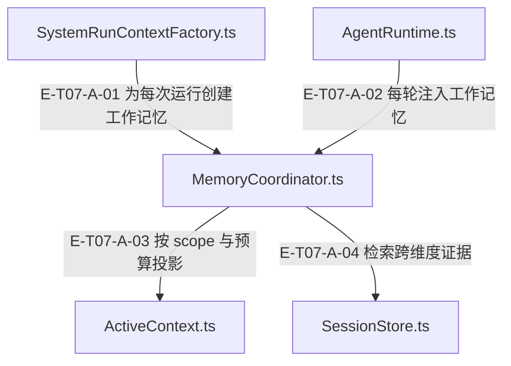

# 07 · 记忆、上下文与提示

> 工作发现怎样跨轮保留、跨维度复用及跨会话固化，历史压缩又保留哪些信息？

三层记忆分别是 scope 内 ActiveContext、会话级 SessionStore 与跨会话 PersistentMemory。MemoryCoordinator 管理 scope 和动态 prompt，但不是所有访问的唯一路由；Analyst 直接通过 MemoryPrompt 读取持久语义记忆。ContextWindow 的 L1–L4 是另一组压缩步骤，不是记忆层级。

[真实调用](call-flow.md) · [直接依赖](file-dependency.md) · [15文件当前全文深读](full-source-review.md) · [阅读规范](../00-diagram-standard.md)

## 职责与主要接缝

### 本图术语说明

| 术语／节点 | 含义与范围 |
| --- | --- |
| SystemRunContextFactory.ts | `src/agent/service/SystemRunContextFactory.ts`；本图按实现文件聚合职责；具体装配条件见下表。 |
| MemoryCoordinator.ts | `src/agent/memory/MemoryCoordinator.ts`；本图按实现文件聚合职责；具体装配条件见下表。 |
| AgentRuntime.ts | `src/agent/runtime/AgentRuntime.ts`；本图按实现文件聚合职责；具体装配条件见下表。 |
| ActiveContext.ts | `src/agent/memory/ActiveContext.ts`；本图按实现文件聚合职责；具体装配条件见下表。 |
| SessionStore.ts | `src/agent/memory/SessionStore.ts`；本图按实现文件聚合职责；具体装配条件见下表。 |

| 编号 | 代码依据 | 测试依据 | 关系与可证明范围 |
| --- | --- | --- | --- |
| E-T07-A-01 | `src/agent/service/SystemRunContextFactory.ts#createSystemContext` → `src/agent/memory/MemoryCoordinator.ts#createDimensionScope` | `test/agent-lifecycle.test.ts#case:factory%20contexts%20retain%20scoped%20mutable%20resources%20but%20isolate%20separate%20runs`；已读用例：两个相同 label 的运行仍有不同 coordinator/contextWindow，sharedState 互不污染，trace 指向本运行 activeContext，scopeId 保留。断言已定位；本轮未运行，执行状态另见页面证据。 | 工厂构造 mode=bootstrap 的 coordinator，创建 scan:<label> scope、ContextWindow 和 tracker；此默认构造没有注入 SessionStore 或 PersistentMemory。 |
| E-T07-A-02 | `src/agent/runtime/AgentRuntime.ts#prepareIteration` → `src/agent/memory/MemoryCoordinator.ts#buildDynamicMemoryPrompt` | 未覆盖：本轮已读 Runtime 真实调用点；所读 memory-context 单元测试覆盖 coordinator 的预算/scope行为，没有单独证明此 Runtime 分支的集成断言。 | 系统运行每轮按 analyst/producer 与 dimensionScopeId 读取动态工作记忆，追加到 ephemeral dynamicContext；静态 systemPrompt 保持稳定，动态层不写进 ContextWindow。 |
| E-T07-A-03 | `src/agent/memory/MemoryCoordinator.ts#dynamicPromptForBudget` → `src/agent/memory/ActiveContext.ts#buildContext` | `test/memory-context.test.ts#case:returns%20an%20empty%20dynamic%20memory%20prompt%20without%20scopeId%20when%20several%20scopes%20are%20active`；已读用例：两 scope 下缺 scopeId 返回空且告警含 scopes=2；显式指定 dimB 时包含 dimB 发现。另单 scope 用例验证隐式回退仍可写、可读且记 debug。断言已定位；本轮未运行，执行状态另见页面证据。 | 动态 prompt 使用目标 scope、相同 mode 的预算快照与 surplus；ActiveContext.buildContext 只投影 scratchpad 与已压缩观察台账，外层再按 token 预算截断，不把计划或近期原始观察自动拼进此片段。多 scope 且缺 scopeId 返回空并警告。 |
| E-T07-A-04 | `src/agent/memory/MemoryCoordinator.ts#searchEvidenceWithDiagnostics` → `src/agent/memory/SessionStore.ts#searchEvidence` | `test/memory-context.test.ts#case:returns%20visible%20degraded%20diagnostics%20when%20evidence%20search%20fails`；已读用例：模拟 SessionStore.searchEvidence 抛错，断言 ok=false、degraded=true、results=[]、MEMORY_EVIDENCE_SEARCH_FAILED；缺 SessionStore 用例断言单独缺失原因。断言已定位；本轮未运行，执行状态另见页面证据。 | coordinator 将 query/dimId 交给 SessionStore，缺存储或存储抛错返回结构化 degraded 诊断；SessionStore 的维度报告替换先校验再同步重建证据与 crossRefs。 |

## 输入、输出与副作用

| 维度 | 当前实现 |
| --- | --- |
| 输入 | 工作层接收轮次、真实工具回执、note_finding、计划及 scopeId。；会话层接收维度报告、digest、crossRefs、反思和已提交候选；持久层接收候选记忆及宿主数据库/可选 embedding 端口。；提示构建接收模式、任务 query、tokenBudget、abortSignal/deadline；压缩接收历史与结构化 L4 memory package。 |
| 输出 | 工作/session/semantic prompt 的预算内片段与结构化检索/固化回执；独立会话快照；Provider 可见历史投影及 L4 成功、失败、取消或跳过结果。ContextWindow 的历史压缩预算是触发条件，保留最近工具轮和证据尾注时不保证严格降到目标上限。 |
| 副作用 | ActiveContext 与 SessionStore 更新进程内状态；SessionStore 报告替换同时更新派生证据索引。；MemoryStore 对宿主数据库执行同步 SQL；Consolidator 在事务内合并、替换与容量淘汰。；Retriever 对被注入 prompt 的记忆更新访问热度；embedding sidecar 可由显式配置持久化。；L1/L2 可改写原始历史，L3 仅改变读时投影，L4 成功后才替换历史并记压缩诊断。 |

## 从这些文件开始

| 文件 | 阅读目的 |
| --- | --- |
| `src/agent/memory/MemoryCoordinator.ts` | scope、模式预算、动态 prompt 与 SessionStore 证据检索代理 |
| `src/agent/memory/ActiveContext.ts` | 轮次、观察、结构化发现、计划与蒸馏的工作记忆 |
| `src/agent/memory/SessionStore.ts` | 维度报告、digest、交叉引用、证据索引与快照 |
| `src/agent/memory/PersistentMemory.ts` | 跨会话门面，组合 Store/Retriever/Consolidator |
| `src/agent/memory/MemoryStore.ts` | 消费 Core semantic memory schema 的同步 raw SQLite adapter |
| `src/agent/memory/MemoryRetriever.ts` | 相关性排序、词法/向量融合与预算内 prompt 选择 |
| `src/agent/memory/MemoryConsolidator.ts` | 事务内冲突替换、ADD/UPDATE/MERGE/NOOP 与容量控制 |
| `src/agent/memory/EpisodicConsolidator.ts` | SessionStore findings/reflections/analysisText 提取后固化 |
| `src/agent/memory/MemoryPrompt.ts` | 模式预算与有截止时间的持久记忆读取 |
| `src/agent/context/ContextWindow.ts` | 原始历史、provider 投影与 L1–L4 压缩 |
| `src/agent/context/l4MemoryPackage.ts` | 结构化压缩包、摘要覆盖检查与稳定摘要包装 |
| `src/agent/prompts/insightAnalyst.ts` | 组装分析提示，直接读取 session/semantic memory |

## 失败、取消与恢复

- 持久读取或 embedding 超时：默认读取期限 5 秒，嵌套共享 deadline；持久片段失败降级空段，embedding 失败可回退词法；迟到结果不重新进入消费路径。
- 多 scope 未指明目标：动态读返回空；noteFinding 拒绝记录并返回 missing-active-context；单 scope 仍允许明确诊断的兼容回退。
- 固化写失败：同一事务回滚旧代删除与此前新写入；零候选替换显式跳过。非空但全为无效短/空白候选仍先删旧代，现源码可见这一边界，不能声称已防住。
- L4 开关关闭返回 l4_disabled 且不调用 Provider；Provider 调用及返回后的取消、失败、历史并发变化会保留原历史，取消只以调用方 signal 为准。包构造、render 与原历史 JSON 快照在该 try 之外，畸形已标 kind 的包或不可序列化历史可能直接抛错，不能说所有 L4 失败都返回结构化回执。
- 恢复快照形状损坏：SessionStore.fromJSON 先 validateSessionStoreShape，再构建集合并恢复；坏快照不应被当成已恢复状态。evidenceStore 缺席才从报告重建证据，显式空对象保持空；旧归属迁移仅认领与报告匹配的条目，独立证据保留。

## 已知边界与未验证范围

- MemoryCoordinator不是唯一记忆入口：静态prompt与conversationLog摘要便利口仍保留但非默认消费；checkpoint/restore、生命周期与对话提取成员已经删除。SessionStore只提供toJSON/fromJSON快照边界，宿主负责保存与dispose。
- SystemRunContextFactory 默认只建 coordinator+ActiveContext；SessionStore/PersistentMemory 的实际启用必须检查宿主注入。本事实包未把所有宿主视为已接入。
- ActiveContext 的 maxRecentRounds 实际按 recentObservations 条目数裁剪，不按完整轮次分组；一轮多次调用也可能把本轮较早观察压缩。scratchpad 的“不可压缩”是保留存储，预算不足时其投影仍可省略。
- ContextWindow 的 L3 至少保最近两轮工具调用，并钉住 L4 摘要；provider-input 预算只触发压缩而非保证达标。证据保尾截断会给正文至少 200 字、尾注最多 801 字（800 加省略号），也可能超过 maxChars。
- L4 覆盖检查是最低条件：前三个 findings 任一个有词项/标记命中、前五条证据任一路径/文件名命中、前四项 failure 的任一针词命中即可；不是逐项覆盖或摘要语义等价证明，且默认关闭。
- 本轮复核到 MemoryConsolidator 的全无效非空候选会越过零候选防护；这是源码现状与原报告导航一致，不引用旧 probe 的通过结论，也未新运行复现。
- 简体中文 prompt、Core SOP/知识字段合同与预算装配是 Agent 编排能力；不把 Core schema/迁移复制到 Agent。

[scope与会话恢复](source-review-and-recovery.md) 保留内存换代闭环；[当前全文深读](full-source-review.md) 记录本轮 15 文件连续分段、读取前后 SHA、72 条分支与未覆盖项。v4 执行事实留在历史快照，本轮不借用旧通过结论。

## 当前入口收窄

ConversationStore只保留create/append/load；load继续兼容旧[对话摘要]，但不再调用模型生成摘要。ActiveContext统一通过recordToolCall记录观察，计划覆盖经expectPlan与extractAndSetPlan，旧lightweight/fromJSON已删除。ContextWindow的L4初始关闭，仅由BudgetController同步enableL4Compaction；旧enableL4LLM构造字段被忽略。

`test/conversation-store-legacy-summary.test.ts#case:keeps%20a%20leading%20legacy%20summary%20and%20the%20newest%20message%20when%20load%20exceeds%20the%20token%20budget`；断言已定位；本轮未运行，执行状态另见页面证据。超过读取预算时旧摘要与最新消息在能同时放入时保留。 边界：真实临时 JSONL，读取兼容，不调用 AI 摘要。

`test/agent-policy-budget-exit-narrowing.test.ts#case:a%20stray%20enableL4LLM%20config%20is%20ignored%3A%20L4%20starts%20off%20and%20only%20syncL4CompactionSwitch%20turns%20it%20on`；断言已定位；本轮未运行，执行状态另见页面证据。旧 enableL4LLM 被忽略；窗口初始关闭，仅 syncL4CompactionSwitch 可开启。 边界：ContextWindow 控制开关局部行为。

当前投影和恢复边界的直接断言：`test/ActiveContext.test.ts#case:counts%20complete%20CJK%2Femoji%20ledger%20headers%20and%20sections%20at%20every%20small%20budget` 逐个检查 0–260 的本地估算预算；它不能证明真实 Provider tokenizer 一致。`test/ContextWindow.test.ts#case:C01%20keeps%20the%20L4%20memory%20summary%20when%20it%20is%20the%20only%20message%20before%20the%20collapse%20boundary` 断言无可折叠内容时投影长度原样、无额外 Collapsed marker；不代表阶段消息数上限达标。`test/memory-context.test.ts#case:rebuilds%20legacy%20evidence%20only%20when%20the%20persisted%20evidence%20field%20is%20absent` 对照缺字段恢复一条与显式空索引恢复零条。三项均已读断言，本轮未运行。
