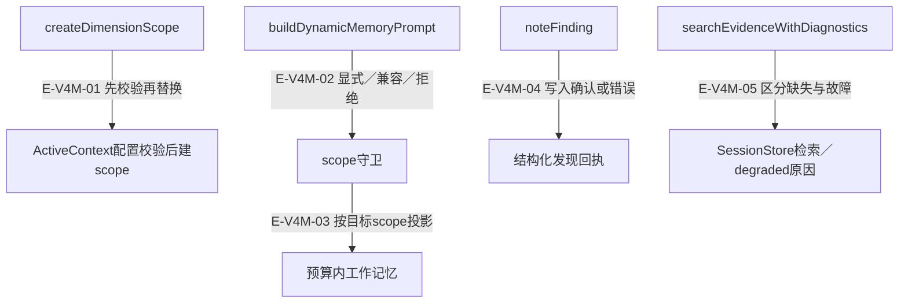
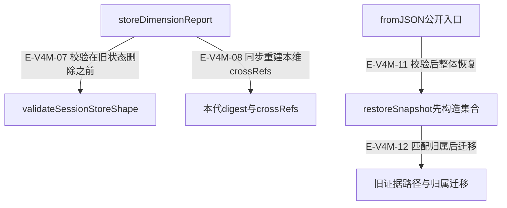

# scope、会话换代与恢复：逐文件深读

本轮已重新顺序读完当前 ActiveContext、MemoryCoordinator、SessionStore、SessionStoreSchema 与 memory 出口的全部正文；逐段与SHA记录见新的全文深读页。下面分开描述默认消费链、宿主注入责任和保留的便利API。所引断言包括真实内存对象/JSON快照、受控端口与编译探针；本轮未运行这些测试，没有真实AI服务或宿主文件耐久性验证。

[专题职责](overview.md) · [15文件当前全文深读](full-source-review.md) · [逐文件索引](../file-index.md) · [执行记录](../../evidence/scoped-execution.json)

## 工作scope的读写与所有权

### 本图术语说明

| 节点／术语 | 本图含义 |
| --- | --- |
| scope守卫 | 只保护内部动态读与noteFinding；公开无参getActiveContext仍取最近scope。 |
| degraded | 缺存储和存储失败是两类原因，不与零命中混为一谈。 |
| 所有权 | scope随会话级Coordinator对象回收；Coordinator已无dispose。SessionStore仍由宿主显式dispose。 |

| 编号 | 代码依据 | 测试依据 | 关系与可证明范围 |
| --- | --- | --- | --- |
| E-V4M-01 | `src/agent/memory/MemoryCoordinator.ts#MemoryCoordinator.createDimensionScope`；`src/agent/memory/ActiveContext.ts#ActiveContext.constructor` | `test/ActiveContext.test.ts#case:rejects%20an%20invalid%20scope%20without%20replacing%20the%20current%20active%20context`；断言已定位；本轮未运行，执行状态另见页面证据。非法maxRecentRounds抛RangeError，原scope仍为当前，invalid scope不存在。 | 先验证配置再创建／替换scope，拒绝输入不能清掉原工作记忆。 |
| E-V4M-02 | `src/agent/memory/MemoryCoordinator.ts#MemoryCoordinator.buildDynamicMemoryPrompt`；`src/agent/memory/MemoryCoordinator.ts#MemoryCoordinator.resolveScopedContext` | `test/memory-context.test.ts#case:returns%20an%20empty%20dynamic%20memory%20prompt%20without%20scopeId%20when%20several%20scopes%20are%20active`；断言已定位；本轮未运行，执行状态另见页面证据。多scope动态读为空且告警；显式dimB可见B发现；公开无参getter仍返回最近scope。 边界：真实Coordinator/ActiveContext内存scope与日志spy；未注入SessionStore或运行多维宿主调度。 | 显式scope / 单scope隐式兼容 / 多scope拒绝。 |
| E-V4M-03 | `src/agent/memory/MemoryCoordinator.ts#MemoryCoordinator.dynamicPromptForBudget`；`src/agent/memory/ActiveContext.ts#ActiveContext.buildContext` | `test/memory-context.test.ts#case:keeps%20the%20single-scope%20implicit%20fallback%20writable%20and%20logs%20implicit-current-scope%20at%20debug`；断言已定位；本轮未运行，执行状态另见页面证据。单scope读写成功并有implicit-current-scope诊断。 边界：真实Coordinator/ActiveContext内存scope与日志spy；未注入SessionStore或运行多维宿主调度。 | 只投影目标scope的scratchpad与已压缩观察台账；中止、无预算或异常为空。近期原始观察和计划不在此动态片段中。 |
| E-V4M-04 | `src/agent/memory/MemoryCoordinator.ts#MemoryCoordinator.noteFinding`；`src/agent/memory/ActiveContext.ts#ActiveContext.noteKeyFinding` | `test/memory-context.test.ts#case:reports%20non-Error%20throws%20by%20value%20in%20noteFinding%20receipts%20instead%20of%20%22undefined%22`；断言已定位；本轮未运行，执行状态另见页面证据。noteKeyFinding抛字符串时recorded:false/target:error，消息保留字符串。 边界：真实Coordinator/ActiveContext，noteKeyFinding通过spy抛非Error；未调用SessionStore。 | 成功写入才recorded:true；异常是结构化错误。 |
| E-V4M-05 | `src/agent/memory/MemoryCoordinator.ts#MemoryCoordinator.searchEvidenceWithDiagnostics`；`src/agent/memory/SessionStore.ts#SessionStore.searchEvidence` | `test/memory-context.test.ts#case:returns%20visible%20degraded%20diagnostics%20when%20evidence%20search%20fails`；断言已定位；本轮未运行，执行状态另见页面证据。存储抛错得到ok:false/degraded:true与稳定原因码；旧数组接口只返回空数组。 边界：真实Coordinator；缺Store路径没有SessionStore，查询故障由searchEvidence端口替身抛错；handler定位用例只调用本地handler。 | 未配置与读失败保留不同degraded原因。 |

## 报告换代与宿主快照边界

### 本图术语说明

| 节点／术语 | 本图含义 |
| --- | --- |
| 报告换代 | 只移除本维报告派生的索引，旧快照恢复的独立证据与其他维度保留。 |
| digest三态 | 缺省沿用、null清空、对象替换；入口归一化与严格快照校验不是同一道门。 |
| 快照边界 | toJSON返回独立副本；fromJSON先校验再创建新Store。文件保存、原子替换、期限与重启策略由宿主负责。 |
| 恢复入口 | fromJSON调用restoreSnapshot；不再有对已存活Store调用loadCheckpoint的路径。 |

| 编号 | 代码依据 | 测试依据 | 关系与可证明范围 |
| --- | --- | --- | --- |
| E-V4M-07 | `src/agent/memory/SessionStore.ts#SessionStore.storeDimensionReport`；`src/agent/memory/SessionStoreSchema.ts#validateSessionStoreShape` | `test/memory-context.test.ts#case:bad%20report%20replacement%20must%20not%20remove%20the%20live%20report%20indexes`；断言已定位；本轮未运行，执行状态另见页面证据。坏findings导致写入抛错，整个旧会话快照仍相等。 边界：真实内存SessionStore与快照/日志spy；不涉及Coordinator编排、宿主文件写入或进程重启。 | 校验成功才换代报告/本维派生索引。 |
| E-V4M-08 | `src/agent/memory/SessionStore.ts#SessionStore.storeDimensionReport`；`src/agent/memory/SessionStore.ts#SessionStore.pushDigestCrossRefs` | `test/memory-context.test.ts#case:keeps%20an%20earlier%20digest%20and%20its%20crossRefs%20when%20a%20resumed%20report%20omits%20digest`；断言已定位；本轮未运行，执行状态另见页面证据。先恢复digest再写不带digest报告，digest和crossRefs保留；再次换代不累加。 边界：真实内存SessionStore与快照/日志spy；不涉及Coordinator编排、宿主文件写入或进程重启。 | 按保留/清空/替换后的digest重建crossRefs。 |
| E-V4M-11 | `src/agent/memory/SessionStore.ts#SessionStore.fromJSON`；`src/agent/memory/SessionStore.ts#SessionStore.restoreSnapshot` | `test/memory-context.test.ts#case:migrates%20legacy%20ledger-label%20evidence%20indexes%20before%20replacing%20a%20restored%20report`；断言已定位；本轮未运行，执行状态另见页面证据。旧E-id索引恢复为两个文件键；替换为空报告会清除其派生项。 边界：真实内存SessionStore与快照/日志spy；不涉及Coordinator编排、宿主文件写入或进程重启。 | 公开恢复先验证，再构建所有集合并迁移旧证据归属。 |
| E-V4M-12 | `src/agent/memory/SessionStore.ts#SessionStore.restoreSnapshot`；`src/agent/memory/SessionStore.ts#evidenceFilePaths` | `test/memory-context.test.ts#case:legacy%20snapshots%20infer%20report%20ownership%20without%20deleting%20distinct%20independent%20evidence`；断言已定位；本轮未运行，执行状态另见页面证据。缺reportDimId的旧索引只认领匹配finding/importance项；独立同维证据保留。 边界：真实内存SessionStore与快照/日志spy；不涉及Coordinator编排、宿主文件写入或进程重启。 | 从E-id标注识别文件路径，归属匹配后才迁移；保留独立项。 |

## 逐文件职责与当前复核范围

### ActiveContext 的保留计数与动态投影

`src/agent/memory/ActiveContext.ts#ActiveContext.recordToolCall` 的 while 条件比较 recentObservations.length 与 maxRecentRounds，所以该选项实际保留最近 N 条观察，不是 N 个完整轮次。一轮多工具调用可能立即把同轮较早观察转入压缩台账；0 表示所有观察即时压缩。

`src/agent/memory/ActiveContext.ts#ActiveContext.buildContext` 先按重要性投影 scratchpad，再按剩余预算装配已压缩 Observation Ledger。它不直接渲染 plan 或最近原始观察；原发现仍在存储中不表示该轮模型一定可见。`src/agent/memory/ActiveContext.ts#ActiveContext.distill` 才将压缩观察和近期观察都转为摘要，并附发现refs、plan和已结束轮次stats。

| 情形 | 行为与恢复边界 | 已读断言 |
| --- | --- | --- |
| 部分批量读取失败 | 成功文件进入readSet，失败成员进入failureSet与nextHints，错误不会被压缩成全批成功。重试仍由模型/宿主决定。 | `test/ActiveContext.test.ts#case:records%20partially%20failed%20batch%20reads%20in%20the%20ledger%20failureSet%20and%20nextHints`：手工合法envelope验证成功/失败路径分别投影及失败摘要；未读取真实文件。 |
| 小预算省略发现或台账 | 存储未删除，投影按预算略去并记录omitted/skipped；不是所有scratchpad永远注入。 | `test/ActiveContext.test.ts#case:counts%20complete%20CJK%2Femoji%20ledger%20headers%20and%20sections%20at%20every%20small%20budget`：逐个0–260预算断言本地estimateTokens不超额；未用Provider tokenizer。 |
| 快照恢复范围 | ActiveContext无fromJSON；toJSON不保存原始观察滑窗供恢复，宿主恢复SessionStore后重新建scope。 | `test/memory-retired-members.test.ts#case:keeps%20the%20production%20entrypoints%20that%20replace%20the%20retired%20members`：原型/静态成员存在性检查，不等同恢复宿主流程。 |

以上断言本轮只读未运行；[完整失败分支记录](full-source-review.md) 继续列出不可序列化结果、计划授权过期/保留和未覆盖项。

### MemoryCoordinator.ts

`src/agent/memory/MemoryCoordinator.ts`

作用域工作记忆、预算快照、会话证据检索代理；兼容便利接口不是默认生产链。

默认Runtime仅调用动态prompt；memory handler调用noteFinding/searchEvidenceWithDiagnostics；每次运行的工厂创建ActiveContext，持久读取在Analyst另行装配。

| 语义复核项 | 当前实现与定位 |
| --- | --- |
| 模式与预算 | configure/allocateBudget及每次静态请求自己的预算snapshot；这些便利接口仍保留。 |
| 真实默认读取 | Runtime调用buildDynamicMemoryPrompt；多scope缺scopeId拒绝隐式选择。 |
| 确认写入 | noteFinding→ActiveContext.noteKeyFinding；异常返回recorded:false，不再有对话规则提取append路径。 |
| scope创建 | createDimensionScope先校验ActiveContext选项，再替换目标scope与清旧预算快照。 |
| 会话检索 | searchEvidenceWithDiagnostics把缺Store与检索故障区分；旧数组接口仍只返回results。 |
| 剩余便利口 | buildStaticMemoryPrompt/buildMemoryPrompt、getConversationLog/onConversationUpdated仍非默认消费；writeFailures无写入者恒空。 |
| 生命周期退役 | completeDimension/completeSession/checkpoint/restore/dispose/getPersistentMemory已删除；宿主持有SessionStore生命周期。 |

| 触发条件 | 实际行为 | 恢复／停止依据 | 源码与测试证据 |
| --- | --- | --- | --- |
| 多scope且动态读/写未传scopeId | 内部守卫拒绝隐式选择：读空串、写recorded:false；公开getActiveContext无参保持最近scope语义。 | 调用方传实际scopeId；不是重试同一无scope请求。 | `src/agent/memory/MemoryCoordinator.ts#MemoryCoordinator.resolveScopedContext`；`src/agent/memory/MemoryCoordinator.ts#MemoryCoordinator.getActiveContext` `test/memory-context.test.ts#case:rejects%20noteFinding%20without%20scopeId%20when%20two%20scopes%20are%20active%20and%20warns%20with%20the%20scope%20count`；断言已定位；本轮未运行，执行状态另见页面证据。缺scopeId拒绝且两个scratchpad均0；显式dimA仅写A。 边界：真实Coordinator/ActiveContext内存scope与日志spy；未注入SessionStore或运行多维宿主调度。 `test/memory-context.test.ts#case:returns%20an%20empty%20dynamic%20memory%20prompt%20without%20scopeId%20when%20several%20scopes%20are%20active`；断言已定位；本轮未运行，执行状态另见页面证据。多scope动态读为空且告警；显式dimB可见B发现；公开无参getter仍返回最近scope。 边界：真实Coordinator/ActiveContext内存scope与日志spy；未注入SessionStore或运行多维宿主调度。 `test/memory-context.test.ts#case:keeps%20the%20single-scope%20implicit%20fallback%20writable%20and%20logs%20implicit-current-scope%20at%20debug`；断言已定位；本轮未运行，执行状态另见页面证据。单scope读写成功并有implicit-current-scope诊断。 边界：真实Coordinator/ActiveContext内存scope与日志spy；未注入SessionStore或运行多维宿主调度。 |
| 并发scope静态读取或中途预算重新配置 | 每次请求持独立snapshot；旧请求不能覆盖另一scope的surplus，也不会扩大原请求总预算。 | 新请求读取新配置；static便利API的行为不证明默认Runtime使用它。 | `src/agent/memory/MemoryCoordinator.ts#MemoryCoordinator.assembleStaticPrompt`；`src/agent/memory/MemoryCoordinator.ts#MemoryCoordinator.buildMemoryPrompt` `test/memory-context.test.ts#case:isolates%20per-scope%20budgets%20when%20asynchronous%20reads%20finish%20in%20reverse%20order`；断言已定位；本轮未运行，执行状态另见页面证据。两个scope异步静态读取逆序完成，b的producer动态预算始终为100；不证明静态便利接口在默认链路启用。 边界：真实Coordinator与scope，持久读取用延迟Promise替身，动态buildContext用spy；未验证真实数据库并发。 `test/memory-context.test.ts#case:keeps%20the%20complete%20request%20budget%20stable%20across%20concurrent%20reconfiguration`；断言已定位；本轮未运行，执行状态另见页面证据。100预算的pending请求中途allocateBudget到1000，既有请求最终仍≤100。 边界：真实Coordinator与scope，持久读取用延迟Promise替身，动态buildContext用spy；未验证真实数据库并发。 |
| 未配置SessionStore / 存储检索抛错 | 前者ok:true+degraded+missing，后者ok:false+degraded+search-failed；都不是成功检索到零证据。 | 宿主注入/修复端口；handler消费诊断，旧数组接口丢失原因。 | `src/agent/memory/MemoryCoordinator.ts#MemoryCoordinator.searchEvidenceWithDiagnostics` `test/memory-context.test.ts#case:locates%20the%20missing-SessionStore%20degradation%20in%20logs%20when%20get_previous_evidence%20runs%20through%20the%20handler`；断言已定位；本轮未运行，执行状态另见页面证据。真实memory handler两次调用均degraded；首次warn、后续debug带各自query。 边界：真实Coordinator；缺Store路径没有SessionStore，查询故障由searchEvidence端口替身抛错；handler定位用例只调用本地handler。 `test/memory-context.test.ts#case:returns%20visible%20degraded%20diagnostics%20when%20evidence%20search%20fails`；断言已定位；本轮未运行，执行状态另见页面证据。存储抛错得到ok:false/degraded:true与稳定原因码；旧数组接口只返回空数组。 边界：真实Coordinator；缺Store路径没有SessionStore，查询故障由searchEvidence端口替身抛错；handler定位用例只调用本地handler。 |
| noteKeyFinding抛错 | noteFinding返回recorded:false、target:error与可读错误；没有持久append写入链。 | 调用方先看该finding回执，不能把writeFailures恒空当作成功持久化。 | `src/agent/memory/MemoryCoordinator.ts#MemoryCoordinator.noteFinding` `test/memory-context.test.ts#case:reports%20non-Error%20throws%20by%20value%20in%20noteFinding%20receipts%20instead%20of%20%22undefined%22`；断言已定位；本轮未运行，执行状态另见页面证据。noteKeyFinding抛字符串时返回结构化错误。 |

边界与未验证项：

- 缺scope保护只用于内部读写入口，不覆盖公开无参getter。
- deprecated注释的宿主零消费者结论只按本仓使用点及现注释说明，本轮没有扫描或验收相邻宿主。

### SessionStore.ts

`src/agent/memory/SessionStore.ts`

会话报告、证据索引、digest、反思、候选与快照；无工具结果缓存或清理定时器。

报告输入先克隆/校验再换代；digest/反思单项入口有各自归一化；addSubmittedCandidate只是独立追加，不能继承前两者的schema保证。上下文按建议/反思优先装配；toJSON/fromJSON为公开快照合同；旧文件checkpoint链已删除，不承诺自动保存或宿主耐久性。

| 语义复核项 | 当前实现与定位 |
| --- | --- |
| 数据与兼容配置 | 构造克隆projectContext；旧ttlMs/cleanupIntervalMs仅一条debug且不注册timer；cache统计保持全零过渡形状。 |
| 报告换代 | storeDimensionReport在删旧索引前完成clone/normalize/shape验证；按reportDimId只替换本维派生证据。 |
| digest与反思 | digest缺省沿用/null清空/对象替换；单项AI输入归一化并记录诊断；反思当前不按dimId过滤。 |
| 上下文预算 | header/crossRefs/reflections/dimensions/files按优先级装配，超预算截断并说明被裁类别。 |
| 快照恢复 | toJSON深拷贝；fromJSON验证后新建Store；缺证据字段才重建，旧ledger标签与归属按匹配规则迁移。 |
| 释放 | dispose幂等清空报告/证据/建议/反思/候选，保留projectContext；它不设置closed标记，之后仍可调用写入方法。宿主负责调用，无后台timer持有。 |

| 触发条件 | 实际行为 | 恢复／停止依据 | 源码与测试证据 |
| --- | --- | --- | --- |
| 坏报告整代替换 | 克隆、normalize和schema验证都发生在删旧证据之前；被拒时live报告/索引保留。 | 修正输入后重试；候选独立列表不是报告替换时一并清空。 | `src/agent/memory/SessionStore.ts#SessionStore.storeDimensionReport` `test/memory-context.test.ts#case:bad%20report%20replacement%20must%20not%20remove%20the%20live%20report%20indexes`；断言已定位；本轮未运行，执行状态另见页面证据。坏findings导致写入抛错，整个旧会话快照仍相等。 边界：真实内存SessionStore与快照/日志spy；不涉及Coordinator编排、宿主文件写入或进程重启。 `test/memory-context.test.ts#case:new%20report%20generations%20retain%20unrelated%20and%20independent%20restored%20evidence`；断言已定位；本轮未运行，执行状态另见页面证据。fromJSON之后替换报告只删本代索引，保留其他维度和独立证据；publicEvidence去掉归属标签。 边界：真实内存SessionStore与快照/日志spy；不涉及Coordinator编排、宿主文件写入或进程重启。 |
| 恢复顺序不同或digest缺省/null/对象 | 缺省保留既有digest；null清空；对象整体替换，crossRefs按本代重建。非对象假值仍沿用历史\|\|null清空路径。 | 明确使用null表达清空；不要把缺省当清空。 | `src/agent/memory/SessionStore.ts#SessionStore.storeDimensionReport`；`src/agent/memory/SessionStore.ts#SessionStore.addDimensionDigest` `test/memory-context.test.ts#case:keeps%20an%20earlier%20digest%20and%20its%20crossRefs%20when%20a%20resumed%20report%20omits%20digest`；断言已定位；本轮未运行，执行状态另见页面证据。先恢复digest再写不带digest报告，digest和crossRefs保留；再次换代不累加。 边界：真实内存SessionStore与快照/日志spy；不涉及Coordinator编排、宿主文件写入或进程重启。 `test/memory-context.test.ts#case:clears%20the%20digest%20and%20its%20crossRefs%20only%20when%20a%20report%20passes%20digest%3A%20null`；断言已定位；本轮未运行，执行状态另见页面证据。null清空；显式新对象替换，只保留新目标建议。 边界：真实内存SessionStore与快照/日志spy；不涉及Coordinator编排、宿主文件写入或进程重启。 |
| AI digest/反思字段漂移 | addDimensionDigest/addTierReflection修复可归一化字段并warn；整体非对象抛Error，状态不改。storeDimensionReport仍走严格快照校验。 | 按入口区分容错与严格拒绝，不能认为所有写入都自动修复。 | `src/agent/memory/SessionStore.ts#SessionStore.addDimensionDigest`；`src/agent/memory/SessionStore.ts#SessionStore.addTierReflection` `test/memory-context.test.ts#case:normalizes%20a%20malformed%20AI%20digest%20at%20addDimensionDigest%20with%20a%20located%20warning`；断言已定位；本轮未运行，执行状态另见页面证据。错误的summary/candidateCount/keyFindings/crossRefs/gaps逐字段修复；保留合法值并可fromJSON。 边界：真实内存SessionStore与快照/日志spy；不涉及Coordinator编排、宿主文件写入或进程重启。 `test/memory-context.test.ts#case:normalizes%20a%20malformed%20tier%20reflection%20at%20addTierReflection%20and%20keeps%20it%20round-trippable`；断言已定位；本轮未运行，执行状态另见页面证据。反思逐字段归一化、补tierIndex，非对象拒绝且已有反思不变。 边界：真实内存SessionStore与快照/日志spy；不涉及Coordinator编排、宿主文件写入或进程重启。 |
| 上下文预算不足 | header→crossRefs→reflections→dimensions→files顺序尾部截断，日志仅类别计数；极小预算仍可能裁掉建议/反思。 | 按日志识别被裁段落，必要时通过evidence检索补细节。 | `src/agent/memory/SessionStore.ts#SessionStore.buildContextForDimension`；`src/agent/memory/SessionStore.ts#SessionStore.logContextTruncation` 仅源码依据：本页未绑定对应故障注入用例，不能声明当前行为已执行通过。 |
| 快照缺证据字段或旧ledger标签 | 缺字段才重建；显式空evidenceStore保持空。旧标签仅迁移与报告相匹配项，独立证据保留。 | 使用fromJSON校验/迁移，不直接拷贝内部Map。 | `src/agent/memory/SessionStore.ts#SessionStore.fromJSON`；`src/agent/memory/SessionStore.ts#SessionStore.restoreSnapshot`；`src/agent/memory/SessionStore.ts#evidenceFilePaths` `test/memory-context.test.ts#case:migrates%20legacy%20ledger-label%20evidence%20indexes%20before%20replacing%20a%20restored%20report`；断言已定位；本轮未运行，执行状态另见页面证据。旧E-id索引恢复为两个文件键；替换为空报告会清除其派生项。 边界：真实内存SessionStore与快照/日志spy；不涉及Coordinator编排、宿主文件写入或进程重启。 `test/memory-context.test.ts#case:legacy%20snapshots%20infer%20report%20ownership%20without%20deleting%20distinct%20independent%20evidence`；断言已定位；本轮未运行，执行状态另见页面证据。缺reportDimId的旧索引只认领匹配finding/importance项；独立同维证据保留。 边界：真实内存SessionStore与快照/日志spy；不涉及Coordinator编排、宿主文件写入或进程重启。 `test/memory-context.test.ts#case:new%20report%20generations%20retain%20unrelated%20and%20independent%20restored%20evidence`；断言已定位；本轮未运行，执行状态另见页面证据。fromJSON之后替换报告只删本代索引，保留其他维度和独立证据；publicEvidence去掉归属标签。 边界：真实内存SessionStore与快照/日志spy；不涉及Coordinator编排、宿主文件写入或进程重启。 |
| 外部改写快照或回执／宿主释放会话 | 查询和toJSON提供独立副本；dispose清空Store数据，Coordinator仍引用这个已清空对象。 | 宿主显式dispose，不再经Coordinator转发。 | `src/agent/memory/SessionStore.ts#SessionStore.toJSON`；`src/agent/memory/SessionStore.ts#SessionStore.dispose` `test/memory-session-store-lazy-cleanup.test.ts#case:leaves%20an%20injected%20SessionStore%20to%20its%20host%20owner%20now%20that%20MemoryCoordinator%20has%20no%20dispose`；断言已定位；本轮未运行，执行状态另见页面证据。Coordinator 没有 dispose；注入 SessionStore 由宿主独立持有，显式 store.dispose 后状态清理。 边界：真实内存 Store；无外部宿主进程。 `test/memory-context.test.ts#case:snapshot%20edits%20do%20not%20mutate%20the%20current%20session`；断言已定位；本轮未运行，执行状态另见页面证据。修改快照不会影响live报告。 |

边界与未验证项：

- getRelevantReflections中的currentDimId未使用，返回所有tier反思；相关性要在调用层区分。
- `src/agent/memory/SessionStore.ts#SessionStore.addSubmittedCandidate` 只以空串回退字段；越过TS合同的truthy非字符串可能进入内存，而fromJSON严格验证会拒绝。该跨入口一致性缺口本轮仅从源码定位，没有执行probe。
- `src/agent/memory/SessionStoreSchema.ts#validateSessionStoreShape` 的structuredClone保证副本隔离，不等于任意扩展字段都可JSON持久化；循环/BigInt扩展字段与plan内部结构未在本页声明覆盖。

### index.ts

`src/agent/memory/index.ts`

记忆子路径的显式值/类型再导出；兼容公开面仍受产品政策约束。

显式导出当前类与类型。DimensionFlushManifest及extractHighPriorityFindings已经删除；DistilledContext保留type-only，不再把历史flush清单当默认写入链。

| 语义复核项 | 当前实现与定位 |
| --- | --- |
| 具名出口 | ActiveContext、Coordinator、Store/Retriever/Consolidator、EmbeddingStore、SessionStore与schema仍公开；DistilledContext仅类型，已退役flush投影不再导出。 |

边界与未验证项：

- 桶文件导出不等于默认使用；旧高优先finding投影及其evidenceRefs丢失风险已转历史记录。

## 当前公开入口与恢复边界

`test/memory-retired-members.test.ts#case:rejects%20every%20retired%20member%20and%20option%20while%20the%20kept%20entrypoints%20still%20type-check`；断言已定位；本轮未运行，执行状态另见页面证据。真实 TS 编译探针逐项拒绝旧成员和 lightweight；recordToolCall/expectPlan/extractAndSetPlan、SessionStore 快照恢复与 dispose 仍通过类型检查。 边界：源码类型面；不等于持久化宿主流程执行。

ActiveContext统一使用recordToolCall记录回执；计划覆盖经expectPlan授权与extractAndSetPlan解析，旧setPlan/updatePlan、轻量模式和有损fromJSON已删除。宿主恢复SessionStore后按维度重新创建ActiveContext，不声称恢复旧观察窗口。

`test/memory-context.test.ts#case:new%20report%20generations%20retain%20unrelated%20and%20independent%20restored%20evidence`；断言已定位；本轮未运行，执行状态另见页面证据。经 fromJSON 恢复的独立证据和其它维度证据在本维报告换代后保留。 边界：真实 SessionStore；旧独立证据来自快照，不再通过 addEvidence 写入。

历史边 E-V4M-06（Coordinator.dispose）、E-V4M-09/10（文件checkpoint写入／加载）已撤回，编号不复用；v4快照保留旧实现与旧失败说明。当前SessionStore只负责内存状态、快照形状与恢复新实例；文件写入、fsync、过期策略和进程重启恢复由宿主负责，本图谱没有验收这些外部流程。

仍保留的onConversationUpdated仅面向自带summarize的注入端口；ConversationStore自身已无summarize方法。没有默认接线时不能画成自动摘要链。Coordinator.getDiagnostics().writeFailures当前恒空，不是持久写入成功证明。

恢复索引的缺席/显式空区别有独立断言：`test/memory-context.test.ts#case:rebuilds%20legacy%20evidence%20only%20when%20the%20persisted%20evidence%20field%20is%20absent` 分别验证缺字段恢复一条、显式空对象恢复零条，并拒绝 findings:null。本轮未运行；此内存形状用例不证明宿主保存文件或进程重启。
