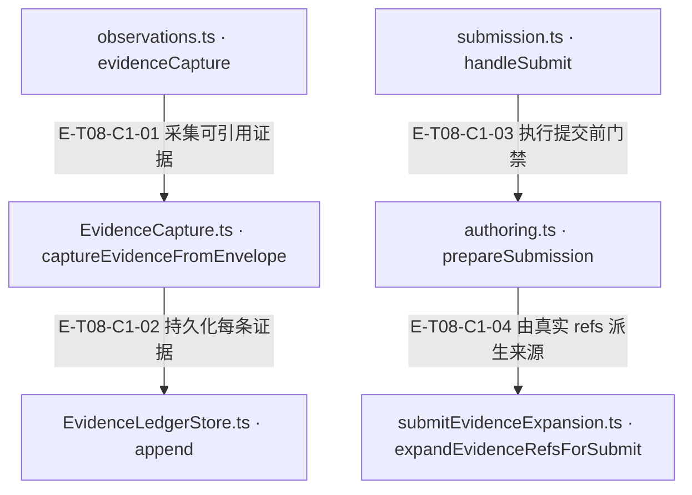
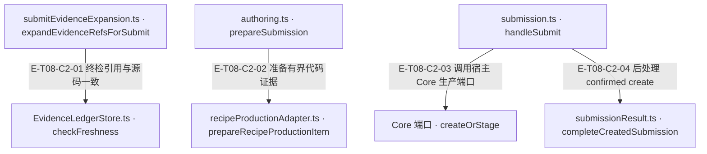
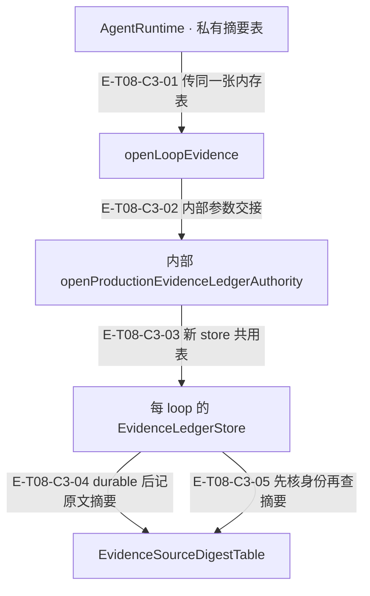

# 证据与知识提交 · 真实调用

循环观察器把成功或可用 partial 的证据工具结果规范化后追加 JSONL 台账，回显 E-x 标注。knowledge.submit 从 evidenceRefs 机械展开来源并复查 freshness，完成有界源码/authoring 检查后调用宿主注入的 Core createOrStage；已确认创建之后的只读/会话失败只能降级，不抹掉持久化身份。

[职责与边界](overview.md) · [直接依赖](file-dependency.md)

图中调用边经实现正文核对；AST只用于符号定位。接口／注入对象是调用端口，不据此推定所有宿主实现相同。断言已定位，实际执行见页面证据；具体输入、替身与断言分开说明，历史通过记录不自动证明当前源码。

## 调用接缝 1

### 本图术语说明

| 术语／节点 | 含义与范围 |
| --- | --- |
| observations.ts · evidenceCapture | `src/agent/runtime/toolPipeline/observations.ts#evidenceCapture`；声明或调用端口；动态实现的绑定条件见下表。 |
| EvidenceCapture.ts · captureEvidenceFromEnvelope | `src/agent/evidence/EvidenceCapture.ts#captureEvidenceFromEnvelope`；声明或调用端口；动态实现的绑定条件见下表。 |
| EvidenceLedgerStore.ts · append | `src/agent/evidence/EvidenceLedgerStore.ts#EvidenceLedgerStore.append`；声明或调用端口；动态实现的绑定条件见下表。 |
| submission.ts · handleSubmit | `src/tools/runtime/handlers/knowledge/submission.ts#handleSubmit`；声明或调用端口；动态实现的绑定条件见下表。 |
| authoring.ts · prepareSubmission | `src/tools/runtime/handlers/knowledge/authoring.ts#prepareSubmission`；声明或调用端口；动态实现的绑定条件见下表。 |
| submitEvidenceExpansion.ts · expandEvidenceRefsForSubmit | `src/tools/runtime/handlers/submitEvidenceExpansion.ts#expandEvidenceRefsForSubmit`；声明或调用端口；动态实现的绑定条件见下表。 |

| 编号 | 代码依据 | 测试依据 | 关系与可证明范围 |
| --- | --- | --- | --- |
| E-T08-C1-01 | `src/agent/runtime/toolPipeline/observations.ts#evidenceCapture` → `src/agent/evidence/EvidenceCapture.ts#captureEvidenceFromEnvelope` | `test/EvidenceCapture.test.ts#case:keeps%20confirmed%20evidence%20annotations%20when%20the%20next%20batch%20append%20fails`；第二次 append 注入异常，第一条真实 JSONL 与 E-1 标注保留，E-2 不出现；EVIDENCE_CAPTURE_FAILED 带 persisted count。断言已定位，实际执行见页面证据。 | 默认观察链在 tracker/trace 之前采集；批次部分失败保留 EvidenceCaptureError.entries 中已经确认的条目，不伪称零写入。 |
| E-T08-C1-02 | `src/agent/evidence/EvidenceCapture.ts#captureEvidenceFromEnvelope` → `src/agent/evidence/EvidenceLedgerStore.ts#EvidenceLedgerStore.append` | `test/evidence-capture-search-incomplete.test.ts#case:ledgers%20every%20observed%20match%20of%20a%20partial%20multi-pattern%20search%20verbatim%2C%20grouped%20by%20file`；断言 partial search 的全部观察命中逐字分组入账且 range undefined；同文件另有 timeout/aborted 零入账参数化用例。 | 仅证据工具且 readToolObservation 可用时写入；code.search 依文件分组不伪造连续 range；secret-bearing 草稿去掉 range。 |
| E-T08-C1-03 | `src/tools/runtime/handlers/knowledge/submission.ts#handleSubmit` → `src/tools/runtime/handlers/knowledge/authoring.ts#prepareSubmission` | `test/recipe-production-profile-adapter.test.ts#case:checks%20cancellation%20after%20preparation%20yields%20and%20before%20starting%20the%20Core%20write`；用例专门覆盖 prepare 的让出点取消后不能启动 Core 写入。 | 输入 fast-fail 后 await 准备；prepare 返回 rejected 时不进入 gateway，await 后再次紧邻写口检查取消。 |
| E-T08-C1-04 | `src/tools/runtime/handlers/knowledge/authoring.ts#prepareSubmission` → `src/tools/runtime/handlers/submitEvidenceExpansion.ts#expandEvidenceRefsForSubmit` | `test/knowledge-submit-stop-loss.test.ts#case:expansion%20%E5%A4%B1%E8%B4%A5%EF%BC%88evidenceRefs%20%E6%97%A0%E6%B3%95%E8%A7%A3%E6%9E%90%EF%BC%89%E5%90%8C%E6%A0%B7%E8%AE%A1%E5%85%A5%20streak%2Ftotal%20%E5%B9%B6%E5%9C%A8%E7%AC%AC%203%20%E6%AC%A1%E9%99%84%20STOP`；证据展开失败累计会话拒绝次数，第三次携带 STOP；不把拒绝循环当有效提交。 | 从 ledger 解析 refs，机械生成来源并做文件 freshness；有台账但零 refs 则 EVIDENCE_REFS_REQUIRED。 |

## 调用接缝 2

### 本图术语说明

| 术语／节点 | 含义与范围 |
| --- | --- |
| submitEvidenceExpansion.ts · expandEvidenceRefsForSubmit | `src/tools/runtime/handlers/submitEvidenceExpansion.ts#expandEvidenceRefsForSubmit`；声明或调用端口；动态实现的绑定条件见下表。 |
| EvidenceLedgerStore.ts · checkFreshness | `src/agent/evidence/EvidenceLedgerStore.ts#EvidenceLedgerStore.checkFreshness`；声明或调用端口；动态实现的绑定条件见下表。 |
| authoring.ts · prepareSubmission | `src/tools/runtime/handlers/knowledge/authoring.ts#prepareSubmission`；声明或调用端口；动态实现的绑定条件见下表。 |
| recipeProductionAdapter.ts · prepareRecipeProductionItem | `src/tools/runtime/handlers/recipeProductionAdapter.ts#prepareRecipeProductionItem`；声明或调用端口；动态实现的绑定条件见下表。 |
| submission.ts · handleSubmit | `src/tools/runtime/handlers/knowledge/submission.ts#handleSubmit`；声明或调用端口；动态实现的绑定条件见下表。 |
| Core 端口 · createOrStage | `src/tools/runtime/handlers/knowledge/contracts.ts#RecipeGatewayLike`；声明或调用端口；动态实现的绑定条件见下表。 |
| submissionResult.ts · completeCreatedSubmission | `src/tools/runtime/handlers/knowledge/submissionResult.ts#completeCreatedSubmission`；声明或调用端口；动态实现的绑定条件见下表。 |

| 编号 | 代码依据 | 测试依据 | 关系与可证明范围 |
| --- | --- | --- | --- |
| E-T08-C2-01 | `src/tools/runtime/handlers/submitEvidenceExpansion.ts#expandEvidenceRefsForSubmit` → `src/agent/evidence/EvidenceLedgerStore.ts#EvidenceLedgerStore.checkFreshness` | `test/evidence-ledger-readback.test.ts#case:%E5%AF%B9%E7%85%A7%E7%BB%84%EF%BC%9A%E6%94%B9%E5%8A%A8%E8%90%BD%E5%9C%A8%E8%84%B1%E6%95%8F%E8%8C%83%E5%9B%B4%E4%B9%8B%E5%A4%96%EF%BC%8C%E4%B8%A4%E6%9D%A1%E8%B7%AF%E5%BE%84%E9%83%BD%E5%88%A4%20stale`；用例验证 source-digest 与 redacted-hash 对可见源码变化均 stale；这里只是 freshness 函数证据，非完整 submit 集成。 | file+range 引用在项目内读取当前文件后调用 ledger.checkFreshness；stale 或不可读拒绝并提示重采。无 range 返回未知不能等同逐字接地。 |
| E-T08-C2-02 | `src/tools/runtime/handlers/knowledge/authoring.ts#prepareSubmission` → `src/tools/runtime/handlers/recipeProductionAdapter.ts#prepareRecipeProductionItem` | `test/recipe-production-profile-adapter.test.ts#case:knowledge.submit%20keeps%20a%20CRLF%20coreCode%20cited%20from%20a%20CRLF%20file%2C%20sending%20it%20LF-normalized%20to%20the%20gateway`；提交链测试验证 CRLF 来源的匹配 coreCode 保留并以 LF 送到 gateway。 | 检查显式 coreCode 是非文档、非整文件、项目内有界来源中的子串；CRLF 按 LF 对齐后写回，不能自动复制第一条来源。 |
| E-T08-C2-03 | `src/tools/runtime/handlers/knowledge/submission.ts#handleSubmit` → `src/tools/runtime/handlers/knowledge/contracts.ts#RecipeGatewayLike` | `test/recipe-production-profile-adapter.test.ts#case:retains%20the%20confirmed%20identity%20when%20real%20Core%20relation%20readback%20makes%20created.raw%20null`；真实 Core RecipeProductionGateway 加可控 service：createOrStage 一次、create/update 各一次；raw=null 时 Agent 仍保留 recipe-confirmed/staging，降级诊断不抹身份。 | 实际 await gateway.createOrStage({items:[effectiveItem],options}, actor)；RecipeGatewayLike 只是 Core RecipeProductionPort 别名，Agent 不实现其 repository/lifecycle。共享 dedup Set 传副本。 |
| E-T08-C2-04 | `src/tools/runtime/handlers/knowledge/submission.ts#handleSubmit` → `src/tools/runtime/handlers/knowledge/submissionResult.ts#completeCreatedSubmission` | `test/recipe-production-profile-adapter.test.ts#case:surfaces%20Core%20readiness%20violations%20structurally%20while%20the%20candidate%20remains%20pending`；可控 Core port 返回 created/pending 与 ready=false；Agent 回传结构化 violations 且 publishCalls=0。 | created 分支进入 readiness 和 session 记录；异常/取消不重复 create，不把 pending 或 ready=false 伪装成发布。 |

## 同 Runtime 的证据摘要生命周期

### 本图术语说明

| 节点／术语 | 含义与代码定位 |
| --- | --- |
| AgentRuntime · 私有摘要表 | `src/agent/runtime/AgentRuntime.ts#AgentRuntime.initLoop`；每个 Runtime 构造时创建一张表。 |
| openLoopEvidence | `src/agent/evidence/loopLedger.ts#openLoopEvidence`；每 loop 打开真实坐标。 |
| 内部 openProductionEvidenceLedgerAuthority | `src/agent/evidence/ProductionEvidenceLedgerAuthority.ts#openProductionEvidenceLedgerAuthority`；内部入口，未从生产 facade 转出。 |
| 每 loop 的 EvidenceLedgerStore | `src/agent/evidence/EvidenceLedgerStore.ts#EvidenceLedgerStore.append`、`src/agent/evidence/EvidenceLedgerStore.ts#EvidenceLedgerStore.checkFreshness`；openProfileStore每loop创建，图中两条出边属于append与checkFreshness两种独立调用。 |
| EvidenceSourceDigestTable | `src/agent/evidence/EvidenceLedgerStore.ts#EvidenceSourceDigestTable`；HMAC密钥与按台账/E-id分区的记录只在内存。 |

| 编号 | 代码依据 | 测试依据 | 关系与可证明范围 |
| --- | --- | --- | --- |
| E-T08-C3-01 | `src/agent/runtime/AgentRuntime.ts#AgentRuntime.initLoop` → `src/agent/evidence/loopLedger.ts#openLoopEvidence` | `test/evidence-ledger-readback.test.ts#case:%24name%EF%BC%9A%E5%90%8C%E4%B8%80%E5%BC%A0%E8%A1%A8%E7%9A%84%E4%B8%8B%E4%B8%80%E4%B8%AA%20reactLoop%20store%20%E5%88%A4%20stale%EF%BC%8C%E5%B9%B6%E6%8C%89%E5%8E%9F%E6%96%87%E5%9B%9E%E8%AF%BB`；新 store 同 JSONL/同表，未改 fresh，遮蔽内变化 stale。断言已定位，实际执行见页面证据。 | Runtime 接线来自源码；该用例直接打开两次 loop 资源，不冒充完整模型两阶段测试。 |
| E-T08-C3-02 | `src/agent/evidence/loopLedger.ts#openLoopEvidence` → `src/agent/evidence/ProductionEvidenceLedgerAuthority.ts#openProductionEvidenceLedgerAuthority` | `test/evidence-ledger-readback.test.ts#case:%E5%85%AC%E5%BC%80%E5%B7%A5%E5%8E%82%E4%B8%8D%E6%8E%A5%E5%8F%97%E6%91%98%E8%A6%81%E8%A1%A8%EF%BC%9A%E5%A4%9A%E4%BC%A0%E7%9A%84%E5%8F%82%E6%95%B0%E8%A2%AB%E5%BF%BD%E7%95%A5%EF%BC%8Cstore%20%E5%8F%AA%E7%94%A8%E8%87%AA%E5%BB%BA%E7%9A%84%E8%A1%A8`；公共工厂多余第二参数被忽略，内部/公共身份仍相等。断言已定位，实际执行见页面证据。 | sourceDigests 只经内部 options 传递；公共create固定调用内部open(input,{})。 |
| E-T08-C3-03 | `src/agent/evidence/ProductionEvidenceLedgerAuthority.ts#openProfileStore` → `src/agent/evidence/EvidenceLedgerStore.ts#EvidenceLedgerStore.constructor` | `test/evidence-ledger-readback.test.ts#case:%24name%EF%BC%9A%E5%90%8C%E4%B8%80%E5%BC%A0%E8%A1%A8%E7%9A%84%E4%B8%8B%E4%B8%80%E4%B8%AA%20reactLoop%20store%20%E5%88%A4%20stale%EF%BC%8C%E5%B9%B6%E6%8C%89%E5%8E%9F%E6%96%87%E5%9B%9E%E8%AF%BB`；两次 store 不同对象且共用表；`test/evidence-ledger-readback.test.ts#case:%E4%B8%8D%E5%90%8C%E6%91%98%E8%A6%81%E8%A1%A8%EF%BC%88%E5%8F%A6%E4%B8%80%E4%B8%AA%20runtime%EF%BC%89%E4%B8%8D%E5%85%B1%E4%BA%AB%EF%BC%9A%E9%80%80%E5%9B%9E%E8%84%B1%E6%95%8F%E5%93%88%E5%B8%8C%EF%BC%8C%E8%AF%8A%E6%96%AD%E5%86%99%E6%98%8E%20no-source-digest%20%E4%B8%8E%E8%A1%A8%E6%9D%A5%E6%BA%90`；不同表走回退。断言已定位，实际执行见页面证据。 | Runtime/loop/store寿命不同。相同路径重开不自动获得摘要，必须同表。 |
| E-T08-C3-04 | `src/agent/evidence/EvidenceLedgerStore.ts#EvidenceLedgerStore.recordSourceDigest` → `src/agent/evidence/EvidenceLedgerStore.ts#EvidenceSourceDigestTable.record` | `test/evidence-ledger-readback.test.ts#case:%E6%91%98%E8%A6%81%E8%A1%A8%E6%8C%89%E5%8F%B0%E8%B4%A6%E6%96%87%E4%BB%B6%E5%88%86%E5%8C%BA%EF%BC%9A%E5%8F%A6%E4%B8%80%E7%BB%B4%E5%BA%A6%E7%9A%84%E5%90%8C%E5%90%8D%20E-1%20%E4%B8%8D%E5%80%9F%E7%94%A8%E6%9C%AC%E5%8F%B0%E8%B4%A6%E7%9A%84%E6%91%98%E8%A6%81%EF%BC%9B%E6%97%A0%20range%20%E6%9D%A1%E7%9B%AE%E4%B8%8D%E8%AE%B0%E6%91%98%E8%A6%81`；HMAC不写JSONL。断言已定位，实际执行见页面证据。 | append确认落盘后，带file+range且contentIsSourceSlice不为false才记录；seed不伪造原文摘要。 |
| E-T08-C3-05 | `src/agent/evidence/EvidenceLedgerStore.ts#EvidenceLedgerStore.checkFreshness` → `src/agent/evidence/EvidenceLedgerStore.ts#EvidenceLedgerStore.usableSourceDigest` → `src/agent/evidence/EvidenceLedgerStore.ts#EvidenceSourceDigestTable.lookup` | `test/evidence-ledger-readback.test.ts#case:%E5%85%B1%E4%BA%AB%E8%A1%A8%E9%87%8C%E7%9A%84%E6%91%98%E8%A6%81%E7%BB%91%E5%AE%9A%E8%90%BD%E7%9B%98%E8%BA%AB%E4%BB%BD%EF%BC%9A%E5%90%8C%E4%B8%80%20id%20%E8%A2%AB%E5%85%B6%E5%AE%83%E5%86%99%E5%85%A5%E6%9B%BF%E6%8D%A2%E5%90%8E%E4%B8%8D%E5%86%8D%E4%BD%BF%E7%94%A8%E6%97%A7%E6%91%98%E8%A6%81`；同E-id的callId改写使旧摘要失效；`test/evidence-ledger-readback.test.ts#case:%E4%B8%8D%E5%90%8C%E6%91%98%E8%A6%81%E8%A1%A8%EF%BC%88%E5%8F%A6%E4%B8%80%E4%B8%AA%20runtime%EF%BC%89%E4%B8%8D%E5%85%B1%E4%BA%AB%EF%BC%9A%E9%80%80%E5%9B%9E%E8%84%B1%E6%95%8F%E5%93%88%E5%B8%8C%EF%BC%8C%E8%AF%8A%E6%96%AD%E5%86%99%E6%98%8E%20no-source-digest%20%E4%B8%8E%E8%A1%A8%E6%9D%A5%E6%BA%90`。断言已定位，实际执行见页面证据。 | 绑定callId/capturedAt/contentHash/file/range。摘要可用才HMAC重算；否则使用相同来源redactor/cap重算投影哈希。 |

| 条件 | 使用的依据 | 返回／恢复责任 |
| --- | --- | --- |
| 同 Runtime 前一 loop 真实采集的 file+range 条目，身份一致 | source-digest；不依赖被脱敏后的文本是否相同 | 原文变化判 stale，重新采证；analyze→produce 不因重新构造 store 丢失原文比较。 |
| 另一 Runtime／进程、未共享表的store、兄弟证据 seed | redacted-hash；同来源、同截断重算 | 无法保证被遮区域变化可见；诊断 basis/reason/sourceDigestScope 应一并读，shared 不表示该条目必有摘要。 |
| 同 E-id 被外部重写或重建，落盘身份不符 | source-digest-entry-mismatch 后回退 | 旧HMAC不能冒充新条目；strict历史完整性仍由其独立authority gate处理。 |
| 无 file+range 或 ref不可解析 | unknown | 不能画成原文fresh；submit另有有界源码校验，不把unknown当逐字证明。 |
| 当前文件变短、捕获区间越界 | stale | 重采新E-id，不裁小原区间后冒充原证据。 |
| seed或无range写回占用了共享表中旧位置 | forget旧记录 | 记录discard诊断；不跨维度借用同名E-id。 |

来源策略与摘要解决不同问题：T3 决定落盘可见内容，原文HMAC决定同Runtime的变更检测。公共factory的宿主capture允许保留合法range，而循环EvidenceCapture对secret-bearing主动去range；不能用公共capture测试证明循环会保留凭据文件range。
