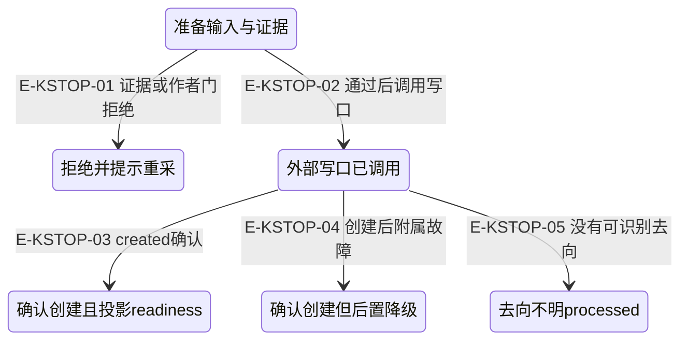

# 证据、提交与回执：在哪里停止

[完整知识生产纵切](../13-end-to-end/knowledge-production.md) · [Core去向与返回状态](overview.md)

先区分观察原文、结构化发现、工具执行状态、领域 outcome、知识生命周期和检索就绪。这些字段回答不同问题；取消也不能把已经确认的写入改写为从未发生。

## 提交边界的解释流程

### 本图术语说明

| 节点／术语 | 本图中的含义 |
| --- | --- |
| 准备 | 尚未进入Core写口；仅此时可证明阻止创建。 |
| 确认/降级 | ID与lifecycle来自端口真实回执；readiness与附属操作另记。 |
| processed | 保守处理未知去向，ok不等于已确认落库。 |

| 编号 | 代码依据 | 测试依据 | 关系与可证明范围 |
| --- | --- | --- | --- |
| E-KSTOP-01 | `src/tools/runtime/handlers/knowledge/submission.ts#handleSubmit` → `src/tools/runtime/handlers/knowledge/authoring.ts#prepareSubmission` | 间接覆盖：`test/mining-e2e-pipeline.test.ts#case:EVIDENCE_STALE%20%E8%B4%9F%E4%BE%8B%EF%BC%9Aproduce%20%E9%A6%96%E8%B0%83%E5%89%8D%E6%94%B9%E5%86%99%E8%A2%AB%E5%BC%95%E7%94%A8%E6%96%87%E4%BB%B6%20%E2%86%92%20%E6%96%B0%E9%B2%9C%E5%BA%A6%E9%87%8D%E5%93%88%E5%B8%8C%E6%8B%92%E7%BB%9D%EF%BC%8C%E9%9B%B6%E5%80%99%E9%80%89`；断言已定位，实际执行见页面证据，真实 Agent 组合、脚本模型与内存 gateway。不是对每个内部函数的独立 spy 断言。 | 准备阶段展开真实refs并检查freshness，失败时不进入写口。EVIDENCE_STALE用例只断言零created与错误记录，不断言整个Service必须error。 |
| E-KSTOP-02 | `src/tools/runtime/handlers/knowledge/submission.ts#handleSubmit` → `src/tools/runtime/handlers/knowledge/contracts.ts#RecipeGatewayLike` | 间接覆盖：`test/mining-e2e-pipeline.test.ts#case:%E5%81%A5%E5%BA%B7%E6%A8%A1%E5%9D%97%EF%BC%9Aanalyze(%E7%9C%9F%E5%8F%B0%E8%B4%A6)%E2%86%92note_finding(ledger-id)%E2%86%92%E8%B4%A8%E9%87%8F%E9%97%A8%E2%86%92produce%E2%86%92submit%20%E5%85%A8%E9%93%BE%E4%BA%A7%E5%87%BA%201%20%E6%9D%A1%20rule`；断言已定位，实际执行见页面证据，真实 Agent 组合、脚本模型与内存 gateway。不是对每个内部函数的独立 spy 断言。 | 准备后再次检查取消；真正创建通过注入的createOrStage。该定位用例的端口是内存 fake。 |
| E-KSTOP-03 | `src/tools/runtime/handlers/knowledge/submissionResult.ts#completeCreatedSubmission` | 间接覆盖：`test/mining-e2e-pipeline.test.ts#case:%E5%81%A5%E5%BA%B7%E6%A8%A1%E5%9D%97%EF%BC%9Aanalyze(%E7%9C%9F%E5%8F%B0%E8%B4%A6)%E2%86%92note_finding(ledger-id)%E2%86%92%E8%B4%A8%E9%87%8F%E9%97%A8%E2%86%92produce%E2%86%92submit%20%E5%85%A8%E9%93%BE%E4%BA%A7%E5%87%BA%201%20%E6%9D%A1%20rule`；断言已定位，实际执行见页面证据，真实 Agent 组合、脚本模型与内存 gateway。不是对每个内部函数的独立 spy 断言。 | 保留created identity并读取readiness；ready:false不取消创建确认。 |
| E-KSTOP-04 | `src/tools/runtime/handlers/knowledge/submissionResult.ts#completeCreatedSubmission` | 未覆盖：这里只核对当前实现与合同，不声明该分支已经执行。 | 已确认创建后的readiness/session等附属失败只降级并保留ID，不盲目重复create；所引用 mining 健康用例没有注入此故障；该分支的独立测试不能由健康路径代替。 |
| E-KSTOP-05 | `src/tools/runtime/handlers/knowledge/submissionResult.ts#unrecognizedOutcomeResult` | 未覆盖：这里只核对当前实现与合同，不声明该分支已经执行。 | 无可识别Core去向时返回processed+degraded并提示勿重提；写入事实不确定，不能归为已创建。 |

## 失败、取消与恢复矩阵

| 触发条件 | 实际行为与下一步 | 证据／执行范围 |
| --- | --- | --- |
| 缺 capabilityCatalog 或 schema 投影为空 | 工具能力存在但 schema 为空时记 tool_schema_projection_empty；不能把零工具调用误读为没有可发现的知识。 | `src/agent/runtime/AgentRuntime.ts#AgentRuntime.initLoop`；`test/mining-e2e-pipeline.test.ts#case:%E5%B7%A5%E5%85%B7%E9%9D%A2%E9%9D%99%E9%BB%98%E5%A4%B1%E6%95%88%E6%97%B6%20child%20diagnostics%20%E5%B8%A6%20tool_schema_projection_empty(%E5%AE%BF%E4%B8%BB%E5%8F%AF%E5%AE%9A%E4%BD%8D%E6%8E%A5%E7%BA%BF%E9%94%99%E8%AF%AF)`（断言已定位，实际执行见页面证据；只证明下述断言） child diagnostics 的 JSON 包含 tool_schema_projection_empty 同真实装配但 omitCatalog=true；脚本 provider 模式 no-findings；没有验证任何真实宿主 DI。 |
| ledger 引用缺失/越界或 active scope 缺失/歧义 | 有 ledger 时任一 refs 不可解析整条拒绝；没有 MemoryCoordinator/ActiveContext 不写。多 scope 未指定 scopeId 也拒绝。无 ledger 的非维度兼容路径可不验证写入，但记 MEMORY_FINDING_UNVERIFIED_NO_LEDGER，不能当本纵切正常证据。 | `src/tools/runtime/handlers/memory.ts#handleNoteFinding`；`src/agent/memory/MemoryCoordinator.ts#MemoryCoordinator.noteFinding`；未覆盖：本页尚未绑定该故障的直接断言。 该主 E2E 只覆盖健康 refs/scope 和缺 findings 后果；本次没有定位这些独立失败的完整 case。 源码事实，不冒充 E2E 失败覆盖。 |
| 批证据部分 append 失败 | 保留已追加条目和 E-1 标注，报告 persisted count，不声称零写入或伪造后续 E-id。 | `src/agent/runtime/toolPipeline/observations.ts#evidenceCapture`；`src/agent/evidence/EvidenceCapture.ts#EvidenceCaptureError`；`test/EvidenceCapture.test.ts#case:keeps%20confirmed%20evidence%20annotations%20when%20the%20next%20batch%20append%20fails`（断言已定位，实际执行见页面证据） entries=1；E-1 存在/E-2 不存在；EVIDENCE_CAPTURE_FAILED persisted=1 第二次 append 故障注入；第一条真实 JSONL 写入。 |
| Analyst 有高质量文本和读证据，但没有 note_finding | 候选模式缺少 memory findings 时分流 record_repair 或 analysis_retry；record_repair 默认最多 1 次，仍不达门则 degraded_no_findings，停止后续 produce 并标 abandoned。 | `src/agent/evaluation/qualityGates.ts#applyGateThresholds`；`src/agent/strategies/PipelineStrategy.ts#PipelineStrategy.processGate`；`test/mining-e2e-pipeline.test.ts#case:%E5%BC%B1%E6%A8%A1%E5%9D%97%EF%BC%9A%E9%9B%B6%E5%8F%91%E7%8E%B0%20%E2%86%92%20record_repair%20%E6%95%91%E4%B8%8D%E5%9B%9E%20%E2%86%92%20degraded_no_findings%20%E2%86%92%20%E7%88%B6%E7%BB%93%E6%9E%9C%20abandonedModules%20%E4%B8%80%E7%AD%89%E5%8F%AF%E8%A7%81`（断言已定位，实际执行见页面证据；只证明下述断言） created=0；child outcome=abandoned；parent abandonedModules 明确列出 mod-weak 与 degraded 族 action 脚本仍读四文件并搜索证据、返回高分分析，只故意省略 note_finding；不是零工具调用案例。 |
| produce 之前来源文件已变更/不可读 | 按采集 range 重新读源码/重算 freshness，stale 返回 EVIDENCE_STALE 与重采指导；不调用 createOrStage。 | `src/tools/runtime/handlers/submitEvidenceExpansion.ts#expandEvidenceRefsForSubmit`；`src/agent/evidence/EvidenceLedgerStore.ts#EvidenceLedgerStore.checkFreshness`；`test/mining-e2e-pipeline.test.ts#case:EVIDENCE_STALE%20%E8%B4%9F%E4%BE%8B%EF%BC%9Aproduce%20%E9%A6%96%E8%B0%83%E5%89%8D%E6%94%B9%E5%86%99%E8%A2%AB%E5%BC%95%E7%94%A8%E6%96%87%E4%BB%B6%20%E2%86%92%20%E6%96%B0%E9%B2%9C%E5%BA%A6%E9%87%8D%E5%93%88%E5%B8%8C%E6%8B%92%E7%BB%9D%EF%BC%8C%E9%9B%B6%E5%80%99%E9%80%89`（断言已定位，实际执行见页面证据；只证明下述断言） 前插改动使原区间 hash 变化；fake created=0；toolCalls 包含 EVIDENCE_STALE 真实临时 fixture 文件被 test callback 修改；没有真实生产仓库改动或数据库。 |
| 质量分不足、深度不接地或大模块覆盖不足 | 按原因 analysis_retry/summary_rewrite/degrade；大模块覆盖门只在基础 pass 且 ownedFiles>=8、grounded owned files<3 时要求补读。重试受 gate cap/预算限制，耗尽可标 retry_exhausted/abandoned。 | `src/agent/evaluation/gateEvaluators.ts#insightGateEvaluator`；`src/agent/evaluation/gateEvaluators.ts#applyModuleCoverageGate`；`src/agent/evaluation/qualityGates.ts#applyDepthRetryGate`；未覆盖：本页尚未绑定该故障的直接断言。 本 E2E 四文件模块未触发大模块覆盖门；不能称已覆盖该门。 源码规则，未执行/未补充新测试。 |
| producer 缺 quality_gate AnalysisArtifact | 按门名读取失败记 pipeline_producer_analysis_artifact_unavailable，严格形状 guard 拒绝，不借其他门的 artifact。 | `src/agent/strategies/PipelineStrategy.ts#PipelineStrategy.resolveStageGateArtifact`；`src/agent/profiles/presets/insightPreset.ts#requireProducerAnalysisArtifact`；未覆盖：本页尚未绑定该故障的直接断言。 mining-e2e 健康例间接证明正确装配路径；没有本故障注入。 源码事实。 |
| 作者输入/证据硬门失败，或同标题重复失败 | 硬违规阻止写口；允许的机械/有限风格 repair 必须复验，不凭软建议授予事实。相同标题已尝试 3 次时第 4 次 terminal 拒绝；计数单源是 sharedState._sessionCounters._submitTitleAttempts，旧顶层同名字典不读不写。连续/总拒绝仍按 3/12 阈值附指导。 | `src/tools/runtime/handlers/knowledge/authoring.ts#prepareSubmission`；`src/tools/runtime/handlers/knowledge/authoring.ts#recordRejectAndDirective`；`test/mining-e2e-pipeline.test.ts#case:%E7%94%9F%E4%BA%A7%E5%85%A5%E5%8F%A3%20runScopedModuleMining%EF%BC%9A%E4%BF%AE%E5%A4%8D%E5%B1%82%E8%AE%A1%E6%95%B0(evidence_sanitized)%E8%B7%A8%E8%B0%83%E7%94%A8%E7%B4%AF%E8%AE%A1%E5%B9%B6%E6%8A%95%E5%BD%B1%E5%88%B0%20child%20_pipelineOutcome.submitRepairs`（断言已定位，实际执行见页面证据；只证明下述断言） 仅验证 evidence_sanitized 修复计数>=1 与成功候选；不覆盖所有 hard-gate/stop-loss 分支 本用例 bareSources 强制机械来源修复；脚本候选内容预先设计成能过公开 authoring 门。 |
| 取消、期限、权限拒绝 | coordinator stop-new；阶段/loop 转发 signal。submit 在 prepare await 后、Core 写口前再检查；Core createOrStage 不接受取消参数，已启动后等待真实回执而非假设回滚。前置权限门不进入 handler。 | `src/agent/coordination/AgentRunCoordinator.ts#runChildren`；`src/agent/strategies/pipeline/attempt.ts#runStageAttempt`；`src/agent/runtime/toolPipeline/accessGates.ts#runtimeSafetyGate`；`src/tools/runtime/handlers/knowledge/submission.ts#handleSubmit`；未覆盖：本页尚未绑定该故障的直接断言。 mining-e2e 这 6 个案例没有 cancel/timeout/permission 故障注入；不可用健康组合测试代替。 边界源码已核对；实际执行见页面证据。 |
| 端口确认 created 后 readiness/session/详情失败，或没有可识别 outcome | confirmed created 保留 identity，附后置警告；ready=false 保留候选。无可识别 outcome 返回 processed+degraded，明确勿重提，写入事实仍不确定。 | `src/tools/runtime/handlers/knowledge/submissionResult.ts#completeCreatedSubmission`；`src/tools/runtime/handlers/knowledge/submissionResult.ts#unrecognizedOutcomeResult`；`test/mining-e2e-pipeline.test.ts#case:%E5%81%A5%E5%BA%B7%E6%A8%A1%E5%9D%97%EF%BC%9Aanalyze(%E7%9C%9F%E5%8F%B0%E8%B4%A6)%E2%86%92note_finding(ledger-id)%E2%86%92%E8%B4%A8%E9%87%8F%E9%97%A8%E2%86%92produce%E2%86%92submit%20%E5%85%A8%E9%93%BE%E4%BA%A7%E5%87%BA%201%20%E6%9D%A1%20rule`（断言已定位，实际执行见页面证据；只证明下述断言） 该 E2E 只断言 ready:false 被保留并投影；并未覆盖未知 outcome/后置读抛错/迟到取消 fake gateway 的 readiness 固定 ready:false，不是可检索生产记录。 |

## 状态层不要混读

| 层 | 典型值 | 含义 |
| --- | --- | --- |
| Core/注入端口 outcome key | created / duplicates / merged / rejected / blocked / none-recognizable | 端口返回候选去向；Agent 没有重新实现 Core repository。 |
| knowledge tool business payload | created / duplicate_blocked / merged_into_proposal / processed | processed 是无法确认去向时的保守 ok+degraded 返回，带 KNOWLEDGE_SUBMIT_OUTCOME_UNRECOGNIZED；不表示确认持久化。普通 rejected/blocked 常为 fail(error)，只有特定 unsafe-core-code 分支附 rejected/consolidation-blocked payload。 |
| ToolResultEnvelope | success / partial / error / blocked / aborted / timeout / needs-confirmation | 执行与传输状态；duplicate_blocked、merged_into_proposal 或 processed 可能仍有 ok:true。 |
| Pipeline outcome | completed / abandoned / failed / aborted | 阶段是否按策略结束；不能替代 created、readiness 或发布事实。 |
| Recipe readiness/lifecycle | pending / staging / active / ready:false/true | 由注入端口提供；mining-e2e 健康 fake 返回 pending、ready:false。当前纵切不调用 publish。 |

本页使用的是 Agent 可见结果合同；Core 内容文件、索引、serving、route 与发布的内部一致性不在这里代替验收。

## 同标题止损与原文 freshness 的新增校准

同标题计数只保存在嵌套 session counter box，跨阶段浅拷贝保留该盒身份；顶层遗留 `_submitTitleAttempts` 不影响止损。源码：`src/tools/runtime/handlers/knowledge/sessionState.ts#sessionCounterBox`、`src/tools/runtime/handlers/knowledge/authoring.ts#prepareSubmission`。`test/recipe-production-profile-adapter.test.ts#case:ignores%20a%20top-level%20_submitTitleAttempts%20dictionary%20for%20the%20hard%20stop-loss`与`test/recipe-production-profile-adapter.test.ts#case:keeps%20the%20title%20attempt%20count%20only%20inside%20the%20session%20counter%20box`分别锁定旧别名被忽略与盒内计数。断言已定位，实际执行见页面证据。

被脱敏字节变化的 freshness 必须区分摘要表范围：同 Runtime 的下一 reactLoop store 继续使用原文 HMAC；另一个 Runtime、seed 或被外部替换身份的条目回退 redacted-hash，可能无法识别被遮区域的变化。下一步读取 [证据摘要生命周期](call-flow.md#scenario-evidence-freshness)，不能以相同投影哈希推断全部原文未变。
