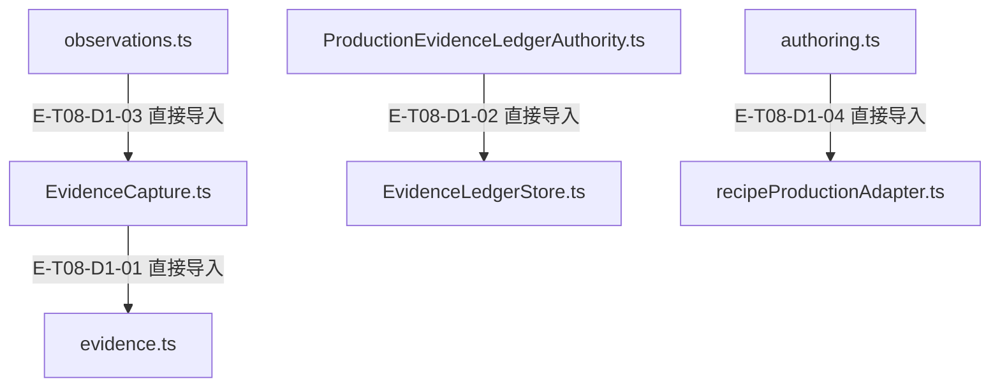
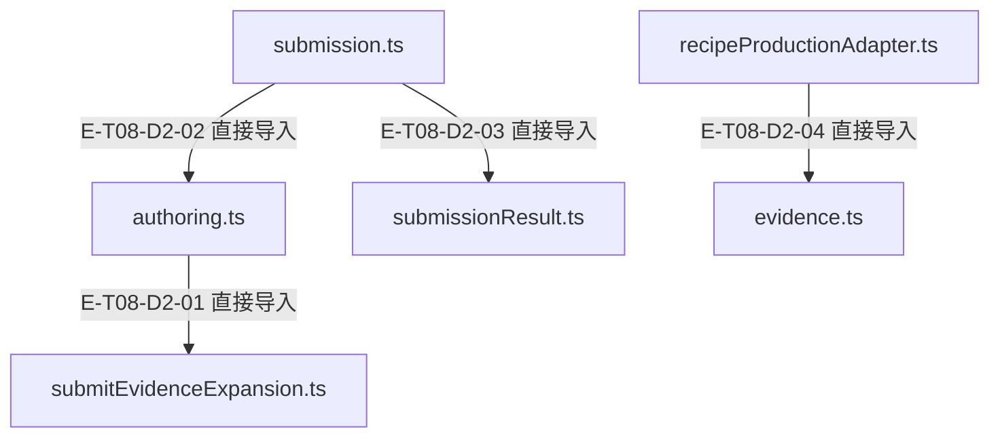

# 证据与知识提交 · 精选直接依赖

[职责与边界](overview.md) · [真实调用](call-flow.md)

选取本专题入口的最多8条直接依赖；完整库存可在阅读器「文件与依赖」查看。以仓库全路径为节点身份，同名文件不会合并。Core／Node／第三方包只在完整探索器的外部边界出现。

## 静态依赖 1

### 本图术语说明

| 术语／节点 | 含义与范围 |
| --- | --- |
| EvidenceCapture.ts | `src/agent/evidence/EvidenceCapture.ts`；文件直接依赖，箭头不表示执行先后。 |
| evidence.ts | `src/tools/runtime/handlers/evidence.ts`；文件直接依赖，箭头不表示执行先后。 |
| ProductionEvidenceLedgerAuthority.ts | `src/agent/evidence/ProductionEvidenceLedgerAuthority.ts`；文件直接依赖，箭头不表示执行先后。 |
| EvidenceLedgerStore.ts | `src/agent/evidence/EvidenceLedgerStore.ts`；文件直接依赖，箭头不表示执行先后。 |
| observations.ts | `src/agent/runtime/toolPipeline/observations.ts`；文件直接依赖，箭头不表示执行先后。 |
| authoring.ts | `src/tools/runtime/handlers/knowledge/authoring.ts`；文件直接依赖，箭头不表示执行先后。 |
| recipeProductionAdapter.ts | `src/tools/runtime/handlers/recipeProductionAdapter.ts`；文件直接依赖，箭头不表示执行先后。 |

| 编号 | 代码依据 | 测试依据 | 关系与可证明范围 |
| --- | --- | --- | --- |
| E-T08-D1-01 | `src/agent/evidence/EvidenceCapture.ts` → `src/tools/runtime/handlers/evidence.ts` | 未覆盖：静态依赖由本图谱解析器反例测试支持；不把 import 当作行为覆盖。 | TypeScript AST 解析 #tools/runtime/handlers/evidence.js；第 23 行，kind=import，typeOnly=false。只证明结构关系。 |
| E-T08-D1-02 | `src/agent/evidence/ProductionEvidenceLedgerAuthority.ts` → `src/agent/evidence/EvidenceLedgerStore.ts` | 未覆盖：静态依赖由本图谱解析器反例测试支持；不把 import 当作行为覆盖。 | TypeScript AST 解析 ./EvidenceLedgerStore.js；第 11 行，kind=import，typeOnly=false。只证明结构关系。 |
| E-T08-D1-03 | `src/agent/runtime/toolPipeline/observations.ts` → `src/agent/evidence/EvidenceCapture.ts` | 未覆盖：静态依赖由本图谱解析器反例测试支持；不把 import 当作行为覆盖。 | TypeScript AST 解析 ../../evidence/EvidenceCapture.js；第 8 行，kind=import，typeOnly=false。只证明结构关系。 |
| E-T08-D1-04 | `src/tools/runtime/handlers/knowledge/authoring.ts` → `src/tools/runtime/handlers/recipeProductionAdapter.ts` | 未覆盖：静态依赖由本图谱解析器反例测试支持；不把 import 当作行为覆盖。 | TypeScript AST 解析 ../recipeProductionAdapter.js；第 13 行，kind=import，typeOnly=false。只证明结构关系。 |

## 静态依赖 2

### 本图术语说明

| 术语／节点 | 含义与范围 |
| --- | --- |
| authoring.ts | `src/tools/runtime/handlers/knowledge/authoring.ts`；文件直接依赖，箭头不表示执行先后。 |
| submitEvidenceExpansion.ts | `src/tools/runtime/handlers/submitEvidenceExpansion.ts`；文件直接依赖，箭头不表示执行先后。 |
| submission.ts | `src/tools/runtime/handlers/knowledge/submission.ts`；文件直接依赖，箭头不表示执行先后。 |
| submissionResult.ts | `src/tools/runtime/handlers/knowledge/submissionResult.ts`；文件直接依赖，箭头不表示执行先后。 |
| recipeProductionAdapter.ts | `src/tools/runtime/handlers/recipeProductionAdapter.ts`；文件直接依赖，箭头不表示执行先后。 |
| evidence.ts | `src/tools/runtime/handlers/evidence.ts`；文件直接依赖，箭头不表示执行先后。 |

| 编号 | 代码依据 | 测试依据 | 关系与可证明范围 |
| --- | --- | --- | --- |
| E-T08-D2-01 | `src/tools/runtime/handlers/knowledge/authoring.ts` → `src/tools/runtime/handlers/submitEvidenceExpansion.ts` | 未覆盖：静态依赖由本图谱解析器反例测试支持；不把 import 当作行为覆盖。 | TypeScript AST 解析 ../submitEvidenceExpansion.js；第 14 行，kind=import，typeOnly=false。只证明结构关系。 |
| E-T08-D2-02 | `src/tools/runtime/handlers/knowledge/submission.ts` → `src/tools/runtime/handlers/knowledge/authoring.ts` | 未覆盖：静态依赖由本图谱解析器反例测试支持；不把 import 当作行为覆盖。 | TypeScript AST 解析 ./authoring.js；第 6 行，kind=import，typeOnly=false。只证明结构关系。 |
| E-T08-D2-03 | `src/tools/runtime/handlers/knowledge/submission.ts` → `src/tools/runtime/handlers/knowledge/submissionResult.ts` | 未覆盖：静态依赖由本图谱解析器反例测试支持；不把 import 当作行为覆盖。 | TypeScript AST 解析 ./submissionResult.js；第 10 行，kind=import，typeOnly=false。只证明结构关系。 |
| E-T08-D2-04 | `src/tools/runtime/handlers/recipeProductionAdapter.ts` → `src/tools/runtime/handlers/evidence.ts` | 未覆盖：静态依赖由本图谱解析器反例测试支持；不把 import 当作行为覆盖。 | TypeScript AST 解析 ./evidence.js；第 9 行，kind=import，typeOnly=false。只证明结构关系。 |
