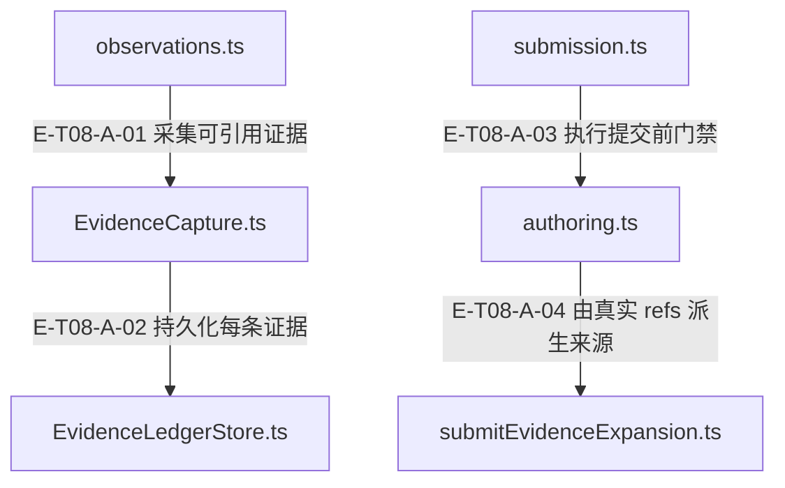

# 08 · 证据与知识提交

> 工具原文如何变成可引用证据，再经接地和 Core 写口成为候选？

循环观察器把成功或可用 partial 的证据工具结果规范化后追加 JSONL 台账，回显 E-x 标注。knowledge.submit 从 evidenceRefs 机械展开来源并复查 freshness，完成有界源码/authoring 检查后调用宿主注入的 Core createOrStage；已确认创建之后的只读/会话失败只能降级，不抹掉持久化身份。

[真实调用](call-flow.md) · [直接依赖](file-dependency.md) · [阅读规范](../00-diagram-standard.md)

## 职责与主要接缝

### 本图术语说明

| 术语／节点 | 含义与范围 |
| --- | --- |
| observations.ts | `src/agent/runtime/toolPipeline/observations.ts`；本图按实现文件聚合职责；具体装配条件见下表。 |
| EvidenceCapture.ts | `src/agent/evidence/EvidenceCapture.ts`；本图按实现文件聚合职责；具体装配条件见下表。 |
| EvidenceLedgerStore.ts | `src/agent/evidence/EvidenceLedgerStore.ts`；本图按实现文件聚合职责；具体装配条件见下表。 |
| submission.ts | `src/tools/runtime/handlers/knowledge/submission.ts`；本图按实现文件聚合职责；具体装配条件见下表。 |
| authoring.ts | `src/tools/runtime/handlers/knowledge/authoring.ts`；本图按实现文件聚合职责；具体装配条件见下表。 |
| submitEvidenceExpansion.ts | `src/tools/runtime/handlers/submitEvidenceExpansion.ts`；本图按实现文件聚合职责；具体装配条件见下表。 |

| 编号 | 代码依据 | 测试依据 | 关系与可证明范围 |
| --- | --- | --- | --- |
| E-T08-A-01 | `src/agent/runtime/toolPipeline/observations.ts#evidenceCapture` → `src/agent/evidence/EvidenceCapture.ts#captureEvidenceFromEnvelope` | `test/EvidenceCapture.test.ts#case:keeps%20confirmed%20evidence%20annotations%20when%20the%20next%20batch%20append%20fails`；第二次 append 注入异常，第一条真实 JSONL 与 E-1 标注保留，E-2 不出现；EVIDENCE_CAPTURE_FAILED 带 persisted count。断言已定位，实际执行见页面证据。 | 默认观察链在 tracker/trace 之前采集；批次部分失败保留 EvidenceCaptureError.entries 中已经确认的条目，不伪称零写入。 |
| E-T08-A-02 | `src/agent/evidence/EvidenceCapture.ts#captureEvidenceFromEnvelope` → `src/agent/evidence/EvidenceLedgerStore.ts#EvidenceLedgerStore.append` | `test/evidence-capture-search-incomplete.test.ts#case:ledgers%20every%20observed%20match%20of%20a%20partial%20multi-pattern%20search%20verbatim%2C%20grouped%20by%20file`；断言 partial search 的全部观察命中逐字分组入账且 range undefined；同文件另有 timeout/aborted 零入账参数化用例。 | 仅证据工具且 readToolObservation 可用时写入；code.search 依文件分组不伪造连续 range；secret-bearing 草稿去掉 range。 |
| E-T08-A-03 | `src/tools/runtime/handlers/knowledge/submission.ts#handleSubmit` → `src/tools/runtime/handlers/knowledge/authoring.ts#prepareSubmission` | `test/recipe-production-profile-adapter.test.ts#case:checks%20cancellation%20after%20preparation%20yields%20and%20before%20starting%20the%20Core%20write`；用例专门覆盖 prepare 的让出点取消后不能启动 Core 写入。 | 输入 fast-fail 后 await 准备；prepare 返回 rejected 时不进入 gateway，await 后再次紧邻写口检查取消。 |
| E-T08-A-04 | `src/tools/runtime/handlers/knowledge/authoring.ts#prepareSubmission` → `src/tools/runtime/handlers/submitEvidenceExpansion.ts#expandEvidenceRefsForSubmit` | `test/knowledge-submit-stop-loss.test.ts#case:expansion%20%E5%A4%B1%E8%B4%A5%EF%BC%88evidenceRefs%20%E6%97%A0%E6%B3%95%E8%A7%A3%E6%9E%90%EF%BC%89%E5%90%8C%E6%A0%B7%E8%AE%A1%E5%85%A5%20streak%2Ftotal%20%E5%B9%B6%E5%9C%A8%E7%AC%AC%203%20%E6%AC%A1%E9%99%84%20STOP`；证据展开失败累计会话拒绝次数，第三次携带 STOP；不把拒绝循环当有效提交。 | 从 ledger 解析 refs，机械生成来源并做文件 freshness；有台账但零 refs 则 EVIDENCE_REFS_REQUIRED。 |

## 输入、输出与副作用

| 维度 | 当前实现 |
| --- | --- |
| 输入 | 证据类工具 envelope、call id、真实 file/range/content；store 的可选 redactor 与 contentProfile（生产 authority 固定选择，不允许宿主任意注入）；knowledge.submit 的 authored fields、reasoning.evidenceRefs、sourceRefs、显式 coreCode、runtime session/dimension 状态；宿主注入 recipeGateway、ledger、sessionStore 与 abortSignal |
| 输出 | E-n 条目、内容 hash、[evidence] 标注、strict snapshot identity；Core 去向经 submissionResult 转成 created / duplicate_blocked / merged_into_proposal / processed 等 payload；rejected/blocked 的返回形状另按 codeEvidence 分支，详见提交结果表。 |
| 副作用 | EvidenceLedgerStore 在 dataRoot/.asd 下追加 JSONL；先 durable append 成功才消耗序号，重开时 hydrate。；refs 展开和 coreCode 校验可只读项目源码；Core createOrStage 才是知识持久化外部写边界。；提交/修复/止损计数记录在 session counters；confirmed create 后可写 SessionStore。 |

## 从这些文件开始

| 文件 | 阅读目的 |
| --- | --- |
| `src/agent/runtime/toolPipeline/observations.ts` | 证据先落账，再通知 tracker/trace |
| `src/agent/evidence/EvidenceCapture.ts` | 工具结果规范化、范围保真、secret-bearing 路由与标注 |
| `src/agent/evidence/EvidenceLedgerStore.ts` | JSONL append、freshness、readback、持久化健康与内容 profile |
| `src/agent/evidence/ProductionEvidenceLedgerAuthority.ts` | 不可伪造的生产 capture/read facet 和 strict snapshot |

| `src/agent/evidence/loopLedger.ts` | 每 loop 打开真实 store，并接入 Runtime 持有的原文摘要表 |
| `src/agent/utils/redaction/sourcePolicy.ts` | 默认台账在未知来源底线之上追加 terminal／secret-bearing 规则 |
| `src/tools/runtime/handlers/knowledge/queries.ts` | prime 与 detail 读取口的不同兼容边界 |
| `src/tools/runtime/handlers/evidence.ts` | E-x 与子区间读取、fresh 源码回读、ledger search |
| `src/tools/runtime/handlers/submitEvidenceExpansion.ts` | refs 到来源标签与新鲜度终检 |
| `src/tools/runtime/handlers/knowledge/submission.ts` | 提交编排与唯一 createOrStage 调用 |
| `src/tools/runtime/handlers/knowledge/authoring.ts` | 止损、接地、硬门与有限风格 repair |
| `src/tools/runtime/handlers/recipeProductionAdapter.ts` | 有界 coreCode/provenance 准备 |
| `src/tools/runtime/handlers/knowledge/submissionResult.ts` | Core 去向分类和 confirmed create 后处理 |

## 失败、取消与恢复

- 空结果、超时/取消、派生/截断读：空/失败不伪造证据；派生或截断 read 降为 file-only，partial 可保留真实观察片段。
- 台账 append 部分失败：已经写入的条目不回滚；返回已确认标注并记 EVIDENCE_CAPTURE_FAILED。
- 引用不存在、子区间越界、EVIDENCE_STALE：给可用范围或重采提示；用新 E-x 重新提交，不以手写来源绕过。
- 同标题重复失败/会话连续拒绝：同标题第 4 次硬止损；连续/总拒绝统计附 STOP，避免烧完回合。
- Core 写入 confirmed 后 abort/readiness/session 失败：保留 id/lifecycle 与完成事实，添加 skipped/unavailable/post-commit 警告；先 readback，不能盲重提。

## 已知边界与未验证范围

- 普通循环台账可脱敏/截断；verbatim-witness 是独立内容 profile，不能将普通台账视为逐字见证。

- 默认生产台账按 tool/file 来源追加 T3；开发者事件仍按未知来源底线投影，见 [来源策略与三条内容通道](../11-observability/source-policy-and-channels.md#scenario-source-policy)。
- Runtime 持有的 EvidenceSourceDigestTable 跨同一 Runtime 的 reactLoop store 重开共享；跨 Runtime／进程、seed 或条目身份不匹配才退回 redacted-hash。无 file+range 返回 unknown，仍不能宣称跨进程具有同样原文摘要能力。
- fresh evidence.get 可只读当前源文件；secret-bearing、陈旧、不可读或缺分类能力返回台账文本。注册表描述已说明有界回读与 freshness；模型回读不把原文写回台账。
- 真实 Core gateway 加可控 service 测试不等于生产 DB/宿主/LLM 闭环；created 也不等于 ready/published。
- Core 共享确定性 authoring、repository、生命周期只以公开端口出现，不收进 Agent 的实现节点。

## Core 去向与 Agent 返回状态

| Core 去向 | payload／ToolResult | 是否确认新建 Recipe |
| --- | --- | --- |
| created | created，含 id/lifecycle/readiness | 确认创建；pending 与 ready=false 仍可能存在，不代表发布。 |
| duplicates | duplicate_blocked，ok=true | 没有新建。 |
| merged | merged_into_proposal，ok=true | 确认整合提案身份，不是新 Recipe。 |
| rejected | 通常 fail；移除不安全 coreCode 的分支带 rejected payload | 没有确认新建。 |
| blocked | 通常 fail；相应不安全 coreCode 分支带 consolidation-blocked | 没有确认新建。 |
| 空／无法识别 | processed，ok=true，degraded 与 KNOWLEDGE_SUBMIT_OUTCOME_UNRECOGNIZED | 无法确认，不能把 ok 当入库，也不能盲重提。 |

源码：`src/tools/runtime/handlers/knowledge/submissionResult.ts#unrecognizedOutcomeResult`、`src/tools/runtime/handlers/knowledge/submissionResult.ts#completeCreatedSubmission`。这张表区分去向、Agent 状态和副作用确认，不创造新的 Core 枚举。

## 从组合执行继续阅读

[分析发现到知识候选回执](../13-end-to-end/knowledge-production.md)包含真实台账、scope发现、质量门、Producer与回执回程；[失败与回执矩阵](failure-and-receipts.md)列出具体断言及尚未绑定测试的分支；实际执行见页面证据。

## 知识读取口的兼容边界

`knowledge.prime` 只认可 `knowledgeRead`：仅注入 `knowledgeRepo` 时该动作不可用，handler 也拒绝且不会读取 repo。两个读取口都缺席时仍可走 `searchEngine` 的 search-only 降级；它与 repo-only 拒绝不同。`knowledge.detail` 仍在显式读取口缺席时回落到 repo，不把 prime 的收窄推广到全部知识动作。

源码：`src/tools/runtime/handlers/knowledge/queries.ts#handlePrime`、`src/tools/runtime/handlers/knowledge/queries.ts#handleDetail`。`test/tool-runtime-legacy-host-compat.test.ts#case:refuses%20prime%20on%20a%20knowledgeRepo-only%20host%20without%20reading%20the%20repository`断言 repo-only 被拒且无读取；`test/tool-runtime-legacy-host-compat.test.ts#case:does%20not%20advertise%20prime%20on%20a%20knowledgeRepo-only%20host%20while%20detail%20keeps%20its%20fallback`断言动作可见性差别；`test/tool-runtime-legacy-host-compat.test.ts#case:keeps%20the%20search-only%20fallback%20on%20its%20own%20diagnostic%20without%20a%20knowledgeRepo%20log`定位 search-only 诊断。断言已定位，实际执行见页面证据。
