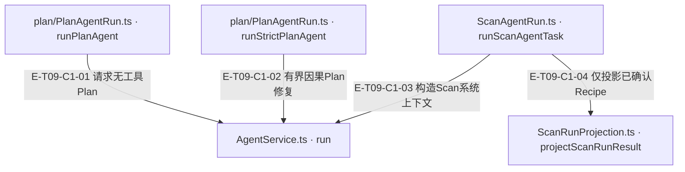
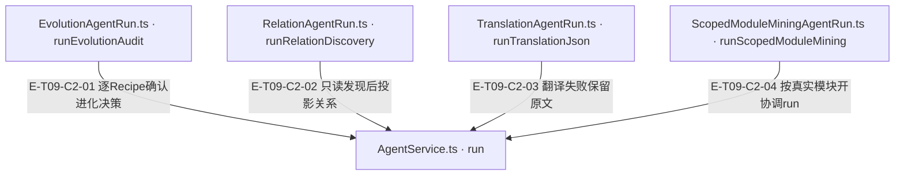

# 领域任务 · 真实调用

六类run helper负责领域输入、profile选择、宿主取消/期限透传与结果投影，执行仍经AgentService。成功文本不是通用领域成功：Plan必须校验形状/阶段，Scan只信持久化created回执，Evolution必须覆盖全部唯一Recipe决策，Relation失败不能进入写图，Translation可保留原文并标error，module mining 按真实 ProjectContext 模块通过 Coordinator 扇出；普通 Runtime 策略只有 single/pipeline。

[职责与边界](overview.md) · [直接依赖](file-dependency.md)

图中调用边经实现正文核对；AST只用于符号定位。接口／注入对象是调用端口，不据此推定所有宿主实现相同。断言已定位，实际执行见页面证据；具体输入、替身与断言分开说明，历史通过记录不自动证明当前源码。

## 调用接缝 1

### 本图术语说明

| 术语／节点 | 含义与范围 |
| --- | --- |
| plan/PlanAgentRun.ts · runPlanAgent | `src/agent/runs/plan/PlanAgentRun.ts#runPlanAgent`；声明或调用端口；动态实现的绑定条件见下表。 |
| AgentService.ts · run | `src/agent/service/AgentService.ts#AgentService.run`；声明或调用端口；动态实现的绑定条件见下表。 |
| plan/PlanAgentRun.ts · runStrictPlanAgent | `src/agent/runs/plan/PlanAgentRun.ts#runStrictPlanAgent`；声明或调用端口；动态实现的绑定条件见下表。 |
| ScanAgentRun.ts · runScanAgentTask | `src/agent/runs/scan/ScanAgentRun.ts#runScanAgentTask`；声明或调用端口；动态实现的绑定条件见下表。 |
| ScanRunProjection.ts · projectScanRunResult | `src/agent/runs/scan/ScanRunProjection.ts#projectScanRunResult`；声明或调用端口；动态实现的绑定条件见下表。 |

| 编号 | 代码依据 | 测试依据 | 关系与可证明范围 |
| --- | --- | --- | --- |
| E-T09-C1-01 | `src/agent/runs/plan/PlanAgentRun.ts#runPlanAgent` → `src/agent/service/AgentService.ts#AgentService.run` | `test/plan-agent-run.test.ts#case:performs%20one%20real%20no-tool%20LLM%20call%20before%20returning%20PlanSelection%20JSON`；真实Service/Builder/Runtime，provider mock返回有效PlanSelection；断言维度api、provider仅一次、prompt有coldStart，toolSchemas/toolChoice传给provider为undefined（没有可见工具）。不是远程真实LLM。断言已定位，实际执行见页面证据。 | buildSystemTaskRunInput选择plan-selection，toolChoiceOverride=none；success之后parsePlanSelection调用Core阶段校验，非success抛带partialResult的runFailure。 |
| E-T09-C1-02 | `src/agent/runs/plan/PlanAgentRun.ts#runStrictPlanAgent` → `src/agent/service/AgentService.ts#AgentService.run` | `test/plan-agent-run.test.ts#case:forwards%20the%20same%20signals%20to%20every%20strict%20plan%20attempt%20including%20causal%20repairs`；service替身每次返回有效intent，validateReceipt第一次抛PLAN_REQUIRED_LENS_UNSCHEDULED后第二次通过；断言run调用2次、每次execution={toolChoiceOverride:none,同一abortSignal,同一shouldAbort,timeoutMs:15000}。无真实模型或宿主封印。断言已定位，实际执行见页面证据。 | 严格Plan复用plan-selection但完整冻结context、禁工具；结构拒绝与白名单PLAN语义拒绝共用0..2修复预算，每次携带父输出/hash，最后交validateReceipt宿主口。 |
| E-T09-C1-03 | `src/agent/runs/scan/ScanAgentRun.ts#runScanAgentTask` → `src/agent/service/AgentService.ts#AgentService.run` | `test/scan-run-projection.test.ts#case:runScanAgentTask%20passes%20per-file%20language%20into%20the%20run%20file%20cache`；输入单文件{name:code,content:fn main() {},language:rust}，使用真实SystemRunContextFactory与service.run替身；断言run一次，context.fileCache精确为relativePath/name=code、正文和language=rust。断言已定位，实际执行见页面证据。 | 校验extract/summarize，files映射fileCache，SystemRunContextFactory创建scope/window/tracker；选scan-extract/scan-summarize，结果交projectScanRunResult。 |
| E-T09-C1-04 | `src/agent/runs/scan/ScanAgentRun.ts#runScanAgentTask` → `src/agent/runs/scan/ScanRunProjection.ts#projectScanRunResult` | `test/scan-run-production-integration.test.ts#case:rejects%20provider-only%20Recipes%20when%20the%20production%20runner%20makes%20no%20submit%20call`；Service+Runtime替身返回声称1个Recipe的JSON但toolCalls=[]；断言extracted=0/recipes=[]，persistenceOutcome=no-submit-attempt，ignoredUnpersistedOutput=true。断言已定位，实际执行见页面证据。 | 调用投影时带task/label/result/fallback；extractCreatedRecipes经isPersistedSubmission筛选，成功provider文字不能制造Recipe。 |

## 调用接缝 2

### 本图术语说明

| 术语／节点 | 含义与范围 |
| --- | --- |
| EvolutionAgentRun.ts · runEvolutionAudit | `src/agent/runs/evolution/EvolutionAgentRun.ts#runEvolutionAudit`；声明或调用端口；动态实现的绑定条件见下表。 |
| AgentService.ts · run | `src/agent/service/AgentService.ts#AgentService.run`；声明或调用端口；动态实现的绑定条件见下表。 |
| RelationAgentRun.ts · runRelationDiscovery | `src/agent/runs/relation/RelationAgentRun.ts#runRelationDiscovery`；声明或调用端口；动态实现的绑定条件见下表。 |
| TranslationAgentRun.ts · runTranslationJson | `src/agent/runs/translation/TranslationAgentRun.ts#runTranslationJson`；声明或调用端口；动态实现的绑定条件见下表。 |
| ScopedModuleMiningAgentRun.ts · runScopedModuleMining | `src/agent/runs/module-mining/ScopedModuleMiningAgentRun.ts#runScopedModuleMining`；声明或调用端口；动态实现的绑定条件见下表。 |

| 编号 | 代码依据 | 测试依据 | 关系与可证明范围 |
| --- | --- | --- | --- |
| E-T09-C2-01 | `src/agent/runs/evolution/EvolutionAgentRun.ts#runEvolutionAudit` → `src/agent/service/AgentService.ts#AgentService.run` | `test/agent-surface-floor.test.ts#case:throws%20runFailure%20with%20the%20pending%20ids%20and%20the%20partial%20result%20when%20decisions%20are%20missing`；service替身给r1/r2成功skip但输入r1/r2/r3，断言Error含decisions2/3 pending=r3、partialResult/cause是原result，evolutionGateEvaluator也判r3 pending。断言已定位，实际执行见页面证据。 | recipes空直接零结果；非空选evolution-audit，Service成功后从工具回执collectSuccessfulEvolutionIds，按唯一expectedIds检查pending，缺失则runFailure。 |
| E-T09-C2-02 | `src/agent/runs/relation/RelationAgentRun.ts#runRelationDiscovery` → `src/agent/service/AgentService.ts#AgentService.run` | `test/agent-surface-floor.test.ts#case:forwards%20signals%20from%20runRelationDiscovery%20and%20keeps%20the%20old%20shape%20without%20them`；捕获service替身输入：signals全进入execution，aborted时reject且partialResult.status=aborted；无signals时execution键不出现。只验证helper与投影，不验证宿主写图。断言已定位，实际执行见页面证据。 | relation-discovery带batchSize与signals；projectRelationDiscoveryResult先要求status=success，优先synthesize阶段文本，解析失败保留0关系但明确usedFallback/parseError。 |
| E-T09-C2-03 | `src/agent/runs/translation/TranslationAgentRun.ts#runTranslationJson` → `src/agent/service/AgentService.ts#AgentService.run` | `test/agent-surface-floor.test.ts#case:keeps%20the%20translated%20field%20and%20reports%20only%20the%20missing%20one`；service替身返回{summaryEn:Summary}而原文usageGuide非空，断言保留Summary、usageGuide回原文、error仅missing usageGuideEn、onParseError一次、partial-fallback诊断。断言已定位，实际执行见页面证据。 | 空输入直接空译文；否则translation-json。非success返回原文+error；成功JSON缺字段按字段回退，保留已译字段并经安全观察器通知。 |
| E-T09-C2-04 | `src/agent/runs/module-mining/ScopedModuleMiningAgentRun.ts#runScopedModuleMining` → `src/agent/service/AgentService.ts#AgentService.run` | `test/module-mining-agent-run.test.ts#case:fans%20out%20one%20child%20per%20ProjectContext%20module%20without%20dimension%20cross-talk`；3真实模块声明经Service/Coordinator进入3次runtime替身；验证模块身份、context ownedFiles/budget及无dimension串值。provider/handler非此测试覆盖。断言已定位，实际执行见页面证据。 | 先scaleCap、normalize与splitOversizedModule，附静态contextMap与按ownedFiles计算的预算；请求module-mining-session，非success抛保留partialResult的runFailure。 |
