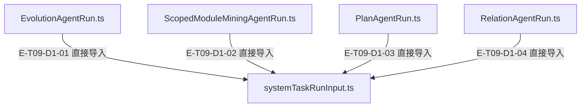
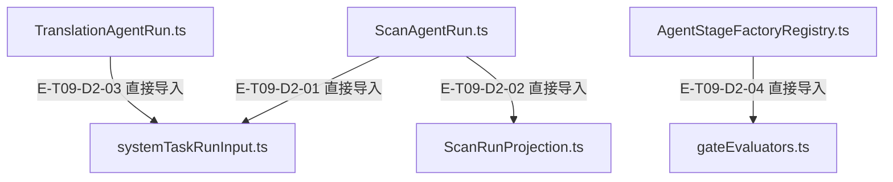

# 领域任务 · 精选直接依赖

[职责与边界](overview.md) · [真实调用](call-flow.md)

选取本专题入口的最多8条直接依赖；完整库存可在阅读器「文件与依赖」查看。以仓库全路径为节点身份，同名文件不会合并。Core／Node／第三方包只在完整探索器的外部边界出现。

## 静态依赖 1

### 本图术语说明

| 术语／节点 | 含义与范围 |
| --- | --- |
| EvolutionAgentRun.ts | `src/agent/runs/evolution/EvolutionAgentRun.ts`；文件直接依赖，箭头不表示执行先后。 |
| systemTaskRunInput.ts | `src/agent/runs/systemTaskRunInput.ts`；文件直接依赖，箭头不表示执行先后。 |
| ScopedModuleMiningAgentRun.ts | `src/agent/runs/module-mining/ScopedModuleMiningAgentRun.ts`；文件直接依赖，箭头不表示执行先后。 |
| PlanAgentRun.ts | `src/agent/runs/plan/PlanAgentRun.ts`；文件直接依赖，箭头不表示执行先后。 |
| RelationAgentRun.ts | `src/agent/runs/relation/RelationAgentRun.ts`；文件直接依赖，箭头不表示执行先后。 |

| 编号 | 代码依据 | 测试依据 | 关系与可证明范围 |
| --- | --- | --- | --- |
| E-T09-D1-01 | `src/agent/runs/evolution/EvolutionAgentRun.ts` → `src/agent/runs/systemTaskRunInput.ts` | 未覆盖：静态依赖由本图谱解析器反例测试支持；不把 import 当作行为覆盖。 | TypeScript AST 解析 ../systemTaskRunInput.js；第 14 行，kind=import，typeOnly=false。只证明结构关系。 |
| E-T09-D1-02 | `src/agent/runs/module-mining/ScopedModuleMiningAgentRun.ts` → `src/agent/runs/systemTaskRunInput.ts` | 未覆盖：静态依赖由本图谱解析器反例测试支持；不把 import 当作行为覆盖。 | TypeScript AST 解析 ../systemTaskRunInput.js；第 7 行，kind=import，typeOnly=false。只证明结构关系。 |
| E-T09-D1-03 | `src/agent/runs/plan/PlanAgentRun.ts` → `src/agent/runs/systemTaskRunInput.ts` | 未覆盖：静态依赖由本图谱解析器反例测试支持；不把 import 当作行为覆盖。 | TypeScript AST 解析 ../systemTaskRunInput.js；第 18 行，kind=import，typeOnly=false。只证明结构关系。 |
| E-T09-D1-04 | `src/agent/runs/relation/RelationAgentRun.ts` → `src/agent/runs/systemTaskRunInput.ts` | 未覆盖：静态依赖由本图谱解析器反例测试支持；不把 import 当作行为覆盖。 | TypeScript AST 解析 ../systemTaskRunInput.js；第 10 行，kind=import，typeOnly=false。只证明结构关系。 |

## 静态依赖 2

### 本图术语说明

| 术语／节点 | 含义与范围 |
| --- | --- |
| ScanAgentRun.ts | `src/agent/runs/scan/ScanAgentRun.ts`；文件直接依赖，箭头不表示执行先后。 |
| systemTaskRunInput.ts | `src/agent/runs/systemTaskRunInput.ts`；文件直接依赖，箭头不表示执行先后。 |
| ScanRunProjection.ts | `src/agent/runs/scan/ScanRunProjection.ts`；文件直接依赖，箭头不表示执行先后。 |
| TranslationAgentRun.ts | `src/agent/runs/translation/TranslationAgentRun.ts`；文件直接依赖，箭头不表示执行先后。 |
| AgentStageFactoryRegistry.ts | `src/agent/profiles/AgentStageFactoryRegistry.ts`；文件直接依赖，箭头不表示执行先后。 |
| gateEvaluators.ts | `src/agent/evaluation/gateEvaluators.ts`；文件直接依赖，箭头不表示执行先后。 |

| 编号 | 代码依据 | 测试依据 | 关系与可证明范围 |
| --- | --- | --- | --- |
| E-T09-D2-01 | `src/agent/runs/scan/ScanAgentRun.ts` → `src/agent/runs/systemTaskRunInput.ts` | 未覆盖：静态依赖由本图谱解析器反例测试支持；不把 import 当作行为覆盖。 | TypeScript AST 解析 ../systemTaskRunInput.js；第 6 行，kind=import，typeOnly=false。只证明结构关系。 |
| E-T09-D2-02 | `src/agent/runs/scan/ScanAgentRun.ts` → `src/agent/runs/scan/ScanRunProjection.ts` | 未覆盖：静态依赖由本图谱解析器反例测试支持；不把 import 当作行为覆盖。 | TypeScript AST 解析 ./ScanRunProjection.js；第 7 行，kind=import，typeOnly=false。只证明结构关系。 |
| E-T09-D2-03 | `src/agent/runs/translation/TranslationAgentRun.ts` → `src/agent/runs/systemTaskRunInput.ts` | 未覆盖：静态依赖由本图谱解析器反例测试支持；不把 import 当作行为覆盖。 | TypeScript AST 解析 ../systemTaskRunInput.js；第 8 行，kind=import，typeOnly=false。只证明结构关系。 |
| E-T09-D2-04 | `src/agent/profiles/AgentStageFactoryRegistry.ts` → `src/agent/evaluation/gateEvaluators.ts` | 未覆盖：静态依赖由本图谱解析器反例测试支持；不把 import 当作行为覆盖。 | TypeScript AST 解析 ../evaluation/gateEvaluators.js；第 7 行，kind=import，typeOnly=false。只证明结构关系。 |
