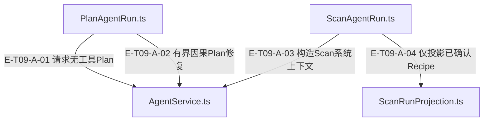

# 09 · 领域任务

> Plan、Scan、Evolution、Relation、Translation、Module mining分别怎样进入Service、产出何种结果？

六类run helper负责领域输入、profile选择、宿主取消/期限透传与结果投影，执行仍经AgentService。成功文本不是通用领域成功：Plan必须校验形状/阶段，Scan只信持久化created回执，Evolution必须覆盖全部唯一Recipe决策，Relation失败不能进入写图，Translation可保留原文并标error，module mining 按真实 ProjectContext 模块通过 Coordinator 扇出；普通 Runtime 策略只有 single/pipeline。

[真实调用](call-flow.md) · [直接依赖](file-dependency.md) · [阅读规范](../00-diagram-standard.md)

## 职责与主要接缝

### 本图术语说明

| 术语／节点 | 含义与范围 |
| --- | --- |
| PlanAgentRun.ts | `src/agent/runs/plan/PlanAgentRun.ts`；本图按实现文件聚合职责；具体装配条件见下表。 |
| AgentService.ts | `src/agent/service/AgentService.ts`；本图按实现文件聚合职责；具体装配条件见下表。 |
| ScanAgentRun.ts | `src/agent/runs/scan/ScanAgentRun.ts`；本图按实现文件聚合职责；具体装配条件见下表。 |
| ScanRunProjection.ts | `src/agent/runs/scan/ScanRunProjection.ts`；本图按实现文件聚合职责；具体装配条件见下表。 |

| 编号 | 代码依据 | 测试依据 | 关系与可证明范围 |
| --- | --- | --- | --- |
| E-T09-A-01 | `src/agent/runs/plan/PlanAgentRun.ts#runPlanAgent` → `src/agent/service/AgentService.ts#AgentService.run` | `test/plan-agent-run.test.ts#case:performs%20one%20real%20no-tool%20LLM%20call%20before%20returning%20PlanSelection%20JSON`；真实Service/Builder/Runtime，provider mock返回有效PlanSelection；断言维度api、provider仅一次、prompt有coldStart，toolSchemas/toolChoice传给provider为undefined（没有可见工具）。不是远程真实LLM。断言已定位，实际执行见页面证据。 | buildSystemTaskRunInput选择plan-selection，toolChoiceOverride=none；success之后parsePlanSelection调用Core阶段校验，非success抛带partialResult的runFailure。 |
| E-T09-A-02 | `src/agent/runs/plan/PlanAgentRun.ts#runStrictPlanAgent` → `src/agent/service/AgentService.ts#AgentService.run` | `test/plan-agent-run.test.ts#case:forwards%20the%20same%20signals%20to%20every%20strict%20plan%20attempt%20including%20causal%20repairs`；service替身每次返回有效intent，validateReceipt第一次抛PLAN_REQUIRED_LENS_UNSCHEDULED后第二次通过；断言run调用2次、每次execution={toolChoiceOverride:none,同一abortSignal,同一shouldAbort,timeoutMs:15000}。无真实模型或宿主封印。断言已定位，实际执行见页面证据。 | 严格Plan复用plan-selection但完整冻结context、禁工具；结构拒绝与白名单PLAN语义拒绝共用0..2修复预算，每次携带父输出/hash，最后交validateReceipt宿主口。 |
| E-T09-A-03 | `src/agent/runs/scan/ScanAgentRun.ts#runScanAgentTask` → `src/agent/service/AgentService.ts#AgentService.run` | `test/scan-run-projection.test.ts#case:runScanAgentTask%20passes%20per-file%20language%20into%20the%20run%20file%20cache`；输入单文件{name:code,content:fn main() {},language:rust}，使用真实SystemRunContextFactory与service.run替身；断言run一次，context.fileCache精确为relativePath/name=code、正文和language=rust。断言已定位，实际执行见页面证据。 | 校验extract/summarize，files映射fileCache，SystemRunContextFactory创建scope/window/tracker；选scan-extract/scan-summarize，结果交projectScanRunResult。 |
| E-T09-A-04 | `src/agent/runs/scan/ScanAgentRun.ts#runScanAgentTask` → `src/agent/runs/scan/ScanRunProjection.ts#projectScanRunResult` | `test/scan-run-production-integration.test.ts#case:rejects%20provider-only%20Recipes%20when%20the%20production%20runner%20makes%20no%20submit%20call`；Service+Runtime替身返回声称1个Recipe的JSON但toolCalls=[]；断言extracted=0/recipes=[]，persistenceOutcome=no-submit-attempt，ignoredUnpersistedOutput=true。断言已定位，实际执行见页面证据。 | 调用投影时带task/label/result/fallback；extractCreatedRecipes经isPersistedSubmission筛选，成功provider文字不能制造Recipe。 |

## 输入、输出与副作用

| 维度 | 当前实现 |
| --- | --- |
| 输入 | Plan: generationStage与projectContextFacts；Strict额外冻结hash/白名单/caps与validateReceipt；Scan: files+task+label；Evolution: recipes+overview；Relation: batchSize；Translation: summary/usageGuide；Module: modules/projectFacts/scaleCap/concurrency；各helper可选三种system signals |
| 输出 | PlanSelection或PlanCognitionReceipt；Scan已确认Recipe投影；Evolution计数与完整性；Relation关系列表；Translation译文或原文+error；Module协调AgentRunResult与child pipeline outcome |
| 副作用 | helpers自身主要组装/投影；真正领域写入经模型工具和Core port；Relation的宿主持久化属于外部消费边界，本helper不写图；tasks公开子路径仍保留5个deprecated旧任务；关系发现替代为service.runRelationDiscovery，其余4项依赖工具已不存在，没有可宣称的替代流程 |

## 从这些文件开始

| 文件 | 阅读目的 |
| --- | --- |
| `src/agent/runs/plan/PlanAgentRun.ts` | legacy PlanSelection 解析验证与 strict Plan 冻结上下文/0..2 次因果修复；只修模型可修复结构/语义，Core 决定计划是否合法。 |
| `src/agent/runs/scan/ScanAgentRun.ts` | 校验 extract/summarize，预装 fileCache 与系统 scope，运行服务后转扫描业务结果。 |
| `src/agent/runs/scan/ScanRunProjection.ts` | 只从已持久化 knowledge.submit created 回执抽取 Recipe；零持久化返回任务 fallback 和明确诊断。 |
| `src/agent/runs/evolution/EvolutionAgentRun.ts` | 对非空待审 recipe 集运行 evolution-audit，按唯一期望 ID 校验每条成功决策，统计 proposal/deprecated/verified。 |
| `src/agent/runs/relation/RelationAgentRun.ts` | 两阶段只读关系发现后解析 JSON；非成功抛 partialResult，解析失败按既有决定回退零关系。 |
| `src/agent/runs/translation/TranslationAgentRun.ts` | 无工具翻译运行；非成功返回原文/error；JSON 解析恢复、缺字段回退与旁路诊断。 |
| `src/agent/runs/module-mining/ScopedModuleMiningAgentRun.ts` | 选模块、规模封顶、超大模块拆分、contextMap 与动态 analyst 预算附着，交 coordinator，失败保留子结果。 |
| `src/agent/runs/systemTaskRunInput.ts` | 六类系统 run 共用 Input 装配；信号按需透传，未传信号保持历史键形状，fanout 期限为每 child。 |
| `src/agent/profiles/AgentStageFactoryRegistry.ts` | 装配 scan、relation、按 recipe 规模 evolution、动态预算 generate 或 strict 四阶段流水线。 |
| `src/agent/tasks/index.ts` | 显式聚合/兼容出口；转出本层已有实现，未创建第二条运行链。 |

## 失败、取消与恢复

- Plan校验与停止：普通Plan要求stage与moduleBindings合法；严格Plan若run失败或出现toolCalls立即停止，不以语义修复掩盖工具违规。
- Scan持久化与执行状态：已created回执可在status=aborted/timeout时保留并带error；无回执走task fallback，onParseError一次诊断，不把模型文本视为已入库。
- Evolution完整性：期望Recipe ID先去重，成功/提案/废弃按回执判断；缺少任一唯一ID即抛incomplete，保留partial result。
- 解析回退差异：Relation成功run解析失败回0关系+diagnostics；Translation整体/字段回退给原文+error；二者不可统一成同一成功状态图。
- 模块调度：空模块或scaleCap=0输入拒绝；超大模块可拆分并解决ID碰撞；失败父结果保留兄弟回执。宿主budget只作为提示，不约束child执行。

## 已知边界与未验证范围

- 旧tasks不能画成六类现代run的等价可用入口；当前仍导出是宿主兼容，不代表工具存在。
- module budget提示目前没有阶段prompt builder实际读取，也不是runtime budgetOverride。
- Strict validateReceipt是宿主授权口；本子任务只核对本仓调用与修复边界，不确认宿主真实封印。
- 未执行真实provider、真实用户项目scan或外部关系持久化。

## 六类run的可执行对照

[权限与结果矩阵](result-matrix.md)逐类对照输入、profile、阶段工具、结果和恢复，并附精确用例与替身边界；实际执行见页面证据。
