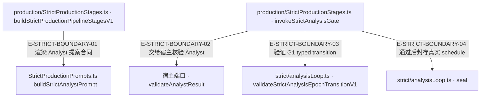

# 严格生产：权威在哪里停止

[职责与已知缺口](overview.md) · [真实调用](call-flow.md)

公开入口当前分工：`src/evaluation.ts` 只导出独立 reviewer 与 frozen evidence projection；`src/production.ts` 保留 durable review factory/error 与相关类型。重复出口撤回不代表 durable 能力删除。`test/contract-surface.test.ts#case:withdraws%20FanOutStrategy%20from%20%60.%60%20and%20%60.%2Fagent%60%20and%20the%20durable%20runtime%20from%20%60.%2Fevaluation%60`定位名集与保留入口；断言已定位，实际执行见页面证据。

Strict pipeline、旧 IndependentValueReviewer 与 durable review 是不同路径。下图选取最关键的门调用；外部宿主返回值必须经过本仓验证，不能从静态注入端口推导生产已接通。

## 严格门与权威端口

### 本图术语说明

| 术语／节点 | 含义与范围 |
| --- | --- |
| production/StrictProductionStages.ts · buildStrictProductionPipelineStagesV1 | `src/agent/production/StrictProductionStages.ts#buildStrictProductionPipelineStagesV1`；声明或调用端口；动态实现的绑定条件见下表。 |
| StrictProductionPrompts.ts · buildStrictAnalystPrompt | `src/agent/production/StrictProductionPrompts.ts#buildStrictAnalystPrompt`；声明或调用端口；动态实现的绑定条件见下表。 |
| production/StrictProductionStages.ts · invokeStrictAnalysisGate | `src/agent/production/StrictProductionStages.ts#invokeStrictAnalysisGate`；声明或调用端口；动态实现的绑定条件见下表。 |
| 宿主端口 · validateAnalystResult | `src/agent/production/StrictProductionStages.ts#StrictProductionRuntimePortV1.validateAnalystResult`；声明或调用端口；动态实现的绑定条件见下表。 |
| strict/analysisLoop.ts · validateStrictAnalysisEpochTransitionV1 | `src/agent/production/strict/analysisLoop.ts#validateStrictAnalysisEpochTransitionV1`；声明或调用端口；动态实现的绑定条件见下表。 |
| strict/analysisLoop.ts · seal | `src/agent/production/strict/analysisLoop.ts#StrictAnalysisExpansionPortV1.seal`；声明或调用端口；动态实现的绑定条件见下表。 |

| 编号 | 代码依据 | 测试依据 | 关系与可证明范围 |
| --- | --- | --- | --- |
| E-STRICT-BOUNDARY-01 | `src/agent/production/StrictProductionStages.ts#buildStrictProductionPipelineStagesV1` → `src/agent/production/StrictProductionPrompts.ts#buildStrictAnalystPrompt` | `test/strict-production-prompts-output-contract.test.ts#case:renders%20every%20key%20the%20host%20Analyst%20envelope%20parser%20and%20the%20Agent%20epoch%20input%20require`；测试核对模型可见 shape 的必需键；不证明真实模型会遵守或宿主已经注入 sealed review。 | builder 返回的 analyze.promptBuilder 在运行时读取 epoch 与 limits 并调用 prompt builder；capabilities/additionalTools 为空、toolChoiceOverride=none。 |
| E-STRICT-BOUNDARY-02 | `src/agent/production/StrictProductionStages.ts#invokeStrictAnalysisGate` → `src/agent/production/StrictProductionStages.ts#StrictProductionRuntimePortV1.validateAnalystResult` | `test/strict-production-stages-port-signal.test.ts#case:forwards%20the%20G1%20strategy%20abortSignal%20to%20validateAnalystResult%20as%20options.signal`；断言端口调用有 3 个参数、options.signal 与原 signal 相同。 | 实际 await 注入端口，并把 observed epoch 和可选 signal 传入；事实查询执行/审查的外部实现不在此函数。 |
| E-STRICT-BOUNDARY-03 | `src/agent/production/StrictProductionStages.ts#invokeStrictAnalysisGate` → `src/agent/production/strict/analysisLoop.ts#validateStrictAnalysisEpochTransitionV1` | `test/strict-iterative-analysis.test.ts#case:fails%20closed%20when%20a%20retry%20does%20not%20advance%20the%20append-only%20epoch%20state`；该用例把不前进的 retry 导向失败关闭；另有 epoch/obligation cap 与 shadow obligation 用例。 | 宿主返回后读取 after；从真实 before/after 差集授权新增 obligation，再校验 typed outcome、epoch 上界、append-only 与 terminal 集守恒。 |
| E-STRICT-BOUNDARY-04 | `src/agent/production/StrictProductionStages.ts#invokeStrictAnalysisGate` → `src/agent/production/strict/analysisLoop.ts#StrictAnalysisExpansionPortV1.seal` | `test/strict-iterative-analysis.test.ts#case:checks%20an%20expected%20schedule%20hash%20before%20committing%20seal%20and%20caches%20the%20sealed%20schedule`；错误 hash 抛 STRICT_ANALYSIS_FIXPOINT_SCHEDULE_MISMATCH 且 finalSchedule 仍 null；正确封存后复用同一结果。 | 只有完整 transition 验过且 action=pass 时才用 finalExpandedScheduleHash 调用 seal；失败不能提前封口。 |

## 必须停止的条件

| 位置 | 已实现核验 | 当前仍需宿主／跨仓处理 |
| --- | --- | --- |
| Analyst → G1 | epoch/append-only transitions/fixpoint/schedule 合同校验 | 模型 JSON 不拥有 host-sealed 权威；缺字段必须 fail-closed。 |
| Producer 零处置 | 建集时要求 dispositionReview | 本仓注释登记的宿主审查顺序在 G2 后；需宿主窗口确认，不能靠模型伪造提前过门。 |
| IndependentValueReviewer | 对可比 identity 做全等核验 | producer/modelHash 与 provider/model 坐标不可比只告警；不能证明独立模型身份。 |
| G2 verdict | Agent 与 Core 各有推导 | 5 个 it.fails 组合仍是目标，不是已满足合同。 |
| DurableSemanticReviewRuntime | ledger read facet、load receipt、authority、attestation 绑定 | 独立路径的严格绑定不自动修复旧 reviewer/宿主接线。 |

依据：`src/agent/production/StrictProductionPrompts.ts`、`src/agent/evaluation/IndependentValueReviewer.ts`、`test/independent-value-reviewer-core-g2-contract.test.ts`。断言已定位，实际执行见页面证据；没有真实 LLM 或跨仓验收结论。
