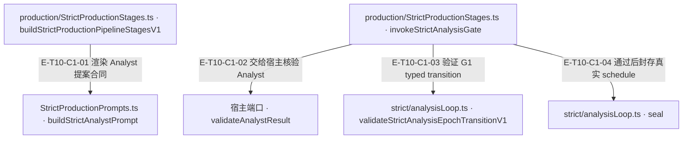
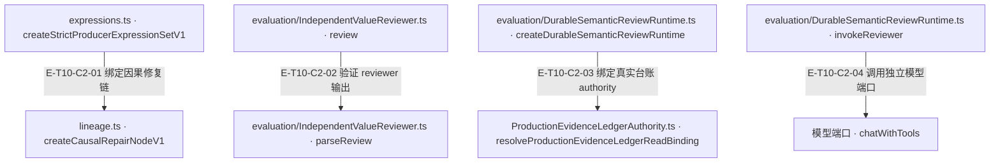

# 严格生产与评审 · 真实调用

Strict stages 复用 PipelineStrategy，但 Analyst/Producer 均没有工具权限。宿主端口提供 epoch、事实执行权威与审查；Agent 校验 append-only transition、封存 schedule、绑定 producer 因果 lineage，并把独立 reviewer 输出限制为可验证结构。DurableSemanticReviewRuntime 另以真实 ledger read facet、provider load receipt、见证 authority 和 Core V5 gateway 形成可重验 attestation；这不自动证明现有严格模型提案与宿主封印已接通。

[职责与边界](overview.md) · [直接依赖](file-dependency.md)

公开入口当前分工：`src/evaluation.ts` 只导出独立 reviewer 与 frozen evidence projection；`src/production.ts` 保留 durable review factory/error 与相关类型。重复出口撤回不代表 durable 能力删除。`test/contract-surface.test.ts#case:withdraws%20FanOutStrategy%20from%20%60.%60%20and%20%60.%2Fagent%60%20and%20the%20durable%20runtime%20from%20%60.%2Fevaluation%60`定位名集与保留入口；断言已定位，实际执行见页面证据。

图中调用边经实现正文核对；AST只用于符号定位。接口／注入对象是调用端口，不据此推定所有宿主实现相同。断言已定位，实际执行见页面证据；具体输入、替身与断言分开说明，历史通过记录不自动证明当前源码。

## 调用接缝 1

### 本图术语说明

| 术语／节点 | 含义与范围 |
| --- | --- |
| production/StrictProductionStages.ts · buildStrictProductionPipelineStagesV1 | `src/agent/production/StrictProductionStages.ts#buildStrictProductionPipelineStagesV1`；声明或调用端口；动态实现的绑定条件见下表。 |
| StrictProductionPrompts.ts · buildStrictAnalystPrompt | `src/agent/production/StrictProductionPrompts.ts#buildStrictAnalystPrompt`；声明或调用端口；动态实现的绑定条件见下表。 |
| production/StrictProductionStages.ts · invokeStrictAnalysisGate | `src/agent/production/StrictProductionStages.ts#invokeStrictAnalysisGate`；声明或调用端口；动态实现的绑定条件见下表。 |
| 宿主端口 · validateAnalystResult | `src/agent/production/StrictProductionStages.ts#StrictProductionRuntimePortV1.validateAnalystResult`；声明或调用端口；动态实现的绑定条件见下表。 |
| strict/analysisLoop.ts · validateStrictAnalysisEpochTransitionV1 | `src/agent/production/strict/analysisLoop.ts#validateStrictAnalysisEpochTransitionV1`；声明或调用端口；动态实现的绑定条件见下表。 |
| strict/analysisLoop.ts · seal | `src/agent/production/strict/analysisLoop.ts#StrictAnalysisExpansionPortV1.seal`；声明或调用端口；动态实现的绑定条件见下表。 |

| 编号 | 代码依据 | 测试依据 | 关系与可证明范围 |
| --- | --- | --- | --- |
| E-T10-C1-01 | `src/agent/production/StrictProductionStages.ts#buildStrictProductionPipelineStagesV1` → `src/agent/production/StrictProductionPrompts.ts#buildStrictAnalystPrompt` | `test/strict-production-prompts-output-contract.test.ts#case:renders%20every%20key%20the%20host%20Analyst%20envelope%20parser%20and%20the%20Agent%20epoch%20input%20require`；测试核对模型可见 shape 的必需键；不证明真实模型会遵守或宿主已经注入 sealed review。 | builder 返回的 analyze.promptBuilder 在运行时读取 epoch 与 limits 并调用 prompt builder；capabilities/additionalTools 为空、toolChoiceOverride=none。 |
| E-T10-C1-02 | `src/agent/production/StrictProductionStages.ts#invokeStrictAnalysisGate` → `src/agent/production/StrictProductionStages.ts#StrictProductionRuntimePortV1.validateAnalystResult` | `test/strict-production-stages-port-signal.test.ts#case:forwards%20the%20G1%20strategy%20abortSignal%20to%20validateAnalystResult%20as%20options.signal`；断言端口调用有 3 个参数、options.signal 与原 signal 相同。 | 实际 await 注入端口，并把 observed epoch 和可选 signal 传入；事实查询执行/审查的外部实现不在此函数。 |
| E-T10-C1-03 | `src/agent/production/StrictProductionStages.ts#invokeStrictAnalysisGate` → `src/agent/production/strict/analysisLoop.ts#validateStrictAnalysisEpochTransitionV1` | `test/strict-iterative-analysis.test.ts#case:fails%20closed%20when%20a%20retry%20does%20not%20advance%20the%20append-only%20epoch%20state`；该用例把不前进的 retry 导向失败关闭；另有 epoch/obligation cap 与 shadow obligation 用例。 | 宿主返回后读取 after；从真实 before/after 差集授权新增 obligation，再校验 typed outcome、epoch 上界、append-only 与 terminal 集守恒。 |
| E-T10-C1-04 | `src/agent/production/StrictProductionStages.ts#invokeStrictAnalysisGate` → `src/agent/production/strict/analysisLoop.ts#StrictAnalysisExpansionPortV1.seal` | `test/strict-iterative-analysis.test.ts#case:checks%20an%20expected%20schedule%20hash%20before%20committing%20seal%20and%20caches%20the%20sealed%20schedule`；错误 hash 抛 STRICT_ANALYSIS_FIXPOINT_SCHEDULE_MISMATCH 且 finalSchedule 仍 null；正确封存后复用同一结果。 | 只有完整 transition 验过且 action=pass 时才用 finalExpandedScheduleHash 调用 seal；失败不能提前封口。 |

## 调用接缝 2

### 本图术语说明

| 术语／节点 | 含义与范围 |
| --- | --- |
| expressions.ts · createStrictProducerExpressionSetV1 | `src/agent/production/strict/expressions.ts#createStrictProducerExpressionSetV1`；声明或调用端口；动态实现的绑定条件见下表。 |
| lineage.ts · createCausalRepairNodeV1 | `src/agent/production/strict/lineage.ts#createCausalRepairNodeV1`；声明或调用端口；动态实现的绑定条件见下表。 |
| evaluation/IndependentValueReviewer.ts · review | `src/agent/evaluation/IndependentValueReviewer.ts#IndependentValueReviewer.review`；声明或调用端口；动态实现的绑定条件见下表。 |
| evaluation/IndependentValueReviewer.ts · parseReview | `src/agent/evaluation/IndependentValueReviewer.ts#parseReview`；声明或调用端口；动态实现的绑定条件见下表。 |
| evaluation/DurableSemanticReviewRuntime.ts · createDurableSemanticReviewRuntime | `src/agent/evaluation/DurableSemanticReviewRuntime.ts#createDurableSemanticReviewRuntime`；声明或调用端口；动态实现的绑定条件见下表。 |
| ProductionEvidenceLedgerAuthority.ts · resolveProductionEvidenceLedgerReadBinding | `src/agent/evidence/ProductionEvidenceLedgerAuthority.ts#resolveProductionEvidenceLedgerReadBinding`；声明或调用端口；动态实现的绑定条件见下表。 |
| evaluation/DurableSemanticReviewRuntime.ts · invokeReviewer | `src/agent/evaluation/DurableSemanticReviewRuntime.ts#invokeReviewer`；声明或调用端口；动态实现的绑定条件见下表。 |
| 模型端口 · chatWithTools | `src/agent/evaluation/DurableSemanticReviewRuntime.ts#SemanticReviewProviderV1`；声明或调用端口；动态实现的绑定条件见下表。 |

| 编号 | 代码依据 | 测试依据 | 关系与可证明范围 |
| --- | --- | --- | --- |
| E-T10-C2-01 | `src/agent/production/strict/expressions.ts#createStrictProducerExpressionSetV1` → `src/agent/production/strict/lineage.ts#createCausalRepairNodeV1` | `test/strict-production-rework.test.ts#case:derives%20immutable%20roots%20from%20semantic%20receipts%20and%20cannot%20reset%20the%20repair%20depth`；初始/两次修复的 version 与 parentSetId 连续，rootIds 不变，第 3 次修复抛 STRICT_CAUSAL_REPAIR_LIMIT。 | 先验证 lineage/parent set 与提案，再从前驱 repairNode 派生当前节点；版本/深度不接受调用者重置。 |
| E-T10-C2-02 | `src/agent/evaluation/IndependentValueReviewer.ts#IndependentValueReviewer.review` → `src/agent/evaluation/IndependentValueReviewer.ts#parseReview` | `test/independent-value-reviewer-core-g2-contract.test.ts#case:%E8%A6%86%E7%9B%96%20review()%20%E7%9A%84%E5%85%A8%E9%83%A8%E4%B8%83%E4%B8%AA%E6%95%B4%E4%BD%93%E6%8B%92%E7%BB%9D%E5%87%BA%E5%8F%A3`；覆盖整体拒绝 reason 集；同测试文件另用 it.fails 记录 5 个未完成的 Agent/宿主/Core verdict 一致性目标。 | chat 回来后解析六轴、score/verdict 配对、novelty/duplicate 与 citations；无效结构或引用进入 reject，而非猜测缺失字段。 |
| E-T10-C2-03 | `src/agent/evaluation/DurableSemanticReviewRuntime.ts#createDurableSemanticReviewRuntime` → `src/agent/evidence/ProductionEvidenceLedgerAuthority.ts#resolveProductionEvidenceLedgerReadBinding` | `test/durable-semantic-review-runtime.test.ts#case:rejects%20a%20caller-provided%20structural%20replacement%20for%20the%20production%20read%20facet`；覆盖结构相似但无权威绑定的 read facet 在 bootstrap 被拒；不代表 Core gateway 内部实现属于 Agent。 | bootstrap 必须识别由生产 factory 创建的 read facet，不能接受结构相似的调用者替身；然后以宿主 key/reviewer/witness 绑定 Core durable gateway。 |
| E-T10-C2-04 | `src/agent/evaluation/DurableSemanticReviewRuntime.ts#invokeReviewer` → `src/agent/evaluation/DurableSemanticReviewRuntime.ts#SemanticReviewProviderV1` | `test/durable-semantic-review-runtime.test.ts#case:loads%20the%20authoritative%20Agent%20ledger%2C%20invokes%20the%20provider%20with%20Core%20prompt%2C%20and%20emits%20a%20fresh-process%20V5%20durable%20attestation`；真实 ledger/key/Core attestation 与新进程校验；provider 回复由 passingDecisionFromCompiledPrompt 替身生成，断言只调一次且 prompt 完全一致。 | 实际调用 state.reviewer.provider.chatWithTools(Core compiledPrompt,{toolSchemas:[],toolChoice:'none',temperature:0,abortSignal})；空、带工具或 partial 回复拒绝。 |
