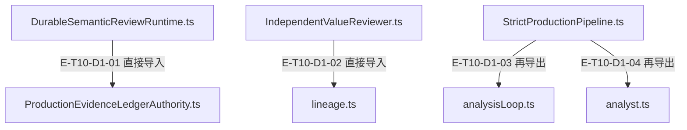
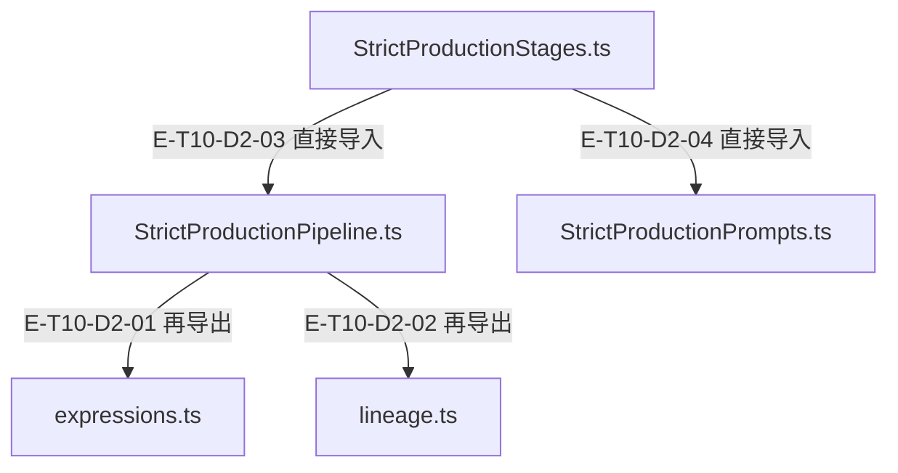

# 严格生产与评审 · 精选直接依赖

[职责与边界](overview.md) · [真实调用](call-flow.md)

选取本专题入口的最多8条直接依赖；完整库存可在阅读器「文件与依赖」查看。以仓库全路径为节点身份，同名文件不会合并。Core／Node／第三方包只在完整探索器的外部边界出现。

## 静态依赖 1

### 本图术语说明

| 术语／节点 | 含义与范围 |
| --- | --- |
| DurableSemanticReviewRuntime.ts | `src/agent/evaluation/DurableSemanticReviewRuntime.ts`；文件直接依赖，箭头不表示执行先后。 |
| ProductionEvidenceLedgerAuthority.ts | `src/agent/evidence/ProductionEvidenceLedgerAuthority.ts`；文件直接依赖，箭头不表示执行先后。 |
| IndependentValueReviewer.ts | `src/agent/evaluation/IndependentValueReviewer.ts`；文件直接依赖，箭头不表示执行先后。 |
| lineage.ts | `src/agent/production/strict/lineage.ts`；文件直接依赖，箭头不表示执行先后。 |
| StrictProductionPipeline.ts | `src/agent/production/StrictProductionPipeline.ts`；文件直接依赖，箭头不表示执行先后。 |
| analysisLoop.ts | `src/agent/production/strict/analysisLoop.ts`；文件直接依赖，箭头不表示执行先后。 |
| analyst.ts | `src/agent/production/strict/analyst.ts`；文件直接依赖，箭头不表示执行先后。 |

| 编号 | 代码依据 | 测试依据 | 关系与可证明范围 |
| --- | --- | --- | --- |
| E-T10-D1-01 | `src/agent/evaluation/DurableSemanticReviewRuntime.ts` → `src/agent/evidence/ProductionEvidenceLedgerAuthority.ts` | 未覆盖：静态依赖由本图谱解析器反例测试支持；不把 import 当作行为覆盖。 | TypeScript AST 解析 ../evidence/ProductionEvidenceLedgerAuthority.js；第 24 行，kind=import，typeOnly=false。只证明结构关系。 |
| E-T10-D1-02 | `src/agent/evaluation/IndependentValueReviewer.ts` → `src/agent/production/strict/lineage.ts` | 未覆盖：静态依赖由本图谱解析器反例测试支持；不把 import 当作行为覆盖。 | TypeScript AST 解析 ../production/strict/lineage.js；第 5 行，kind=import，typeOnly=false。只证明结构关系。 |
| E-T10-D1-03 | `src/agent/production/StrictProductionPipeline.ts` → `src/agent/production/strict/analysisLoop.ts` | 未覆盖：静态依赖由本图谱解析器反例测试支持；不把 import 当作行为覆盖。 | TypeScript AST 解析 ./strict/analysisLoop.js；第 2 行，kind=re-export，typeOnly=false。只证明结构关系。 |
| E-T10-D1-04 | `src/agent/production/StrictProductionPipeline.ts` → `src/agent/production/strict/analyst.ts` | 未覆盖：静态依赖由本图谱解析器反例测试支持；不把 import 当作行为覆盖。 | TypeScript AST 解析 ./strict/analyst.js；第 19 行，kind=re-export，typeOnly=false。只证明结构关系。 |

## 静态依赖 2

### 本图术语说明

| 术语／节点 | 含义与范围 |
| --- | --- |
| StrictProductionPipeline.ts | `src/agent/production/StrictProductionPipeline.ts`；文件直接依赖，箭头不表示执行先后。 |
| expressions.ts | `src/agent/production/strict/expressions.ts`；文件直接依赖，箭头不表示执行先后。 |
| lineage.ts | `src/agent/production/strict/lineage.ts`；文件直接依赖，箭头不表示执行先后。 |
| StrictProductionStages.ts | `src/agent/production/StrictProductionStages.ts`；文件直接依赖，箭头不表示执行先后。 |
| StrictProductionPrompts.ts | `src/agent/production/StrictProductionPrompts.ts`；文件直接依赖，箭头不表示执行先后。 |

| 编号 | 代码依据 | 测试依据 | 关系与可证明范围 |
| --- | --- | --- | --- |
| E-T10-D2-01 | `src/agent/production/StrictProductionPipeline.ts` → `src/agent/production/strict/expressions.ts` | 未覆盖：静态依赖由本图谱解析器反例测试支持；不把 import 当作行为覆盖。 | TypeScript AST 解析 ./strict/expressions.js；第 30 行，kind=re-export，typeOnly=false。只证明结构关系。 |
| E-T10-D2-02 | `src/agent/production/StrictProductionPipeline.ts` → `src/agent/production/strict/lineage.ts` | 未覆盖：静态依赖由本图谱解析器反例测试支持；不把 import 当作行为覆盖。 | TypeScript AST 解析 ./strict/lineage.js；第 43 行，kind=re-export，typeOnly=false。只证明结构关系。 |
| E-T10-D2-03 | `src/agent/production/StrictProductionStages.ts` → `src/agent/production/StrictProductionPipeline.ts` | 未覆盖：静态依赖由本图谱解析器反例测试支持；不把 import 当作行为覆盖。 | TypeScript AST 解析 ./StrictProductionPipeline.js；第 4 行，kind=import，typeOnly=false。只证明结构关系。 |
| E-T10-D2-04 | `src/agent/production/StrictProductionStages.ts` → `src/agent/production/StrictProductionPrompts.ts` | 未覆盖：静态依赖由本图谱解析器反例测试支持；不把 import 当作行为覆盖。 | TypeScript AST 解析 ./StrictProductionPrompts.js；第 12 行，kind=import，typeOnly=false。只证明结构关系。 |
