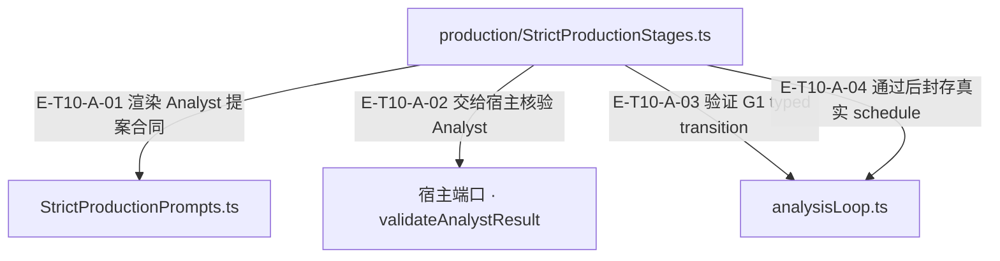

# 10 · 严格生产与评审

> 严格 Analyst/Producer 的约束链怎样形成可验证回执，哪些环节仍未形成真实生产闭环？

Strict stages 复用 PipelineStrategy，但 Analyst/Producer 均没有工具权限。宿主端口提供 epoch、事实执行权威与审查；Agent 校验 append-only transition、封存 schedule、绑定 producer 因果 lineage，并把独立 reviewer 输出限制为可验证结构。DurableSemanticReviewRuntime 另以真实 ledger read facet、provider load receipt、见证 authority 和 Core V5 gateway 形成可重验 attestation；这不自动证明现有严格模型提案与宿主封印已接通。

[真实调用](call-flow.md) · [直接依赖](file-dependency.md) · [阅读规范](../00-diagram-standard.md)

公开入口当前分工：`src/evaluation.ts` 只导出独立 reviewer 与 frozen evidence projection；`src/production.ts` 保留 durable review factory/error 与相关类型。重复出口撤回不代表 durable 能力删除。`test/contract-surface.test.ts#case:withdraws%20FanOutStrategy%20from%20%60.%60%20and%20%60.%2Fagent%60%20and%20the%20durable%20runtime%20from%20%60.%2Fevaluation%60`定位名集与保留入口；断言已定位，实际执行见页面证据。

## 职责与主要接缝（G1局部）

### 本图术语说明

| 术语／节点 | 含义与范围 |
| --- | --- |
| production/StrictProductionStages.ts | `src/agent/production/StrictProductionStages.ts`；本图按实现文件聚合职责；具体装配条件见下表。 |
| StrictProductionPrompts.ts | `src/agent/production/StrictProductionPrompts.ts`；本图按实现文件聚合职责；具体装配条件见下表。 |
| 宿主端口 · validateAnalystResult | `src/agent/production/StrictProductionStages.ts#StrictProductionRuntimePortV1.validateAnalystResult`；本图按实现文件聚合职责；具体装配条件见下表。 |
| analysisLoop.ts | `src/agent/production/strict/analysisLoop.ts`；本图按实现文件聚合职责；具体装配条件见下表。 |

| 编号 | 代码依据 | 测试依据 | 关系与可证明范围 |
| --- | --- | --- | --- |
| E-T10-A-01 | `src/agent/production/StrictProductionStages.ts#buildStrictProductionPipelineStagesV1` → `src/agent/production/StrictProductionPrompts.ts#buildStrictAnalystPrompt` | `test/strict-production-prompts-output-contract.test.ts#case:renders%20every%20key%20the%20host%20Analyst%20envelope%20parser%20and%20the%20Agent%20epoch%20input%20require`；测试核对模型可见 shape 的必需键；不证明真实模型会遵守或宿主已经注入 sealed review。 | builder 返回的 analyze.promptBuilder 在运行时读取 epoch 与 limits 并调用 prompt builder；capabilities/additionalTools 为空、toolChoiceOverride=none。 |
| E-T10-A-02 | `src/agent/production/StrictProductionStages.ts#invokeStrictAnalysisGate` → `src/agent/production/StrictProductionStages.ts#StrictProductionRuntimePortV1.validateAnalystResult` | `test/strict-production-stages-port-signal.test.ts#case:forwards%20the%20G1%20strategy%20abortSignal%20to%20validateAnalystResult%20as%20options.signal`；断言端口调用有 3 个参数、options.signal 与原 signal 相同。 | 实际 await 注入端口，并把 observed epoch 和可选 signal 传入；事实查询执行/审查的外部实现不在此函数。 |
| E-T10-A-03 | `src/agent/production/StrictProductionStages.ts#invokeStrictAnalysisGate` → `src/agent/production/strict/analysisLoop.ts#validateStrictAnalysisEpochTransitionV1` | `test/strict-iterative-analysis.test.ts#case:fails%20closed%20when%20a%20retry%20does%20not%20advance%20the%20append-only%20epoch%20state`；该用例把不前进的 retry 导向失败关闭；另有 epoch/obligation cap 与 shadow obligation 用例。 | 宿主返回后读取 after；从真实 before/after 差集授权新增 obligation，再校验 typed outcome、epoch 上界、append-only 与 terminal 集守恒。 |
| E-T10-A-04 | `src/agent/production/StrictProductionStages.ts#invokeStrictAnalysisGate` → `src/agent/production/strict/analysisLoop.ts#StrictAnalysisExpansionPortV1.seal` | `test/strict-iterative-analysis.test.ts#case:checks%20an%20expected%20schedule%20hash%20before%20committing%20seal%20and%20caches%20the%20sealed%20schedule`；错误 hash 抛 STRICT_ANALYSIS_FIXPOINT_SCHEDULE_MISMATCH 且 finalSchedule 仍 null；正确封存后复用同一结果。 | 只有完整 transition 验过且 action=pass 时才用 finalExpandedScheduleHash 调用 seal；失败不能提前封口。 |

## 输入、输出与副作用

| 维度 | 当前实现 |
| --- | --- |
| 输入 | StrictProductionRuntimePortV1：epoch/limits/expansionPort、validateAnalystResult/buildProducerInput/reviewProducerResult；模型 Analyst/Producer JSON 提案、宿主事实执行 receipts、独立 review 封印、源修订与 frozen evidence；Durable bootstrap：Ed25519 key custody、model-load receipt、production ledger read facet、witness authority、timeout |
| 输出 | 带 hash 的 epoch transition、analysis fixpoint、producer lineage/expression set/terminal receipts；G1/G2 pass/reject/retry 或 typed exception artifact；Core SemanticDispositionReviewDurableAttestationV5 与可序列化 trustPolicy |
| 副作用 | 扩展端口登记并最终 seal schedule；表达与回执冻结/hash 绑定。；Durable runtime 调用外部 provider 和 witness authority；维护按 requestHash 的并发上下文与取消/timeout 清理。；知识生命周期与最终 durable attestation mint/validation 由 Core/宿主端口承接；Agent 不直接拥有 repository。 |

## 从这些文件开始

| 文件 | 阅读目的 |
| --- | --- |
| `src/agent/production/StrictProductionStages.ts` | 四阶段配置、宿主 G1/G2 调用与异常归类 |
| `src/agent/production/StrictProductionPrompts.ts` | 模型可见提案合同与 host-owned/host-sealed 区分 |
| `src/agent/production/StrictProductionPipeline.ts` | 严格生产 public/internal 聚合入口 |
| `src/agent/production/strict/analysisLoop.ts` | epoch/hash、append-only retry、扩展授权和 seal |
| `src/agent/production/strict/analyst.ts` | 事实/假设/独立处置审查校验与 fixpoint |
| `src/agent/production/strict/lineage.ts` | 语义回执到 producer 不可变 lineage 与因果修复 |
| `src/agent/production/strict/expressions.ts` | 0/1/N 表达、零处置封印和 terminal identity 守恒 |
| `src/agent/evaluation/IndependentValueReviewer.ts` | 六轴独立价值审查与现有 G2 映射 |
| `src/agent/evaluation/DurableSemanticReviewRuntime.ts` | trusted bootstrap、见证加载、provider 调用和 Core V5 attestation |
| `src/agent/evidence/ProductionEvidenceLedgerAuthority.ts` | 生产 ledger authority identity/read facet |

## 失败、取消与恢复

- G1 retry 未推进、缩小义务、影子义务或超限：失败关闭；合法 retry 必须 epoch+1 且新增义务与 terminal 增量严格匹配，不能凭模型声明授权。
- 门端口异常/取消：G1/G2 返回 reject；artifact 区分 semantic-reject/infrastructure，signal 调用前后均检查。基础设施归类本身不改业务拒绝。
- 封印或 producer zero review 缺失：保持明确 STRICT_* 语义拒绝；不得让模型伪造 host review 回执以过门。
- durable 证据/见证绑定不一致、重复执行、provider partial：typed error，不发 partial attestation；退出时 finally 清理 context/计时器。
- 语义修复：producer 因果链最多两次修复；超限拒绝，不能重置父链/深度绕过。

## 已知边界与未验证范围

- KNOWN-STRICT-SEALING 仍由本仓源码注释登记：跨仓第二步前宿主把模型 JSON 直接交校验；缺 host-sealed 字段会在 G1/G2 失败关闭。本页没有访问宿主重新确认其部署状态，不能将注释登记当作当前宿主实测。
- Producer 零处置在建集时要求 dispositionReview；本仓注释记录的宿主审查在 G2 后生成，是需由宿主确认的接线顺序缺口，不是本轮跨仓复验结论。
- KNOWN-G2-IDENTITY 仍存在：IndependentValueReviewer 只全等比较 producerIdentity 与 provider/model；宿主 producer/<modelHash> 坐标不可比仅告警，verdict 不变。现状测试证明同模型可继续产出 pass。
- KNOWN-G2-VERDICT 仍存在：Agent narrow/merge 优先级、宿主映射和 Core 推导不同；independent-value-reviewer-core-g2-contract.test.ts 的两个 it.fails.each 共 5 行是预期失败目标，不是已实现契约。
- DurableSemanticReviewRuntime 的严格身份/见证校验不能自动修复旧 IndependentValueReviewer 与宿主 G2 的上述缺口，两条路径必须分别讲解。
- fixture/public connected probe 证明可控输入下真实 wiring/ledger/signature，不能证明真实 LLM 质量、人工 calibration 或生产全链验收。

### 已登记的接线缺口

- {"id":"KNOWN-STRICT-SEALING","sourceRefs":["src/agent/production/StrictProductionPrompts.ts#STRICT_MODEL_OUTPUT_CONTRACT_V1","src/agent/production/strict/expressions.ts#CreateStrictProducerExpressionSetInputV1"],"testRef":"test/strict-production-prompts-output-contract.test.ts#case:reports%20an%20unsealed%20contract-shaped%20zero%20disposition%20at%20G2%20as%20a%20semantic%20reject%2C%20not%20an%20infrastructure%20fault%20(C029)","fact":"Source comments explicitly register pending host seal injection/order. The contract-shaped unsealed producer zero disposition is expected to fail closed; no real-host verification was run."}
- {"id":"KNOWN-G2-IDENTITY","sourceRefs":["src/agent/evaluation/IndependentValueReviewer.ts#IndependentValueReviewer.review","src/agent/evaluation/IndependentValueReviewer.ts#classifyProducerCoordinate"],"testRef":"test/independent-value-reviewer-core-g2-contract.test.ts#case:%E5%AE%BF%E4%B8%BB%E6%A0%BC%E5%BC%8F%E4%B8%8B%E5%90%8C%E6%A8%A1%E5%9E%8B%E8%87%AA%E8%AF%84%EF%BC%9AAgent%20%E5%8F%AA%E5%8F%91%E4%B8%8D%E5%8F%AF%E6%AF%94%E8%AF%8A%E6%96%AD%EF%BC%88verdict%20%E4%B8%8D%E5%8F%98%EF%BC%89%EF%BC%8CCore%20%E7%9A%84%20identity%20%E5%85%A8%E7%AD%89%E6%A3%80%E6%9F%A5%E5%90%8C%E6%A0%B7%E6%94%BE%E8%A1%8C%E5%B9%B6%E4%BA%A7%E5%87%BA%20pass%20%E5%9B%9E%E6%89%A7%EF%BC%88%E7%8E%B0%E7%8A%B6%EF%BC%89","fact":"provider/model equals guard only works in the same coordinate system; producer/<hash> mismatch is warned with verdictEffect=none."}
- {"id":"KNOWN-G2-VERDICT","sourceRefs":["src/agent/evaluation/IndependentValueReviewer.ts#IndependentValueReviewer.review"],"testRef":"test/independent-value-reviewer-core-g2-contract.test.ts#case:%25s%EF%BC%9A%E7%9B%AE%E6%A0%87%E4%B8%BA%20Core%20%E5%8F%AF%E7%BC%96%E7%A0%81%EF%BC%9B%E7%8E%B0%E7%8A%B6%20Agent%20narrow%20%E5%B8%A6%20permittedRepairFields%20%E8%80%8C%20Core%20%E6%8E%A8%E5%AF%BC%E9%9D%9E%20revise%20%E2%86%92%20STRICT_G2_REPAIR_FIELDS_INVALID","additionalTestRef":"test/independent-value-reviewer-core-g2-contract.test.ts#case:%25s%EF%BC%9A%E7%9B%AE%E6%A0%87%E4%B8%BA%20Agent%20%E4%B8%8E%20Core%20%E4%B8%80%E8%87%B4%E5%88%A4%20reject%EF%BC%9B%E7%8E%B0%E7%8A%B6%E5%AE%BF%E4%B8%BB%E7%A1%AC%E7%BC%96%E7%A0%81%20no-match%20%E5%90%8E%20Core%20%E7%BB%99%E5%87%BA%20pass%2Frevise","expectedFailure":true,"parameterRows":5,"fact":"Two it.fails.each groups document five unsupported target-contract combinations; a green suite does not mean these contracts are implemented."}

## 按权威继续阅读

[权威与停止边界](authority-boundaries.md)说明 G1 局部图之外的 Producer／G2 与 Durable 独立路径。旧路径的身份、封印与裁决缺口仍需各自核验。

## 顺序、哈希与见证内容的边界

`src/agent/production/strict/expressions.ts#normalizeStrictProducerProposals` 继续按固定 `en` locale 排 expressionId；本次只有迁移说明变化，没有改成码元排序。ASCII 的历史顺序兼容不能外推到非 ASCII、旧默认 zh 区域：原模型输出重派生顺序可不同，已存表达式完整性仍按其存储顺序重算。`test/strict-canonical-locale.test.ts#case:orders%20non-ASCII%20expression%20ids%20by%20en%20collation%2C%20not%20the%20historical%20zh-CN%20default`定位该差别；断言已定位，实际执行见页面证据。

production ledger 的默认 redacted-evidence 现在固定来源感知 T3；verbatim-witness 继续拒绝注入任何 redactor，并先经过见证 gate 再写入。Strict/durable 消费方必须按真实 authority/contentProfile 绑定，不能用默认台账或“同来源”替代逐字见证。详见 [三条内容通道](../11-observability/source-policy-and-channels.md#scenario-source-policy)。
