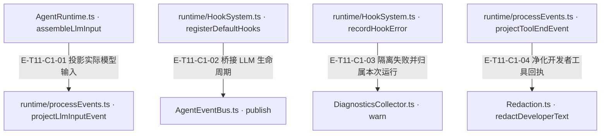
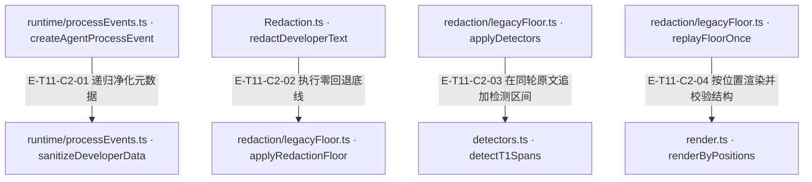
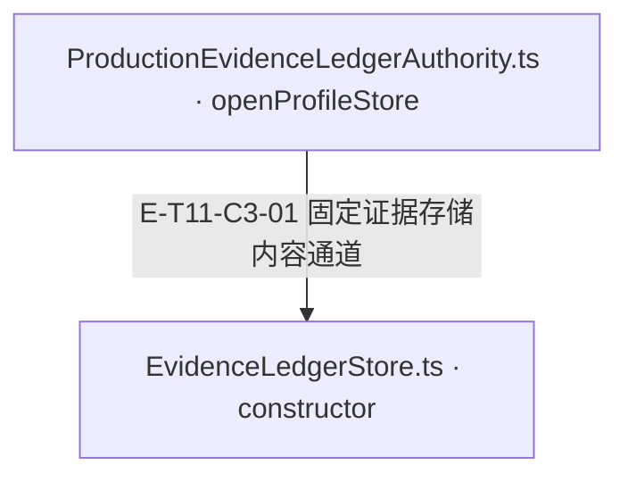

# 事件、诊断与脱敏 · 真实调用

Runtime 保持业务时序，HookSystem 提供拦截与观察，AgentEventBus 发布事件，DiagnosticsCollector 汇总运行诊断。开发者过程事件由 processEvents 显式投影并调用 Redaction；开发者未知来源门面以四份冻结规则的遮蔽并集为底线，再并入 T1；默认生产台账额外按可信 tool/file 追加 T3，见证 profile 则不注入 redactor。三条通道均按各自合同解释。detectors.ts 与 sourcePolicy.ts 已跟踪，Git 状态不代表外部包已发布。

[职责与边界](overview.md) · [直接依赖](file-dependency.md)

图中调用边经实现正文核对；AST只用于符号定位。接口／注入对象是调用端口，不据此推定所有宿主实现相同。断言已定位，实际执行见页面证据；具体输入、替身与断言分开说明，历史通过记录不自动证明当前源码。

## 调用接缝 1

### 本图术语说明

| 术语／节点 | 含义与范围 |
| --- | --- |
| AgentRuntime.ts · assembleLlmInput | `src/agent/runtime/AgentRuntime.ts#AgentRuntime.assembleLlmInput`；声明或调用端口；动态实现的绑定条件见下表。 |
| runtime/processEvents.ts · projectLlmInputEvent | `src/agent/runtime/processEvents.ts#projectLlmInputEvent`；声明或调用端口；动态实现的绑定条件见下表。 |
| runtime/HookSystem.ts · registerDefaultHooks | `src/agent/runtime/HookSystem.ts#registerDefaultHooks`；声明或调用端口；动态实现的绑定条件见下表。 |
| AgentEventBus.ts · publish | `src/agent/runtime/AgentEventBus.ts#AgentEventBus.publish`；声明或调用端口；动态实现的绑定条件见下表。 |
| runtime/HookSystem.ts · recordHookError | `src/agent/runtime/HookSystem.ts#HookSystem.recordHookError`；声明或调用端口；动态实现的绑定条件见下表。 |
| DiagnosticsCollector.ts · warn | `src/agent/runtime/DiagnosticsCollector.ts#DiagnosticsCollector.warn`；声明或调用端口；动态实现的绑定条件见下表。 |
| runtime/processEvents.ts · projectToolEndEvent | `src/agent/runtime/processEvents.ts#projectToolEndEvent`；声明或调用端口；动态实现的绑定条件见下表。 |
| Redaction.ts · redactDeveloperText | `src/agent/utils/Redaction.ts#redactDeveloperText`；声明或调用端口；动态实现的绑定条件见下表。 |

| 编号 | 代码依据 | 测试依据 | 关系与可证明范围 |
| --- | --- | --- | --- |
| E-T11-C1-01 | `src/agent/runtime/AgentRuntime.ts#AgentRuntime.assembleLlmInput` → `src/agent/runtime/processEvents.ts#projectLlmInputEvent` | `test/native-provider-sdk.test.ts#case:executes%20one%20actual%20Runtime%20tool%20round%20and%20keeps%20native%20reasoning%20out%20of%20progress%20events`；已读真实 Runtime 的多 Provider fixture：断言宿主执行一次、模型请求两次，并且 progress JSON 不含 fixture hidden reasoning 或签名。断言已定位，实际执行见页面证据。 | Runtime 在装配与测量完成后调用纯投影器，将实际 provider 消息、工具 schema、请求/有效 toolChoice 与输入估算组成开发者事件；模型原生隐藏推理不会作为展示正文。 |
| E-T11-C1-02 | `src/agent/runtime/HookSystem.ts#registerDefaultHooks` → `src/agent/runtime/AgentEventBus.ts#AgentEventBus.publish` | `test/hook-system-event-constants.test.ts#case:bridges%20only%20llm%3Acall%3A*%20under%20the%20AgentEvents%20constant%20values`；默认注册恰好两个 llm 桥，旧 agent:exit 手动事件不再产生 step:completed。断言已定位，实际执行见页面证据。 | 只桥接 llm:call:before/after → LLM_CALL_START/END。工具开始/结束由 Runtime 直接发布；旧 agent:exit 桥与从未分发 HookEvent 已退役。 |
| E-T11-C1-03 | `src/agent/runtime/HookSystem.ts#HookSystem.recordHookError` → `src/agent/runtime/DiagnosticsCollector.ts#DiagnosticsCollector.warn` | `test/hook-system-run-diagnostics.test.ts#case:records%20a%20throwing%20tool%3Aexecute%3Abefore%20hook%20as%20a%20hook_handler_failed%20warning%20without%20blocking%20the%20tool`；已读真实 Runtime 用例：hook 抛错后工具仍执行一次、回复 done，运行诊断含单条 tool 归属 warning 且不含合成秘密。另读取双 sink 用例确认失败只归属对应 dispatch。断言已定位，实际执行见页面证据。 | 钩子错误先脱敏后写本地 hookErrors、processEvent metadata 与当次 dispatch 的 diagnostics sink；sink 自身失败隔离。tool:execute:before 抛错不等于返回 false，不自动阻断工具。 |
| E-T11-C1-04 | `src/agent/runtime/processEvents.ts#projectToolEndEvent` → `src/agent/utils/Redaction.ts#redactDeveloperText` | `test/evidence-ledger-readback.test.ts#case:%E5%9B%9E%E8%AF%BB%E5%8E%9F%E6%96%87%E4%B8%8D%E5%86%99%E5%9B%9E%E5%8F%B0%E8%B4%A6%EF%BC%8C%E5%BC%80%E5%8F%91%E8%80%85%E4%BA%8B%E4%BB%B6%E4%BB%8D%E7%BB%8F%20processEvents%20%E8%84%B1%E6%95%8F`；已读用例：evidence.get 可给模型返回 verbatim，台账文件与 stats 保持不变且不含合成秘密；把该结果交给 projectToolEndEvent 后，开发者事件不含秘密。断言已定位，实际执行见页面证据。 | 投影器只对展示 content.text 进行脱敏，并保留 duration/cache/status 等 metadata；原业务回执与模型回读通道不被此投影器原地改写。 |

## 调用接缝 2

### 本图术语说明

| 术语／节点 | 含义与范围 |
| --- | --- |
| runtime/processEvents.ts · createAgentProcessEvent | `src/agent/runtime/processEvents.ts#createAgentProcessEvent`；声明或调用端口；动态实现的绑定条件见下表。 |
| runtime/processEvents.ts · sanitizeDeveloperData | `src/agent/runtime/processEvents.ts#sanitizeDeveloperData`；声明或调用端口；动态实现的绑定条件见下表。 |
| Redaction.ts · redactDeveloperText | `src/agent/utils/Redaction.ts#redactDeveloperText`；声明或调用端口；动态实现的绑定条件见下表。 |
| redaction/legacyFloor.ts · applyRedactionFloor | `src/agent/utils/redaction/legacyFloor.ts#applyRedactionFloor`；声明或调用端口；动态实现的绑定条件见下表。 |
| redaction/legacyFloor.ts · applyDetectors | `src/agent/utils/redaction/legacyFloor.ts#applyDetectors`；声明或调用端口；动态实现的绑定条件见下表。 |
| detectors.ts · detectT1Spans | `src/agent/utils/redaction/detectors.ts#detectT1Spans`；声明或调用端口；动态实现的绑定条件见下表。 |
| redaction/legacyFloor.ts · replayFloorOnce | `src/agent/utils/redaction/legacyFloor.ts#replayFloorOnce`；声明或调用端口；动态实现的绑定条件见下表。 |
| render.ts · renderByPositions | `src/agent/utils/redaction/render.ts#renderByPositions`；声明或调用端口；动态实现的绑定条件见下表。 |

| 编号 | 代码依据 | 测试依据 | 关系与可证明范围 |
| --- | --- | --- | --- |
| E-T11-C2-01 | `src/agent/runtime/processEvents.ts#createAgentProcessEvent` → `src/agent/runtime/processEvents.ts#sanitizeDeveloperData` | `test/runtime-efficiency.test.ts#case:keeps%20numeric%20token%20metrics%20but%20redacts%20secret-like%20and%20non-metric%20token%20fields`；已读用例：数值 usage token 指标保留，字符串 outputTokens 与 tokenBudget/accessToken/apiKey 被置为标记；另已读 DAG/循环用例验证只把真实循环替为 [Circular]。断言已定位，实际执行见页面证据。 | 创建事件时递归清理 metadata 中的字符串与敏感键，保留允许的数值 token 指标；使用祖先集合识别真实循环，重复 DAG 引用不误当循环。content/title/summary 的安全取决于对应上游投影，不是本函数通用全字段净化。 |
| E-T11-C2-02 | `src/agent/utils/Redaction.ts#redactDeveloperText` → `src/agent/utils/redaction/legacyFloor.ts#applyRedactionFloor` | `test/redaction-tracked-replay.test.ts#case:a%20replay%20whose%20text%20differs%20on%20one%20line%20masks%20that%20line%20and%20every%20line%20the%20frozen%20version%20changed`；已读故障注入用例：伪造失配重放后，受影响行及该冻结版本改过的行变成 UNALIGNED_MARKER，换行数不变，report 记录 mismatch 与行数，输出不含合成秘密。断言已定位，实际执行见页面证据。 | 门面调用重放底线：每轮对四个冻结版本计算隐藏原位置并集，运行时自检；任何历史版本隐藏的非结构字符仍隐藏，最多八轮不动点，报告只含计数与事件种类。 |
| E-T11-C2-03 | `src/agent/utils/redaction/legacyFloor.ts#applyDetectors` → `src/agent/utils/redaction/detectors.ts#detectT1Spans` | `test/redaction-detectors.test.ts#case:the%20default%20detector%20table%20is%20the%20T1%20table`；已读用例：默认表长度为1，默认 floor 与门面输出一致，显式 detectors=[] 不遮单独 T1 前缀输入；另已读 invariant A 用例要求旧遮蔽位置不重新可见并检查超过1000个 T1 spans。断言已定位，实际执行见页面证据。 | 默认检测器表含 detectT1Spans；T1 在同轮原文返回区间，与冻结底线取并集而非在已脱敏字符串上串接。底线已全遮的区间跳过；为后续底线级联保留触发前缀。该检测器已跟踪；实际行为验证以页面证据绑定的输入摘要为准。 |
| E-T11-C2-04 | `src/agent/utils/redaction/legacyFloor.ts#replayFloorOnce` → `src/agent/utils/redaction/render.ts#renderByPositions` | `test/redaction-render.test.ts#case:the%20provenance%20table%20maps%20kept%20characters%20and%20marks%20synthetic%20ones%20with%20-1`；已读用例：遮蔽区间渲染成标记，保留字符映射回原索引，合成标记映射为 -1；未请求来源表时返回 null。另已读幂等与确定性用例。断言已定位，实际执行见页面证据。 | 合并隐藏位、结构位、原子 marker 与优先级 gap 后只渲染一次；可返回保留字符的原位置和合成字符的 -1。换行守恒失败退回保留输入换行骨架的遮蔽输出。 |

## 调用接缝 3

### 本图术语说明

| 术语／节点 | 含义与范围 |
| --- | --- |
| ProductionEvidenceLedgerAuthority.ts · openProfileStore | `src/agent/evidence/ProductionEvidenceLedgerAuthority.ts#openProfileStore`；声明或调用端口；动态实现的绑定条件见下表。 |
| EvidenceLedgerStore.ts · constructor | `src/agent/evidence/EvidenceLedgerStore.ts#EvidenceLedgerStore.constructor`；声明或调用端口；动态实现的绑定条件见下表。 |

| 编号 | 代码依据 | 测试依据 | 关系与可证明范围 |
| --- | --- | --- | --- |
| E-T11-C3-01 | `src/agent/evidence/ProductionEvidenceLedgerAuthority.ts#openProfileStore` → `src/agent/evidence/EvidenceLedgerStore.ts#EvidenceLedgerStore.constructor` | `test/production-evidence-ledger-authority.test.ts#case:masks%20every%20value%20of%20a%20secret-bearing%20capture%20and%20sensitive%20env%20keys%20of%20a%20terminal%20capture%2C%20but%20keeps%20source%20captures%20on%20the%20unknown-source%20floor`；真实 authority 的三类capture对照。`test/production-evidence-ledger-authority.test.ts#case:leaves%20the%20verbatim%20witness%20profile%20without%20any%20redactor%3A%20terminal%20and%20secret-bearing%20captures%20stay%20byte-exact`定位见证通道不改写（仍须过独立gate）。断言已定位，实际执行见页面证据。 | 默认 profile 固定注入 redactLedgerContent → redactDeveloperTextInContextWithReport，带条目来源追加 T3；verbatim-witness 不注入 redactor，构造时拒绝任何外加 redactor。原文摘要由 Runtime 经内部打开入口共享，公共工厂不接受该注入。 |

默认台账 redactor 的回调发生在 `EvidenceLedgerStore.append` 的内容变换内，不能把 `openProfileStore` 画成当场对所有内容运行 T3。继续阅读 [来源策略、五条路径与跳过分支](source-policy-and-channels.md#scenario-source-policy)。
