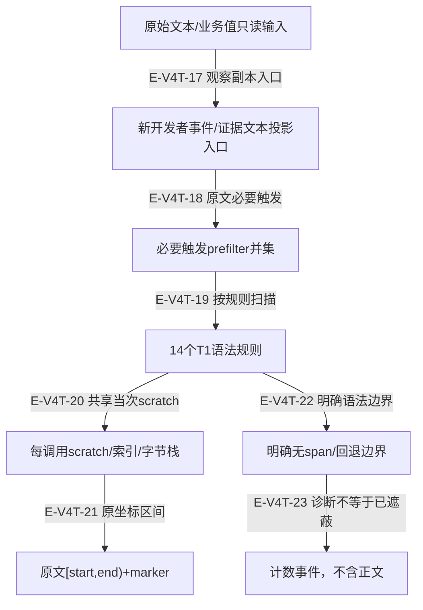
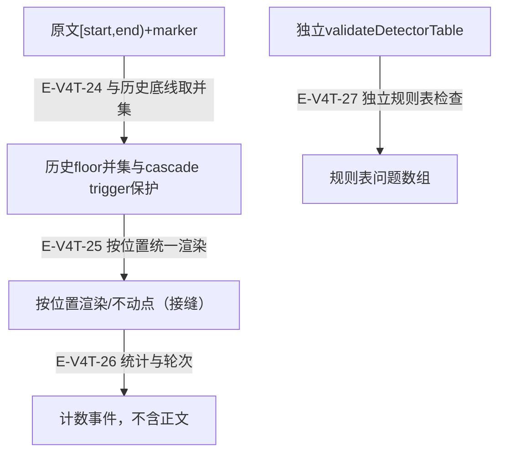

# 凭据检测、原文区间与失败边界：逐文件深读

当前 detectors.ts 已按全文复核；旧 dirty 字节无法由既有 Git 历史恢复，因此没有伪造逐行旧差异。T1规则输出原文区间和封闭标记，不验证凭据真伪；最终显示结果还需要历史floor并集和渲染入口。检测器的诊断不代表输入中的每个秘密都已隐藏。

[诊断与脱敏专题](overview.md) · [T3 来源策略](source-policy-and-channels.md#scenario-source-policy) · [执行记录](../../evidence/scoped-execution.json)

## 原文检测与明确的语法边界

### 本图术语说明

| 节点／术语 | 本图含义 |
| --- | --- |
| 原始文本/业务值只读输入 | Agent；`src/agent/utils/redaction/detectors.ts#detectT1Spans`；`src/agent/runtime/processEvents.ts#projectToolEndEvent` |
| 新开发者事件/证据文本投影入口 | Agent；`src/agent/utils/Redaction.ts#redactDeveloperText`；`src/agent/runtime/processEvents.ts#sanitizeDeveloperData` |
| 必要触发prefilter并集 | Agent；`src/agent/utils/redaction/detectors.ts#presentRules` |
| 14个T1语法规则 | Agent；`src/agent/utils/redaction/detectors.ts#T1_DETECTOR_RULES` |
| 每调用scratch/索引/字节栈 | Agent；`src/agent/utils/redaction/detectors.ts#DetectorScratch`；`src/agent/utils/redaction/detectors.ts#BraceResolver` |
| 原文[start,end)+marker | Agent；`src/agent/utils/redaction/detectors.ts#detectT1Spans` |
| 明确无span/回退边界 | Agent；`src/agent/utils/redaction/detectors.ts#quotedValue`；`src/agent/utils/redaction/detectors.ts#schemeBefore` |
| 计数事件，不含正文 | Agent；`src/agent/utils/redaction/detectors.ts#DetectorSink` |

| 编号 | 代码依据 | 测试依据 | 关系与可证明范围 |
| --- | --- | --- | --- |
| E-V4T-17 | `src/agent/runtime/processEvents.ts#projectToolEndEvent`；`src/agent/runtime/processEvents.ts#sanitizeDeveloperData` | `test/runtime-efficiency.test.ts#case:keeps%20numeric%20token%20metrics%20but%20redacts%20secret-like%20and%20non-metric%20token%20fields`；断言已定位，实际执行见页面证据。新事件metadata保留usage的数值token指标，其余accessToken/apiKey/tokenBudget等替换为标记。 边界：仅验观察投影结果；没有直接assert输入对象未变，原值不写回结论来自sanitizeDeveloperData源码。 | 观察事件构造新text/metadata副本；检测器不会修改业务对象。ledger用途则是另存投影文本。 |
| E-V4T-18 | `src/agent/utils/Redaction.ts#redactDeveloperText`；`src/agent/utils/redaction/detectors.ts#detectT1Spans`；`src/agent/utils/redaction/detectors.ts#presentRules` | `test/redaction-detectors.test.ts#case:prefilter%20short-circuits%20are%20exact%3A%20detection%20without%20any%20prefilter%20yields%20the%20same%20spans`；断言已定位，实际执行见页面证据。规则例子、3000 grammar、500 adversarial及2份源码上filtered/unfiltered span列表完全相等，且>1000输入有span。 边界：有限固定样本的差分，不是一般正则必要条件形式证明。 | 门面通过floor默认检测器调用detectT1Spans，预过滤在同一原文上找出现的规则。 |
| E-V4T-19 | `src/agent/utils/redaction/detectors.ts#presentRules`；`src/agent/utils/redaction/detectors.ts#detectT1Spans` | `test/redaction-detectors.test.ts#case:prefilter%20short-circuits%20are%20exact%3A%20detection%20without%20any%20prefilter%20yields%20the%20same%20spans`；断言已定位，实际执行见页面证据。规则例子、3000 grammar、500 adversarial及2份源码上filtered/unfiltered span列表完全相等，且>1000输入有span。 边界：有限固定样本的差分，不是一般正则必要条件形式证明。 `test/redaction-detectors.test.ts#case:hits%20by%20rule%20id%2C%20rejections%20and%20the%20already-masked%20skip%20of%20the%20fixpoint%20round`；断言已定位，实际执行见页面证据。报告含各规则命中/拒绝/skip计数，不含秘密片段；干净文本prefilter-skip计数但kinds为空。 边界：诊断只计数，不携正文；性能不由这个case证明。 | 只对出现必要触发的规则创建全局scanner；其他计prefilter-skip而非猜测安全。 |
| E-V4T-20 | `src/agent/utils/redaction/detectors.ts#DetectorRule`；`src/agent/utils/redaction/detectors.ts#DetectorScratch` | `test/redaction-detectors.test.ts#case:deterministic%20and%20free%20of%20module%20state%3A%20interleaved%20calls%20give%20identical%20spans%20and%20reports`；断言已定位，实际执行见页面证据。交错调用同文本span和report完全一致。 边界：无跨调用scratch/lastIndex语义污染的固定样本验证。 `test/redaction-detectors.test.ts#case:the%20byte%20recognizer%20never%20throws%20and%20keeps%20an%20explicit%20stack`；断言已定位，实际执行见页面证据。50000层嵌套数组JSON被识别，截掉末字节返回false。 边界：显式stack避免JS递归栈；缓冲仍随输入长度增长。 `test/redaction-detectors.test.ts#case:the%20closing-quote%20index%20equals%20per-candidate%20bounded%20scanning%20(quote%2C%20backslash%20run%2C%20line%2C%20window)`；断言已定位，实际执行见页面证据。800随机文本>10000查询与naive quote扫描等价，覆盖closed/end/line/window。 边界：每候选二分索引；总体性能仍以选定输入族测量。 `test/redaction-detectors.test.ts#case:the%20brace%20resolvers%20equal%20per-group%20bounded%20scanning%2C%20in%20increasing%20and%20random%20query%20order`；断言已定位，实际执行见页面证据。1500文本中递增/随机开括号查询>10000，和naiveGroup一致。 边界：防御随机顺序可走settleAlone；不承诺每种调用方式恒摊销。 | locate共享本次文本的括号/URL/quote/SAS/JSON scratch，调用结束不留跨请求状态。 |
| E-V4T-21 | `src/agent/utils/redaction/detectors.ts#detectT1Spans`；`src/agent/utils/redaction/detectors.ts#isWholeMarker` | `test/redaction-detectors.test.ts#case:a%20T1%20span%20inside%20a%20floor-masked%20value%20still%20lands%20on%20original%20positions`；断言已定位，实际执行见页面证据。password=Pa(ss)+token在原坐标求span与floor并集，历史遮蔽不回退。 边界：从原文检测，不对其他规则输出串接匹配。 `test/redaction-detectors.test.ts#case:two%20detectors%20that%20cover%20the%20same%20span%20render%20one%20marker`；断言已定位，实际执行见页面证据。同URL secret同时命中github-token/url-userinfo但最终只渲染一个[redacted]。 边界：marker合并归floor/render，不由detectT1Spans自己去重。 | 候选确认后产原位置span；重叠可存在，scanner跳到最远处理位置，完整已有marker跳过。 |
| E-V4T-22 | `src/agent/utils/redaction/detectors.ts#prefixedTokenRule`；`src/agent/utils/redaction/detectors.ts#quotedValue`；`src/agent/utils/redaction/detectors.ts#schemeBefore`；`src/agent/utils/redaction/detectors.ts#AZURE_SAS_RULE` | `test/redaction-detectors.test.ts#case:too%20short%2C%20or%20not%20followed%20by%20a%20truncation%20marker%2C%20is%20not%20a%20token`；断言已定位，实际执行见页面证据。前缀后少于4字符、较短片段无截断标记返回空；truncationFollows区分omitted与普通文本。 边界：刻意的高置信门，短秘密可能不由T1识别。 `test/redaction-detectors.test.ts#case:a%20quoted%20value%20with%20no%20closing%20quote%20inside%20the%20window%20is%20read%20unquoted%20and%20reported`；断言已定位，实际执行见页面证据。>4096未闭Digest nonce的单规则span为空，report含window-exceeded；4000闭合值正常遮住。 边界：明确接受的T1无span边界，不能声称该超长quoted credential已被T1隐藏。 `test/redaction-detectors.test.ts#case:pure%20references%20are%20skipped%20and%20reported%3B%20defaults%20inside%20them%20are%20masked`；断言已定位，实际执行见页面证据。纯${API_TOKEN}保持不变且reference-skip=1；带literal default的引用隐藏secret。 边界：URL userinfo不采用此skip规则。 `test/redaction-detectors.test.ts#case:an%20over-long%20scheme%20is%20not%20a%20URL%20candidate%20and%20is%20reported`；断言已定位，实际执行见页面证据。50字符scheme的URL单规则span为空，report有window-exceeded。 边界：MAX_SCHEME_LENGTH=40。 `test/redaction-detectors.test.ts#case:Azure%20SAS%20sig%3D%20without%20userinfo%3A%20adopted%20into%20T1`；断言已定位，实际执行见页面证据。有sv=的SAS签名被遮；无sv=普通sig参数逐字保留并计rejected。 边界：sv形态是必要上下文，不证明URL属于Azure真实账户。 | 长度/identifier/纯引用、未闭引号/组、过长scheme、缺SAS版本等按明确语法拒绝或回退。 |
| E-V4T-23 | `src/agent/utils/redaction/detectors.ts#DetectorSink`；`src/agent/utils/redaction/detectors.ts#quotedValue`；`src/agent/utils/redaction/detectors.ts#credentialRunEnd` | `test/redaction-detectors.test.ts#case:hits%20by%20rule%20id%2C%20rejections%20and%20the%20already-masked%20skip%20of%20the%20fixpoint%20round`；断言已定位，实际执行见页面证据。报告含各规则命中/拒绝/skip计数，不含秘密片段；干净文本prefilter-skip计数但kinds为空。 边界：诊断只计数，不携正文；性能不由这个case证明。 `test/redaction-detectors.test.ts#case:an%20unterminated%20quote%20is%20read%20unquoted%20and%20reported`；断言已定位，实际执行见页面证据。未闭Digest/Cookie值到行尾/EOF均有unclosed-quote。 边界：只验诊断；回退值可能为空，不证明秘密完全覆盖。 `test/redaction-detectors.test.ts#case:an%20unclosed%20dollar-brace%20group%20in%20an%20Authorization%20credential%20is%20dropped%20and%20reported`；断言已定位，实际执行见页面证据。未闭${组不被吸收；只得到[[22,26]]且unclosed-group=1。 边界：不应把URL的宽回退语义套给Authorization。 | 跳过/否决/回退以事件kind+ruleId计数，不能把诊断存在当作已遮住秘密。 |

## 与历史底线合并及独立校验

后半段是检测span到显示投影的数据交接；规则表校验是独立检查，不画成业务执行自动跑测试。

### 本图术语说明

| 节点／术语 | 本图含义 |
| --- | --- |
| 原文[start,end)+marker | Agent；`src/agent/utils/redaction/detectors.ts#detectT1Spans` |
| 历史floor并集与cascade trigger保护 | Agent；`src/agent/utils/redaction/legacyFloor.ts#applyDetectors` |
| 按位置渲染/不动点（接缝） | Agent；`src/agent/utils/Redaction.ts#redactDeveloperText` |
| 计数事件，不含正文 | Agent；`src/agent/utils/redaction/detectors.ts#DetectorSink` |
| 独立validateDetectorTable | 当前控制节点；具体函数与行为在逐边表中说明。 |
| 规则表问题数组 | 当前控制节点；具体函数与行为在逐边表中说明。 |

| 编号 | 代码依据 | 测试依据 | 关系与可证明范围 |
| --- | --- | --- | --- |
| E-V4T-24 | `src/agent/utils/redaction/legacyFloor.ts#applyDetectors`；`src/agent/utils/redaction/detectors.ts#detectT1Spans` | `test/redaction-detectors.test.ts#case:a%20T1%20span%20inside%20a%20floor-masked%20value%20still%20lands%20on%20original%20positions`；断言已定位，实际执行见页面证据。password=Pa(ss)+token在原坐标求span与floor并集，历史遮蔽不回退。 边界：从原文检测，不对其他规则输出串接匹配。 `test/redaction-floor-properties.test.ts#case:no%20non-structural%20position%20hidden%20by%20the%20floor%20becomes%20visible%2C%20and%20every%20T1%20span%20is%20hidden`；断言已定位，实际执行见页面证据。样本对齐到原位置，floor隐藏位置不得重现，T1所有有效位置仍隐藏；>1000 span checks。 边界：依赖floor/render集成，检测器孤立span不够证明门面不变量。 `test/redaction-floor-properties.test.ts#case:a%20secret%20glued%20to%20a%20keyword%20keeps%20the%20keyword%2C%20so%20the%20fixpoint%20cascade%20still%20masks%20what%20follows`；断言已定位，实际执行见页面证据。紧贴token/password/secret等保留trigger，次轮历史级联继续隐藏；精确输出与trigger-kept/glued-header事件被断言。 边界：不改变业务原对象，只针对显示文本的多轮投影。 | span始终基于原文；floor并集不串接规则，历史已遮区间优先、未遮cascade trigger保留。 |
| E-V4T-25 | `src/agent/utils/Redaction.ts#redactDeveloperText`；`src/agent/utils/redaction/legacyFloor.ts#applyDetectors` | `test/redaction-detectors.test.ts#case:two%20detectors%20that%20cover%20the%20same%20span%20render%20one%20marker`；断言已定位，实际执行见页面证据。同URL secret同时命中github-token/url-userinfo但最终只渲染一个[redacted]。 边界：marker合并归floor/render，不由detectT1Spans自己去重。 `test/redaction-detectors.test.ts#case:%24id%3A%20no%20fragment%20of%20the%20secret%20survives%2C%20S%20holds%2C%20idempotent`；参数化模板；展开项的实际执行状态见定向记录。逐正例secret的有效4gram不存活、重跑幂等、换行骨架相同、历史无回退oracle。 边界：只覆盖规则声明的合成样本；4gram排除elsewhere与marker重合片段。 `test/redaction-floor-properties.test.ts#case:a%20secret%20glued%20to%20a%20keyword%20keeps%20the%20keyword%2C%20so%20the%20fixpoint%20cascade%20still%20masks%20what%20follows`；断言已定位，实际执行见页面证据。紧贴token/password/secret等保留trigger，次轮历史级联继续隐藏；精确输出与trigger-kept/glued-header事件被断言。 边界：不改变业务原对象，只针对显示文本的多轮投影。 | 历史/检测gap按位置统一渲染并迭代不动点，避免重叠marker重复和新增规则露出旧隐藏字符。 |
| E-V4T-26 | `src/agent/utils/Redaction.ts#redactDeveloperTextWithReport`；`src/agent/utils/redaction/detectors.ts#DetectorSink` | `test/redaction-detectors.test.ts#case:hits%20by%20rule%20id%2C%20rejections%20and%20the%20already-masked%20skip%20of%20the%20fixpoint%20round`；断言已定位，实际执行见页面证据。报告含各规则命中/拒绝/skip计数，不含秘密片段；干净文本prefilter-skip计数但kinds为空。 边界：诊断只计数，不携正文；性能不由这个case证明。 `test/redaction-detectors.test.ts#case:dense%20short%20values%20render%20one%20marker%20per%20header%3A%20the%20output%20does%20not%20grow`；断言已定位，实际执行见页面证据。大量短Cookie/Digest值输出小于输入，rounds<=2，换行与幂等保持。 边界：整段ListCover会遮掉列表内名字/分隔符，换取不膨胀。 | 门面报告命中/隐藏字符/回退/轮次等计数；干净prefilter skip不进入异常kinds。 |
| E-V4T-27 | `src/agent/utils/redaction/detectors.ts#validateDetectorTable` | `test/redaction-detectors.test.ts#case:every%20rule%20passes%20its%20own%20positive%20and%20negative%20examples`；断言已定位，实际执行见页面证据。validateDetectorTable()断言空问题列表。 边界：只证明规则表样本约束，实际执行见页面证据。 `test/redaction-detectors.test.ts#case:rules%20are%20T1%2C%20apply%20to%20every%20source%2C%20use%20only%20closed-vocabulary%20markers`；断言已定位，实际执行见页面证据。14个明确id、所有source、g候选、无flag预过滤与封闭marker词表逐项断言。 边界：T1不能根据来源变宽；不证明全世界凭据格式皆在表中。 `test/redaction-detectors.test.ts#case:%25s`（参数化模板；具体 suite 与展开身份见页面证据）；参数化模板；展开项的实际执行状态见定向记录。adversarial detector suite用8000/32000构造输入，large<max(small,2ms)*10且large<3000ms。 边界：有限负载/平台时间断言，不是严格O(n)形式证明。 `test/redaction-floor-performance.test.ts#case:deferred%20to%204f%3A%20%24name%20grows%20linearly%20(ratio%20reported%20only)`；参数化模板；展开项的实际执行状态见定向记录。4f延后组只assert四倍输入candidate耗时增幅<=7；相对历史版本ratio仅annotate。 边界：不能声称这组通过8x或目标4x；是否执行以本页状态和定向记录为准。 | validateDetectorTable是独立规则表校验，返回问题字符串；实际执行范围见页面证据，不属于业务检测到诊断的调用链。 |

## 逐文件职责与全文阅读范围

### detectors.ts

`src/agent/utils/redaction/detectors.ts`

T1高置信凭据检测：仅原文span与封闭marker/计数事件；不修改业务回执，不负责签名验证

detectT1Spans→presentRules单次必要触发预过滤→14规则各新建scanner→locate按前缀/JWT/HTTP头/URL/SAS语法算原文span→跳过完整既有marker→交legacyFloor与历史遮蔽位置并集、保留级联trigger→render投影；DetectorScratch每次调用新建，索引/缓冲不跨请求。

| 阅读段落（行） | 核对内容 |
| --- | --- |
| 1–185 | T1 覆盖、不变量、性能延后口径与 source/kind/marker/event/rule 契约。 |
| 186–345 | 左右边界、载体转义、96字符截断判定、纯引用与4096单值/组窗口。 |
| 346–609 | BraceResolver typed-array栈与结论编码，闭组/阻断/超窗、独立有界扫描防御路径。 |
| 610–1130 | DetectorScratch 当次调用的 continuation memo、截断/端口/SAS、base64/JSON缓冲与quote索引。 |
| 1131–1181 | 按片段拼接合成正反例。 |
| 1182–1400 | 九类前缀token工厂，完整长度/shape和截断例外。 |
| 1401–1726 | base64url字节解码、显式JSON栈与JWT三段形状。 |
| 1727–2236 | Authorization方案/参数、glued header、quoted/value/reference、ListCover。 |
| 2237–2356 | Cookie整列表与Set-Cookie第一对值，carrier quote回退。 |
| 2357–2531 | URL balanced/plain authority并集、截断与端口区分、40字符scheme。 |
| 2532–2576 | SAS签名必须同URL片段具有sv版本形态。 |
| 2577–2697 | 14规则数组、必要触发预过滤、原坐标span与单规则入口。 |
| 2698–2774 | 规则结构、预过滤必要条件与正反例表检查。 |

| 触发条件 | 实际行为 | 恢复／停止依据 | 源码与测试证据 |
| --- | --- | --- | --- |
| 缺触发字面量、边界嵌入identifier、长度/shape不足 | 规则精确prefilter跳过或locate拒绝，不按熵猜测普通hash/代码。 | 追加规则需正反例与差分验证；不要把T1空span理解成没有任何秘密。 | `src/agent/utils/redaction/detectors.ts#presentRules`；`src/agent/utils/redaction/detectors.ts#prefixedTokenRule`；`src/agent/utils/redaction/detectors.ts#leftBoundaryAt` `test/redaction-detectors.test.ts#case:prefilter%20short-circuits%20are%20exact%3A%20detection%20without%20any%20prefilter%20yields%20the%20same%20spans`；断言已定位，实际执行见页面证据。规则例子、3000 grammar、500 adversarial及2份源码上filtered/unfiltered span列表完全相等，且>1000输入有span。 边界：有限固定样本的差分，不是一般正则必要条件形式证明。 `test/redaction-detectors.test.ts#case:%25s`（参数化模板；具体 suite 与展开身份见页面证据）；参数化模板；展开项的实际执行状态见定向记录。gitleaks-style boundaries suite断言长标识符/identifier后缀不命中；escaped newline/tab/unicode、diff短横线和CSV支持。 边界：用于该suite的it.each；不是所有同名%s case。 `test/redaction-detectors.test.ts#case:too%20short%2C%20or%20not%20followed%20by%20a%20truncation%20marker%2C%20is%20not%20a%20token`；断言已定位，实际执行见页面证据。前缀后少于4字符、较短片段无截断标记返回空；truncationFollows区分omitted与普通文本。 边界：刻意的高置信门，短秘密可能不由T1识别。 |
| JWT-like文本解码不是JSON对象或只有两段 | JWT规则返回空；非法对象候选计rejected；字节判定器显式stack避免异常/递归热路径。 | 只有匹配到规定三段与前两段对象形状才遮；不验证签名真实性。 | `src/agent/utils/redaction/detectors.ts#JWT_RULE`；`src/agent/utils/redaction/detectors.ts#decodesToJsonObject`；`src/agent/utils/redaction/detectors.ts#isJsonObjectBytes` `test/redaction-detectors.test.ts#case:random%20objects%2C%20mutations%2C%20JSON-ish%20bytes%20and%20truncated%20base64url%20agree%20with%20the%20reference`；断言已定位，实际执行见页面证据。12000次对象/变异/字节序列及4种截断与decode+JSON.parse reference一致，接受/拒绝均有最小计数。 边界：只验证JSON-object形状识别，不校验JWT签名或claim真实性。 `test/redaction-detectors.test.ts#case:the%20byte%20recognizer%20never%20throws%20and%20keeps%20an%20explicit%20stack`；断言已定位，实际执行见页面证据。50000层嵌套数组JSON被识别，截掉末字节返回false。 边界：显式stack避免JS递归栈；缓冲仍随输入长度增长。 |
| 纯变量引用、裸scheme、全符号占位 | auth/Cookie的isCredentialValue跳过/拒绝并计数；带literal默认值不能按纯引用放过。 | 保留可读模板，literal默认值按凭据处理；URL规则有独立更宽口径。 | `src/agent/utils/redaction/detectors.ts#isCredentialValue`；`src/agent/utils/redaction/detectors.ts#AUTH_HEADER_RULE`；`src/agent/utils/redaction/detectors.ts#COOKIE_HEADER_RULE` `test/redaction-detectors.test.ts#case:pure%20references%20are%20skipped%20and%20reported%3B%20defaults%20inside%20them%20are%20masked`；断言已定位，实际执行见页面证据。纯${API_TOKEN}保持不变且reference-skip=1；带literal default的引用隐藏secret。 边界：URL userinfo不采用此skip规则。 `test/redaction-detectors.test.ts#case:rules%20are%20T1%2C%20apply%20to%20every%20source%2C%20use%20only%20closed-vocabulary%20markers`；断言已定位，实际执行见页面证据。14个明确id、所有source、g候选、无flag预过滤与封闭marker词表逐项断言。 边界：T1不能根据来源变宽；不证明全世界凭据格式皆在表中。 |
| 认证头quoted值未闭合/闭引号超过4096窗口 | quotedValue返回null，调用者按unquoted读；开引号本身结束值，T1可能无span；计unclosed-quote/window-exceeded。 | 图谱显式标为检测能力边界；不能把诊断事件当作已隐藏断言，扩展语义需要另行批准和新负例。 | `src/agent/utils/redaction/detectors.ts#quotedValue`；`src/agent/utils/redaction/detectors.ts#authParamSpans`；`src/agent/utils/redaction/detectors.ts#COOKIE_HEADER_RULE` `test/redaction-detectors.test.ts#case:a%20quoted%20value%20with%20no%20closing%20quote%20inside%20the%20window%20is%20read%20unquoted%20and%20reported`；断言已定位，实际执行见页面证据。>4096未闭Digest nonce的单规则span为空，report含window-exceeded；4000闭合值正常遮住。 边界：明确接受的T1无span边界，不能声称该超长quoted credential已被T1隐藏。 `test/redaction-detectors.test.ts#case:an%20unterminated%20quote%20is%20read%20unquoted%20and%20reported`；断言已定位，实际执行见页面证据。未闭Digest/Cookie值到行尾/EOF均有unclosed-quote。 边界：只验诊断；回退值可能为空，不证明秘密完全覆盖。 |
| Cookie引号内含空白/分号/逗号或Authorization ${组未闭 | 前者作为carrier quote回退，后者在组前截断不吸收；产生carrier-quote/unclosed-group。 | 读取诊断和实际span；不要套用URL的宽回退或声称尾段全部安全。 | `src/agent/utils/redaction/detectors.ts#COOKIE_HEADER_RULE`；`src/agent/utils/redaction/detectors.ts#credentialRunEnd` `test/redaction-detectors.test.ts#case:a%20Cookie%20quote%20that%20holds%20separators%20is%20a%20carrier%20quote%20and%20is%20reported`；断言已定位，实际执行见页面证据。Cookie引号内空白/分号触发carrier-quote事件。 边界：此case只验诊断，不断言其内所有值被隐藏。 `test/redaction-detectors.test.ts#case:an%20unclosed%20dollar-brace%20group%20in%20an%20Authorization%20credential%20is%20dropped%20and%20reported`；断言已定位，实际执行见页面证据。未闭${组不被吸收；只得到[[22,26]]且unclosed-group=1。 边界：不应把URL的宽回退语义套给Authorization。 |
| URL组不配平/窗口触顶、无@但有截断标记 | balanced与plain读法span取并集；未闭口令必要时遮冒号之后范围；纯数字端口与无口令URL排除。 | 缺口上报unbalanced-fallback/window-exceeded/truncated；只能根据规定语法解释，非通用URLparser。 | `src/agent/utils/redaction/detectors.ts#URL_USERINFO_RULE`；`src/agent/utils/redaction/detectors.ts#userinfoSpans`；`src/agent/utils/redaction/detectors.ts#plainAuthority` `test/redaction-detectors.test.ts#case:an%20unclosed%20brace%20group%20falls%20back%20to%20the%20unbalanced%20reading%20and%20is%20reported`；断言已定位，实际执行见页面证据。未闭URL组重读plain authority，secret不泄漏并有unbalanced-fallback；无截断标记的行尾也遮。 边界：只说明URL口令段回退，不等同认证头未闭组处理。 `test/redaction-detectors.test.ts#case:ports%2C%20plain%20hosts%20and%20URLs%20without%20a%20password%20are%20untouched`；断言已定位，实际执行见页面证据。localhost端口、普通host、user@host、jdbc无口令不产生userinfo span。 边界：避免把端口误作password。 `test/redaction-detectors.test.ts#case:URL%20userinfo%20spans%20equal%20a%20per-candidate%20reference%20on%20random%20inputs`；断言已定位，实际执行见页面证据。3000随机输入与naiveUrlSpans逐区间相同，>500有span。 边界：缓存/记忆化等价于当前有限语法reference。 |
| scheme超过40字符或sig缺同片段sv版本 | scheme不作URL候选并计window-exceeded；无sv的普通sig按rejected保留。 | 高置信边界需明确展示，不能将保留等同无secret。 | `src/agent/utils/redaction/detectors.ts#schemeBefore`；`src/agent/utils/redaction/detectors.ts#AZURE_SAS_RULE`；`src/agent/utils/redaction/detectors.ts#DetectorScratch` `test/redaction-detectors.test.ts#case:an%20over-long%20scheme%20is%20not%20a%20URL%20candidate%20and%20is%20reported`；断言已定位，实际执行见页面证据。50字符scheme的URL单规则span为空，report有window-exceeded。 边界：MAX_SCHEME_LENGTH=40。 `test/redaction-detectors.test.ts#case:Azure%20SAS%20sig%3D%20without%20userinfo%3A%20adopted%20into%20T1`；断言已定位，实际执行见页面证据。有sv=的SAS签名被遮；无sv=普通sig参数逐字保留并计rejected。 边界：sv形态是必要上下文，不证明URL属于Azure真实账户。 |
| 多个规则重叠、历史floor已遮、marker重新被候选命中 | 检测只返回原坐标span，legacyFloor负责并集/优先历史gap/保留trigger；完整既有marker可跳过。 | 不把规则串接在改写输出上；新增规则继续跑原坐标不变量与幂等检查。 | `src/agent/utils/redaction/detectors.ts#detectT1Spans`；`src/agent/utils/redaction/detectors.ts#isWholeMarker`；`src/agent/utils/redaction/legacyFloor.ts#applyDetectors` `test/redaction-detectors.test.ts#case:a%20T1%20span%20inside%20a%20floor-masked%20value%20still%20lands%20on%20original%20positions`；断言已定位，实际执行见页面证据。password=Pa(ss)+token在原坐标求span与floor并集，历史遮蔽不回退。 边界：从原文检测，不对其他规则输出串接匹配。 `test/redaction-detectors.test.ts#case:two%20detectors%20that%20cover%20the%20same%20span%20render%20one%20marker`；断言已定位，实际执行见页面证据。同URL secret同时命中github-token/url-userinfo但最终只渲染一个[redacted]。 边界：marker合并归floor/render，不由detectT1Spans自己去重。 `test/redaction-floor-properties.test.ts#case:no%20non-structural%20position%20hidden%20by%20the%20floor%20becomes%20visible%2C%20and%20every%20T1%20span%20is%20hidden`；断言已定位，实际执行见页面证据。样本对齐到原位置，floor隐藏位置不得重现，T1所有有效位置仍隐藏；>1000 span checks。 边界：依赖floor/render集成，检测器孤立span不够证明门面不变量。 `test/redaction-floor-properties.test.ts#case:a%20secret%20glued%20to%20a%20keyword%20keeps%20the%20keyword%2C%20so%20the%20fixpoint%20cascade%20still%20masks%20what%20follows`；断言已定位，实际执行见页面证据。紧贴token/password/secret等保留trigger，次轮历史级联继续隐藏；精确输出与trigger-kept/glued-header事件被断言。 边界：不改变业务原对象，只针对显示文本的多轮投影。 |
| 密集候选/超长值/多层JSON与大量列表对 | 每调用scratch共享memo/索引，JSON显式栈，裸值/列表不按4096总截断；ListCover整段一个marker控制输出膨胀。 | 观察选定adversarial性能和内存；性能测试不替代所有输入的形式界，4f延后组不标比率达标。 | `src/agent/utils/redaction/detectors.ts#DetectorScratch`；`src/agent/utils/redaction/detectors.ts#BraceResolver`；`src/agent/utils/redaction/detectors.ts#ListCover`；`src/agent/utils/redaction/detectors.ts#isJsonObjectBytes` `test/redaction-detectors.test.ts#case:the%20closing-quote%20index%20equals%20per-candidate%20bounded%20scanning%20(quote%2C%20backslash%20run%2C%20line%2C%20window)`；断言已定位，实际执行见页面证据。800随机文本>10000查询与naive quote扫描等价，覆盖closed/end/line/window。 边界：每候选二分索引；总体性能仍以选定输入族测量。 `test/redaction-detectors.test.ts#case:the%20brace%20resolvers%20equal%20per-group%20bounded%20scanning%2C%20in%20increasing%20and%20random%20query%20order`；断言已定位，实际执行见页面证据。1500文本中递增/随机开括号查询>10000，和naiveGroup一致。 边界：防御随机顺序可走settleAlone；不承诺每种调用方式恒摊销。 `test/redaction-detectors.test.ts#case:a%20credential%2C%20cookie%20list%20or%20parameter%20list%20longer%20than%20the%20scan%20window%20is%20masked%20to%20its%20end`；断言已定位，实际执行见页面证据。6000字符普通凭据、600对Cookie和600对Digest列表全文输出不含SYNTH。 边界：4096窗口只约束单quoted/group查找，不是列表/裸凭据总长上限。 `test/redaction-detectors.test.ts#case:dense%20short%20values%20render%20one%20marker%20per%20header%3A%20the%20output%20does%20not%20grow`；断言已定位，实际执行见页面证据。大量短Cookie/Digest值输出小于输入，rounds<=2，换行与幂等保持。 边界：整段ListCover会遮掉列表内名字/分隔符，换取不膨胀。 `test/redaction-detectors.test.ts#case:%25s`（参数化模板；具体 suite 与展开身份见页面证据）；参数化模板；展开项的实际执行状态见定向记录。adversarial detector suite用8000/32000构造输入，large<max(small,2ms)*10且large<3000ms。 边界：有限负载/平台时间断言，不是严格O(n)形式证明。 `test/redaction-floor-performance.test.ts#case:deferred%20to%204f%3A%20%24name%20grows%20linearly%20(ratio%20reported%20only)`；参数化模板；展开项的实际执行状态见定向记录。4f延后组只assert四倍输入candidate耗时增幅<=7；相对历史版本ratio仅annotate。 边界：不能声称这组通过8x或目标4x；是否执行以本页状态和定向记录为准。 |
| 规则表改动破坏marker/source/prefilter/正反例 | validateDetectorTable生成问题字符串；CI测试断言应为空，故意坏例可验证gate能失败。 | 先修表再复验；断言已定位，实际执行见页面证据。 | `src/agent/utils/redaction/detectors.ts#validateDetectorTable`；`src/agent/utils/redaction/detectors.ts#T1_DETECTOR_RULES` `test/redaction-detectors.test.ts#case:every%20rule%20passes%20its%20own%20positive%20and%20negative%20examples`；断言已定位，实际执行见页面证据。validateDetectorTable()断言空问题列表。 边界：只证明规则表样本约束，实际执行见页面证据。 `test/redaction-detectors.test.ts#case:rules%20are%20T1%2C%20apply%20to%20every%20source%2C%20use%20only%20closed-vocabulary%20markers`；断言已定位，实际执行见页面证据。14个明确id、所有source、g候选、无flag预过滤与封闭marker词表逐项断言。 边界：T1不能根据来源变宽；不证明全世界凭据格式皆在表中。 |

边界与未验证项：

- T1不是完整secret scanner：无关键字高熵串、未收录前缀、字母数字长度/边界不符、未闭/过窗引号、过长scheme、无sv的sig可不产span；最终floor可能另有覆盖，但不能从T1本身承诺。 `src/agent/utils/redaction/detectors.ts#PREFIXED_TOKEN_SPECS`；`src/agent/utils/redaction/detectors.ts#quotedValue`；`src/agent/utils/redaction/detectors.ts#schemeBefore`；`src/agent/utils/redaction/detectors.ts#AZURE_SAS_RULE`
- 每次调用索引/typed buffers为O(n)量级内存；quote索引查询本身二分，不能单凭注释称所有路径有严格线性时间证明。已有性能case是固定输入族的倍率/耗时断言，4f延后组不验相对倍率。 `src/agent/utils/redaction/detectors.ts#DetectorScratch`；`src/agent/utils/redaction/detectors.ts#BraceResolver`
- detectT1Spans只接string并返回span；业务回执与观察副本的隔离属于调用方。定向读到processEvents生成新观察对象，ledger则按设计存脱敏文本供hash/freshness使用，不能把这两种用途混称“不变原值”。 `src/agent/utils/redaction/detectors.ts#detectT1Spans`；`src/agent/runtime/processEvents.ts#projectToolEndEvent`；`src/agent/runtime/processEvents.ts#sanitizeDeveloperData`；`src/agent/utils/Redaction.ts#redactDeveloperText`

## 性能与覆盖口径

规则表、语法边界、共享索引／长值／对抗输入与 floor 不变量均有定位用例；实际执行见页面证据。4f 延后组只按自身断言解释，不能宣称目标 4 倍已达成；固定样本耗时与倍率也不是对任意输入的形式复杂度证明。
