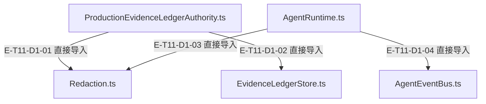
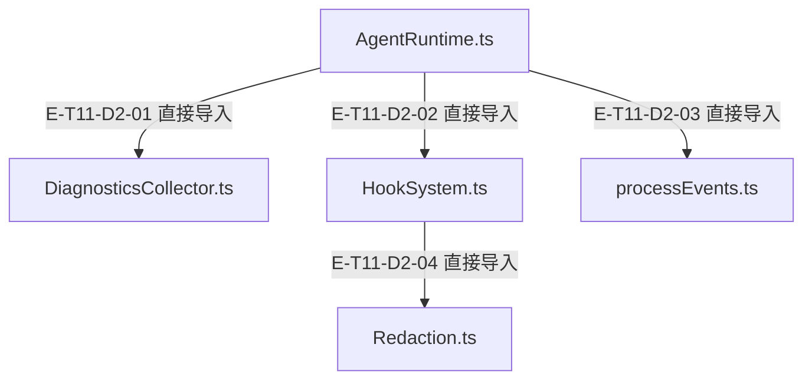
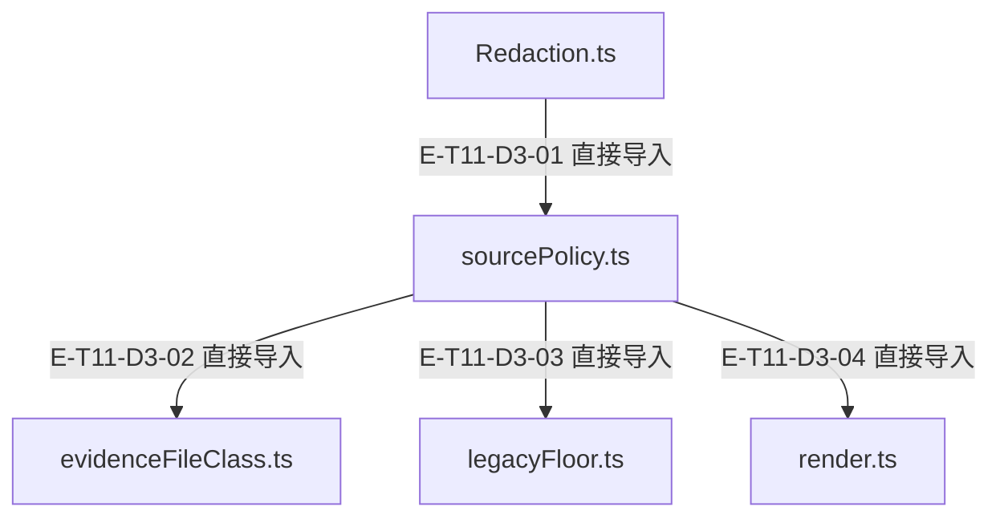

# 事件、诊断与脱敏 · 精选直接依赖

[职责与边界](overview.md) · [真实调用](call-flow.md)

选取本专题入口与来源策略接线的直接依赖；完整库存可在阅读器「文件与依赖」查看。以仓库全路径为节点身份，同名文件不会合并。Core／Node／第三方包只在完整探索器的外部边界出现。

## 静态依赖 1

### 本图术语说明

| 术语／节点 | 含义与范围 |
| --- | --- |
| ProductionEvidenceLedgerAuthority.ts | `src/agent/evidence/ProductionEvidenceLedgerAuthority.ts`；文件直接依赖，箭头不表示执行先后。 |
| Redaction.ts | `src/agent/utils/Redaction.ts`；文件直接依赖，箭头不表示执行先后。 |
| EvidenceLedgerStore.ts | `src/agent/evidence/EvidenceLedgerStore.ts`；文件直接依赖，箭头不表示执行先后。 |
| AgentRuntime.ts | `src/agent/runtime/AgentRuntime.ts`；文件直接依赖，箭头不表示执行先后。 |
| AgentEventBus.ts | `src/agent/runtime/AgentEventBus.ts`；文件直接依赖，箭头不表示执行先后。 |

| 编号 | 代码依据 | 测试依据 | 关系与可证明范围 |
| --- | --- | --- | --- |
| E-T11-D1-01 | `src/agent/evidence/ProductionEvidenceLedgerAuthority.ts` → `src/agent/utils/Redaction.ts` | 未覆盖：静态依赖由本图谱解析器反例测试支持；不把 import 当作行为覆盖。 | TypeScript AST 解析 ../utils/Redaction.js；第 10 行，kind=import，typeOnly=false。只证明结构关系。 |
| E-T11-D1-02 | `src/agent/evidence/ProductionEvidenceLedgerAuthority.ts` → `src/agent/evidence/EvidenceLedgerStore.ts` | 未覆盖：静态依赖由本图谱解析器反例测试支持；不把 import 当作行为覆盖。 | TypeScript AST 解析 ./EvidenceLedgerStore.js；第 11 行，kind=import，typeOnly=false。只证明结构关系。 |
| E-T11-D1-03 | `src/agent/runtime/AgentRuntime.ts` → `src/agent/utils/Redaction.ts` | 未覆盖：静态依赖由本图谱解析器反例测试支持；不把 import 当作行为覆盖。 | TypeScript AST 解析 ../utils/Redaction.js；第 61 行，kind=import，typeOnly=false。只证明结构关系。 |
| E-T11-D1-04 | `src/agent/runtime/AgentRuntime.ts` → `src/agent/runtime/AgentEventBus.ts` | 未覆盖：静态依赖由本图谱解析器反例测试支持；不把 import 当作行为覆盖。 | TypeScript AST 解析 ./AgentEventBus.js；第 62 行，kind=import，typeOnly=false。只证明结构关系。 |

## 静态依赖 2

### 本图术语说明

| 术语／节点 | 含义与范围 |
| --- | --- |
| AgentRuntime.ts | `src/agent/runtime/AgentRuntime.ts`；文件直接依赖，箭头不表示执行先后。 |
| DiagnosticsCollector.ts | `src/agent/runtime/DiagnosticsCollector.ts`；文件直接依赖，箭头不表示执行先后。 |
| HookSystem.ts | `src/agent/runtime/HookSystem.ts`；文件直接依赖，箭头不表示执行先后。 |
| processEvents.ts | `src/agent/runtime/processEvents.ts`；文件直接依赖，箭头不表示执行先后。 |
| Redaction.ts | `src/agent/utils/Redaction.ts`；文件直接依赖，箭头不表示执行先后。 |

| 编号 | 代码依据 | 测试依据 | 关系与可证明范围 |
| --- | --- | --- | --- |
| E-T11-D2-01 | `src/agent/runtime/AgentRuntime.ts` → `src/agent/runtime/DiagnosticsCollector.ts` | 未覆盖：静态依赖由本图谱解析器反例测试支持；不把 import 当作行为覆盖。 | TypeScript AST 解析 ./DiagnosticsCollector.js；第 86 行，kind=import，typeOnly=false。只证明结构关系。 |
| E-T11-D2-02 | `src/agent/runtime/AgentRuntime.ts` → `src/agent/runtime/HookSystem.ts` | 未覆盖：静态依赖由本图谱解析器反例测试支持；不把 import 当作行为覆盖。 | TypeScript AST 解析 ./HookSystem.js；第 99 行，kind=import，typeOnly=false。只证明结构关系。 |
| E-T11-D2-03 | `src/agent/runtime/AgentRuntime.ts` → `src/agent/runtime/processEvents.ts` | 未覆盖：静态依赖由本图谱解析器反例测试支持；不把 import 当作行为覆盖。 | TypeScript AST 解析 ./processEvents.js；第 121 行，kind=import，typeOnly=false。只证明结构关系。 |
| E-T11-D2-04 | `src/agent/runtime/HookSystem.ts` → `src/agent/utils/Redaction.ts` | 未覆盖：静态依赖由本图谱解析器反例测试支持；不把 import 当作行为覆盖。 | TypeScript AST 解析 ../utils/Redaction.js；第 21 行，kind=import，typeOnly=false。只证明结构关系。 |

## 来源策略的直接依赖

### 本图术语说明

| 节点／术语 | 含义与代码定位 |
| --- | --- |
| Redaction.ts | `src/agent/utils/Redaction.ts`；文件直接依赖，不表示业务调用时序。 |
| sourcePolicy.ts | `src/agent/utils/redaction/sourcePolicy.ts`；文件直接依赖，不表示业务调用时序。 |
| evidenceFileClass.ts | `src/agent/evidence/evidenceFileClass.ts`；文件直接依赖，不表示业务调用时序。 |
| legacyFloor.ts | `src/agent/utils/redaction/legacyFloor.ts`；文件直接依赖，不表示业务调用时序。 |
| render.ts | `src/agent/utils/redaction/render.ts`；文件直接依赖，不表示业务调用时序。 |

| 编号 | 代码依据 | 测试依据 | 关系与可证明范围 |
| --- | --- | --- | --- |
| E-T11-D3-01 | `src/agent/utils/Redaction.ts` → `src/agent/utils/redaction/sourcePolicy.ts` | 未覆盖：静态依赖定位，不把import当行为验证。 | TypeScript AST 解析 ./redaction/sourcePolicy.js；第 32 行，kind=import，typeOnly=false。只证明结构关系。 |
| E-T11-D3-02 | `src/agent/utils/redaction/sourcePolicy.ts` → `src/agent/evidence/evidenceFileClass.ts` | 未覆盖：静态依赖定位，不把import当行为验证。 | TypeScript AST 解析 ../../evidence/evidenceFileClass.js；第 50 行，kind=import，typeOnly=false。只证明结构关系。 |
| E-T11-D3-03 | `src/agent/utils/redaction/sourcePolicy.ts` → `src/agent/utils/redaction/legacyFloor.ts` | 未覆盖：静态依赖定位，不把import当行为验证。 | TypeScript AST 解析 ./legacyFloor.js；第 54 行，kind=import，typeOnly=false。只证明结构关系。 |
| E-T11-D3-04 | `src/agent/utils/redaction/sourcePolicy.ts` → `src/agent/utils/redaction/render.ts` | 未覆盖：静态依赖定位，不把import当行为验证。 | TypeScript AST 解析 ./render.js；第 63 行，kind=import，typeOnly=false。只证明结构关系。 |
