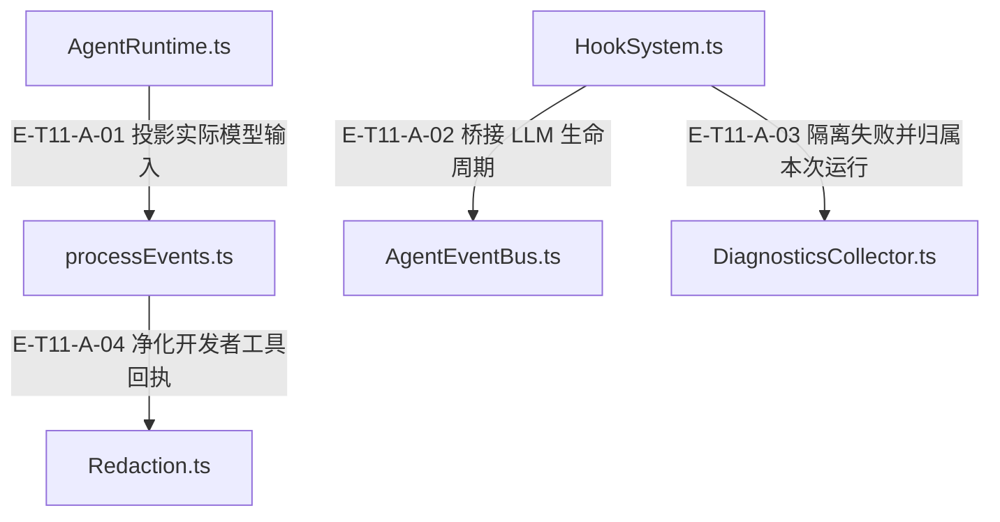

# 11 · 事件、诊断与脱敏

> 一次运行如何留下可观察证据，同时将开发者可见内容与业务回执、隐藏推理分开？

Runtime 保持业务时序，HookSystem 提供拦截与观察，AgentEventBus 发布事件，DiagnosticsCollector 汇总运行诊断。开发者过程事件由 processEvents 显式投影并调用 Redaction；开发者未知来源门面以四份冻结规则的遮蔽并集为底线，再并入 T1；默认生产台账额外按可信 tool/file 追加 T3，见证 profile 则不注入 redactor。三条通道均按各自合同解释。detectors.ts 与 sourcePolicy.ts 已跟踪，Git 状态不代表外部包已发布。

[真实调用](call-flow.md) · [直接依赖](file-dependency.md) · [阅读规范](../00-diagram-standard.md)

## 职责与主要接缝

### 本图术语说明

| 术语／节点 | 含义与范围 |
| --- | --- |
| AgentRuntime.ts | `src/agent/runtime/AgentRuntime.ts`；本图按实现文件聚合职责；具体装配条件见下表。 |
| processEvents.ts | `src/agent/runtime/processEvents.ts`；本图按实现文件聚合职责；具体装配条件见下表。 |
| HookSystem.ts | `src/agent/runtime/HookSystem.ts`；本图按实现文件聚合职责；具体装配条件见下表。 |
| AgentEventBus.ts | `src/agent/runtime/AgentEventBus.ts`；本图按实现文件聚合职责；具体装配条件见下表。 |
| DiagnosticsCollector.ts | `src/agent/runtime/DiagnosticsCollector.ts`；本图按实现文件聚合职责；具体装配条件见下表。 |
| Redaction.ts | `src/agent/utils/Redaction.ts`；本图按实现文件聚合职责；具体装配条件见下表。 |

| 编号 | 代码依据 | 测试依据 | 关系与可证明范围 |
| --- | --- | --- | --- |
| E-T11-A-01 | `src/agent/runtime/AgentRuntime.ts#AgentRuntime.assembleLlmInput` → `src/agent/runtime/processEvents.ts#projectLlmInputEvent` | `test/native-provider-sdk.test.ts#case:executes%20one%20actual%20Runtime%20tool%20round%20and%20keeps%20native%20reasoning%20out%20of%20progress%20events`；已读真实 Runtime 的多 Provider fixture：断言宿主执行一次、模型请求两次，并且 progress JSON 不含 fixture hidden reasoning 或签名。断言已定位，实际执行见页面证据。 | Runtime 在装配与测量完成后调用纯投影器，将实际 provider 消息、工具 schema、请求/有效 toolChoice 与输入估算组成开发者事件；模型原生隐藏推理不会作为展示正文。 |
| E-T11-A-02 | `src/agent/runtime/HookSystem.ts#registerDefaultHooks` → `src/agent/runtime/AgentEventBus.ts#AgentEventBus.publish` | `test/hook-system-event-constants.test.ts#case:bridges%20only%20llm%3Acall%3A*%20under%20the%20AgentEvents%20constant%20values`；默认注册恰好两个 llm 桥，旧 agent:exit 手动事件不再产生 step:completed。断言已定位，实际执行见页面证据。 | 只桥接 llm:call:before/after → LLM_CALL_START/END。工具开始/结束由 Runtime 直接发布；旧 agent:exit 桥与从未分发 HookEvent 已退役。 |
| E-T11-A-03 | `src/agent/runtime/HookSystem.ts#HookSystem.recordHookError` → `src/agent/runtime/DiagnosticsCollector.ts#DiagnosticsCollector.warn` | `test/hook-system-run-diagnostics.test.ts#case:records%20a%20throwing%20tool%3Aexecute%3Abefore%20hook%20as%20a%20hook_handler_failed%20warning%20without%20blocking%20the%20tool`；已读真实 Runtime 用例：hook 抛错后工具仍执行一次、回复 done，运行诊断含单条 tool 归属 warning 且不含合成秘密。另读取双 sink 用例确认失败只归属对应 dispatch。断言已定位，实际执行见页面证据。 | 钩子错误先脱敏后写本地 hookErrors、processEvent metadata 与当次 dispatch 的 diagnostics sink；sink 自身失败隔离。tool:execute:before 抛错不等于返回 false，不自动阻断工具。 |
| E-T11-A-04 | `src/agent/runtime/processEvents.ts#projectToolEndEvent` → `src/agent/utils/Redaction.ts#redactDeveloperText` | `test/evidence-ledger-readback.test.ts#case:%E5%9B%9E%E8%AF%BB%E5%8E%9F%E6%96%87%E4%B8%8D%E5%86%99%E5%9B%9E%E5%8F%B0%E8%B4%A6%EF%BC%8C%E5%BC%80%E5%8F%91%E8%80%85%E4%BA%8B%E4%BB%B6%E4%BB%8D%E7%BB%8F%20processEvents%20%E8%84%B1%E6%95%8F`；已读用例：evidence.get 可给模型返回 verbatim，台账文件与 stats 保持不变且不含合成秘密；把该结果交给 projectToolEndEvent 后，开发者事件不含秘密。断言已定位，实际执行见页面证据。 | 投影器只对展示 content.text 进行脱敏，并保留 duration/cache/status 等 metadata；原业务回执与模型回读通道不被此投影器原地改写。 |

## 输入、输出与副作用

| 维度 | 当前实现 |
| --- | --- |
| 输入 | Runtime/Hook 的普通数据快照、工具调用和结果文本、LLM 输入输出、usage 与故障。；Redaction 接收字符串；T1 返回原文字区间；Floor 接收冻结重放结果与可选检测器；EvidenceLedger 接收 profile 约束的证据片段。 |
| 输出 | 带 kind、correlationId、阶段/维度、retention、displayPolicy 的开发者过程事件。；结构化 AgentDiagnostics、hookErrors、degraded/fallback/工具与效率计数。；脱敏文本以及仅含计数/事件类型的 FloorReport；可选来源表供属性检查。 |
| 副作用 | EventBus 发布给本地监听者，Hook 可以按契约阻断工具；大多数观察失败被隔离，继续原运行。；DiagnosticsCollector 合并诊断与计数，不是业务状态或验收权威。；Redaction/T1/renderer 为纯文本计算，不执行外部扫描；默认 EvidenceLedger 存储脱敏内容并影响后续哈希判断。 |

## 从这些文件开始

| 文件 | 阅读目的 |
| --- | --- |
| `src/agent/runtime/AgentRuntime.ts` | 发送 LLM/工具过程事件及 lifecycle/progress，保持调用顺序 |
| `src/agent/runtime/HookSystem.ts` | 有优先级的 hooks、once 语义、错误隔离与运行诊断桥接 |
| `src/agent/runtime/AgentEventBus.ts` | 单向 publish 广播与继承 on/off；target/correlationId 仅信封标签，旧 subscribe/request 已退役 |
| `src/agent/runtime/DiagnosticsCollector.ts` | 运行警告、degrade、工具调用、预算/效率与输入形状校验 |
| `src/agent/runtime/processEvents.ts` | 开发者过程事件投影、隐藏推理省略、metadata 净化 |
| `src/agent/utils/Redaction.ts` | 开发者文本/台账脱敏门面与不含正文的报告 |
| `src/agent/utils/redaction/legacyFloor.ts` | 冻结规则追踪重放、检测并集、自检与失败即关 |
| `src/agent/utils/redaction/trackedReplay.ts` | 记录替换和 JSON 解码/重编码的原始位置来源 |
| `src/agent/utils/redaction/render.ts` | 按原位置渲染遮蔽并保留结构与来源表 |
| `src/agent/utils/redaction/detectors.ts` | T1 前缀 token/JWT/认证头/Cookie/URL userinfo/SAS 检测 |

| `src/agent/utils/redaction/sourcePolicy.ts` | 来源分类、5条 T3 规则、unknown/covered/merged 路径与只增合并 |
| `src/agent/runtime/PcvNodeEvidenceRecorder.ts` | 来源身份分桶、歧义路径与节点证据缺链诊断 |
| `src/agent/evidence/ProductionEvidenceLedgerAuthority.ts` | 按证据 profile 固定注入默认 redactor 或见证通道 |
| `src/agent/evidence/EvidenceLedgerStore.ts` | 证据入账、内容哈希、freshness 与诊断持久化边界 |

## 失败、取消与恢复

- 观察钩子或诊断 sink 抛错/异步拒绝：记录 hook_handler_failed，先脱敏错误，保留本地 hookErrors，继续后续 hooks；只有 before hook 的 false 是工具阻断信号。
- 畸形外部诊断：DiagnosticsCollector.merge 对数组、元素和非负有限计数守卫；坏项变成明确 warning，合法兄弟项继续合并。
- 重放失配或换行失守：不信任失配位置，按受影响行失败即关；无法对齐换行时遮蔽非空行并保留换行骨架。
- 不动点触顶：最多八轮，触顶写 fixpoint-cap，返回当前遮蔽结果；不能将报告忽略后声称无限收敛保证。
- EventBus 仅在 publish 边界隔离监听失败；继承 emit 保留 Node EventEmitter 语义。resetInstance 只移除旧监听并清空单例，不再有 pending RPC；getStats 只报告 totalEvents。

## 已知边界与未验证范围

- AgentEventBus.publish 本身不脱敏 payload；DiagnosticsCollector 也不是全局净化器。安全展示必须通过对应 projection/redactor 入口。
- T1/T3 文件均已进入当前源码；本文绑定工作树的来源摘要，不将源码存在或测试定位当作外部发布事实。
- ListCover 的当前断言以当前用例为准；历史输出冲突或旧通过记录不能替代本页对应输入摘要的执行证据。
- 当前 ListCover 对 Digest/auth-param/Cookie 可从首个凭据参数名遮到最后凭据值，可能连中间键名/分隔符一起遮；Set-Cookie 只遮第一对的值。这是展示行为，不应仅写成性能优化。
- 冻结底线也保留历史误伤；新增 T1 只扩大遮蔽。代码回读与见证属于单独受约束通道，不能通过放松开发者脱敏得到逐字源码。
- 性能、属性与浏览器验证是独立证据；本页正文给出断言和边界，实际执行见页面证据，不能由源码中的“线性”注释推通用性能保证。

[T1 凭据检测边界逐文件深读](detector-failure-boundaries.md)保留语法盲区；[T3 来源策略与三条内容通道](source-policy-and-channels.md#scenario-source-policy)解释追加规则、有界跳过与内容责任。

## 来源路径的身份歧义

PCV 对相同 qualifiedPath 不再让后一条覆盖前一条：按真实身份分桶。唯一 qualifiedPath 可规范映射；多个不同身份共享同一显示路径时，qualifiedPath 引用判 ambiguous-path，basename 引用判 ambiguous-basename。若输入本身是唯一 absolutePath，而映射的显示路径冲突，则保留该 absolutePath 及行号、按索引去重记录 info，不伪造缺链。缺 absolutePath 时以 folderId+relativePath 区分身份。

源码：`src/agent/runtime/PcvNodeEvidenceRecorder.ts#buildPcvProjectScopeSourceRefIndex`、`src/agent/runtime/PcvNodeEvidenceRecorder.ts#normalizePcvProjectScopeSourceRef`、`src/agent/runtime/PcvNodeEvidenceRecorder.ts#reportAbsolutePathKept`。`test/evidence-recording-phase-chain.test.ts#case:keeps%20a%20unique%20absolute%20path%20verbatim%20and%20marks%20the%20colliding%20qualified%20path%20and%20basename%20ambiguous`和`test/evidence-recording-phase-chain.test.ts#case:tells%20identities%20apart%20by%20folderId%20and%20relativePath%20when%20absolutePath%20is%20missing`使用合成宿主映射定位行为；断言已定位，实际执行见页面证据。图谱只保存接口说明与合成样例，不保存真实用户路径。
