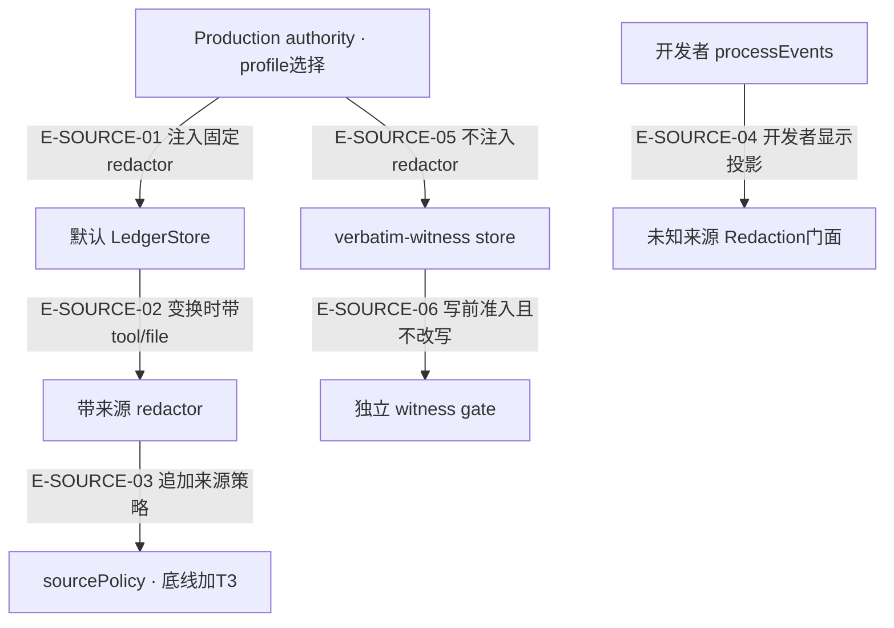

# 来源策略与三条内容通道

同一段工具文本在开发者事件、默认证据台账、逐字见证中有不同职责。T3 只追加到带可信来源的默认台账，不能把它推定为所有模型输出或日志都已获得同样保护。`sourcePolicy.ts` 当前全文已读；本页引用均为断言定位，实际执行见页面证据。

[T1语法盲区](detector-failure-boundaries.md) · [证据摘要生命周期](../08-evidence-knowledge/call-flow.md#scenario-evidence-freshness) · [知识提交失败](../08-evidence-knowledge/failure-and-receipts.md)

## 内容进入哪条通道

### 本图术语说明

| 节点／术语 | 含义与代码定位 |
| --- | --- |
| Production authority · profile选择 | `src/agent/evidence/ProductionEvidenceLedgerAuthority.ts#openProfileStore`；打开时选择固定profile。 |
| 默认 LedgerStore | `src/agent/evidence/EvidenceLedgerStore.ts#EvidenceLedgerStore.transform`；append/freshness/describe采用同来源上下文。 |
| 带来源 redactor | `src/agent/evidence/ProductionEvidenceLedgerAuthority.ts#redactLedgerContent` → `src/agent/utils/Redaction.ts#redactDeveloperTextInContextWithReport`；回调在内容变换时运行。 |
| sourcePolicy · 底线加T3 | `src/agent/utils/redaction/sourcePolicy.ts#applySourcePolicyFloor`；来源矩阵、快路径、合并与报告。 |
| 开发者 processEvents | `src/agent/runtime/processEvents.ts#projectToolEndEvent`；构造开发者展示副本。 |
| 未知来源 Redaction门面 | `src/agent/utils/Redaction.ts#redactDeveloperText`；四历史规则底线加默认T1，不接来源参数。 |
| verbatim-witness store | `src/agent/evidence/EvidenceLedgerStore.ts#EvidenceLedgerStore.constructor`；见证通道拒绝任何redactor。 |
| 独立 witness gate | `src/agent/evidence/witnessGate.ts#inspectWitnessContent`；拒绝不合格内容，准入后逐字存储。 |

| 编号 | 代码依据 | 测试依据 | 关系与可证明范围 |
| --- | --- | --- | --- |
| E-SOURCE-01 | `src/agent/evidence/ProductionEvidenceLedgerAuthority.ts#openProfileStore` → `src/agent/evidence/EvidenceLedgerStore.ts#EvidenceLedgerStore.constructor` | `test/production-evidence-ledger-authority.test.ts#case:masks%20every%20value%20of%20a%20secret-bearing%20capture%20and%20sensitive%20env%20keys%20of%20a%20terminal%20capture%2C%20but%20keeps%20source%20captures%20on%20the%20unknown-source%20floor`；真实authority三类capture对照。断言已定位，实际执行见页面证据。 | 默认分支只注入固定redactLedgerContent；不开放调用者任意redactor配置。 |
| E-SOURCE-02 | `src/agent/evidence/EvidenceLedgerStore.ts#EvidenceLedgerStore.transform` → `src/agent/evidence/ProductionEvidenceLedgerAuthority.ts#redactLedgerContent` | `test/production-evidence-ledger-authority.test.ts#case:classifies%20a%20T3-only%20rewrite%20as%20redacted%20in%20the%20capture%20diagnostic%20(same%20source%20context%20as%20the%20append)`；PORT/REGION原门面不改、来源T3改写，diagnostic与落盘一致。断言已定位，实际执行见页面证据。 | context来自草稿/条目冻结副本；append、fallback哈希重算、describe同尺。 |
| E-SOURCE-03 | `src/agent/utils/Redaction.ts#redactDeveloperTextInContextWithReport` → `src/agent/utils/redaction/sourcePolicy.ts#applySourcePolicyFloor` | `test/redaction-source-policy.test.ts#case:path%20distinguishes%20unknown%20source%2C%20no%20rules%2C%20no%20span%2C%20covered%20and%20merged`；五path与新增字符计数。断言已定位，实际执行见页面证据。 | 未知来源floor选项与开发者门面相同；T3只能增加遮蔽，不放行历史位置。 |
| E-SOURCE-04 | `src/agent/runtime/processEvents.ts#projectToolEndEvent` → `src/agent/utils/Redaction.ts#redactDeveloperText` | `test/evidence-ledger-readback.test.ts#case:%E5%BC%80%E5%8F%91%E8%80%85%E4%BA%8B%E4%BB%B6%E9%80%9A%E9%81%93%E4%BB%8D%E7%94%A8%E6%9C%AA%E7%9F%A5%E6%9D%A5%E6%BA%90%E5%BA%95%E7%BA%BF%EF%BC%9A%E5%90%8C%E4%B8%80%E6%AE%B5%E7%BB%88%E7%AB%AF%E8%BE%93%E5%87%BA%E7%9A%84%E4%BA%8B%E4%BB%B6%E6%96%87%E6%9C%AC%E4%B8%8E%20redactDeveloperText%20%E4%B8%80%E8%87%B4`；事件等于未知门面且不同于terminal T3。断言已定位，实际执行见页面证据。 | 观察副本的显示文本按未知来源处理；不原地修改业务DTO或模型回读内容。 |
| E-SOURCE-05 | `src/agent/evidence/ProductionEvidenceLedgerAuthority.ts#openProfileStore` → `src/agent/evidence/EvidenceLedgerStore.ts#EvidenceLedgerStore.constructor` | `test/production-evidence-ledger-authority.test.ts#case:leaves%20the%20verbatim%20witness%20profile%20without%20any%20redactor%3A%20terminal%20and%20secret-bearing%20captures%20stay%20byte-exact`；合成准入内容逐字保留。断言已定位，实际执行见页面证据。 | 见证profile不脱敏、不截断替代准入；类型/大小/高置信秘密由独立gate检查。 |
| E-SOURCE-06 | `src/agent/evidence/EvidenceLedgerStore.ts#EvidenceLedgerStore.assertWitnessAdmissible` → `src/agent/evidence/witnessGate.ts#inspectWitnessContent` | `test/witness-gate-rules.test.ts#case:rejects%20the%20audit%20probe%20(RSA%2C%2026%20x%2064-char%20segments%20joined%20by%20spaces)%20before%20writing`；该pure gate用例只断言拒绝reason/kind，不直接证明I/O。`test/production-evidence-witness-profile.test.ts#case:rejects%20%24name%20with%20no%20new%20ledger%20row%20and%20no%20content%20in%20the%20reason`另以真实台账断言拒绝后JSONL字节/stats不变、无E-2、快照仍一条；写前gate的顺序由源码确认。断言已定位，实际执行见页面证据。 | 见证gate与T1/T3是独立规则表：拒绝而不改写，不能用T3的保留形态推见证准入。 |

## 来源矩阵

分类入口是 `src/agent/utils/redaction/sourcePolicy.ts#classifyRedactionSource`，复用 `src/agent/evidence/evidenceFileClass.ts#classifyEvidenceSource`。terminal.exec 先于文件分类，因为 terminal.file 可能是命令词法猜测；凭据文件名称优先于源码扩展名。

| 来源 | 如何判定 | T3追加范围 |
| --- | --- | --- |
| unknown | 没有context，开发者门面 | 无；四历史底线+T1。 |
| terminal | tool=terminal.exec，不论file | 敏感env键、verbose认证头、Secret data、netrc口令。 |
| secret-bearing | 文件分类命中凭据名称/目录/扩展名规则 | 已识别键值/序列/块标量/JSON值及netrc口令。 |
| source | 未先命中secret-bearing的源码扩展名 | 无；与未知来源逐字相同。 |
| config | 其他有file的来源 | 无；与未知来源逐字相同，不意味着文件内容天然安全。 |
| no-file | 非terminal且没有file | 无；与未知来源逐字相同。 |

`test/redaction-source-policy.test.ts#case:source%2C%20config%2C%20no-file%20and%20unknown%20contexts%20keep%20the%20unknown-source%20floor%20byte%20for%20byte`定位逐字相等；`test/redaction-source-policy.test.ts#case:terminal%20entries%20are%20terminal%20whatever%20their%20file%3B%20files%20follow%20the%20name-first%20table`定位分类优先级。断言已定位，实际执行见页面证据。

## 五条规则读法

规则单源：`src/agent/utils/redaction/sourcePolicy.ts#SOURCE_POLICY_RULES`；扫描器只返回原文区间，不串接修改后的字符串。

| 规则ID | 触发条件与遮蔽 | 保留及边界 |
| --- | --- | --- |
| secret-bearing-every-value | 识别键值、YAML序列/块标量/嵌套续行、多行引号及一行JSON值 | 键名、空值、纯容器结构保留；code.search先跳过NN:前缀。它是词法扫描，不是完整配置解析器。 |
| terminal-env-sensitive-key | KEY=VALUE的键内含pass/pwd/secret/token/key/auth/cred/private/cookie/session | 行首形态取整行值；行内形态到空白/分隔符；普通PORT不因T3被遮。 |
| terminal-curl-verbose-auth-header | 以 > 或 < 开始的头行，头名含认证/凭据词 | 认证类整值遮住，包含Set-Cookie后续对；这一点比T1仅第一对更宽。 |
| terminal-kubectl-secret-data | 文档具有kind:Secret或Secret专有type，且进入data/stringData缩进块 | 只遮数据块的已识别取值；ConfigMap不因该规则命中。 |
| netrc-password | terminal/secret-bearing内同时出现machine及login/password形态 | 遮password后的口令；纯关键字/空口令不追加；普通source上下文不启用此规则。 |

`test/redaction-source-policy.test.ts#case:positive%20examples%20hide%20every%20fragment%20of%20at%20least%204%20characters%20in%20every%20listed%20source`与`test/redaction-source-policy.test.ts#case:negative%20examples%20stay%20byte-identical%20in%20every%20listed%20source%20and%20the%20rule%20adds%20no%20span`检查规则表合成正反例；不扩展为所有真实秘密格式已覆盖。断言已定位，实际执行见页面证据。

## 五种执行路径与只增合并

`src/agent/utils/redaction/sourcePolicy.ts#runSourcePolicyFloor` 先在原文检测T3，再运行与开发者相同的未知来源底线。进入合并时，未知底线最终隐藏的原始位置作为首轮seed整段并入；T3逐轮重新算区间。这样保证带来源的遮蔽不小于未知来源，即使不动点多轮的组合本身不单调。

| source.path | 条件 | 输出事实 |
| --- | --- | --- |
| unknown-source | 无context | 直接未知底线。 |
| no-source-rules | source/config/no-file | 直接未知底线，ruleIds空。 |
| no-span | 原文T3无命中；未知底线已收敛且其输出上的T3只落在已有marker内 | 快路径，输出逐字等于未知底线；不能将“原文无span”单独当充分条件。 |
| covered | 新增字符数0，且满足同样收敛/marker稳定条件 | T3有命中但无需再遮；逐字返回未知底线。 |
| merged | 快路径不满足 | seed与T3经sourceDetectors合并后渲染/不动点；保留floor报告，不宣称一定有原文ruleHit。 |

原文无T3命中但未知底线尚需多轮时，也可进入merged；需要补跑带来源表以取seed。`src/agent/utils/redaction/legacyFloor.ts#createFloorReplayShare` 在同一次调用内复用相同原文的第一轮版本重放与结构信息，不是模块级敏感文本缓存。普通T1 detector为旧规则级联保留触发前缀；sourceDetectors的seed/T3整段并入，不沿用该裁剪。

`test/redaction-source-policy.test.ts#case:path%20distinguishes%20unknown%20source%2C%20no%20rules%2C%20no%20span%2C%20covered%20and%20merged`、`test/redaction-source-policy.test.ts#case:no%20T3%20hit%20on%20the%20input%20but%20merged%20later%3A%20the%20production%20entry%20agrees%20with%20the%20provenance%20entry`与`test/redaction-source-policy-replay-share.test.ts#case:merged%20path%3A%20the%20original%20text%20is%20replayed%20exactly%20as%20often%20as%20by%20the%20facade`分别定位路径、补算等价与原文重放次数；断言已定位，实际执行见页面证据。

## 有界跳过与恢复责任

| 触发条件 | 实际行为／报告 | 不能据此声称什么 |
| --- | --- | --- |
| terminal未闭引号在后续64行内找不到闭引号 | quotedContinuation返回空续行span；首行已遮，计quote-continuation-limit | 超过64行的所有后续内容都已隐藏。若在上限内就到EOF，则遮到EOF，不计该skip。 |
| env敏感键前的行首前缀超过256字符 | env-line-prefix-over-limit；按行内值读到分隔符，少追加 | 整行都按env完整值被遮。底线与其他规则仍生效。 |
| JSON风格单行引号未闭合 | json-line-unclosed-quote；该行JSON扫描停止，已识别区间和其他形态仍保留 | 这是一份成功完整解析的JSON，或后续值必定被T3发现。 |
| gate/trigger不匹配、未收录语法 | 本规则不追加，其他规则/未知底线照常 | 没有span就等于没有秘密。 |
| debug/warn诊断通道自身抛错 | authority通过observeSafely隔离；已产生文本/已确认append保留 | 日志失败使业务创建可安全重试或可以抹掉回执。 |
| floor重放失配/换行自检失败/不动点触顶 | 继续按floor的fail-closed或cap报告处理 | T3成功路径自动消除floor降级。 |

源码：`src/agent/utils/redaction/sourcePolicy.ts#quotedContinuation`、`src/agent/utils/redaction/sourcePolicy.ts#scanEnvAssignments`、`src/agent/utils/redaction/sourcePolicy.ts#scanJsonLine`。`test/redaction-source-policy.test.ts#case:bounded%20heuristics%20report%20their%20skips%20by%20kind%20and%20count%20only`给出三个skip的精确输入与输出；`test/production-evidence-ledger-authority.test.ts#case:logs%20the%20source-policy%20contribution%20at%20debug%20level%20with%20counts%20only`断言诊断无正文。断言已定位，实际执行见页面证据。

## 与台账回读、见证、历史兼容的交接

- 默认生产台账只存变换后文本及其hash；freshness fallback必须用同tool/file来源重算，否则T3独有改写会造成错误比较。`test/production-evidence-ledger-authority.test.ts#case:keeps%20freshness%20consistent%20across%20processes%20for%20secret-bearing%20captures%20that%20carry%20a%20range`用新实例检验未变内容fresh、键名变化stale；该用例不是被遮值变化的跨进程保证。
- 公共authority.capture允许合法secret-bearing草稿带range；循环EvidenceCapture会主动去range。`test/evidence-ledger-readback.test.ts#case:.env%20%E7%BB%8F%E5%BE%AA%E7%8E%AF%20code.read%20%E5%85%A5%E8%B4%A6%EF%BC%9A%E4%B8%A2%E5%BC%83%20range%EF%BC%8C%E6%8C%89%20secret-bearing%20%E8%A7%84%E5%88%99%E9%81%AE%E4%BD%8F%E5%85%A8%E9%83%A8%E5%8F%96%E5%80%BC%E3%80%81%E4%BF%9D%E7%95%99%E9%94%AE%E5%90%8D`与公共capture的范围保留应分开读。
- evidence.get在source/config、code.read、有界range且fresh等条件满足时可向模型回读原文；secret-bearing不回读，开发者事件另经未知门面投影。原文回读不写回JSONL。
- 见证profile的原文准入是独立gate；T1/T3规则不会被反向用作见证规则，也不会因source class允许而跳过gate。
- 默认storeId/storeConfigHash公式在T3接入后保持原合同；身份稳定不等于脱敏内容不变。旧无摘要条目遇规则变化可能变stale，应重采，不只更新引用hash。

## 渲染与性能口径

`src/agent/utils/redaction/trackedReplay.ts#jsonDocumentRanges` 只将整文JSON、或整行JSON对象/数组当载体；普通源码/shell引号里的字面转义换行是内容。`src/agent/utils/redaction/render.ts#renderByPositions` 按载体层级恢复换行，并按反斜杠奇偶/值边界处理引号，防止把值内部引号当可见结构。`test/redaction-render.test.ts#case:a%20double-quoted%20value%20in%20plain%20text%20is%20not%20a%20JSON%20carrier%2C%20so%20its%20escaped%20newline%20stays%20masked`及`test/redaction-render.test.ts#case:an%20escaping%20backslash%20swallowed%20by%20an%20early%20version%20stays%20with%20its%20quote%2C%20so%20the%20carrier%20stays%20valid%20JSON`定位收紧。

测试中的规则表、固定seed属性、原文重放spy与时间基准回答不同问题。T3 dense/4f延后组的性能门槛只能按 `test/redaction-source-policy-performance.test.ts` 当前断言解释，不由功能用例通过推断目标倍率已达成。此页没有新增模型API、生产运行代码或跨仓验收。
