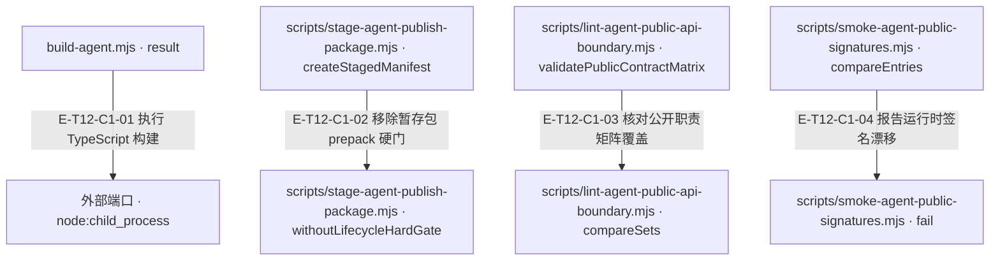
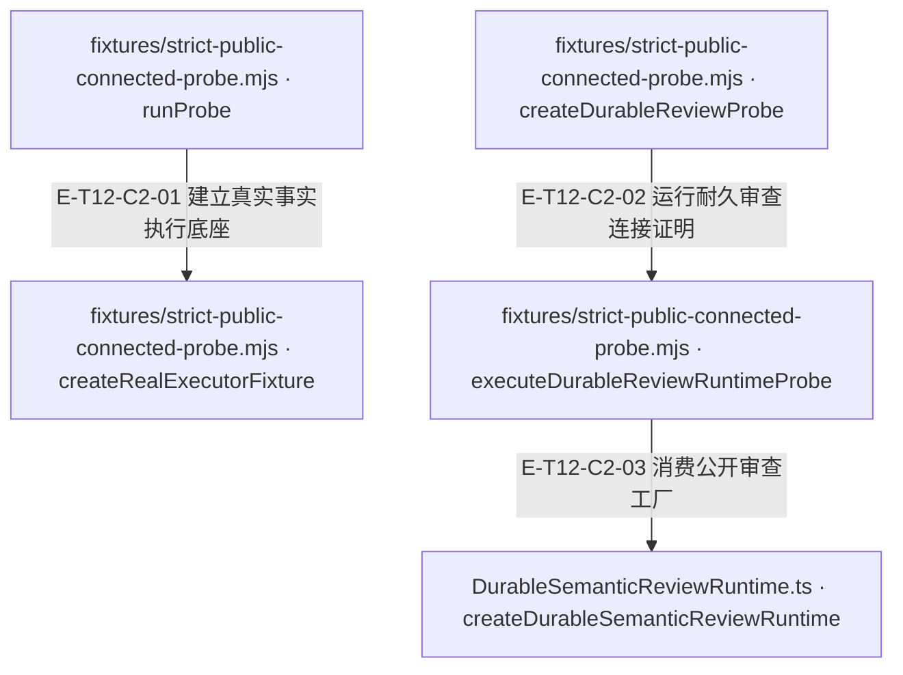

# 构建、边界与发布 · 真实调用

包是 Node>=22 的 ESM，15 个精确公开 exports；开发 Core 依赖保持 file:../AlembicCore。构建先清 dist 再 tsc。公开路径、运行时名字/种类签名、消费 TypeScript 与严格连接 probe 分层验证。发布根 prepack 拒绝本地 file:../ 依赖，staging 生成带来源信息的 registry 依赖包，不直接发布。

[职责与边界](overview.md) · [直接依赖](file-dependency.md)

图中调用边经实现正文核对；AST只用于符号定位。接口／注入对象是调用端口，不据此推定所有宿主实现相同。测试表记录已定位的精确声明和断言边界；实际执行、展开后的参数化用例身份及当前输入一致性见页面证据。

## 调用接缝 1

### 本图术语说明

| 术语／节点 | 含义与范围 |
| --- | --- |
| build-agent.mjs · result | `scripts/build-agent.mjs#result`；声明或调用端口；动态实现的绑定条件见下表。 |
| 外部端口 · node:child_process | 外部合同 `node:child_process#spawnSync`；声明或调用端口；动态实现的绑定条件见下表。 |
| scripts/stage-agent-publish-package.mjs · createStagedManifest | `scripts/stage-agent-publish-package.mjs#createStagedManifest`；声明或调用端口；动态实现的绑定条件见下表。 |
| scripts/stage-agent-publish-package.mjs · withoutLifecycleHardGate | `scripts/stage-agent-publish-package.mjs#withoutLifecycleHardGate`；声明或调用端口；动态实现的绑定条件见下表。 |
| scripts/lint-agent-public-api-boundary.mjs · validatePublicContractMatrix | `scripts/lint-agent-public-api-boundary.mjs#validatePublicContractMatrix`；声明或调用端口；动态实现的绑定条件见下表。 |
| scripts/lint-agent-public-api-boundary.mjs · compareSets | `scripts/lint-agent-public-api-boundary.mjs#compareSets`；声明或调用端口；动态实现的绑定条件见下表。 |
| scripts/smoke-agent-public-signatures.mjs · compareEntries | `scripts/smoke-agent-public-signatures.mjs#compareEntries`；声明或调用端口；动态实现的绑定条件见下表。 |
| scripts/smoke-agent-public-signatures.mjs · fail | `scripts/smoke-agent-public-signatures.mjs#fail`；声明或调用端口；动态实现的绑定条件见下表。 |

| 编号 | 代码依据 | 测试依据 | 关系与可证明范围 |
| --- | --- | --- | --- |
| E-T12-C1-01 | `scripts/build-agent.mjs#result` → `node:child_process#spawnSync` | 未覆盖：本轮只读脚本；未运行会写 dist 的 build。结果以子进程 status/error 为准。 | 模块顶层 result 的初始化实际调用 spawnSync(process.execPath,[typescript/bin/tsc,'-p','tsconfig.json'])；之前 rmSync 清理本仓 dist。这是进程调用，不是 import 边。 |
| E-T12-C1-02 | `scripts/stage-agent-publish-package.mjs#createStagedManifest` → `scripts/stage-agent-publish-package.mjs#withoutLifecycleHardGate` | 未覆盖：未找到并阅读此 helper 的独立 unit test；脚本自身随后检查暂存 manifest 不含 file:../，本轮未执行 staging。 | 生成暂存 manifest 时复制 scripts 并删除 prepack；开发根门仍保留，Core 依赖改为读取到的 registry version。 |
| E-T12-C1-03 | `scripts/lint-agent-public-api-boundary.mjs#validatePublicContractMatrix` → `scripts/lint-agent-public-api-boundary.mjs#compareSets` | `test/contract-surface.test.ts#case:classifies%20the%20new%20facades%20as%20stable%20with%20exact%20runtime%20signatures`；关联测试检查 strict facade 在 stable 分类和签名表中；不直接执行 lint helper，因此此边的运行结果未在本轮验证。 | 验证 matrix 每项必需字段/Host owns 边界后，实际 compareSets 将矩阵 exports 与 package exports 对齐。 |
| E-T12-C1-04 | `scripts/smoke-agent-public-signatures.mjs#compareEntries` → `scripts/smoke-agent-public-signatures.mjs#fail` | `test/contract-surface.test.ts#case:keeps%20the%20context%2Fmemory%2Fprompts%20runtime%20names%2C%20kinds%20and%20hashes%20equal%20to%20the%20frozen%20snapshot`；关联测试重复检查 names/kinds/hash；该契约不比较函数参数、返回类型或业务语义 ABI。 | 比较动态 import 结果中的缺失/新增名字、runtime kind、count 与 hash，发现任一漂移就累计 failure 并令脚本失败。 |

## 调用接缝 2

### 本图术语说明

| 术语／节点 | 含义与范围 |
| --- | --- |
| fixtures/strict-public-connected-probe.mjs · runProbe | `scripts/fixtures/strict-public-connected-probe.mjs#runProbe`；声明或调用端口；动态实现的绑定条件见下表。 |
| fixtures/strict-public-connected-probe.mjs · createRealExecutorFixture | `scripts/fixtures/strict-public-connected-probe.mjs#createRealExecutorFixture`；声明或调用端口；动态实现的绑定条件见下表。 |
| fixtures/strict-public-connected-probe.mjs · createDurableReviewProbe | `scripts/fixtures/strict-public-connected-probe.mjs#createDurableReviewProbe`；声明或调用端口；动态实现的绑定条件见下表。 |
| fixtures/strict-public-connected-probe.mjs · executeDurableReviewRuntimeProbe | `scripts/fixtures/strict-public-connected-probe.mjs#executeDurableReviewRuntimeProbe`；声明或调用端口；动态实现的绑定条件见下表。 |
| DurableSemanticReviewRuntime.ts · createDurableSemanticReviewRuntime | `src/agent/evaluation/DurableSemanticReviewRuntime.ts#createDurableSemanticReviewRuntime`；声明或调用端口；动态实现的绑定条件见下表。 |

| 编号 | 代码依据 | 测试依据 | 关系与可证明范围 |
| --- | --- | --- | --- |
| E-T12-C2-01 | `scripts/fixtures/strict-public-connected-probe.mjs#runProbe` → `scripts/fixtures/strict-public-connected-probe.mjs#createRealExecutorFixture` | 未覆盖：脚本为 smoke:strict-consumer 的运行体，自带 report 断言；本轮未运行。模型/部分语义权威仍是 fixture，realExecutor 不等于真实 LLM。 | probe 实际创建控制根、生产 evidence authority、Core fact backend/executor 与 execution receipts，再交给后续语义/producer fixture。 |
| E-T12-C2-02 | `scripts/fixtures/strict-public-connected-probe.mjs#createDurableReviewProbe` → `scripts/fixtures/strict-public-connected-probe.mjs#executeDurableReviewRuntimeProbe` | 未覆盖：运行体校验 provider/witness 各一次、compiled prompt 一致、fresh-process reopen；本轮只核对实现。 | 从真实 executionReceipts/witness、语义/producer fixture 构造 request 后实际调用 durable runtime probe。 |
| E-T12-C2-03 | `scripts/fixtures/strict-public-connected-probe.mjs#executeDurableReviewRuntimeProbe` → `src/agent/evaluation/DurableSemanticReviewRuntime.ts#createDurableSemanticReviewRuntime` | `test/durable-semantic-review-runtime.test.ts#case:loads%20the%20authoritative%20Agent%20ledger%2C%20invokes%20the%20provider%20with%20Core%20prompt%2C%20and%20emits%20a%20fresh-process%20V5%20durable%20attestation`；相关行为用例真实读台账与 fresh-process V5 验证，provider 输出是 deterministic passingDecisionFromCompiledPrompt。 | 实际 await 从 @alembic/agent/production 解析到的工厂，注入临时 Ed25519 key、真实 ledger facet 与确定性 provider；调用 execute 后由 Core 验签，并新进程重开 ledger。 |

## 入口迁移不删除真实能力

当前fixture仍从evaluation取得createFrozenEvidenceProjection、IndependentValueReviewer与InvestigatedEmptyReviewer；createDurableSemanticReviewRuntime与DurableSemanticReviewRuntimeError明确从production导入。`src/evaluation.ts`与`src/production.ts`的再导出分工是当前静态事实；上方durable调用E边保持同一实现目标，仅更正消费入口。

`test/contract-surface.test.ts#case:withdraws%20FanOutStrategy%20from%20%60.%60%20and%20%60.%2Fagent%60%20and%20the%20durable%20runtime%20from%20%60.%2Fevaluation%60`锁定公开入口撤回范围。公开函数路径迁移、运行时实现仍存、消费者测试通过是三个不同结论；实际执行见页面证据。
