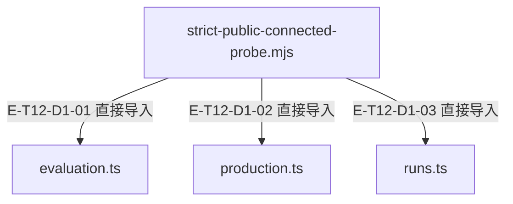

# 构建、边界与发布 · 精选直接依赖

[职责与边界](overview.md) · [真实调用](call-flow.md)

选取本专题入口的最多8条直接依赖；完整库存可在阅读器「文件与依赖」查看。以仓库全路径为节点身份，同名文件不会合并。Core／Node／第三方包只在完整探索器的外部边界出现。

## 静态依赖 1

### 本图术语说明

| 术语／节点 | 含义与范围 |
| --- | --- |
| strict-public-connected-probe.mjs | `scripts/fixtures/strict-public-connected-probe.mjs`；文件直接依赖，箭头不表示执行先后。 |
| evaluation.ts | `src/evaluation.ts`；文件直接依赖，箭头不表示执行先后。 |
| production.ts | `src/production.ts`；文件直接依赖，箭头不表示执行先后。 |
| runs.ts | `src/runs.ts`；文件直接依赖，箭头不表示执行先后。 |

| 编号 | 代码依据 | 测试依据 | 关系与可证明范围 |
| --- | --- | --- | --- |
| E-T12-D1-01 | `scripts/fixtures/strict-public-connected-probe.mjs` → `src/evaluation.ts` | 未覆盖：静态依赖由本图谱解析器反例测试支持；不把 import 当作行为覆盖。 | TypeScript AST 解析 @alembic/agent/evaluation；第 7 行，kind=import，typeOnly=false。只证明结构关系。 |
| E-T12-D1-02 | `scripts/fixtures/strict-public-connected-probe.mjs` → `src/production.ts` | 未覆盖：静态依赖由本图谱解析器反例测试支持；不把 import 当作行为覆盖。 | TypeScript AST 解析 @alembic/agent/production；第 12 行，kind=import，typeOnly=false。只证明结构关系。 |
| E-T12-D1-03 | `scripts/fixtures/strict-public-connected-probe.mjs` → `src/runs.ts` | 未覆盖：静态依赖由本图谱解析器反例测试支持；不把 import 当作行为覆盖。 | TypeScript AST 解析 @alembic/agent/runs；第 27 行，kind=import，typeOnly=false。只证明结构关系。 |

本页直接依赖已对照当前AST逐边重查；沿用稳定边ID，行号按当前源码更新。导入存在不表示本轮行为已执行；实际执行见页面证据。
