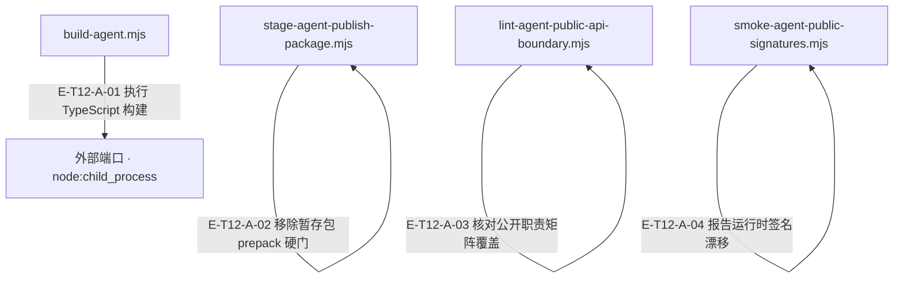

# 12 · 构建、边界与发布

> 源码如何变成可消费包，哪些检查保护公开表面，发布和严格消费 probe 到底证明什么？

包是 Node>=22 的 ESM，15 个精确公开 exports；开发 Core 依赖保持 file:../AlembicCore。构建先清 dist 再 tsc。公开路径、运行时名字/种类签名、消费 TypeScript 与严格连接 probe 分层验证。发布根 prepack 拒绝本地 file:../ 依赖，staging 生成带来源信息的 registry 依赖包，不直接发布。

[真实调用](call-flow.md) · [直接依赖](file-dependency.md) · [阅读规范](../00-diagram-standard.md)

## 职责与主要接缝

### 本图术语说明

| 术语／节点 | 含义与范围 |
| --- | --- |
| build-agent.mjs | `scripts/build-agent.mjs`；本图按实现文件聚合职责；具体装配条件见下表。 |
| 外部端口 · node:child_process | 外部合同 `node:child_process`；本图按实现文件聚合职责；具体装配条件见下表。 |
| stage-agent-publish-package.mjs | `scripts/stage-agent-publish-package.mjs`；本图按实现文件聚合职责；具体装配条件见下表。 |
| lint-agent-public-api-boundary.mjs | `scripts/lint-agent-public-api-boundary.mjs`；本图按实现文件聚合职责；具体装配条件见下表。 |
| smoke-agent-public-signatures.mjs | `scripts/smoke-agent-public-signatures.mjs`；本图按实现文件聚合职责；具体装配条件见下表。 |

| 编号 | 代码依据 | 测试依据 | 关系与可证明范围 |
| --- | --- | --- | --- |
| E-T12-A-01 | `scripts/build-agent.mjs#result` → `node:child_process#spawnSync` | 未覆盖：本轮只读脚本；未运行会写 dist 的 build。结果以子进程 status/error 为准。 | 模块顶层 result 的初始化实际调用 spawnSync(process.execPath,[typescript/bin/tsc,'-p','tsconfig.json'])；之前 rmSync 清理本仓 dist。这是进程调用，不是 import 边。 |
| E-T12-A-02 | `scripts/stage-agent-publish-package.mjs#createStagedManifest` → `scripts/stage-agent-publish-package.mjs#withoutLifecycleHardGate` | 未覆盖：未找到并阅读此 helper 的独立 unit test；脚本自身随后检查暂存 manifest 不含 file:../，本轮未执行 staging。 | 生成暂存 manifest 时复制 scripts 并删除 prepack；开发根门仍保留，Core 依赖改为读取到的 registry version。 |
| E-T12-A-03 | `scripts/lint-agent-public-api-boundary.mjs#validatePublicContractMatrix` → `scripts/lint-agent-public-api-boundary.mjs#compareSets` | `test/contract-surface.test.ts#case:classifies%20the%20new%20facades%20as%20stable%20with%20exact%20runtime%20signatures`；关联测试检查 strict facade 在 stable 分类和签名表中；不直接执行 lint helper，因此此边的运行结果未在本轮验证。 | 验证 matrix 每项必需字段/Host owns 边界后，实际 compareSets 将矩阵 exports 与 package exports 对齐。 |
| E-T12-A-04 | `scripts/smoke-agent-public-signatures.mjs#compareEntries` → `scripts/smoke-agent-public-signatures.mjs#fail` | `test/contract-surface.test.ts#case:keeps%20the%20context%2Fmemory%2Fprompts%20runtime%20names%2C%20kinds%20and%20hashes%20equal%20to%20the%20frozen%20snapshot`；关联测试重复检查 names/kinds/hash；该契约不比较函数参数、返回类型或业务语义 ABI。 | 比较动态 import 结果中的缺失/新增名字、runtime kind、count 与 hash，发现任一漂移就累计 failure 并令脚本失败。 |

## 输入、输出与副作用

| 维度 | 当前实现 |
| --- | --- |
| 输入 | src/tsconfig、package exports/imports、public boundary/signature/floor 配置；相邻 Core 的本地源码包/版本/clean commit；Main 消费 probe 要求真实 @alembic/agent link；公开 consumer TypeScript fixture 与可控 strict probe fixture |
| 输出 | dist JS 与 d.ts；公共入口/签名/consumer 检查结果；tmp/release/@alembic-agent 暂存 manifest、dist/readmes、.alembic-source.json；strict connected probe 的 capture/fault/durable/continuity 报告 |
| 副作用 | build 删除并重建本仓 dist。stage 删除并重建本仓固定 tmp/release 目录；只读邻仓 Core git/package。；public strict probe 在 os.tmpdir 写控制项目/ledger 并 finally 清理，从 Main cwd fresh process 解析公共包；虚拟 TS 文件不写 Main 产品源码。；smoke 读取编译包；release:pack-preview 是 dry-run，不发布 registry。 |

## 从这些文件开始

| 文件 | 阅读目的 |
| --- | --- |
| `package.json` | exports、imports、local-source-first 依赖、build/check/release 脚本 |
| `scripts/build-agent.mjs` | 清 dist 后启动 tsc；保存构建退出码 |
| `config/agent-public-api-boundary.json` | 公开入口分类、职责矩阵与禁止深导入样例 |
| `config/agent-public-api-signatures.json` | 每出口 runtime binding 名字/种类/hash |
| `scripts/smoke-agent-public-signatures.mjs` | 动态加载编译包并比较精确 runtime 签名 |
| `scripts/lint-agent-public-api-boundary.mjs` | 矩阵、导出与边界配置一致性检查 |
| `scripts/probe-agent-public-strict-consumer.mjs` | 真实 Main 包解析、fresh process probe 和虚拟 TS consumer |
| `scripts/fixtures/strict-public-connected-probe.mjs` | 真实 Core fact executor/ledger/durable 连通 probe 与故障矩阵 |
| `scripts/stage-agent-publish-package.mjs` | 发布暂存 manifest、Core 版本和来源 commit |
| `scripts/guard-agent-release-package.mjs` | 禁止开发根泄漏 file:../ 依赖进入 pack/publish |

## 失败、取消与恢复

- 构建错误：脚本保留 tsc 非零退出码；不能拿失败后可能残留的部分 emit 视为成功 build。
- 公开导出漂移或深导入：lint/signature/import smoke 分别失败；修复明确入口或冻结配置，不能把内部路径临时公开。
- 开发根直接 pack/publish：prepack 检测 package 和 lock root 的 file:../ 依赖并拒绝；走 staging 并检查来源元数据。
- Core 脏或 Main link 不对：staging 或 consumer probe 失败关闭；不能把另一 checkout 的结果算当前源码通过。
- strict probe 权威/回执反绑定：故障矩阵要求拒绝；证明结构/来源一致性，不把 synthetic semantic review 当生产效果。

## 已知边界与未验证范围

- 签名 hash 只覆盖 runtime export 名称与 kind；不是函数参数/返回类型 ABI 或行为一致性证明。
- npm run check 包含依赖 Main 环境的 strict-consumer；check:ci 不含该 probe，CI 只构建 Agent+Core 后另跑 public-import smoke，二者不能互换。
- validation-floor 统计测试文件/声明/suite/pack 条目，不是已执行测试数或覆盖率。默认 test/check 不是 test:coverage。
- staging 要求 Core clean，但允许 Agent dirty 并记录 workingTreeDirty；Agent sourceCommit 不能单独证明暂存内容。
- Core import boundary scanner 位于相邻 AlembicCore，通过 package script 调用；不复制到 Agent。CI Core checkout 不是固定历史 commit。
- 本轮未运行 build/check/stage/smoke 或网络评估；所有结果范围仅为源码事实复核。

## 当前公开面收窄与检查解释

15个包子路径数保持，内部绑定数已经变化；当前每入口期望与源码对应见[公开入口表](../01-overall-architecture/public-api-and-hosts.md)。evaluation只留独立reviewer与冻结证据投影（3个运行时绑定），durable工厂/错误继续位于production。Runtime公开面只留默认工具管道工厂和类，内部单中间件再导出已撤回；AgentState仍公开，但Runtime不持有其实例。

`test/contract-surface.test.ts#case:withdraws%20FanOutStrategy%20from%20%60.%60%20and%20%60.%2Fagent%60%20and%20the%20durable%20runtime%20from%20%60.%2Fevaluation%60`检查对应撤回；`test/agent-dcr-retirements.test.ts#case:does%20not%20export%20the%20shared%20Gateway%20singleton%20functions%20from%20any%20AI%20entry`检查共享Gateway函数不在任何AI入口；`test/tool-system.test.ts#case:removes%20the%20legacy%20handler%20layer%20and%20the%20routing%20service-contract%20seam%20from%20the%20kernel`检查旧工具handler/routing文件与导入不存在。它们各自证明明确的集合/结构，不能代替模型调用或知识发布结果。断言已定位，实际执行见页面证据。

图谱静态采样不运行dist导入，冻结runtime绑定数也不是本轮smoke通过；执行签名检查时必须匹配当前dist和输入。TypeScript消费检查验证类型边界，runtime签名只验证名字/种类，二者不可互换。图谱自有npm run check与产品根npm run check属于不同包，后者含跨仓环境需求，不因同名自动扩展本任务范围。
