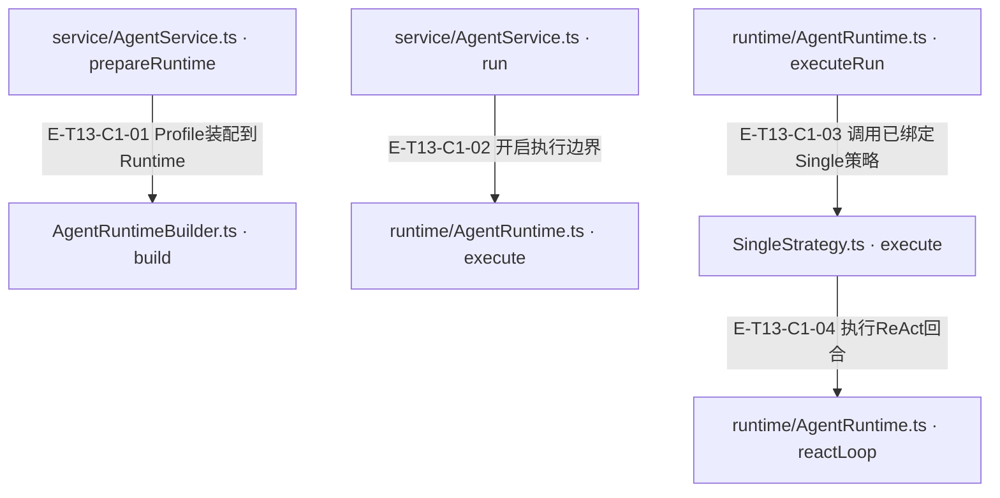
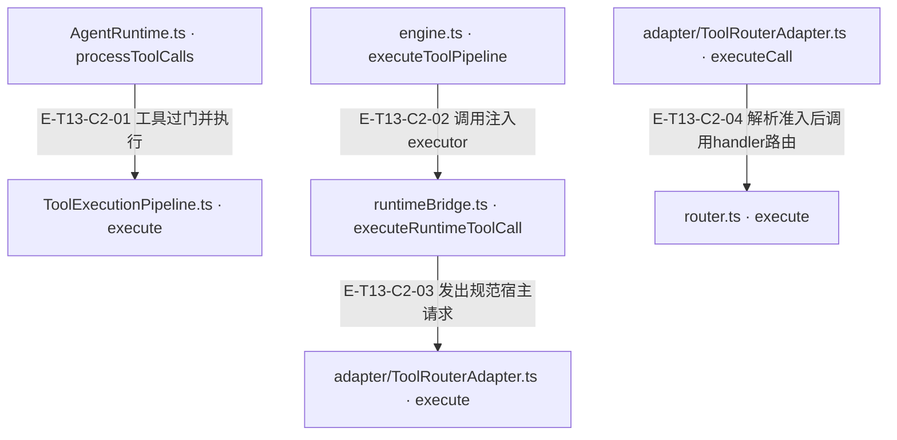

# 一次请求到工具回执 · 真实调用

这条样板以真实 AgentService、Compiler、Builder、SingleStrategy、Runtime、ToolExecutionPipeline、Adapter、Router 与 code.read 串起一个回合。脚本化模型先请求读文件，再接收真实回执，最后生成回复。宿主上下文和临时文件由 fixture 提供；没有真实网络或知识持久化。

[职责与边界](overview.md) · [直接依赖](file-dependency.md)

图中调用边经实现正文核对；AST只用于符号定位。接口／注入对象是调用端口，不据此推定所有宿主实现相同。测试表区分精确断言与执行状态；是否运行及其输入指纹见页面证据。

## 调用接缝 1

### 本图术语说明

| 术语／节点 | 含义与范围 |
| --- | --- |
| service/AgentService.ts · prepareRuntime | `src/agent/service/AgentService.ts#AgentService.prepareRuntime`；声明或调用端口；动态实现的绑定条件见下表。 |
| AgentRuntimeBuilder.ts · build | `src/agent/service/AgentRuntimeBuilder.ts#AgentRuntimeBuilder.build`；声明或调用端口；动态实现的绑定条件见下表。 |
| service/AgentService.ts · run | `src/agent/service/AgentService.ts#AgentService.run`；声明或调用端口；动态实现的绑定条件见下表。 |
| runtime/AgentRuntime.ts · execute | `src/agent/runtime/AgentRuntime.ts#AgentRuntime.execute`；声明或调用端口；动态实现的绑定条件见下表。 |
| runtime/AgentRuntime.ts · executeRun | `src/agent/runtime/AgentRuntime.ts#AgentRuntime.executeRun`；声明或调用端口；动态实现的绑定条件见下表。 |
| SingleStrategy.ts · execute | `src/agent/strategies/SingleStrategy.ts#SingleStrategy.execute`；声明或调用端口；动态实现的绑定条件见下表。 |
| runtime/AgentRuntime.ts · reactLoop | `src/agent/runtime/AgentRuntime.ts#AgentRuntime.reactLoop`；声明或调用端口；动态实现的绑定条件见下表。 |

| 编号 | 代码依据 | 测试依据 | 关系与可证明范围 |
| --- | --- | --- | --- |
| E-T13-C1-01 | `src/agent/service/AgentService.ts#AgentService.prepareRuntime` → `src/agent/service/AgentRuntimeBuilder.ts#AgentRuntimeBuilder.build` | `test/agent-lifecycle.test.ts#case:service%20compilation%20preserves%20explicit%20preset%20params%20at%20the%20real%20builder%20seam`；传 chat preset params={maxIterations:2,maxTokens:333}，Service使用真实Builder构建，再spy替换runtime.execute；断言真实runtime政策预算保留2/333。只覆盖编译/装配接缝，不覆盖该例中的模型或工具执行。断言已定位，实际执行见页面证据。 | Service传已编译profile，Builder解析preset并new Runtime；Builder内绑定provider、strategyInstance和ToolRouterContract。 |
| E-T13-C1-02 | `src/agent/service/AgentService.ts#AgentService.run` → `src/agent/runtime/AgentRuntime.ts#AgentRuntime.execute` | `test/agent-lifecycle.test.ts#case:permits%20the%20first%20model%20call%20when%20the%20iteration%20budget%20is%20one`；harness使用真实Runtime+SingleStrategy，Builder为返回该runtime的替身，provider chat为vi.fn返回done；maxIterations=1，断言Service status=success、reply=done且provider只调用一次。断言已定位，实际执行见页面证据。 | Service已做preflight并扣除耗时，然后runtime.execute(message, buildRuntimeOptions(...))；execute创建resource run并委托策略。 |
| E-T13-C1-03 | `src/agent/runtime/AgentRuntime.ts#AgentRuntime.executeRun` → `src/agent/strategies/SingleStrategy.ts#SingleStrategy.execute` | `test/agent-lifecycle.test.ts#case:permits%20the%20first%20model%20call%20when%20the%20iteration%20budget%20is%20one`；harness使用真实Runtime+SingleStrategy，Builder为返回该runtime的替身，provider chat为vi.fn返回done；maxIterations=1，断言Service status=success、reply=done且provider只调用一次。断言已定位，实际执行见页面证据。 | runOperation中调用this.strategy.execute。此边只适用于preset解析为Single或显式注入Single；Pipeline走PipelineStrategy；跨模块／维度协调由Service进入Coordinator并创建独立child Runtime，当前没有FanOutStrategy。 装配：`src/agent/service/AgentRuntimeBuilder.ts#AgentRuntimeBuilder.build` 绑定 strategy=preset.strategyInstance；`src/agent/profiles/presets/index.ts#resolveStrategy` 将 single 解析为 SingleStrategy。 |
| E-T13-C1-04 | `src/agent/strategies/SingleStrategy.ts#SingleStrategy.execute` → `src/agent/runtime/AgentRuntime.ts#AgentRuntime.reactLoop` | `test/agent-lifecycle.test.ts#case:keeps%20confirmed%20tool%20receipts%20when%20cancellation%20interrupts%20a%20later%20model%20request`；第一次模型返回meta.tools调用，router spy返回observed:true成功信封；第二次模型挂起后runtime.abort，断言Service status=aborted仍保留meta回执/envelope.ok=true，router仅调用一次。真实Runtime/Single/Pipeline，Builder与Router为替身；不证明外部写入已回滚。断言已定位，实际执行见页面证据。 | Single把prompt/history/context/options交给reactLoop；provider有tool calls进入#processToolCalls，纯文本进入#processTextResponse。 |

## 调用接缝 2

### 本图术语说明

| 术语／节点 | 含义与范围 |
| --- | --- |
| AgentRuntime.ts · processToolCalls | `src/agent/runtime/AgentRuntime.ts#AgentRuntime.processToolCalls`；声明或调用端口；动态实现的绑定条件见下表。 |
| ToolExecutionPipeline.ts · execute | `src/agent/runtime/ToolExecutionPipeline.ts#ToolExecutionPipeline.execute`；声明或调用端口；动态实现的绑定条件见下表。 |
| engine.ts · executeToolPipeline | `src/agent/runtime/toolPipeline/engine.ts#executeToolPipeline`；声明或调用端口；动态实现的绑定条件见下表。 |
| runtimeBridge.ts · executeRuntimeToolCall | `src/agent/runtime/toolPipeline/runtimeBridge.ts#executeRuntimeToolCall`；声明或调用端口；动态实现的绑定条件见下表。 |
| adapter/ToolRouterAdapter.ts · execute | `src/tools/runtime/adapter/ToolRouterAdapter.ts#ToolRouterAdapter.execute`；声明或调用端口；动态实现的绑定条件见下表。 |
| adapter/ToolRouterAdapter.ts · executeCall | `src/tools/runtime/adapter/ToolRouterAdapter.ts#ToolRouterAdapter.executeCall`；声明或调用端口；动态实现的绑定条件见下表。 |
| router.ts · execute | `src/tools/runtime/router.ts#ToolRouter.execute`；声明或调用端口；动态实现的绑定条件见下表。 |

| 编号 | 代码依据 | 测试依据 | 关系与可证明范围 |
| --- | --- | --- | --- |
| E-T13-C2-01 | `src/agent/runtime/AgentRuntime.ts#AgentRuntime.processToolCalls` → `src/agent/runtime/ToolExecutionPipeline.ts#ToolExecutionPipeline.execute` | `test/agent-lifecycle.test.ts#case:honors%20an%20asynchronous%20tool%20blocking%20hook%20before%20the%20router`；脚本provider首轮meta.tools后文本done，真实Runtime/Single，异步before hook返回false；断言router.execute零调用且blockedTools含meta。它证明hook阻断，不证明全部权限门或外部沙箱。断言已定位，实际执行见页面证据。 | 异步hook允许后调用pipeline.execute；默认门顺序allowlist→argumentBounds→runtimeSafety→evolution→recordRepair→analystVerify→producerSubmit→duplicateGuard，after证据→tracker→trace→submit登记。 |
| E-T13-C2-02 | `src/agent/runtime/toolPipeline/engine.ts#executeToolPipeline` → `src/agent/runtime/toolPipeline/runtimeBridge.ts#executeRuntimeToolCall` | `test/mining-e2e-pipeline.test.ts#case:%E5%81%A5%E5%BA%B7%E6%A8%A1%E5%9D%97%EF%BC%9Aanalyze(%E7%9C%9F%E5%8F%B0%E8%B4%A6)%E2%86%92note_finding(ledger-id)%E2%86%92%E8%B4%A8%E9%87%8F%E9%97%A8%E2%86%92produce%E2%86%92submit%20%E5%85%A8%E9%93%BE%E4%BA%A7%E5%87%BA%201%20%E6%9D%A1%20rule`；源码断言：脚本化 provider + 临时 fixture 仓，真实 Service/Compiler/Builder/Coordinator/PipelineStrategy/Runtime/Adapter/Router/handler，内存 fake gateway。created 长度为1，evidenceRefs≥3，child outcome=completed，lifecycle=pending且ready=false；不证明真实 provider 或 Core durable 写入。断言已定位，实际执行见页面证据。 | ToolExecutionPipeline.execute把executeRuntimeToolCall作为第四参数传engine；engine仅当before无结果时await executor(call,context,metadata)，随后所有after正序执行。 装配：ToolExecutionPipeline.ts:60的实参绑定；不是根据import推断的调用。 |
| E-T13-C2-03 | `src/agent/runtime/toolPipeline/runtimeBridge.ts#executeRuntimeToolCall` → `src/tools/runtime/adapter/ToolRouterAdapter.ts#ToolRouterAdapter.execute` | `test/mining-e2e-pipeline.test.ts#case:%E5%81%A5%E5%BA%B7%E6%A8%A1%E5%9D%97%EF%BC%9Aanalyze(%E7%9C%9F%E5%8F%B0%E8%B4%A6)%E2%86%92note_finding(ledger-id)%E2%86%92%E8%B4%A8%E9%87%8F%E9%97%A8%E2%86%92produce%E2%86%92submit%20%E5%85%A8%E9%93%BE%E4%BA%A7%E5%87%BA%201%20%E6%9D%A1%20rule`；源码断言：脚本化 provider + 临时 fixture 仓，真实 Service/Compiler/Builder/Coordinator/PipelineStrategy/Runtime/Adapter/Router/handler，内存 fake gateway。created 长度为1，evidenceRefs≥3，child outcome=completed，lifecycle=pending且ready=false；不证明真实 provider 或 Core durable 写入。断言已定位，实际执行见页面证据。 | request完成后最终检查取消，await runtime.toolRouter.execute；得到Envelope先redactModelBoundEnvelope，再recordExecutedEnvelope和structuredContent/ordinary投影。 装配：真实装配示例test/mining-e2e-pipeline.test.ts:392-423；Single生命周期测试使用router spy。 |
| E-T13-C2-04 | `src/tools/runtime/adapter/ToolRouterAdapter.ts#ToolRouterAdapter.executeCall` → `src/tools/runtime/router.ts#ToolRouter.execute` | `test/mining-e2e-pipeline.test.ts#case:%E5%81%A5%E5%BA%B7%E6%A8%A1%E5%9D%97%EF%BC%9Aanalyze(%E7%9C%9F%E5%8F%B0%E8%B4%A6)%E2%86%92note_finding(ledger-id)%E2%86%92%E8%B4%A8%E9%87%8F%E9%97%A8%E2%86%92produce%E2%86%92submit%20%E5%85%A8%E9%93%BE%E4%BA%A7%E5%87%BA%201%20%E6%9D%A1%20rule`；源码断言：脚本化 provider + 临时 fixture 仓，真实 Service/Compiler/Builder/Coordinator/PipelineStrategy/Runtime/Adapter/Router/handler，内存 fake gateway。created 长度为1，evidenceRefs≥3，child outcome=completed，lifecycle=pending且ready=false；不证明真实 provider 或 Core durable 写入。断言已定位，实际执行见页面证据。 | Adapter parseToolCall/explain通过后创建hostContext并router.execute；Router复制params、再次准入、等slot、重读availability并在最后取消检查后action.handler。回传时Adapter封装status/diagnostics。 |
